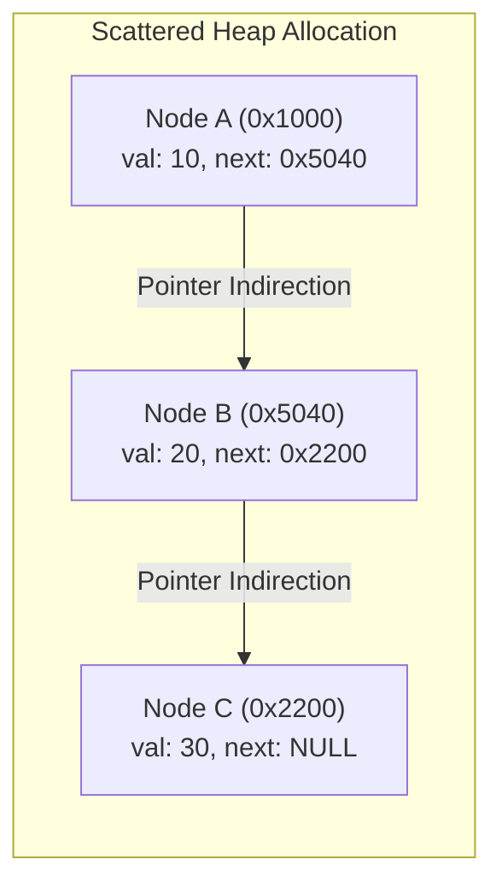

# Singly and Doubly Linked Lists in C

> Master linear pointer-based dynamic data structures in C: node allocation, singly linked lists, doubly linked lists, circular buffers, sentinel nodes, and intrusive kernel-style lists.

| Metadata | Details |
| :--- | :--- |
| **Level** | Intermediate |
| **Prerequisites** | [02-core-concepts/03-pointers.md](../../02-core-concepts/03-pointers.md), [02-core-concepts/06-structs-unions-enums.md](../../02-core-concepts/06-structs-unions-enums.md), [02-core-concepts/08-memory-management.md](../../02-core-concepts/08-memory-management.md) |
| **Time to Read** | 35 minutes |
| **Status** | Complete |
| **Standard Baseline** | ISO C11 / C17 / C23 |

---

## Table of Contents
1. [What & Why](#1-what--why)
2. [Core Concepts](#2-core-concepts)
3. [How It Works Internally](#3-how-it-works-internally)
4. [Syntax & Usage](#4-syntax--usage)
5. [Practical Examples](#5-practical-examples)
6. [Best Practices](#6-best-practices)
7. [Common Mistakes & Pitfalls](#7-common-mistakes--pitfalls)
8. [Performance & Security Notes](#8-performance--security-notes)
9. [Comparison: List Variants vs Arrays](#9-comparison-list-variants-vs-arrays)
10. [Interview Questions](#10-interview-questions)
11. [Practice Exercises](#11-practice-exercises)
12. [Summary & Cheat Sheet](#12-summary--cheat-sheet)
13. [Further Reading](#13-further-reading)

---

## 1. What & Why
A **linked list** is a linear data structure composed of discrete heap-allocated memory records called **nodes**, where each node contains both application payload data and one or more pointer references to adjacent nodes.

Unlike arrays:
- **Non-contiguous**: Elements do not require a single monolithic block of contiguous memory.
- **Dynamic Growth**: Insertion and deletion at arbitrary points require only pointer reassignment ($O(1)$ when pointing to the target), without shifting trailing elements ($O(N)$ in arrays).
- **No Resizing Spikes**: Avoids the latency spikes of dynamic array reallocation and copying (`realloc`).

However, linked lists introduce significant cache overhead because sequential access traverses scattered heap pointers ("pointer chasing"), defeating hardware CPU cache prefetchers.

---

## 2. Core Concepts

### 2.1 Singly Linked List (SLL)
Each node contains a data payload and a single `next` pointer pointing to the successive node. The list terminates with a `NULL` pointer.
- Memory per node on 64-bit systems: `sizeof(T) + 8` bytes (plus structure padding).
- Traversable in forward direction only.

### 2.2 Doubly Linked List (DLL)
Each node contains a data payload, a `next` pointer, and a `prev` pointer.
- Bidirectional traversal (forward and backward).
- Arbitrary node removal requires only the pointer to that node itself ($O(1)$ without needing to know its predecessor).
- Extra memory overhead: 16 bytes of pointer metadata per node on 64-bit systems.

### 2.3 Circular Linked Lists
The `next` pointer of the final node points back to the `head` (or a dedicated sentinel node) instead of `NULL`. Used extensively in round-robin task schedulers and audio playback buffers.

### 2.4 Sentinel (Dummy) Nodes
A dummy head/tail node that carries no payload but permanently exists at the boundaries of the list. Sentinels eliminate edge-case checks for empty lists or inserting/deleting at the true head.

### 2.5 Intrusive Linked Lists
Instead of wrapping user data inside a container node (`struct Node { void *data; struct Node *next; };`), the link pointers (`struct list_head { struct list_head *next, *prev; };`) are embedded directly *inside* the user's data structure. The Linux kernel uses intrusive lists extensively via the `container_of` macro.

---

## 3. How It Works Internally

### Memory Layout Comparison: Array vs Linked List

```
Array (Contiguous, Cache Friendly):
[ Node 0 | Node 1 | Node 2 | Node 3 ]  <-- One contiguous block in L1/L2 Cache

Linked List (Scattered Heap Nodes, Cache Unfriendly):
0x1000: [ Data: 10 | Next: 0x4080 ] -----> 0x4080: [ Data: 20 | Next: 0x2020 ]
                                                                 |
0x8050: [ Data: 30 | Next: NULL   ] <----------------------------+
```

### Pointer Chasing & Hardware Cache Misses
Modern CPUs read memory in 64-byte chunks called **cache lines**. In an array of integers, fetching `arr[0]` loads the next 15 integers directly into the L1 cache. In a linked list, each node is allocated independently by `malloc()`, dispersing nodes across virtual address space. Iterating through a linked list incurs a high probability of L1/L2/L3 cache misses on every single dereference.



---

## 4. Syntax & Usage

### Node Definitions
```c
// Singly linked node
typedef struct SNode {
    int data;
    struct SNode *next;
} SNode;

// Doubly linked node
typedef struct DNode {
    int data;
    struct DNode *prev;
    struct DNode *next;
} DNode;
```

### The Pointer-to-Pointer Deletion Idiom
The canonical C idiom for deleting a node by value without handling the head as a special case:
```c
void delete_val(SNode **head_ref, int target) {
    SNode **curr = head_ref;
    while (*curr) {
        if ((*curr)->data == target) {
            SNode *victim = *curr;
            *curr = (*curr)->next; // Updates head or predecessor's next directly
            free(victim);
            return;
        }
        curr = &(*curr)->next;
    }
}
```

---

## 5. Practical Examples

### Example 1: Singly Linked List Push, Cycle Detection, and In-Place Reversal
Goal: Build a singly linked list, verify absence of cycles using Floyd's Tortoise and Hare algorithm, and reverse the list pointers in-place ($O(1)$ space).

```c
#include <stdio.h>
#include <stdlib.h>
#include <stdbool.h>

typedef struct Node {
    int data;
    struct Node *next;
} Node;

static Node *list_push_front(Node *head, int val) {
    Node *n = (Node *)malloc(sizeof(Node));
    if (!n) return head;
    n->data = val;
    n->next = head;
    return n;
}

static Node *list_reverse(Node *head) {
    Node *prev = NULL;
    Node *curr = head;
    while (curr) {
        Node *next = curr->next;
        curr->next = prev;
        prev = curr;
        curr = next;
    }
    return prev;
}

static bool list_has_cycle(Node *head) {
    if (!head || !head->next) return false;
    Node *slow = head;
    Node *fast = head->next;
    while (fast && fast->next) {
        if (slow == fast) return true;
        slow = slow->next;
        fast = fast->next->next;
    }
    return false;
}

static void list_print(const Node *head) {
    const Node *curr = head;
    while (curr) {
        printf("%d -> ", curr->data);
        curr = curr->next;
    }
    printf("NULL\n");
}

static void list_free(Node *head) {
    while (head) {
        Node *tmp = head;
        head = head->next;
        free(tmp);
    }
}

int main(void) {
    printf("=== Singly Linked List Operations ===\n");
    Node *list = NULL;
    list = list_push_front(list, 10);
    list = list_push_front(list, 20);
    list = list_push_front(list, 30);
    list = list_push_front(list, 40);

    printf("Initial list: ");
    list_print(list);

    bool cycled = list_has_cycle(list);
    printf("Cycle detected: %s\n", cycled ? "true" : "false");

    list = list_reverse(list);
    printf("Reversed list: ");
    list_print(list);

    list_free(list);
    return 0;
}
```

**Verified Output:**
```text
=== Singly Linked List Operations ===
Initial list: 40 -> 30 -> 20 -> 10 -> NULL
Cycle detected: false
Reversed list: 10 -> 20 -> 30 -> 40 -> NULL
```

---

## 6. Best Practices
1. **Always Check Allocation Returns**: Heap nodes can fail to allocate under out-of-memory (OOM) conditions. Check `if (!node) return ERR_NO_MEM;`.
2. **Free in a Loop with Temporary Pointer**: Storing `next` before freeing `curr` is mandatory to avoid use-after-free bugs.
3. **Use Double Pointers (`Node **`) for Mutations**: Pass the address of the head pointer (`&head`) to functions that insert or remove the head node.
4. **Prefer Doubly Linked Lists for $O(1)$ Removal**: If you hold a pointer to a node, a DLL can remove it in $O(1)$ time without searching for the parent.
5. **Consider Sentinels for Complex Logic**: Sentinel head and tail nodes eliminate null checks in doubly linked lists.
6. **Zero Freed Memory in Debug Builds**: Setting pointers to `NULL` immediately after `free()` helps detect dangling pointer dereferences early.

---

## 7. Common Mistakes & Pitfalls

| Mistake | Why It Is Dangerous | Correct Approach |
| :--- | :--- | :--- |
| `free(curr); curr = curr->next;` | **Use-After-Free**: Reading `curr->next` after `curr` has been released into heap freelist. | Save temporary: `Node *next = curr->next; free(curr); curr = next;` |
| Losing head pointer on insertion | Leaks the entire rest of the list if head is overwritten without linking `new_node->next = head`. | Assign `new_node->next = head; head = new_node;` |
| Infinite loop in circular list traversal | Standard `while (curr != NULL)` condition never triggers in a circular list. | Use do-while loop terminating when `curr == head`. |
| Unchecked `malloc()` in `insert()` | Causes immediate segmentation fault on null pointer dereference if heap is exhausted. | Validate `if (!n) return FAILURE;` before initialization. |
| Forgetting to update `prev` in DLL | Breaks reverse traversal and leaves corrupted references during deletion. | Update all 4 pointer links: `prev->next`, `node->next`, `next->prev`, `node->prev`. |
| Memory leak when dropping list head | Setting `head = NULL;` orphans all heap nodes without calling `free()`. | Traverse and `free()` every node sequentially before clearing `head`. |

---

## 8. Performance & Security Notes

### Algorithmic Complexity

| Operation | Singly Linked List | Doubly Linked List | Dynamic Array (Vector) |
| :--- | :--- | :--- | :--- |
| **Insert at Front** | $O(1)$ | $O(1)$ | $O(N)$ (requires shift) |
| **Insert at End (with tail pointer)** | $O(1)$ | $O(1)$ | $O(1)$ amortized |
| **Insert at Arbitrary Node (given node pointer)** | $O(1)$ (after node) | $O(1)$ (before or after) | $O(N)$ |
| **Delete Given Node Pointer** | $O(N)$ (must find predecessor) | $O(1)$ | $O(N)$ |
| **Index Lookup (`list[k]`)** | $O(N)$ | $O(N)$ | $O(1)$ |
| **Memory Overhead** | 8 bytes / node (64-bit) | 16 bytes / node (64-bit) | Minimal (capacity buffer) |

### Cache Locality Penalty
Because each node is allocated independently on the heap, adjacent nodes in the list are rarely adjacent in physical RAM. Traversing a million-element linked list can be 10x to 50x slower than traversing a million-element contiguous array due to CPU cache stalls.

### Security Vulnerabilities
- **Double-Free**: Calling `free()` twice on the same node corrupts glibc/jemalloc metadata, potentially enabling arbitrary write exploits.
- **Uninitialized Pointers**: Omitting `node->next = NULL` on leaf nodes results in wild pointer jumps into invalid memory.

---

## 9. Comparison: List Variants vs Arrays

```
When to use Linked Lists:
- High frequency insertions and deletions in the middle of the collection.
- Number of elements is completely unknown and memory reallocation spikes cannot be tolerated.
- Implementing queues or stacks with absolute $O(1)$ latency guarantees.

When to use Arrays / Dynamic Arrays:
- Frequent random index lookups ($O(1)$).
- High throughput sequential iteration (CPU cache prefetching critical).
- Memory-constrained environments where pointer overhead (8-16 bytes per node) is unacceptable.
```

---

## 10. Interview Questions

<details>
<summary><strong>1. How does Floyd's Cycle Detection Algorithm (Tortoise and Hare) work, and what is its time/space complexity?</strong></summary>

Floyd's algorithm uses two pointers moving at different speeds: a `slow` pointer advancing 1 step per iteration, and a `fast` pointer advancing 2 steps per iteration.
- If no cycle exists, `fast` reaches `NULL` in $O(N)$ time.
- If a cycle exists with loop length $C$, the distance between `fast` and `slow` decreases by 1 step in each cycle iteration. They will meet within at most $N$ steps.
- Space complexity is strictly $O(1)$ because only two pointer variables are maintained.
</details>

<details>
<summary><strong>2. How do you find the middle node of a singly linked list in a single pass?</strong></summary>

Initialize two pointers: `slow = head` and `fast = head`. Advance `slow` by one node (`slow = slow->next`) and `fast` by two nodes (`fast = fast->next->next`) on each iteration. When `fast` reaches the end (`fast == NULL` or `fast->next == NULL`), `slow` will point directly to the exact middle node.
</details>

<details>
<summary><strong>3. Explain the "Pointer-to-Pointer" idiom for linked list deletion and why Linus Torvalds praised it.</strong></summary>

In typical code, removing a head node requires a special conditional check (`if (curr == head) head = curr->next; else prev->next = curr->next;`). By using a double pointer (`Node **curr = &head;`), `curr` holds the address of the pointer pointing to the current node. Reassigning `*curr = (*curr)->next;` updates `head` directly if at the front, or updates `prev->next` directly if in the middle, eliminating conditional branching completely.
</details>

<details>
<summary><strong>4. What is an Intrusive Linked List, and why does the Linux kernel use it?</strong></summary>

In traditional lists, the list node wraps the user data (`struct Node { void *data; struct Node *next; };`), requiring an extra pointer dereference and separate allocation. In intrusive lists, the link struct (`struct list_head { struct list_head *next, *prev; };`) is embedded inside the user data struct. Using the `container_of` macro (which uses `offsetof`), the user struct can be recovered from the `list_head` pointer with zero extra memory allocations and zero void pointer chasing.
</details>

<details>
<summary><strong>5. Why does an array almost always outperform a linked list for simple sequential iteration?</strong></summary>

Spatial locality and CPU cache line prefetching. Modern CPUs fetch 64-byte blocks of memory into L1/L2 caches when an address is accessed. An array of contiguous elements ensures subsequent elements are already residing in L1 cache. Linked list nodes reside at scattered heap addresses; traversing each node incurs a DRAM latency penalty (50-100 ns) if a cache miss occurs.
</details>

<details>
<summary><strong>6. How do you find the starting node of a loop in a linked list?</strong></summary>

1. Detect cycle using Floyd's algorithm where `slow` and `fast` collide.
2. Reset `slow` back to `head`, leaving `fast` at the meeting point.
3. Advance both `slow` and `fast` at the exact same speed (1 step at a time).
4. The node where they collide again is the exact entry point of the cycle.
</details>

<details>
<summary><strong>7. How do you reverse a doubly linked list in-place?</strong></summary>

Iterate through the list and swap the `prev` and `next` pointers for every node:
```c
DNode *curr = head;
DNode *new_head = NULL;
while (curr) {
    DNode *tmp = curr->prev;
    curr->prev = curr->next;
    curr->next = tmp;
    new_head = curr;
    curr = curr->prev; // Note: curr->prev is the original next pointer!
}
return new_head;
```
</details>

<details>
<summary><strong>8. What is a sentinel (dummy) node and how does it prevent boundary bugs?</strong></summary>

A sentinel node is an allocated node with dummy data placed permanently at `head` or `tail`. Because `head` never changes and is never `NULL`, functions never have to check `if (!head)` or update caller's head references. It simplifies insertion and deletion code to uniform pointer assignments.
</details>

---

## 11. Practice Exercises

### Easy 1: Calculate List Length
Write a function `size_t list_length(const Node *head);` that returns the number of nodes in a singly linked list.

<details>
<summary>Solution</summary>

```c
size_t list_length(const Node *head) {
    size_t count = 0;
    while (head) {
        count++;
        head = head->next;
    }
    return count;
}
```
</details>

### Easy 2: Find Value in List
Write a function `bool list_contains(const Node *head, int target);` that returns `true` if `target` is present.

<details>
<summary>Solution</summary>

```c
bool list_contains(const Node *head, int target) {
    while (head) {
        if (head->data == target) return true;
        head = head->next;
    }
    return false;
}
```
</details>

### Easy 3: Push to Tail
Implement `Node *list_push_back(Node *head, int val);` to append a node at the tail of a singly linked list.

<details>
<summary>Solution</summary>

```c
Node *list_push_back(Node *head, int val) {
    Node *n = (Node *)malloc(sizeof(Node));
    if (!n) return head;
    n->data = val;
    n->next = NULL;
    if (!head) return n;
    Node *curr = head;
    while (curr->next) curr = curr->next;
    curr->next = n;
    return head;
}
```
</details>

### Medium 1: Remove Nth Node From End
Given a singly linked list, remove the $N$-th node from the end in a single pass.

<details>
<summary>Solution</summary>

```c
Node *remove_nth_from_end(Node *head, int n) {
    Node dummy;
    dummy.next = head;
    Node *fast = &dummy;
    Node *slow = &dummy;
    for (int i = 0; i <= n; i++) {
        if (!fast) return head;
        fast = fast->next;
    }
    while (fast) {
        fast = fast->next;
        slow = slow->next;
    }
    Node *victim = slow->next;
    slow->next = slow->next->next;
    free(victim);
    return dummy.next;
}
```
</details>

### Medium 2: Merge Two Sorted Lists
Merge two sorted singly linked lists into a single sorted list without creating new nodes.

<details>
<summary>Solution</summary>

```c
Node *merge_sorted_lists(Node *l1, Node *l2) {
    Node dummy;
    Node *tail = &dummy;
    dummy.next = NULL;

    while (l1 && l2) {
        if (l1->data <= l2->data) {
            tail->next = l1;
            l1 = l1->next;
        } else {
            tail->next = l2;
            l2 = l2->next;
        }
        tail = tail->next;
    }
    tail->next = l1 ? l1 : l2;
    return dummy.next;
}
```
</details>

### Medium 3: Check Palindrome List
Determine if a singly linked list is a palindrome in $O(N)$ time and $O(1)$ extra space.

<details>
<summary>Solution</summary>

```c
// Helper to reverse
static Node *rev(Node *h) {
    Node *prev = NULL;
    while (h) {
        Node *nxt = h->next;
        h->next = prev;
        prev = h;
        h = nxt;
    }
    return prev;
}

bool is_palindrome(Node *head) {
    if (!head || !head->next) return true;
    Node *slow = head, *fast = head;
    while (fast->next && fast->next->next) {
        slow = slow->next;
        fast = fast->next->next;
    }
    Node *second_half = rev(slow->next);
    Node *p1 = head, *p2 = second_half;
    bool match = true;
    while (p2) {
        if (p1->data != p2->data) { match = false; break; }
        p1 = p1->next;
        p2 = p2->next;
    }
    slow->next = rev(second_half); // restore list
    return match;
}
```
</details>

### Hard 1: Flatten a Multilevel Doubly Linked List
Given a doubly linked list where each node has a `child` pointer to another list, flatten the list so all nodes appear in a single-level doubly linked list.

<details>
<summary>Solution</summary>

```c
typedef struct MNode {
    int val;
    struct MNode *prev;
    struct MNode *next;
    struct MNode *child;
} MNode;

MNode *flatten(MNode *head) {
    MNode *curr = head;
    while (curr) {
        if (curr->child) {
            MNode *next = curr->next;
            MNode *child_tail = curr->child;
            while (child_tail->next) {
                child_tail = child_tail->next;
            }
            curr->next = curr->child;
            curr->child->prev = curr;
            curr->child = NULL;
            if (next) {
                child_tail->next = next;
                next->prev = child_tail;
            }
        }
        curr = curr->next;
    }
    return head;
}
```
</details>

### Hard 2: Copy List with Random Pointer
A linked list node has a `next` pointer and a `random` pointer. Construct a deep copy of the list in $O(N)$ time and $O(1)$ auxiliary space.

<details>
<summary>Solution</summary>

```c
typedef struct RNode {
    int val;
    struct RNode *next;
    struct RNode *random;
} RNode;

RNode *copy_random_list(RNode *head) {
    if (!head) return NULL;
    // Step 1: Interleave cloned nodes
    RNode *curr = head;
    while (curr) {
        RNode *copy = (RNode *)malloc(sizeof(RNode));
        copy->val = curr->val;
        copy->next = curr->next;
        copy->random = NULL;
        curr->next = copy;
        curr = copy->next;
    }
    // Step 2: Assign random pointers
    curr = head;
    while (curr) {
        if (curr->random) {
            curr->next->random = curr->random->next;
        }
        curr = curr->next->next;
    }
    // Step 3: Separate lists
    curr = head;
    RNode *clone_head = head->next;
    while (curr) {
        RNode *copy = curr->next;
        curr->next = copy->next;
        if (copy->next) {
            copy->next = copy->next->next;
        }
        curr = curr->next;
    }
    return clone_head;
}
```
</details>

### Hard 3: LRU Cache Eviction Node List
Implement an $O(1)$ node promotion and eviction mechanism for an LRU cache using a doubly linked list with dummy head and tail sentinels.

<details>
<summary>Solution</summary>

```c
typedef struct LRUNode {
    int key;
    int val;
    struct LRUNode *prev;
    struct LRUNode *next;
} LRUNode;

typedef struct {
    LRUNode head;
    LRUNode tail;
    size_t size;
} LRUList;

void lru_init(LRUList *l) {
    l->head.next = &l->tail;
    l->head.prev = NULL;
    l->tail.prev = &l->head;
    l->tail.next = NULL;
    l->size = 0;
}

void lru_remove(LRUNode *node) {
    node->prev->next = node->next;
    node->next->prev = node->prev;
}

void lru_push_front(LRUList *l, LRUNode *node) {
    node->next = l->head.next;
    node->prev = &l->head;
    l->head.next->prev = node;
    l->head.next = node;
}

LRUNode *lru_pop_tail(LRUList *l) {
    if (l->head.next == &l->tail) return NULL;
    LRUNode *victim = l->tail.prev;
    lru_remove(victim);
    return victim;
}
```
</details>

---

## 12. Summary & Cheat Sheet

### Common Operations Quick Reference
| Operation | Implementation Idiom |
| :--- | :--- |
| **Push Front** | `new_n->next = head; head = new_n;` |
| **Push Back** | `while (curr->next) curr = curr->next; curr->next = new_n;` |
| **Delete Node (Value)** | `Node **c = &head; while (*c) { if ((*c)->val == v) { Node *t = *c; *c = (*c)->next; free(t); break; } c = &(*c)->next; }` |
| **Reverse** | `while (curr) { next = curr->next; curr->next = prev; prev = curr; curr = next; } return prev;` |
| **Safe Free** | `while (head) { Node *tmp = head; head = head->next; free(tmp); }` |

---

## 13. Further Reading
- *Algorithms in C, Parts 1-4: Fundamentals, Data Structures, Sorting, Searching* by Robert Sedgewick.
- Linux Kernel Linked List Implementation: `include/linux/list.h`.
- *The Practice of Programming* by Brian W. Kernighan and Rob Pike (Chapter 2: Algorithms and Data Structures).

---

[← Previous Note: Module Overview](./README.md) | [Data Structures Index](./README.md) | [Next Note: Stacks & Queues](./02-stacks-queues.md)
