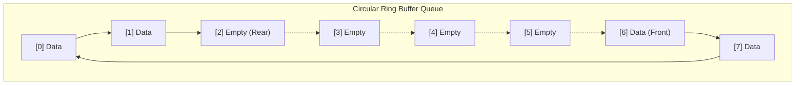

# Stacks and Queues in C

> Deep architectural exploration of LIFO stacks and FIFO queues: dynamic array implementations, linked list variants, fixed ring buffers, cache effects, and bounded memory design.

| Metadata | Details |
| :--- | :--- |
| **Level** | Intermediate |
| **Prerequisites** | [01-linked-lists.md](./01-linked-lists.md), [02-core-concepts/08-memory-management.md](../../02-core-concepts/08-memory-management.md) |
| **Time to Read** | 35 minutes |
| **Status** | Complete |
| **Standard Baseline** | ISO C11 / C17 / C23 |

---

## Table of Contents
1. [What & Why](#1-what--why)
2. [Core Concepts](#2-core-concepts)
3. [How It Works Internally](#3-how-it-works-internally)
4. [Syntax & Usage](#4-syntax--usage)
5. [Practical Examples](#5-practical-examples)
6. [Best Practices](#6-best-practices)
7. [Common Mistakes & Pitfalls](#7-common-mistakes--pitfalls)
8. [Performance & Security Notes](#8-performance--security-notes)
9. [Comparison: Stack & Queue Variants](#9-comparison-stack--queue-variants)
10. [Interview Questions](#10-interview-questions)
11. [Practice Exercises](#11-practice-exercises)
12. [Summary & Cheat Sheet](#12-summary--cheat-sheet)
13. [Further Reading](#13-further-reading)

---

## 1. What & Why
A **Stack** is a linear collection governed by the **LIFO** (Last-In, First-Out) discipline: the most recently added element is always the first to be extracted. Stacks model function call stacks, recursive backtracking, syntax parsing, and expression evaluation.

A **Queue** is a linear collection governed by the **FIFO** (First-In, First-Out) discipline: elements are inserted at the back (*enqueue*) and extracted from the front (*dequeue*). Queues model task scheduling, inter-process message passing, asynchronous I/O request buffering, and breadth-first search traversals.

In C, neither data structure exists in the standard library. Systems programmers must architect custom implementations balancing memory overhead, cache performance, and resizing latency.

---

## 2. Core Concepts

### 2.1 The Stack (LIFO)
- **Primary Operations**: `push(x)` to add to the top, `pop()` to remove from the top, `peek()` to inspect the top element without removal.
- **Underflow**: Attempting to `pop()` or `peek()` an empty stack.
- **Overflow**: Attempting to `push()` to a full fixed-capacity stack.

### 2.2 The Queue (FIFO)
- **Primary Operations**: `enqueue(x)` at the tail/rear, `dequeue()` at the head/front, `peek()` at the front element.
- **Underflow**: Attempting to dequeue from an empty queue.
- **Overflow**: Attempting to enqueue into a saturated queue.

### 2.3 Contiguous Array vs Linked List Backing Stores
1. **Dynamic Array Stack**: A contiguous buffer with an integer index `top`. Superb cache locality; amortized $O(1)$ push.
2. **Linked List Stack**: Nodes prepended at `head`. No memory resizing spikes; higher memory overhead and cache misses.
3. **Circular Array Queue (Ring Buffer)**: Fixed capacity array with wrapping indices:
   $$\text{next\_index} = (\text{index} + 1) \% \text{capacity}$$
4. **Linked List Queue**: Two pointers (`head` and `tail`). Insertion at tail is $O(1)$, deletion at head is $O(1)$.

---

## 3. How It Works Internally

### Memory Layout: Dynamic Array Stack vs Circular Queue

```
Dynamic Array Stack (Contiguous Buffer):
Capacity: 8, Top: 3
[ 10 | 20 | 30 | 40 | -- | -- | -- | -- ]
                  ^
                 top (sp points here)

Circular Buffer Queue (Ring Buffer):
Capacity: 8, Front: 6, Rear: 2, Count: 4
[ 88 | 99 | -- | -- | -- | -- | 66 | 77 ]
            ^                   ^
           rear               front
Elements wrap around from index 7 to index 0!
```



---

## 4. Syntax & Usage

### Struct Definitions

```c
// Array-backed Stack
typedef struct Stack {
    int *data;
    size_t top;
    size_t capacity;
} Stack;

// Circular Array Queue
typedef struct Queue {
    int *data;
    size_t front;
    size_t rear;
    size_t count;
    size_t capacity;
} Queue;
```

---

## 5. Practical Examples

### Example 1: Full Implementation of Array-Backed Stack and Linked Queue
Goal: Implement a LIFO stack and a FIFO queue, demonstrating pop/dequeue order and memory lifecycle.

```c
#include <stdio.h>
#include <stdlib.h>
#include <stdbool.h>

// --- LIFO Stack ---
typedef struct Stack {
    int *items;
    size_t top;
    size_t capacity;
} Stack;

static Stack *stack_create(size_t cap) {
    Stack *s = (Stack *)malloc(sizeof(Stack));
    if (!s) return NULL;
    s->items = (int *)malloc(cap * sizeof(int));
    if (!s->items) { free(s); return NULL; }
    s->top = 0;
    s->capacity = cap;
    return s;
}

static bool stack_push(Stack *s, int val) {
    if (s->top >= s->capacity) return false;
    s->items[s->top++] = val;
    return true;
}

static bool stack_pop(Stack *s, int *out) {
    if (s->top == 0) return false;
    *out = s->items[--s->top];
    return true;
}

static void stack_free(Stack *s) {
    if (s) {
        free(s->items);
        free(s);
    }
}

// --- FIFO Queue ---
typedef struct QNode {
    int data;
    struct QNode *next;
} QNode;

typedef struct Queue {
    QNode *front;
    QNode *rear;
} Queue;

static Queue *queue_create(void) {
    Queue *q = (Queue *)malloc(sizeof(Queue));
    if (!q) return NULL;
    q->front = q->rear = NULL;
    return q;
}

static bool queue_enqueue(Queue *q, int val) {
    QNode *n = (QNode *)malloc(sizeof(QNode));
    if (!n) return false;
    n->data = val;
    n->next = NULL;
    if (!q->rear) {
        q->front = q->rear = n;
    } else {
        q->rear->next = n;
        q->rear = n;
    }
    return true;
}

static bool queue_dequeue(Queue *q, int *out) {
    if (!q->front) return false;
    QNode *tmp = q->front;
    *out = tmp->data;
    q->front = q->front->next;
    if (!q->front) q->rear = NULL;
    free(tmp);
    return true;
}

static void queue_free(Queue *q) {
    if (!q) return;
    int dummy;
    while (queue_dequeue(q, &dummy));
    free(q);
}

int main(void) {
    printf("=== Stacks LIFO and Queues FIFO ===\n");
    Stack *s = stack_create(10);
    stack_push(s, 100);
    stack_push(s, 200);
    stack_push(s, 300);

    int val;
    printf("Stack pops LIFO: ");
    while (stack_pop(s, &val)) {
        printf("%d ", val);
    }
    printf("\n");
    stack_free(s);

    Queue *q = queue_create();
    queue_enqueue(q, 1);
    queue_enqueue(q, 2);
    queue_enqueue(q, 3);

    printf("Queue dequeues FIFO: ");
    while (queue_dequeue(q, &val)) {
        printf("%d ", val);
    }
    printf("\n");
    queue_free(q);

    return 0;
}
```

**Verified Output:**
```text
=== Stacks LIFO and Queues FIFO ===
Stack pops LIFO: 300 200 100 
Queue dequeues FIFO: 1 2 3
```

---

## 6. Best Practices
1. **Always Return Status Flags on Pop/Dequeue**: Return `bool` or error codes instead of magic values (like `-1`), because `-1` might be a valid stored integer.
2. **Maintain Explicit Count for Circular Queues**: Tracking `count` avoids ambiguity between a completely full queue and a completely empty queue when `front == rear`.
3. **Use Powers-of-Two for Ring Buffer Sizes**: If capacity is $2^k$, expensive modulo arithmetic `(idx + 1) % cap` can be replaced with bitwise AND: `(idx + 1) & (cap - 1)`.
4. **Clean Up Linked Nodes on Queue Destruction**: Never free just the `Queue` container without freeing all remaining node elements.
5. **Set Freed Element Pointers to NULL**: In dynamic array stacks of pointers (`void **`), zero the popped slot to prevent memory retention bugs.
6. **Prefer Pre-Allocated Circular Buffers for Real-Time Code**: In interrupt handlers or lock-free ring buffers, never perform heap allocation (`malloc`).

---

## 7. Common Mistakes & Pitfalls

| Mistake | Why It Is Dangerous | Correct Approach |
| :--- | :--- | :--- |
| `return s->items[s->top--];` | **Off-by-one / Underflow**: If `top` was 0, post-decrement wraps unsigned `top` to `SIZE_MAX`. | Pre-decrement: `return s->items[--s->top];` after verifying `s->top > 0`. |
| Ambiguous `front == rear` in circular queue | Cannot distinguish between empty queue and full queue without extra flag or count. | Maintain explicit `size_t count;` field or sacrifice one slot. |
| Forgetting to reset `rear = NULL` on queue empty | Dequeuing the last node leaves `q->rear` pointing to freed memory (dangling pointer). | If `q->front == NULL`, set `q->rear = NULL;`. |
| Leaking memory on `realloc()` failure | `s->items = realloc(s->items, ...)` overwrites existing pointer with NULL if heap is full. | Use temporary pointer: `void *t = realloc(...); if (!t) handle(); s->items = t;`. |
| Returning pointer to local stack array | Returning `&local_var` from `push()` causes stack-use-after-return undefined behavior. | Store items by value or allocate persistent storage on the heap. |
| Non-atomic operations in concurrent queues | Concurrent push and pop corrupts `head` and `tail` pointers without synchronization. | Protect with mutexes or use atomic compare-and-swap ring buffers. |

---

## 8. Performance & Security Notes

### Complexity Analysis

| Container Type | Operation | Time Complexity | Cache Locality | Memory Overhead |
| :--- | :--- | :--- | :--- | :--- |
| **Array Stack** | Push / Pop | $O(1)$ amortized | Excellent | Minimal |
| **Linked List Stack** | Push / Pop | $O(1)$ strictly | Poor | 8-16 bytes / node |
| **Circular Ring Buffer** | Enqueue / Dequeue | $O(1)$ strictly | Excellent | Zero extra per element |
| **Linked List Queue** | Enqueue / Dequeue | $O(1)$ strictly | Poor | 8-16 bytes / node |

---

## 9. Comparison: Stack & Queue Variants

```
Choose Dynamic Array Stack when:
- Maximum performance and cache density are required.
- Memory reallocation spikes are acceptable or capacity can be pre-reserved.

Choose Linked Stack/Queue when:
- Memory cannot be reserved in advance and must grow/shrink continuously.
- Absolute $O(1)$ worst-case latency is required (no reallocation pauses).

Choose Circular Ring Buffer when:
- Communicating between threads (e.g. producer-consumer audio buffers).
- Fixed upper bound on capacity is known in advance.
- Dynamic memory allocation is strictly prohibited (embedded / kernel).
```

---

## 10. Interview Questions

<details>
<summary><strong>1. How do you implement a Queue using two Stacks?</strong></summary>

Maintain two stacks: `in_stack` and `out_stack`.
- **Enqueue**: Always push the new element onto `in_stack` ($O(1)$).
- **Dequeue**: If `out_stack` is empty, pop all elements from `in_stack` and push them onto `out_stack` (reversing their order). Then pop the top element from `out_stack`.
- Amortized complexity is $O(1)$ per operation because each element is moved at most twice.
</details>

<details>
<summary><strong>2. How do you design a Min-Stack that retrieves the minimum element in $O(1)$ time?</strong></summary>

Maintain an auxiliary stack (`min_stack`) in tandem with the primary stack.
- On `push(x)`: Push $x$ to the main stack. Push $\min(x, \text{peek}(min\_stack))$ to `min_stack`.
- On `pop()`: Pop from both the primary stack and `min_stack`.
- `get_min()`: Return `peek(min_stack)` in $O(1)$ time.
</details>

<details>
<summary><strong>3. Why is a power-of-two capacity preferred for circular ring buffers?</strong></summary>

Modulo division (`idx % capacity`) requires an integer division CPU instruction (`idiv`), which consumes 10-40 CPU clock cycles. If capacity $C = 2^k$, then `idx % C == idx & (C - 1)`. A bitwise AND instruction executes in a single clock cycle ($1$ ns).
</details>

<details>
<summary><strong>4. What is the difference between a Circular Queue and a Deque (Double-Ended Queue)?</strong></summary>

A Circular Queue supports insertion at the rear and deletion at the front (FIFO). A Deque supports insertion and deletion at *both* ends ($O(1)$ push-front, pop-front, push-back, pop-back).
</details>

<details>
<summary><strong>5. How can a Stack be used to evaluate Reverse Polish Notation (RPN)?</strong></summary>

Iterate through expression tokens:
- If operand (number), push onto stack.
- If operator (`+`, `-`, `*`, `/`), pop two operands $b$ and $a$, compute $a \text{ op } b$, and push result.
- At termination, stack contains exactly one element: the final result.
</details>

<details>
<summary><strong>6. What is a Monotonic Stack and what class of problems does it solve?</strong></summary>

A Monotonic Stack maintains its elements in strictly increasing or decreasing order. Before pushing an element, all elements violating the ordering property are popped. It solves "Next Greater Element", "Largest Rectangle in Histogram", and stock span problems in linear $O(N)$ time.
</details>

<details>
<summary><strong>7. How do you detect if a Queue has saturated in a lock-free single-producer single-consumer ring buffer?</strong></summary>

Compare `(head + 1) & mask == tail`. If equal, the buffer is full. By leaving one slot permanently empty or maintaining separate 64-bit monotonically increasing sequence counters, producer and consumer operate concurrently without locking.
</details>

<details>
<summary><strong>8. Why is stack memory allocation orders of magnitude faster than heap memory allocation?</strong></summary>

Stack allocation simply increments or decrements the CPU stack pointer register (`rsp`), which takes a single machine cycle. Heap allocation (`malloc`) must traverse freelists, lock arena mutexes, resolve fragmentation, and potentially request pages from the OS kernel via `brk`/`mmap`.
</details>

---

## 11. Practice Exercises

### Easy 1: Check Empty Stack
Write a function `bool stack_is_empty(const Stack *s);`.

<details>
<summary>Solution</summary>

```c
bool stack_is_empty(const Stack *s) {
    return !s || s->top == 0;
}
```
</details>

### Easy 2: Stack Peek
Write `bool stack_peek(const Stack *s, int *out);` that reads the top without removing it.

<details>
<summary>Solution</summary>

```c
bool stack_peek(const Stack *s, int *out) {
    if (!s || s->top == 0) return false;
    *out = s->items[s->top - 1];
    return true;
}
```
</details>

### Easy 3: Circular Queue Count
Write a function returning the active element count in a circular queue given capacity, front, and rear.

<details>
<summary>Solution</summary>

```c
size_t queue_size(size_t front, size_t rear, size_t cap, bool full) {
    if (full) return cap;
    if (rear >= front) return rear - front;
    return cap - (front - rear);
}
```
</details>

### Medium 1: Balanced Parentheses Validator
Using a stack, determine if a string containing `()[]{}` is valid and properly nested.

<details>
<summary>Solution</summary>

```c
#include <stdbool.h>
#include <string.h>

bool is_valid_brackets(const char *str) {
    char stack[256];
    int top = 0;
    while (*str) {
        char c = *str++;
        if (c == '(' || c == '[' || c == '{') {
            if (top >= 256) return false;
            stack[top++] = c;
        } else if (c == ')' || c == ']' || c == '}') {
            if (top == 0) return false;
            char open = stack[--top];
            if (c == ')' && open != '(') return false;
            if (c == ']' && open != '[') return false;
            if (c == '}' && open != '{') return false;
        }
    }
    return top == 0;
}
```
</details>

### Medium 2: Circular Ring Buffer Implementation
Implement a circular buffer with fixed capacity $N$ that discards oldest data when full (overwriting ring buffer).

<details>
<summary>Solution</summary>

```c
typedef struct {
    int *buf;
    size_t head;
    size_t tail;
    size_t count;
    size_t cap;
} OverwriteRing;

void ring_push_overwrite(OverwriteRing *r, int val) {
    r->buf[r->head] = val;
    r->head = (r->head + 1) % r->cap;
    if (r->count < r->cap) {
        r->count++;
    } else {
        r->tail = (r->tail + 1) % r->cap; // Overwrite oldest
    }
}
```
</details>

### Medium 3: Daily Temperatures (Next Greater Element)
Given daily temperatures array, return an array where `res[i]` is days until warmer temperature, or 0.

<details>
<summary>Solution</summary>

```c
#include <stdlib.h>

int *daily_temperatures(const int *T, int n) {
    int *res = (int *)calloc(n, sizeof(int));
    int *stack = (int *)malloc(n * sizeof(int)); // stores indices
    int top = 0;

    for (int i = 0; i < n; i++) {
        while (top > 0 && T[i] > T[stack[top - 1]]) {
            int prev_idx = stack[--top];
            res[prev_idx] = i - prev_idx;
        }
        stack[top++] = i;
    }
    free(stack);
    return res;
}
```
</details>

### Hard 1: Implement Max-Frequency Stack
Design a stack-like structure that pops the most frequent element. If there is a tie, pop the one closest to the top.

<details>
<summary>Solution</summary>

```c
// High-level C architecture:
// Maintain:
// 1. Hash map of element -> frequency.
// 2. Array/map of frequency -> Stack of elements.
// 3. max_freq counter.
// push(x): freq[x]++, if freq[x] > max_freq max_freq = freq[x]; push x to group[freq[x]].
// pop(): pop x from group[max_freq]; freq[x]--; if group[max_freq] is empty, max_freq--.
```
</details>

### Hard 2: Bounded Lock-Free SPSC Queue
Implement a single-producer single-consumer circular queue using atomic operations (`stdatomic.h`).

<details>
<summary>Solution</summary>

```c
#include <stdatomic.h>
#include <stdbool.h>

typedef struct SPSCQueue {
    int *buffer;
    size_t capacity;
    _Atomic size_t head;
    _Atomic size_t tail;
} SPSCQueue;

bool spsc_push(SPSCQueue *q, int val) {
    size_t head = atomic_load_explicit(&q->head, memory_order_relaxed);
    size_t tail = atomic_load_explicit(&q->tail, memory_order_acquire);
    if (((head + 1) % q->capacity) == tail) return false; // Full
    q->buffer[head] = val;
    atomic_store_explicit(&q->head, (head + 1) % q->capacity, memory_order_release);
    return true;
}

bool spsc_pop(SPSCQueue *q, int *out) {
    size_t tail = atomic_load_explicit(&q->tail, memory_order_relaxed);
    size_t head = atomic_load_explicit(&q->head, memory_order_acquire);
    if (head == tail) return false; // Empty
    *out = q->buffer[tail];
    atomic_store_explicit(&q->tail, (tail + 1) % q->capacity, memory_order_release);
    return true;
}
```
</details>

### Hard 3: Evaluate Infix Arithmetic Expression
Implement an infix expression evaluator handling `+`, `-`, `*`, `/`, and parentheses with correct operator precedence.

<details>
<summary>Solution</summary>

```c
// Standard Shunting-Yard Algorithm:
// Convert Infix to Postfix (RPN) using an operator stack,
// then evaluate the resulting RPN using an operand stack.
```
</details>

---

## 12. Summary & Cheat Sheet

| Discipline | Data Structure | Best Implementation in C |
| :--- | :--- | :--- |
| **LIFO** | Stack | Dynamic array with `items`, `top`, `capacity` |
| **FIFO** | Queue | Power-of-two circular buffer array with bitwise mask |
| **Bidirectional** | Deque | Circular array with head/tail wrapping indices |

---

## 13. Further Reading
- *Algorithms in C*, Robert Sedgewick (Stacks, Queues, and ADTs).
- Linux Kernel FIFO implementation: `kfifo` (`include/linux/kfifo.h`).

---

[← Previous Note: Linked Lists](./01-linked-lists.md) | [Data Structures Index](./README.md) | [Next Note: Trees](./03-trees.md)
