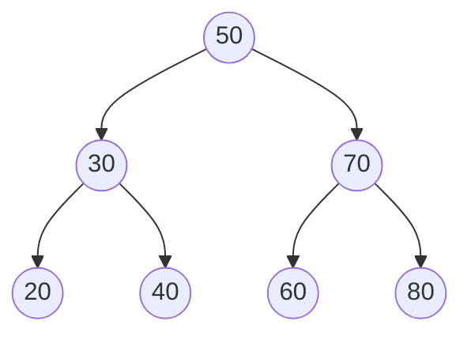

# Binary Trees and Tree Traversals in C

> Deep exploration of hierarchical node structures: binary trees, search trees, depth-first and breadth-first traversals, recursive stack frames, and node deletion mechanics.

| Metadata | Details |
| :--- | :--- |
| **Level** | Intermediate |
| **Prerequisites** | [01-linked-lists.md](./01-linked-lists.md), [02-stacks-queues.md](./02-stacks-queues.md) |
| **Time to Read** | 35 minutes |
| **Status** | Complete |
| **Standard Baseline** | ISO C11 / C17 / C23 |

---

## Table of Contents
1. [What & Why](#1-what--why)
2. [Core Concepts](#2-core-concepts)
3. [How It Works Internally](#3-how-it-works-internally)
4. [Syntax & Usage](#4-syntax--usage)
5. [Practical Examples](#5-practical-examples)
6. [Best Practices](#6-best-practices)
7. [Common Mistakes & Pitfalls](#7-common-mistakes--pitfalls)
8. [Performance & Security Notes](#8-performance--security-notes)
9. [Comparison: Tree Variants vs Linear Structures](#9-comparison-tree-variants-vs-linear-structures)
10. [Interview Questions](#10-interview-questions)
11. [Practice Exercises](#11-practice-exercises)
12. [Summary & Cheat Sheet](#12-summary--cheat-sheet)
13. [Further Reading](#13-further-reading)

---

## 1. What & Why
A **tree** is a non-linear, hierarchical data structure composed of nodes connected by directed edges. Unlike arrays and linked lists which arrange data sequentially, trees organize data in parent-child relationships.

Why trees matter in systems programming:
- **Fast Search and Updates**: A balanced binary search tree guarantees $O(\log N)$ search, insertion, and deletion.
- **Hierarchical Representation**: File systems (directories and files), Abstract Syntax Trees (ASTs) in compilers, and DOM hierarchies in browsers naturally map to trees.
- **Routing & Networking**: IP prefix lookups, routing tables, and tries.

---

## 2. Core Concepts

### 2.1 Terminology
- **Root**: Topmost node without parents.
- **Leaf**: A node with no children (`left == NULL && right == NULL`).
- **Depth of Node**: Number of edges from root to that node.
- **Height of Tree**: Maximum depth from root down to any leaf.

### 2.2 Binary Search Tree (BST) Invariant
For every node $X$ in a BST:
$$\forall Y \in \text{left\_subtree}(X), \quad \text{key}(Y) < \text{key}(X)$$
$$\forall Z \in \text{right\_subtree}(X), \quad \text{key}(Z) > \text{key}(X)$$

### 2.3 Traversal Disciplines
1. **In-Order Traversal (L-N-R)**: Left subtree $\rightarrow$ Current Node $\rightarrow$ Right subtree. In a BST, produces sorted order.
2. **Pre-Order Traversal (N-L-R)**: Current Node $\rightarrow$ Left $\rightarrow$ Right. Useful for tree serialization and cloning.
3. **Post-Order Traversal (L-R-N)**: Left $\rightarrow$ Right $\rightarrow$ Current Node. Mandatory for bottom-up operations like freeing tree memory (`free()`).
4. **Level-Order Traversal (Breadth-First)**: Explores nodes layer-by-layer using a FIFO queue.

---

## 3. How It Works Internally

### Memory Representation: Node Links and Call Stack Frames

```
Heap Memory (Scattered Tree Nodes):
[Root: 50]
  /    \
[30]    [70]
/  \    /  \
[20] [40] [60] [80]

Recursive Traversal Call Stack:
+------------------------------------+
| inorder(node: 20)                 | -> Prints 20
+------------------------------------+
| inorder(node: 30)                 | -> Waiting for left
+------------------------------------+
| inorder(node: 50) [Root Frame]    | -> Initiated traversal
+------------------------------------+
```



---

## 4. Syntax & Usage

```c
typedef struct TreeNode {
    int val;
    struct TreeNode *left;
    struct TreeNode *right;
} TreeNode;
```

---

## 5. Practical Examples

### Example 1: Binary Search Tree Insertion, In-Order Traversal, and Depth Calculation
Goal: Build a BST from unordered values, verify sorted in-order traversal, and compute tree height.

```c
#include <stdio.h>
#include <stdlib.h>

typedef struct TreeNode {
    int val;
    struct TreeNode *left;
    struct TreeNode *right;
} TreeNode;

static TreeNode *tree_create_node(int val) {
    TreeNode *n = (TreeNode *)malloc(sizeof(TreeNode));
    if (!n) return NULL;
    n->val = val;
    n->left = n->right = NULL;
    return n;
}

static TreeNode *tree_insert(TreeNode *root, int val) {
    if (!root) return tree_create_node(val);
    if (val < root->val) {
        root->left = tree_insert(root->left, val);
    } else if (val > root->val) {
        root->right = tree_insert(root->right, val);
    }
    return root;
}

static void tree_inorder(const TreeNode *root) {
    if (!root) return;
    tree_inorder(root->left);
    printf("%d ", root->val);
    tree_inorder(root->right);
}

static int tree_max_depth(const TreeNode *root) {
    if (!root) return 0;
    int l = tree_max_depth(root->left);
    int r = tree_max_depth(root->right);
    return (l > r ? l : r) + 1;
}

static void tree_free(TreeNode *root) {
    if (!root) return;
    tree_free(root->left);
    tree_free(root->right);
    free(root);
}

int main(void) {
    printf("=== Binary Search Tree Operations ===\n");
    TreeNode *root = NULL;
    int values[] = {50, 30, 70, 20, 40, 60, 80};
    for (size_t i = 0; i < 7; i++) {
        root = tree_insert(root, values[i]);
    }

    printf("Inorder traversal: ");
    tree_inorder(root);
    printf("\n");

    int depth = tree_max_depth(root);
    printf("Max tree depth: %d\n", depth);

    tree_free(root);
    return 0;
}
```

**Verified Output:**
```text
=== Binary Search Tree Operations ===
Inorder traversal: 20 30 40 50 60 70 80 
Max tree depth: 3
```

---

## 6. Best Practices
1. **Always Free in Post-Order**: Freeing a node before its children (`pre-order free`) causes use-after-free bugs.
2. **Prevent Stack Overflow on Degenerate Trees**: Deep unbalanced trees (e.g., insertion of sorted array) have depth $O(N)$. Convert recursive traversals to Morris traversal or iterative with explicit heap stack.
3. **Use Double Pointers for In-Place Mutation**: `TreeNode **curr = &root;` allows cleaner insertion and deletion without recursive return assignments.
4. **Prefer AVL or Red-Black Trees for Production**: Raw BSTs degrade to linked lists with $O(N)$ lookup if input is sorted.
5. **Handle Node Deletion with Predecessor/Successor**: When deleting a node with 2 children, replace its value with in-order successor (smallest in right subtree) and recursively delete successor.

---

## 7. Common Mistakes & Pitfalls

| Mistake | Why It Is Dangerous | Correct Approach |
| :--- | :--- | :--- |
| `free(root); tree_free(root->left);` | **Use-After-Free**: Dereferencing `root->left` after `root` is freed. | Free children first: `tree_free(root->left); tree_free(root->right); free(root);` |
| Deep recursion causing stack overflow | A skewed tree with $10^6$ nodes blows the default 1MB/8MB OS stack. | Use self-balancing trees or explicit heap-allocated stack for traversal. |
| Incomplete deletion logic for two children | Simply freeing a node with two children corrupts child subtree links. | Replace value with minimum node of right subtree, then delete that leaf/single-child node. |
| Assuming BST is balanced | Inserting sorted items `1, 2, 3, 4` creates a degenerate linked list ($O(N)$). | Use AVL rotations or Red-Black balancing trees. |
| Forgetting base case `if (!root) return;` | Immediate segmentation fault upon reaching any leaf child pointer (`NULL`). | Guard all recursive functions with null checks. |

---

## 8. Performance & Security Notes

### Algorithmic Complexity

| Structure | Search (Avg) | Search (Worst) | Insert (Avg) | Insert (Worst) | Space |
| :--- | :--- | :--- | :--- | :--- | :--- |
| **Unbalanced BST** | $O(\log N)$ | $O(N)$ (skewed) | $O(\log N)$ | $O(N)$ | $O(N)$ |
| **AVL / Red-Black Tree** | $O(\log N)$ | $O(\log N)$ | $O(\log N)$ | $O(\log N)$ | $O(N)$ |
| **Binary Heap** | $O(N)$ | $O(N)$ | $O(1)$ amortized | $O(\log N)$ | $O(N)$ |

---

## 9. Comparison: Tree Variants vs Linear Structures

```
When to use Trees:
- Hierarchical data representation.
- Dynamic sorted data where both fast lookup and fast insertion/deletion ($O(\log N)$) are needed.
- Range query support (finding all elements between $A$ and $B$).

When to use Hash Tables:
- Exact key matching ($O(1)$) where ordering does not matter.

When to use Arrays:
- Fixed or known size, or pure index-based random access.
```

---

## 10. Interview Questions

<details>
<summary><strong>1. How do you validate if a given Binary Tree is a valid Binary Search Tree?</strong></summary>

A naive check comparing each node to its direct children is insufficient. You must pass down valid intervals `[min_val, max_val]`:
- For current node $N$, verify $\text{min} < N\text{->val} < \text{max}$.
- Recursively validate left child with `[min, N->val]`.
- Recursively validate right child with `[N->val, max]`.
Alternatively, perform an in-order traversal and verify that the resulting sequence is strictly monotonically increasing.
</details>

<details>
<summary><strong>2. How do you delete a node with two children from a BST?</strong></summary>

1. Locate the node to be deleted ($Z$).
2. Find its in-order successor ($Y$, the smallest node in $Z$'s right subtree).
3. Copy $Y$'s key to $Z$.
4. Delete $Y$ from the right subtree. Because $Y$ was the minimum in the right subtree, it has at most one child (a right child), reducing the deletion to the trivial case of 0 or 1 child.
</details>

<details>
<summary><strong>3. What is Morris In-Order Traversal and how does it achieve $O(1)$ auxiliary space?</strong></summary>

Morris traversal avoids recursion and stacks by creating temporary threads:
- For current node, if left child exists, find its in-order predecessor (rightmost node in left subtree).
- If predecessor's right is `NULL`, make it point to current node (temporary thread) and move left.
- If predecessor's right already points to current, revert it back to `NULL` (remove thread), print current, and move right.
Time is $O(N)$, space is strictly $O(1)$.
</details>

<details>
<summary><strong>4. What is the difference between Depth and Height in a Tree?</strong></summary>

- **Depth**: Number of edges from the root node down to the target node. (Root depth = 0).
- **Height**: Number of edges on the longest path from the target node down to a leaf. (Leaf height = 0).
</details>

<details>
<summary><strong>5. How do you find the Lowest Common Ancestor (LCA) of two nodes in a BST?</strong></summary>

Start at root:
- If both values $p$ and $q$ are strictly smaller than `root->val`, LCA is in the left subtree.
- If both $p$ and $q$ are strictly greater than `root->val`, LCA is in the right subtree.
- If one is smaller and the other is larger (or equal to root), the current `root` is the Lowest Common Ancestor.
</details>

<details>
<summary><strong>6. Why do recursive tree algorithms risk stack overflow and how can you mitigate this in production?</strong></summary>

In a degenerate tree (e.g. sorted elements inserted), depth is $N$. $N$ recursive calls create $N$ stack frames. At 64 bytes per frame, $100,000$ nodes consume $\approx 6.4$ MB, exceeding standard stack limits and crashing with SIGSEGV. Mitigations:
1. Ensure self-balancing (AVL / Red-Black).
2. Use iterative traversals with heap-allocated stacks.
3. Use Morris threading.
</details>

<details>
<summary><strong>7. How do you serialize and deserialize a Binary Tree in C?</strong></summary>

Use pre-order traversal with a sentinel marker (like `#` or `NULL`) for missing children.
During serialization: write `val` or `#` to a stream.
During deserialization: recursively read tokens; if token is `#`, return `NULL`; otherwise create node and recurse for left and right children.
</details>

<details>
<summary><strong>8. What is the difference between an AVL Tree and a Red-Black Tree?</strong></summary>

AVL trees are strictly balanced (height difference between subtrees $\le 1$), offering faster lookups at the expense of more rotations during insertions and deletions. Red-Black trees are less strictly balanced (longest path at most $2 \times$ shortest path), requiring fewer rotations, making them faster for write-heavy workloads (used in Linux `rbtree`, C++ `std::map`).
</details>

---

## 11. Practice Exercises

### Easy 1: Count Total Tree Nodes
Write `int tree_count_nodes(const TreeNode *root);`.

<details>
<summary>Solution</summary>

```c
int tree_count_nodes(const TreeNode *root) {
    if (!root) return 0;
    return 1 + tree_count_nodes(root->left) + tree_count_nodes(root->right);
}
```
</details>

### Easy 2: Find Minimum Value in BST
Write `int bst_min(const TreeNode *root);` assuming tree is non-empty.

<details>
<summary>Solution</summary>

```c
int bst_min(const TreeNode *root) {
    while (root->left) root = root->left;
    return root->val;
}
```
</details>

### Easy 3: Invert / Mirror a Binary Tree
Invert a binary tree in-place so left and right children are swapped.

<details>
<summary>Solution</summary>

```c
TreeNode *invert_tree(TreeNode *root) {
    if (!root) return NULL;
    TreeNode *tmp = root->left;
    root->left = invert_tree(root->right);
    root->right = invert_tree(tmp);
    return root;
}
```
</details>

### Medium 1: Check Balanced Binary Tree
Determine if a binary tree is height-balanced (height difference $\le 1$ at every node).

<details>
<summary>Solution</summary>

```c
#include <stdlib.h>
#include <stdbool.h>

static int check_height(const TreeNode *root) {
    if (!root) return 0;
    int lh = check_height(root->left);
    if (lh == -1) return -1;
    int rh = check_height(root->right);
    if (rh == -1) return -1;
    if (abs(lh - rh) > 1) return -1;
    return (lh > rh ? lh : rh) + 1;
}

bool is_balanced(const TreeNode *root) {
    return check_height(root) != -1;
}
```
</details>

### Medium 2: Level-Order Traversal (BFS)
Print tree nodes level by level using a queue.

<details>
<summary>Solution</summary>

```c
void print_level_order(TreeNode *root) {
    if (!root) return;
    TreeNode *q[1024];
    int front = 0, rear = 0;
    q[rear++] = root;

    while (front < rear) {
        TreeNode *curr = q[front++];
        printf("%d ", curr->val);
        if (curr->left && rear < 1024) q[rear++] = curr->left;
        if (curr->right && rear < 1024) q[rear++] = curr->right;
    }
    printf("\n");
}
```
</details>

### Medium 3: Construct Tree from Preorder and Inorder Traversal
Given pre-order and in-order integer arrays, reconstruct the binary tree.

<details>
<summary>Solution</summary>

```c
TreeNode *build_tree_helper(int *pre, int pre_st, int pre_end,
                            int *in, int in_st, int in_end) {
    if (pre_st > pre_end || in_st > in_end) return NULL;
    int root_val = pre[pre_st];
    TreeNode *root = (TreeNode *)malloc(sizeof(TreeNode));
    root->val = root_val;
    root->left = root->right = NULL;

    int root_idx = in_st;
    while (root_idx <= in_end && in[root_idx] != root_val) root_idx++;

    int left_len = root_idx - in_st;
    root->left = build_tree_helper(pre, pre_st + 1, pre_st + left_len, in, in_st, root_idx - 1);
    root->right = build_tree_helper(pre, pre_st + left_len + 1, pre_end, in, root_idx + 1, in_end);
    return root;
}
```
</details>

### Hard 1: Binary Tree Maximum Path Sum
Find the maximum path sum between any two nodes in a binary tree.

<details>
<summary>Solution</summary>

```c
#include <limits.h>

static int max(int a, int b) { return a > b ? a : b; }

static int max_gain(TreeNode *node, int *global_max) {
    if (!node) return 0;
    int left_gain = max(max_gain(node->left, global_max), 0);
    int right_gain = max(max_gain(node->right, global_max), 0);
    int current_path = node->val + left_gain + right_gain;
    if (current_path > *global_max) *global_max = current_path;
    return node->val + max(left_gain, right_gain);
}

int max_path_sum(TreeNode *root) {
    int global_max = INT_MIN;
    max_gain(root, &global_max);
    return global_max;
}
```
</details>

### Hard 2: Iterative Post-Order Traversal with Single Stack
Perform post-order traversal iteratively using only one explicit stack.

<details>
<summary>Solution</summary>

```c
void postorder_iterative(TreeNode *root) {
    TreeNode *stack[256];
    int top = 0;
    TreeNode *curr = root;
    TreeNode *last_visited = NULL;

    while (curr || top > 0) {
        if (curr) {
            stack[top++] = curr;
            curr = curr->left;
        } else {
            TreeNode *peek = stack[top - 1];
            if (peek->right && last_visited != peek->right) {
                curr = peek->right;
            } else {
                printf("%d ", peek->val);
                last_visited = stack[--top];
            }
        }
    }
}
```
</details>

### Hard 3: Serialize and Deserialize BST
Serialize a BST to a binary buffer and reconstruct it without storing null markers.

<details>
<summary>Solution</summary>

```c
// Using Pre-Order: in a BST, pre-order alone uniquely reconstructs the tree!
TreeNode *bst_from_preorder(int *arr, int *idx, int min_val, int max_val, int size) {
    if (*idx >= size) return NULL;
    int val = arr[*idx];
    if (val < min_val || val > max_val) return NULL;

    TreeNode *root = (TreeNode *)malloc(sizeof(TreeNode));
    root->val = val;
    root->left = root->right = NULL;
    (*idx)++;

    root->left = bst_from_preorder(arr, idx, min_val, val, size);
    root->right = bst_from_preorder(arr, idx, val, max_val, size);
    return root;
}
```
</details>

---

## 12. Summary & Cheat Sheet

| Traversal | Sequence | Systems Use Case |
| :--- | :--- | :--- |
| **In-Order** | Left $\rightarrow$ Node $\rightarrow$ Right | Sorted retrieval from BST |
| **Pre-Order** | Node $\rightarrow$ Left $\rightarrow$ Right | Tree serialization, cloning |
| **Post-Order**| Left $\rightarrow$ Right $\rightarrow$ Node | Tree destruction (`free`), bottom-up calculation |
| **Level-Order**| FIFO Queue Layer-by-Layer | Shortest path, breadth-first exploration |

---

## 13. Further Reading
- *Introduction to Algorithms* (CLRS), Chapter 12: Binary Search Trees.
- Linux Kernel Red-Black Trees: `include/linux/rbtree.h`.

---

[← Previous Note: Stacks & Queues](./02-stacks-queues.md) | [Data Structures Index](./README.md) | [Next Note: Hash Tables](./04-hash-tables.md)
