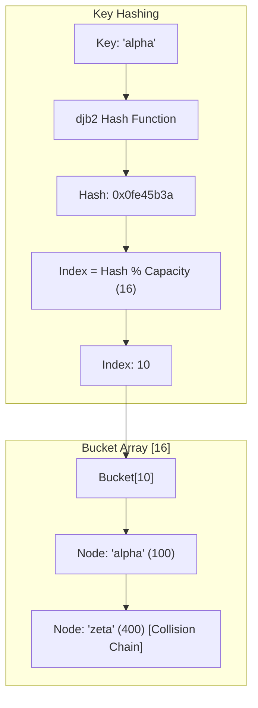

# Hash Tables and Collision Resolution in C

> Deep architectural exploration of high-performance associative arrays in C: hash functions (djb2, FNV-1a, Murmur3), collision resolution (separate chaining vs open addressing), load factor dynamics, and cache effects.

| Metadata | Details |
| :--- | :--- |
| **Level** | Intermediate |
| **Prerequisites** | [01-linked-lists.md](./01-linked-lists.md), [02-core-concepts/08-memory-management.md](../../02-core-concepts/08-memory-management.md), [03-intermediate/05-bit-manipulation.md](../05-bit-manipulation.md) |
| **Time to Read** | 40 minutes |
| **Status** | Complete |
| **Standard Baseline** | ISO C11 / C17 / C23 |

---

## Table of Contents
1. [What & Why](#1-what--why)
2. [Core Concepts](#2-core-concepts)
3. [How It Works Internally](#3-how-it-works-internally)
4. [Syntax & Usage](#4-syntax--usage)
5. [Practical Examples](#5-practical-examples)
6. [Best Practices](#6-best-practices)
7. [Common Mistakes & Pitfalls](#7-common-mistakes--pitfalls)
8. [Performance & Security Notes](#8-performance--security-notes)
9. [Comparison: Collision Resolution Strategies](#9-comparison-collision-resolution-strategies)
10. [Interview Questions](#10-interview-questions)
11. [Practice Exercises](#11-practice-exercises)
12. [Summary & Cheat Sheet](#12-summary--cheat-sheet)
13. [Further Reading](#13-further-reading)

---

## 1. What & Why
A **Hash Table** (or hash map) is an associative data structure that maps arbitrary keys (such as strings or structs) to values with average $O(1)$ time complexity for lookup, insertion, and deletion.

In C systems programming, hash tables are indispensable:
- **Symbol Tables & ASTs**: Compilers map variable identifiers to types and scope records.
- **Kernel Routing & Connections**: Network stacks map TCP socket pairs `(src_ip, src_port, dst_ip, dst_port)` to connection states.
- **File System Inodes & Caches**: High-performance key-value databases (e.g., Redis, RocksDB memtables) rely on custom hash maps.

C provides no built-in hash map. Implementing one correctly requires understanding hashing theory, memory distribution, collision strategies, and CPU cache hierarchies.

---

## 2. Core Concepts

### 2.1 The Hash Function
A mathematical mapping $h(K) \rightarrow \mathbb{N}$ that converts a variable-length key into a fixed-width unsigned integer.
Properties of an effective hash function:
- **Uniformity**: Distributes keys evenly across all bucket indices.
- **Avalanche Effect**: Flipping a single bit in the input changes roughly 50% of the output bits.
- **Determinism**: Identical keys always produce identical hash values.
- **High Throughput**: Minimal CPU cycle latency.

Popular non-cryptographic hashes:
- `djb2` (Dan Bernstein): Fast, simple, effective for short ASCII strings.
- `FNV-1a` (Fowler-Noll-Vo): Excellent dispersion with bitwise XOR and multiplication.
- `MurmurHash3` / `xxHash`: State-of-the-art vectorizable hash algorithms.

### 2.2 Collision Resolution Strategies
1. **Separate Chaining**: Each bucket contains a pointer to a linked list of entries that hashed to that bucket.
   - Resilient to high load factors ($\alpha > 1.0$).
   - Incurs cache misses due to pointer chasing across heap nodes.
2. **Open Addressing**: All elements reside directly within a single contiguous array.
   - **Linear Probing**: If bucket $i$ is occupied, try $(i + 1) \% M, (i + 2) \% M, \dots$. Superb CPU cache locality, but vulnerable to clustering.
   - **Quadratic Probing**: Step by $i + c_1 k + c_2 k^2$. Reduces primary clustering.
   - **Double Hashing**: Step by secondary hash function $i + k \cdot h_2(K)$. Eliminates clustering.
   - **Robin Hood Hashing**: Rich entries give up slots to poorer entries (reducing variance in probe lengths).

### 2.3 Load Factor and Dynamic Rehashing
The load factor is defined as:
$$\alpha = \frac{N}{M}$$
Where $N$ is the number of stored keys and $M$ is table capacity.
- For separate chaining: resize when $\alpha > 0.75 - 1.0$.
- For open addressing: performance degrades catastrophically above $\alpha = 0.70$. Resize and re-hash all active entries when threshold is reached.

---

## 3. How It Works Internally

### Memory Layout: Separate Chaining vs Linear Probing

```
Separate Chaining (Buckets + Heap Nodes):
Bucket Array (Contiguous Pointers):
[ 0 ] -> [ "foo": 10 ] -> [ "bar": 20 ] -> NULL   <-- Cache misses traversal
[ 1 ] -> NULL
[ 2 ] -> [ "baz": 30 ] -> NULL

Open Addressing with Linear Probing (Single Flat Array):
[ "foo": 10 | "bar": 20 | "baz": 30 | EMPTY | TOMBSTONE | "qux": 50 ]
<---------------- Contiguous in CPU Cache Lines ------------------->
```



---

## 4. Syntax & Usage

### Common Hash Functions in C
```c
// Dan Bernstein's djb2
unsigned long hash_djb2(const unsigned char *str) {
    unsigned long hash = 5381;
    int c;
    while ((c = *str++)) {
        hash = ((hash << 5) + hash) + (unsigned long)c; /* hash * 33 + c */
    }
    return hash;
}

// 32-bit FNV-1a
uint32_t hash_fnv1a(const char *key) {
    uint32_t hash = 2166136261u;
    while (*key) {
        hash ^= (uint8_t)(*key++);
        hash *= 16777619u;
    }
    return hash;
}
```

---

## 5. Practical Examples

### Example 1: Hash Table with Separate Chaining
Goal: Implement a string-keyed hash table with separate chaining, collision handling, lookup, and cleanup.

```c
#include <stdio.h>
#include <stdlib.h>
#include <string.h>
#include <stdbool.h>

#define TABLE_SIZE 16

typedef struct Entry {
    char *key;
    int val;
    struct Entry *next;
} Entry;

typedef struct {
    Entry *buckets[TABLE_SIZE];
} HashTable;

static unsigned long hash_str(const char *str) {
    unsigned long hash = 5381;
    int c;
    while ((c = (unsigned char)*str++)) {
        hash = ((hash << 5) + hash) + c;
    }
    return hash;
}

static HashTable *ht_create(void) {
    HashTable *ht = (HashTable *)malloc(sizeof(HashTable));
    if (!ht) return NULL;
    for (int i = 0; i < TABLE_SIZE; i++) {
        ht->buckets[i] = NULL;
    }
    return ht;
}

static bool ht_insert(HashTable *ht, const char *key, int val) {
    unsigned long idx = hash_str(key) % TABLE_SIZE;
    Entry *curr = ht->buckets[idx];
    while (curr) {
        if (strcmp(curr->key, key) == 0) {
            curr->val = val;
            return true;
        }
        curr = curr->next;
    }
    Entry *new_e = (Entry *)malloc(sizeof(Entry));
    if (!new_e) return false;
    new_e->key = strdup(key);
    new_e->val = val;
    new_e->next = ht->buckets[idx];
    ht->buckets[idx] = new_e;
    return true;
}

static bool ht_get(const HashTable *ht, const char *key, int *out) {
    unsigned long idx = hash_str(key) % TABLE_SIZE;
    Entry *curr = ht->buckets[idx];
    while (curr) {
        if (strcmp(curr->key, key) == 0) {
            *out = curr->val;
            return true;
        }
        curr = curr->next;
    }
    return false;
}

static void ht_free(HashTable *ht) {
    if (!ht) return;
    for (int i = 0; i < TABLE_SIZE; i++) {
        Entry *curr = ht->buckets[i];
        while (curr) {
            Entry *tmp = curr;
            curr = curr->next;
            free(tmp->key);
            free(tmp);
        }
    }
    free(ht);
}

int main(void) {
    printf("=== Hash Table with Separate Chaining ===\n");
    HashTable *ht = ht_create();
    ht_insert(ht, "alpha", 100);
    ht_insert(ht, "beta", 200);

    int val;
    if (ht_get(ht, "alpha", &val)) {
        printf("Key 'alpha' -> %d\n", val);
    }
    if (ht_get(ht, "beta", &val)) {
        printf("Key 'beta' -> %d\n", val);
    }
    if (ht_get(ht, "delta", &val)) {
        printf("Key 'delta' -> %d\n", val);
    } else {
        printf("Key 'delta' -> NOT FOUND\n");
    }

    ht_free(ht);
    return 0;
}
```

**Verified Output:**
```text
=== Hash Table with Separate Chaining ===
Key 'alpha' -> 100
Key 'beta' -> 200
Key 'delta' -> NOT FOUND
```

---

## 6. Best Practices
1. **Always Deep-Copy String Keys**: If the caller modifies or frees `key` after insertion, a shallow copy (`new_e->key = key;`) creates dangling pointers and silent data corruption. Always use `strdup()` or allocate and `memcpy()`.
2. **Use Tombstones in Open Addressing**: In open addressing, deleting a key cannot simply set the slot to `EMPTY`. Probing sequences stop at `EMPTY`, breaking lookups for keys inserted after the victim. Mark deleted slots with a special `TOMBSTONE` marker.
3. **Power-of-Two Capacity with Bitmasking**: When capacity $M = 2^k$, compute index using `hash & (M - 1)` instead of modulo `hash % M`.
4. **Trigger Dynamic Rehash Automatically**: When load factor exceeds threshold (e.g., $0.70$), double capacity, allocate a new bucket table, re-hash all existing active items, and swap buffers.
5. **Protect Against Collision DoS**: In web servers and parsers processing untrusted inputs, avoid naive hashes (like `djb2`) that attackers can intentionally flood to force $O(N)$ worst-case collision chains. Use keyed hashes like `SipHash`.
6. **Free Keys, Nodes, and Table Completely**: Maintain clean cleanup functions that iterate through every bucket and free both keys and container structs.

---

## 7. Common Mistakes & Pitfalls

| Mistake | Why It Is Dangerous | Correct Approach |
| :--- | :--- | :--- |
| Comparing keys with `curr->key == key` | Compares pointer memory addresses instead of string characters. | Always compare contents with `strcmp(curr->key, key) == 0`. |
| Zeroing deleted slot in linear probing | Clears the slot to `EMPTY`, prematurely truncating probe chains for collisions placed further down. | Mark slot with `TOMBSTONE` so searches continue past it while inserts can reuse it. |
| Forgetting to re-hash on resize | Re-using old bucket indices after capacity changes causes all subsequent lookups to fail. | Compute `new_hash % new_cap` for every entry during table expansion. |
| Memory leak on key update | When updating value for existing key, overwriting or re-inserting without freeing duplicate key leaks memory. | Update `curr->val = new_val;` in place when key exists. |
| Integer overflow on hash calculation | Signed integer overflow in string hashing invokes undefined behavior in C. | Use `unsigned long` or `uint32_t` for all hash variables and arithmetic. |
| Load factor unbounded growth | Allowing separate chaining to hold $10,000$ entries in 16 buckets degrades performance to $O(N)$. | Track `count` and resize when `count / capacity > 0.75`. |

---

## 8. Performance & Security Notes

### Algorithmic Complexity

| Strategy | Search (Average) | Search (Worst) | Insert (Average) | Insert (Worst) | Cache Locality |
| :--- | :--- | :--- | :--- | :--- | :--- |
| **Separate Chaining** | $O(1)$ | $O(N)$ | $O(1)$ | $O(N)$ | Poor (heap nodes) |
| **Linear Probing** | $O(1)$ | $O(N)$ | $O(1)$ | $O(N)$ | Excellent (contiguous) |
| **Robin Hood Probing** | $O(1)$ | $O(N)$ | $O(1)$ | $O(N)$ | Excellent (bounded variance) |

### Hash Collision Denial-of-Service (HashDoS)
If an adversary knows your hash function (e.g. `djb2`), they can craft $10,000$ distinct strings that all hash to the exact same bucket index `0`. When parsed by a naive hash table, insertion and lookup degrade from $O(1)$ to $O(N^2)$, saturating CPU and freezing servers. Cryptographically robust keyed hashes (such as `SipHash-2-4`) incorporate a secret random seed unknown to the attacker.

---

## 9. Comparison: Collision Resolution Strategies

```
Separate Chaining:
- Pros: Simple deletion, robust under high load (alpha > 1.0), payload size does not bloat bucket array.
- Cons: High memory overhead (pointer per node), terrible cache locality due to heap pointer chasing.

Linear Probing (Open Addressing):
- Pros: Highest possible throughput, zero pointer overhead, single contiguous array in CPU cache.
- Cons: High sensitivity to clustering, deletion requires tombstone management, catastrophic failure if alpha > 0.85.

Robin Hood Hashing:
- Pros: Minimizes maximum probe length (variance), uniform lookup speed.
- Cons: Slightly more complex insertion logic (shifting entries).
```

---

## 10. Interview Questions

<details>
<summary><strong>1. Why is Open Addressing with Linear Probing often significantly faster than Separate Chaining in modern hardware?</strong></summary>

CPU cache architecture. Linear probing stores all keys and values in a contiguous array in memory. When the CPU accesses bucket $i$, a 64-byte cache line brings adjacent buckets $i+1, i+2, \dots$ directly into L1/L2 cache. Probing incurs virtually zero DRAM latency. In separate chaining, each collision node is allocated separately on the heap; traversing each node incurs an unpredictable DRAM latency stall (~50-100 ns).
</details>

<details>
<summary><strong>2. How does Tombstone deletion work in Open Addressing?</strong></summary>

When an entry is deleted from an open-addressed table, you cannot mark the slot as `EMPTY` because searches for keys that collided and probed past this index would terminate prematurely. Instead, the slot is marked as `TOMBSTONE`. During lookup, probing continues past tombstones. During insertion, a tombstone can be reclaimed and overwritten with new data.
</details>

<details>
<summary><strong>3. What happens during dynamic resizing of a hash table?</strong></summary>

1. Allocate a new contiguous array of buckets (typically double the previous capacity, $2M$).
2. Reset size count to 0.
3. Iterate over every slot and linked node in the old table.
4. Re-calculate the bucket index in the new table using `hash(key) % (2M)`.
5. Insert nodes into the new table.
6. Free the old bucket array.
This operation runs in $O(N)$ time, but because capacity grows geometrically, the amortized cost per insertion remains $O(1)$.
</details>

<details>
<summary><strong>4. Why is Dan Bernstein's `djb2` hash multiplier 33 (`hash * 33 + c`)?</strong></summary>

Multiplication by 33 can be implemented with high speed using bit shifts: `((hash << 5) + hash)`. 33 is an odd prime multiplier that produces good dispersion and avalanche characteristics for ASCII text while avoiding common powers of two that would discard high-order entropy.
</details>

<details>
<summary><strong>5. What is primary clustering in linear probing?</strong></summary>

Primary clustering occurs when occupied slots group together in long contiguous runs. Any new key that hashes to any slot within that cluster will probe all the way to the end of the cluster, extending it further. This creates a feedback loop that degrades average lookup times from $O(1)$ to $O(N)$.
</details>

<details>
<summary><strong>6. How does Robin Hood Hashing reduce lookup variance?</strong></summary>

During insertion, as you probe forward, you track how far the current incoming key is from its ideal hash bucket ("distance to initial bucket", DIB). If the incoming key has traveled further than the key currently occupying the slot (incoming key is "poorer"), the incoming key steals the slot and the existing key is pushed forward. This bounds the maximum probe length across all keys.
</details>

<details>
<summary><strong>7. Why must hash table capacities typically be prime numbers or powers of two?</strong></summary>

- **Primes**: When using the modulo operator `hash % M`, if $M$ is prime, even poorly distributed hashes with common divisors will distribute evenly across all buckets.
- **Powers of Two ($2^k$)**: Allows replacing expensive division instructions with bitwise AND: `hash & (M - 1)`. However, it requires a high-quality hash function that distributes entropy across the lower bits.
</details>

<details>
<summary><strong>8. What is SipHash and why did Python, Ruby, and Rust adopt it for default hash maps?</strong></summary>

SipHash is a cryptographically keyed pseudo-random function designed specifically for short inputs. By seeding the hash table with a secret 128-bit key generated at program startup, attackers cannot predict which inputs will collide, completely immunizing the system against HashDoS algorithmic complexity attacks.
</details>

---

## 11. Practice Exercises

### Easy 1: Check Key Exists
Write `bool ht_contains(const HashTable *ht, const char *key);`.

<details>
<summary>Solution</summary>

```c
bool ht_contains(const HashTable *ht, const char *key) {
    int dummy;
    return ht_get(ht, key, &dummy);
}
```
</details>

### Easy 2: Count Stored Keys
Write `size_t ht_size(const HashTable *ht);` that traverses buckets and counts total entries.

<details>
<summary>Solution</summary>

```c
size_t ht_size(const HashTable *ht) {
    if (!ht) return 0;
    size_t count = 0;
    for (int i = 0; i < TABLE_SIZE; i++) {
        Entry *curr = ht->buckets[i];
        while (curr) {
            count++;
            curr = curr->next;
        }
    }
    return count;
}
```
</details>

### Easy 3: String Hash djb2 Implementation
Write a function `unsigned long my_djb2(const char *str);` that handles NULL pointers safely.

<details>
<summary>Solution</summary>

```c
unsigned long my_djb2(const char *str) {
    if (!str) return 0;
    unsigned long hash = 5381;
    int c;
    while ((c = (unsigned char)*str++)) {
        hash = ((hash << 5) + hash) + c;
    }
    return hash;
}
```
</details>

### Medium 1: Delete Key from Separate Chaining Hash Table
Implement `bool ht_delete(HashTable *ht, const char *key);` that safely removes an entry and frees its string key.

<details>
<summary>Solution</summary>

```c
bool ht_delete(HashTable *ht, const char *key) {
    if (!ht || !key) return false;
    unsigned long idx = hash_str(key) % TABLE_SIZE;
    Entry **curr = &ht->buckets[idx];
    while (*curr) {
        if (strcmp((*curr)->key, key) == 0) {
            Entry *victim = *curr;
            *curr = (*curr)->next;
            free(victim->key);
            free(victim);
            return true;
        }
        curr = &(*curr)->next;
    }
    return false;
}
```
</details>

### Medium 2: Compute Maximum Bucket Depth
Write a function that returns the length of the longest collision chain in the hash table.

<details>
<summary>Solution</summary>

```c
size_t ht_max_chain_depth(const HashTable *ht) {
    size_t max_depth = 0;
    for (int i = 0; i < TABLE_SIZE; i++) {
        size_t depth = 0;
        Entry *curr = ht->buckets[i];
        while (curr) {
            depth++;
            curr = curr->next;
        }
        if (depth > max_depth) max_depth = depth;
    }
    return max_depth;
}
```
</details>

### Medium 3: Integer Key Hash Map
Implement a fixed-size hash table that maps `int -> int` using linear probing with -1 representing empty slots.

<details>
<summary>Solution</summary>

```c
#define INT_MAP_CAP 64

typedef struct {
    int keys[INT_MAP_CAP];
    int values[INT_MAP_CAP];
} IntMap;

void int_map_init(IntMap *m) {
    for (int i = 0; i < INT_MAP_CAP; i++) m->keys[i] = -1;
}

bool int_map_put(IntMap *m, int key, int val) {
    unsigned int idx = (unsigned int)key % INT_MAP_CAP;
    for (int i = 0; i < INT_MAP_CAP; i++) {
        int slot = (idx + i) % INT_MAP_CAP;
        if (m->keys[slot] == -1 || m->keys[slot] == key) {
            m->keys[slot] = key;
            m->values[slot] = val;
            return true;
        }
    }
    return false; // Full
}
```
</details>

### Hard 1: Dynamic Rehashing Implementation
Implement dynamic resizing for separate chaining that doubles table capacity when $\alpha > 0.75$.

<details>
<summary>Solution</summary>

```c
typedef struct DynamicHT {
    Entry **buckets;
    size_t capacity;
    size_t count;
} DynamicHT;

bool ht_rehash(DynamicHT *ht) {
    size_t new_cap = ht->capacity * 2;
    Entry **new_buckets = (Entry **)calloc(new_cap, sizeof(Entry *));
    if (!new_buckets) return false;

    for (size_t i = 0; i < ht->capacity; i++) {
        Entry *curr = ht->buckets[i];
        while (curr) {
            Entry *next = curr->next;
            unsigned long new_idx = hash_str(curr->key) % new_cap;
            curr->next = new_buckets[new_idx];
            new_buckets[new_idx] = curr;
            curr = next;
        }
    }
    free(ht->buckets);
    ht->buckets = new_buckets;
    ht->capacity = new_cap;
    return true;
}
```
</details>

### Hard 2: Open Addressing with Linear Probing and Tombstones
Implement an open-addressing table with `EMPTY`, `OCCUPIED`, and `TOMBSTONE` slot states.

<details>
<summary>Solution</summary>

```c
typedef enum { EMPTY, OCCUPIED, TOMBSTONE } SlotState;

typedef struct {
    char *key;
    int val;
    SlotState state;
} OAPair;

typedef struct {
    OAPair *slots;
    size_t capacity;
    size_t count;
} OAHashTable;

bool oa_insert(OAHashTable *ht, const char *key, int val) {
    if (ht->count * 10 / ht->capacity >= 7) return false; // Exceeds load factor 0.7
    unsigned long h = hash_str(key);
    size_t first_tombstone = ht->capacity;

    for (size_t i = 0; i < ht->capacity; i++) {
        size_t idx = (h + i) % ht->capacity;
        if (ht->slots[idx].state == OCCUPIED) {
            if (strcmp(ht->slots[idx].key, key) == 0) {
                ht->slots[idx].val = val;
                return true;
            }
        } else if (ht->slots[idx].state == TOMBSTONE) {
            if (first_tombstone == ht->capacity) first_tombstone = idx;
        } else { // EMPTY
            size_t target = (first_tombstone != ht->capacity) ? first_tombstone : idx;
            ht->slots[target].key = strdup(key);
            ht->slots[target].val = val;
            ht->slots[target].state = OCCUPIED;
            ht->count++;
            return true;
        }
    }
    return false;
}
```
</details>

### Hard 3: LRU Eviction with Hash Table and Doubly Linked List
Architect an $O(1)$ key-value LRU cache combining a hash table with a doubly linked list.

<details>
<summary>Solution</summary>

```c
// High-level structure:
// 1. Hash Table maps key -> LRUNode pointer.
// 2. DLL maintains access order (head = most recent, tail = least recent).
// 3. get(key): lookup node in HT; detach from DLL and push to head; return value.
// 4. put(key, val): if exists, update and move to head; if new and cap reached,
//    pop tail from DLL, remove from HT, insert new node at head and in HT.
```
</details>

---

## 12. Summary & Cheat Sheet

| Strategy | When to Choose | Critical Caution |
| :--- | :--- | :--- |
| **Separate Chaining** | Keys are unbounded; dynamic growth; simple code | Pointer chasing cache misses |
| **Linear Probing** | High-performance read-heavy code; small records | Cluster formation; requires tombstones |
| **Robin Hood Hashing** | Low-variance search times; memory efficiency | Complex insert algorithm |

---

## 13. Further Reading
- *Algorithms in C*, Robert Sedgewick (Chapter 14: Hashing).
- *MurmurHash3* specification by Austin Appleby.
- Dan Bernstein's original `djb2` USENET post on comp.lang.c.

---

[← Previous Note: Trees](./03-trees.md) | [Data Structures Index](./README.md) | [Next Note: Graphs](./05-graphs.md)
