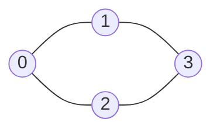

# Graphs and Graph Representations in C

> Deep architectural exploration of graph data structures in C: adjacency matrices, adjacency lists, Depth-First Search (DFS), Breadth-First Search (BFS), cycle detection, and memory layout.

| Metadata | Details |
| :--- | :--- |
| **Level** | Intermediate |
| **Prerequisites** | [01-linked-lists.md](./01-linked-lists.md), [02-stacks-queues.md](./02-stacks-queues.md), [03-trees.md](./03-trees.md) |
| **Time to Read** | 40 minutes |
| **Status** | Complete |
| **Standard Baseline** | ISO C11 / C17 / C23 |

---

## Table of Contents
1. [What & Why](#1-what--why)
2. [Core Concepts](#2-core-concepts)
3. [How It Works Internally](#3-how-it-works-internally)
4. [Syntax & Usage](#4-syntax--usage)
5. [Practical Examples](#5-practical-examples)
6. [Best Practices](#6-best-practices)
7. [Common Mistakes & Pitfalls](#7-common-mistakes--pitfalls)
8. [Performance & Security Notes](#8-performance--security-notes)
9. [Comparison: Adjacency Matrix vs Adjacency List](#9-comparison-adjacency-matrix-vs-adjacency-list)
10. [Interview Questions](#10-interview-questions)
11. [Practice Exercises](#11-practice-exercises)
12. [Summary & Cheat Sheet](#12-summary--cheat-sheet)
13. [Further Reading](#13-further-reading)

---

## 1. What & Why
A **Graph** $G = (V, E)$ is a non-linear data structure consisting of a set of **vertices** (nodes) $V$ connected by a set of **edges** (links) $E$. Unlike trees, graphs may contain cycles, disconnected sub-components, and bidirectional connections.

Graphs model fundamental systems engineering problems:
- **Dependency Resolution**: Package managers (e.g. `npm`, `apt`) and build tools (Make, CMake) model task dependencies as Directed Acyclic Graphs (DAGs).
- **Network Topologies**: Routing protocols (OSPF, BGP) find shortest paths across routers.
- **Garbage Collection**: Tracing GC algorithms (mark-and-sweep) treat object heap allocations as a graph reachable from root references.

---

## 2. Core Concepts

### 2.1 Graph Taxonomy
- **Directed vs Undirected**: Directed edges $(u \rightarrow v)$ have specific flow; undirected $(u - v)$ are symmetric.
- **Weighted vs Unweighted**: Edges carry numeric costs (latency, distance, weight).
- **Cyclic vs Acyclic**: Cyclic graphs contain paths starting and ending at the same vertex. A **DAG** is a Directed Acyclic Graph.
- **Connected Components**: Maximal subgraphs in which any two vertices are connected by paths.

### 2.2 Representations in C
1. **Adjacency Matrix**: A 2D array of size $|V| \times |V|$ where `matrix[u][v]` is $1$ (or edge weight) if an edge exists, and $0$ otherwise.
   - Query time: $O(1)$ to check if edge $(u, v)$ exists.
   - Space complexity: $O(|V|^2)$, wasteful for sparse graphs.
2. **Adjacency List**: An array of $|V|$ linked lists (or dynamic arrays). `adj[u]` contains all neighbor nodes connected from $u$.
   - Query time: $O(\text{degree}(u))$.
   - Space complexity: $O(|V| + |E|)$, optimal for sparse graphs.
3. **Edge List**: An array of edge structs `{ int src, dst, weight; }`. Ideal for Kruskal's MST algorithm.

---

## 3. How It Works Internally

### Memory Layout: Adjacency Matrix vs Adjacency List

```
Adjacency Matrix (Dense 2D Buffer, V=4):
Row 0: [ 0 | 1 | 1 | 0 ]   <-- Continuous flat memory, V*V * sizeof(int)
Row 1: [ 1 | 0 | 0 | 1 ]
Row 2: [ 1 | 0 | 0 | 1 ]
Row 3: [ 0 | 1 | 1 | 0 ]

Adjacency List (Array of Pointers to Linked Nodes):
adj[0] -> [ Node: 1 ] -> [ Node: 2 ] -> NULL
adj[1] -> [ Node: 0 ] -> [ Node: 3 ] -> NULL
adj[2] -> [ Node: 0 ] -> [ Node: 3 ] -> NULL
adj[3] -> [ Node: 1 ] -> [ Node: 2 ] -> NULL
```



---

## 4. Syntax & Usage

### Struct Definitions for Adjacency List
```c
typedef struct AdjListNode {
    int dest;
    int weight;
    struct AdjListNode *next;
} AdjListNode;

typedef struct Graph {
    int num_vertices;
    AdjListNode **adj_lists;
} Graph;
```

---

## 5. Practical Examples

### Example 1: Adjacency List Graph Creation and Depth-First Search (DFS)
Goal: Construct an undirected graph using an adjacency list and perform a recursive DFS traversal tracking visited vertices.

```c
#include <stdio.h>
#include <stdlib.h>
#include <stdbool.h>

typedef struct AdjNode {
    int dest;
    struct AdjNode *next;
} AdjNode;

typedef struct Graph {
    int num_vertices;
    AdjNode **adj_lists;
} Graph;

static Graph *graph_create(int vertices) {
    Graph *g = (Graph *)malloc(sizeof(Graph));
    if (!g) return NULL;
    g->num_vertices = vertices;
    g->adj_lists = (AdjNode **)malloc(vertices * sizeof(AdjNode *));
    if (!g->adj_lists) { free(g); return NULL; }
    for (int i = 0; i < vertices; i++) {
        g->adj_lists[i] = NULL;
    }
    return g;
}

static void graph_add_edge(Graph *g, int src, int dest) {
    AdjNode *n1 = (AdjNode *)malloc(sizeof(AdjNode));
    n1->dest = dest;
    n1->next = g->adj_lists[src];
    g->adj_lists[src] = n1;

    AdjNode *n2 = (AdjNode *)malloc(sizeof(AdjNode));
    n2->dest = src;
    n2->next = g->adj_lists[dest];
    g->adj_lists[dest] = n2;
}

static void dfs_util(const Graph *g, int vertex, bool *visited) {
    visited[vertex] = true;
    printf("%d ", vertex);
    AdjNode *curr = g->adj_lists[vertex];
    while (curr) {
        int neighbor = curr->dest;
        if (!visited[neighbor]) {
            dfs_util(g, neighbor, visited);
        }
        curr = curr->next;
    }
}

static void graph_dfs(const Graph *g, int start_vertex) {
    bool *visited = (bool *)calloc(g->num_vertices, sizeof(bool));
    if (!visited) return;
    dfs_util(g, start_vertex, visited);
    printf("\n");
    free(visited);
}

static void graph_free(Graph *g) {
    if (!g) return;
    for (int i = 0; i < g->num_vertices; i++) {
        AdjNode *curr = g->adj_lists[i];
        while (curr) {
            AdjNode *tmp = curr;
            curr = curr->next;
            free(tmp);
        }
    }
    free(g->adj_lists);
    free(g);
}

int main(void) {
    printf("=== Graph Adjacency List and DFS Traversal ===\n");
    Graph *g = graph_create(5);
    graph_add_edge(g, 0, 1);
    graph_add_edge(g, 0, 2);
    graph_add_edge(g, 1, 3);
    graph_add_edge(g, 2, 4);

    printf("DFS Traversal starting from vertex 0: ");
    graph_dfs(g, 0);

    graph_free(g);
    return 0;
}
```

**Verified Output:**
```text
=== Graph Adjacency List and DFS Traversal ===
DFS Traversal starting from vertex 0: 0 2 4 1 3
```

---

## 6. Best Practices
1. **Validate Vertex Bounds**: Before accessing `g->adj_lists[u]`, always verify `0 <= u < g->num_vertices` to prevent out-of-bounds indexing.
2. **Dynamic Visited Bitmaps**: For large graphs with $10^6$ vertices, a `bool` array wastes 1MB of memory. Use a bit vector (`uint64_t *bitset`) where each vertex occupies 1 bit.
3. **Iterative Traversal for Deep Graphs**: Recursive DFS can easily exhaust the call stack on graphs with $100,000$ sequential nodes. Use an explicit heap-allocated stack.
4. **Clean Edge Node Allocation**: Always free each `AdjNode` in the adjacency list before freeing the pointer array and `Graph` struct.
5. **Prefer Adjacency List for Real Systems**: Almost all real-world graphs (web links, social networks, road maps) are sparse ($|E| \ll |V|^2$). Adjacency matrices waste gigabytes of RAM on zeros.

---

## 7. Common Mistakes & Pitfalls

| Mistake | Why It Is Dangerous | Correct Approach |
| :--- | :--- | :--- |
| Forgetting undirected symmetry | Adding edge $(u \rightarrow v)$ without $(v \rightarrow u)$ breaks undirected traversal. | Add node to both `adj[u]` and `adj[v]`. |
| Missing `visited[]` array in traversal | Traversal enters infinite loop when encountering cycles ($A \rightarrow B \rightarrow A$). | Mark vertices `visited[u] = true;` before exploring neighbors. |
| Memory leak on graph destruction | Freeing `g->adj_lists` without iterating and freeing individual `AdjNode` chains leaks all edges. | Iterate through all vertices and free linked list chains first. |
| Buffer overflow in adjacency matrix | Allocating flat 2D matrix on thread stack (`int m[V][V]`) blows the stack for large $V$. | Dynamically allocate flat 1D buffer on heap: `malloc(V * V * sizeof(int))`. |
| Indexing unallocated vertex | Passing vertex ID $\ge V$ dereferences wild pointers outside `adj_lists`. | Assert or guard `if (v < 0 || v >= g->num_vertices) return;`. |

---

## 8. Performance & Security Notes

### Algorithmic Complexity

| Representation | Space | Add Edge | Check Edge $(u, v)$ | Iterate Neighbors |
| :--- | :--- | :--- | :--- | :--- |
| **Adjacency Matrix** | $O(|V|^2)$ | $O(1)$ | $O(1)$ | $O(|V|)$ |
| **Adjacency List** | $O(|V| + |E|)$ | $O(1)$ | $O(\text{deg}(u))$ | $O(\text{deg}(u))$ |
| **Edge List** | $O(|E|)$ | $O(1)$ | $O(|E|)$ | $O(|E|)$ |

---

## 9. Comparison: Adjacency Matrix vs Adjacency List

```
Use Adjacency Matrix when:
- Dense graphs where |E| approaches |V|^2.
- Frequent edge existence queries ("is u connected to v?").
- Vertex count |V| is small and fixed (e.g. <= 1000).

Use Adjacency List when:
- Sparse graphs where |E| << |V|^2.
- Graph size is large (e.g. 100,000+ vertices).
- Algorithms require rapid iteration over immediate neighbors of a vertex (BFS/DFS/Dijkstra).
```

---

## 10. Interview Questions

<details>
<summary><strong>1. How do you detect a cycle in a Directed Graph?</strong></summary>

Use 3-color Depth-First Search:
- **WHITE (0)**: Vertex not yet visited.
- **GRAY (1)**: Vertex currently being explored (on current DFS recursion stack).
- **BLACK (2)**: Vertex and all its descendants fully explored.
If during traversal of vertex $u$, a neighbor $v$ is encountered with color **GRAY**, a back-edge exists, proving a cycle.
</details>

<details>
<summary><strong>2. How do you detect a cycle in an Undirected Graph?</strong></summary>

Use standard DFS with a `parent` parameter. If an adjacent vertex $v$ has already been visited and $v \neq \text{parent}$, then a cycle exists. Alternatively, use a Disjoint Set (Union-Find) data structure: for every edge $(u, v)$, if `find(u) == find(v)`, a cycle is detected.
</details>

<details>
<summary><strong>3. What is Topological Sort and when is it possible?</strong></summary>

A linear ordering of vertices in a Directed Acyclic Graph (DAG) such that for every directed edge $(u \rightarrow v)$, vertex $u$ comes before $v$. It is possible **if and only if** the graph contains no directed cycles. It can be computed using Kahn's algorithm (indegree-based BFS) or reverse post-order DFS.
</details>

<details>
<summary><strong>4. What is the difference between BFS and DFS in terms of space complexity?</strong></summary>

- **DFS Space**: Proportional to maximum recursion depth ($O(H)$ where $H$ is the tree/path height, worst case $O(|V|)$).
- **BFS Space**: Proportional to the maximum breadth of the graph ($O(W)$ where $W$ is the widest layer, worst case $O(|V|)$). In balanced search spaces, BFS requires much more memory than DFS.
</details>

<details>
<summary><strong>5. How does Breadth-First Search (BFS) guarantee finding the shortest path?</strong></summary>

In an unweighted graph, BFS explores all vertices at distance $k$ before exploring any vertex at distance $k+1$. Therefore, the first time target vertex $T$ is dequeued, the path traversed to reach it is guaranteed to have the minimum possible number of edges.
</details>

<details>
<summary><strong>6. What is the difference between Kruskal's and Prim's Minimum Spanning Tree algorithms?</strong></summary>

- **Kruskal's**: Edge-centric. Sorts all edges by weight and repeatedly adds the smallest edge that does not form a cycle (using Union-Find). Best for sparse graphs: $O(|E| \log |E|)$.
- **Prim's**: Vertex-centric. Grows a single connected tree from an initial vertex by greedily adding the cheapest edge connecting the tree to an unvisited vertex (using a priority queue). Best for dense graphs: $O(|E| \log |V|)$.
</details>

<details>
<summary><strong>7. How do you represent a weighted graph in an Adjacency Matrix?</strong></summary>

Use a special sentinel value (such as `INF` or `INT_MAX`) to denote the absence of an edge, and $0$ along the main diagonal (`matrix[i][i] = 0`). If an edge exists between $u$ and $v$, `matrix[u][v] = weight`.
</details>

<details>
<summary><strong>8. What is a Bipartite Graph and how do you test for it?</strong></summary>

A graph whose vertices can be divided into two disjoint sets $U$ and $V$ such that every edge connects a vertex in $U$ to a vertex in $V$ (no edge connects vertices in the same set). A graph is bipartite if and only if it contains no odd-length cycles. Test using BFS/DFS 2-coloring: assign alternating colors (0 and 1) to adjacent vertices; if an adjacent vertex already has the same color, the graph is not bipartite.
</details>

---

## 11. Practice Exercises

### Easy 1: Calculate Vertex Degree
Write `int graph_vertex_degree(const Graph *g, int u);` for an adjacency list.

<details>
<summary>Solution</summary>

```c
int graph_vertex_degree(const Graph *g, int u) {
    if (!g || u < 0 || u >= g->num_vertices) return -1;
    int degree = 0;
    AdjNode *curr = g->adj_lists[u];
    while (curr) {
        degree++;
        curr = curr->next;
    }
    return degree;
}
```
</details>

### Easy 2: Count Total Edges
Write a function that counts total directed edges in an adjacency list graph.

<details>
<summary>Solution</summary>

```c
int graph_count_edges(const Graph *g) {
    int total = 0;
    for (int i = 0; i < g->num_vertices; i++) {
        AdjNode *c = g->adj_lists[i];
        while (c) { total++; c = c->next; }
    }
    return total;
}
```
</details>

### Easy 3: Has Direct Edge
Write `bool graph_has_edge(const Graph *g, int u, int v);`.

<details>
<summary>Solution</summary>

```c
bool graph_has_edge(const Graph *g, int u, int v) {
    if (!g || u < 0 || u >= g->num_vertices) return false;
    AdjNode *curr = g->adj_lists[u];
    while (curr) {
        if (curr->dest == v) return true;
        curr = curr->next;
    }
    return false;
}
```
</details>

### Medium 1: Breadth-First Search (BFS) Traversal
Implement BFS traversal of an adjacency list graph from a start vertex using an array queue.

<details>
<summary>Solution</summary>

```c
void graph_bfs(const Graph *g, int start) {
    bool *visited = (bool *)calloc(g->num_vertices, sizeof(bool));
    int *queue = (int *)malloc(g->num_vertices * sizeof(int));
    int front = 0, rear = 0;

    visited[start] = true;
    queue[rear++] = start;

    while (front < rear) {
        int curr = queue[front++];
        printf("%d ", curr);
        AdjNode *n = g->adj_lists[curr];
        while (n) {
            if (!visited[n->dest]) {
                visited[n->dest] = true;
                queue[rear++] = n->dest;
            }
            n = n->next;
        }
    }
    printf("\n");
    free(visited);
    free(queue);
}
```
</details>

### Medium 2: Connected Components Counter
Count the number of disconnected components in an undirected graph.

<details>
<summary>Solution</summary>

```c
static void dfs_mark(const Graph *g, int u, bool *visited) {
    visited[u] = true;
    AdjNode *n = g->adj_lists[u];
    while (n) {
        if (!visited[n->dest]) dfs_mark(g, n->dest, visited);
        n = n->next;
    }
}

int graph_count_components(const Graph *g) {
    bool *visited = (bool *)calloc(g->num_vertices, sizeof(bool));
    int components = 0;
    for (int i = 0; i < g->num_vertices; i++) {
        if (!visited[i]) {
            components++;
            dfs_mark(g, i, visited);
        }
    }
    free(visited);
    return components;
}
```
</details>

### Medium 3: Shortest Path Distance in Unweighted Graph
Find the shortest hop count between two vertices using BFS.

<details>
<summary>Solution</summary>

```c
int graph_shortest_hop(const Graph *g, int src, int dst) {
    if (src == dst) return 0;
    int *dist = (int *)malloc(g->num_vertices * sizeof(int));
    for (int i = 0; i < g->num_vertices; i++) dist[i] = -1;

    int *q = (int *)malloc(g->num_vertices * sizeof(int));
    int front = 0, rear = 0;

    dist[src] = 0;
    q[rear++] = src;

    while (front < rear) {
        int curr = q[front++];
        if (curr == dst) {
            int res = dist[dst];
            free(dist); free(q);
            return res;
        }
        AdjNode *n = g->adj_lists[curr];
        while (n) {
            if (dist[n->dest] == -1) {
                dist[n->dest] = dist[curr] + 1;
                q[rear++] = n->dest;
            }
            n = n->next;
        }
    }
    free(dist); free(q);
    return -1; // Unreachable
}
```
</details>

### Hard 1: Topological Sort (Kahn's Algorithm)
Implement Kahn's indegree-based BFS topological sorting algorithm.

<details>
<summary>Solution</summary>

```c
bool topological_sort(const Graph *g, int *order_out) {
    int *indegree = (int *)calloc(g->num_vertices, sizeof(int));
    for (int i = 0; i < g->num_vertices; i++) {
        AdjNode *n = g->adj_lists[i];
        while (n) { indegree[n->dest]++; n = n->next; }
    }

    int *queue = (int *)malloc(g->num_vertices * sizeof(int));
    int front = 0, rear = 0;
    for (int i = 0; i < g->num_vertices; i++) {
        if (indegree[i] == 0) queue[rear++] = i;
    }

    int count = 0;
    while (front < rear) {
        int u = queue[front++];
        order_out[count++] = u;
        AdjNode *n = g->adj_lists[u];
        while (n) {
            if (--indegree[n->dest] == 0) queue[rear++] = n->dest;
            n = n->next;
        }
    }

    free(indegree);
    free(queue);
    return count == g->num_vertices; // false if cycle detected!
}
```
</details>

### Hard 2: Cycle Detection in Directed Graph (3-Color DFS)
Implement directed cycle detection using WHITE, GRAY, BLACK colors.

<details>
<summary>Solution</summary>

```c
typedef enum { WHITE, GRAY, BLACK } Color;

static bool has_cycle_dfs(const Graph *g, int u, Color *colors) {
    colors[u] = GRAY;
    AdjNode *n = g->adj_lists[u];
    while (n) {
        if (colors[n->dest] == GRAY) return true; // Back-edge detected!
        if (colors[n->dest] == WHITE && has_cycle_dfs(g, n->dest, colors)) return true;
        n = n->next;
    }
    colors[u] = BLACK;
    return false;
}

bool graph_has_cycle_directed(const Graph *g) {
    Color *colors = (Color *)calloc(g->num_vertices, sizeof(Color));
    for (int i = 0; i < g->num_vertices; i++) {
        if (colors[i] == WHITE) {
            if (has_cycle_dfs(g, i, colors)) {
                free(colors);
                return true;
            }
        }
    }
    free(colors);
    return false;
}
```
</details>

### Hard 3: Dijkstra's Shortest Path on Weighted Graph
Implement Dijkstra's algorithm using an adjacency list and min-heap priority queue.

<details>
<summary>Solution</summary>

```c
// Standard Dijkstra:
// 1. Maintain dist[] array initialized to INT_MAX, dist[src] = 0.
// 2. Insert (src, 0) into Min-Heap.
// 3. While Min-Heap not empty:
//    - Pop (u, d). If d > dist[u], continue.
//    - For each neighbor v of u:
//      new_dist = dist[u] + weight(u, v);
//      if new_dist < dist[v]:
//          dist[v] = new_dist;
//          Push (v, new_dist) to Min-Heap.
```
</details>

---

## 12. Summary & Cheat Sheet

| Algorithm | Paradigm | Complexity | Best Used For |
| :--- | :--- | :--- | :--- |
| **DFS** | Recursive / Stack | $O(|V| + |E|)$ | Topological sort, cycle detection, path existence |
| **BFS** | FIFO Queue | $O(|V| + |E|)$ | Shortest hop path in unweighted graphs |
| **Kahn's** | Queue + Indegree | $O(|V| + |E|)$ | Dependency build resolution |
| **Dijkstra** | Greedy + Priority Queue | $O(|E| \log |V|)$ | Shortest path in non-negative weighted graphs |

---

## 13. Further Reading
- *Introduction to Algorithms* (CLRS), Chapter 22: Elementary Graph Algorithms.
- *Algorithms in C*, Robert Sedgewick (Graph Algorithms).

---

[← Previous Note: Hash Tables](./04-hash-tables.md) | [Data Structures Index](./README.md) | [Next Note: Dynamic Array](./06-dynamic-array.md)
