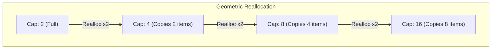

# Dynamic Arrays (Vector) in C

> Deep architectural exploration of contiguous dynamic arrays: capacity management, geometric growth factors, safe reallocation, cache line alignment, and generic vector construction.

| Metadata | Details |
| :--- | :--- |
| **Level** | Intermediate |
| **Prerequisites** | [02-core-concepts/01-arrays.md](../../02-core-concepts/01-arrays.md), [02-core-concepts/08-memory-management.md](../../02-core-concepts/08-memory-management.md) |
| **Time to Read** | 35 minutes |
| **Status** | Complete |
| **Standard Baseline** | ISO C11 / C17 / C23 |

---

## Table of Contents
1. [What & Why](#1-what--why)
2. [Core Concepts](#2-core-concepts)
3. [How It Works Internally](#3-how-it-works-internally)
4. [Syntax & Usage](#4-syntax--usage)
5. [Practical Examples](#5-practical-examples)
6. [Best Practices](#6-best-practices)
7. [Common Mistakes & Pitfalls](#7-common-mistakes--pitfalls)
8. [Performance & Security Notes](#8-performance--security-notes)
9. [Comparison: Dynamic Array vs Linked List](#9-comparison-dynamic-array-vs-linked-list)
10. [Interview Questions](#10-interview-questions)
11. [Practice Exercises](#11-practice-exercises)
12. [Summary & Cheat Sheet](#12-summary--cheat-sheet)
13. [Further Reading](#13-further-reading)

---

## 1. What & Why
A **Dynamic Array** (commonly called a `Vector`) is a resizable, contiguous random-access collection that grows automatically as elements are added. It combines the $O(1)$ random access performance of static C arrays with the flexible unbounded growth of linked lists.

Why dynamic arrays are the premier collection in systems engineering:
- **Optimal Cache Locality**: Elements reside in adjacent memory addresses, allowing hardware prefetchers to preload cache lines seamlessly.
- **Minimal Metadata**: Requires only 3 integers (data pointer, size, capacity), incurring zero per-element pointer overhead.
- **SIMD / Vectorization**: Modern CPUs can load 4, 8, or 16 contiguous elements into AVX/NEON vector registers in a single clock cycle.

---

## 2. Core Concepts

### 2.1 Size vs Capacity
- **Size (`size`)**: The count of elements currently stored and active in the array.
- **Capacity (`capacity`)**: The total number of elements the currently allocated heap buffer can hold before needing reallocation.
$$\text{Invariant:} \quad 0 \le \text{size} \le \text{capacity}$$

### 2.2 Amortized Analysis & Growth Factor
When `size == capacity`, the array must grow before insertion. Growing by a constant additive step ($+K$) yields $O(N^2)$ cumulative insertion time.
Growing by a **geometric multiplier** ($g > 1.0$) yields **$O(1)$ amortized insertion**:
- **Growth Factor $2.0$** (GCC `std::vector`): Doubling capacity minimizes reallocation frequency. However, older memory blocks cannot be reused because $\sum_{i=0}^{k-1} 2^i < 2^k$.
- **Growth Factor $1.5$** (MSVC, Facebook `folly::fbvector`): Allows the heap allocator to reclaim previously freed contiguous blocks in subsequent reallocations.

---

## 3. How It Works Internally

### Memory Layout & Reallocation Mechanics

```
Initial Capacity = 4, Size = 4:
Heap Block: [ 10 | 20 | 30 | 40 ]

Push 50 -> Reallocation triggered (Capacity doubled to 8):
1. malloc(8 * sizeof(int))
2. memcpy(new_buf, old_buf, 4 * sizeof(int))
3. free(old_buf)
New Heap Block: [ 10 | 20 | 30 | 40 | 50 | -- | -- | -- ]
                 <---- Active ------>   <-- Reserved -->
```



---

## 4. Syntax & Usage

### Struct Definition
```c
typedef struct Vector {
    int *data;
    size_t size;
    size_t capacity;
} Vector;
```

### The Safe `realloc()` Idiom
```c
bool vector_reserve(Vector *v, size_t new_cap) {
    if (new_cap <= v->capacity) return true;
    int *new_data = (int *)realloc(v->data, new_cap * sizeof(int));
    if (!new_data) return false; // Existing buffer remains intact!
    v->data = new_data;
    v->capacity = new_cap;
    return true;
}
```

---

## 5. Practical Examples

### Example 1: Dynamic Array with Growth Tracking
Goal: Implement an auto-growing vector demonstrating capacity doubling and amortized $O(1)$ insertion.

```c
#include <stdio.h>
#include <stdlib.h>
#include <stdbool.h>

typedef struct Vector {
    int *data;
    size_t size;
    size_t capacity;
} Vector;

static Vector *vector_create(size_t initial_cap) {
    Vector *v = (Vector *)malloc(sizeof(Vector));
    if (!v) return NULL;
    v->data = (int *)malloc(initial_cap * sizeof(int));
    if (!v->data) { free(v); return NULL; }
    v->size = 0;
    v->capacity = initial_cap;
    return v;
}

static bool vector_push(Vector *v, int val) {
    if (v->size >= v->capacity) {
        size_t new_cap = v->capacity * 2;
        int *new_data = (int *)realloc(v->data, new_cap * sizeof(int));
        if (!new_data) return false;
        v->data = new_data;
        v->capacity = new_cap;
    }
    v->data[v->size++] = val;
    printf("Pushed %d | Size: %zu, Capacity: %zu\n", val, v->size, v->capacity);
    return true;
}

static void vector_free(Vector *v) {
    if (v) {
        free(v->data);
        free(v);
    }
}

int main(void) {
    printf("=== Generic Dynamic Array Operations ===\n");
    Vector *v = vector_create(2);

    vector_push(v, 10);
    vector_push(v, 20);
    vector_push(v, 30);
    vector_push(v, 40);
    vector_push(v, 50);

    printf("Vector contents: ");
    for (size_t i = 0; i < v->size; i++) {
        printf("%d ", v->data[i]);
    }
    printf("\n");

    vector_free(v);
    return 0;
}
```

**Verified Output:**
```text
=== Generic Dynamic Array Operations ===
Pushed 10 | Size: 1, Capacity: 2
Pushed 20 | Size: 2, Capacity: 2
Pushed 30 | Size: 3, Capacity: 4
Pushed 40 | Size: 4, Capacity: 4
Pushed 50 | Size: 5, Capacity: 8
Vector contents: 10 20 30 40 50
```

---

## 6. Best Practices
1. **Never Overwrite with Unchecked `realloc`**: `v->data = realloc(v->data, ...);` destroys the existing pointer if reallocation fails, causing catastrophic memory leaks.
2. **Prevent Integer Overflow in Byte Size**: Always check `if (new_cap > SIZE_MAX / sizeof(T))` before computing `new_cap * sizeof(T)`.
3. **Use Hysteresis When Shrinking**: Never shrink capacity immediately when `size == capacity / 2`, otherwise alternating push and pop operations cause continuous reallocation thrashing. Shrink only when `size <= capacity / 4`.
4. **Pre-Reserve Known Capacities**: Call `vector_reserve(v, expected_count)` upfront to eliminate all intermediate reallocations and memory copies.
5. **Zero Capacity Starting State**: Allow `vector_create()` to initialize `data = NULL, size = 0, capacity = 0`. First push allocates initial buffer on demand.

---

## 7. Common Mistakes & Pitfalls

| Mistake | Why It Is Dangerous | Correct Approach |
| :--- | :--- | :--- |
| `v->data = realloc(...)` | If heap is exhausted, `realloc` returns `NULL`, losing pointer to existing allocated memory. | Use temporary pointer: `void *t = realloc(...); if (!t) handle_oom(); v->data = t;` |
| Dangling pointers after `realloc` | Holding external pointers to elements (`int *p = &v->data[0];`) becomes dangling after reallocation moves buffer. | Access elements via indices, or refresh pointers after any mutation. |
| Additive growth `capacity += 10` | Repeated insertions incur $O(N^2)$ cumulative copies, crippling performance. | Use geometric growth multiplier: `new_cap = old_cap * 2`. |
| Out-of-bounds indexing without bounds check | Accessing `v->data[v->size]` reads uninitialized garbage or invokes undefined behavior. | Implement bounds-checked getter: `int *vector_at(Vector *v, size_t idx);`. |
| Memory leak when storing pointers | Freeing vector container does not free heap objects stored inside `void **data`. | Iterate and `free()` stored elements before calling `vector_free()`. |

---

## 8. Performance & Security Notes

### Complexity Analysis

| Operation | Dynamic Array | Singly Linked List |
| :--- | :--- | :--- |
| **Random Access (`v[i]`)** | $O(1)$ | $O(N)$ |
| **Push Back (Amortized)** | $O(1)$ | $O(1)$ (with tail pointer) |
| **Push Back (Worst Case)** | $O(N)$ (realloc copy) | $O(1)$ |
| **Insert / Delete at Index** | $O(N)$ (memory shift) | $O(N)$ |
| **Memory Overhead** | Unused capacity buffer | 8-16 bytes per node |
| **Cache Line Utilization** | 100% | Often < 20% |

---

## 9. Comparison: Dynamic Array vs Linked List

```
Choose Dynamic Array (Vector) when:
- Random index access is required.
- High sequential iteration speed is paramount (CPU cache locality).
- Elements are small and pointer overhead would dominate memory footprint.

Choose Linked List when:
- Worst-case latency must be strictly bounded (no reallocation spikes).
- Frequent insertions and deletions in the middle of collection.
- Pointers to individual elements must remain valid across insertions.
```

---

## 10. Interview Questions

<details>
<summary><strong>1. Why does geometric growth give $O(1)$ amortized push time, while additive growth gives $O(N^2)$?</strong></summary>

With additive growth ($+K$), after $N$ insertions there are $N/K$ reallocations, copying $K + 2K + 3K + \dots + N = O(N^2)$ total items.
With geometric growth ($2\times$), copying occurs at powers of two: $1 + 2 + 4 + \dots + N/2 = N - 1$ total copies over $N$ insertions. Dividing total work ($N$) by $N$ insertions yields an amortized cost of $O(1)$ per insertion.
</details>

<details>
<summary><strong>2. Why do many production allocators and containers prefer a growth factor of 1.5 over 2.0?</strong></summary>

With a growth factor of 2, the current buffer size is strictly greater than the sum of all previously freed buffers combined:
$$2^k > \sum_{i=0}^{k-1} 2^i = 2^k - 1$$
Thus, the memory allocator can never reuse the memory blocks freed by earlier reallocations. With a factor $\le 1.618$ (the Golden Ratio), after several reallocations, the sum of previously freed blocks is large enough to satisfy future allocations in-place.
</details>

<details>
<summary><strong>3. What is pointer invalidation in dynamic arrays?</strong></summary>

When a dynamic array reallocates, the OS/allocator may move the entire buffer to a completely different virtual memory address. Any external pointers or references previously pointing to elements within the old buffer become invalid dangling pointers. Dereferencing them is undefined behavior.
</details>

<details>
<summary><strong>4. How do you implement a generic Vector in C?</strong></summary>

Store elements as a byte array (`char *data` or `uint8_t *data`) and track `size_t element_size`.
To access element $i$:
`void *element = (char *)v->data + (i * v->element_size);`
Use `memcpy()` to copy elements into and out of the buffer.
</details>

<details>
<summary><strong>5. How does `realloc()` work under the hood?</strong></summary>

The runtime allocator:
1. Inspects the heap chunk metadata following the current block. If adjacent memory is unallocated, it expands the chunk in-place without moving data.
2. If adjacent memory is occupied, it allocates a new chunk of the requested size elsewhere.
3. Copies existing data (`memcpy`).
4. Marks the old chunk as free in the allocator freelist.
5. Returns the new pointer.
</details>

<details>
<summary><strong>6. What is reallocation thrashing and how do you prevent it?</strong></summary>

Reallocation thrashing occurs when capacity shrinks immediately upon reaching half-capacity. Alternating `push` and `pop` at that boundary triggers reallocation on every single operation. Prevention: use **hysteresis**—shrink capacity only when size drops to $\le 25\%$ of capacity, reducing capacity to $50\%$.
</details>

<details>
<summary><strong>7. How does dynamic array capacity reservation prevent memory fragmentation?</strong></summary>

By reserving total required capacity upfront with `vector_reserve()`, the allocator allocates a single permanent heap block. This eliminates all intermediate reallocations, avoiding memory churn, heap fragmentation, and unnecessary CPU data copying.
</details>

<details>
<summary><strong>8. Why should you check for multiplication overflow in `capacity * sizeof(T)`?</strong></summary>

If `capacity` is large, `capacity * sizeof(T)` can overflow `size_t` and wrap around to a small number. `malloc()` then allocates an undersized buffer. Subsequent element writes exceed the buffer bounds, leading to heap buffer overflow and remote code execution vulnerabilities.
</details>

---

## 11. Practice Exercises

### Easy 1: Vector Size and Empty Check
Write `bool vector_is_empty(const Vector *v);` and `size_t vector_size(const Vector *v);`.

<details>
<summary>Solution</summary>

```c
bool vector_is_empty(const Vector *v) {
    return !v || v->size == 0;
}

size_t vector_size(const Vector *v) {
    return v ? v->size : 0;
}
```
</details>

### Easy 2: Safe Element Getter
Write `bool vector_get(const Vector *v, size_t idx, int *out);`.

<details>
<summary>Solution</summary>

```c
bool vector_get(const Vector *v, size_t idx, int *out) {
    if (!v || idx >= v->size) return false;
    *out = v->data[idx];
    return true;
}
```
</details>

### Easy 3: Vector Pop Back
Write `bool vector_pop(Vector *v, int *out);` that removes the last element.

<details>
<summary>Solution</summary>

```c
bool vector_pop(Vector *v, int *out) {
    if (!v || v->size == 0) return false;
    *out = v->data[--v->size];
    return true;
}
```
</details>

### Medium 1: Insert At Index
Implement `bool vector_insert_at(Vector *v, size_t idx, int val);` shifting elements to the right.

<details>
<summary>Solution</summary>

```c
#include <string.h>

bool vector_insert_at(Vector *v, size_t idx, int val) {
    if (!v || idx > v->size) return false;
    if (v->size >= v->capacity) {
        size_t new_cap = v->capacity ? v->capacity * 2 : 4;
        int *new_d = (int *)realloc(v->data, new_cap * sizeof(int));
        if (!new_d) return false;
        v->data = new_d;
        v->capacity = new_cap;
    }
    memmove(&v->data[idx + 1], &v->data[idx], (v->size - idx) * sizeof(int));
    v->data[idx] = val;
    v->size++;
    return true;
}
```
</details>

### Medium 2: Remove At Index
Implement `bool vector_remove_at(Vector *v, size_t idx);` shifting elements left to maintain order.

<details>
<summary>Solution</summary>

```c
#include <string.h>

bool vector_remove_at(Vector *v, size_t idx) {
    if (!v || idx >= v->size) return false;
    memmove(&v->data[idx], &v->data[idx + 1], (v->size - idx - 1) * sizeof(int));
    v->size--;
    return true;
}
```
</details>

### Medium 3: Shrink to Fit
Implement `bool vector_shrink_to_fit(Vector *v);` resizing the heap buffer to exactly match `size`.

<details>
<summary>Solution</summary>

```c
bool vector_shrink_to_fit(Vector *v) {
    if (!v || v->size == v->capacity) return true;
    size_t target = v->size ? v->size : 1;
    int *new_d = (int *)realloc(v->data, target * sizeof(int));
    if (!new_d) return false;
    v->data = new_d;
    v->capacity = target;
    return true;
}
```
</details>

### Hard 1: Generic Byte-Level Vector
Implement a generic vector in C supporting arbitrary types via `element_size` and `memcpy`.

<details>
<summary>Solution</summary>

```c
typedef struct GVector {
    char *data;
    size_t size;
    size_t capacity;
    size_t elem_size;
} GVector;

GVector *gvec_create(size_t elem_size, size_t init_cap) {
    GVector *gv = (GVector *)malloc(sizeof(GVector));
    if (!gv) return NULL;
    gv->data = (char *)malloc(init_cap * elem_size);
    if (!gv->data) { free(gv); return NULL; }
    gv->size = 0;
    gv->capacity = init_cap;
    gv->elem_size = elem_size;
    return gv;
}

bool gvec_push(GVector *gv, const void *elem) {
    if (gv->size >= gv->capacity) {
        size_t new_cap = gv->capacity * 2;
        char *new_d = (char *)realloc(gv->data, new_cap * gv->elem_size);
        if (!new_d) return false;
        gv->data = new_d;
        gv->capacity = new_cap;
    }
    memcpy(gv->data + (gv->size * gv->elem_size), elem, gv->elem_size);
    gv->size++;
    return true;
}
```
</details>

### Hard 2: Fast Unordered Removal
Implement $O(1)$ removal by swapping target with the last element.

<details>
<summary>Solution</summary>

```c
bool vector_swap_remove(Vector *v, size_t idx) {
    if (!v || idx >= v->size) return false;
    v->data[idx] = v->data[v->size - 1];
    v->size--;
    return true;
}
```
</details>

### Hard 3: Dynamic 2D Matrix Vector
Implement a dynamically resizable 2D matrix where both rows and columns can grow dynamically.

<details>
<summary>Solution</summary>

```c
typedef struct Matrix2D {
    int *data;
    size_t rows;
    size_t cols;
    size_t row_cap;
    size_t col_cap;
} Matrix2D;

int *mat_at(Matrix2D *m, size_t r, size_t c) {
    if (r >= m->rows || c >= m->cols) return NULL;
    return &m->data[r * m->col_cap + c];
}
```
</details>

---

## 12. Summary & Cheat Sheet

| Operation | Complexity | Note |
| :--- | :--- | :--- |
| **Index Access** | $O(1)$ | Direct pointer arithmetic `data + i` |
| **Push Back** | $O(1)$ amortized | Geometric factor $1.5\times$ or $2\times$ |
| **Insert / Erase**| $O(N)$ | Requires `memmove` of trailing elements |
| **Swap Remove** | $O(1)$ | Overwrite target with last element (unordered) |

---

## 13. Further Reading
- *C Interfaces and Implementations* by David R. Hanson (Chapter 5: Sequences).
- Facebook `folly::fbvector` documentation on why growth factor 1.5 is mathematically superior.

---

[← Previous Note: Graphs](./05-graphs.md) | [Data Structures Index](./README.md) | [Next Note: Queues & Circular Buffers](./07-queues-circular-buffer.md)
