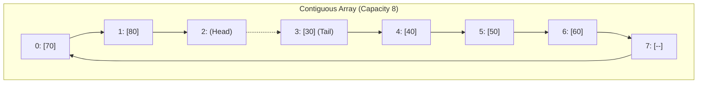

# Circular Buffers and Ring Queues in C

> Deep architectural exploration of fixed-size ring buffers in C: single-producer single-consumer lock-free design, bitwise modulo indexing, cache line padding, and bounded embedded queue patterns.

| Metadata | Details |
| :--- | :--- |
| **Level** | Intermediate |
| **Prerequisites** | [02-stacks-queues.md](./02-stacks-queues.md), [03-intermediate/05-bit-manipulation.md](../05-bit-manipulation.md) |
| **Time to Read** | 35 minutes |
| **Status** | Complete |
| **Standard Baseline** | ISO C11 / C17 / C23 |

---

## Table of Contents
1. [What & Why](#1-what--why)
2. [Core Concepts](#2-core-concepts)
3. [How It Works Internally](#3-how-it-works-internally)
4. [Syntax & Usage](#4-syntax--usage)
5. [Practical Examples](#5-practical-examples)
6. [Best Practices](#6-best-practices)
7. [Common Mistakes & Pitfalls](#7-common-mistakes--pitfalls)
8. [Performance & Security Notes](#8-performance--security-notes)
9. [Comparison: Ring Buffer vs Linked Queue](#9-comparison-ring-buffer-vs-linked-queue)
10. [Interview Questions](#10-interview-questions)
11. [Practice Exercises](#11-practice-exercises)
12. [Summary & Cheat Sheet](#12-summary--cheat-sheet)
13. [Further Reading](#13-further-reading)

---

## 1. What & Why
A **Circular Buffer** (or ring buffer) is a fixed-capacity contiguous data structure that uses a single memory array as if it were connected end-to-end. Elements are enqueued at the `head` and dequeued at the `tail`. When either pointer reaches the end of the memory buffer, it wraps around to the beginning.

Why ring buffers are crucial in systems programming:
- **Zero Dynamic Allocation**: Pre-allocated at startup; never calls `malloc()` or `free()` during runtime execution, making it deterministic and real-time safe.
- **Lock-Free Concurrency**: With careful memory ordering, a Single-Producer Single-Consumer (SPSC) circular queue can communicate between two threads without mutexes or kernel system calls.
- **Hardware I/O & Drivers**: Audio DAC/ADC streams, UART serial ring buffers, and network card DMA rings (e.g. Linux `sk_buff` rings) are fundamentally implemented as circular buffers.

---

## 2. Core Concepts

### 2.1 Head, Tail, and Wrapping Arithmetic
- `head`: The index where the *next* incoming element will be written.
- `tail`: The index from which the *next* element will be read/dequeued.
- **Modulo Arithmetic**:
  $$\text{next\_idx} = (\text{idx} + 1) \% \text{capacity}$$
- **Power-of-Two Optimization**: If capacity $C = 2^k$, expensive integer division is replaced with a single machine-cycle bitwise AND:
  $$\text{next\_idx} = (\text{idx} + 1) \& (C - 1)$$

### 2.2 Distinguishing Full vs Empty States
Because `head == tail` when the buffer is completely empty AND when it is completely full, engineers use one of three techniques:
1. **Explicit Count**: Maintain a `size_t count;` field. Simple and readable.
2. **Sacrificial Slot**: Leave one slot permanently empty. Full condition is `(head + 1) % cap == tail`. Empty condition is `head == tail`.
3. **Monotonic Sequences**: Keep 64-bit monotonically increasing `head` and `tail` counters without wrapping in memory. Wrap only during array indexing: `buf[head % cap]`.

### 2.3 Overwrite vs Reject Policies
- **Lossless Queue (Reject)**: Returns `false` or blocks when capacity is exhausted.
- **Lossy Ring (Overwrite)**: Automatically advances `tail` to drop the oldest unread element when `head` collides with `tail`. Used in real-time telemetry and logging.

---

## 3. How It Works Internally

### Memory Layout & Pointer Wrapping

```
Buffer Array (Capacity: 8, Mask: 0x07):
Initial: [ -- | -- | -- | -- | -- | -- | -- | -- ]
         ^head, ^tail (Empty, count = 0)

Push 4 items (10, 20, 30, 40):
[ 10 | 20 | 30 | 40 | -- | -- | -- | -- ]
  ^tail               ^head (head = 4, count = 4)

Pop 2 items, Push 5 items (wraps around!):
[ 70 | 80 | -- | 30 | 40 | 50 | 60 | -- ]
            ^head   ^tail
head wrapped from index 7 back to index 1!
```



---

## 4. Syntax & Usage

```c
#define RING_CAP 64 // Must be power of 2

typedef struct RingBuffer {
    int buffer[RING_CAP];
    size_t head;
    size_t tail;
    size_t count;
} RingBuffer;

static inline size_t ring_next(size_t idx) {
    return (idx + 1) & (RING_CAP - 1);
}
```

---

## 5. Practical Examples

### Example 1: Fixed-Size Power-of-Two Ring Buffer
Goal: Implement a ring buffer with bitwise masking, verify insertion, extraction, and wrap-around behavior.

```c
#include <stdio.h>
#include <stdbool.h>

#define RING_CAP 8 // Must be power of 2

typedef struct {
    int buffer[RING_CAP];
    size_t head;
    size_t tail;
    size_t count;
} RingBuffer;

static void ring_init(RingBuffer *rb) {
    rb->head = 0;
    rb->tail = 0;
    rb->count = 0;
}

static bool ring_push(RingBuffer *rb, int val) {
    if (rb->count >= RING_CAP) return false;
    rb->buffer[rb->head] = val;
    rb->head = (rb->head + 1) & (RING_CAP - 1);
    rb->count++;
    return true;
}

static bool ring_pop(RingBuffer *rb, int *out) {
    if (rb->count == 0) return false;
    *out = rb->buffer[rb->tail];
    rb->tail = (rb->tail + 1) & (RING_CAP - 1);
    rb->count--;
    return true;
}

int main(void) {
    printf("=== Ring Buffer Operations ===\n");
    RingBuffer rb;
    ring_init(&rb);

    ring_push(&rb, 10);
    ring_push(&rb, 20);
    ring_push(&rb, 30);

    int val;
    ring_pop(&rb, &val);
    printf("Popped item: %d\n", val);

    ring_push(&rb, 40);
    ring_push(&rb, 50);

    printf("Remaining elements: ");
    while (ring_pop(&rb, &val)) {
        printf("%d ", val);
    }
    printf("\n");
    return 0;
}
```

**Verified Output:**
```text
=== Ring Buffer Operations ===
Popped item: 10
Remaining elements: 20 30 40 50
```

---

## 6. Best Practices
1. **Always Enforce Power-of-Two Capacities**: Assert `(CAP & (CAP - 1)) == 0` at compile time or initialization. Replacing modulo with bitmask saves 10-30 CPU cycles per push/pop.
2. **Prevent False Sharing in Concurrent Queues**: In multi-threaded SPSC queues, place `head` and `tail` on separate CPU cache lines (`alignas(64)`) to avoid cache-line bouncing.
3. **Use Memory Barriers for Lock-Free Queues**: Always use `atomic_store_explicit(..., memory_order_release)` when publishing writes, and `atomic_load_explicit(..., memory_order_acquire)` when reading indices.
4. **Avoid Writing to Buffer Before Checking Free Space**: Never overwrite `buffer[head]` until you verify that space is actually available.
5. **Implement Batch Operations**: Provide `ring_write_n()` and `ring_read_n()` using `memcpy` to copy blocks across the wrap boundary efficiently.

---

## 7. Common Mistakes & Pitfalls

| Mistake | Why It Is Dangerous | Correct Approach |
| :--- | :--- | :--- |
| Using `& (CAP - 1)` with non-power-of-two | Bitmask wrapping fails completely for non-powers-of-two, causing wild array out-of-bounds corruption. | Use modulo `% CAP` or statically assert `(CAP & (CAP - 1)) == 0`. |
| Ambiguity between empty and full | If `head == tail` represents both empty and full, buffer overflows silently. | Maintain an explicit `count` variable or reserve one sacrificial slot. |
| Non-volatile indices in ISRs | Compiler caches `head` in CPU register; interrupt service routine (ISR) updates are never noticed by main loop. | Declare indices `volatile` or use `stdatomic.h`. |
| Unbounded monotonic index overflow | 32-bit integer overflows after 4 billion operations, causing discontinuity in wrapping logic. | Use 64-bit integers (`uint64_t`) or rely strictly on standard unsigned modulo wrapping. |
| Forgetting to wrap during batch `memcpy` | A contiguous `memcpy` past `CAP - 1` writes directly into adjacent memory buffers. | Split batch copies into two chunks: up to `CAP - 1`, and from index `0`. |

---

## 8. Performance & Security Notes

### Complexity Analysis
- **Enqueue**: strictly $O(1)$ (1 memory write + 1 bitwise AND).
- **Dequeue**: strictly $O(1)$ (1 memory read + 1 bitwise AND).
- **Space**: $O(C)$ contiguous memory allocated once. Zero heap churn.

### Cache Performance
Because the circular buffer is flat and contiguous, sequential reads and writes benefit from CPU hardware prefetchers. Cache misses occur only when traversing the wrap boundary, making ring buffers 5x to 20x faster than linked-list queues.

---

## 9. Comparison: Ring Buffer vs Linked Queue

```
Choose Circular Ring Buffer when:
- Fixed upper bound on capacity is known.
- Deterministic real-time performance is required (no malloc/free).
- Inter-thread communication (SPSC queue).
- Embedded systems, audio streaming, device drivers.

Choose Linked Queue when:
- Capacity must grow unboundedly.
- Payload objects are very large and moving them inside a circular buffer is costly.
```

---

## 10. Interview Questions

<details>
<summary><strong>1. How does a Single-Producer Single-Consumer (SPSC) lock-free ring buffer work?</strong></summary>

The producer thread only mutates `head`, while the consumer thread only mutates `tail`.
- Producer loads `tail` with acquire semantics, checks available space, writes data to `buffer[head]`, and stores `head` with release semantics.
- Consumer loads `head` with acquire semantics, verifies available items, reads data from `buffer[tail]`, and stores `tail` with release semantics.
Because neither thread writes to the other's index, no locks are required.
</details>

<details>
<summary><strong>2. What is False Sharing and how do you prevent it in a concurrent ring buffer?</strong></summary>

False sharing occurs when two threads on different CPU cores write to independent variables that happen to share the same 64-byte L1 cache line (e.g. `head` and `tail` placed consecutively in a struct). Every write by one core invalidates the entire cache line in the other core, causing severe bus contention. Prevention: pad `head` and `tail` with 64 bytes of unused spacing (`alignas(64)`).
</details>

<details>
<summary><strong>3. How do you implement zero-copy reads and writes with a circular buffer?</strong></summary>

Expose direct pointers to the internal buffer slices. Return two contiguous memory segments: `(ptr1, len1)` and `(ptr2, len2)`. The caller can pass these pointers directly to POSIX `readv()` / `writev()` system calls without intermediate copies.
</details>

<details>
<summary><strong>4. What is the "Sacrificial Slot" technique?</strong></summary>

A buffer of capacity $N$ only allows storing at most $N - 1$ items.
- Empty condition: `head == tail`.
- Full condition: `(head + 1) % N == tail`.
This cleanly differentiates empty from full states without allocating a separate `count` integer.
</details>

<details>
<summary><strong>5. Why is modulo arithmetic slow on microcontrollers and embedded processors?</strong></summary>

Many low-power microcontrollers (e.g. ARM Cortex-M0) lack a hardware divide instruction. A modulo operation `% N` calls a runtime software division routine taking 30–80 machine cycles. Bitwise AND `& (N - 1)` executes in a single cycle.
</details>

<details>
<summary><strong>6. How can you handle variable-length messages in a circular buffer?</strong></summary>

Prepend each message with a fixed-size header containing the payload length (`uint16_t len`). When reading, dequeue the header first, then dequeue exactly `len` bytes from the buffer.
</details>

<details>
<summary><strong>7. What happens if a monotonic 64-bit sequence counter runs continuously at 10 GHz?</strong></summary>

A 64-bit counter incrementing at 10 GHz will not overflow for $\approx 58$ years ($2^{64} / 10^{10} \text{ seconds} \approx 1.84 \times 10^9 \text{ s}$). Monotonic sequence counters are practically immune to overflow bugs.
</details>

<details>
<summary><strong>8. What is the difference between blocking, dropping oldest, and dropping newest on buffer full?</strong></summary>

- **Blocking**: Suspends caller until space opens (ideal for lossless worker queues).
- **Drop Oldest**: Advances `tail`, overwriting oldest data (ideal for real-time video/audio).
- **Drop Newest**: Discards incoming item immediately (ideal for network packet drops under DDoS).
</details>

---

## 11. Practice Exercises

### Easy 1: Ring Buffer Is Full Check
Write `bool ring_is_full(const RingBuffer *rb);`.

<details>
<summary>Solution</summary>

```c
bool ring_is_full(const RingBuffer *rb) {
    return rb && rb->count >= RING_CAP;
}
```
</details>

### Easy 2: Ring Buffer Available Space
Write `size_t ring_available(const RingBuffer *rb);` returning remaining slots.

<details>
<summary>Solution</summary>

```c
size_t ring_available(const RingBuffer *rb) {
    return rb ? (RING_CAP - rb->count) : 0;
}
```
</details>

### Easy 3: Ring Buffer Clear
Write `void ring_clear(RingBuffer *rb);` resetting the buffer without reallocation.

<details>
<summary>Solution</summary>

```c
void ring_clear(RingBuffer *rb) {
    if (rb) {
        rb->head = rb->tail = rb->count = 0;
    }
}
```
</details>

### Medium 1: Ring Buffer Peek At Offset
Write `bool ring_peek_at(const RingBuffer *rb, size_t offset, int *out);` that inspects the $K$-th item from the tail without removing it.

<details>
<summary>Solution</summary>

```c
bool ring_peek_at(const RingBuffer *rb, size_t offset, int *out) {
    if (!rb || offset >= rb->count) return false;
    size_t idx = (rb->tail + offset) & (RING_CAP - 1);
    *out = rb->buffer[idx];
    return true;
}
```
</details>

### Medium 2: Overwrite Ring Buffer (Drop Oldest)
Implement a push function that always succeeds by dropping the oldest element if full.

<details>
<summary>Solution</summary>

```c
void ring_push_overwrite(RingBuffer *rb, int val) {
    rb->buffer[rb->head] = val;
    rb->head = (rb->head + 1) & (RING_CAP - 1);
    if (rb->count < RING_CAP) {
        rb->count++;
    } else {
        rb->tail = (rb->tail + 1) & (RING_CAP - 1); // Discard oldest
    }
}
```
</details>

### Medium 3: Contiguous Slices for Zero-Copy I/O
Given a ring buffer, compute the memory slices for a linear read.

<details>
<summary>Solution</summary>

```c
void ring_get_read_slices(const RingBuffer *rb, const int **p1, size_t *l1, const int **p2, size_t *l2) {
    if (rb->count == 0) {
        *p1 = *p2 = NULL;
        *l1 = *l2 = 0;
        return;
    }
    *p1 = &rb->buffer[rb->tail];
    if (rb->tail + rb->count <= RING_CAP) {
        *l1 = rb->count;
        *p2 = NULL;
        *l2 = 0;
    } else {
        *l1 = RING_CAP - rb->tail;
        *p2 = &rb->buffer[0];
        *l2 = rb->count - *l1;
    }
}
```
</details>

### Hard 1: Lock-Free SPSC Ring Buffer with C11 Atomics
Implement a lock-free single-producer single-consumer circular queue using `stdatomic.h`.

<details>
<summary>Solution</summary>

```c
#include <stdatomic.h>
#include <stdbool.h>

#define SPSC_CAP 128

typedef struct {
    int buffer[SPSC_CAP];
    _Alignas(64) _Atomic size_t head;
    _Alignas(64) _Atomic size_t tail;
} SPSCQueue;

void spsc_init(SPSCQueue *q) {
    atomic_init(&q->head, 0);
    atomic_init(&q->tail, 0);
}

bool spsc_enqueue(SPSCQueue *q, int val) {
    size_t head = atomic_load_explicit(&q->head, memory_order_relaxed);
    size_t tail = atomic_load_explicit(&q->tail, memory_order_acquire);
    if (((head + 1) & (SPSC_CAP - 1)) == tail) return false; // Full
    q->buffer[head] = val;
    atomic_store_explicit(&q->head, (head + 1) & (SPSC_CAP - 1), memory_order_release);
    return true;
}

bool spsc_dequeue(SPSCQueue *q, int *out) {
    size_t tail = atomic_load_explicit(&q->tail, memory_order_relaxed);
    size_t head = atomic_load_explicit(&q->head, memory_order_acquire);
    if (head == tail) return false; // Empty
    *out = q->buffer[tail];
    atomic_store_explicit(&q->tail, (tail + 1) & (SPSC_CAP - 1), memory_order_release);
    return true;
}
```
</details>

### Hard 2: Dynamic Resizing Circular Buffer
Implement a ring buffer that doubles in capacity when full without losing wrap continuity.

<details>
<summary>Solution</summary>

```c
typedef struct {
    int *data;
    size_t cap;
    size_t head;
    size_t tail;
    size_t count;
} DynRing;

bool dyn_ring_expand(DynRing *r) {
    size_t new_cap = r->cap * 2;
    int *new_buf = (int *)malloc(new_cap * sizeof(int));
    if (!new_buf) return false;
    for (size_t i = 0; i < r->count; i++) {
        new_buf[i] = r->data[(r->tail + i) % r->cap];
    }
    free(r->data);
    r->data = new_buf;
    r->cap = new_cap;
    r->tail = 0;
    r->head = r->count;
    return true;
}
```
</details>

### Hard 3: Batch Block Read/Write with Wrapping
Implement `size_t ring_write_batch(RingBuffer *rb, const int *src, size_t n);` using at most two `memcpy` calls.

<details>
<summary>Solution</summary>

```c
#include <string.h>

size_t ring_write_batch(RingBuffer *rb, const int *src, size_t n) {
    size_t free_space = RING_CAP - rb->count;
    if (n > free_space) n = free_space;
    if (n == 0) return 0;

    size_t to_end = RING_CAP - rb->head;
    if (n <= to_end) {
        memcpy(&rb->buffer[rb->head], src, n * sizeof(int));
        rb->head = (rb->head + n) & (RING_CAP - 1);
    } else {
        memcpy(&rb->buffer[rb->head], src, to_end * sizeof(int));
        size_t rem = n - to_end;
        memcpy(&rb->buffer[0], src + to_end, rem * sizeof(int));
        rb->head = rem;
    }
    rb->count += n;
    return n;
}
```
</details>

---

## 12. Summary & Cheat Sheet

| Feature | Modulo Variant | Power-of-Two Mask Variant |
| :--- | :--- | :--- |
| **Next Index** | `(idx + 1) % CAP` | `(idx + 1) & (CAP - 1)` |
| **CPU Instruction** | `idiv` (30+ cycles) | `and` (1 cycle) |
| **Capacity Constraint**| Any integer | Strictly powers of two ($2^k$) |

---

## 13. Further Reading
- Linux Kernel FIFO implementation: `kfifo` (`lib/kfifo.c`).
- Jack Klein, *The Ring Buffer: a useful data structure*.

---

[← Previous Note: Dynamic Array](./06-dynamic-array.md) | [Data Structures Index](./README.md) | [Next Note: Heaps & Priority Queues](./08-heaps-and-priority-queues.md)
