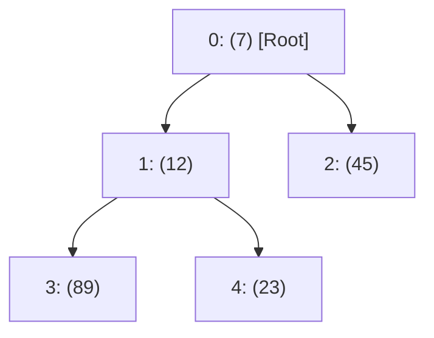

# Heaps and Priority Queues in C

> Deep architectural exploration of binary heaps in C: implicit flat-array memory representation, sift-up, sift-down, linear-time heapify, and priority queue applications.

| Metadata | Details |
| :--- | :--- |
| **Level** | Intermediate |
| **Prerequisites** | [02-core-concepts/01-arrays.md](../../02-core-concepts/01-arrays.md), [03-trees.md](./03-trees.md) |
| **Time to Read** | 40 minutes |
| **Status** | Complete |
| **Standard Baseline** | ISO C11 / C17 / C23 |

---

## Table of Contents
1. [What & Why](#1-what--why)
2. [Core Concepts](#2-core-concepts)
3. [How It Works Internally](#3-how-it-works-internally)
4. [Syntax & Usage](#4-syntax--usage)
5. [Practical Examples](#5-practical-examples)
6. [Best Practices](#6-best-practices)
7. [Common Mistakes & Pitfalls](#7-common-mistakes--pitfalls)
8. [Performance & Security Notes](#8-performance--security-notes)
9. [Comparison: Heap vs Sorted Array vs BST](#9-comparison-heap-vs-sorted-array-vs-bst)
10. [Interview Questions](#10-interview-questions)
11. [Practice Exercises](#11-practice-exercises)
12. [Summary & Cheat Sheet](#12-summary--cheat-sheet)
13. [Further Reading](#13-further-reading)

---

## 1. What & Why
A **Binary Heap** is a complete binary tree that satisfies the **Heap Property**:
- In a **Min-Heap**, for any given node $C$, the key of $C$'s parent $P$ is less than or equal to the key of $C$: $\text{key}(P) \le \text{key}(C)$. The absolute minimum element resides at the root.
- In a **Max-Heap**, $\text{key}(P) \ge \text{key}(C)$, with the maximum at the root.

A **Priority Queue** is an abstract data type where each element has an associated priority. Elements with higher priority are dequeued before elements with lower priority. Binary heaps provide the canonical implementation for priority queues.

Systems applications:
- **OS Process Schedulers**: Linux Completely Fair Scheduler (CFS) prioritizes tasks with lowest virtual runtime.
- **Graph Algorithms**: Dijkstra's shortest path and Prim's Minimum Spanning Tree depend on fast priority queues.
- **Event-Driven Simulation**: Real-time timer systems trigger timeouts sorted by earliest expiration timestamp.

---

## 2. Core Concepts

### 2.1 The Complete Binary Tree Property
A tree is *complete* if every level, except possibly the last, is completely filled, and all nodes in the last level are as far left as possible.
Because of this rigid structural property, a binary heap requires **zero pointers**! It is stored compactly inside a flat 1D array.

### 2.2 Index Arithmetic (0-Indexed)
For a node at index $i$:
- **Parent**: $\lfloor (i - 1) / 2 \rfloor$
- **Left Child**: $2i + 1$
- **Right Child**: $2i + 2$

### 2.3 Primary Operations
1. **Push (`sift_up`)**: Append element to end of array ($i = \text{size}$) and bubble up by repeatedly swapping with parent while smaller: $O(\log N)$.
2. **Pop Min (`sift_down`)**: Extract root element. Overwrite root with the last array element ($i = 0$), decrement size, and bubble down by swapping with the smaller child until heap property is restored: $O(\log N)$.
3. **Linear-Time Build (`heapify`)**: Convert an arbitrary array of $N$ items into a valid heap in $O(N)$ time by running `sift_down` backwards from index $\lfloor N/2 \rfloor - 1$ down to 0.

---

## 3. How It Works Internally

### Memory Layout: Implicit Tree in Flat Array

```
Logical Complete Binary Tree:
         [ 7 ] (idx 0)
        /     \
    [ 12 ]    [ 45 ] (idx 1, 2)
    /    \
  [ 89 ]  [ 23 ]     (idx 3, 4)

Flat Array Representation (Contiguous, Zero Pointer Overhead):
Index: [  0  |  1   |  2   |  3   |  4   ]
Value: [  7  |  12  |  45  |  89  |  23  ]
```



---

## 4. Syntax & Usage

```c
#define HEAP_CAP 64

typedef struct MinHeap {
    int data[HEAP_CAP];
    size_t size;
} MinHeap;

static inline size_t heap_parent(size_t i) { return (i - 1) / 2; }
static inline size_t heap_left(size_t i)   { return 2 * i + 1; }
static inline size_t heap_right(size_t i)  { return 2 * i + 2; }
```

---

## 5. Practical Examples

### Example 1: Binary Min-Heap Priority Queue
Goal: Implement a min-heap with insertion and minimum extraction, verifying sorted retrieval.

```c
#include <stdio.h>
#include <stdbool.h>

#define HEAP_MAX 32

typedef struct {
    int data[HEAP_MAX];
    size_t size;
} MinHeap;

static void swap(int *a, int *b) {
    int t = *a; *a = *b; *b = t;
}

static void heap_push(MinHeap *h, int val) {
    if (h->size >= HEAP_MAX) return;
    size_t i = h->size++;
    h->data[i] = val;
    while (i > 0 && h->data[(i - 1) / 2] > h->data[i]) {
        swap(&h->data[(i - 1) / 2], &h->data[i]);
        i = (i - 1) / 2;
    }
}

static bool heap_pop(MinHeap *h, int *out) {
    if (h->size == 0) return false;
    *out = h->data[0];
    h->data[0] = h->data[--h->size];
    size_t i = 0;
    while (2 * i + 1 < h->size) {
        size_t left = 2 * i + 1;
        size_t right = 2 * i + 2;
        size_t smallest = left;
        if (right < h->size && h->data[right] < h->data[left]) {
            smallest = right;
        }
        if (h->data[i] <= h->data[smallest]) break;
        swap(&h->data[i], &h->data[smallest]);
        i = smallest;
    }
    return true;
}

int main(void) {
    printf("=== Binary Min-Heap Priority Queue ===\n");
    MinHeap h = { .size = 0 };
    heap_push(&h, 45);
    heap_push(&h, 12);
    heap_push(&h, 89);
    heap_push(&h, 7);
    heap_push(&h, 23);

    printf("Extracting min elements in order: ");
    int min_val;
    while (heap_pop(&h, &min_val)) {
        printf("%d ", min_val);
    }
    printf("\n");
    return 0;
}
```

**Verified Output:**
```text
=== Binary Min-Heap Priority Queue ===
Extracting min elements in order: 7 12 23 45 89
```

---

## 6. Best Practices
1. **Build Heaps in $O(N)$ with `heapify`**: Never build a heap by calling `push` $N$ times ($O(N \log N)$). Use bottom-up `sift_down` starting from parent of last leaf.
2. **Handle Ties Deterministically**: If two elements have identical priorities, store an insertion counter (`uint64_t seq`) to maintain FIFO stability.
3. **Use Zero-Based Indexing**: While 1-based indexing simplifies math (`2i` and `2i+1`), 0-based indexing avoids wasting index 0 and aligns with C idioms.
4. **Prefer Min-Heap with Dynamic Array**: Back the heap with a geometrically growing dynamic array to prevent fixed capacity overflow.
5. **Combine Swap Operations in Sift**: Instead of calling `swap()` in every loop iteration, shift elements and place the target item only once at the final destination.

---

## 7. Common Mistakes & Pitfalls

| Mistake | Why It Is Dangerous | Correct Approach |
| :--- | :--- | :--- |
| Overwriting root without bubbling down | Violates heap property, returning corrupted priority values on subsequent pops. | Replace `data[0]` with `data[size - 1]` and call `sift_down(0)`. |
| Out-of-bounds child access | Reading `data[2*i + 2]` when `2*i + 2 >= size` causes buffer overrun. | Always check `if (right < size)` before comparing right child. |
| Building heap with $N$ insertions | Incurs $O(N \log N)$ time instead of optimal $O(N)$. | Run `sift_down` from `(size/2) - 1` down to 0. |
| Integer underflow on parent check | Unsigned integer `(i - 1) / 2` when $i = 0$ wraps to `SIZE_MAX / 2`. | Guard loop with `while (i > 0)`. |
| Modifying heap keys externally | Changing an element's priority while in the heap breaks ordering without updating position. | Implement `decrease_key` / `increase_key` with explicit sift up/down. |

---

## 8. Performance & Security Notes

### Algorithmic Complexity

| Operation | Binary Heap | Sorted Array | Unsorted Array | Balanced BST |
| :--- | :--- | :--- | :--- | :--- |
| **Peek Min** | $O(1)$ | $O(1)$ | $O(N)$ | $O(\log N)$ |
| **Extract Min** | $O(\log N)$ | $O(1)$ (shift $O(N)$) | $O(N)$ | $O(\log N)$ |
| **Insert** | $O(\log N)$ | $O(N)$ | $O(1)$ | $O(\log N)$ |
| **Build Heap** | $O(N)$ | $O(N \log N)$ | $O(1)$ | $O(N \log N)$ |

---

## 9. Comparison: Heap vs Sorted Array vs BST

```
Use Binary Heap when:
- Primary requirement is fast extraction of the extreme element (min or max).
- Zero pointer overhead and maximum cache locality are required.
- Priority queue scheduling.

Use Balanced BST (AVL/Red-Black) when:
- Arbitrary key searching ($O(\log N)$) is required.
- In-order sorted traversal of all elements is needed.
- Range queries (elements between A and B).
```

---

## 10. Interview Questions

<details>
<summary><strong>1. Why is building a heap via `heapify` $O(N)$ time instead of $O(N \log N)$?</strong></summary>

Most nodes in a complete binary tree reside near the bottom. Half of all nodes ($N/2$) are leaves with height 0 (requiring 0 sift operations). $N/4$ nodes have height 1, $N/8$ nodes have height 2, and only 1 node has height $\log N$.
The total operations sum to:
$$\sum_{h=1}^{\log N} \frac{N}{2^{h+1}} \cdot O(h) = O\left(N \sum_{h=1}^{\infty} \frac{h}{2^h}\right) = O(2N) = O(N)$$
</details>

<details>
<summary><strong>2. How does Heapsort work, and what is its worst-case time and space complexity?</strong></summary>

1. Build a Max-Heap from the array in $O(N)$ time.
2. Repeatedly swap the root (`data[0]`, current maximum) with the last element (`data[size - 1]`).
3. Decrement heap size and call `sift_down(0)` on the root.
4. Repeat until size is 1.
Time complexity is guaranteed $O(N \log N)$ in all cases (best, average, worst). Space complexity is $O(1)$ strictly in-place.
</details>

<details>
<summary><strong>3. Why is Quicksort usually faster in practice than Heapsort despite both being $O(N \log N)$?</strong></summary>

Cache locality. Quicksort scans contiguous memory sequentially with linear strides, maximizing CPU cache line hits. In Heapsort, `sift_down` jumps by indices $2i+1$ and $2i+2$. As the tree grows, child indices jump across memory pages, causing L1/L2 cache misses on almost every comparison.
</details>

<details>
<summary><strong>4. How do you implement `decrease_key` in a priority queue in $O(\log N)$ time?</strong></summary>

To modify an element's priority, you must locate its array index. Maintain an auxiliary position map (hash table or direct array) mapping `item_id -> heap_index`. When priority is decreased, lookup index in $O(1)$, update value, call `sift_up`, and update position mappings whenever items are swapped.
</details>

<details>
<summary><strong>5. How do you find the $K$-th largest element in an unsorted stream of numbers?</strong></summary>

Maintain a Min-Heap of size $K$.
- For each incoming number:
  - If heap size $< K$, push number.
  - Else if number $>$ heap root, pop root and push number.
At termination, the root of the min-heap is the $K$-th largest element. Time: $O(N \log K)$, space: $O(K)$.
</details>

<details>
<summary><strong>6. What is a $d$-ary Heap and when is it preferred over a binary heap?</strong></summary>

In a $d$-ary heap, each node has $d$ children instead of 2. It reduces tree height to $\log_d N$, making `sift_up` faster ($O(\log_d N)$). While `sift_down` requires $d$ child comparisons per level, larger branch factors (e.g. $d=4$ or $d=8$) align better with CPU cache line sizes, optimizing Dijkstra's algorithm.
</details>

<details>
<summary><strong>7. Is Heapsort a stable sort?</strong></summary>

No. Swapping root elements with the last array element and bubbling through the heap alters the relative order of elements with equal keys.
</details>

<details>
<summary><strong>8. What is the difference between a Binary Heap and a Fibonacci Heap?</strong></summary>

Fibonacci heaps support `insert` and `decrease_key` in $O(1)$ amortized time (compared to $O(\log N)$ in binary heaps), speeding up Dijkstra's algorithm to $O(|E| + |V| \log |V|)$. However, high constant factors and pointer overhead make binary heaps faster for practical problem sizes.
</details>

---

## 11. Practice Exercises

### Easy 1: Check If Array Is Min-Heap
Write `bool is_min_heap(const int *arr, size_t n);`.

<details>
<summary>Solution</summary>

```c
bool is_min_heap(const int *arr, size_t n) {
    for (size_t i = 0; i < n / 2; i++) {
        size_t l = 2 * i + 1;
        size_t r = 2 * i + 2;
        if (l < n && arr[i] > arr[l]) return false;
        if (r < n && arr[i] > arr[r]) return false;
    }
    return true;
}
```
</details>

### Easy 2: Heap Peek Min
Write `bool heap_peek(const MinHeap *h, int *out);`.

<details>
<summary>Solution</summary>

```c
bool heap_peek(const MinHeap *h, int *out) {
    if (!h || h->size == 0) return false;
    *out = h->data[0];
    return true;
}
```
</details>

### Easy 3: Count Elements Less Than X in Min-Heap
Count elements strictly smaller than $X$ without sorting the entire heap.

<details>
<summary>Solution</summary>

```c
int count_less_than(const int *heap, size_t n, size_t idx, int x) {
    if (idx >= n || heap[idx] >= x) return 0;
    return 1 + count_less_than(heap, n, 2 * idx + 1, x)
             + count_less_than(heap, n, 2 * idx + 2, x);
}
```
</details>

### Medium 1: In-Place Heapify
Implement $O(N)$ linear-time bottom-up `heapify` on an existing array.

<details>
<summary>Solution</summary>

```c
static void sift_down(int *arr, size_t n, size_t i) {
    while (2 * i + 1 < n) {
        size_t l = 2 * i + 1, r = 2 * i + 2, smallest = l;
        if (r < n && arr[r] < arr[l]) smallest = r;
        if (arr[i] <= arr[smallest]) break;
        int t = arr[i]; arr[i] = arr[smallest]; arr[smallest] = t;
        i = smallest;
    }
}

void heapify(int *arr, size_t n) {
    if (n < 2) return;
    for (ssize_t i = (n / 2) - 1; i >= 0; i--) {
        sift_down(arr, n, (size_t)i);
    }
}
```
</details>

### Medium 2: In-Place Heapsort
Implement in-place Heapsort sorting an array in ascending order.

<details>
<summary>Solution</summary>

```c
static void max_sift_down(int *arr, size_t n, size_t i) {
    while (2 * i + 1 < n) {
        size_t l = 2 * i + 1, r = 2 * i + 2, largest = l;
        if (r < n && arr[r] > arr[l]) largest = r;
        if (arr[i] >= arr[largest]) break;
        int t = arr[i]; arr[i] = arr[largest]; arr[largest] = t;
        i = largest;
    }
}

void heapsort(int *arr, size_t n) {
    // 1. Build Max-Heap
    for (ssize_t i = (n / 2) - 1; i >= 0; i--) max_sift_down(arr, n, i);
    // 2. Extract max to end
    for (size_t i = n - 1; i > 0; i--) {
        int t = arr[0]; arr[0] = arr[i]; arr[i] = t;
        max_sift_down(arr, i, 0);
    }
}
```
</details>

### Medium 3: Merge $K$ Sorted Arrays
Merge $K$ sorted arrays into a single sorted array using a min-heap.

<details>
<summary>Solution</summary>

```c
typedef struct {
    int val;
    int arr_idx;
    int elem_idx;
} KNode;

// Algorithm:
// Push first element of each of the K arrays into Min-Heap of size K.
// Repeatedly pop minimum, append to result array, and push the next element
// from the same array that provided the popped element.
```
</details>

### Hard 1: Priority Queue with Index Tracking (Decrease Key)
Implement a priority queue supporting $O(\log N)$ `decrease_key` via an auxiliary position map.

<details>
<summary>Solution</summary>

```c
typedef struct {
    int id;
    int priority;
} PQItem;

typedef struct {
    PQItem items[128];
    int pos_map[128]; // id -> heap_index
    size_t size;
} IndexedPQ;

static void pq_swap(IndexedPQ *pq, size_t i, size_t j) {
    PQItem tmp = pq->items[i];
    pq->items[i] = pq->items[j];
    pq->items[j] = tmp;
    pq->pos_map[pq->items[i].id] = i;
    pq->pos_map[pq->items[j].id] = j;
}
```
</details>

### Hard 2: Median Maintenance in Data Stream
Design a data structure that calculates running median in $O(1)$ time and $O(\log N)$ insertion.

<details>
<summary>Solution</summary>

```c
// Algorithm:
// Maintain two heaps:
// 1. Max-Heap for lower half of numbers.
// 2. Min-Heap for upper half of numbers.
// Balance sizes so Max-Heap has either equal or 1 more element than Min-Heap.
// Median is either Max-Heap root, or average of both roots.
```
</details>

### Hard 3: Top $K$ Frequent Elements
Given an array, return the $K$ most frequent elements using a min-heap.

<details>
<summary>Solution</summary>

```c
// Algorithm:
// 1. Hash map to count frequencies of each unique element.
// 2. Min-Heap of size K storing (frequency, element).
// 3. For each unique element in hash map:
//    - Push to Min-Heap if size < K.
//    - If frequency > heap root frequency, pop root and push current element.
```
</details>

---

## 12. Summary & Cheat Sheet

| Formula | 0-Indexed | 1-Indexed |
| :--- | :--- | :--- |
| **Parent** | `(i - 1) / 2` | `i / 2` |
| **Left Child** | `2 * i + 1` | `2 * i` |
| **Right Child** | `2 * i + 2` | `2 * i + 1` |
| **First Leaf Node** | `N / 2` | `(N / 2) + 1` |

---

## 13. Further Reading
- *Introduction to Algorithms* (CLRS), Chapter 6: Heapsort.
- Robert Sedgewick, *Algorithms in C*, Chapter 9: Priority Queues and Heapsort.

---

[← Previous Note: Queues & Circular Buffers](./07-queues-circular-buffer.md) | [Data Structures Index](./README.md) | [Next Note: Binary Search Trees](./09-binary-search-trees.md)
