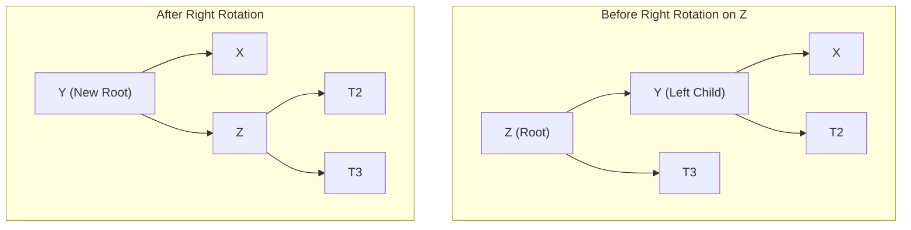

# Binary Search Trees and Self-Balancing in C

> Deep architectural exploration of Binary Search Trees (BST), AVL balance factor rotations, Red-Black invariants, node deletion mechanics, and iterative search traversal.

| Metadata | Details |
| :--- | :--- |
| **Level** | Intermediate |
| **Prerequisites** | [03-trees.md](./03-trees.md), [02-core-concepts/03-pointers.md](../../02-core-concepts/03-pointers.md) |
| **Time to Read** | 40 minutes |
| **Status** | Complete |
| **Standard Baseline** | ISO C11 / C17 / C23 |

---

## Table of Contents
1. [What & Why](#1-what--why)
2. [Core Concepts](#2-core-concepts)
3. [How It Works Internally](#3-how-it-works-internally)
4. [Syntax & Usage](#4-syntax--usage)
5. [Practical Examples](#5-practical-examples)
6. [Best Practices](#6-best-practices)
7. [Common Mistakes & Pitfalls](#7-common-mistakes--pitfalls)
8. [Performance & Security Notes](#8-performance--security-notes)
9. [Comparison: BST vs AVL vs Red-Black Tree](#9-comparison-bst-vs-avl-vs-red-black-tree)
10. [Interview Questions](#10-interview-questions)
11. [Practice Exercises](#11-practice-exercises)
12. [Summary & Cheat Sheet](#12-summary--cheat-sheet)
13. [Further Reading](#13-further-reading)

---

## 1. What & Why
A **Binary Search Tree** (BST) is a hierarchical node structure where every node satisfies the binary search invariant: all keys in its left subtree are strictly smaller, and all keys in its right subtree are strictly greater.

Why BSTs are foundational in systems engineering:
- **Ordered Associative Storage**: Unlike hash tables which randomize order, a BST allows ordered range queries ("find all IP addresses between X and Y") in $O(\log N + K)$ time.
- **Dynamic Adaptability**: Efficient insertion, deletion, minimum, maximum, and predecessor/successor search all in $O(H)$ time, where $H$ is tree height.
- **Self-Balancing Trees**: Red-Black trees and AVL trees guarantee $H = O(\log N)$, preventing worst-case performance collapse. Linux kernel uses Red-Black trees (`rbtree`) for virtual memory area (VMA) tracking and the CFS scheduler.

---

## 2. Core Concepts

### 2.1 The Degeneracy Problem
If elements are inserted into a basic BST in pre-sorted order (`10, 20, 30, 40, 50`), each new node becomes the right child of the previous. The tree degenerates into a singly linked list:
- Tree height $H = N$.
- Lookup degrades from $O(\log N)$ to $O(N)$.

### 2.2 AVL Tree Balance Factor & Rotations
An **AVL Tree** is a strictly height-balanced BST where for every node:
$$\text{Balance Factor }(BF) = \text{height}(\text{left}) - \text{height}(\text{right}) \in \{ -1, 0, 1 \}$$
When an insertion causes $BF \notin \{-1, 0, 1\}$, tree balance is restored via one of four pointer rotations:
1. **Left-Left (LL)**: Right rotation on root.
2. **Right-Right (RR)**: Left rotation on root.
3. **Left-Right (LR)**: Left rotation on left child, followed by Right rotation on root.
4. **Right-Left (RL)**: Right rotation on right child, followed by Left rotation on root.

### 2.3 Red-Black Tree Properties
1. Every node is colored either **RED** or **BLACK**.
2. The root is always **BLACK**.
3. All leaf nodes (`NULL`) are considered **BLACK**.
4. If a node is **RED**, both of its children must be **BLACK** (no two consecutive RED nodes).
5. Every path from a node to any of its descendant `NULL` leaves contains the exact same number of **BLACK** nodes (Black-Height).
These rules guarantee that the longest path from root to leaf is at most twice as long as the shortest path, guaranteeing $H \le 2 \log_2(N + 1)$.

---

## 3. How It Works Internally

### Tree Rotations Memory Mechanics

```
Right Rotation (Fixes Left-Heavy LL Imbalance):
      Z (Root)                 Y
     / \                     / \
    Y   T3      ===>         X   Z
   / \                         / \
  X   T2                       T2  T3
```



---

## 4. Syntax & Usage

```c
typedef struct BSTNode {
    int key;
    struct BSTNode *left;
    struct BSTNode *right;
} BSTNode;

typedef struct AVLNode {
    int key;
    int height;
    struct AVLNode *left;
    struct AVLNode *right;
} AVLNode;
```

---

## 5. Practical Examples

### Example 1: Non-Recursive BST Search and Iterative Insertion
Goal: Build a BST and perform iterative $O(1)$-auxiliary-space search without consuming stack frames.

```c
#include <stdio.h>
#include <stdlib.h>
#include <stdbool.h>

typedef struct BSTNode {
    int key;
    struct BSTNode *left;
    struct BSTNode *right;
} BSTNode;

static BSTNode *bst_insert(BSTNode *root, int key) {
    if (!root) {
        BSTNode *n = (BSTNode *)malloc(sizeof(BSTNode));
        if (!n) return NULL;
        n->key = key;
        n->left = n->right = NULL;
        return n;
    }
    if (key < root->key) root->left = bst_insert(root->left, key);
    else if (key > root->key) root->right = bst_insert(root->right, key);
    return root;
}

static bool bst_search(const BSTNode *root, int key) {
    while (root) {
        if (key == root->key) return true;
        if (key < root->key) root = root->left;
        else root = root->right;
    }
    return false;
}

static void bst_free(BSTNode *root) {
    if (!root) return;
    bst_free(root->left);
    bst_free(root->right);
    free(root);
}

int main(void) {
    printf("=== Binary Search Tree Validation ===\n");
    BSTNode *root = NULL;
    int keys[] = { 40, 20, 60, 10, 30, 50, 70 };
    for (size_t i = 0; i < 7; i++) {
        root = bst_insert(root, keys[i]);
    }

    printf("Search 30: %s\n", bst_search(root, 30) ? "FOUND" : "NOT FOUND");
    printf("Search 99: %s\n", bst_search(root, 99) ? "FOUND" : "NOT FOUND");

    bst_free(root);
    return 0;
}
```

**Verified Output:**
```text
=== Binary Search Tree Validation ===
Search 30: FOUND
Search 99: NOT FOUND
```

---

## 6. Best Practices
1. **Prefer Iterative Search Over Recursive**: `while (root) Ellipsis` runs in $O(1)$ stack space, preventing stack exhaustion on un-balanced trees.
2. **Update Heights Immediately During AVL Rotation**: Rotate child pointers first, then re-compute heights of rotated nodes: `h(n) = 1 + max(h(l), h(r))`.
3. **Use In-Order Successor for Two-Child Deletion**: When deleting node with 2 children, find the minimum node in right subtree (`while (curr->left) curr = curr->left;`), copy key, and delete that successor node.
4. **Choose Red-Black Over AVL for Write-Heavy Systems**: Red-Black trees require at most 2 rotations per insertion and 3 rotations per deletion; AVL may require $O(\log N)$ rotations on deletion.
5. **Double Pointer Insertion Idiom**: Use `BSTNode **curr = &root;` to avoid returning root pointers and simplifying tree mutation code.

---

## 7. Common Mistakes & Pitfalls

| Mistake | Why It Is Dangerous | Correct Approach |
| :--- | :--- | :--- |
| Assuming input data is random | Inserting pre-sorted IDs turns BST into $O(N)$ linked list. | Use balanced trees (AVL or Red-Black). |
| Forgetting to update height after AVL rotation | Balance factors become inaccurate, causing missing or incorrect subsequent rotations. | Update heights of rotated node and new root immediately. |
| Memory leak when deleting node with 2 children | Copying key from successor without freeing successor node leaks memory. | Recursively delete successor node from right subtree after copying. |
| In-order traversal stack overflow | Deep recursion on skewed tree crashes thread stack. | Use Morris traversal or iterative traversal with heap stack. |
| Comparing floats directly in BST keys | Float rounding issues (`NaN`, `-0.0`) violate strict total ordering. | Use epsilon comparisons or integer identifiers. |

---

## 8. Performance & Security Notes

### Algorithmic Complexity

| Operation | Basic BST (Worst) | AVL Tree (Worst) | Red-Black Tree (Worst) |
| :--- | :--- | :--- | :--- |
| **Search** | $O(N)$ | $O(\log N)$ | $O(\log N)$ |
| **Insert** | $O(N)$ | $O(\log N)$ | $O(\log N)$ |
| **Delete** | $O(N)$ | $O(\log N)$ | $O(\log N)$ |
| **Max Rotations on Insert** | None | 2 | 2 |
| **Max Rotations on Delete** | None | $O(\log N)$ | 3 |

---

## 9. Comparison: BST vs AVL vs Red-Black Tree

```
Basic BST:
- Best for: Quick prototypes where input is guaranteed random.
- Danger: Degenerates to linked list on ordered input.

AVL Tree:
- Best for: Read-heavy workloads (search speed optimal due to strict balance H <= 1.44 log2 N).
- Drawback: Higher rebalancing rotation cost on frequent writes.

Red-Black Tree:
- Best for: General-purpose systems associative containers (Linux rbtree, C++ std::map).
- Advantage: Faster insertion/deletion (at most 3 rotations per mutation).
```

---

## 10. Interview Questions

<details>
<summary><strong>1. Why does the Linux kernel use Red-Black trees (`rbtree`) instead of AVL trees?</strong></summary>

Linux memory management (VMAs) and task scheduling (CFS) perform frequent insertions and deletions. Red-Black trees require at most 2 rotations on insert and 3 on delete, whereas AVL trees may propagate rotations all the way up to the root ($O(\log N)$ rotations). The bounded rotation cost makes Red-Black trees significantly faster for write-heavy systems workloads.
</details>

<details>
<summary><strong>2. How do you find the in-order successor of a node in a BST?</strong></summary>

- If node has a **right subtree**: Successor is the leftmost node in the right subtree (`curr = node->right; while (curr->left) curr = curr->left;`).
- If node has **no right subtree**: Traverse from root down to node. The deepest ancestor for which the node is in the left subtree is the successor.
</details>

<details>
<summary><strong>3. What is the maximum height of an AVL tree with $N$ nodes?</strong></summary>

Height $H < 1.44 \log_2(N + 2) - 0.328$. AVL trees are strictly balanced within $\approx 44\%$ of the theoretical minimum binary tree height.
</details>

<details>
<summary><strong>4. How do you perform a range query in a BST in $O(\log N + K)$ time?</strong></summary>

To find all keys in $[L, R]$:
Start at root:
- If `root->key > L`, recursively explore left subtree.
- If `L <= root->key <= R`, output `root->key`.
- If `root->key < R`, recursively explore right subtree.
Pruning subtrees outside $[L, R]$ bounds the search to $O(\log N + K)$, where $K$ is the number of matching elements.
</details>

<details>
<summary><strong>5. What is the 2-3-4 tree connection to Red-Black trees?</strong></summary>

A Red-Black tree is an isometry (direct mapping) of a 2-3-4 B-tree. A 3-node (2 keys, 3 children) is represented as a black node with one red child. A 4-node (3 keys, 4 children) is represented as a black node with two red children. Rotations and color flips correspond directly to node splits and joins in 2-3-4 trees.
</details>

<details>
<summary><strong>6. Why do leaf nodes in Red-Black trees need to be black `NULL` pointers?</strong></summary>

Treating `NULL` pointers as black sentinel leaves ensures that the black-height invariant can be verified consistently across all terminal paths in the tree.
</details>

<details>
<summary><strong>7. How can you convert a sorted array into a height-balanced BST in $O(N)$ time?</strong></summary>

Recursively pick the middle element of the array slice `mid = (low + high) / 2` as the root node. Construct left subtree from `[low, mid - 1]` and right subtree from `[mid + 1, high]`. Runs in $O(N)$ time and produces a perfectly balanced tree.
</details>

<details>
<summary><strong>8. What is the difference between Left-Left and Left-Right rotation in AVL trees?</strong></summary>

- **Left-Left (LL)**: Imbalance caused by insertion into left child's left subtree. Fixed with a single Right rotation on unbalanced node.
- **Left-Right (LR)**: Imbalance caused by insertion into left child's right subtree. Requires a Left rotation on left child first, then Right rotation on unbalanced node.
</details>

---

## 11. Practice Exercises

### Easy 1: Find Maximum Key in BST
Write `int bst_max(const BSTNode *root);`.

<details>
<summary>Solution</summary>

```c
int bst_max(const BSTNode *root) {
    while (root->right) root = root->right;
    return root->key;
}
```
</details>

### Easy 2: Count Leaves in BST
Write `int bst_count_leaves(const BSTNode *root);`.

<details>
<summary>Solution</summary>

```c
int bst_count_leaves(const BSTNode *root) {
    if (!root) return 0;
    if (!root->left && !root->right) return 1;
    return bst_count_leaves(root->left) + bst_count_leaves(root->right);
}
```
</details>

### Easy 3: Calculate AVL Balance Factor
Write `int avl_balance_factor(const AVLNode *n);`.

<details>
<summary>Solution</summary>

```c
static inline int avl_h(const AVLNode *n) { return n ? n->height : 0; }

int avl_balance_factor(const AVLNode *n) {
    return n ? (avl_h(n->left) - avl_h(n->right)) : 0;
}
```
</details>

### Medium 1: In-Order Successor Search
Implement `BSTNode *bst_successor(BSTNode *root, int target);`.

<details>
<summary>Solution</summary>

```c
BSTNode *bst_successor(BSTNode *root, int target) {
    BSTNode *curr = root;
    BSTNode *succ = NULL;
    while (curr) {
        if (target < curr->key) {
            succ = curr;
            curr = curr->left;
        } else if (target > curr->key) {
            curr = curr->right;
        } else {
            if (curr->right) {
                curr = curr->right;
                while (curr->left) curr = curr->left;
                return curr;
            }
            break;
        }
    }
    return succ;
}
```
</details>

### Medium 2: Sorted Array to Balanced BST
Convert `int arr[]` of size $N$ into a balanced BST.

<details>
<summary>Solution</summary>

```c
BSTNode *sorted_arr_to_bst(const int *arr, int low, int high) {
    if (low > high) return NULL;
    int mid = low + (high - low) / 2;
    BSTNode *root = (BSTNode *)malloc(sizeof(BSTNode));
    root->key = arr[mid];
    root->left = sorted_arr_to_bst(arr, low, mid - 1);
    root->right = sorted_arr_to_bst(arr, mid + 1, high);
    return root;
}
```
</details>

### Medium 3: AVL Right Rotation
Implement a right rotation function on an `AVLNode **root_ref` and update heights.

<details>
<summary>Solution</summary>

```c
AVLNode *avl_rotate_right(AVLNode *y) {
    AVLNode *x = y->left;
    AVLNode *T2 = x->right;
    x->right = y;
    y->left = T2;
    int hl_y = avl_h(y->left), hr_y = avl_h(y->right);
    y->height = (hl_y > hr_y ? hl_y : hr_y) + 1;
    int hl_x = avl_h(x->left), hr_x = avl_h(x->right);
    x->height = (hl_x > hr_x ? hl_x : hr_x) + 1;
    return x;
}
```
</details>

### Hard 1: Delete Node from BST
Implement node deletion handling 0, 1, and 2 children correctly.

<details>
<summary>Solution</summary>

```c
BSTNode *bst_delete(BSTNode *root, int key) {
    if (!root) return NULL;
    if (key < root->key) root->left = bst_delete(root->left, key);
    else if (key > root->key) root->right = bst_delete(root->right, key);
    else {
        if (!root->left) {
            BSTNode *tmp = root->right; free(root); return tmp;
        } else if (!root->right) {
            BSTNode *tmp = root->left; free(root); return tmp;
        }
        BSTNode *succ = root->right;
        while (succ->left) succ = succ->left;
        root->key = succ->key;
        root->right = bst_delete(root->right, succ->key);
    }
    return root;
}
```
</details>

### Hard 2: Complete AVL Tree Insertion
Implement AVL insertion with all 4 rotations (LL, RR, LR, RL).

<details>
<summary>Solution</summary>

```c
AVLNode *avl_insert(AVLNode *node, int key) {
    if (!node) {
        AVLNode *n = (AVLNode *)malloc(sizeof(AVLNode));
        n->key = key; n->height = 1; n->left = n->right = NULL;
        return n;
    }
    if (key < node->key) node->left = avl_insert(node->left, key);
    else if (key > node->key) node->right = avl_insert(node->right, key);
    else return node;

    int hl = avl_h(node->left), hr = avl_h(node->right);
    node->height = 1 + (hl > hr ? hl : hr);
    int bf = hl - hr;

    // LL
    if (bf > 1 && key < node->left->key) return avl_rotate_right(node);
    // RR
    if (bf < -1 && key > node->right->key) {
        // rotate left
        AVLNode *r = node->right; node->right = r->left; r->left = node;
        node->height = 1 + (avl_h(node->left) > avl_h(node->right) ? avl_h(node->left) : avl_h(node->right));
        r->height = 1 + (avl_h(r->left) > avl_h(r->right) ? avl_h(r->left) : avl_h(r->right));
        return r;
    }
    // LR
    if (bf > 1 && key > node->left->key) {
        // rotate left on left child then right on node
        AVLNode *l = node->left; AVLNode *m = l->right; l->right = m->left; m->left = l;
        l->height = 1 + (avl_h(l->left) > avl_h(l->right) ? avl_h(l->left) : avl_h(l->right));
        m->height = 1 + (avl_h(m->left) > avl_h(m->right) ? avl_h(m->left) : avl_h(m->right));
        node->left = m;
        return avl_rotate_right(node);
    }
    // RL
    if (bf < -1 && key < node->right->key) {
        node->right = avl_rotate_right(node->right);
        // rotate left on node
        AVLNode *r = node->right; node->right = r->left; r->left = node;
        node->height = 1 + (avl_h(node->left) > avl_h(node->right) ? avl_h(node->left) : avl_h(node->right));
        r->height = 1 + (avl_h(r->left) > avl_h(r->right) ? avl_h(r->left) : avl_h(r->right));
        return r;
    }
    return node;
}
```
</details>

### Hard 3: Range Count in BST
Return count of keys between $A$ and $B$ in $O(\log N + K)$ time without storing keys.

<details>
<summary>Solution</summary>

```c
int bst_range_count(const BSTNode *root, int low, int high) {
    if (!root) return 0;
    if (root->key < low) return bst_range_count(root->right, low, high);
    if (root->key > high) return bst_range_count(root->left, low, high);
    return 1 + bst_range_count(root->left, low, high) + bst_range_count(root->right, low, high);
}
```
</details>

---

## 12. Summary & Cheat Sheet

| Operation | Logic |
| :--- | :--- |
| **Search** | `key < curr->key ? left : right` |
| **Delete 0 Children** | `free(node); return NULL;` |
| **Delete 1 Child** | `child = node->left ? node->left : node->right; free(node); return child;` |
| **Delete 2 Children** | Replace key with in-order successor; delete successor from right subtree |
| **AVL Balance Factor** | `height(left) - height(right)` |

---

## 13. Further Reading
- Linux Kernel Red-Black Trees: `Documentation/core-api/rbtree.rst`.
- *Introduction to Algorithms* (CLRS), Chapter 13: Red-Black Trees.

---

[← Previous Note: Heaps & Priority Queues](./08-heaps-and-priority-queues.md) | [Data Structures Index](./README.md) | [Next Note: Tries](./10-tries.md)
