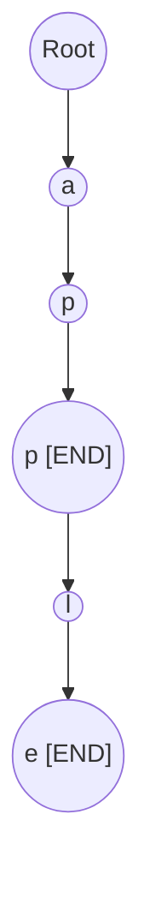

# Tries and Prefix Trees in C

> Deep architectural exploration of Tries (prefix trees) and Radix trees in C: n-way branching, prefix lookups, IP routing table longest-prefix matching, memory compaction, and cache behavior.

| Metadata | Details |
| :--- | :--- |
| **Level** | Intermediate |
| **Prerequisites** | [03-trees.md](./03-trees.md), [02-core-concepts/02-strings.md](../../02-core-concepts/02-strings.md) |
| **Time to Read** | 35 minutes |
| **Status** | Complete |
| **Standard Baseline** | ISO C11 / C17 / C23 |

---

## Table of Contents
1. [What & Why](#1-what--why)
2. [Core Concepts](#2-core-concepts)
3. [How It Works Internally](#3-how-it-works-internally)
4. [Syntax & Usage](#4-syntax--usage)
5. [Practical Examples](#5-practical-examples)
6. [Best Practices](#6-best-practices)
7. [Common Mistakes & Pitfalls](#7-common-mistakes--pitfalls)
8. [Performance & Security Notes](#8-performance--security-notes)
9. [Comparison: Trie vs Hash Table vs BST](#9-comparison-trie-vs-hash-table-vs-bst)
10. [Interview Questions](#10-interview-questions)
11. [Practice Exercises](#11-practice-exercises)
12. [Summary & Cheat Sheet](#12-summary--cheat-sheet)
13. [Further Reading](#13-further-reading)

---

## 1. What & Why
A **Trie** (derived from re**trie**val, pronounced "try") is a multiway search tree used to store dynamic sets of strings where keys are represented not inside individual nodes, but implicitly along the paths from the root.

Why Tries matter in systems engineering:
- **Prefix Matching & Autocomplete**: Quickly find all strings beginning with prefix $P$ in $O(|P| + K)$ time, completely independent of the total dictionary size $N$.
- **Network Routing**: IP routers match incoming packet destination addresses against routing tables using **Longest Prefix Matching** (LPM) implemented with binary radix tries.
- **Spell Checkers & Dictionaries**: Efficient lexicon verification with shared prefix storage.

---

## 2. Core Concepts

### 2.1 The Alphabet Array vs Byte Branching
- **Fixed Alphabet (e.g. 26 lowercase ASCII)**: Each node contains `TrieNode *children[26];`.
  - Node index: `c - 'a'`.
  - Fast $O(1)$ child branch lookup.
  - Large memory footprint ($26 \times 8 = 208$ bytes per node on 64-bit systems).
- **Full Byte Trie (256 children)**: Supports arbitrary binary strings and ASCII. Memory per node: $256 \times 8 = 2048$ bytes.
- **Radix Tree (Compressed Trie / Patricia Trie)**: Compresses non-branching linear paths into a single edge containing a string slice, dramatically reducing node allocation overhead.

### 2.2 Terminal Node Marker (`is_end`)
A boolean flag `bool is_end;` distinguishes between a string that actually exists in the dictionary and a prefix that is merely part of a longer word. For example, inserting `"apple"` creates paths for `"a"`, `"ap"`, `"app"`, `"appl"`, but only `"apple"` has `is_end = true` unless `"app"` was explicitly inserted.

---

## 3. How It Works Internally

### Memory Layout & Edge Traversal

```
Root
 |--> 'a'
       |--> 'p'
             |--> 'p' (is_end = true) [Word: "app"]
                   |--> 'l'
                         |--> 'e' (is_end = true) [Word: "apple"]
                   |--> 'l'
                         |--> 'i'
                               |--> 'c'
                                     |--> 'a'
                                           |--> 't'
                                                 |--> 'i'
                                                       |--> 'o'
                                                             |--> 'n' (is_end = true)
```



---

## 4. Syntax & Usage

```c
#define ALPHABET_SIZE 26

typedef struct TrieNode {
    struct TrieNode *children[ALPHABET_SIZE];
    bool is_end;
} TrieNode;
```

---

## 5. Practical Examples

### Example 1: Full Trie Insertion, Exact Match, and Prefix Query
Goal: Build a Trie, verify exact search and `starts_with` prefix search.

```c
#include <stdio.h>
#include <stdlib.h>
#include <string.h>
#include <stdbool.h>

#define ALPHABET_SIZE 26

typedef struct TrieNode {
    struct TrieNode *children[ALPHABET_SIZE];
    bool is_end;
} TrieNode;

static TrieNode *trie_create_node(void) {
    TrieNode *node = (TrieNode *)malloc(sizeof(TrieNode));
    if (!node) return NULL;
    node->is_end = false;
    for (int i = 0; i < ALPHABET_SIZE; i++) node->children[i] = NULL;
    return node;
}

static void trie_insert(TrieNode *root, const char *key) {
    TrieNode *curr = root;
    while (*key) {
        int idx = *key - 'a';
        if (idx < 0 || idx >= ALPHABET_SIZE) return;
        if (!curr->children[idx]) {
            curr->children[idx] = trie_create_node();
        }
        curr = curr->children[idx];
        key++;
    }
    curr->is_end = true;
}

static bool trie_search(const TrieNode *root, const char *key) {
    const TrieNode *curr = root;
    while (*key) {
        int idx = *key - 'a';
        if (idx < 0 || idx >= ALPHABET_SIZE || !curr->children[idx]) return false;
        curr = curr->children[idx];
        key++;
    }
    return curr != NULL && curr->is_end;
}

static bool trie_starts_with(const TrieNode *root, const char *prefix) {
    const TrieNode *curr = root;
    while (*prefix) {
        int idx = *prefix - 'a';
        if (idx < 0 || idx >= ALPHABET_SIZE || !curr->children[idx]) return false;
        curr = curr->children[idx];
        prefix++;
    }
    return true;
}

static void trie_free(TrieNode *root) {
    if (!root) return;
    for (int i = 0; i < ALPHABET_SIZE; i++) {
        trie_free(root->children[i]);
    }
    free(root);
}

int main(void) {
    printf("=== Trie Prefix Tree Search ===\n");
    TrieNode *root = trie_create_node();
    trie_insert(root, "apple");
    trie_insert(root, "app");
    trie_insert(root, "application");

    printf("Search 'app': %s\n", trie_search(root, "app") ? "EXISTS" : "MISSING");
    printf("Search 'appl': %s\n", trie_search(root, "appl") ? "EXISTS" : "MISSING");
    printf("Prefix 'appl': %s\n", trie_starts_with(root, "appl") ? "MATCHED" : "NO MATCH");

    trie_free(root);
    return 0;
}
```

**Verified Output:**
```text
=== Trie Prefix Tree Search ===
Search 'app': EXISTS
Search 'appl': MISSING
Prefix 'appl': MATCHED
```

---

## 6. Best Practices
1. **Always Check Index Bounds**: Validate `0 <= idx < ALPHABET_SIZE` before array indexing to prevent out-of-bounds memory writes from non-ASCII or uppercase characters.
2. **Post-Order Deallocation**: Recursively free all children before freeing the parent node (`trie_free`).
3. **Use Radix Trees for Large Lexicons**: Standard Tries waste 80-95% of allocated pointers on `NULL`. Compressing linear single-child chains saves orders of magnitude in RAM.
4. **Use Arena Allocators for Tries**: Allocating thousands of small nodes with individual `malloc()` calls fragments the heap. Allocate nodes from a contiguous memory arena.
5. **Differentiate Prefix from Word**: Never return `true` on search unless `curr->is_end == true`.

---

## 7. Common Mistakes & Pitfalls

| Mistake | Why It Is Dangerous | Correct Approach |
| :--- | :--- | :--- |
| Passing uppercase characters | Negative index `('A' - 'a' == -32)` corrupts memory before the `children` array. | Normalize with `tolower()` or check `isalpha()`. |
| Memory leak on node deletion | Simply setting `is_end = false` retains unused leaf nodes on the heap indefinitely. | Prune unbranched leaf nodes bottom-up when `is_end` is cleared. |
| Pointer dereference on NULL child | Accessing `curr->children[idx]->is_end` without verifying child pointer exists causes SIGSEGV. | Always check `if (!curr->children[idx]) return false;`. |
| Huge memory footprint | Allocating a 256-pointer table for every character in a million words consumes gigabytes. | Use compact ternary search trees (TST) or radix trees. |
| Forgetting base case in recursive free | Calling `free()` on already freed child pointers invokes undefined behavior. | Guard `if (!root) return;`. |

---

## 8. Performance & Security Notes

### Complexity Analysis
- **Search Key of Length $L$**: strictly $O(L)$, completely independent of total words in dictionary.
- **Insert Key of Length $L$**: strictly $O(L)$.
- **Prefix Match of Length $P$**: strictly $O(P)$.
- **Memory Overhead**: High ($O(L \cdot \Sigma)$ where $\Sigma$ is alphabet size).

---

## 9. Comparison: Trie vs Hash Table vs BST

```
Trie:
- Search time: O(L) where L is string length.
- Prefix searching: O(P) native support.
- Memory: High (sparse pointer matrices).

Hash Table:
- Search time: O(L) average (hash calculation + string comparison).
- Prefix searching: Impossible without O(N) full scan.
- Memory: Compact.

BST:
- Search time: O(L * log N).
- Prefix searching: Supported via range search.
- Memory: Moderate (2 pointers per word).
```

---

## 10. Interview Questions

<details>
<summary><strong>1. What is a Radix Tree (Patricia Trie) and how does it optimize a standard Trie?</strong></summary>

A Radix tree compresses every sequence of single-child nodes into a single edge holding a string fragment. For example, the path `r -> o -> m -> a -> n` in a standard Trie requires 5 nodes; in a Radix tree, it collapses into a single node with edge label `"roman"`. This eliminates up to 80% of node pointers and CPU cache misses.
</details>

<details>
<summary><strong>2. How does Longest Prefix Matching (LPM) work in IP routing?</strong></summary>

IP routing tables store subnets in CIDR notation (e.g. `192.168.0.0/16`). A binary radix trie stores bits (0 or 1). For an incoming destination IP, traversal follows bits from most significant to least significant. The last matching node on the path containing a gateway route is the Longest Prefix Match.
</details>

<details>
<summary><strong>3. What is a Ternary Search Tree (TST) and why is it more memory-efficient than a standard Trie?</strong></summary>

In a TST, each node contains a single character and three child pointers: `low`, `equal`, and `high` (like a BST). If search char is smaller, go `low`; if larger, go `high`; if equal, go `equal` and advance to next char. A TST uses only 3 pointers per node instead of 26 or 256, reducing memory usage by 70–90%.
</details>

<details>
<summary><strong>4. How do you delete a word from a Trie without leaving dangling empty nodes?</strong></summary>

Recursively traverse down to the terminal node of the word and set `is_end = false`. On the way back up the call stack, if a node has `is_end == false` and all its child pointers are `NULL`, free that node and set its parent's pointer to `NULL`.
</details>

<details>
<summary><strong>5. How does a Trie enable wildcard matching (e.g., regex `.` matching any character)?</strong></summary>

During search, if a wildcard `.` is encountered, branch into *all* non-null children of the current node recursively. If any branch matches the remaining string pattern, return `true`.
</details>

<details>
<summary><strong>6. Why is a Hash Table often preferred over a Trie for simple exact string lookups?</strong></summary>

A hash table computes the hash once and performs a single array lookup and string comparison ($O(1)$ memory accesses). A Trie performs $L$ separate heap memory pointer dereferences, causing $L$ CPU cache misses. For keys without common prefixes, hash tables are much faster.
</details>

<details>
<summary><strong>7. How can you implement word frequency tracking in a Trie?</strong></summary>

Replace `bool is_end;` with `int frequency;` (or `size_t count;`). When inserting a word, increment `curr->frequency++`.
</details>

<details>
<summary><strong>8. What is the Aho-Corasick automaton and how does it extend a Trie?</strong></summary>

The Aho-Corasick algorithm builds failure links (similar to KMP) between nodes in a Trie. It matches multiple dictionary patterns simultaneously in text in linear $O(N + M)$ time, used extensively in intrusion detection systems (Snort) and antivirus scanners.
</details>

---

## 11. Practice Exercises

### Easy 1: Check If Node Is Leaf
Write `bool trie_is_leaf(const TrieNode *n);` returning `true` if node has no children.

<details>
<summary>Solution</summary>

```c
bool trie_is_leaf(const TrieNode *n) {
    if (!n) return false;
    for (int i = 0; i < ALPHABET_SIZE; i++) {
        if (n->children[i]) return false;
    }
    return true;
}
```
</details>

### Easy 2: Count Words in Trie
Write a function `size_t trie_word_count(const TrieNode *root);`.

<details>
<summary>Solution</summary>

```c
size_t trie_word_count(const TrieNode *root) {
    if (!root) return 0;
    size_t count = root->is_end ? 1 : 0;
    for (int i = 0; i < ALPHABET_SIZE; i++) {
        count += trie_word_count(root->children[i]);
    }
    return count;
}
```
</details>

### Easy 3: Clear All Words
Implement `void trie_clear(TrieNode *root);` clearing all words while keeping root intact.

<details>
<summary>Solution</summary>

```c
void trie_clear(TrieNode *root) {
    if (!root) return;
    for (int i = 0; i < ALPHABET_SIZE; i++) {
        trie_free(root->children[i]);
        root->children[i] = NULL;
    }
    root->is_end = false;
}
```
</details>

### Medium 1: Delete Word from Trie
Implement clean deletion that prunes unused child nodes.

<details>
<summary>Solution</summary>

```c
static bool has_children(const TrieNode *n) {
    for (int i = 0; i < ALPHABET_SIZE; i++) if (n->children[i]) return true;
    return false;
}

static bool trie_delete_helper(TrieNode *curr, const char *key) {
    if (!curr) return false;
    if (*key == '\0') {
        if (!curr->is_end) return false;
        curr->is_end = false;
        return !has_children(curr);
    }
    int idx = *key - 'a';
    if (idx < 0 || idx >= ALPHABET_SIZE || !curr->children[idx]) return false;
    bool should_delete_child = trie_delete_helper(curr->children[idx], key + 1);
    if (should_delete_child) {
        free(curr->children[idx]);
        curr->children[idx] = NULL;
        return !curr->is_end && !has_children(curr);
    }
    return false;
}

bool trie_delete(TrieNode *root, const char *key) {
    if (!root || !key) return false;
    return trie_delete_helper(root, key);
}
```
</details>

### Medium 2: Autocomplete Prefix Collector
Collect up to $K$ words matching a given prefix.

<details>
<summary>Solution</summary>

```c
static void collect_words(const TrieNode *node, char *buffer, int depth, int *found, int max_find) {
    if (!node || *found >= max_find) return;
    if (node->is_end) {
        buffer[depth] = '\0';
        printf("Suggestion: %s\n", buffer);
        (*found)++;
    }
    for (int i = 0; i < ALPHABET_SIZE; i++) {
        if (node->children[i]) {
            buffer[depth] = 'a' + i;
            collect_words(node->children[i], buffer, depth + 1, found, max_find);
        }
    }
}
```
</details>

### Medium 3: Longest Common Prefix of Dictionary
Find the longest common prefix shared by all words in a Trie.

<details>
<summary>Solution</summary>

```c
char *trie_longest_common_prefix(const TrieNode *root) {
    static char buf[256];
    int len = 0;
    const TrieNode *curr = root;
    while (curr && !curr->is_end) {
        int child_count = 0;
        int next_idx = -1;
        for (int i = 0; i < ALPHABET_SIZE; i++) {
            if (curr->children[i]) { child_count++; next_idx = i; }
        }
        if (child_count != 1) break;
        buf[len++] = 'a' + next_idx;
        curr = curr->children[next_idx];
    }
    buf[len] = '\0';
    return buf;
}
```
</details>

### Hard 1: Wildcard Word Search (`.` matches any char)
Implement word search where `.` can match any lowercase letter.

<details>
<summary>Solution</summary>

```c
bool trie_search_wildcard(const TrieNode *curr, const char *key) {
    if (!curr) return false;
    if (*key == '\0') return curr->is_end;
    if (*key == '.') {
        for (int i = 0; i < ALPHABET_SIZE; i++) {
            if (curr->children[i] && trie_search_wildcard(curr->children[i], key + 1)) {
                return true;
            }
        }
        return false;
    }
    int idx = *key - 'a';
    if (idx < 0 || idx >= ALPHABET_SIZE || !curr->children[idx]) return false;
    return trie_search_wildcard(curr->children[idx], key + 1);
}
```
</details>

### Hard 2: Binary Radix Trie for IP Routing
Implement a 1-bit binary Trie supporting 32-bit IPv4 addresses and longest prefix match.

<details>
<summary>Solution</summary>

```c
typedef struct RadixNode {
    struct RadixNode *children[2]; // 0 or 1
    int next_hop_gateway;
    bool has_route;
} RadixNode;

int ip_longest_prefix_match(const RadixNode *root, uint32_t ip) {
    int gateway = -1;
    const RadixNode *curr = root;
    for (int i = 31; i >= 0 && curr; i--) {
        if (curr->has_route) gateway = curr->next_hop_gateway;
        int bit = (ip >> i) & 1;
        curr = curr->children[bit];
    }
    if (curr && curr->has_route) gateway = curr->next_hop_gateway;
    return gateway;
}
```
</details>

### Hard 3: Ternary Search Tree (TST) Implementation
Implement a compact Ternary Search Tree with `low`, `equal`, and `high` pointers.

<details>
<summary>Solution</summary>

```c
typedef struct TSTNode {
    char c;
    bool is_end;
    struct TSTNode *low;
    struct TSTNode *eq;
    struct TSTNode *high;
} TSTNode;

TSTNode *tst_insert(TSTNode *root, const char *word) {
    if (!*word) return root;
    if (!root) {
        root = (TSTNode *)malloc(sizeof(TSTNode));
        root->c = *word; root->is_end = false;
        root->low = root->eq = root->high = NULL;
    }
    if (*word < root->c) root->low = tst_insert(root->low, word);
    else if (*word > root->c) root->high = tst_insert(root->high, word);
    else {
        if (*(word + 1)) root->eq = tst_insert(root->eq, word + 1);
        else root->is_end = true;
    }
    return root;
}
```
</details>

---

## 12. Summary & Cheat Sheet

| Feature | Standard Trie | Radix Tree | Ternary Search Tree |
| :--- | :--- | :--- | :--- |
| **Search Time** | $O(L)$ | $O(L)$ | $O(L + \log \Sigma)$ |
| **Pointers Per Node** | 26 or 256 | 2 to 256 | 3 (`low`, `eq`, `high`) |
| **Memory Footprint** | Massive | Compact | Highly Compact |
| **Best Used For** | Fast ASCII prefix search | IP routing (LPM) | Large dictionaries / spell check |

---

## 13. Further Reading
- *Algorithms in C*, Robert Sedgewick (Ternary Search Trees and Tries).
- Donald Knuth, *The Art of Computer Programming, Volume 3: Sorting and Searching* (Section 6.3: Digital Searching).

---

[← Previous Note: Binary Search Trees](./09-binary-search-trees.md) | [Data Structures Index](./README.md) | [Next Note: Union-Find](./11-union-find.md)
