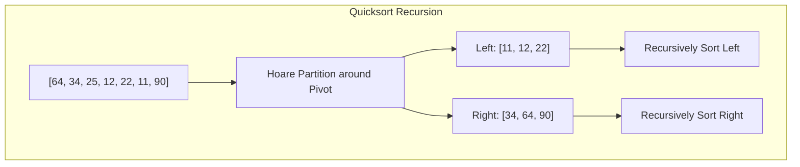

# Sorting Algorithms in C

> Deep comparative exploration of sorting algorithms in C: Quicksort (Lomuto vs Hoare), Mergesort, Heapsort, Insertion sort, the C standard library `qsort()`, cache effects, and stability.

| Metadata | Details |
| :--- | :--- |
| **Level** | Intermediate |
| **Prerequisites** | [02-core-concepts/01-arrays.md](../../02-core-concepts/01-arrays.md), [03-intermediate/01-function-pointers.md](../01-function-pointers.md) |
| **Time to Read** | 45 minutes |
| **Status** | Complete |
| **Standard Baseline** | ISO C11 / C17 / C23 |

---

## Table of Contents
1. [What & Why](#1-what--why)
2. [Core Concepts](#2-core-concepts)
3. [How It Works Internally](#3-how-it-works-internally)
4. [Syntax & Usage](#4-syntax--usage)
5. [Practical Examples](#5-practical-examples)
6. [Best Practices](#6-best-practices)
7. [Common Mistakes & Pitfalls](#7-common-mistakes--pitfalls)
8. [Performance & Security Notes](#8-performance--security-notes)
9. [Comparison: Sorting Algorithms Matrix](#9-comparison-sorting-algorithms-matrix)
10. [Interview Questions](#10-interview-questions)
11. [Practice Exercises](#11-practice-exercises)
12. [Summary & Cheat Sheet](#12-summary--cheat-sheet)
13. [Further Reading](#13-further-reading)

---

## 1. What & Why
Sorting arranges an array of elements into a designated order (typically ascending or descending). In systems engineering, sorting is rarely an isolated problem; it is the prerequisite for fast searches ($O(\log N)$ binary search), database indexing (B-trees), deduplication, and scheduling algorithms.

Why understanding sorting implementations in C is critical:
- **Cache Awareness**: A theoretically optimal $O(N \log N)$ sort can be 5x slower than another due to CPU cache stalls.
- **Safety & Reentrancy**: Standard library `qsort()` is not reentrant without `qsort_r()` / `qsort_s()`.
- **Worst-Case Immunity**: Naive Quicksort degrades to $O(N^2)$ on pre-sorted or adversarial inputs, causing algorithmic complexity denial of service.

---

## 2. Core Concepts

### 2.1 Stability
A sorting algorithm is **stable** if elements with identical keys preserve their relative order from the input.
- **Stable**: Mergesort, Insertion Sort, Timsort.
- **Unstable**: Quicksort, Heapsort, Selection Sort.

### 2.2 Quicksort Partitioning Schemes
- **Lomuto Partitioning**: Pivot placed at end; single forward scan with pointer $i$. Simple to write, but does $3\times$ more swaps on average and degrades to $O(N^2)$ when all keys are equal.
- **Hoare Partitioning**: Two pointers scanning inward from both ends. Executes far fewer swaps and handles duplicate elements gracefully.
- **Median-of-Three**: Choose pivot as median of `arr[low]`, `arr[mid]`, and `arr[high]`, preventing $O(N^2)$ collapse on pre-sorted data.

### 2.3 The C Standard `qsort()`
Declared in `<stdlib.h>`:
```c
void qsort(void *base, size_t nel, size_t width, int (*compar)(const void *, const void *));
```
- Operates on generic memory buffers using `void *`.
- Comparison function must return:
  - $< 0$ if $a < b$
  - $0$ if $a == b$
  - $> 0$ if $a > b$

---

## 3. How It Works Internally

### Partitioning Memory Layout (Lomuto vs Hoare)

```
Lomuto Partitioning (Pivot = arr[high]):
[ <= Pivot | > Pivot | Unprocessed | Pivot ]
  ^low        ^i       ^j            ^high

Hoare Partitioning (Pointers converge):
[ ... <= Pivot ... | ... >= Pivot ... ]
  -----> i               j <-----
```



---

## 4. Syntax & Usage

### Safe Integer Comparator Idiom
```c
// Correct: avoids integer overflow bugs of (ia - ib)!
int cmp_int(const void *a, const void *b) {
    int ia = *(const int *)a;
    int ib = *(const int *)b;
    return (ia > ib) - (ia < ib);
}
```

---

## 5. Practical Examples

### Example 1: Custom Quicksort vs C Standard Library `qsort()`
Goal: Implement an in-place Quicksort, compare against the standard library `qsort()`, and verify identical output.

```c
#include <stdio.h>
#include <stdlib.h>

static int cmp_int(const void *a, const void *b) {
    int ia = *(const int *)a;
    int ib = *(const int *)b;
    return (ia > ib) - (ia < ib);
}

static void quicksort_lumuto(int *arr, int low, int high) {
    if (low >= high) return;
    int pivot = arr[high];
    int i = low - 1;
    for (int j = low; j < high; j++) {
        if (arr[j] <= pivot) {
            i++;
            int t = arr[i]; arr[i] = arr[j]; arr[j] = t;
        }
    }
    int t = arr[i + 1]; arr[i + 1] = arr[high]; arr[high] = t;
    int p = i + 1;

    quicksort_lumuto(arr, low, p - 1);
    quicksort_lumuto(arr, p + 1, high);
}

int main(void) {
    printf("=== Quicksort vs Standard qsort ===\n");
    int data1[] = { 64, 34, 25, 12, 22, 11, 90 };
    int n = sizeof(data1) / sizeof(data1[0]);

    quicksort_lumuto(data1, 0, n - 1);
    printf("Sorted by custom quicksort: ");
    for (int i = 0; i < n; i++) printf("%d ", data1[i]);
    printf("\n");

    int data2[] = { 64, 34, 25, 12, 22, 11, 90 };
    qsort(data2, n, sizeof(int), cmp_int);
    printf("Sorted by C standard qsort: ");
    for (int i = 0; i < n; i++) printf("%d ", data2[i]);
    printf("\n");
    return 0;
}
```

**Verified Output:**
```text
=== Quicksort vs Standard qsort ===
Sorted by custom quicksort: 11 12 22 25 34 64 90 
Sorted by C standard qsort: 11 12 22 25 34 64 90
```

---

## 6. Best Practices
1. **Never Subtract in Comparators**: Writing `return (*(int *)a - *(int *)b);` causes signed integer overflow when subtracting negative numbers from `INT_MAX`, invoking undefined behavior. Use `(ia > ib) - (ia < ib)`.
2. **Use Tail Call Optimization for Quicksort**: Recurse on the smaller partition and loop on the larger partition. This guarantees maximum stack depth $O(\log N)$ instead of $O(N)$.
3. **Switch to Insertion Sort for Small Partitions**: When partition size drops below 16–32 elements, switch from Quicksort/Mergesort to Insertion Sort. Insertion sort avoids recursion overhead and has ideal cache locality.
4. **Use Introsort for Production**: Start with Quicksort; if recursion depth exceeds $2 \log N$, switch to Heapsort to guarantee $O(N \log N)$ worst-case.
5. **Pre-Allocate Temporary Buffer for Mergesort**: Allocate the merge buffer once upfront: `malloc(N * sizeof(T))`. Allocating in every recursive frame fragments the heap.

---

## 7. Common Mistakes & Pitfalls

| Mistake | Why It Is Dangerous | Correct Approach |
| :--- | :--- | :--- |
| `return ia - ib;` in `qsort` comparator | **Signed Overflow**: `INT_MIN - 1` overflows to `INT_MAX`, inverting comparison and corrupting sort. | Use branchless sign idiom: `(ia > ib) - (ia < ib)`. |
| Stack overflow on sorted input | Naive Quicksort on $10^5$ sorted items uses $10^5$ recursive stack frames, crashing with SIGSEGV. | Use median-of-three pivot and tail-call loop. |
| Memory leak in Mergesort | Allocating temporary arrays inside recursive calls without pairing with `free()`. | Allocate one scratch buffer at top level and pass down. |
| Inverting comparator contract | Returning 0 for unequal items violates strict weak ordering, causing glibc `qsort` to write out of bounds. | Return 0 strictly when keys are equal. |
| Assuming `qsort()` is stable | Re-sorting a list with `qsort()` scrambles previously ordered secondary fields. | Use stable Mergesort if order preservation is required. |

---

## 8. Performance & Security Notes

### Algorithmic Complexity Comparison

| Algorithm | Best Time | Average Time | Worst Time | Space | Stable? | Cache Locality |
| :--- | :--- | :--- | :--- | :--- | :--- | :--- |
| **Quicksort** | $O(N \log N)$ | $O(N \log N)$ | $O(N^2)$ | $O(\log N)$ | No | Excellent |
| **Mergesort** | $O(N \log N)$ | $O(N \log N)$ | $O(N \log N)$ | $O(N)$ | Yes | Good |
| **Heapsort** | $O(N \log N)$ | $O(N \log N)$ | $O(N \log N)$ | $O(1)$ | No | Poor |
| **Insertion Sort** | $O(N)$ | $O(N^2)$ | $O(N^2)$ | $O(1)$ | Yes | Superb |

---

## 9. Comparison: Sorting Algorithms Matrix

```
Quicksort:
- Fastest general-purpose in-memory sort in practice.
- Superb CPU cache line sequential access.
- Not stable; requires pivot defense against O(N^2).

Mergesort:
- Guaranteed O(N log N) in all cases.
- Stable sort.
- Preferred for linked lists (O(1) extra space) and external disk sorting.
- Requires O(N) extra memory buffer for arrays.

Heapsort:
- Guaranteed O(N log N) with strictly O(1) extra space.
- Poor cache locality due to index jumps (2i+1).
- Unstable.
```

---

## 10. Interview Questions

<details>
<summary><strong>1. Why is standard library `qsort()` typically faster than Heapsort?</strong></summary>

Cache locality and instruction branch prediction. Quicksort scans elements linearly from both ends, loading consecutive memory addresses into L1 cache lines. Heapsort jumps through array indices ($2i+1, 2i+2$), traversing memory pages randomly and causing constant CPU cache misses.
</details>

<details>
<summary><strong>2. How does Introsort achieve both Quicksort's average speed and Heapsort's worst-case guarantee?</strong></summary>

Introsort (introspective sort, used in C++ `std::sort` and modern libc):
1. Starts sorting using Quicksort.
2. Tracks recursion depth. If depth exceeds $2 \lfloor \log_2 N \rfloor$, it detects that Quicksort is degenerating towards $O(N^2)$ and switches that partition to Heapsort ($O(N \log N)$ guaranteed).
3. Switches to Insertion Sort when partitions become small ($< 16$).
</details>

<details>
<summary><strong>3. What is the difference between Lomuto and Hoare partitioning schemes?</strong></summary>

- **Lomuto**: Simpler code; keeps pivot at end and advances one index. Does $\approx 3\times$ more element swaps; degrades to $O(N^2)$ if all elements are equal.
- **Hoare**: Scans inward from both ends; terminates earlier on equal elements; executes $\approx 3\times$ fewer swaps, making it substantially faster in practice.
</details>

<details>
<summary><strong>4. Why is Mergesort the preferred algorithm for sorting Linked Lists?</strong></summary>

In linked lists, merging two sorted lists requires only rearranging existing pointer links in $O(1)$ auxiliary space without memory reallocation. In contrast, array Mergesort requires $O(N)$ extra memory for temporary buffers. Furthermore, Quicksort's random access benefits are lost on linked lists.
</details>

<details>
<summary><strong>5. Why is `qsort_r` / `qsort_s` necessary in multi-threaded programs?</strong></summary>

The standard `qsort` comparator only takes `(const void *a, const void *b)`, preventing callers from passing context data (such as a database collation table or configuration struct) without dangerous global variables. `qsort_r` (GNU/BSD) and `qsort_s` (C11 Annex K) pass a third `void *context` pointer into the comparison callback.
</details>

<details>
<summary><strong>6. What is an in-place sort?</strong></summary>

An algorithm that requires only $O(1)$ (or $O(\log N)$ for call stack frames) auxiliary memory beyond the input array itself. Heapsort and Quicksort are in-place; Mergesort on arrays is not.
</details>

<details>
<summary><strong>7. How do you implement external sorting for files too large to fit in RAM?</strong></summary>

Use **External Merge Sort**:
1. Read chunks of the large file that fit in RAM (e.g. 1GB chunks), sort them in memory using Quicksort, and write them out as temporary sorted run files.
2. Use a $K$-way min-heap priority queue to merge the $K$ sorted temporary files into the final sorted output stream.
</details>

<details>
<summary><strong>8. Why is Insertion Sort the fastest algorithm for small arrays ($N < 16$)?</strong></summary>

Zero recursion overhead, minimal branching, and maximum spatial locality. For small $N$, the low constant factor of Insertion Sort beats the logarithmic recursion machinery of Quicksort.
</details>

---

## 11. Practice Exercises

### Easy 1: Insertion Sort Implementation
Write `void insertion_sort(int *arr, size_t n);`.

<details>
<summary>Solution</summary>

```c
void insertion_sort(int *arr, size_t n) {
    for (size_t i = 1; i < n; i++) {
        int key = arr[i];
        ssize_t j = i - 1;
        while (j >= 0 && arr[j] > key) {
            arr[j + 1] = arr[j];
            j--;
        }
        arr[j + 1] = key;
    }
}
```
</details>

### Easy 2: String Array Sort with `qsort`
Sort an array of string literals alphabetically using `qsort`.

<details>
<summary>Solution</summary>

```c
#include <string.h>

static int cmp_str(const void *a, const void *b) {
    const char *s1 = *(const char * const *)a;
    const char *s2 = *(const char * const *)b;
    return strcmp(s1, s2);
}

void sort_strings(const char **strings, size_t n) {
    qsort(strings, n, sizeof(char *), cmp_str);
}
```
</details>

### Easy 3: Struct Array Sort by Field
Sort an array of `struct { int id; double score; }` by `score` in descending order.

<details>
<summary>Solution</summary>

```c
typedef struct { int id; double score; } Student;

static int cmp_student(const void *a, const void *b) {
    double s1 = ((const Student *)a)->score;
    double s2 = ((const Student *)b)->score;
    return (s2 > s1) - (s2 < s1); // Descending
}
```
</details>

### Medium 1: Hoare Partitioning Quicksort
Implement Quicksort using Hoare's partitioning scheme.

<details>
<summary>Solution</summary>

```c
static int hoare_partition(int *arr, int low, int high) {
    int pivot = arr[low + (high - low) / 2];
    int i = low - 1;
    int j = high + 1;
    while (1) {
        do { i++; } while (arr[i] < pivot);
        do { j--; } while (arr[j] > pivot);
        if (i >= j) return j;
        int t = arr[i]; arr[i] = arr[j]; arr[j] = t;
    }
}

void quicksort_hoare(int *arr, int low, int high) {
    if (low < high) {
        int p = hoare_partition(arr, low, high);
        quicksort_hoare(arr, low, p);
        quicksort_hoare(arr, p + 1, high);
    }
}
```
</details>

### Medium 2: Mergesort with Single Scratch Buffer
Implement Mergesort pre-allocating the scratch array once.

<details>
<summary>Solution</summary>

```c
static void merge(int *arr, int *tmp, int l, int m, int r) {
    int i = l, j = m + 1, k = l;
    while (i <= m && j <= r) {
        tmp[k++] = (arr[i] <= arr[j]) ? arr[i++] : arr[j++];
    }
    while (i <= m) tmp[k++] = arr[i++];
    while (j <= r) tmp[k++] = arr[j++];
    for (i = l; i <= r; i++) arr[i] = tmp[i];
}

static void msort_helper(int *arr, int *tmp, int l, int r) {
    if (l >= r) return;
    int m = l + (r - l) / 2;
    msort_helper(arr, tmp, l, m);
    msort_helper(arr, tmp, m + 1, r);
    merge(arr, tmp, l, m, r);
}

void mergesort_safe(int *arr, size_t n) {
    int *tmp = (int *)malloc(n * sizeof(int));
    if (!tmp) return;
    msort_helper(arr, tmp, 0, (int)n - 1);
    free(tmp);
}
```
</details>

### Medium 3: Stable Linked List Sort
Implement Mergesort on a singly linked list in $O(1)$ extra space.

<details>
<summary>Solution</summary>

```c
// Algorithm:
// 1. Find middle of list using slow and fast pointers.
// 2. Split list into two halves: head and slow->next.
// 3. Recursively sort both halves.
// 4. Merge two sorted lists by pointer reassignment (dummy node).
```
</details>

### Hard 1: Median-of-Three Tail-Call Optimized Quicksort
Implement Quicksort guaranteeing $O(\log N)$ maximum stack depth.

<details>
<summary>Solution</summary>

```c
void quicksort_tail_opt(int *arr, int low, int high) {
    while (low < high) {
        int p = hoare_partition(arr, low, high);
        if (p - low < high - p) {
            quicksort_tail_opt(arr, low, p);
            low = p + 1; // Tail call loop on larger right partition
        } else {
            quicksort_tail_opt(arr, p + 1, high);
            high = p; // Tail call loop on larger left partition
        }
    }
}
```
</details>

### Hard 2: Non-Recursive Introsort
Implement a depth-limited Introsort switching to Heapsort when depth limit is breached.

<details>
<summary>Solution</summary>

```c
// High-level:
// depth_limit = 2 * floor(log2(n));
// On each partition:
// if depth_limit == 0: heapsort(partition); return;
// depth_limit--;
```
</details>

### Hard 3: Three-Way Quicksort (Dutch National Flag)
Partition array into three segments: $< Pivot$, $== Pivot$, and $> Pivot$ in a single pass.

<details>
<summary>Solution</summary>

```c
void quicksort_3way(int *arr, int low, int high) {
    if (low >= high) return;
    int lt = low, gt = high;
    int pivot = arr[low];
    int i = low + 1;
    while (i <= gt) {
        if (arr[i] < pivot) {
            int t = arr[lt]; arr[lt] = arr[i]; arr[i] = t;
            lt++; i++;
        } else if (arr[i] > pivot) {
            int t = arr[i]; arr[i] = arr[gt]; arr[gt] = t;
            gt--;
        } else {
            i++;
        }
    }
    quicksort_3way(arr, low, lt - 1);
    quicksort_3way(arr, gt + 1, high);
}
```
</details>

---

## 12. Summary & Cheat Sheet

| Algorithm | Paradigm | Best For |
| :--- | :--- | :--- |
| **Quicksort** | Divide & Conquer | In-memory general purpose arrays |
| **Mergesort** | Divide & Conquer | Linked lists, stability required, external sort |
| **Heapsort** | Selection / Heap | Strictly $O(1)$ space with guaranteed $O(N \log N)$ |
| **Insertion Sort** | Incremental | Small arrays ($N < 32$), nearly sorted data |

---

## 13. Further Reading
- Robert Sedgewick, *Algorithms in C*, Chapters 6–9: Sorting Methods.
- C11 Standard ISO/IEC 9899:2011, Section 7.22.5: Searching and sorting utilities (`qsort`, `bsearch`).

---

[← Previous Note: Union-Find](./11-union-find.md) | [Data Structures Index](./README.md) | [Next Note: Searching Algorithms](./13-searching-algorithms.md)
