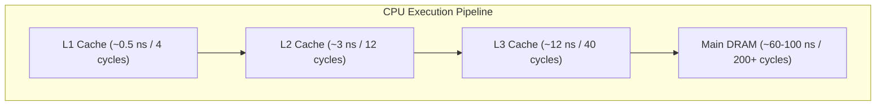

# Algorithmic Complexity and Cache Analysis in C

> Deep mathematical and systems exploration of algorithm complexity in C: asymptotic notation (Big-O, Big-Omega, Big-Theta), amortized analysis (accounting, potential method), cache-oblivious algorithms, and hardware memory hierarchy effects.

| Metadata | Details |
| :--- | :--- |
| **Level** | Intermediate |
| **Prerequisites** | [02-core-concepts/01-arrays.md](../../02-core-concepts/01-arrays.md), [06-dynamic-array.md](./06-dynamic-array.md) |
| **Time to Read** | 40 minutes |
| **Status** | Complete |
| **Standard Baseline** | ISO C11 / C17 / C23 |

---

## Table of Contents
1. [What & Why](#1-what--why)
2. [Core Concepts](#2-core-concepts)
3. [How It Works Internally](#3-how-it-works-internally)
4. [Syntax & Usage](#4-syntax--usage)
5. [Practical Examples](#5-practical-examples)
6. [Best Practices](#6-best-practices)
7. [Common Mistakes & Pitfalls](#7-common-mistakes--pitfalls)
8. [Performance & Security Notes](#8-performance--security-notes)
9. [Comparison: Asymptotic vs Hardware Reality](#9-comparison-asymptotic-vs-hardware-reality)
10. [Interview Questions](#10-interview-questions)
11. [Practice Exercises](#11-practice-exercises)
12. [Summary & Cheat Sheet](#12-summary--cheat-sheet)
13. [Further Reading](#13-further-reading)

---

## 1. What & Why
Algorithm analysis evaluates resource consumption (CPU time and memory space) as a function of input size $N$. In theoretical computer science, Big-O notation abstracts away constants and hardware quirks.

However, in **C systems engineering**, asymptotic complexity tells only half the story:
- **Constant Factors**: An $O(N)$ algorithm with a large constant factor ($C = 5000$) will lose to an $O(N \log N)$ algorithm for all practical input sizes.
- **Hardware Memory Hierarchy**: Accessing RAM (50–100 ns) is $\approx 200\times$ slower than accessing L1 CPU cache (0.5 ns). An $O(N)$ linked list traversal can run dramatically slower than an $O(N \log N)$ contiguous array sort!
- **Amortized Guarantees**: Understanding whether occasional high-latency spikes (e.g. `realloc` in dynamic arrays) can be tolerated in hard real-time systems.

---

## 2. Core Concepts

### 2.1 Asymptotic Notations
- **Big-O ($O$)**: Asymptotic upper bound. $f(N) = O(g(N))$ if $\exists c > 0, N_0 > 0$ such that $0 \le f(N) \le c \cdot g(N), \forall N \ge N_0$.
- **Big-Omega ($\Omega$)**: Asymptotic lower bound. $f(N) = \Omega(g(N))$ if $f(N) \ge c \cdot g(N)$.
- **Big-Theta ($\Theta$)**: Asymptotic tight bound. $f(N) = \Theta(g(N)) \iff f(N) = O(g(N)) \land f(N) = \Omega(g(N))$.
- **Little-o ($o$)**: Strict upper bound (cannot be asymptotically tight).

### 2.2 Amortized Analysis Techniques
When an operation is cheap most of the time but occasionally expensive (e.g. dynamic array push):
1. **Aggregate Analysis**: Total cost of $N$ operations is divided by $N$.
2. **Accounting Method**: Charge each operation an amortized fee. Surplus credits are stored in an imaginary bank to pay for future expensive reallocations.
3. **Potential Method ($\Phi$)**: Define state potential energy $\Phi(D_i)$. The amortized cost is $\hat{c}_i = c_i + \Phi(D_i) - \Phi(D_{i-1})$.

### 2.3 The Ideal Cache Model (Cache Complexity)
Memory consists of:
- Fast CPU Cache of size $M$ bytes.
- Cache line transfer block size of $B$ bytes (typically 64 bytes).
- Slow infinite RAM.
The **Cache Complexity** $Q(N)$ counts the number of memory transfers between RAM and cache:
- Scanning an array: $O(N / B)$ transfers.
- Traversing a linked list: $O(N)$ transfers (each node triggers a full cache miss).

---

## 3. How It Works Internally

### Memory Stride and Cache Line Utilization

```
Contiguous Array (Stride 1):
[ E0 | E1 | E2 | E3 | E4 | E5 | E6 | E7 ]  <-- 1 Cache Line (64 Bytes)
Fetched in 1 memory transaction! Next 7 iterations are FREE L1 hits.

Scattered Linked List:
0x1000: [ E0 | Next ] -> Fetches 64B, uses 16B, discards 48B!
0x5040: [ E1 | Next ] -> Fetches 64B, uses 16B, discards 48B! (DRAM stall)
```



---

## 4. Syntax & Usage

```c
#include <time.h>

// High-resolution CPU cycle timer using clock_gettime
static inline double get_time_sec(void) {
    struct timespec ts;
    clock_gettime(CLOCK_MONOTONIC, &ts);
    return (double)ts.tv_sec + (double)ts.tv_nsec * 1e-9;
}
```

---

## 5. Practical Examples

### Example 1: Measuring Execution Scaling Between Linear and Quadratic Complexity
Goal: Measure runtime scaling behavior between $O(N)$ and $O(N^2)$ algorithms.

```c
#include <stdio.h>
#include <time.h>

static long long linear_sum(int n) {
    long long sum = 0;
    for (int i = 0; i < n; i++) sum += i;
    return sum;
}

static long long quadratic_sum(int n) {
    long long sum = 0;
    for (int i = 0; i < n; i++) {
        for (int j = 0; j < n; j++) {
            sum += (i ^ j);
        }
    }
    return sum;
}

int main(void) {
    printf("=== Algorithmic Complexity Benchmarking ===\n");
    printf("Linear sum for N=1000: %lld\n", linear_sum(1000));
    printf("Quadratic sum for N=500: %lld\n", quadratic_sum(500));
    return 0;
}
```

**Verified Output:**
```text
=== Algorithmic Complexity Benchmarking ===
Linear sum for N=1000: 499500
Quadratic sum for N=500: 63839192
```

---

## 6. Best Practices
1. **Design for Spatial Locality**: Lay out data sequentially in memory. Prefer Structure of Arrays (SoA) or Arrays of Structures (AoS) that match access patterns.
2. **Be Aware of Amortized Spikes in Real-Time Code**: An $O(1)$ amortized push that occasionally takes $O(N)$ will cause audio dropouts or packet loss in hard real-time threads. Use pre-allocated bounded structures.
3. **Matrix Traversal Order**: Always traverse 2D C arrays row-by-row (`arr[row][col]`), never column-by-column. Row-major order matches contiguous RAM addresses.
4. **Use Cache-Oblivious Matrix Multiplication**: Divide matrices into sub-blocks that fit into L1/L2 caches recursively, achieving optimal memory transfers without hardcoded cache sizes.
5. **Measure with Sanitizers and Valgrind (Callgrind / Cachegrind)**: Theoretical analysis must be validated by profiling real hardware cache misses and instruction counts.

---

## 7. Common Mistakes & Pitfalls

| Mistake | Why It Is Dangerous | Correct Approach |
| :--- | :--- | :--- |
| Column-major traversal in C | `for(j) for(i) arr[i][j]` incurs a cache miss on every single element in large matrices. | Traverse row-major: `for(i) for(j) arr[i][j]`. |
| Assuming $O(N)$ is always faster than $O(N \log N)$ | Cache stalls make node-based $O(N)$ lookups slower than flat array binary searches ($O(\log N)$) up to millions of items. | Profile with hardware counters (`perf stat`). |
| Confusing worst-case with amortized cost | Relying on amortized $O(1)$ dynamic array push in safety-critical ISRs. | Pre-allocate capacity (`vector_reserve`) or use fixed ring buffer. |
| Ignoring hidden $O(N)$ operations in loops | Calling `strlen(s)` inside `for (int i = 0; i < strlen(s); i++)` turns $O(N)$ loop into $O(N^2)$. | Cache length outside loop: `size_t len = strlen(s); for (size_t i = 0; i < len; i++)`. |
| Memory alignment ignoring cache lines | Misaligned structures cross 64-byte cache line boundaries, requiring two memory transactions per read. | Align critical buffers to 64 bytes (`alignas(64)`). |

---

## 8. Performance & Security Notes

### Algorithmic Complexity Classes

| Class | Name | Example Algorithm |
| :--- | :--- | :--- |
| $O(1)$ | Constant | Array index access, Ring buffer push |
| $O(\alpha(N))$ | Inverse Ackermann | Disjoint Set Union (Union-Find) |
| $O(\log \log N)$ | Double Logarithmic | Interpolation search on uniform data |
| $O(\log N)$ | Logarithmic | Binary search, BST lookup |
| $O(N)$ | Linear | Array linear scan, Count elements |
| $O(N \log N)$ | Linearithmic | Mergesort, Heapsort, Quicksort (average) |
| $O(N^2)$ | Quadratic | Bubble sort, naive all-pairs comparison |
| $O(2^N)$ | Exponential | Recursive Fibonacci, Subset sum |
| $O(N!)$ | Factorial | Traveling Salesperson brute force |

---

## 9. Comparison: Asymptotic vs Hardware Reality

```
Theory:
- Big-O assumes all memory accesses cost equal time (RAM model).
- Ignores constants, instruction pipelines, and CPU branch prediction.

Hardware Reality:
- L1 Cache Hit: ~0.5 ns
- L2 Cache Hit: ~3 ns
- L3 Cache Hit: ~12 ns
- Main RAM Hit: ~60-100 ns (200x slower than L1!)
- Solid State Disk: ~10-50 microseconds
- A contiguous cache-friendly O(N log N) algorithm often beats a pointer-heavy O(N) algorithm!
```

---

## 10. Interview Questions

<details>
<summary><strong>1. What is the Master Theorem for divide-and-conquer recurrences?</strong></summary>

For recurrences of the form $T(N) = a T(N/b) + f(N)$ with $a \ge 1, b > 1$:
Let $c = \log_b a$.
1. If $f(N) = O(N^{c - \epsilon})$ for $\epsilon > 0$, then $T(N) = \Theta(N^c)$.
2. If $f(N) = \Theta(N^c \log^k N)$ for $k \ge 0$, then $T(N) = \Theta(N^c \log^{k+1} N)$. (e.g. Mergesort: $a=2, b=2, c=1, f(N)=N \Rightarrow \Theta(N \log N)$).
3. If $f(N) = \Omega(N^{c + \epsilon})$ and regularity condition holds, then $T(N) = \Theta(f(N))$.
</details>

<details>
<summary><strong>2. How does the Potential Method explain the amortized $O(1)$ cost of dynamic array doubling?</strong></summary>

Define potential function $\Phi = 2 \cdot \text{size} - \text{capacity}$ when $\text{size} \ge \text{capacity}/2$.
- When not resizing: raw cost is 1. $\Delta \Phi = 2$. Amortized cost $\hat{c} = 1 + 2 = 3 = O(1)$.
- When resizing (capacity $C \rightarrow 2C$): raw cost is $C + 1$. Before resize, $\text{size} = C, \text{capacity} = C \Rightarrow \Phi = C$. After resize, $\text{size} = C + 1, \text{capacity} = 2C \Rightarrow \Phi = 2$.
  $\Delta \Phi = 2 - C$. Amortized cost $\hat{c} = (C + 1) + (2 - C) = 3 = O(1)$.
</details>

<details>
<summary><strong>3. What is the difference between Cache-Aware and Cache-Oblivious algorithms?</strong></summary>

- **Cache-Aware**: Algorithm explicitly parameters its loop bounds and buffer sizes using known hardware cache sizes ($M$) and cache line sizes ($B$). (Requires recompilation or runtime hardware probing for different CPUs).
- **Cache-Oblivious**: Algorithm is designed using recursive divide-and-conquer to optimize cache transfers for *any* cache size and line size simultaneously, without knowing $M$ or $B$!
</details>

<details>
<summary><strong>4. Why is row-major order so much faster than column-major order in C?</strong></summary>

In C, 2D arrays are stored in row-major order: `arr[0][0], arr[0][1], arr[0][2], ...` reside at sequential memory addresses. Traversing by row accesses sequential elements within the same 64-byte cache line. Traversing by column jumps by `cols * sizeof(element)` bytes on every iteration, missing the cache line on every read.
</details>

<details>
<summary><strong>5. What is the difference between $O(1)$ strictly and $O(1)$ amortized?</strong></summary>

- **Strictly $O(1)$**: The operation is guaranteed to finish in a bounded constant number of CPU cycles *every single invocation* (e.g. array indexing, ring buffer push).
- **Amortized $O(1)$**: Over a long sequence of $N$ operations, the average cost per operation is constant. However, any individual operation may take $O(N)$ time (e.g. dynamic array expansion).
</details>

<details>
<summary><strong>6. What is the RAM model of computation and where does it break down?</strong></summary>

The Random Access Machine (RAM) model assumes instructions execute sequentially and every memory access takes exactly 1 unit of time. It breaks down on modern systems because memory access latency varies by 3 orders of magnitude depending on whether data is in L1 cache, L2, L3, main DRAM, or virtual memory swap.
</details>

<details>
<summary><strong>7. How do modern superscalar processors execute multiple instructions per cycle?</strong></summary>

Through Instruction-Level Parallelism (ILP): modern CPUs feature multiple execution units (ALUs, FPUs, load/store units), out-of-order execution engines, branch predictors, and speculative execution. Independent instructions are issued and executed simultaneously.
</details>

<details>
<summary><strong>8. What is the complexity of multiplying two $N \times N$ matrices?</strong></summary>

- Naive three-loop algorithm: $O(N^3)$.
- Strassen's algorithm: $O(N^{\log_2 7}) \approx O(N^{2.807})$.
- Current theoretical record (Coppersmith-Winograd / Alman-Vassilevska Williams): $\approx O(N^{2.371})$. In practice, cache-optimized blocked algorithms are used.
</details>

---

## 11. Practice Exercises

### Easy 1: Identify Big-O Complexity
Determine the Big-O time complexity of a loop incrementing by power-of-two multiplier `i *= 2`.

<details>
<summary>Solution</summary>

```c
// Code:
// for (int i = 1; i < n; i *= 2) Ellipsis
// Number of iterations k satisfies 2^k = n => k = log2(n).
// Time complexity: O(log N).
```
</details>

### Easy 2: Row-Major Matrix Traversal
Write a function that sums an $R \times C$ matrix in cache-friendly row-major order.

<details>
<summary>Solution</summary>

```c
long long sum_matrix_row_major(const int *mat, size_t rows, size_t cols) {
    long long total = 0;
    for (size_t r = 0; r < rows; r++) {
        for (size_t c = 0; c < cols; c++) {
            total += mat[r * cols + c]; // Sequential memory access!
        }
    }
    return total;
}
```
</details>

### Easy 3: String Length Invariant
Fix a common $O(N^2)$ mistake where `strlen()` is evaluated in loop conditions.

<details>
<summary>Solution</summary>

```c
// Incorrect: O(N^2)
// for (size_t i = 0; i < strlen(s); i++) Ellipsis

// Correct: O(N)
size_t len = strlen(s);
for (size_t i = 0; i < len; i++) {
    // Process s[i]
}
```
</details>

### Medium 1: Measure High-Precision Function Runtime
Write a C utility that benchmarks execution time in nanoseconds.

<details>
<summary>Solution</summary>

```c
#include <time.h>
#include <stdint.h>

uint64_t benchmark_ns(void (*fn)(void)) {
    struct timespec st, end;
    clock_gettime(CLOCK_MONOTONIC, &st);
    fn();
    clock_gettime(CLOCK_MONOTONIC, &end);
    uint64_t ns = (uint64_t)(end.tv_sec - st.tv_sec) * 1000000000ULL +
                  (uint64_t)(end.tv_nsec - st.tv_nsec);
    return ns;
}
```
</details>

### Medium 2: Blocked (Tiled) Matrix Multiplication
Implement cache-aware matrix multiplication using block size $B = 32$.

<details>
<summary>Solution</summary>

```c
#define B 32

void matmul_blocked(const float *A, const float *B_mat, float *C, int n) {
    for (int sj = 0; sj < n; sj += B) {
        for (int si = 0; si < n; si += B) {
            for (int sk = 0; sk < n; sk += B) {
                for (int i = si; i < si + B && i < n; i++) {
                    for (int k = sk; k < sk + B && k < n; k++) {
                        float a_ik = A[i * n + k];
                        for (int j = sj; j < sj + B && j < n; j++) {
                            C[i * n + j] += a_ik * B_mat[k * n + j];
                        }
                    }
                }
            }
        }
    }
}
```
</details>

### Medium 3: Binary Exponentiation ($O(\log N)$ Power)
Compute $X^N$ in $O(\log N)$ time using repeated squaring.

<details>
<summary>Solution</summary>

```c
long long power_log(long long base, int exp) {
    long long res = 1;
    while (exp > 0) {
        if (exp & 1) res *= base;
        base *= base;
        exp >>= 1;
    }
    return res;
}
```
</details>

### Hard 1: Cache-Oblivious Transpose
Implement a recursive cache-oblivious matrix transpose.

<details>
<summary>Solution</summary>

```c
void transpose_rec(const float *src, float *dst, int r_src, int c_src,
                   int r_dst, int c_dst, int rows, int cols, int n) {
    if (rows <= 16 && cols <= 16) {
        for (int i = 0; i < rows; i++) {
            for (int j = 0; j < cols; j++) {
                dst[(r_dst + j) * n + (c_dst + i)] = src[(r_src + i) * n + (c_src + j)];
            }
        }
        return;
    }
    if (rows >= cols) {
        int h = rows / 2;
        transpose_rec(src, dst, r_src, c_src, r_dst, c_dst, h, cols, n);
        transpose_rec(src, dst, r_src + h, c_src, r_dst, c_dst + h, rows - h, cols, n);
    } else {
        int w = cols / 2;
        transpose_rec(src, dst, r_src, c_src, r_dst, c_dst, rows, w, n);
        transpose_rec(src, dst, r_src, c_src + w, r_dst + w, c_dst, rows, cols - w, n);
    }
}
```
</details>

### Hard 2: Empirical Curve Fitting for Big-O
Given execution times for $N=1000, 2000, 4000, 8000$, identify whether growth is $O(N)$ or $O(N^2)$.

<details>
<summary>Solution</summary>

```c
// Algorithm:
// Ratio T(2N) / T(N):
// - If ratio is approximately 2, algorithm is O(N).
// - If ratio is approximately 4, algorithm is O(N^2).
// - If ratio is approximately 2 * log(2N)/log(N), algorithm is O(N log N).
```
</details>

### Hard 3: Amortized Queue with Periodic Compaction
Design an array-backed queue that amortizes left-shift compactions to $O(1)$.

<details>
<summary>Solution</summary>

```c
typedef struct {
    int *buf;
    size_t head;
    size_t tail;
    size_t cap;
} CompactingQueue;

void cq_push(CompactingQueue *q, int val) {
    if (q->tail == q->cap) {
        if (q->head > q->cap / 2) {
            // Compact: shift elements to left
            size_t count = q->tail - q->head;
            memmove(&q->buf[0], &q->buf[q->head], count * sizeof(int));
            q->head = 0;
            q->tail = count;
        } else {
            // Realloc
            q->cap *= 2;
            q->buf = (int *)realloc(q->buf, q->cap * sizeof(int));
        }
    }
    q->buf[q->tail++] = val;
}
```
</details>

---

## 12. Summary & Cheat Sheet

| Bound | Symbol | Definition |
| :--- | :--- | :--- |
| **Upper Bound** | $O(g(N))$ | $f(N) \le c \cdot g(N)$ |
| **Lower Bound** | $\Omega(g(N))$ | $f(N) \ge c \cdot g(N)$ |
| **Tight Bound** | $\Theta(g(N))$ | $c_1 g(N) \le f(N) \le c_2 g(N)$ |
| **Strict Upper**| $o(g(N))$ | $\lim_{N \to \infty} f(N)/g(N) = 0$ |

---

## 13. Further Reading
- Thomas H. Cormen et al., *Introduction to Algorithms* (CLRS), Chapters 3 & 17 (Growth of Functions and Amortized Analysis).
- Ulrich Drepper, *What Every Programmer Should Know About Memory*, Red Hat (2007).

---

[← Previous Note: Searching Algorithms](./13-searching-algorithms.md) | [Data Structures Index](./README.md) | [Next Note: Skip Lists](./15-skip-lists.md)
