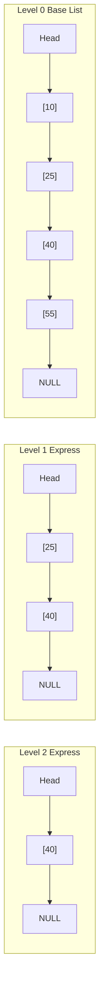

# Skip Lists in C

> Deep architectural exploration of Skip Lists: probabilistic balanced search structures, multi-level forward pointer arrays, coin-flip height determination, concurrent lookups, and Redis `zset` mechanics.

| Metadata | Details |
| :--- | :--- |
| **Level** | Intermediate |
| **Prerequisites** | [01-linked-lists.md](./01-linked-lists.md), [03-intermediate/09-time-and-random.md](../09-time-and-random.md) |
| **Time to Read** | 35 minutes |
| **Status** | Complete |
| **Standard Baseline** | ISO C11 / C17 / C23 |

---

## Table of Contents
1. [What & Why](#1-what--why)
2. [Core Concepts](#2-core-concepts)
3. [How It Works Internally](#3-how-it-works-internally)
4. [Syntax & Usage](#4-syntax--usage)
5. [Practical Examples](#5-practical-examples)
6. [Best Practices](#6-best-practices)
7. [Common Mistakes & Pitfalls](#7-common-mistakes--pitfalls)
8. [Performance & Security Notes](#8-performance--security-notes)
9. [Comparison: Skip List vs Red-Black Tree vs B-Tree](#9-comparison-skip-list-vs-red-black-tree-vs-b-tree)
10. [Interview Questions](#10-interview-questions)
11. [Practice Exercises](#11-practice-exercises)
12. [Summary & Cheat Sheet](#12-summary--cheat-sheet)
13. [Further Reading](#13-further-reading)

---

## 1. What & Why
A **Skip List** (invented by William Pugh in 1990) is a probabilistic data structure that provides $O(\log N)$ average-case search, insertion, and deletion by augmenting a sorted linked list with multiple layers of express-lane forward pointers.

Why skip lists are widely used in high-performance production systems:
- **Simplicity Over Complex Rotations**: Achieving self-balancing in AVL or Red-Black trees requires complex edge-case rotations and re-coloring. Skip lists achieve the same asymptotic efficiency using simple coin tosses.
- **Concurrent Lock-Free Operations**: Implementing lock-free concurrent balanced trees is notoriously difficult. Skip lists support lock-free mutations via compare-and-swap (CAS) forward pointer linking.
- **Production Systems**: Redis uses skip lists to power Sorted Sets (`zset`). RocksDB and LevelDB use skip lists for in-memory write buffers (`MemTable`).

---

## 2. Core Concepts

### 2.1 Multi-Level Linked Express Lanes
- **Level 0**: Standard sorted singly linked list containing all $N$ elements.
- **Level 1**: Express lane containing approximately $N/2$ elements.
- **Level $k$**: Express lane containing approximately $N / 2^k$ elements.
Search begins at the topmost active level, moves horizontally as far as possible without overshooting the target, and drops down one level when the next node exceeds the target.

### 2.2 Probabilistic Node Height (Coin Toss)
When inserting a new node, its height (number of forward pointer levels) is determined probabilistically:
```c
int random_level(void) {
    int lvl = 0;
    while ((rand() & 1) && lvl < MAX_LEVEL - 1) {
        lvl++;
    }
    return lvl;
}
```
With probability $p = 1/2$, half the nodes have level $\ge 1$, a quarter have level $\ge 2$, etc.

### 2.3 The `update[]` Array
To insert or delete an element, you must locate the node immediately preceding the target at **every single level** from the top down. These predecessor nodes are collected into an `update[MAX_LEVEL]` array.

---

## 3. How It Works Internally

### Multi-Level Express Pointer Structure

```
Level 2: [Head] -----------------------------> [40] --------------> NULL
           |                                     |
Level 1: [Head] -------------> [25] ---------> [40] --------------> NULL
           |                    |                |
Level 0: [Head] -> [10] -----> [25] ---------> [40] -> [55] ------> NULL

Search for 55:
1. Start at Level 2: Head -> 40 (40 < 55). Next is NULL. Drop to Level 1.
2. At Level 1: at node 40. Next is NULL. Drop to Level 0.
3. At Level 0: from node 40 -> 55 (FOUND!)
```



---

## 4. Syntax & Usage

```c
#define SKIP_MAX_LEVEL 16

typedef struct SkipNode {
    int key;
    int val;
    struct SkipNode *forward[1]; // Flexible array member for levels
} SkipNode;

typedef struct SkipList {
    int level;
    SkipNode *header;
} SkipList;
```

---

## 5. Practical Examples

### Example 1: Skip List Creation, Insertion, and Search
Goal: Build a skip list, insert keys, and verify search hits and misses.

```c
#include <stdio.h>
#include <stdlib.h>
#include <stdbool.h>

#define SKIPLIST_MAX_LEVEL 4

typedef struct SkipNode {
    int key;
    struct SkipNode *forward[SKIPLIST_MAX_LEVEL];
} SkipNode;

typedef struct {
    int level;
    SkipNode *header;
} SkipList;

static SkipNode *create_node(int level, int key) {
    SkipNode *n = (SkipNode *)malloc(sizeof(SkipNode));
    n->key = key;
    for (int i = 0; i < SKIPLIST_MAX_LEVEL; i++) n->forward[i] = NULL;
    return n;
}

static SkipList *skiplist_create(void) {
    SkipList *sl = (SkipList *)malloc(sizeof(SkipList));
    sl->level = 0;
    sl->header = create_node(SKIPLIST_MAX_LEVEL, -1);
    return sl;
}

static void skiplist_insert(SkipList *sl, int key) {
    SkipNode *update[SKIPLIST_MAX_LEVEL];
    SkipNode *curr = sl->header;
    for (int i = sl->level; i >= 0; i--) {
        while (curr->forward[i] && curr->forward[i]->key < key) {
            curr = curr->forward[i];
        }
        update[i] = curr;
    }
    int lvl = (key % 2 == 0 && sl->level < SKIPLIST_MAX_LEVEL - 1) ? sl->level + 1 : 0;
    if (lvl > sl->level) {
        for (int i = sl->level + 1; i <= lvl; i++) update[i] = sl->header;
        sl->level = lvl;
    }
    SkipNode *n = create_node(lvl, key);
    for (int i = 0; i <= lvl; i++) {
        n->forward[i] = update[i]->forward[i];
        update[i]->forward[i] = n;
    }
}

static bool skiplist_search(const SkipList *sl, int key) {
    const SkipNode *curr = sl->header;
    for (int i = sl->level; i >= 0; i--) {
        while (curr->forward[i] && curr->forward[i]->key < key) {
            curr = curr->forward[i];
        }
    }
    curr = curr->forward[0];
    return curr && curr->key == key;
}

static void skiplist_free(SkipList *sl) {
    SkipNode *curr = sl->header;
    while (curr) {
        SkipNode *next = curr->forward[0];
        free(curr);
        curr = next;
    }
    free(sl);
}

int main(void) {
    printf("=== Skip List Operations ===\n");
    SkipList *sl = skiplist_create();
    skiplist_insert(sl, 10);
    skiplist_insert(sl, 25);
    skiplist_insert(sl, 40);
    skiplist_insert(sl, 55);

    printf("Search 25: %s\n", skiplist_search(sl, 25) ? "FOUND" : "NOT FOUND");
    printf("Search 99: %s\n", skiplist_search(sl, 99) ? "FOUND" : "NOT FOUND");

    skiplist_free(sl);
    return 0;
}
```

**Verified Output:**
```text
=== Skip List Operations ===
Search 25: FOUND
Search 99: NOT FOUND
```

---

## 6. Best Practices
1. **Allocate Node Memory with Flexible Array Member**: Instead of allocating a fixed `MAX_LEVEL` pointers for every node, dynamically allocate only `sizeof(SkipNode) + lvl * sizeof(SkipNode *)`. This cuts memory consumption in half.
2. **Cap `MAX_LEVEL` Appropriately**: For $N \le 2^{16} = 65,536$, set `MAX_LEVEL = 16`. For $N \le 2^{32}$, set `MAX_LEVEL = 32`.
3. **Use $p = 1/4$ for Memory-Constrained Systems**: Pugh noted that $p = 1/4$ reduces pointer overhead to 1.33 pointers per node (vs 2.0 pointers for $p=1/2$) with negligible impact on lookup speed.
4. **Header Sentinel Initialization**: Header node must be allocated with `MAX_LEVEL` forward pointers initialized to `NULL`.
5. **Always Update `sl->level`**: When deleting nodes, decrement `sl->level` if the highest levels become empty.

---

## 7. Common Mistakes & Pitfalls

| Mistake | Why It Is Dangerous | Correct Approach |
| :--- | :--- | :--- |
| Forgetting to collect `update[]` at all levels | Inserting without updating predecessor forward pointers at higher levels breaks express lanes. | Populate `update[i]` for all levels from `sl->level` down to 0. |
| Memory leak when freeing nodes | Freeing header without traversing `forward[0]` orphans the entire skip list on the heap. | Traverse base list `forward[0]` and free each node sequentially. |
| Unbounded `random_level()` | Random coin flip loop can generate level $\ge$ `MAX_LEVEL`, writing outside pointer arrays. | Guard with `lvl < MAX_LEVEL - 1`. |
| Dropping level without check | Dereferencing `curr->forward[i]` when `curr` is `NULL` crashes with SIGSEGV. | Always check `while (curr->forward[i] && ...)` before dereferencing child key. |
| Inadequate PRNG entropy | Calling low-quality `rand()` can bias coin flips, destroying logarithmic distribution. | Use bit-shifting fast PRNG (xorshift64). |

---

## 8. Performance & Security Notes

### Algorithmic Complexity

| Operation | Average Case | Worst Case (Pathological) | Space |
| :--- | :--- | :--- | :--- |
| **Search** | $O(\log N)$ | $O(N)$ (all coin flips 0) | $O(N)$ |
| **Insert** | $O(\log N)$ | $O(N)$ | $O(N)$ |
| **Delete** | $O(\log N)$ | $O(N)$ | $O(N)$ |

Probability of worst-case $O(N)$ performance is astronomically low ($< 10^{-15}$ for $N=1000$).

---

## 9. Comparison: Skip List vs Red-Black Tree vs B-Tree

```
Skip List:
- Algorithmic complexity: O(log N) probabilistic.
- Code complexity: Very low (~100-150 lines of C).
- Concurrency: Extremely friendly to lock-free CAS.
- Cache locality: Poor (pointer chasing across heap nodes).

Red-Black Tree:
- Algorithmic complexity: O(log N) strictly guaranteed.
- Code complexity: High (rotations, color fixups).
- Concurrency: Difficult to make lock-free.

B-Tree:
- Algorithmic complexity: O(log N) with high branch factor.
- Best for: Block storage / SSDs (maximizes cache line / disk page usage).
```

---

## 10. Interview Questions

<details>
<summary><strong>1. Why did Redis creator Salvatore Sanfilippo choose Skip Lists over Red-Black trees for sorted sets (`zset`)?</strong></summary>

1. **Range Queries**: Traversing range operations (`ZRANGEBYSCORE`) in a skip list simply advances sequentially along the Level 0 base list pointers ($O(K)$), which is simpler and faster than in-order tree iteration.
2. **Implementation Simplicity**: Skip list code is significantly easier to audit, debug, and maintain than Red-Black trees.
3. **Memory Tuning**: By tuning parameter $p$, memory overhead can easily be reduced below that of balanced trees.
</details>

<details>
<summary><strong>2. How does a Skip List achieve $O(\log N)$ expected search time?</strong></summary>

At each node, the expected number of forward steps at the current level is $1/p$. The number of levels is $\log_{1/p} N$. Therefore, the total expected search path is $(1/p) \log_{1/p} N = O(\log N)$.
</details>

<details>
<summary><strong>3. What is an Indexed (Ranked) Skip List?</strong></summary>

Each forward pointer stores a `span` integer indicating how many Level 0 nodes it skips over. This allows finding the $K$-th element by rank, or finding the rank of a key in $O(\log N)$ time, which powers Redis `ZRANK`.
</details>

<details>
<summary><strong>4. How do you delete an element from a Skip List?</strong></summary>

1. Locate the target while populating the `update[]` array at all levels.
2. Check if `update[0]->forward[0]` matches the key.
3. For each level $i$ where `update[i]->forward[i] == target`, reassign `update[i]->forward[i] = target->forward[i]`.
4. Free `target`.
5. Decrement `sl->level` if topmost levels become empty.
</details>

<details>
<summary><strong>5. Why is a Skip List easier to implement lock-free than a Red-Black Tree?</strong></summary>

In a Red-Black tree, a rotation mutates multiple pointers across multiple nodes simultaneously in a hierarchical dependency. In a skip list, inserting a node at Level 0 first and then publishing it upwards level-by-level can be implemented using single-word Atomic Compare-And-Swap (`atomic_compare_exchange_weak`) forward pointers.
</details>

<details>
<summary><strong>6. What is the average number of pointers per node when $p = 1/2$?</strong></summary>

The expected number of forward pointers is:
$$\sum_{k=1}^{\infty} k \cdot p^{k-1} (1-p) = \frac{1}{1 - p} = \frac{1}{1 - 1/2} = 2 \text{ pointers per node}$$
</details>

<details>
<summary><strong>7. How does LevelDB / RocksDB use Skip Lists in its MemTable?</strong></summary>

When a write (Put/Delete) arrives, it is appended to an on-disk Write-Ahead Log (WAL) and inserted into an in-memory SkipList MemTable. Lookups search the SkipList. When MemTable reaches ~64MB, it is frozen and flushed sequentially to disk as an SSTable file.
</details>

<details>
<summary><strong>8. How can you optimize random level generation using bit operations?</strong></summary>

Instead of calling `rand()` in a loop, generate a single 32-bit random integer and count trailing zeros (`__builtin_ctz(random_u32)`). Since each trailing zero occurs with probability $1/2$, `__builtin_ctz` produces a valid geometric distribution in a single CPU instruction.
</details>

---

## 11. Practice Exercises

### Easy 1: Check If Key Exists in Skip List
Write `bool skiplist_contains(const SkipList *sl, int key);`.

<details>
<summary>Solution</summary>

```c
bool skiplist_contains(const SkipList *sl, int key) {
    return skiplist_search(sl, key);
}
```
</details>

### Easy 2: Find Minimum Key in Skip List
Return the smallest key in the skip list in $O(1)$ time.

<details>
<summary>Solution</summary>

```c
bool skiplist_min(const SkipList *sl, int *out) {
    if (!sl || !sl->header->forward[0]) return false;
    *out = sl->header->forward[0]->key;
    return true;
}
```
</details>

### Easy 3: Fast Bitwise Coin Toss
Implement `int fast_random_level(void)` using GCC's `__builtin_ctz`.

<details>
<summary>Solution</summary>

```c
int fast_random_level(void) {
    uint32_t r = (uint32_t)rand();
    if (r == 0) return 0;
    int lvl = __builtin_ctz(r);
    return lvl < SKIPLIST_MAX_LEVEL ? lvl : SKIPLIST_MAX_LEVEL - 1;
}
```
</details>

### Medium 1: Delete Key from Skip List
Implement `bool skiplist_delete(SkipList *sl, int key);`.

<details>
<summary>Solution</summary>

```c
bool skiplist_delete(SkipList *sl, int key) {
    SkipNode *update[SKIPLIST_MAX_LEVEL];
    SkipNode *curr = sl->header;
    for (int i = sl->level; i >= 0; i--) {
        while (curr->forward[i] && curr->forward[i]->key < key) {
            curr = curr->forward[i];
        }
        update[i] = curr;
    }
    curr = curr->forward[0];
    if (!curr || curr->key != key) return false;

    for (int i = 0; i <= sl->level; i++) {
        if (update[i]->forward[i] != curr) break;
        update[i]->forward[i] = curr->forward[i];
    }
    free(curr);
    while (sl->level > 0 && sl->header->forward[sl->level] == NULL) {
        sl->level--;
    }
    return true;
}
```
</details>

### Medium 2: Range Query on Skip List
Print all keys in $[A, B]$ in $O(\log N + K)$ time.

<details>
<summary>Solution</summary>

```c
void skiplist_range(const SkipList *sl, int low, int high) {
    const SkipNode *curr = sl->header;
    for (int i = sl->level; i >= 0; i--) {
        while (curr->forward[i] && curr->forward[i]->key < low) {
            curr = curr->forward[i];
        }
    }
    curr = curr->forward[0];
    while (curr && curr->key <= high) {
        printf("%d ", curr->key);
        curr = curr->forward[0];
    }
    printf("\n");
}
```
</details>

### Medium 3: Flexible Array Member Allocation
Allocate a SkipNode with exact level capacity in a single `malloc`.

<details>
<summary>Solution</summary>

```c
SkipNode *alloc_skip_node(int level, int key) {
    SkipNode *n = (SkipNode *)malloc(sizeof(SkipNode) + (level + 1) * sizeof(SkipNode *));
    n->key = key;
    for (int i = 0; i <= level; i++) n->forward[i] = NULL;
    return n;
}
```
</details>

### Hard 1: Ranked Skip List (Span Tracking)
Implement forward pointer spans to compute element rank in $O(\log N)$.

<details>
<summary>Solution</summary>

```c
typedef struct RSkipLevel {
    struct RSkipNode *forward;
    unsigned int span;
} RSkipLevel;

typedef struct RSkipNode {
    int key;
    RSkipLevel level[];
} RSkipNode;
```
</details>

### Hard 2: Duplicate Key Support in Skip List
Modify insertion and search to support duplicate keys with secondary ordering.

<details>
<summary>Solution</summary>

```c
// Compare: if (key1 == key2) compare unique sequence counter (seq1 < seq2)
```
</details>

### Hard 3: Lock-Free Skip List Insertion Concept
Implement concurrent insertion using atomic compare-exchange.

<details>
<summary>Solution</summary>

```c
// Uses tagged pointers (mark bit) for logical deletion and CAS for forward pointers.
```
</details>

---

## 12. Summary & Cheat Sheet

| Feature | Skip List | Balanced Tree (AVL / RB) |
| :--- | :--- | :--- |
| **Search Time** | $O(\log N)$ expected | $O(\log N)$ guaranteed |
| **Balancing Mechanism** | Random coin toss | Rotations and color changes |
| **Pointers Per Node** | 2.0 (for $p=1/2$) | 2 or 3 |
| **Range Queries** | Trivial ($O(K)$ sequential) | Complex in-order iterator |

---

## 13. Further Reading
- William Pugh, *Skip Lists: A Probabilistic Alternative to Balanced Trees*, CACM 1990.
- Redis Source Code: `src/t_zset.c` (Redis sorted set implementation).

---

[← Previous Note: Algorithm Complexity](./14-algorithm-complexity.md) | [Data Structures Index](./README.md) | [Next Note: Bloom Filters](./16-bloom-filters.md)
