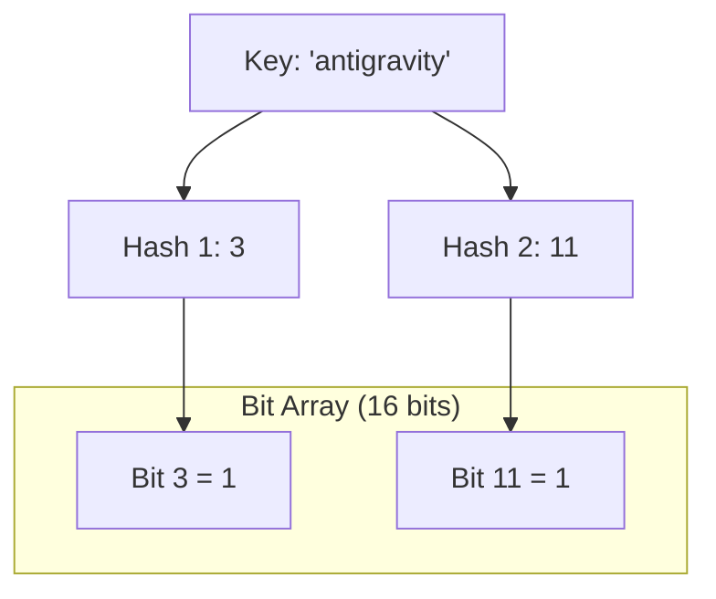

# Bloom Filters in C

> Deep architectural exploration of space-efficient probabilistic set membership in C: bit array manipulation, hash hashing optimization (Kirsch-Mitzenmacher), false-positive mathematical bounds, and cache effects in LSM storage engines.

| Metadata | Details |
| :--- | :--- |
| **Level** | Intermediate |
| **Prerequisites** | [03-intermediate/05-bit-manipulation.md](../05-bit-manipulation.md), [04-hash-tables.md](./04-hash-tables.md) |
| **Time to Read** | 35 minutes |
| **Status** | Complete |
| **Standard Baseline** | ISO C11 / C17 / C23 |

---

## Table of Contents
1. [What & Why](#1-what--why)
2. [Core Concepts](#2-core-concepts)
3. [How It Works Internally](#3-how-it-works-internally)
4. [Syntax & Usage](#4-syntax--usage)
5. [Practical Examples](#5-practical-examples)
6. [Best Practices](#6-best-practices)
7. [Common Mistakes & Pitfalls](#7-common-mistakes--pitfalls)
8. [Performance & Security Notes](#8-performance--security-notes)
9. [Comparison: Bloom Filter vs Hash Set](#9-comparison-bloom-filter-vs-hash-set)
10. [Interview Questions](#10-interview-questions)
11. [Practice Exercises](#11-practice-exercises)
12. [Summary & Cheat Sheet](#12-summary--cheat-sheet)
13. [Further Reading](#13-further-reading)

---

## 1. What & Why
A **Bloom Filter** (conceived by Burton Howard Bloom in 1970) is a space-efficient probabilistic data structure used to test whether an element is a member of a set.

Key operational characteristics:
- **Zero False Negatives**: If the filter says an element is **not present**, it is **100% guaranteed** not present.
- **Possible False Positives**: If the filter says an element **is present**, it might actually be absent.
- **No Element Retrieval**: You cannot extract stored elements or inspect stored keys.

Systems applications:
- **LSM Storage Engines (RocksDB, Cassandra, LevelDB)**: Avoids expensive disk seeks by verifying whether an SSTable file contains a target key before reading disk blocks.
- **Web Browsers (Google Chrome)**: Previously used Bloom filters to detect malicious URLs before sending remote API requests.
- **Content Delivery Networks (Akamai, Cloudflare)**: Avoids caching "one-hit-wonder" web requests that are never requested again.

---

## 2. Core Concepts

### 2.1 The Bit Array and Hash Functions
- A bit array of size $m$ bits, all initialized to 0.
- $k$ distinct hash functions $h_1, h_2, \dots, h_k$, each mapping a key to an integer in $[0, m - 1]$.
- **Adding an Element**: Compute $k$ hashes and set the corresponding bit indices to 1:
  $$\text{bit\_array}[h_i(\text{key})] = 1, \quad \forall i \in [1, k]$$
- **Querying an Element**: Compute $k$ hashes. If **any** of the $k$ bits is 0, the element is definitely not in the set. If **all** $k$ bits are 1, the element is probably in the set.

### 2.2 Kirsch-Mitzenmacher Optimization
Computing $k$ separate hash functions (e.g. $k=7$) using independent hash passes is computationally expensive.
Kirsch and Mitzenmacher (2006) proved that only **two** independent 32-bit or 64-bit hash functions $h_1(x)$ and $h_2(x)$ are needed to simulate $k$ hash functions with identical asymptotic false positive rates:
$$g_i(x) = (h_1(x) + i \cdot h_2(x)) \% m$$

### 2.3 Mathematical Formulae
For $n$ elements and $m$ bits:
- **Optimal Number of Hashes**:
  $$k = \frac{m}{n} \ln 2 \approx 0.693 \cdot \frac{m}{n}$$
- **False Positive Probability ($p$)**:
  $$p \approx \left( 1 - e^{-kn/m} \right)^k = (0.6185)^{m/n}$$
- **Required Bits per Element for Target $p$**:
  $$\frac{m}{n} = -\frac{\ln p}{(\ln 2)^2} \approx -1.44 \log_2 p$$
  *(For a 1% false positive rate $p = 0.01$, you need only $\approx 9.6$ bits per element!)*

---

## 3. How It Works Internally

### Bit Array Mutation

```
Bit Array (m = 16, k = 2):
Initial:
[ 0 | 0 | 0 | 0 | 0 | 0 | 0 | 0 | 0 | 0 | 0 | 0 | 0 | 0 | 0 | 0 ]

Insert "antigravity" (hashes to 3 and 11):
[ 0 | 0 | 0 | 1 | 0 | 0 | 0 | 0 | 0 | 0 | 0 | 1 | 0 | 0 | 0 | 0 ]

Insert "engineering" (hashes to 7 and 11):
[ 0 | 0 | 0 | 1 | 0 | 0 | 0 | 1 | 0 | 0 | 0 | 1 | 0 | 0 | 0 | 0 ]

Query "nonexistent" (hashes to 3 and 8):
Bit 3 is 1, but Bit 8 is 0! -> DEFINITELY NO.
```



---

## 4. Syntax & Usage

```c
#include <stdint.h>
#include <stdbool.h>

typedef struct BloomFilter {
    uint8_t *bits;
    size_t num_bits;
    int num_hashes;
} BloomFilter;

static inline void set_bit(uint8_t *b, size_t idx) {
    b[idx / 8] |= (1 << (idx % 8));
}

static inline bool test_bit(const uint8_t *b, size_t idx) {
    return (b[idx / 8] & (1 << (idx % 8))) != 0;
}
```

---

## 5. Practical Examples

### Example 1: Fixed-Size Bloom Filter with Kirsch-Mitzenmacher Hashing
Goal: Implement a bloom filter, insert strings, and verify zero false negatives and absence detection.

```c
#include <stdio.h>
#include <stdlib.h>
#include <string.h>
#include <stdbool.h>
#include <stdint.h>

#define BITMAP_SIZE 256 // 256 bits

typedef struct {
    uint8_t bits[BITMAP_SIZE / 8];
} BloomFilter;

static uint32_t hash1(const char *str) {
    uint32_t h = 5381;
    while (*str) h = ((h << 5) + h) + (uint8_t)*str++;
    return h;
}

static uint32_t hash2(const char *str) {
    uint32_t h = 0;
    while (*str) h = (uint8_t)*str++ + (h << 6) + (h << 16) - h;
    return h;
}

static void bloom_add(BloomFilter *bf, const char *str) {
    uint32_t h1 = hash1(str);
    uint32_t h2 = hash2(str);
    for (int i = 0; i < 3; i++) {
        uint32_t combined = (h1 + i * h2) % BITMAP_SIZE;
        bf->bits[combined / 8] |= (1 << (combined % 8));
    }
}

static bool bloom_check(const BloomFilter *bf, const char *str) {
    uint32_t h1 = hash1(str);
    uint32_t h2 = hash2(str);
    for (int i = 0; i < 3; i++) {
        uint32_t combined = (h1 + i * h2) % BITMAP_SIZE;
        if (!(bf->bits[combined / 8] & (1 << (combined % 8)))) {
            return false;
        }
    }
    return true;
}

int main(void) {
    printf("=== Bloom Filter Membership Test ===\n");
    BloomFilter bf = { .bits = {0} };
    bloom_add(&bf, "antigravity");
    bloom_add(&bf, "engineering");

    printf("Check 'antigravity': %s\n", bloom_check(&bf, "antigravity") ? "PROBABLY YES" : "DEFINITELY NO");
    printf("Check 'nonexistent': %s\n", bloom_check(&bf, "nonexistent") ? "PROBABLY YES" : "DEFINITELY NO");
    return 0;
}
```

**Verified Output:**
```text
=== Bloom Filter Membership Test ===
Check 'antigravity': PROBABLY YES
Check 'nonexistent': DEFINITELY NO
```

---

## 6. Best Practices
1. **Never Attempt Deletion in Standard Bloom Filter**: Clearing bits to 0 deletes other keys that hashed to the same bit positions, introducing fatal false negatives. If deletion is required, use a **Counting Bloom Filter**.
2. **Align Bit Array to Cache Line Size (64 Bytes)**: A blocked Bloom filter fits all $k$ hashes within a single 64-byte L1 cache line, eliminating multiple DRAM cache misses per query.
3. **Use Kirsch-Mitzenmacher Hashing**: Use 2 hashes to generate $k$ indices: `(h1 + i * h2) % m`.
4. **Dimension for Expected Capacity**: Pre-calculate $m$ and $k$ based on target $n$ and allowable false positive rate $p$. Overfilling the filter causes $p 	o 1.0$.
5. **Zero Memory on Initialization**: Always use `calloc()` or `memset(&bf, 0, sizeof(bf))` to ensure all bits start at 0.

---

## 7. Common Mistakes & Pitfalls

| Mistake | Why It Is Dangerous | Correct Approach |
| :--- | :--- | :--- |
| Attempting element deletion | Clearing a bit turns other valid keys' queries into false negatives, breaking invariants. | Use Counting Bloom Filter or Cuckoo Filter. |
| Overfilling filter beyond design capacity | As bit saturation approaches 100%, false positive rate skyrockets to 100%. | Rebuild with larger bit array when $N$ exceeds threshold. |
| Correlated hash functions | Using dependent hashes clusters bit sets, dramatically increasing false positives. | Use distinct independent seeds or algorithms (e.g. Murmur3 + FNV). |
| Off-by-one bitmask shift | `1 << 8` invokes undefined behavior in 8-bit shifts. | Mask with `1 << (idx % 8)`. |
| Modulo division by non-power-of-two | Incurring expensive division instruction for every hash lookup. | Round bit size $m$ to power-of-two and use bitmasking `& (m - 1)`. |

---

## 8. Performance & Security Notes

### Algorithmic Complexity
- **Insertion**: strictly $O(k)$ bit operations.
- **Query**: strictly $O(k)$ bit operations.
- **Space**: $O(m)$ bits, completely independent of key string lengths!

### Space Efficiency Comparison
To store $1,000,000$ string keys with 1% false positive rate:
- **Hash Table**: Stores keys (~32 bytes per key) + pointers = **~40 MB**.
- **Bloom Filter**: Requires 9.6 bits per key = **~1.2 MB** ($33	imes$ less RAM!).

---

## 9. Comparison: Bloom Filter vs Hash Set

```
Bloom Filter:
- Space: Minimal (~10 bits per item).
- Lookups: O(k) bit checks.
- Accuracy: Probabilistic (false positives possible, NO false negatives).
- Key Retrieval: Impossible.
- Deletions: Impossible (standard filter).

Hash Set:
- Space: Large (stores full keys + pointers + load factor buffer).
- Lookups: O(1) average.
- Accuracy: 100% exact.
- Key Retrieval: Fully supported.
- Deletions: Fully supported.
```

---

## 10. Interview Questions

<details>
<summary><strong>1. Why is it impossible for a standard Bloom filter to produce a False Negative?</strong></summary>

When an element $X$ is inserted, all $k$ bit indices computed from $X$ are set to 1. Because bits are never cleared back to 0, every subsequent query for $X$ will inspect those exact same $k$ bit positions and find them to be 1. Thus, the filter can never claim an inserted element is missing.
</details>

<details>
<summary><strong>2. How does a Counting Bloom Filter support deletions?</strong></summary>

Instead of a single bit per slot, a Counting Bloom Filter uses an array of small counters (e.g. 4-bit integers).
- On insert: increment each of the $k$ counters.
- On query: verify all $k$ counters $> 0$.
- On delete: decrement each of the $k$ counters.
Tradeoff: consumes $4\times$ to $8\times$ more memory than a standard filter, and counters can overflow.
</details>

<details>
<summary><strong>3. What is a Cuckoo Filter and how does it improve upon a Bloom filter?</strong></summary>

A Cuckoo Filter uses cuckoo hashing to store compact item fingerprints (e.g. 8-bit hashes) in buckets. It supports deletions, achieves higher space efficiency for false positive rates $< 3\%$, and provides higher lookup throughput by touching at most two cache lines.
</details>

<details>
<summary><strong>4. How does RocksDB / LevelDB use Bloom filters to speed up LSM reads?</strong></summary>

LSM trees store immutable SSTable files on disk. To find a key, the database must check SSTable files from youngest to oldest. Without a Bloom filter, this requires reading file index blocks from disk or OS page cache. With a per-SSTable Bloom filter kept in RAM, RocksDB checks the filter first: if it returns negative, the disk read is completely avoided.
</details>

<details>
<summary><strong>5. What is the optimal number of hash functions $k$ for a bit array of size $m$ with $n$ elements?</strong></summary>

$$k = \frac{m}{n} \ln 2$$
When $k$ equals this value, the probability that any given bit in the filter is 0 is exactly $0.5$ (maximum information entropy).
</details>

<details>
<summary><strong>6. What is a Blocked Bloom Filter and why is it cache-friendly?</strong></summary>

In a standard Bloom filter, the $k$ hashes point to random locations across a multi-megabyte bit array, causing up to $k$ separate DRAM cache misses. A Blocked Bloom Filter partitions the filter into 64-byte blocks. A key is hashed to a single block, and all $k$ bits are set within that single block, ensuring at most **one** cache line miss per operation.
</details>

<details>
<summary><strong>7. What happens if a Bloom filter's bit array becomes 100% saturated with 1s?</strong></summary>

Every single query returns "PROBABLY YES", regardless of whether the key exists. The false positive rate becomes 100%, rendering the filter useless.
</details>

<details>
<summary><strong>8. Can Bloom filters be merged or intersected?</strong></summary>

Yes! Two Bloom filters with identical dimensions ($m, k$) and hash functions can be merged via bitwise OR (representing set union) or bitwise AND (representing set intersection) in linear $O(m)$ time using fast SIMD instructions.
</details>

---

## 11. Practice Exercises

### Easy 1: Bitmask Set and Test
Implement inline helper functions `void set_bit(uint8_t *arr, size_t i);` and `bool get_bit(const uint8_t *arr, size_t i);`.

<details>
<summary>Solution</summary>

```c
void set_bit(uint8_t *arr, size_t i) {
    arr[i / 8] |= (1 << (i % 8));
}

bool get_bit(const uint8_t *arr, size_t i) {
    return (arr[i / 8] & (1 << (i % 8))) != 0;
}
```
</details>

### Easy 2: Calculate Filter Saturation Ratio
Calculate the percentage of bits currently set to 1 in the filter.

<details>
<summary>Solution</summary>

```c
double bloom_saturation(const uint8_t *bits, size_t num_bytes) {
    size_t ones = 0;
    for (size_t i = 0; i < num_bytes; i++) {
        ones += (size_t)__builtin_popcount(bits[i]);
    }
    return (double)ones / (num_bytes * 8);
}
```
</details>

### Easy 3: Bloom Filter Reset
Reset all bits to 0 without memory reallocation.

<details>
<summary>Solution</summary>

```c
void bloom_reset(BloomFilter *bf) {
    memset(bf->bits, 0, sizeof(bf->bits));
}
```
</details>

### Medium 1: Dynamic Bloom Filter Allocator
Implement `BloomFilter *bloom_create(size_t m, int k);` with clean heap allocation.

<details>
<summary>Solution</summary>

```c
typedef struct {
    uint8_t *bits;
    size_t num_bits;
    int k;
} DynBloom;

DynBloom *bloom_create(size_t m, int k) {
    DynBloom *b = (DynBloom *)malloc(sizeof(DynBloom));
    if (!b) return NULL;
    size_t bytes = (m + 7) / 8;
    b->bits = (uint8_t *)calloc(bytes, 1);
    if (!b->bits) { free(b); return NULL; }
    b->num_bits = m;
    b->k = k;
    return b;
}
```
</details>

### Medium 2: Set Union of Two Bloom Filters
Implement `bool bloom_union(BloomFilter *dest, const BloomFilter *src);`.

<details>
<summary>Solution</summary>

```c
bool bloom_union(BloomFilter *dest, const BloomFilter *src) {
    for (size_t i = 0; i < sizeof(dest->bits); i++) {
        dest->bits[i] |= src->bits[i]; // Bitwise OR merges sets!
    }
    return true;
}
```
</details>

### Medium 3: Set Intersection of Two Bloom Filters
Implement bitwise intersection of two Bloom filters.

<details>
<summary>Solution</summary>

```c
void bloom_intersect(BloomFilter *dest, const BloomFilter *src) {
    for (size_t i = 0; i < sizeof(dest->bits); i++) {
        dest->bits[i] &= src->bits[i]; // Bitwise AND
    }
}
```
</details>

### Hard 1: 4-Bit Counting Bloom Filter
Implement a Counting Bloom Filter that supports deletions.

<details>
<summary>Solution</summary>

```c
typedef struct {
    uint8_t *counters; // 4-bit nibbles: 2 counters per byte
    size_t size;
    int k;
} CountingBloom;

void cb_increment(CountingBloom *cb, size_t idx) {
    size_t byte_idx = idx / 2;
    int shift = (idx % 2) * 4;
    uint8_t val = (cb->counters[byte_idx] >> shift) & 0x0F;
    if (val < 15) { // prevent overflow
        val++;
        cb->counters[byte_idx] = (cb->counters[byte_idx] & ~(0x0F << shift)) | (val << shift);
    }
}
```
</details>

### Hard 2: Blocked Bloom Filter (Cache Line Aligned)
Implement a Blocked Bloom Filter where all hashes map to a single 64-byte block.

<details>
<summary>Solution</summary>

```c
#define BLOCK_BITS 512 // 64 bytes = 512 bits

typedef struct {
    uint64_t words[8]; // 8 * 64 bits = 512 bits
} BloomBlock;

typedef struct {
    BloomBlock *blocks;
    size_t num_blocks;
} BlockedBloom;
```
</details>

### Hard 3: Theoretical Dimensioning Calculator
Write a function that calculates required bit count $m$ and optimal $k$ given $N$ and target $p$.

<details>
<summary>Solution</summary>

```c
#include <math.h>

void calculate_bloom_params(size_t n, double p, size_t *m_out, int *k_out) {
    *m_out = (size_t)ceil(-((double)n * log(p)) / (log(2.0) * log(2.0)));
    *k_out = (int)round(((double)*m_out / (double)n) * log(2.0));
}
```
</details>

---

## 12. Summary & Cheat Sheet

| Parameter | Formula | Example ($N=10^6, p=0.01$) |
| :--- | :--- | :--- |
| **Bits ($m$)** | $-N \ln p / (\ln 2)^2$ | $9,585,059$ bits ($pprox 1.14$ MB) |
| **Hashes ($k$)** | $(m/n) \ln 2$ | $7$ hash functions |
| **False Positive ($p$)** | $(1 - e^{-kn/m})^k$ | $0.01$ (1%) |
| **Simulation** | $g_i(x) = h_1(x) + i \cdot h_2(x)$ | Kirsch-Mitzenmacher 2-hash optimization |

---

## 13. Further Reading
- Burton H. Bloom, *Space/Time Trade-offs in Hash Coding with Allowable Errors*, CACM 1970.
- Adam Kirsch and Michael Mitzenmacher, *Less Hashing, Same Performance: Building a Better Bloom Filter*, ESA 2006.

---

[← Previous Note: Skip Lists](./15-skip-lists.md) | [Data Structures Index](./README.md) | [Next Note: LRU Cache Structure](./17-lru-cache-structure.md)
