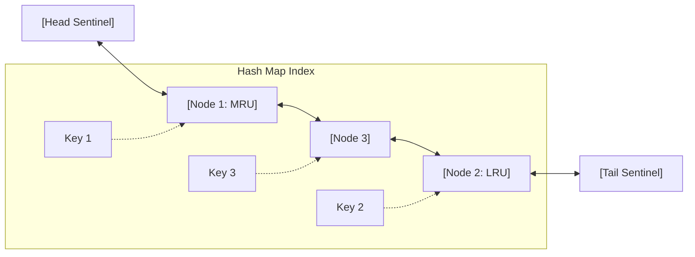

# LRU Cache Implementation in C

> Deep architectural exploration of the Least Recently Used (LRU) Cache: hybridizing hash tables with doubly linked lists, dummy sentinel nodes, $O(1)$ promotion and eviction, thread safety, and memory management.

| Metadata | Details |
| :--- | :--- |
| **Level** | Intermediate |
| **Prerequisites** | [01-linked-lists.md](./01-linked-lists.md), [04-hash-tables.md](./04-hash-tables.md) |
| **Time to Read** | 35 minutes |
| **Status** | Complete |
| **Standard Baseline** | ISO C11 / C17 / C23 |

---

## Table of Contents
1. [What & Why](#1-what--why)
2. [Core Concepts](#2-core-concepts)
3. [How It Works Internally](#3-how-it-works-internally)
4. [Syntax & Usage](#4-syntax--usage)
5. [Practical Examples](#5-practical-examples)
6. [Best Practices](#6-best-practices)
7. [Common Mistakes & Pitfalls](#7-common-mistakes--pitfalls)
8. [Performance & Security Notes](#8-performance--security-notes)
9. [Comparison: Cache Eviction Policies](#9-comparison-cache-eviction-policies)
10. [Interview Questions](#10-interview-questions)
11. [Practice Exercises](#11-practice-exercises)
12. [Summary & Cheat Sheet](#12-summary--cheat-sheet)
13. [Further Reading](#13-further-reading)

---

## 1. What & Why
An **LRU (Least Recently Used) Cache** is a finite-capacity key-value cache that evicts the item that has remained unaccessed for the longest duration when full.

In high-performance systems engineering:
- **Operating System Page Tables**: The OS page replacement daemon approximates LRU to evict clean physical memory pages under memory pressure.
- **Database Buffer Pools**: MySQL InnoDB and PostgreSQL maintain buffer pool caches using LRU lists to keep hot disk pages in RAM.
- **Web Proxies & API Caching**: Redis, Memcached, and Nginx employ LRU caches to serve frequent queries with sub-millisecond latency.

Achieving strictly $O(1)$ time complexity for both `get()` and `put()` requires a hybrid data structure: combining an associative Hash Table with a Doubly Linked List.

---

## 2. Core Concepts

### 2.1 The Two-Component Architecture
1. **Doubly Linked List (DLL)**: Maintains access recency.
   - Most Recently Used (MRU) node placed at the **Head**.
   - Least Recently Used (LRU) node placed at the **Tail**.
   - Any node can be detached and promoted to the head in strictly $O(1)$ pointer assignments.
2. **Hash Table**: Maps keys to DLL node pointers.
   - Locates any node in the DLL in $O(1)$ average lookup time without traversing the list.

### 2.2 Dummy Head and Tail Sentinels
By maintaining permanent dummy `head` and `tail` nodes that never hold payload data:
- `head->next` always points to the true MRU node.
- `tail->prev` always points to the true LRU node.
- Detaching and attaching nodes requires zero special checks for empty lists or boundary edges!

### 2.3 Cache Operations
- **`get(key)`**: Lookup node in hash map. If found, detach node from its current position in the DLL and prepend to `head` (MRU promotion). Return value. If not found, return $-1$ (or `NULL`).
- **`put(key, val)`**:
  - If key exists: update value and promote node to head.
  - If key does not exist: if capacity is reached, evict node at `tail->prev`, remove its entry from hash map, and free node. Allocate new node, attach at head, and insert into hash map.

---

## 3. How It Works Internally

### Hybrid Memory Layout

```
Hash Map (Direct Lookup):
[ Key 1 ] ------------> [ Node 1: Val 100 ]
[ Key 2 ] ------------> [ Node 2: Val 200 ]
[ Key 3 ] ------------> [ Node 3: Val 300 ]

Doubly Linked List (Recency Order):
[Head Sentinel] <--> [Node 1 (MRU)] <--> [Node 3] <--> [Node 2 (LRU)] <--> [Tail Sentinel]
```



---

## 4. Syntax & Usage

```c
typedef struct LRUNode {
    int key;
    int val;
    struct LRUNode *prev;
    struct LRUNode *next;
} LRUNode;

typedef struct LRUCache {
    int capacity;
    int size;
    LRUNode *head;
    LRUNode *tail;
    // Hash table buckets or node pointers
} LRUCache;
```

---

## 5. Practical Examples

### Example 1: LRU Cache with Sentinel Nodes and Direct Key Map
Goal: Implement an LRU cache, demonstrate access promotion, and verify eviction of least recently used keys.

```c
#include <stdio.h>
#include <stdlib.h>
#include <stdbool.h>

typedef struct Node {
    int key;
    int val;
    struct Node *prev;
    struct Node *next;
} Node;

typedef struct {
    int capacity;
    int size;
    Node *head;
    Node *tail;
    Node *map[100]; // Direct key map for 0-99
} LRUCache;

static LRUCache *lru_create(int capacity) {
    LRUCache *c = (LRUCache *)malloc(sizeof(LRUCache));
    c->capacity = capacity;
    c->size = 0;
    c->head = (Node *)malloc(sizeof(Node));
    c->tail = (Node *)malloc(sizeof(Node));
    c->head->next = c->tail; c->head->prev = NULL;
    c->tail->prev = c->head; c->tail->next = NULL;
    for (int i = 0; i < 100; i++) c->map[i] = NULL;
    return c;
}

static void detach_node(Node *n) {
    n->prev->next = n->next;
    n->next->prev = n->prev;
}

static void attach_front(LRUCache *c, Node *n) {
    n->next = c->head->next;
    n->prev = c->head;
    c->head->next->prev = n;
    c->head->next = n;
}

static int lru_get(LRUCache *c, int key) {
    if (key < 0 || key >= 100 || !c->map[key]) return -1;
    Node *n = c->map[key];
    detach_node(n);
    attach_front(c, n);
    return n->val;
}

static void lru_put(LRUCache *c, int key, int val) {
    if (key < 0 || key >= 100) return;
    if (c->map[key]) {
        Node *n = c->map[key];
        n->val = val;
        detach_node(n);
        attach_front(c, n);
        return;
    }
    if (c->size >= c->capacity) {
        Node *victim = c->tail->prev;
        detach_node(victim);
        c->map[victim->key] = NULL;
        free(victim);
        c->size--;
    }
    Node *n = (Node *)malloc(sizeof(Node));
    n->key = key; n->val = val;
    attach_front(c, n);
    c->map[key] = n;
    c->size++;
}

static void lru_free(LRUCache *c) {
    Node *curr = c->head;
    while (curr) {
        Node *next = curr->next;
        free(curr);
        curr = next;
    }
    free(c);
}

int main(void) {
    printf("=== LRU Cache Operations ===\n");
    LRUCache *cache = lru_create(2);
    lru_put(cache, 1, 100);
    lru_put(cache, 2, 200);

    printf("Get key 1: %d\n", lru_get(cache, 1)); // 1 becomes MRU

    lru_put(cache, 3, 300); // Evicts key 2!

    printf("Get key 2 (evicted): %d\n", lru_get(cache, 2));
    printf("Get key 3: %d\n", lru_get(cache, 3));

    lru_free(cache);
    return 0;
}
```

**Verified Output:**
```text
=== LRU Cache Operations ===
Get key 1: 100
Get key 2 (evicted): -1
Get key 3: 300
```

---

## 6. Best Practices
1. **Always Use Sentinels for Head and Tail**: Eliminates all null-checks during node detach and attach.
2. **Store Key Inside the Node**: The node must store its own `key` so that when `tail->prev` is evicted, its corresponding key can be removed from the hash map.
3. **Protect with Mutex in Multi-Threaded Environments**: Both read (`get`) and write (`put`) mutate the doubly linked list (due to recency promotion). Use a reader-writer lock or fine-grained mutex.
4. **Pre-Allocate Nodes in a Memory Pool**: Instead of calling `malloc()` and `free()` on every eviction and insertion, recycle the victim node directly for the incoming key.
5. **Handle Capacity Zero Gracefully**: If initialized with `capacity <= 0`, refuse inserts or return errors.

---

## 7. Common Mistakes & Pitfalls

| Mistake | Why It Is Dangerous | Correct Approach |
| :--- | :--- | :--- |
| Omitting key in node struct | Cannot determine which hash map bucket to clear when evicting `tail->prev`. | Store `key` explicitly in `LRUNode`. |
| Dangling pointer in hash map on eviction | Evicting DLL node without setting hash map entry to `NULL` leaves dangling pointer. | Delete from hash map *before* or *during* node destruction. |
| Forgetting to promote on `get()` | Lookup succeeds but item is not marked recently used, causing premature eviction. | Detach and attach to head on every successful `get()`. |
| Memory leak of sentinels on `lru_free()` | Freeing cache struct without freeing dummy `head` and `tail` sentinels leaks heap memory. | Free sentinels along with active nodes. |
| Non-atomic promotion in multithreading | Concurrent `get()` calls corrupt pointer links during simultaneous node detachment. | Synchronize list mutations with a mutex. |

---

## 8. Performance & Security Notes

### Algorithmic Complexity
- **`get(key)`**: $O(1)$ average (hash table lookup + 4 pointer reassignments).
- **`put(key, val)`**: $O(1)$ average (hash table check + node detach/attach).
- **Space**: $O(C)$ where $C$ is cache capacity.

### Memory Recycling Optimization
In high-throughput caches (e.g. 500,000 req/sec), calling `free(victim)` and `malloc()` on every miss causes heap allocator contention. Reusing the victim node in-place:
```c
victim->key = new_key;
victim->val = new_val;
attach_front(c, victim);
```
Achieves **zero heap allocations** after initial capacity saturation!

---

## 9. Comparison: Cache Eviction Policies

```
LRU (Least Recently Used):
- Evicts item unaccessed for longest time.
- Best for temporal locality.
- Vulnerable to sequential scan pollution (e.g. mysqldump evicts entire hot cache).

LFU (Least Frequently Used):
- Evicts item with lowest access frequency.
- Resilient to scan pollution, but historical items can stagnate in cache.

FIFO (First-In, First-Out):
- Evicts oldest inserted item regardless of recency.
- Simplest (queue), but poor hit rates.

2Q / ARC (Adaptive Replacement Cache):
- Hybrid policies that self-tune between recency and frequency, eliminating scan pollution.
```

---

## 10. Interview Questions

<details>
<summary><strong>1. Why is a Doubly Linked List required instead of a Singly Linked List for an LRU Cache?</strong></summary>

To achieve $O(1)$ eviction and promotion, you must remove an arbitrary node from the middle of the list. In a Singly Linked List, removing a node requires finding its predecessor, which takes $O(N)$ linear traversal. A Doubly Linked List gives direct $O(1)$ access to predecessor via `node->prev`.
</details>

<details>
<summary><strong>2. How does the 2Q (Two-Queue) cache policy solve the LRU scan pollution problem?</strong></summary>

In standard LRU, a single sequential table scan touches every record once, evicting all hot data from cache. The 2Q policy maintains two queues: a FIFO queue for items accessed once, and an LRU queue for items accessed multiple times. Items must be accessed at least twice before entering the main LRU cache, completely filtering out one-hit scans.
</details>

<details>
<summary><strong>3. How can you implement an LRU cache without dynamic memory allocation after startup?</strong></summary>

Pre-allocate an array of `capacity` nodes at startup. Keep unused nodes on a "free freelist". During eviction, detach the victim node from the tail, re-assign its key/val, and attach it to the head. The allocator is never invoked after startup.
</details>

<details>
<summary><strong>4. Why must both `get()` and `put()` acquire exclusive write locks in a thread-safe LRU cache?</strong></summary>

Even though `get()` is conceptually a read operation, it mutates the underlying doubly linked list by detaching and re-attaching the accessed node to the head. Multiple concurrent `get()` calls without write synchronization will corrupt list pointers.
</details>

<details>
<summary><strong>5. What is the Clock (Second Chance) algorithm and how does it relate to LRU?</strong></summary>

The Clock algorithm is an efficient approximation of LRU used in OS virtual memory paging. It arranges pages in a circular buffer with a single "hand" pointer and a 1-bit reference flag. When evicting, if flag is 1, clear it to 0 and advance hand; if flag is 0, evict that page. It avoids pointer-list manipulation on every memory access.
</details>

<details>
<summary><strong>6. How do you implement Time-To-Live (TTL) expiration alongside LRU eviction?</strong></summary>

Add an expiration timestamp `uint64_t expire_at;` to each node. In `get()`, compare current timestamp against `expire_at`: if expired, evict immediately and return -1. Alternatively, maintain a min-heap of expiration times for background garbage collection.
</details>

<details>
<summary><strong>7. What is Belady's Anomaly and can it happen in an LRU cache?</strong></summary>

Belady's Anomaly is the phenomenon where increasing cache capacity causes *more* cache misses. It occurs in FIFO eviction. LRU is a **stack algorithm** (an inclusion property holds: cache of size $N$ always contains the contents of cache of size $N-1$), making LRU mathematically immune to Belady's Anomaly.
</details>

<details>
<summary><strong>8. How does Redis implement its LRU eviction policy without pointer overhead?</strong></summary>

Redis avoids maintaining an explicit doubly linked list (saving 16 bytes of pointer metadata per object). Instead, each Redis object stores a 24-bit timestamp of its last access time. When memory is full, Redis samples a random batch of 5 keys and evicts the one with the oldest timestamp (Approximated LRU).
</details>

---

## 11. Practice Exercises

### Easy 1: Check If Key Is Cached
Write `bool lru_has_key(LRUCache *c, int key);` without promoting the key.

<details>
<summary>Solution</summary>

```c
bool lru_has_key(LRUCache *c, int key) {
    return key >= 0 && key < 100 && c->map[key] != NULL;
}
```
</details>

### Easy 2: Inspect Most Recently Used Key
Return the key of the current MRU item without modifying cache state.

<details>
<summary>Solution</summary>

```c
bool lru_peek_mru(const LRUCache *c, int *out_key) {
    if (!c || c->head->next == c->tail) return false;
    *out_key = c->head->next->key;
    return true;
}
```
</details>

### Easy 3: Inspect Least Recently Used Key
Return the key of the current LRU item without modifying cache state.

<details>
<summary>Solution</summary>

```c
bool lru_peek_lru(const LRUCache *c, int *out_key) {
    if (!c || c->tail->prev == c->head) return false;
    *out_key = c->tail->prev->key;
    return true;
}
```
</details>

### Medium 1: Delete Explicit Key from LRU
Implement `bool lru_delete_key(LRUCache *c, int key);`.

<details>
<summary>Solution</summary>

```c
bool lru_delete_key(LRUCache *c, int key) {
    if (key < 0 || key >= 100 || !c->map[key]) return false;
    Node *n = c->map[key];
    detach_node(n);
    c->map[key] = NULL;
    free(n);
    c->size--;
    return true;
}
```
</details>

### Medium 2: In-Place Node Recycling
Implement node eviction that reuses the victim node instead of calling `free()` and `malloc()`.

<details>
<summary>Solution</summary>

```c
void lru_recycle_victim(LRUCache *c, int new_key, int new_val) {
    Node *victim = c->tail->prev;
    detach_node(victim);
    c->map[victim->key] = NULL;
    victim->key = new_key;
    victim->val = new_val;
    attach_front(c, victim);
    c->map[new_key] = victim;
}
```
</details>

### Medium 3: String-Keyed LRU Cache Node
Design the node struct for string keys using dynamically allocated strings.

<details>
<summary>Solution</summary>

```c
typedef struct StrLRUNode {
    char *key;
    void *val;
    struct StrLRUNode *prev;
    struct StrLRUNode *next;
} StrLRUNode;
```
</details>

### Hard 1: Thread-Safe LRU Cache with Pthreads
Implement an LRU cache protected by a POSIX mutex.

<details>
<summary>Solution</summary>

```c
#include <pthread.h>

typedef struct {
    LRUCache *core;
    pthread_mutex_t lock;
} SafeLRUCache;

int safe_lru_get(SafeLRUCache *sc, int key) {
    pthread_mutex_lock(&sc->lock);
    int res = lru_get(sc->core, key);
    pthread_mutex_unlock(&sc->lock);
    return res;
}
```
</details>

### Hard 2: Dynamic Hash Table Backed LRU Cache
Combine an open-addressing hash table with dynamic resizing and a doubly linked list.

<details>
<summary>Solution</summary>

```c
// High-level:
// Hash table stores pointers to DLL nodes.
// When capacity is reached, tail->prev node is detached and removed from hash table.
```
</details>

### Hard 3: LRU with TTL Expiration
Add microsecond TTL to each item; evict expired items on access.

<details>
<summary>Solution</summary>

```c
typedef struct TTLNode {
    int key;
    int val;
    uint64_t expire_at_us;
    struct TTLNode *prev;
    struct TTLNode *next;
} TTLNode;
```
</details>

---

## 12. Summary & Cheat Sheet

| Component | Responsibility | Complexity |
| :--- | :--- | :--- |
| **Hash Table** | Key $\to$ Node Pointer lookup | $O(1)$ average |
| **Doubly Linked List** | Recency ordering | $O(1)$ detach/attach |
| **Head Sentinel** | Points to MRU node | Zero null check |
| **Tail Sentinel** | Points to LRU node | Immediate victim target |

---

## 13. Further Reading
- MySQL InnoDB Buffer Pool Architecture: *MySQL Internals Manual*.
- Redis LRU Eviction Documentation: *Using Redis as an LRU Cache*.

---

[← Previous Note: Bloom Filters](./16-bloom-filters.md) | [Data Structures Index](./README.md) | [Next Note: Graph Algorithms](./18-graph-algorithms.md)
