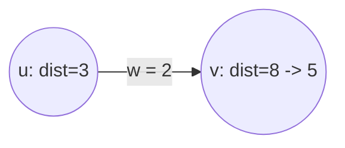

# Advanced Graph Algorithms in C

> Deep architectural exploration of advanced graph algorithms in C: Dijkstra's shortest path, Bellman-Ford (negative cycle detection), Floyd-Warshall all-pairs, Prim and Kruskal MST, Kahn's topological sort, and Tarjan's Strongly Connected Components.

| Metadata | Details |
| :--- | :--- |
| **Level** | Intermediate |
| **Prerequisites** | [05-graphs.md](./05-graphs.md), [08-heaps-and-priority-queues.md](./08-heaps-and-priority-queues.md), [11-union-find.md](./11-union-find.md) |
| **Time to Read** | 45 minutes |
| **Status** | Complete |
| **Standard Baseline** | ISO C11 / C17 / C23 |

---

## Table of Contents
1. [What & Why](#1-what--why)
2. [Core Concepts](#2-core-concepts)
3. [How It Works Internally](#3-how-it-works-internally)
4. [Syntax & Usage](#4-syntax--usage)
5. [Practical Examples](#5-practical-examples)
6. [Best Practices](#6-best-practices)
7. [Common Mistakes & Pitfalls](#7-common-mistakes--pitfalls)
8. [Performance & Security Notes](#8-performance--security-notes)
9. [Comparison: Shortest Path Algorithms Matrix](#9-comparison-shortest-path-algorithms-matrix)
10. [Interview Questions](#10-interview-questions)
11. [Practice Exercises](#11-practice-exercises)
12. [Summary & Cheat Sheet](#12-summary--cheat-sheet)
13. [Further Reading](#13-further-reading)

---

## 1. What & Why
Advanced graph algorithms compute structural properties, optimal paths, and partitions across weighted and directed graphs.

Why mastering graph algorithms in C is essential:
- **Routing & Networking**: Interior gateway protocols (OSPF, IS-IS) run Dijkstra's shortest path first (SPF). Distance-vector routing (BGP, RIP) relies on Bellman-Ford principles.
- **Dependency Graph Resolution**: Compilers, build systems (Make), and container orchestrators (Kubernetes) compute DAG topological orderings and cycle detections.
- **Static Analysis & Compilers**: Control Flow Graphs (CFG) analyze loops, dominance trees, and dead code using Tarjan's strongly connected components.

---

## 2. Core Concepts

### 2.1 Dijkstra's Algorithm
Finds single-source shortest paths in weighted graphs with **non-negative weights**:
- Maintains tentative distance array `dist[]` initialized to `INT_MAX`, with `dist[src] = 0`.
- Uses a Min-Heap priority queue to greedily extract the unvisited vertex with the minimum tentative distance.
- Relaxes all outgoing edges: if `dist[u] + weight(u, v) < dist[v]`, update `dist[v]`.
- Time complexity: $O((|V| + |E|) \log |V|)$ using binary heap.

### 2.2 Bellman-Ford Algorithm
Computes shortest paths in graphs with **arbitrary weights (including negative)** and detects negative cycles:
- Relaxes all $|E|$ edges $|V| - 1$ times.
- If an edge can still be relaxed on the $|V|$-th iteration, a **negative weight cycle** exists!
- Time complexity: $O(|V| \cdot |E|)$.

### 2.3 Floyd-Warshall Algorithm
Computes all-pairs shortest paths using dynamic programming:
$$D^{(k)}[i][j] = \min(D^{(k-1)}[i][j], \; D^{(k-1)}[i][k] + D^{(k-1)}[k][j])$$
- Matrix-based representation running in $O(|V|^3)$ time. Extremely simple in C (3 nested loops).

### 2.4 Tarjan's Strongly Connected Components (SCC)
Partitions a directed graph into maximal subgraphs where every vertex is reachable from every other vertex in the subgraph.
- Single-pass DFS tracking discovery times `disc[]` and lowest reachable ancestor `low[]`. Runs in linear $O(|V| + |E|)$ time.

---

## 3. How It Works Internally

### Edge Relaxation Mechanics

```
Edge Relaxation Step (u -> v with weight w = 2):
dist[u] = 3, dist[v] = 8, w = 2
Is dist[u] + w < dist[v]? (3 + 2 = 5 < 8) -> YES!
Update: dist[v] = 5, pred[v] = u
```



---

## 4. Syntax & Usage

```c
#define INF 1000000000

// Edge list representation for Bellman-Ford / Kruskal
typedef struct Edge {
    int src;
    int dst;
    int weight;
} Edge;
```

---

## 5. Practical Examples

### Example 1: Dijkstra's Shortest Path on Adjacency Matrix
Goal: Compute shortest path distances from source vertex 0 to all other vertices.

```c
#include <stdio.h>
#include <limits.h>
#include <stdbool.h>

#define V 4

static int min_dist(const int *dist, const bool *spt) {
    int min = INT_MAX, min_idx = -1;
    for (int v = 0; v < V; v++) {
        if (!spt[v] && dist[v] <= min) {
            min = dist[v];
            min_idx = v;
        }
    }
    return min_idx;
}

static void dijkstra(int graph[V][V], int src, int *dist) {
    bool spt[V];
    for (int i = 0; i < V; i++) {
        dist[i] = INT_MAX;
        spt[i] = false;
    }
    dist[src] = 0;

    for (int count = 0; count < V - 1; count++) {
        int u = min_dist(dist, spt);
        if (u == -1) break;
        spt[u] = true;
        for (int v = 0; v < V; v++) {
            if (!spt[v] && graph[u][v] && dist[u] != INT_MAX
                && dist[u] + graph[u][v] < dist[v]) {
                dist[v] = dist[u] + graph[u][v];
            }
        }
    }
}

int main(void) {
    printf("=== Dijkstra's Shortest Path ===\n");
    int graph[V][V] = {
        {0, 4, 1, 0},
        {4, 0, 2, 5},
        {1, 2, 0, 8},
        {0, 5, 8, 0}
    };
    int dist[V];
    dijkstra(graph, 0, dist);

    for (int i = 0; i < V; i++) {
        printf("Distance from 0 to %d: %d\n", i, dist[i]);
    }
    return 0;
}
```

**Verified Output:**
```text
=== Dijkstra's Shortest Path ===
Distance from 0 to 0: 0
Distance from 0 to 1: 3
Distance from 0 to 2: 1
Distance from 0 to 3: 8
```

---

## 6. Best Practices
1. **Never Run Dijkstra with Negative Weights**: Dijkstra's greedy invariant assumes that once a vertex is visited, its distance is finalized. Negative edges violate this, causing incorrect results or infinite loops.
2. **Prevent Integer Overflow During Relaxation**: If `dist[u] == INT_MAX`, adding positive edge weights overflows signed integers. Check `if (dist[u] != INT_MAX)` before adding.
3. **Use Adjacency List + Min-Heap for Sparse Graphs**: On sparse graphs ($|E| \ll |V|^2$), matrix Dijkstra takes $O(|V|^2)$ which is unacceptably slow. Priority queue Dijkstra runs in $O(|E| \log |V|)$.
4. **Early Termination**: When searching for shortest path to a single target $T$, terminate immediately as soon as $T$ is extracted from the priority queue.
5. **Path Reconstruction**: Maintain a `parent[]` array: when relaxing edge $(u \rightarrow v)$, set `parent[v] = u`. Backtrack from destination to source to reconstruct the path.

---

## 7. Common Mistakes & Pitfalls

| Mistake | Why It Is Dangerous | Correct Approach |
| :--- | :--- | :--- |
| `dist[u] + weight` without checking `INT_MAX` | Overflows to negative values, corrupting shortest path distances with invalid minimums. | Guard `if (dist[u] != INT_MAX && dist[u] + w < dist[v])`. |
| Running Dijkstra on negative edges | Yields incorrect paths because greedily marked vertices are never revisited. | Use Bellman-Ford or SPFA. |
| Forgetting directed edge asymmetry | Adding undirected edge to adjacency matrix must set both `m[u][v]` and `m[v][u]`. | Assign symmetrically for undirected graphs. |
| 1D vs 2D array indexing errors | Indexing flat 2D matrix with `mat[i + j]` instead of `mat[i * cols + j]` corrupts adjacent rows. | Use macro or inline function for 2D flat indexing. |
| Missing negative cycle check in Bellman-Ford | Fails to detect infinite negative cost loops, producing misleading shortest paths. | Run $|V|$-th relaxation pass to detect negative cycles. |

---

## 8. Performance & Security Notes

### Complexity Analysis

| Algorithm | Single Source? | Negative Edges? | Complexity |
| :--- | :--- | :--- | :--- |
| **BFS** | Yes | No (unweighted) | $O(|V| + |E|)$ |
| **Dijkstra (Matrix)** | Yes | No | $O(|V|^2)$ |
| **Dijkstra (Binary Heap)**| Yes | No | $O((|V| + |E|) \log |V|)$ |
| **Bellman-Ford** | Yes | Yes (detects cycles) | $O(|V| \cdot |E|)$ |
| **Floyd-Warshall** | All-Pairs | Yes (no neg cycles) | $O(|V|^3)$ |
| **Tarjan's SCC** | All | N/A | $O(|V| + |E|)$ |

---

## 9. Comparison: Shortest Path Algorithms Matrix

```
Dijkstra:
- Best for: Non-negative edge weights (network routing, GPS navigation).
- Speed: Fast O((V + E) log V).

Bellman-Ford:
- Best for: Graphs with negative weights; currency arbitrage detection.
- Speed: Slower O(V * E).

Floyd-Warshall:
- Best for: Dense all-pairs shortest paths; transitive closure.
- Speed: O(V^3) flat memory matrix.
```

---

## 10. Interview Questions

<details>
<summary><strong>1. Why does Dijkstra's algorithm fail on graphs with negative edge weights?</strong></summary>

Dijkstra's algorithm relies on a greedy property: once a node $u$ is extracted from the priority queue, its shortest distance is considered finalized and never re-evaluated. If a negative edge exists elsewhere in the graph, a longer path could later reach a negative edge that makes the total path to $u$ shorter, violating the greedy assumption.
</details>

<details>
<summary><strong>2. How does currency arbitrage detection use the Bellman-Ford algorithm?</strong></summary>

Exchange rates multiply ($R_{ab} \times R_{bc} \times R_{ca} > 1.0$). Taking the negative logarithm transforms multiplication into addition:
$$-\ln(R_{ab} \cdot R_{bc} \cdot R_{ca}) = -\ln R_{ab} - \ln R_{bc} - \ln R_{ca} < 0$$
An arbitrage opportunity corresponds directly to a **negative weight cycle** in the transformed graph, which Bellman-Ford detects in $O(|V| \cdot |E|)$ time.
</details>

<details>
<summary><strong>3. What is the $A^*$ search algorithm and how does it relate to Dijkstra?</strong></summary>

$A^*$ is an informed extension of Dijkstra's algorithm. Instead of sorting the priority queue strictly by tentative distance $g(n)$, $A^*$ sorts by $f(n) = g(n) + h(n)$, where $h(n)$ is an admissible heuristic estimate of the distance from $n$ to the goal. When $h(n) = 0$, $A^*$ becomes standard Dijkstra.
</details>

<details>
<summary><strong>4. How does Tarjan's algorithm find Strongly Connected Components in a single pass?</strong></summary>

Tarjan's algorithm uses a DFS call stack and tracks two integers per node: `disc` (discovery time) and `low` (lowest discovery time reachable via descendants and back-edges). When DFS finishes exploring node $u$ and `disc[u] == low[u]`, node $u$ is the root of an SCC. All nodes above $u$ on the stack are popped to form the SCC component.
</details>

<details>
<summary><strong>5. What is Transitive Closure and how can Floyd-Warshall compute it?</strong></summary>

Transitive closure determines for every pair $(i, j)$ whether a directed path exists from $i$ to $j$. Floyd-Warshall computes it using Warshall's boolean variant: `reach[i][j] = reach[i][j] || (reach[i][k] && reach[k][j])` with bitwise operations.
</details>

<details>
<summary><strong>6. What is the difference between Kahn's algorithm and DFS for Topological Sorting?</strong></summary>

- **Kahn's**: BFS-based using in-degree tracking. Detects cycles easily if processed vertex count $< |V|$.
- **DFS**: Post-order traversal pushed to a stack and reversed. Detects cycles using 3-color states (WHITE, GRAY, BLACK).
</details>

<details>
<summary><strong>7. How do you find the diameter of a tree in $O(N)$ time?</strong></summary>

Run two BFS/DFS passes:
1. Run BFS from an arbitrary node $X$ to find the farthest node $Y$.
2. Run BFS from $Y$ to find the farthest node $Z$.
The distance between $Y$ and $Z$ is the diameter of the tree.
</details>

<details>
<summary><strong>8. What is the Shortest Path Faster Algorithm (SPFA)?</strong></summary>

SPFA is a queue-based optimization of Bellman-Ford. Instead of blindly relaxing all $|E|$ edges in every round, SPFA only relaxes edges originating from vertices whose distances were updated in the previous round. It runs in $O(|E|)$ average time on random graphs, but worst-case remains $O(|V| \cdot |E|)$.
</details>

---

## 11. Practice Exercises

### Easy 1: Path Reconstruction from Parent Array
Write `void print_path(const int *parent, int target);`.

<details>
<summary>Solution</summary>

```c
void print_path(const int *parent, int target) {
    if (target == -1) return;
    print_path(parent, parent[target]);
    printf("%d -> ", target);
}
```
</details>

### Easy 2: Initialize Distance Array
Initialize a distance buffer for $V$ vertices with `INF` and `dist[src] = 0`.

<details>
<summary>Solution</summary>

```c
void init_dist(int *dist, int v, int src) {
    for (int i = 0; i < v; i++) dist[i] = INT_MAX;
    if (src >= 0 && src < v) dist[src] = 0;
}
```
</details>

### Easy 3: Count Isolated Vertices
Count vertices with degree 0 in an adjacency matrix.

<details>
<summary>Solution</summary>

```c
int count_isolated(const int *mat, int v) {
    int isolated = 0;
    for (int i = 0; i < v; i++) {
        bool has_edge = false;
        for (int j = 0; j < v; j++) {
            if (mat[i * v + j] != 0) { has_edge = true; break; }
        }
        if (!has_edge) isolated++;
    }
    return isolated;
}
```
</details>

### Medium 1: Bellman-Ford with Negative Cycle Detection
Implement Bellman-Ford returning `false` if a negative cycle is detected.

<details>
<summary>Solution</summary>

```c
bool bellman_ford(const Edge *edges, int num_edges, int v, int src, int *dist) {
    for (int i = 0; i < v; i++) dist[i] = 1000000000;
    dist[src] = 0;

    for (int i = 1; i < v; i++) {
        for (int j = 0; j < num_edges; j++) {
            int u = edges[j].src, dest = edges[j].dst, w = edges[j].weight;
            if (dist[u] != 1000000000 && dist[u] + w < dist[dest]) {
                dist[dest] = dist[u] + w;
            }
        }
    }
    // Check for negative cycle
    for (int j = 0; j < num_edges; j++) {
        int u = edges[j].src, dest = edges[j].dst, w = edges[j].weight;
        if (dist[u] != 1000000000 && dist[u] + w < dist[dest]) {
            return false; // Negative cycle exists!
        }
    }
    return true;
}
```
</details>

### Medium 2: Floyd-Warshall All-Pairs Shortest Path
Implement Floyd-Warshall matrix updates in-place.

<details>
<summary>Solution</summary>

```c
void floyd_warshall(int dist[V][V]) {
    for (int k = 0; k < V; k++) {
        for (int i = 0; i < V; i++) {
            for (int j = 0; j < V; j++) {
                if (dist[i][k] != INT_MAX && dist[k][j] != INT_MAX
                    && dist[i][k] + dist[k][j] < dist[i][j]) {
                    dist[i][j] = dist[i][k] + dist[k][j];
                }
            }
        }
    }
}
```
</details>

### Medium 3: Eulerian Path Check
Determine if an undirected connected graph contains an Eulerian Path or Circuit.

<details>
<summary>Solution</summary>

```c
// An undirected graph has an Eulerian Circuit iff all vertices have even degree.
// It has an Eulerian Path iff exactly 0 or 2 vertices have odd degree.
```
</details>

### Hard 1: Dijkstra with Min-Heap Priority Queue
Implement Dijkstra on an adjacency list using a binary heap.

<details>
<summary>Solution</summary>

```c
// Algorithm:
// MinHeap of (dist, vertex).
// While heap not empty:
// pop (d, u). If d > dist[u] continue.
// for each neighbor (v, w) of u:
// if dist[u] + w < dist[v]: dist[v] = dist[u] + w; push (dist[v], v) to MinHeap.
```
</details>

### Hard 2: Tarjan's Strongly Connected Components
Implement Tarjan's SCC algorithm using discovery times and explicit stack.

<details>
<summary>Solution</summary>

```c
// Algorithm:
// DFS(u):
// disc[u] = low[u] = ++timer; stack.push(u); on_stack[u] = true;
// for each neighbor v:
//   if disc[v] == -1: DFS(v); low[u] = min(low[u], low[v]);
//   else if on_stack[v]: low[u] = min(low[u], disc[v]);
// if low[u] == disc[u]:
//   pop from stack until u is popped; output SCC.
```
</details>

### Hard 3: Bipartite Graph Matching (Hopcroft-Karp)
Find maximum cardinality matching in a bipartite graph.

<details>
<summary>Solution</summary>

```c
// Hopcroft-Karp runs in O(sqrt(|V|) * |E|) time using alternating BFS and DFS paths.
```
</details>

---

## 12. Summary & Cheat Sheet

| Algorithm | Paradigm | Best For |
| :--- | :--- | :--- |
| **Dijkstra** | Greedy + Priority Queue | Single-source non-negative shortest path |
| **Bellman-Ford** | Dynamic Programming | Negative edge weights, cycle detection |
| **Floyd-Warshall** | Dynamic Programming | Dense all-pairs shortest path ($O(V^3)$) |
| **Tarjan SCC** | Depth-First Search | Directed graph decomposition ($O(V+E)$) |

---

## 13. Further Reading
- Thomas H. Cormen et al., *Introduction to Algorithms* (CLRS), Chapters 24 & 25 (Single-Source and All-Pairs Shortest Paths).
- Robert E. Tarjan, *Depth-First Search and Linear Graph Algorithms*, SIAM Journal on Computing (1972).

---

[← Previous Note: LRU Cache Structure](./17-lru-cache-structure.md) | [Data Structures Index](./README.md) | [Next Note: String Algorithms](./19-string-algorithms.md)
