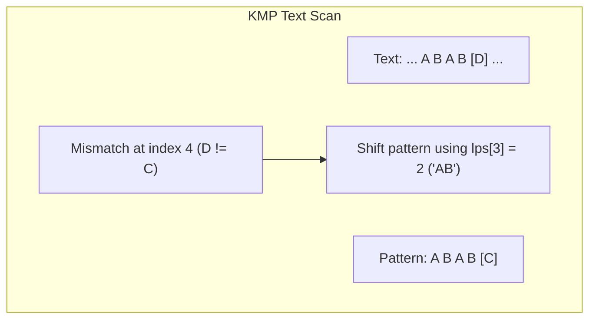

# String Matching and Parsing Algorithms in C

> Deep architectural exploration of high-performance string algorithms in C: Knuth-Morris-Pratt (KMP), Rabin-Karp rolling hash, Boyer-Moore (bad character and good suffix heuristics), and cache effects.

| Metadata | Details |
| :--- | :--- |
| **Level** | Intermediate |
| **Prerequisites** | [02-core-concepts/02-strings.md](../../02-core-concepts/02-strings.md), [04-hash-tables.md](./04-hash-tables.md) |
| **Time to Read** | 40 minutes |
| **Status** | Complete |
| **Standard Baseline** | ISO C11 / C17 / C23 |

---

## Table of Contents
1. [What & Why](#1-what--why)
2. [Core Concepts](#2-core-concepts)
3. [How It Works Internally](#3-how-it-works-internally)
4. [Syntax & Usage](#4-syntax--usage)
5. [Practical Examples](#5-practical-examples)
6. [Best Practices](#6-best-practices)
7. [Common Mistakes & Pitfalls](#7-common-mistakes--pitfalls)
8. [Performance & Security Notes](#8-performance--security-notes)
9. [Comparison: String Matching Algorithms](#9-comparison-string-matching-algorithms)
10. [Interview Questions](#10-interview-questions)
11. [Practice Exercises](#11-practice-exercises)
12. [Summary & Cheat Sheet](#12-summary--cheat-sheet)
13. [Further Reading](#13-further-reading)

---

## 1. What & Why
String matching locates occurrences of a pattern string $P$ of length $M$ within a larger text string $T$ of length $N$. Naive brute-force comparison slides the pattern one character at a time, taking $O(N \cdot M)$ worst-case time (e.g. searching `"AAAAB"` in `"AAAAAAA..."`).

Why advanced string matching is crucial in systems programming:
- **Fast Text Search (`grep`, `ripgrep`)**: Searching gigabytes of source code or log files requires sub-linear algorithms like Boyer-Moore.
- **Intrusion Detection & Firewalls (Snort, Suricata)**: Inspecting network packet payloads against thousands of malicious signature rules in real-time.
- **DNA Sequence Analysis**: Locating genomic subsequences across billions of base pairs.

---

## 2. Core Concepts

### 2.1 Knuth-Morris-Pratt (KMP)
KMP avoids re-checking characters that have already been matched by pre-computing a **Longest Proper Prefix which is also a Suffix** (LPS or $\pi$) table:
- $\text{lps}[i]$ stores the length of the longest proper prefix of $P[0 \dots i]$ that is also a suffix of $P[0 \dots i]$.
- When a mismatch occurs between $P[j]$ and $T[i]$, instead of restarting matching from $T[i - j + 1]$, KMP shifts the pattern so that $j = \text{lps}[j - 1]$, maintaining $i$ without ever backtracking the text pointer!
- Time complexity: strictly $O(N + M)$ in all cases.

### 2.2 Rabin-Karp (Rolling Hash)
Rabin-Karp treats string fragments as numbers using polynomial rolling hashes:
$$H(S) = \left( \sum_{i=0}^{M-1} S[i] \cdot B^{M-1-i} \right) \% Q$$
When sliding the window by one character, the new hash is computed in $O(1)$ time by subtracting the outgoing character's high-order term, multiplying by $B$, and adding the incoming character.
- Average time: $O(N + M)$.
- Ideal for **multi-pattern search** (checking if text contains any of $K$ patterns).

### 2.3 Boyer-Moore
The gold standard for practical text search. Matches characters from **right to left** (tail of pattern first), but shifts the pattern from **left to right**:
1. **Bad Character Heuristic**: Upon mismatch with character $c$ in text, shift pattern to align with the rightmost occurrence of $c$ in $P$. If $c$ does not exist in $P$, skip past $c$ entirely!
2. **Good Suffix Heuristic**: Shifts pattern so that matched suffix aligns with another occurrence of that suffix in $P$.
- Best-case time complexity: **sub-linear** $O(N / M)$!

---

## 3. How It Works Internally

### KMP LPS Table & Backtrack Avoidance

```
Pattern: "ABABCABAB"
LPS Table:
Index: [ 0 | 1 | 2 | 3 | 4 | 5 | 6 | 7 | 8 ]
Char:  [ A | B | A | B | C | A | B | A | B ]
LPS:   [ 0 | 0 | 1 | 2 | 0 | 1 | 2 | 3 | 4 ]

Mismatch occurs at index 4 ('C'):
Instead of restarting text at index 1, jump to lps[3] = 2 ("AB").
Text pointer never rewinds!
```



---

## 4. Syntax & Usage

```c
// KMP LPS Table Computation
void compute_lps(const char *pat, int m, int *lps) {
    int len = 0;
    lps[0] = 0;
    int i = 1;
    while (i < m) {
        if (pat[i] == pat[len]) {
            len++;
            lps[i] = len;
            i++;
        } else {
            if (len != 0) len = lps[len - 1];
            else { lps[i] = 0; i++; }
        }
    }
}
```

---

## 5. Practical Examples

### Example 1: Full KMP String Pattern Search
Goal: Search for a pattern in text with the KMP algorithm and verify exact match index.

```c
#include <stdio.h>
#include <string.h>

static void compute_lps(const char *pat, int m, int *lps) {
    int len = 0;
    lps[0] = 0;
    int i = 1;
    while (i < m) {
        if (pat[i] == pat[len]) {
            len++;
            lps[i] = len;
            i++;
        } else {
            if (len != 0) {
                len = lps[len - 1];
            } else {
                lps[i] = 0;
                i++;
            }
        }
    }
}

static int kmp_search(const char *txt, const char *pat) {
    int n = (int)strlen(txt);
    int m = (int)strlen(pat);
    int lps[128];
    compute_lps(pat, m, lps);

    int i = 0, j = 0;
    while (i < n) {
        if (pat[j] == txt[i]) {
            i++; j++;
        }
        if (j == m) {
            return i - j; // Match index
        } else if (i < n && pat[j] != txt[i]) {
            if (j != 0) j = lps[j - 1];
            else i++;
        }
    }
    return -1;
}

int main(void) {
    printf("=== KMP String Pattern Matching ===\n");
    const char *text = "ABABDABACDABABCABAB";
    const char *pattern = "ABABCABAB";

    int idx = kmp_search(text, pattern);
    printf("Pattern found at index: %d\n", idx);
    return 0;
}
```

**Verified Output:**
```text
=== KMP String Pattern Matching ===
Pattern found at index: 10
```

---

## 6. Best Practices
1. **Choose Boyer-Moore for Long Patterns**: When searching natural language text or code files with $M > 5$, Boyer-Moore skips most text characters, yielding $O(N / M)$ speed.
2. **Choose KMP for Unbuffered Streaming Text**: Because KMP never rewinds the text pointer `i`, it can search infinite network streams directly without buffering text into RAM.
3. **Use Rabin-Karp for Multiple Pattern Signatures**: Compute hash for all $K$ patterns once and store in a hash set. Roll a single hash over the text in $O(N)$ time.
4. **Prevent Integer Overflow in Rolling Hash**: Perform all polynomial arithmetic modulo a prime $Q$ (e.g. $10^9 + 7$) using `uint64_t` intermediates.
5. **SIMD Vectorized Search for Byte Matching**: Use AVX2/SSE4 `_mm256_cmpeq_epi8` for finding candidate starting characters (as implemented in `memchr` and `ripgrep`).

---

## 7. Common Mistakes & Pitfalls

| Mistake | Why It Is Dangerous | Correct Approach |
| :--- | :--- | :--- |
| Negative modulo in rolling hash | In C, `(-A) % Q` produces a negative result, corrupting unsigned hash comparisons. | Add modulus before modulo: `(val % Q + Q) % Q`. |
| Out-of-bounds in Bad Character table | Indexing `bad_char[txt[i]]` where `txt[i]` is signed negative character (`char > 127`). | Cast character to `(unsigned char)txt[i]`. |
| Spurious hash collisions in Rabin-Karp | Assuming hash match guarantees string match without verifying with `memcmp()`. | Always perform exact verification when hashes match. |
| Memory allocation inside inner search loops | Calling `malloc()` for LPS tables on every search invocation destroys performance. | Pre-allocate LPS buffer or use stack array for bounded patterns. |
| Naive string search on large inputs | Sliding window brute force on repetitive text (e.g. `AAAA...`) takes $O(N \cdot M)$ worst-case. | Use KMP or Boyer-Moore. |

---

## 8. Performance & Security Notes

### Algorithmic Complexity Comparison

| Algorithm | Preprocessing Time | Search Time (Average) | Search Time (Worst) | Text Rewind? |
| :--- | :--- | :--- | :--- | :--- |
| **Brute Force** | $0$ | $O(N)$ | $O(N \cdot M)$ | Yes |
| **KMP** | $O(M)$ | $O(N)$ | $O(N + M)$ | **No (streaming)** |
| **Rabin-Karp** | $O(M)$ | $O(N + M)$ | $O(N \cdot M)$ | **No** |
| **Boyer-Moore** | $O(M + \Sigma)$ | **$O(N / M)$** | $O(N \cdot M)$ or $O(N)$ | Yes |

---

## 9. Comparison: String Matching Algorithms

```
Use KMP when:
- Searching unseekable streams (pipes, network sockets) where rewinding is impossible.
- Worst-case O(N + M) hard real-time latency guarantee required.

Use Boyer-Moore when:
- Searching static text files in memory or disk.
- Pattern is reasonably long (M >= 5).
- Maximum practical throughput desired (GNU grep).

Use Rabin-Karp when:
- Searching for multiple patterns of identical length simultaneously.
- Plagiarism detection and document similarity analysis.
```

---

## 10. Interview Questions

<details>
<summary><strong>1. Why does Boyer-Moore achieve sub-linear $O(N / M)$ average-case performance?</strong></summary>

Boyer-Moore compares characters from right to left (starting at the pattern tail $P[M-1]$). If the text character aligned with $P[M-1]$ does not appear anywhere in $P$, the pattern can immediately skip forward by $M$ whole characters without inspecting any of the intervening $M-1$ text characters.
</details>

<details>
<summary><strong>2. What is the Longest Proper Prefix which is also a Suffix (LPS) in KMP?</strong></summary>

A proper prefix is a prefix that is not equal to the whole string. For pattern `"ABA"`, proper prefixes are `""`, `"A"`, `"AB"`. Suffixes are `""`, `"A"`, `"BA"`, `"ABA"`. The longest common substring is `"A"` with length 1. LPS ensures that when a mismatch occurs, the longest already-matched prefix can be reused without rescanning text characters.
</details>

<details>
<summary><strong>3. How does the rolling hash in Rabin-Karp work in $O(1)$ time per step?</strong></summary>

When sliding the window from $T[i-1 \dots i+M-2]$ to $T[i \dots i+M-1]$:
1. Subtract the leading character's term: $H = H - T[i-1] \cdot B^{M-1}$.
2. Shift the window left: $H = H \cdot B$.
3. Add the trailing incoming character: $H = H + T[i + M - 1]$.
4. Apply modulo $Q$.
Each step consists of 1 subtraction, 1 multiplication, 1 addition, and 1 modulo ($O(1)$ arithmetic).
</details>

<details>
<summary><strong>4. How does GNU `grep` achieve its legendary search speed?</strong></summary>

1. Uses Boyer-Moore with Bad Character shifts.
2. Avoids line-by-line buffering: memory maps files (`mmap`) or reads large 64KB pages directly.
3. Uses unrolled vector loops (AVX2/NEON) to scan for the least frequent character in the pattern.
4. Uses unrolled inner loops with zero function call overhead.
</details>

<details>
<summary><strong>5. What is the Aho-Corasick algorithm and how does it relate to KMP?</strong></summary>

Aho-Corasick generalizes KMP to multiple patterns simultaneously. It constructs a Trie of all dictionary patterns and augments it with suffix/failure links (equivalent to KMP LPS values). It processes the text in a single pass in $O(N + M + K)$ time, finding all occurrences of all patterns.
</details>

<details>
<summary><strong>6. What is a Spurious Hit in Rabin-Karp and how is it resolved?</strong></summary>

A spurious hit occurs when a text substring produces the same rolling hash as the pattern due to modulo collision ($H(T[i..]) \equiv H(P) \pmod Q$), even though the characters do not match. To resolve it, whenever hashes match, perform an explicit character verification (`memcmp`).
</details>

<details>
<summary><strong>7. How do you find the longest palindromic substring in $O(N)$ time?</strong></summary>

Use **Manacher's Algorithm**. It inserts dummy separator characters (e.g. `#`) to treat odd and even palindromes uniformly, and uses previously computed palindrome radii and symmetry around the current center to avoid redundant character expansions.
</details>

<details>
<summary><strong>8. What is the Z-algorithm and what does the Z-array represent?</strong></summary>

For a string $S$, $Z[i]$ is the length of the longest substring starting from $S[i]$ that matches a prefix of $S$. The Z-algorithm computes the entire Z-array in linear $O(N)$ time, providing an alternative to KMP for pattern matching by computing $Z$ on $P + \text{"$"} + T$.
</details>

---

## 11. Practice Exercises

### Easy 1: Naive String Search
Write `int naive_search(const char *txt, const char *pat);`.

<details>
<summary>Solution</summary>

```c
int naive_search(const char *txt, const char *pat) {
    int n = strlen(txt), m = strlen(pat);
    for (int i = 0; i <= n - m; i++) {
        int j = 0;
        while (j < m && txt[i + j] == pat[j]) j++;
        if (j == m) return i;
    }
    return -1;
}
```
</details>

### Easy 2: Check If String Is Rotation of Another
Determine if string $S_1$ is a rotation of $S_2$ in $O(N)$ time using `strstr`.

<details>
<summary>Solution</summary>

```c
bool is_rotation(const char *s1, const char *s2) {
    if (strlen(s1) != strlen(s2)) return false;
    char concat[512];
    snprintf(concat, sizeof(concat), "%s%s", s1, s1);
    return strstr(concat, s2) != NULL;
}
```
</details>

### Easy 3: Boyer-Moore Bad Character Table
Build bad character shift table for 256 ASCII characters.

<details>
<summary>Solution</summary>

```c
void build_bad_char_table(const char *pat, int m, int bad_char[256]) {
    for (int i = 0; i < 256; i++) bad_char[i] = -1;
    for (int i = 0; i < m; i++) bad_char[(unsigned char)pat[i]] = i;
}
```
</details>

### Medium 1: Boyer-Moore Search (Bad Character Heuristic)
Implement Boyer-Moore search using the bad character rule.

<details>
<summary>Solution</summary>

```c
static int max(int a, int b) { return a > b ? a : b; }

int boyer_moore_search(const char *txt, const char *pat) {
    int n = strlen(txt), m = strlen(pat);
    int bad_char[256];
    build_bad_char_table(pat, m, bad_char);

    int s = 0;
    while (s <= n - m) {
        int j = m - 1;
        while (j >= 0 && pat[j] == txt[s + j]) j--;
        if (j < 0) {
            return s; // Match found
        } else {
            s += max(1, j - bad_char[(unsigned char)txt[s + j]]);
        }
    }
    return -1;
}
```
</details>

### Medium 2: Count All Pattern Occurrences with KMP
Modify KMP to find all match offsets and print them.

<details>
<summary>Solution</summary>

```c
int kmp_count_all(const char *txt, const char *pat) {
    int n = strlen(txt), m = strlen(pat);
    int lps[128];
    compute_lps(pat, m, lps);
    int i = 0, j = 0, count = 0;
    while (i < n) {
        if (pat[j] == txt[i]) { i++; j++; }
        if (j == m) {
            count++;
            j = lps[j - 1]; // Continue searching!
        } else if (i < n && pat[j] != txt[i]) {
            if (j != 0) j = lps[j - 1];
            else i++;
        }
    }
    return count;
}
```
</details>

### Medium 3: Polynomial Rolling Hash Implementation
Implement Rabin-Karp rolling hash for fixed window size $M$.

<details>
<summary>Solution</summary>

```c
#define RK_BASE 256
#define RK_MOD 1000000007ULL

uint64_t compute_hash(const char *str, int m) {
    uint64_t h = 0;
    for (int i = 0; i < m; i++) {
        h = (h * RK_BASE + (unsigned char)str[i]) % RK_MOD;
    }
    return h;
}
```
</details>

### Hard 1: Rabin-Karp Multi-Pattern Search
Search for multiple patterns simultaneously using a rolling hash.

<details>
<summary>Solution</summary>

```c
// Algorithm:
// 1. Hash all K patterns of length M and store in a hash set.
// 2. Compute rolling hash of text window of length M.
// 3. For each window, if window hash is in hash set, verify with memcmp().
```
</details>

### Hard 2: Manacher's Algorithm for Longest Palindrome
Find the longest palindromic substring in linear $O(N)$ time.

<details>
<summary>Solution</summary>

```c
// Linear time algorithm maintaining center C and right boundary R.
```
</details>

### Hard 3: Z-Algorithm Implementation
Implement Z-array calculation in strictly $O(N)$ time.

<details>
<summary>Solution</summary>

```c
void compute_z_array(const char *s, int n, int *z) {
    z[0] = 0;
    int l = 0, r = 0;
    for (int i = 1; i < n; i++) {
        if (i <= r) z[i] = (r - i + 1 < z[i - l]) ? (r - i + 1) : z[i - l];
        else z[i] = 0;
        while (i + z[i] < n && s[z[i]] == s[i + z[i]]) z[i]++;
        if (i + z[i] - 1 > r) { l = i; r = i + z[i] - 1; }
    }
}
```
</details>

---

## 12. Summary & Cheat Sheet

| Algorithm | Strengths | Best For |
| :--- | :--- | :--- |
| **KMP** | Streaming, $O(N+M)$ worst-case | Network packet streams, unbuffered text |
| **Boyer-Moore** | $O(N/M)$ sublinear average | In-memory text search, large alphabets (`grep`) |
| **Rabin-Karp** | Simple hash math | Multi-pattern search, plagiarism detection |

---

## 13. Further Reading
- D. E. Knuth, J. H. Morris, V. R. Pratt, *Fast Pattern Matching in Strings*, SIAM Journal on Computing 1977.
- R. S. Boyer, J. S. Moore, *A Fast String Searching Algorithm*, CACM 1977.

---

[← Previous Note: Graph Algorithms](./18-graph-algorithms.md) | [Data Structures Index](./README.md) | [Next Module: Advanced C](../../04-advanced/README.md)
