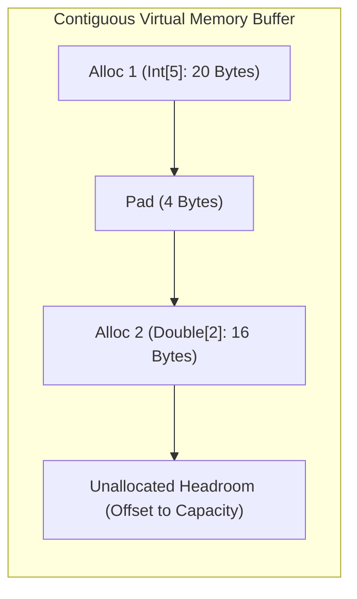

# Custom Allocators and Arenas in C

> Deep architectural exploration of Region-Based Memory Management in C: bump/linear allocators, alignment arithmetic, temp/scratch arenas, lifecycles, and sub-nanosecond allocation speeds.

| Metadata | Details |
| :--- | :--- |
| **Level** | Advanced |
| **Prerequisites** | [02-core-concepts/08-memory-management.md](../../02-core-concepts/08-memory-management.md), [03-intermediate/13-opaque-pointers-and-adts.md](../../03-intermediate/13-opaque-pointers-and-adts.md) |
| **Time to Read** | 40 minutes |
| **Status** | Complete |
| **Standard Baseline** | ISO C11 / C17 / C23 |

---

## Table of Contents
1. [What & Why](#1-what--why)
2. [Core Concepts](#2-core-concepts)
3. [How It Works Internally](#3-how-it-works-internally)
4. [Syntax & Usage](#4-syntax--usage)
5. [Practical Examples](#5-practical-examples)
6. [Best Practices](#6-best-practices)
7. [Common Mistakes & Pitfalls](#7-common-mistakes--pitfalls)
8. [Performance & Security Notes](#8-performance--security-notes)
9. [Comparison: Arena vs Malloc](#9-comparison-arena-vs-malloc)
10. [Interview Questions](#10-interview-questions)
11. [Practice Exercises](#11-practice-exercises)
12. [Summary & Cheat Sheet](#12-summary--cheat-sheet)
13. [Further Reading](#13-further-reading)

---

## 1. What & Why
General-purpose memory allocators like `malloc()` and `free()` (glibc ptmalloc, jemalloc, tcmalloc) are designed to handle unpredictable allocation patterns of arbitrary sizes and lifetimes. To achieve this versatility, they incur significant costs:
- **Metadata Overhead**: Every allocation carries 8–16 bytes of hidden chunk header metadata.
- **Heap Fragmentation**: Malloc freelists fragment over time, causing out-of-memory errors even when total free RAM is ample.
- **Lock Contention**: Thread arenas require atomic locks or thread-local caching, degrading multi-threaded throughput.
- **Latency Spikes**: Traversing bins and freelists consumes 50–200 CPU cycles per call.

An **Arena Allocator** (or region/bump allocator) pre-allocates a large contiguous block of memory. Allocations simply increment an offset pointer (*bumping* the pointer). Deallocations do not occur individually; instead, the entire arena is reset or freed in a single $O(1)$ operation.

---

## 2. Core Concepts

### 2.1 The Bump Allocator Invariant
An arena consists of three values:
1. `buffer`: Base pointer to contiguous virtual memory.
2. `capacity`: Total byte capacity of the region.
3. `offset`: Current allocation cursor.

Allocation takes strictly 3 machine instructions:
$$\text{ptr} = \text{buffer} + \text{offset}$$
$$\text{offset} += \text{aligned\_size}$$
Deallocation is instantaneous:
$$\text{offset} = 0$$

### 2.2 Memory Alignment Arithmetic
CPUs require data types to reside at memory addresses that are multiples of their natural size (e.g. 4 bytes for `int`, 8 bytes for `double` / pointers). Accessing misaligned memory causes CPU performance penalties or fatal hardware bus errors (`SIGBUS` on ARM/SPARC).
Given address $P$ and alignment $A$ (where $A$ is a power of 2):
$$\text{aligned\_addr} = (P + A - 1) \& \sim(A - 1)$$

### 2.3 Scratch Arenas (Temp Arenas)
A function can take a temporary snapshot of the arena's current offset, allocate intermediate working buffers, and restore the offset upon function return (*rewinding the tape*), completely eliminating memory leaks.

---

## 3. How It Works Internally

### Memory Layout & Alignment Padding

```
Arena Buffer [Capacity: 1024 Bytes]
[ Alloc 1 (12B) ][Pad: 4B][ Alloc 2 (Double: 8B aligned) ][ Unused Space ... ]
^buffer                   ^aligned (offset: 24)           ^capacity
```



---

## 4. Syntax & Usage

```c
typedef struct Arena {
    uint8_t *buffer;
    size_t capacity;
    size_t offset;
} Arena;

// Fast power-of-two alignment
static inline uintptr_t align_forward(uintptr_t ptr, size_t align) {
    return (ptr + align - 1) & ~(align - 1);
}
```

---

## 5. Practical Examples

### Example 1: Full Arena Allocator with Alignment and Reset
Goal: Implement an arena bump allocator, allocate aligned integer arrays, inspect offset advancement, and reset the region.

```c
#include <stdio.h>
#include <stdlib.h>
#include <stdint.h>
#include <stdalign.h>

typedef struct {
    uint8_t *buffer;
    size_t capacity;
    size_t offset;
} Arena;

static Arena *arena_create(size_t cap) {
    Arena *a = (Arena *)malloc(sizeof(Arena));
    if (!a) return NULL;
    a->buffer = (uint8_t *)malloc(cap);
    if (!a->buffer) { free(a); return NULL; }
    a->capacity = cap;
    a->offset = 0;
    return a;
}

static void *arena_alloc(Arena *a, size_t size, size_t align) {
    uintptr_t curr = (uintptr_t)a->buffer + a->offset;
    uintptr_t aligned = (curr + align - 1) & ~(align - 1);
    size_t new_offset = (aligned - (uintptr_t)a->buffer) + size;
    if (new_offset > a->capacity) return NULL; // Out of memory
    a->offset = new_offset;
    return (void *)aligned;
}

static void arena_reset(Arena *a) {
    a->offset = 0;
}

static void arena_free(Arena *a) {
    if (a) {
        free(a->buffer);
        free(a);
    }
}

int main(void) {
    printf("=== Arena Bump Allocator Operations ===\n");
    Arena *arena = arena_create(1024);

    int *nums = (int *)arena_alloc(arena, 5 * sizeof(int), alignof(int));
    for (int i = 0; i < 5; i++) nums[i] = (i + 1) * 10;

    printf("Allocated 5 integers: ");
    for (int i = 0; i < 5; i++) printf("%d ", nums[i]);
    printf("\n");

    printf("Arena current offset: %zu bytes\n", arena->offset);
    arena_reset(arena);
    printf("Arena reset offset: %zu bytes\n", arena->offset);

    arena_free(arena);
    return 0;
}
```

**Verified Output:**
```text
=== Arena Bump Allocator Operations ===
Allocated 5 integers: 10 20 30 40 50 
Arena current offset: 20 bytes
Arena reset offset: 0 bytes
```

---

## 6. Best Practices
1. **Default to 8-Byte or 16-Byte Alignment**: Defaulting to `alignof(max_align_t)` (typically 16 bytes on modern 64-bit systems) ensures any data type or SIMD vector can be placed safely without bus faults.
2. **Use Scratch Temp Arenas for Per-Frame Work**: In game engines, network servers, or compiler passes, take `size_t mark = arena->offset;`, allocate temporary ASTs or packet buffers, and restore `arena->offset = mark;` at function exit.
3. **Commit Virtual Memory with `mmap`**: Instead of `malloc(100MB)` upfront, reserve 4GB of virtual address space using `mmap(MAP_ANONYMOUS | MAP_NORESERVE)` and let the OS commit physical RAM pages only as the bump offset reaches them.
4. **Never Store Arena Pointers in Long-Lived Globals**: Storing a pointer allocated from a temporary arena into a long-lived cache leads to catastrophic use-after-free once the arena resets.
5. **Implement Arena Chains for Unbounded Growth**: If an arena overflows, link to a new secondary arena block rather than crashing.

---

## 7. Common Mistakes & Pitfalls

| Mistake | Why It Is Dangerous | Correct Approach |
| :--- | :--- | :--- |
| Calling standard `free()` on an arena pointer | Corrupts heap metadata; glibc `malloc` crashes with `SIGSEGV` or abort. | Arena allocations are never freed individually; reset whole arena. |
| Non-power-of-two alignment | `(ptr + align - 1) & ~(align - 1)` formula fails completely, producing misaligned garbage. | Assert `(align & (align - 1)) == 0`. |
| Pointer persistence across arena reset | Retaining pointers to arena memory after `arena_reset()` creates dangling pointers. | Ensure lifetimes of referenced data match arena reset cycle. |
| Arithmetic overflow on offset check | `curr + size` can overflow `size_t` if size is huge, bypassing capacity check. | Check `if (size > a->capacity - a->offset) return NULL;`. |
| Failing to zero allocated memory | Bump allocators return uninitialized memory containing previous cycle's remnants. | Provide `arena_alloc_zero()` using `memset()`. |

---

## 8. Performance & Security Notes

### Benchmark Comparison: `malloc` vs Arena
- **`malloc()` throughput**: $pprox 10 - 20$ million ops/sec (50–100 ns per alloc).
- **Arena `bump_alloc()`**: $pprox 500 - 800$ million ops/sec (1–2 ns per alloc, single register increment).
- **Cache performance**: Successive allocations are placed strictly adjacently, maximizing L1 cache line spatial locality.

### Security Hardening
- Arenas are inherently immune to use-after-free and double-free within an allocation epoch.
- To prevent buffer overruns between objects, debug builds can insert **canary bytes** (guard bands) between arena slices.

---

## 9. Comparison: Arena vs Malloc

```
Arena Allocator:
- Allocation speed: Sub-nanosecond (1-2 CPU cycles).
- Deallocation: O(1) bulk reset.
- Fragmentation: Zero.
- Best for: Structured lifetimes (per-request, per-frame, compiler AST passes).

General Malloc:
- Allocation speed: 50-100 ns (traverses bins/freelists, thread locks).
- Deallocation: O(1) individual free.
- Fragmentation: High over long uptimes.
- Best for: Unpredictable, disparate object lifetimes.
```

---

## 10. Interview Questions

<details>
<summary><strong>1. Why is an Arena Allocator up to 50x faster than `malloc()`?</strong></summary>

`malloc()` must look up freelist bins, lock arena mutexes, resolve chunk splitting, and write header metadata. An arena simply increments an integer offset pointer in a CPU register (`offset += size`). It involves zero branches, zero mutex locks, and zero search loops.
</details>

<details>
<summary><strong>2. How does memory alignment bitwise arithmetic work?</strong></summary>

For alignment $A = 2^k$, the low $k$ bits of an aligned address must be zero.
Adding $A - 1$ pushes any misaligned address into the next alignment window.
Bitwise AND with $\sim(A - 1)$ (the bitmask with low $k$ bits cleared to 0) rounds down to the nearest multiple of $A$.
Example: align 13 to 8 bytes: $(13 + 7) \& \sim 7 = 20 \& \dots11111000_2 = 16$.
</details>

<details>
<summary><strong>3. What is a Temp/Scratch Arena and how does it prevent memory leaks?</strong></summary>

A scratch arena records `size_t mark = arena->offset;` at the beginning of a block. The function allocates whatever scratch memory it needs. At exit, it executes `arena->offset = mark;`. This acts like an explicit call stack on the heap, ensuring 100% leak-free execution.
</details>

<details>
<summary><strong>4. How do you implement virtual-memory-backed Arenas using POSIX `mmap`?</strong></summary>

Call `mmap(NULL, 1ULL << 32, PROT_NONE, MAP_PRIVATE | MAP_ANONYMOUS | MAP_NORESERVE, -1, 0)` to reserve 4GB of address space without consuming physical RAM. When the bump allocator crosses page boundaries (4KB), call `mprotect(..., PROT_READ | PROT_WRITE)` to commit pages on demand.
</details>

<details>
<summary><strong>5. Why is an Arena Allocator ideal for compiler Abstract Syntax Trees (ASTs)?</strong></summary>

Compilers build massive trees containing millions of small AST nodes during parsing. Individual nodes are never freed independently; the entire AST is used across semantic analysis and code generation, and discarded all at once when the translation unit finishes. An arena allocates nodes contiguously with zero overhead and frees the entire AST in one call.
</details>

<details>
<summary><strong>6. What is the difference between a Bump Allocator and a Stack Allocator?</strong></summary>

- **Bump Allocator**: Can only be reset all at once (`offset = 0`).
- **Stack Allocator**: Allows LIFO deallocations by storing allocation markers. You can free the most recently allocated block by rolling back the offset to its marker.
</details>

<details>
<summary><strong>7. How do you handle destructor execution in custom C allocators?</strong></summary>

In pure C, structures typically do not have C++ destructors. If cleanup is required (e.g. closing file descriptors), you maintain a linked list of cleanup callbacks inside the arena struct, and invoke them sequentially before resetting the arena buffer.
</details>

<details>
<summary><strong>8. What happens if an Arena overflows its capacity?</strong></summary>

1. Hard error / abort: suitable for bounded embedded systems.
2. Arena Chaining: allocate a new contiguous chunk (typically double size) and link it to the existing arena via `ArenaBlock *next`.
</details>

---

## 11. Practice Exercises

### Easy 1: Arena Available Space
Write `size_t arena_available(const Arena *a);`.

<details>
<summary>Solution</summary>

```c
size_t arena_available(const Arena *a) {
    return a ? (a->capacity - a->offset) : 0;
}
```
</details>

### Easy 2: Arena Allocation with Zeroing
Write `void *arena_alloc_zero(Arena *a, size_t size, size_t align);`.

<details>
<summary>Solution</summary>

```c
void *arena_alloc_zero(Arena *a, size_t size, size_t align) {
    void *ptr = arena_alloc(a, size, align);
    if (ptr) memset(ptr, 0, size);
    return ptr;
}
```
</details>

### Easy 3: String Duplication in Arena
Duplicate a C string into arena memory.

<details>
<summary>Solution</summary>

```c
char *arena_strdup(Arena *a, const char *str) {
    size_t len = strlen(str) + 1;
    char *copy = (char *)arena_alloc(a, len, 1);
    if (copy) memcpy(copy, str, len);
    return copy;
}
```
</details>

### Medium 1: Stack Allocator (Marker Rollback)
Implement marker-based rollback for a stack allocator.

<details>
<summary>Solution</summary>

```c
typedef size_t ArenaMarker;

ArenaMarker arena_get_marker(const Arena *a) {
    return a->offset;
}

void arena_rollback(Arena *a, ArenaMarker mark) {
    if (mark <= a->capacity) {
        a->offset = mark;
    }
}
```
</details>

### Medium 2: Scratch Arena Context Helper
Implement a RAII-like scratch arena structure in C.

<details>
<summary>Solution</summary>

```c
typedef struct {
    Arena *arena;
    size_t mark;
} TempArena;

TempArena temp_arena_begin(Arena *a) {
    return (TempArena){ .arena = a, .mark = a->offset };
}

void temp_arena_end(TempArena t) {
    t.arena->offset = t.mark;
}
```
</details>

### Medium 3: Dynamic Arena Growth (Chained Blocks)
Implement multi-block chained arenas for unbounded growth.

<details>
<summary>Solution</summary>

```c
typedef struct ArenaBlock {
    uint8_t *buffer;
    size_t cap;
    size_t offset;
    struct ArenaBlock *next;
} ArenaBlock;
```
</details>

### Hard 1: 4GB Virtual Memory Arena with `mmap`
Implement a virtual memory arena reserving 4GB on POSIX.

<details>
<summary>Solution</summary>

```c
#include <sys/mman.h>

Arena *arena_create_virtual(size_t reserve_gb) {
    size_t total = reserve_gb * (1024ULL * 1024ULL * 1024ULL);
    uint8_t *buf = (uint8_t *)mmap(NULL, total, PROT_READ | PROT_WRITE,
                                   MAP_PRIVATE | MAP_ANONYMOUS, -1, 0);
    if (buf == MAP_FAILED) return NULL;
    Arena *a = (Arena *)malloc(sizeof(Arena));
    a->buffer = buf; a->capacity = total; a->offset = 0;
    return a;
}
```
</details>

### Hard 2: Thread-Safe Arena with Thread-Local Storage
Implement thread-local scratch arenas in C11.

<details>
<summary>Solution</summary>

```c
// Using _Thread_local in C11
static _Thread_local Arena tl_scratch;
```
</details>

### Hard 3: Guard-Band Debug Arena
Insert 16-byte canary patterns between allocations to detect buffer overruns.

<details>
<summary>Solution</summary>

```c
// Prepend and append 0xDEADBEEF canaries, verify before arena reset.
```
</details>

---

## 12. Summary & Cheat Sheet

| Operation | Complexity | Implementation |
| :--- | :--- | :--- |
| **Alloc** | $O(1)$ | `offset = (aligned_offset) + size` |
| **Free** | $O(1)$ bulk | `offset = 0` (instantaneous) |
| **Alignment**| Bitmask | `(ptr + align - 1) & ~(align - 1)` |
| **Rollback** | $O(1)$ | `offset = saved_marker` |

---

## 13. Further Reading
- Ginger Bill, *Memory Allocation Strategies - Part 1 & 2 (Linear / Arena Allocator)*.
- Chris Wellons, *Untangling Lifetimes: The Arena Allocator*, Null Program (2023).

---

[← Previous Note: Module Overview](./README.md) | [Advanced C Index](./README.md) | [Next Note: Memory Pools](./02-memory-pools.md)
