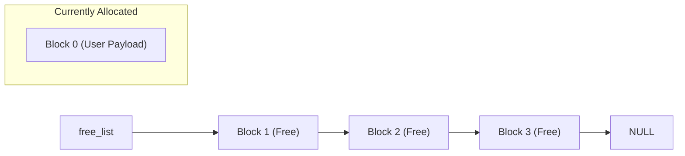

# Fixed-Size Memory Pools in C

> Deep architectural exploration of fixed-size block memory pools: embedded freelists, union type punning, zero heap fragmentation, real-time deterministic $O(1)$ allocations, and object recycling.

| Metadata | Details |
| :--- | :--- |
| **Level** | Advanced |
| **Prerequisites** | [01-custom-allocators-and-arenas.md](./01-custom-allocators-and-arenas.md), [02-core-concepts/06-structs-unions-enums.md](../../02-core-concepts/06-structs-unions-enums.md) |
| **Time to Read** | 35 minutes |
| **Status** | Complete |
| **Standard Baseline** | ISO C11 / C17 / C23 |

---

## Table of Contents
1. [What & Why](#1-what--why)
2. [Core Concepts](#2-core-concepts)
3. [How It Works Internally](#3-how-it-works-internally)
4. [Syntax & Usage](#4-syntax--usage)
5. [Practical Examples](#5-practical-examples)
6. [Best Practices](#6-best-practices)
7. [Common Mistakes & Pitfalls](#7-common-mistakes--pitfalls)
8. [Performance & Security Notes](#8-performance--security-notes)
9. [Comparison: Memory Pool vs Arena vs Malloc](#9-comparison-memory-pool-vs-arena-vs-malloc)
10. [Interview Questions](#10-interview-questions)
11. [Practice Exercises](#11-practice-exercises)
12. [Summary & Cheat Sheet](#12-summary--cheat-sheet)
13. [Further Reading](#13-further-reading)

---

## 1. What & Why
While an arena allocator is optimal for objects with matching lifecycles, it cannot free individual elements out of order. If an application repeatedly creates and destroys millions of uniform objects with independent, unpredictable lifecycles (e.g., network packets, game entities, transaction records, thread task structs), an arena will continually grow.

A **Fixed-Size Memory Pool** (or object pool / slab allocator) solves this problem by partitioning a contiguous memory buffer into equal-sized blocks.
- **Zero Fragmentation**: Because every block is identical in size, any freed block can satisfy any future allocation. Fragmentation is physically impossible.
- **Deterministic $O(1)$ Alloc & Free**: Acquiring and returning blocks takes strictly 2–3 pointer reassignments.
- **No Extra Metadata**: Unallocated blocks store freelist pointers *inside themselves*.

---

## 2. Core Concepts

### 2.1 The Embedded Freelist (Union Trick)
In standard linked lists, each node carries an 8-byte pointer alongside its payload.
In a memory pool, when a block is **free**, it doesn't need to hold data! We can store the `next` pointer directly inside the block's unallocated storage using a C `union`:
```c
typedef union Block {
    union Block *next;      // Used when block is FREE
    char payload[BLOCK_SZ]; // Used when block is ALLOCATED
} Block;
```
Memory overhead per block: **strictly 0 bytes**!

### 2.2 Pool Operations
- **`pool_alloc()`**: Pop the head block from `free_list`:
  ```c
  Block *b = pool->free_list;
  pool->free_list = b->next;
  return b->payload;
  ```
- **`pool_free(ptr)`**: Push the returned block onto the head of `free_list`:
  ```c
  Block *b = (Block *)ptr;
  b->next = pool->free_list;
  pool->free_list = b;
  ```

---

## 3. How It Works Internally

### Freelist Memory Representation

```
Memory Pool Buffer (Pre-allocated Array of 4 Blocks):
[ Block 0 (Free) ] -> Points to Block 1
[ Block 1 (Free) ] -> Points to Block 2
[ Block 2 (Free) ] -> Points to Block 3
[ Block 3 (Free) ] -> NULL

After Allocating Block 0:
free_list points to Block 1.
Block 0's memory is now active user payload!
```



---

## 4. Syntax & Usage

```c
#define POOL_BLOCK_SIZE 64
#define POOL_NUM_BLOCKS 1024

typedef union PoolBlock {
    union PoolBlock *next;
    uint8_t payload[POOL_BLOCK_SIZE];
} PoolBlock;

typedef struct MemoryPool {
    PoolBlock blocks[POOL_NUM_BLOCKS];
    PoolBlock *free_list;
} MemoryPool;
```

---

## 5. Practical Examples

### Example 1: Fixed-Size Pool Allocation and Immediate Freelist Recycling
Goal: Implement a memory pool, allocate blocks, deallocate a block, and verify that subsequent allocations reuse the exact freed address.

```c
#include <stdio.h>
#include <stdlib.h>
#include <stdint.h>

#define BLOCK_SIZE 32
#define POOL_BLOCKS 8

typedef union Block {
    union Block *next;
    char payload[BLOCK_SIZE];
} Block;

typedef struct {
    Block blocks[POOL_BLOCKS];
    Block *free_list;
} Pool;

static void pool_init(Pool *p) {
    p->free_list = &p->blocks[0];
    for (int i = 0; i < POOL_BLOCKS - 1; i++) {
        p->blocks[i].next = &p->blocks[i + 1];
    }
    p->blocks[POOL_BLOCKS - 1].next = NULL;
}

static void *pool_alloc(Pool *p) {
    if (!p->free_list) return NULL; // Exhausted
    Block *b = p->free_list;
    p->free_list = b->next;
    return b->payload;
}

static void pool_dealloc(Pool *p, void *ptr) {
    if (!ptr) return;
    Block *b = (Block *)ptr;
    b->next = p->free_list;
    p->free_list = b;
}

int main(void) {
    printf("=== Fixed-Size Memory Pool Operations ===\n");
    Pool pool;
    pool_init(&pool);

    void *p1 = pool_alloc(&pool);
    void *p2 = pool_alloc(&pool);
    void *p3 = pool_alloc(&pool);

    printf("Allocated 3 blocks successfully.\n");
    pool_dealloc(&pool, p2);
    printf("Deallocated block 2 back to freelist.\n");

    void *p4 = pool_alloc(&pool);
    printf("Reallocated block (reused address): %s\n", (p4 == p2) ? "YES" : "NO");
    return 0;
}
```

**Verified Output:**
```text
=== Fixed-Size Memory Pool Operations ===
Allocated 3 blocks successfully.
Deallocated block 2 back to freelist.
Reallocated block (reused address): YES
```

---

## 6. Best Practices
1. **Enforce `sizeof(Block) >= sizeof(void *)`**: A block must be at least as large as a pointer (`8 bytes` on 64-bit systems) so that the embedded `next` pointer fits inside.
2. **Validate Freed Pointers in Debug Mode**: Verify that `ptr` falls strictly within the pool's buffer range `[pool->buffer, pool->buffer + total_size)` and that `(ptr - pool->buffer) % block_size == 0`.
3. **Use Slab Allocators for Varied Object Sizes**: Combine multiple pools of size powers-of-two (16, 32, 64, 128, 256 bytes). Incoming allocations are routed to the smallest pool that fits the object.
4. **Lock-Free Freelist with Atomic CAS**: Use `atomic_compare_exchange_weak` on `free_list` with tagged pointers (ABA problem defense) to implement concurrent lock-free object pools.
5. **Zero Memory on Return**: In debug mode, overwrite deallocated blocks with a poison pattern (`0xDD`) to detect use-after-free immediately.

---

## 7. Common Mistakes & Pitfalls

| Mistake | Why It Is Dangerous | Correct Approach |
| :--- | :--- | :--- |
| Passing alien pointer to `pool_dealloc()` | Corrupts freelist pointer chains, causing future allocations to point to wild memory. | Validate `ptr` bounds and alignment before linking. |
| Double-freeing a block | Links the same block into the freelist twice, creating an infinite circular freelist loop. | Track allocation state in a bitmap or detect cycles. |
| Block size smaller than pointer | On 64-bit platforms, defining a 4-byte block overflows when writing 8-byte `next` pointer. | Assert `sizeof(payload) >= sizeof(void *)`. |
| Writing to block after freeing | Overwrites the embedded `b->next` pointer, severing the freelist permanently. | Never write to freed blocks. |
| The ABA Problem in concurrent pools | A thread reads head A, gets preempted while A is popped, B popped, and A pushed back; CAS succeeds erroneously. | Use 128-bit atomic pointer + sequence counter (`tagged pointer`). |

---

## 8. Performance & Security Notes

### Benchmark Comparison
- **`malloc()` / `free()`**: $50 - 150$ CPU cycles per cycle.
- **`pool_alloc()` / `pool_free()`**: $3 - 5$ CPU cycles (single pointer load and store).
- **L1 Cache Benefits**: High hit rate when objects are frequently recycled from the top of the freelist (LIFO cache reuse).

---

## 9. Comparison: Memory Pool vs Arena vs Malloc

```
Memory Pool:
- Object sizes: Fixed (uniform blocks).
- Deallocation: Individual O(1) free.
- Fragmentation: Zero.
- Ideal for: Network packet buffers, entity pools, particle systems.

Arena:
- Object sizes: Variable.
- Deallocation: Bulk reset only.
- Fragmentation: Zero within epoch.
- Ideal for: Per-frame/per-request scratch buffers, AST generation.

Malloc:
- Object sizes: Variable.
- Deallocation: Individual.
- Fragmentation: High.
```

---

## 10. Interview Questions

<details>
<summary><strong>1. What is the Slab Allocator in the Linux kernel and how does it relate to memory pools?</strong></summary>

The Linux Slab Allocator (Jeff Bonwick, SunOS / Linux) maintains caches of pre-allocated kernel object pools (e.g. `mm_struct`, `inode`, `sk_buff`). It avoids the cost of repeatedly initializing and destroying kernel data structures by recycling pre-constructed memory slabs, eliminating internal and external fragmentation.
</details>

<details>
<summary><strong>2. How does the union-based embedded freelist avoid memory overhead?</strong></summary>

When a memory block is in the free state, it contains no valid user data. By overlapping the `next` pointer with the payload storage using a C `union`, the freelist pointer occupies the exact same memory bytes that will later hold the user payload. Thus, zero additional metadata bytes are consumed per block.
</details>

<details>
<summary><strong>3. What is the ABA problem in lock-free memory pools and how is it solved?</strong></summary>

Thread 1 reads `head = A`, `next = B`. Thread 1 is preempted. Thread 2 pops A, pops B, and pushes A back. `head` is once again A. Thread 1 resumes and executes CAS: `head` matches A, so it sets `head = B`. But B was already freed or modified! Solution: **Tagged Pointers** (Double-Word CAS) combining pointer with an incrementing 64-bit sequence counter.
</details>

<details>
<summary><strong>4. How do you detect double-free bugs in a memory pool?</strong></summary>

1. Maintain an external bitset where 1 bit represents allocation state. If bit is already 0 during free, trigger an assertion failure.
2. In debug builds, inspect the first pointer in the block; if it already points to a valid pool address or magic poison value, double-free is suspected.
</details>

<details>
<summary><strong>5. Why does LIFO freelist ordering maximize CPU cache performance?</strong></summary>

When a block is freed and immediately reallocated, its memory address is still residing in the CPU's L1/L2 data cache. LIFO reuse ensures the "hottest" cache lines are assigned to the next allocation.
</details>

<details>
<summary><strong>6. What is the Buddy Allocator and how does it compare to a memory pool?</strong></summary>

A Buddy Allocator partitions memory into power-of-two blocks. When a block is freed, it checks if its adjacent "buddy" block is also free; if so, they coalesce into a larger block. A memory pool never coalesces; it maintains fixed block sizes without searching.
</details>

<details>
<summary><strong>7. How do you implement dynamic expansion when a memory pool is exhausted?</strong></summary>

Maintain a linked list of pool chunks. When `free_list == NULL`, allocate a new chunk of $N$ blocks, initialize its freelist, and link it into the master pool struct.
</details>

<details>
<summary><strong>8. How do you ensure correct alignment for objects stored in a pool?</strong></summary>

Ensure `BLOCK_SIZE` is rounded up to a multiple of `alignof(T)`. When allocating the initial pool buffer, align the base pointer to the maximum alignment required by the payload type.
</details>

---

## 11. Practice Exercises

### Easy 1: Memory Pool Capacity
Write `size_t pool_free_count(const Pool *p);`.

<details>
<summary>Solution</summary>

```c
size_t pool_free_count(const Pool *p) {
    size_t count = 0;
    const Block *curr = p->free_list;
    while (curr) {
        count++;
        curr = curr->next;
    }
    return count;
}
```
</details>

### Easy 2: Pointer Ownership Verification
Verify if `void *ptr` belongs to the pool.

<details>
<summary>Solution</summary>

```c
bool pool_owns(const Pool *p, const void *ptr) {
    uintptr_t start = (uintptr_t)&p->blocks[0];
    uintptr_t end = (uintptr_t)&p->blocks[POOL_BLOCKS];
    uintptr_t target = (uintptr_t)ptr;
    return target >= start && target < end && ((target - start) % sizeof(Block) == 0);
}
```
</details>

### Easy 3: Poisoning Freed Blocks
Write a function that fills freed blocks with `0xDD` in debug builds.

<details>
<summary>Solution</summary>

```c
void pool_dealloc_debug(Pool *p, void *ptr) {
    if (!ptr) return;
    Block *b = (Block *)ptr;
    memset(b->payload, 0xDD, sizeof(b->payload));
    b->next = p->free_list;
    p->free_list = b;
}
```
</details>

### Medium 1: Bitset-Tracked Double-Free Detection
Use an auxiliary 64-bit integer bitmask to detect double-free bugs.

<details>
<summary>Solution</summary>

```c
typedef struct {
    Pool core;
    uint64_t allocated_mask; // up to 64 blocks
} SafePool;

bool safe_pool_free(SafePool *sp, void *ptr) {
    size_t idx = ((Block *)ptr - &sp->core.blocks[0]);
    if (!(sp->allocated_mask & (1ULL << idx))) {
        fprintf(stderr, "Double-free detected at block %zu!\n", idx);
        return false;
    }
    sp->allocated_mask &= ~(1ULL << idx);
    pool_dealloc(&sp->core, ptr);
    return true;
}
```
</details>

### Medium 2: Dynamic Multi-Chunk Pool
Expand pool by allocating an extra chunk of blocks when depleted.

<details>
<summary>Solution</summary>

```c
typedef struct Chunk {
    Block blocks[64];
    struct Chunk *next;
} Chunk;

typedef struct {
    Chunk *chunks;
    Block *free_list;
} DynamicPool;
```
</details>

### Medium 3: Type-Safe Pool Macro Generator
Define preprocessor macros that generate type-safe memory pools for any struct `T`.

<details>
<summary>Solution</summary>

```c
#define DECLARE_POOL(T, NAME, CAP) \
    typedef union NAME##Block { union NAME##Block *next; T data; } NAME##Block; \
    typedef struct { NAME##Block blocks[CAP]; NAME##Block *free_list; } NAME##Pool;
```
</details>

### Hard 1: Lock-Free Memory Pool with C11 Atomics
Implement thread-safe `alloc` and `dealloc` using atomic compare-and-swap.

<details>
<summary>Solution</summary>

```c
#include <stdatomic.h>

typedef struct {
    Block blocks[128];
    _Atomic(Block *) free_list;
} LockFreePool;

void *lf_pool_alloc(LockFreePool *p) {
    Block *head = atomic_load(&p->free_list);
    while (head && !atomic_compare_exchange_weak(&p->free_list, &head, head->next));
    return head;
}
```
</details>

### Hard 2: Multi-Slab Allocator (Powers of Two)
Route allocations to pools of 16, 32, 64, 128, 256 bytes.

<details>
<summary>Solution</summary>

```c
// Array of 5 pools. Route size <= 16 to pool 0, <= 32 to pool 1, etc.
```
</details>

### Hard 3: Cache-Line Aligned Pool Blocks
Ensure every block starts on an exact 64-byte L1 cache line boundary.

<details>
<summary>Solution</summary>

```c
typedef union _Alignas(64) AlignBlock {
    union AlignBlock *next;
    char payload[64];
} AlignBlock;
```
</details>

---

## 12. Summary & Cheat Sheet

| Feature | Memory Pool | Standard Malloc |
| :--- | :--- | :--- |
| **Allocation Latency** | $pprox 2 - 4$ cycles | $50 - 200$ cycles |
| **Fragmentation** | Strictly Zero | Significant over time |
| **Deallocation** | $O(1)$ individual | $O(1)$ individual with coalescing overhead |
| **Metadata** | 0 bytes (embedded union) | 8–16 bytes per chunk |

---

## 13. Further Reading
- Jeff Bonwick, *The Slab Allocator: An Object-Caching Kernel Memory Allocator*, USENIX 1994.
- Robert Nystrom, *Game Programming Patterns* (Object Pool Pattern).

---

[← Previous Note: Custom Allocators & Arenas](./01-custom-allocators-and-arenas.md) | [Advanced C Index](./README.md) | [Next Note: Memory Debugging: Valgrind & ASan](./03-memory-debugging-valgrind-asan.md)
