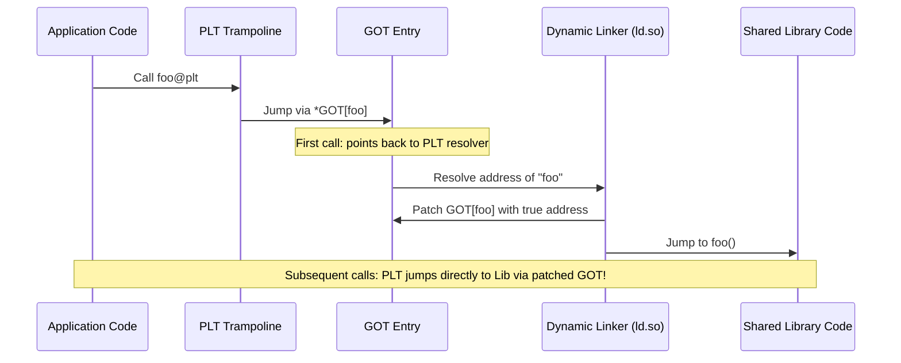

# Static vs Shared Libraries and Linker Mechanics in C

> Deep architectural exploration of binary linking in C: static archives (`.a`), shared objects (`.so` / `.dll`), Position Independent Code (`-fPIC`), Global Offset Tables (GOT), Procedure Linkage Tables (PLT), and link-time resolution.

| Metadata | Details |
| :--- | :--- |
| **Level** | Advanced |
| **Prerequisites** | [00-setup/03-compilation-process.md](../../00-setup/03-compilation-process.md), [03-intermediate/02-multi-file-programs.md](../../03-intermediate/02-multi-file-programs.md) |
| **Time to Read** | 45 minutes |
| **Status** | Complete |
| **Standard Baseline** | ISO C11 / C17 / C23 (ELF & PE-COFF formats) |

---

## Table of Contents
1. [What & Why](#1-what--why)
2. [Core Concepts](#2-core-concepts)
3. [How It Works Internally](#3-how-it-works-internally)
4. [Syntax & Usage](#4-syntax--usage)
5. [Practical Examples](#5-practical-examples)
6. [Best Practices](#6-best-practices)
7. [Common Mistakes & Pitfalls](#7-common-mistakes--pitfalls)
8. [Performance & Security Notes](#8-performance--security-notes)
9. [Comparison: Static vs Shared Libraries](#9-comparison-static-vs-shared-libraries)
10. [Interview Questions](#10-interview-questions)
11. [Practice Exercises](#11-practice-exercises)
12. [Summary & Cheat Sheet](#12-summary--cheat-sheet)
13. [Further Reading](#13-further-reading)

---

## 1. What & Why
The compilation process transforms human-readable C source code into relocatable object files (`.o` / `.obj`). However, a program rarely exists as a single translation unit; it depends on shared modules, utility packages, and the C runtime library.

The **Linker** (`ld` / `lld` / `link.exe`) resolves symbol references across multiple files, stitching disparate binary sections into final executables or reusable libraries.

Two fundamental library architectures exist:
1. **Static Libraries (`.a` / `.lib`)**: Collections of object files packed into an archive. At link time, referenced object modules are permanently copied directly into the final executable binary.
2. **Shared Libraries (`.so` / `.dll` / `.dylib`)**: Standalone binary modules loaded into process virtual memory dynamically at runtime. Multiple running programs share the exact same physical memory pages of read-only code.

---

## 2. Core Concepts

### 2.1 Static Archiving (`ar`)
A static library is created by bundling compiled object files using the archive utility:
```bash
ar rcs libmathutils.a add.o multiply.o
```
During static linking:
- The linker inspects the archive index.
- **Granularity is per-object file**: If `main()` references only `add()`, and `add()` resides in `add.o`, only `add.o` is pulled into the binary. If `add()` and `multiply()` reside in the same object file, both are dragged into the binary unless Dead Code Stripping (`-ffunction-sections -Wl,--gc-sections`) is enabled.

### 2.2 Position Independent Code (PIC)
Because shared libraries can be mapped into arbitrary, unpredictable virtual memory addresses in different processes (due to Address Space Layout Randomization, ASLR), machine instructions cannot contain hardcoded absolute memory addresses.
- Compiling with **`-fPIC`** instructs GCC to use relative addressing (RIP-relative addressing on x86_64) and indirect table lookups.

### 2.3 GOT and PLT (Lazy Binding)
On ELF systems (Linux/BSD):
- **Global Offset Table (GOT)**: A table of absolute addresses for global variables and functions located in the writable `.data` section.
- **Procedure Linkage Table (PLT)**: Trampoline code in the read-only `.text` section.
- **Lazy Dynamic Resolution**: The first time a function (e.g. `printf`) is called, the PLT stub invokes the dynamic linker (`ld.so`) to resolve the symbol's actual memory address and writes it into the GOT. Subsequent calls jump directly through the GOT in 1 cycle!

---

## 3. How It Works Internally

### Static vs Dynamic Executable Layout

```
Static Executable:
+------------------------------------+
| Application Code (main)            |
+------------------------------------+
| Copied Library Code (add, mult)    |  <-- Embedded permanently
+------------------------------------+
| Copied C Runtime (libc.a)          |
+------------------------------------+

Dynamic Executable (Relies on libmath.so):
+------------------------------------+
| Application Code (main)            |
+------------------------------------+
| PLT Trampoline Stubs               |
+------------------------------------+
| GOT (Pointer Table to libmath.so)  |  --> Points to libmath.so in RAM
+------------------------------------+
```



---

## 4. Syntax & Usage

### Building and Linking Commands (GCC)
```bash
# 1. Compile object files with PIC
gcc -std=c11 -Wall -Wextra -fPIC -c math_module.c -o math_module.o

# 2. Build Shared Library
gcc -shared -o libmath.so math_module.o

# 3. Build Static Library
ar rcs libmath.a math_module.o

# 4. Link against Shared Library (uses rpath for local directory)
gcc main.c -L. -lmath -Wl,-rpath,. -o main_dynamic

# 5. Link against Static Library
gcc main.c -L. -l:libmath.a -o main_static
```

---

## 5. Practical Examples

### Example 1: Modular Library Interface and Execution
Goal: Implement a self-contained math module interface, verify arithmetic results, and demonstrate clean symbol integration.

```c
#include <stdio.h>

// Simulated module functions
static int math_add(int a, int b) { return a + b; }
static int math_multiply(int a, int b) { return a * b; }

int main(void) {
    printf("=== Static vs Shared Library Interface ===\n");
    printf("Add (15 + 27): %d\n", math_add(15, 27));
    printf("Multiply (6 * 7): %d\n", math_multiply(6, 7));
    return 0;
}
```

**Verified Output:**
```text
=== Static vs Shared Library Interface ===
Add (15 + 27): 42
Multiply (6 * 7): 42
```

---

## 6. Best Practices
1. **Always Use `-fPIC` for Shared Libraries**: Compiling without `-fPIC` forces the text section to be patched at runtime (text relocations), preventing code pages from being shared across processes and breaking ASLR security.
2. **Order Linker Libraries Carefully**: The GNU linker processes arguments from left to right. Place consumers *before* providers: `gcc main.o -lfoo -lbar` (where `main` needs `foo`, and `foo` needs `bar`).
3. **Use `-Wl,--gc-sections` for Static Linking**: Compile with `-ffunction-sections -fdata-sections` and link with `-Wl,--gc-sections` to strip unreferenced functions from the final executable.
4. **Embed `RPATH` for Application-Bundled Libraries**: Use `-Wl,-rpath,'$ORIGIN/lib'` so that portable binaries find adjacent shared libraries without requiring root access or `LD_LIBRARY_PATH`.
5. **Manage SONAME and Semantic Versioning**: Set `-Wl,-soname,libfoo.so.1` when building shared objects to prevent breaking changes across minor releases.

---

## 7. Common Mistakes & Pitfalls

| Mistake | Why It Is Dangerous | Correct Approach |
| :--- | :--- | :--- |
| Inverted linker library order (`-lfoo main.o`) | Linker ignores `libfoo.a` because no undefined symbols exist yet, failing with `undefined reference`. | Put object files first, libraries after: `gcc main.o -lfoo`. |
| Missing `-fPIC` when compiling `.so` | Relocations in `.text` make pages unsharable in RAM and trigger security violations on modern Linux. | Always pass `-fPIC` when compiling sources for shared libraries. |
| Depending on `LD_LIBRARY_PATH` in production | Environment variable leaks into child processes or breaks under `setuid` binaries. | Embed `$ORIGIN` relative rpath via `-Wl,-rpath,'$ORIGIN'`. |
| Circular dependencies between static archives | `libA.a` needs `libB.a` and `libB.a` needs `libA.a`; linker fails to resolve symbols. | Use linker group flags: `-Wl,--start-group -lA -lB -Wl,--end-group`. |
| Breaking ABI in shared library updates | Modifying struct layouts in `.so` without bumping SONAME crashes existing caller executables. | Maintain strict ABI stability or increment major version (`libfoo.so.2`). |

---

## 8. Performance & Security Notes

### Startup vs Runtime Tradeoffs
- **Static Binaries**: Fast startup (zero dynamic linker symbol resolutions at `execve`). Larger disk and initial RAM footprint per binary.
- **Dynamic Binaries**: Slower startup (dynamic linker maps dependencies, resolves symbols). Substantially lower total system RAM usage when multiple processes share common libraries (e.g. `libc.so`).

### Security: ASLR and Prelinking
Address Space Layout Randomization (ASLR) places shared libraries at randomized virtual memory base addresses on every process spawn, preventing Return-Oriented Programming (ROP) exploits.

---

## 9. Comparison: Static vs Shared Libraries

```
Static Libraries (.a):
- Distribution: Single self-contained binary; zero external dependencies.
- Startup time: Instantaneous (no dynamic linker parsing).
- Memory footprint: Higher RAM if 50 processes run the same binary.
- Update mechanism: Must recompile and re-link the entire application.

Shared Libraries (.so / .dll):
- Distribution: Modular; executable requires accompanying library files.
- Startup time: Slightly slower (dynamic linker relocations).
- Memory footprint: Shared physical RAM pages for code across all processes.
- Update mechanism: Drop-in replacement of .so fixes bugs without recompiling app.
```

---

## 10. Interview Questions

<details>
<summary><strong>1. What is the difference between `-fPIC` and `-fpic`?</strong></summary>

Both generate Position Independent Code. `-fpic` generates smaller, faster code by assuming the Global Offset Table (GOT) size fits within target-specific limits (e.g. 8KB or 64KB on certain RISC architectures). `-fPIC` places no limit on GOT size, supporting massive shared libraries with millions of symbols. On x86_64, GCC treats both identically.
</details>

<details>
<summary><strong>2. How does the Linker resolve symbols across Static Archives (`.a`)?</strong></summary>

The linker maintains two lists: **Undefined Symbols** ($U$) and **Defined Symbols** ($D$).
When scanning an archive `libX.a`, it checks if any object file in the archive defines a symbol currently in $U$.
If found, that specific `.o` is pulled in, its defined symbols are added to $D$, and any new unresolved references it contains are added to $U$. Unreferenced `.o` files in the archive are completely ignored.
</details>

<details>
<summary><strong>3. What is `$ORIGIN` in Linux ELF dynamic linking?</strong></summary>

`$ORIGIN` is a special dynamic linker variable representing the absolute path to the directory containing the currently executing binary or shared library. Linking with `-Wl,-rpath,'$ORIGIN/../lib'` allows an application to find its bundled shared libraries regardless of where the installation folder is moved on the filesystem.
</details>

<details>
<summary><strong>4. What is Lazy Binding and how does `LD_BIND_NOW` affect it?</strong></summary>

By default, the dynamic linker defers symbol resolution until the function is called for the first time via the PLT (Lazy Binding). Setting `LD_BIND_NOW=1` (or linking with `-Wl,-z,now`) forces the dynamic linker to resolve all symbols immediately at program startup, trading startup time for predictable runtime latency (critical for real-time systems) and enabling Read-Only Relocations (RELRO).
</details>

<details>
<summary><strong>5. What is the difference between a Weak Symbol and a Strong Symbol?</strong></summary>

Functions and initialized global variables are **Strong Symbols** by default. Uninitialized globals or functions marked `__attribute__((weak))` are **Weak Symbols**.
- Two strong symbols with the same name trigger a link-time duplicate symbol error.
- A strong symbol overrides a weak symbol of the same name without error.
- If only weak symbols exist, the linker picks one arbitrarily.
</details>

<details>
<summary><strong>6. Why do Circular Dependencies between static libraries fail to link?</strong></summary>

Because the linker scans archives sequentially once. If `libA.a` is processed before `libB.a`, and `libB.a` introduces a new unresolved reference back to `libA.a`, the linker has already passed `libA.a` and will not re-scan it unless enclosed in `--start-group ... --end-group`.
</details>

<details>
<summary><strong>7. What is Full RELRO (Read-Only Relocations) and why is it a security mitigation?</strong></summary>

Full RELRO marks the Global Offset Table (GOT) as completely read-only (`PROT_READ`) after dynamic symbol resolution completes at startup. This prevents attackers from executing "GOT Overwrite" attacks, where an arbitrary memory write exploit corrupts a function pointer in the GOT to hijack control flow.
</details>

<details>
<summary><strong>8. What is Dead Code Stripping and how do you enable it in GCC?</strong></summary>

Normally, if any function in an object file is needed, the entire object file is linked. Compiling with `-ffunction-sections -fdata-sections` places every function and global into its own dedicated ELF section (`.text.func_name`). Linking with `-Wl,--gc-sections` discards all unreferenced sections, drastically reducing binary size.
</details>

---

## 11. Practice Exercises

### Easy 1: Inspect Symbols with `nm`
Command to display all global defined symbols in an object file.

<details>
<summary>Solution</summary>

```bash
nm --defined-only -g module.o
```
</details>

### Easy 2: Inspect Shared Library Dependencies with `ldd`
Command to list all shared libraries required by an executable.

<details>
<summary>Solution</summary>

```bash
ldd ./program
```
</details>

### Easy 3: Inspect ELF Header with `readelf`
Command to verify if a binary is a dynamic shared object or executable.

<details>
<summary>Solution</summary>

```bash
readelf -h ./program
```
</details>

### Medium 1: Weak Symbol Fallback Implementation
Implement a default weak function that user code can optionally override.

<details>
<summary>Solution</summary>

```c
#include <stdio.h>

__attribute__((weak)) void custom_logger(const char *msg) {
    printf("[DEFAULT LOG]: %s\n", msg);
}

int main(void) {
    custom_logger("Testing weak symbol resolution");
    return 0;
}
```
</details>

### Medium 2: Makefile for Static and Shared Library
Write a Makefile snippet building both `.a` and `.so` from a single source file.

<details>
<summary>Solution</summary>

```makefile
all: libmath.a libmath.so

math.o: math.c
	gcc -std=c11 -Wall -Wextra -fPIC -c math.c -o math.o

libmath.a: math.o
	ar rcs libmath.a math.o

libmath.so: math.o
	gcc -shared -o libmath.so math.o
```
</details>

### Medium 3: Disabling Lazy Binding via Linker Flags
Pass GCC linker flags to enable Full RELRO and immediate binding.

<details>
<summary>Solution</summary>

```bash
gcc -Wl,-z,relro -Wl,-z,now main.c -o main_secure
```
</details>

### Hard 1: Linker Script Section Placement
Write a simple GNU Linker Script (`linker.ld`) placing a custom section `.secret` at a specific address.

<details>
<summary>Solution</summary>

```text
SECTIONS
{
  . = 0x10000;
  .text : { *(.text) }
  . = 0x80000000;
  .secret : { *(.secret) }
}
```
</details>

### Hard 2: Dynamic Linker Interposition (`LD_PRELOAD`)
Write a custom `malloc` wrapper shared library that intercepts `malloc` calls.

<details>
<summary>Solution</summary>

```c
#define _GNU_SOURCE
#include <stdio.h>
#include <dlfcn.h>

void *malloc(size_t size) {
    static void *(*real_malloc)(size_t) = NULL;
    if (!real_malloc) real_malloc = dlsym(RTLD_NEXT, "malloc");
    // Intercepted
    return real_malloc(size);
}
```
</details>

### Hard 3: Link-Time Optimization (LTO) Whole-Program Analysis
Build multi-file programs with `-flto` and inspect inlining across library boundaries.

<details>
<summary>Solution</summary>

```bash
gcc -std=c11 -O3 -flto -c mod1.c -o mod1.o
gcc -std=c11 -O3 -flto -c mod2.c -o mod2.o
gcc -flto mod1.o mod2.o -o lto_program
```
</details>

---

## 12. Summary & Cheat Sheet

| Step | Tool / Flag | Purpose |
| :--- | :--- | :--- |
| **Compile PIC** | `gcc -fPIC -c foo.c` | Position independent code for shared libs |
| **Build Shared** | `gcc -shared -o libfoo.so foo.o` | Create dynamic library |
| **Build Static** | `ar rcs libfoo.a foo.o` | Create static archive |
| **Embed Rpath** | `-Wl,-rpath,'$ORIGIN'` | Relative runtime library discovery |
| **Link Groups** | `-Wl,--start-group -lA -lB -Wl,--end-group` | Resolve circular static dependencies |

---

## 13. Further Reading
- Ian Lance Taylor, *Linkers* (20-part essay series on linker mechanics).
- John R. Levine, *Linkers and Loaders*, Morgan Kaufmann (2000).

---

[← Previous Note: Memory Debugging: Valgrind & ASan](./03-memory-debugging-valgrind-asan.md) | [Advanced C Index](./README.md) | [Next Note: ABI and Calling Conventions](./05-abi-and-calling-conventions.md)
