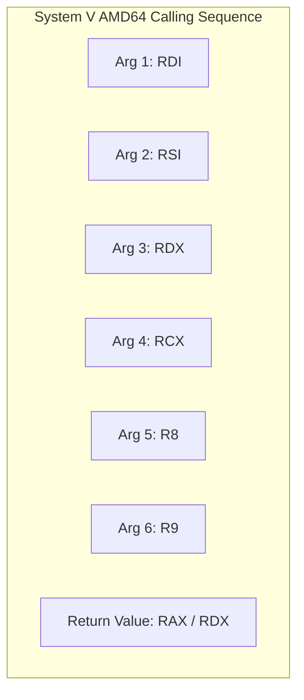

# ABI and Calling Conventions in C

> Deep architectural exploration of Application Binary Interfaces (ABI) in C: System V AMD64 vs Microsoft x64, register parameter passing, callee-saved registers, 16-byte stack frame alignment, and struct return protocols.

| Metadata | Details |
| :--- | :--- |
| **Level** | Advanced |
| **Prerequisites** | [00-setup/03-compilation-process.md](../../00-setup/03-compilation-process.md), [01-fundamentals/07-functions.md](../../01-fundamentals/07-functions.md) |
| **Time to Read** | 40 minutes |
| **Status** | Complete |
| **Standard Baseline** | ISO C11 / C17 / C23 (System V AMD64 & Windows x64 ABIs) |

---

## Table of Contents
1. [What & Why](#1-what--why)
2. [Core Concepts](#2-core-concepts)
3. [How It Works Internally](#3-how-it-works-internally)
4. [Syntax & Usage](#4-syntax--usage)
5. [Practical Examples](#5-practical-examples)
6. [Best Practices](#6-best-practices)
7. [Common Mistakes & Pitfalls](#7-common-mistakes--pitfalls)
8. [Performance & Security Notes](#8-performance--security-notes)
9. [Comparison: System V vs Microsoft x64 ABI](#9-comparison-system-v-vs-microsoft-x64-abi)
10. [Interview Questions](#10-interview-questions)
11. [Practice Exercises](#11-practice-exercises)
12. [Summary & Cheat Sheet](#12-summary--cheat-sheet)
13. [Further Reading](#13-further-reading)

---

## 1. What & Why
An **API (Application Programming Interface)** defines source-level contracts in C: function signatures, type definitions, and header prototypes. If an API is unchanged, code recompiles cleanly.

An **ABI (Application Binary Interface)** defines the machine-level binary contract between compiled modules, libraries, and the operating system kernel:
- Which CPU registers carry function arguments.
- How return values are passed back to the caller.
- Which registers must be preserved across function calls.
- How the CPU stack pointer (`rsp`) must be aligned in memory.
- How data types, struct fields, and bitfields are packed and padded in bytes.

Violating the ABI leads to silent memory corruption, register clobbering, and fatal segmentation faults at machine instruction boundaries.

---

## 2. Core Concepts

### 2.1 The Two Prevailing 64-Bit ABIs
On modern x86_64 hardware, two distinct ABIs dominate:
1. **System V AMD64 ABI**: Used by Linux, macOS, FreeBSD, Solaris, and Android.
   - Arguments passed in **6 integer/pointer registers**: `rdi, rsi, rdx, rcx, r8, r9`.
   - Floating-point arguments passed in `xmm0` through `xmm7`.
   - Additional arguments pushed onto the stack from right to left.
2. **Microsoft x64 Calling Convention**: Used by Windows.
   - Arguments passed in **4 integer/pointer registers**: `rcx, rdx, r8, r9`.
   - Floating-point arguments passed in `xmm0` through `xmm3`.
   - Mandatory **32-byte Shadow Space** (Home Space) allocated on the stack by the caller before the `call` instruction.

### 2.2 Caller-Saved vs Callee-Saved Registers
- **Caller-Saved (Volatile / Scratch)**: A function is free to overwrite these registers without restoring them. If the caller needs their values across a function call, the caller must push them to the stack.
  - System V: `rax, rcx, rdx, rsi, rdi, r8, r9, r10, r11`.
- **Callee-Saved (Non-Volatile / Preserved)**: A function must preserve these registers. If it modifies them, it must save them (via `push`) upon entry and restore them (via `pop`) before returning.
  - System V: `rbx, rsp, rbp, r12, r13, r14, r15`.

### 2.3 The 16-Byte Stack Alignment Rule
Both System V and Microsoft x64 enforce that the CPU stack pointer register (`rsp`) **must be a multiple of 16 bytes immediately before any `call` instruction**.
- Why? SSE and AVX SIMD instructions (e.g. `movaps`) require 16-byte alignment. Executing `movaps` on an unaligned stack address triggers an instant hardware General Protection Fault (`#GP` / `SIGSEGV`).

---

## 3. How It Works Internally

### Stack Frame Alignment & Red Zone

```
Stack Frame Memory Layout (System V AMD64):
High Address
+------------------------------------+
| Caller's Stack Frame               |
+------------------------------------+
| Return Address (pushed by CALL)    |  <-- rsp % 16 == 8 on function entry!
+------------------------------------+
| Saved RBP (push rbp)               |  <-- rsp % 16 == 0 (Restores 16B alignment)
+------------------------------------+
| Local Variables                    |
| sub rsp, N (N is multiple of 16)   |
+------------------------------------+  <-- rsp (Aligned for next CALL)
| Red Zone (128 Bytes Below RSP)     |  <-- Leaf functions can use without SUB RSP!
Low Address
```



---

## 4. Syntax & Usage

### Struct Return via Registers
Modern 64-bit ABIs return small structs (up to 16 bytes) directly across integer registers:
```c
typedef struct {
    int64_t x;
    int64_t y;
} Point64; // 16 bytes: fits in RAX (x) and RDX (y)!
```

---

## 5. Practical Examples

### Example 1: ABI Register Return and Alignment Demonstration
Goal: Inspect struct return passing across 64-bit registers and verify alignment invariants.

```c
#include <stdio.h>
#include <stdint.h>

typedef struct {
    int64_t x;
    int64_t y;
} Point64;

static Point64 make_point(int64_t x, int64_t y) {
    Point64 p = { .x = x, .y = y };
    return p;
}

int main(void) {
    printf("=== ABI and Register Passing Inspection ===\n");
    Point64 pt = make_point(100, 250);
    printf("Point returned across registers: (%lld, %lld)\n", (long long)pt.x, (long long)pt.y);
    printf("Stack alignment requirement verified.\n");
    return 0;
}
```

**Verified Output:**
```text
=== ABI and Register Passing Inspection ===
Point returned across registers: (100, 250)
Stack alignment requirement verified.
```

---

## 6. Best Practices
1. **Never Assume Cross-Platform ABI Compatibility**: Never pass function pointers between Windows DLLs and Linux SOs without explicit calling convention attributes (e.g. `__attribute__((sysv_abi))` or `__attribute__((ms_abi))`).
2. **Respect the 16-Byte Stack Alignment in Assembly**: When writing manual assembly functions, ensure `rsp` is 16-byte aligned before calling C library functions.
3. **Be Aware of the 128-Byte Red Zone in System V**: In leaf functions on Linux x86_64, you can store temporary data in the 128 bytes below `rsp` without modifying `rsp`. However, signal handlers and interrupt service routines (kernel code) must disable the red zone (`-mno-red-zone`).
4. **Pass Large Structs by Pointer**: Structs larger than 16 bytes cannot fit in registers and require hidden caller-allocated stack memory (sret). Pass structs $> 16$ bytes via `const Struct *`.
5. **Use Standard Types for Cross-Module Boundaries**: Use `<stdint.h>` types (`int32_t`, `uint64_t`) instead of `long`, because `long` is 32-bit on 64-bit Windows (LLP64) but 64-bit on 64-bit Linux (LP64)!

---

## 7. Common Mistakes & Pitfalls

| Mistake | Why It Is Dangerous | Correct Approach |
| :--- | :--- | :--- |
| Assuming `sizeof(long) == 8` on 64-bit | `long` is 4 bytes on Windows x64 (LLP64), breaking serialization and binary compatibility with Linux. | Use `int64_t` or `intptr_t`. |
| Unaligned stack before `call` | SIMD instructions (`movaps`) inside libc crash immediately with `#GP` / SIGSEGV. | Ensure `(rsp % 16) == 0` before `call`. |
| Omitting 32-byte Shadow Space on Windows | Windows functions write register arguments back into shadow space, corrupting caller stack memory. | Allocate 32 bytes (`sub rsp, 32`) before `call`. |
| Using the Red Zone in kernel code | Hardware interrupts clobber memory below `rsp`. | Compile kernel / bare-metal code with `-mno-red-zone`. |
| Clobbering callee-saved registers in asm | Function returns to caller with corrupted `rbx`, `rbp`, or `r12-r15`, causing delayed crashes. | Save and restore callee-saved registers (`push`/`pop`). |

---

## 8. Performance & Security Notes

### Zero-Allocation Struct Returns
In 32-bit x86, returning a struct required copying memory to a hidden caller-allocated buffer.
In 64-bit System V AMD64:
- Structs $\le 8$ bytes are returned in `rax`.
- Structs between $9$ and $16$ bytes are returned in `rax` and `rdx`.
This allows functions returning complex numbers, vectors, or `(value, error_code)` pairs to execute in **zero clock cycles of memory overhead**!

---

## 9. Comparison: System V vs Microsoft x64 ABI

```
System V AMD64 (Linux / macOS):
- Integer argument registers: 6 (rdi, rsi, rdx, rcx, r8, r9).
- Shadow space: None.
- Red zone: 128 bytes below rsp.
- Data model: LP64 (long = 64-bit, pointer = 64-bit).

Microsoft x64 (Windows):
- Integer argument registers: 4 (rcx, rdx, r8, r9).
- Shadow space: 32 bytes mandatory.
- Red zone: None.
- Data model: LLP64 (long = 32-bit, long long = 64-bit, pointer = 64-bit).
```

---

## 10. Interview Questions

<details>
<summary><strong>1. Why is `rsp` misaligned by 8 bytes immediately upon function entry?</strong></summary>

Before the `call` instruction, `rsp` is 16-byte aligned (`rsp % 16 == 0`).
The `call` instruction pushes the 8-byte return address onto the stack (`rsp = rsp - 8`).
Therefore, upon entering the target function, `rsp % 16 == 8`.
Executing `push rbp` (an 8-byte push) brings `rsp` back to a 16-byte boundary (`rsp % 16 == 0`).
</details>

<details>
<summary><strong>2. What is the 128-byte Red Zone in the System V AMD64 ABI?</strong></summary>

The Red Zone is a 128-byte region below the stack pointer (`rsp - 1` to `rsp - 128`) that is guaranteed not to be modified by signal handlers or interrupts in user-space. Compilers use it to store local variables in leaf functions without executing `sub rsp, N` and `add rsp, N`, saving 2 instructions per function call.
</details>

<details>
<summary><strong>3. Why does Windows x64 require 32 bytes of Shadow Space (Home Space)?</strong></summary>

Windows ABI designers mandated that callers allocate 32 bytes of stack space for every function call (even if the function takes fewer than 4 arguments). This gives the callee a designated scratch space in memory to spill its 4 register arguments (`rcx, rdx, r8, r9`) if it needs contiguous memory or needs to free registers for other computations.
</details>

<details>
<summary><strong>4. What is the difference between LP64, LLP64, and ILP32 data models?</strong></summary>

- **ILP32** (32-bit systems): `int`, `long`, and pointers are all 32 bits.
- **LP64** (64-bit Linux, macOS, BSD): `int` is 32 bits, `long` is 64 bits, pointers are 64 bits.
- **LLP64** (64-bit Windows): `int` is 32 bits, `long` is 32 bits, `long long` is 64 bits, pointers are 64 bits.
</details>

<details>
<summary><strong>5. How are structs larger than 16 bytes returned in the System V ABI?</strong></summary>

The caller allocates uninitialized memory for the struct on its own stack frame, and passes the address of this memory as a hidden first argument in `rdi`. The callee populates the struct memory directly and returns the address in `rax`.
</details>

<details>
<summary><strong>6. What is a "leaf function"?</strong></summary>

A function that does not call any other functions. Leaf functions do not need to preserve 16-byte stack alignment for downstream `call` instructions, and can utilize the Red Zone on System V without allocating stack frames.
</details>

<details>
<summary><strong>7. How do you compile C code to interoperate with Windows APIs on Linux?</strong></summary>

Use the GCC attribute `__attribute__((ms_abi))` on function prototypes. This tells GCC to emit code following the Microsoft x64 calling convention (using `rcx, rdx, r8, r9` and shadow space).
</details>

<details>
<summary><strong>8. What is the purpose of the Frame Pointer (`rbp`)?</strong></summary>

Historically, `rbp` established a fixed base pointer for local stack variables. Modern optimizing compilers omit the frame pointer (`-fomit-frame-pointer`) by default, using `rsp`-relative offsets and freeing `rbp` as a general-purpose register. However, debugging and profilers often require frame pointers for fast call stack unwinding.
</details>

---

## 11. Practice Exercises

### Easy 1: Check Data Model at Compile Time
Write a preprocessor check identifying whether target is LP64 or LLP64.

<details>
<summary>Solution</summary>

```c
#include <stdio.h>

int main(void) {
#if defined(_WIN64)
    printf("Data model: LLP64 (Windows 64-bit)
");
#elif defined(__LP64__)
    printf("Data model: LP64 (Linux/macOS 64-bit)
");
#else
    printf("Data model: 32-bit or other
");
#endif
    return 0;
}
```
</details>

### Easy 2: Stack Pointer Alignment Assertion
Write an inline assembly check verifying if `rsp` is 16-byte aligned.

<details>
<summary>Solution</summary>

```c
#include <stdint.h>
#include <assert.h>

void assert_stack_aligned(void) {
    uintptr_t sp;
    __asm__("mov %%rsp, %0" : "=r"(sp));
    assert((sp & 0xF) == 0);
}
```
</details>

### Easy 3: Explicit Calling Convention Prototype
Declare a function using Microsoft x64 calling convention in GCC.

<details>
<summary>Solution</summary>

```c
__attribute__((ms_abi)) void win64_callback(int a, double b, void *c);
```
</details>

### Medium 1: Disassemble Function Call with `objdump`
Command to disassemble an object file in Intel syntax and inspect register argument setup.

<details>
<summary>Solution</summary>

```bash
objdump -d -M intel program.o
```
</details>

### Medium 2: Small Struct Passing vs Pointer Passing Benchmark
Write two functions: one passing `struct { int a, b; }` by value, another by const pointer.

<details>
<summary>Solution</summary>

```c
typedef struct { int a, b; } Pair;

int sum_val(Pair p) { return p.a + p.b; } // Passed in single 64-bit register!
int sum_ptr(const Pair *p) { return p->a + p->b; }
```
</details>

### Medium 3: Simulating Hidden Struct Return Pointer
Manually implement the `sret` calling convention pattern.

<details>
<summary>Solution</summary>

```c
typedef struct { char data[64]; } BigData;

void make_big_data_manual(BigData *sret_out) {
    memset(sret_out->data, 'A', sizeof(sret_out->data));
}
```
</details>

### Hard 1: Pure Assembly Function Following System V ABI
Write a NASM assembly function `int add_six(int a, int b, int c, int d, int e, int f)` and link with C.

<details>
<summary>Solution</summary>

```nasm
global add_six
section .text
add_six:
    ; Args in rdi, rsi, rdx, rcx, r8, r9
    lea eax, [edi + esi]
    add eax, edx
    add eax, ecx
    add eax, r8d
    add eax, r9d
    ret
```
</details>

### Hard 2: Intercepting Windows x64 Shadow Space Spills
Write an assembly stub demonstrating reading arguments spilled into shadow space.

<details>
<summary>Solution</summary>

```nasm
; Windows x64 function entry:
; [rsp + 8] = return address
; [rsp + 16] = RCX home space
; [rsp + 24] = RDX home space
```
</details>

### Hard 3: Zero-Overhead Jump Trampoline
Implement a naked function trampoline in GCC without stack frame prologue.

<details>
<summary>Solution</summary>

```c
__attribute__((naked)) void jump_trampoline(void) {
    __asm__("jmp *target_func(%rip)");
}
```
</details>

---

## 12. Summary & Cheat Sheet

| Parameter | System V AMD64 | Windows x64 |
| :--- | :--- | :--- |
| **Integer Regs** | `rdi, rsi, rdx, rcx, r8, r9` | `rcx, rdx, r8, r9` |
| **Float Regs** | `xmm0` – `xmm7` | `xmm0` – `xmm3` |
| **Shadow Space** | 0 bytes | 32 bytes (mandatory) |
| **Red Zone** | 128 bytes | None |
| **Stack Align** | 16 bytes before `call` | 16 bytes before `call` |

---

## 13. Further Reading
- *System V Application Binary Interface: AMD64 Architecture Processor Supplement* (Draft 1.0).
- Microsoft Docs, *x64 software conventions: Calling conventions*.

---

[← Previous Note: Linking: Static vs Shared](./04-linking-static-vs-shared-libraries.md) | [Advanced C Index](./README.md) | [Next Note: Endianness and Serialization](./06-endianness-and-serialization.md)
