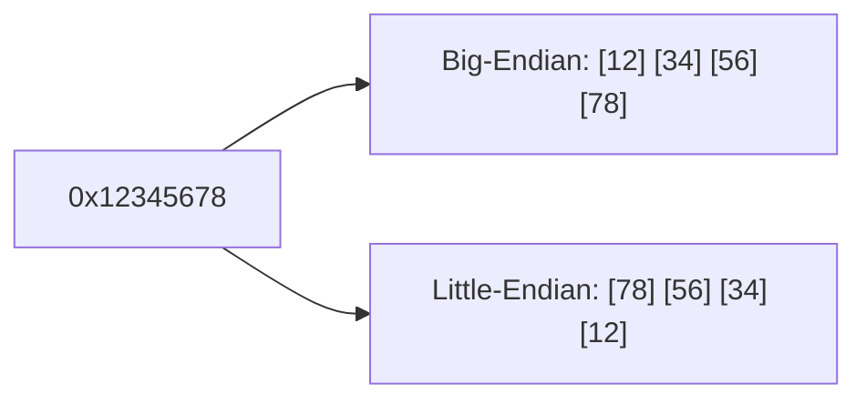

# Endianness and Binary Serialization in C

> Deep architectural exploration of binary serialization in C: Big-Endian (Network Byte Order) vs Little-Endian (Host Order), hardware byte swapping intrinsics, structure padding hazards, and portable wire protocols.

| Metadata | Details |
| :--- | :--- |
| **Level** | Advanced |
| **Prerequisites** | [02-core-concepts/06-structs-unions-enums.md](../../02-core-concepts/06-structs-unions-enums.md), [03-intermediate/05-bit-manipulation.md](../../03-intermediate/05-bit-manipulation.md) |
| **Time to Read** | 40 minutes |
| **Status** | Complete |
| **Standard Baseline** | ISO C11 / C17 / C23 (POSIX & WinSock networking) |

---

## Table of Contents
1. [What & Why](#1-what--why)
2. [Core Concepts](#2-core-concepts)
3. [How It Works Internally](#3-how-it-works-internally)
4. [Syntax & Usage](#4-syntax--usage)
5. [Practical Examples](#5-practical-examples)
6. [Best Practices](#6-best-practices)
7. [Common Mistakes & Pitfalls](#7-common-mistakes--pitfalls)
8. [Performance & Security Notes](#8-performance--security-notes)
9. [Comparison: Serialization Strategies](#9-comparison-serialization-strategies)
10. [Interview Questions](#10-interview-questions)
11. [Practice Exercises](#11-practice-exercises)
12. [Summary & Cheat Sheet](#12-summary--cheat-sheet)
13. [Further Reading](#13-further-reading)

---

## 1. What & Why
In computing, **Endianness** refers to the sequential order in which the individual bytes of a multi-byte word are addressed and stored in physical memory:
- **Little-Endian**: The least significant byte (LSB) is stored at the lowest memory address (used by x86, x86_64, and most ARM processors).
- **Big-Endian**: The most significant byte (MSB) is stored at the lowest memory address (used by network protocols, IBM mainframes, and SPARC).

When systems communicate across a network socket or persist binary files to disk, differing architectures can interpret the exact same memory bytes in reverse order. Writing raw C structures directly to a socket via `write(sock, &my_struct, sizeof(my_struct))` is a severe bug: it breaks across architectures due to endianness discrepancies and compiler-specific structure padding.

---

## 2. Core Concepts

### 2.1 Memory Byte Ordering
Consider the 32-bit hexadecimal value `0x12345678`:
- In **Big-Endian** (Natural / Network Order):
  - Base Address `+0`: `0x12` (MSB)
  - Base Address `+1`: `0x34`
  - Base Address `+2`: `0x56`
  - Base Address `+3`: `0x78` (LSB)
- In **Little-Endian** (x86_64 Host Order):
  - Base Address `+0`: `0x78` (LSB)
  - Base Address `+1`: `0x56`
  - Base Address `+2`: `0x34`
  - Base Address `+3`: `0x12` (MSB)

### 2.2 Structure Padding Hazards
Compilers insert silent padding bytes between struct members to satisfy hardware alignment requirements:
```c
struct Header {
    uint8_t type;    // 1 byte
    // 3 bytes of SILENT PADDING inserted here!
    uint32_t length; // 4 bytes
}; // Total size: 8 bytes, not 5!
```
Dumping this struct to a network socket sends uninitialized padding bytes (leaking kernel/stack secrets) and breaks cross-platform decoders that expect a packed 5-byte header.

### 2.3 Explicit Byte Packing and Unpacking
Robust C systems avoid struct dumping entirely. They serialize and deserialize fields sequentially into contiguous byte buffers using bit shifts:
```c
// Packing a 32-bit int into Big-Endian wire format
buf[0] = (uint8_t)(val >> 24);
buf[1] = (uint8_t)(val >> 16);
buf[2] = (uint8_t)(val >> 8);
buf[3] = (uint8_t)(val);
```
This is **100% portable** across every CPU architecture in existence, completely immune to host endianness and compiler struct padding.

---

## 3. How It Works Internally

### Hardware Memory Byte Layout

```
Value: 0x12345678 (32-bit integer)

Little-Endian (x86_64):
Address:    [0x1000] [0x1001] [0x1002] [0x1003]
Byte Value:   0x78     0x56     0x34     0x12
             (LSB)                      (MSB)

Big-Endian (Network Order):
Address:    [0x1000] [0x1001] [0x1002] [0x1003]
Byte Value:   0x12     0x34     0x56     0x78
             (MSB)                      (LSB)
```



---

## 4. Syntax & Usage

### Standard Network Byte Swapping Functions (`<arpa/inet.h>` / `<winsock2.h>`)
- `htons(val)`: Host to Network Short (16-bit).
- `ntohs(val)`: Network to Host Short (16-bit).
- `htonl(val)`: Host to Network Long (32-bit).
- `ntohl(val)`: Network to Host Long (32-bit).

### Compiler Intrinsics (Single CPU `BSWAP` instruction)
- `__builtin_bswap16(val)`
- `__builtin_bswap32(val)`
- `__builtin_bswap64(val)`

---

## 5. Practical Examples

### Example 1: Endianness Detection, Explicit Packing, and Unpacking
Goal: Determine host endianness dynamically, serialize a 32-bit integer into big-endian wire format, and reconstruct the original value.

```c
#include <stdio.h>
#include <stdint.h>
#include <stdbool.h>

static bool is_system_little_endian(void) {
    uint16_t test = 0x0001;
    return (*((uint8_t *)&test) == 0x01);
}

static void pack_uint32_be(uint8_t *buf, uint32_t val) {
    buf[0] = (uint8_t)((val >> 24) & 0xFF);
    buf[1] = (uint8_t)((val >> 16) & 0xFF);
    buf[2] = (uint8_t)((val >> 8) & 0xFF);
    buf[3] = (uint8_t)(val & 0xFF);
}

static uint32_t unpack_uint32_be(const uint8_t *buf) {
    return ((uint32_t)buf[0] << 24) |
           ((uint32_t)buf[1] << 16) |
           ((uint32_t)buf[2] << 8)  |
           ((uint32_t)buf[3]);
}

int main(void) {
    printf("=== Endianness & Binary Serialization ===\n");
    printf("Host architecture is: %s\n", is_system_little_endian() ? "Little-Endian" : "Big-Endian");

    uint8_t wire_packet[4];
    uint32_t original_val = 0x12345678;
    pack_uint32_be(wire_packet, original_val);

    printf("Serialized Big-Endian bytes: %02X %02X %02X %02X\n",
           wire_packet[0], wire_packet[1], wire_packet[2], wire_packet[3]);

    uint32_t restored_val = unpack_uint32_be(wire_packet);
    printf("Unpacked 32-bit integer: 0x%08X\n", restored_val);
    return 0;
}
```

**Verified Output:**
```text
=== Endianness & Binary Serialization ===
Host architecture is: Little-Endian
Serialized Big-Endian bytes: 12 34 56 78
Unpacked 32-bit integer: 0x12345678
```

---

## 6. Best Practices
1. **Always Use Explicit Serialization Routines**: Never write `send(sock, &struct, sizeof(struct), 0)`. Write discrete `serialize_packet()` and `deserialize_packet()` helper functions.
2. **Standardize on Network Byte Order (Big-Endian)**: The standard internet protocol suite (IP, TCP, UDP) mandates big-endian wire formats.
3. **Use Explicit Width Types**: Use `uint16_t`, `uint32_t`, `uint64_t` from `<stdint.h>`. Never use raw `int` or `long` in wire protocols.
4. **Avoid `__attribute__((packed))` for Network Structs**: Packed structs cause misaligned memory accesses on CPU architectures like ARM, resulting in severe performance penalties or hardware bus fault crashes.
5. **Always Validate Buffer Length Before Unpacking**: When parsing incoming untrusted network packets, ensure `remaining_bytes >= field_size` before reading to prevent buffer over-read vulnerabilities.

---

## 7. Common Mistakes & Pitfalls

| Mistake | Why It Is Dangerous | Correct Approach |
| :--- | :--- | :--- |
| Dumping raw structs to sockets | Breaks across endianness, compilers, and platforms; leaks uninitialized stack bytes in padding. | Serialize fields individually into a flat byte array using bit shifts. |
| Type-punning via `*(uint32_t *)buf` | Violates C strict aliasing rules and causes unaligned memory faults on ARM/SPARC. | Use `memcpy()` or bitwise shift reconstruction. |
| Unsigned shift overflow | `buf[0] << 24` where `buf[0]` promotes to signed 32-bit `int` with high bit set invokes undefined behavior. | Cast to unsigned type before shifting: `(uint32_t)buf[0] << 24`. |
| Neglecting 64-bit integer conversion | `htonl()` only handles 32 bits. Calling `htonl()` on a 64-bit integer truncates the upper 32 bits! | Use `__builtin_bswap64()` or write explicit 64-bit packing functions. |
| Floating point raw bit dumps | Different architectures may use differing IEEE-754 NaN representations or byte ordering. | Convert floats to fixed-point integers or serialize sign/mantissa explicitly. |

---

## 8. Performance & Security Notes

### Compiler Auto-Vectorization of Shift Serialization
Modern compilers (GCC and Clang) recognize the sequential shift idiom:
```c
uint32_t val = (b[0] << 24) | (b[1] << 16) | (b[2] << 8) | b[3];
```
On Little-Endian targets (x86_64), the compiler replaces this entire 4-step sequence with a single `mov` instruction followed by a single hardware `bswap` instruction! You get **portable code at maximum hardware execution speed**.

### Information Leak Vulnerabilities
Copying unpadded structs directly from kernel space to user space (e.g. via `ioctl` or socket) frequently leads to CVEs because padding bytes contain sensitive kernel stack data. Explicit packing zeroes out or eliminates padding entirely.

---

## 9. Comparison: Serialization Strategies

```
Raw Struct Dump (memcpy):
- Speed: Instantaneous.
- Portability: ZERO (breaks on different compilers, ABIs, endianness).
- Security: Dangerous (leaks padding memory).

Manual Bit-Shift Serialization:
- Speed: 1 machine instruction (compiled to BSWAP).
- Portability: 100% universal across all hardware and OSes.
- Security: Safe (zero uninitialized memory leakage).

Protocol Buffers / FlatBuffers:
- Speed: Highly optimized.
- Portability: Multi-language schema-based.
- Overhead: Requires code generator and runtime library.
```

---

## 10. Interview Questions

<details>
<summary><strong>1. Why is Big-Endian called "Network Byte Order"?</strong></summary>

In the early development of ARPANET and the Internet Protocol (RFC 1700), network engineers established Big-Endian as the canonical wire standard so that routers inspecting packet headers could read the most significant bits of addresses and lengths first as bits stream across the serial line.
</details>

<details>
<summary><strong>2. How do you check the host system's endianness at compile time?</strong></summary>

Using GCC/Clang built-in macros:
```c
#if __BYTE_ORDER__ == __ORDER_LITTLE_ENDIAN__
    // Little-Endian
#elif __BYTE_ORDER__ == __ORDER_BIG_ENDIAN__
    // Big-Endian
#endif
```
Or in C23 using `<endian.h>`.
</details>

<details>
<summary><strong>3. Why is casting an unaligned byte pointer to `uint32_t *` dangerous?</strong></summary>

1. **Strict Aliasing Violation**: C standards mandate that pointers of different incompatible types cannot alias the same memory (except `char *`), allowing compiler optimizers to reorder or eliminate memory accesses.
2. **Hardware Alignment Fault**: On many architectures (ARMv6, SPARC, MIPS), dereferencing an unaligned 32-bit pointer triggers an unrecoverable hardware alignment exception (`SIGBUS`).
</details>

<details>
<summary><strong>4. How do you serialize a 64-bit integer into network byte order portably?</strong></summary>

```c
void pack_uint64_be(uint8_t *b, uint64_t v) {
    b[0] = (uint8_t)(v >> 56);
    b[1] = (uint8_t)(v >> 48);
    b[2] = (uint8_t)(v >> 40);
    b[3] = (uint8_t)(v >> 32);
    b[4] = (uint8_t)(v >> 24);
    b[5] = (uint8_t)(v >> 16);
    b[6] = (uint8_t)(v >> 8);
    b[7] = (uint8_t)(v);
}
```
</details>

<details>
<summary><strong>5. What is Bi-Endianness?</strong></summary>

Hardware architectures (such as modern ARM Cortex processors and PowerPC) that can be configured by software or the OS kernel to operate in either Little-Endian or Big-Endian mode by toggling a control register bit.
</details>

<details>
<summary><strong>6. What is the difference between internal padding and trailing padding in C structs?</strong></summary>

- **Internal Padding**: Inserted between struct members to align each member to its natural boundary.
- **Trailing Padding**: Inserted at the end of the struct so that the total struct size is a multiple of the largest member's alignment. This ensures that in an array of structs, every subsequent element begins at an aligned address.
</details>

<details>
<summary><strong>7. How does Protocol Buffers (Protobuf) encode integers efficiently across networks?</strong></summary>

Protobuf uses **Varints** (variable-length quantity). Each byte uses 7 bits for data and 1 continuation bit (MSB). Small integers (e.g. 1 to 127) serialize to a single byte instead of 4 or 8 bytes, saving significant network bandwidth.
</details>

<details>
<summary><strong>8. Why should you avoid `__attribute__((packed))` on struct definitions?</strong></summary>

Packing removes padding, which forces multi-byte members onto misaligned memory addresses. Compilers must then generate multiple byte-read instructions and bit shifts instead of single word loads, degrading performance. On strict alignment architectures, it can trigger crash faults if pointers to packed fields are passed to external functions.
</details>

---

## 11. Practice Exercises

### Easy 1: Runtime Endianness Check Function
Write `bool is_little_endian(void);`.

<details>
<summary>Solution</summary>

```c
bool is_little_endian(void) {
    uint32_t x = 1;
    return *(uint8_t *)&x == 1;
}
```
</details>

### Easy 2: Pack 16-Bit Integer Big-Endian
Write `void pack_u16_be(uint8_t *buf, uint16_t val);`.

<details>
<summary>Solution</summary>

```c
void pack_u16_be(uint8_t *buf, uint16_t val) {
    buf[0] = (uint8_t)(val >> 8);
    buf[1] = (uint8_t)(val);
}
```
</details>

### Easy 3: Unpack 16-Bit Integer Big-Endian
Write `uint16_t unpack_u16_be(const uint8_t *buf);`.

<details>
<summary>Solution</summary>

```c
uint16_t unpack_u16_be(const uint8_t *buf) {
    return ((uint16_t)buf[0] << 8) | (uint16_t)buf[1];
}
```
</details>

### Medium 1: Portable 64-Bit Host-to-Network Swap
Implement `uint64_t hton64(uint64_t val);` without calling external libraries.

<details>
<summary>Solution</summary>

```c
uint64_t hton64(uint64_t val) {
#if __BYTE_ORDER__ == __ORDER_LITTLE_ENDIAN__
    return __builtin_bswap64(val);
#else
    return val;
#endif
}
```
</details>

### Medium 2: Fixed-Point Float Serialization
Serialize a 32-bit floating point number as a 32-bit fixed-point integer (scaled by 1000).

<details>
<summary>Solution</summary>

```c
void pack_float_fixed(uint8_t *buf, float val) {
    int32_t scaled = (int32_t)(val * 1000.0f);
    pack_uint32_be(buf, (uint32_t)scaled);
}

float unpack_float_fixed(const uint8_t *buf) {
    int32_t scaled = (int32_t)unpack_uint32_be(buf);
    return (float)scaled / 1000.0f;
}
```
</details>

### Medium 3: Length-Prefixed String Serialization
Serialize a C string with a 2-byte big-endian length prefix.

<details>
<summary>Solution</summary>

```c
size_t pack_string_prefixed(uint8_t *buf, const char *str) {
    size_t len = strlen(str);
    pack_u16_be(buf, (uint16_t)len);
    memcpy(buf + 2, str, len);
    return 2 + len;
}
```
</details>

### Hard 1: Binary Packet Encoder/Decoder Framework
Implement a binary stream serializer struct with buffer bounds tracking.

<details>
<summary>Solution</summary>

```c
typedef struct {
    uint8_t *data;
    size_t cap;
    size_t offset;
    bool error;
} BufferWriter;

void bw_write_u32(BufferWriter *bw, uint32_t val) {
    if (bw->error || bw->offset + 4 > bw->cap) {
        bw->error = true;
        return;
    }
    pack_uint32_be(bw->data + bw->offset, val);
    bw->offset += 4;
}
```
</details>

### Hard 2: Variable-Length Integer (Varint) Protobuf-Style
Implement 64-bit integer Varint encoder and decoder.

<details>
<summary>Solution</summary>

```c
size_t encode_varint(uint8_t *buf, uint64_t val) {
    size_t i = 0;
    while (val >= 0x80) {
        buf[i++] = (uint8_t)((val & 0x7F) | 0x80);
        val >>= 7;
    }
    buf[i++] = (uint8_t)(val & 0x7F);
    return i;
}
```
</details>

### Hard 3: Zero-Copy Network Packet Header Parsing
Safely parse an IP header from a raw packet buffer using offset validation.

<details>
<summary>Solution</summary>

```c
typedef struct {
    uint8_t version_ihl;
    uint8_t tos;
    uint16_t total_length;
    uint16_t id;
} ParsedIPHeader;

bool parse_ip_header(const uint8_t *packet, size_t len, ParsedIPHeader *out) {
    if (len < 20) return false; // Minimum IPv4 header length
    out->version_ihl = packet[0];
    out->tos = packet[1];
    out->total_length = unpack_u16_be(packet + 2);
    out->id = unpack_u16_be(packet + 4);
    return true;
}
```
</details>

---

## 12. Summary & Cheat Sheet

| Type | Size | Big-Endian Serialization |
| :--- | :--- | :--- |
| **`uint16_t`** | 2 Bytes | `b[0] = v >> 8; b[1] = v;` |
| **`uint32_t`** | 4 Bytes | `b[0]=v>>24; b[1]=v>>16; b[2]=v>>8; b[3]=v;` |
| **Intrinsic** | Fast | `__builtin_bswap16`, `__builtin_bswap32`, `__builtin_bswap64` |
| **Rule** | Security | Never dump raw structs; always serialize field by field |

---

## 13. Further Reading
- Danny Cohen, *On Holy Wars and a Plea for Peace*, IEN 137 (1980) (Original origin of "Endian").
- RFC 791: *Internet Protocol (DARPA Internet Program Protocol Specification)*.

---

[← Previous Note: ABI and Calling Conventions](./05-abi-and-calling-conventions.md) | [Advanced C Index](./README.md) | [Next Note: Interfacing with Assembly](./07-interfacing-with-assembly.md)
