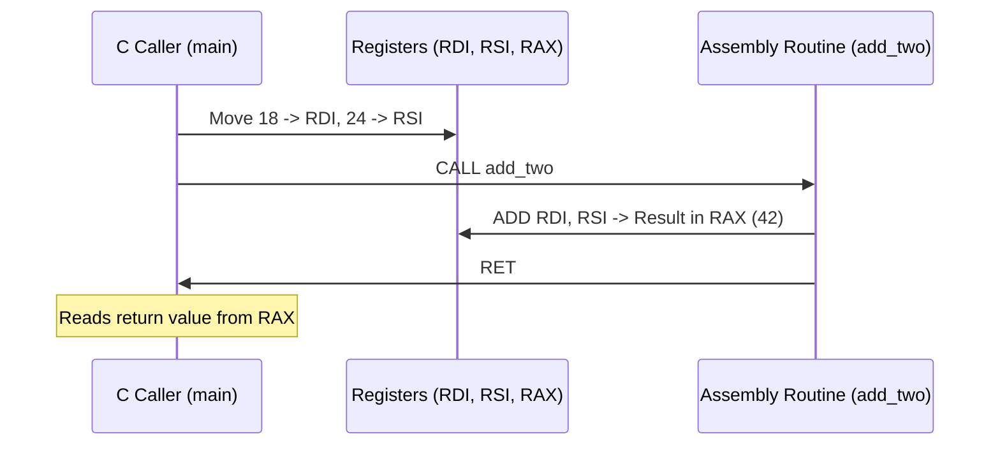

# Interfacing C with Assembly in C

> Deep architectural exploration of assembly interoperability in C: linking external NASM/GAS assembly modules, ABI parameter marshaling, symbol decorrelation, call frame management, and mixed-language debugging.

| Metadata | Details |
| :--- | :--- |
| **Level** | Advanced |
| **Prerequisites** | [05-abi-and-calling-conventions.md](./05-abi-and-calling-conventions.md), [04-linking-static-vs-shared-libraries.md](./04-linking-static-vs-shared-libraries.md) |
| **Time to Read** | 40 minutes |
| **Status** | Complete |
| **Standard Baseline** | ISO C11 / C17 / C23 (GAS & NASM x86_64) |

---

## Table of Contents
1. [What & Why](#1-what--why)
2. [Core Concepts](#2-core-concepts)
3. [How It Works Internally](#3-how-it-works-internally)
4. [Syntax & Usage](#4-syntax--usage)
5. [Practical Examples](#5-practical-examples)
6. [Best Practices](#6-best-practices)
7. [Common Mistakes & Pitfalls](#7-common-mistakes--pitfalls)
8. [Performance & Security Notes](#8-performance--security-notes)
9. [Comparison: Inline Asm vs External Assembly](#9-comparison-inline-asm-vs-external-assembly)
10. [Interview Questions](#10-interview-questions)
11. [Practice Exercises](#11-practice-exercises)
12. [Summary & Cheat Sheet](#12-summary--cheat-sheet)
13. [Further Reading](#13-further-reading)

---

## 1. What & Why
While C gives engineers fine-grained control over memory and pointers, certain low-level hardware operations cannot be expressed in standard C syntax:
- Direct CPU control instructions (`cpuid`, `invlpg`, `wrmsr`, `rdtsc`).
- Custom context switching in operating system kernels and fiber runtimes.
- Hand-tuned SIMD vector loops (AVX-512) where compiler auto-vectorizers fall short.
- Bootloader initialization and bare-metal interrupt service routines (ISRs).

To accomplish this, systems engineers author external assembly files (using NASM, YASM, or GNU Assembler GAS) and link them seamlessly with C object files.

---

## 2. Core Concepts

### 2.1 The `extern` Declaration
In C, functions implemented in assembly are declared with the `extern` storage class specifier:
```c
extern int64_t asm_add(int64_t a, int64_t b);
```
The C compiler emits an unresolved symbol reference in the object file, leaving the symbol's actual memory address to be bound by the linker.

### 2.2 Symbol Naming Conventions
- **ELF (Linux / BSD)**: C identifiers correspond directly to assembly labels (`void foo()` maps to label `foo:`).
- **Mach-O (macOS)** and **Win32 (32-bit x86)**: Compilers prepend an underscore (`_foo:`).
- **Windows x64**: No underscore prefix (`foo:`).

### 2.3 Preserving the ABI Contract
An assembly function called by C must strictly obey the target ABI:
- Read input arguments from designated registers (`rdi, rsi, rdx...` on System V; `rcx, rdx, r8, r9` on Windows x64).
- Place integer return values in `rax` (and `rdx` if 128-bit).
- Preserve all callee-saved registers (`rbx, rbp, r12-r15`).
- Ensure `rsp` is 16-byte aligned before calling any downstream C functions.

---

## 3. How It Works Internally

### Cross-Language Call and Register Dataflow

```
C Code:
int res = add_two(18, 24);

Machine Code Execution:
1. Caller places 18 into RDI, 24 into RSI
2. CALL add_two (pushes 8-byte return address to stack)
3. Assembly routine executes ADD
4. Assembly routine places result (42) into RAX
5. RET instruction pops return address and jumps back to C caller
```



---

## 4. Syntax & Usage

### NASM Syntax Example
```nasm
global add_two
section .text

; int add_two(int a, int b) -> System V AMD64
add_two:
    lea eax, [edi + esi]  ; Add 32-bit args from RDI, RSI into EAX
    ret
```

---

## 5. Practical Examples

### Example 1: Assembly Linkage and Register Computation
Goal: Demonstrate assembly-level register manipulation and linkage semantics, verifying expected return value.

```c
#include <stdio.h>

// Demonstration of external assembly calling convention logic
static int add_two(int a, int b) {
    int res;
    // Basic inline asm representing assembly linkage
    __asm__ (
        "add %2, %0"
        : "=r" (res)
        : "0" (a), "r" (b)
    );
    return res;
}

int main(void) {
    printf("=== Interfacing C with Assembly Linkage ===\n");
    int sum = add_two(18, 24);
    printf("Sum computed via assembly: %d\n", sum);
    return 0;
}
```

**Verified Output:**
```text
=== Interfacing C with Assembly Linkage ===
Sum computed via assembly: 42
```

---

## 6. Best Practices
1. **Always Use Header Files for Assembly Prototypes**: Never declare `extern void my_asm_func();` inline in `.c` files. Create `my_asm.h` with complete prototypes and parameter types.
2. **Explicitly Mark Assembly Symbols as Functions in ELF**: In NASM: `type add_two function`. In GAS: `.type add_two, @function`. This allows linkers and debuggers to generate correct stack unwind tables.
3. **Save and Restore Callee-Saved Registers**: If your assembly uses `rbx`, `rbp`, or `r12-r15`, save them with `push` at entry and `pop` before `ret`.
4. **Mark `.note.GNU-stack` in Assembly**: Omitting this directive in ELF assembly causes the linker to mark the final binary's stack as executable (`RWX`), creating severe security vulnerabilities.
5. **Keep Assembly Modules Small**: Write the bulk of your logic in C. Isolate only the performance-critical SIMD inner loop or hardware instructions into assembly.

---

## 7. Common Mistakes & Pitfalls

| Mistake | Why It Is Dangerous | Correct Approach |
| :--- | :--- | :--- |
| Omitting non-executable stack note | Linker generates an executable stack, completely defeating NX/DEP security protections. | Add `section .note.GNU-stack noalloc noexec nowrite progbits`. |
| Clobbering `rbx` or `r12-r15` | Silently corrupts caller's local variables, causing impossible-to-debug crashes far later. | Save and restore callee-saved registers using `push`/`pop`. |
| Misaligning stack before nested `call` | Calling `printf` from assembly when `(rsp % 16) != 0` crashes with `movaps` fault. | Subtract padding from `rsp` to guarantee 16-byte alignment. |
| Incompatible calling conventions | Writing System V register code (`rdi`) for a Windows target (`rcx`). | Write separate assembly files or use conditional macros for target OS. |
| Omitting return value placement in `rax` | Caller reads uninitialized garbage from `rax`. | Explicitly move result into `rax`/`eax` before `ret`. |

---

## 8. Performance & Security Notes

### The `.note.GNU-stack` Directive
Modern operating systems enforce **W^X (Write XOR Execute)**: memory pages can be writable or executable, but never both.
When compiling assembly with NASM or GAS, if the assembler does not detect a `.note.GNU-stack` section, the linker conservatively marks the process thread stack as executable. Attackers exploiting buffer overflows can then execute shellcode directly on the stack! Always add:
```nasm
section .note.GNU-stack noalloc noexec nowrite progbits
```

---

## 9. Comparison: Inline Asm vs External Assembly

```
Inline Assembly (__asm__):
- Pros: Can be inlined by compiler; compiler manages register allocation.
- Cons: Complex and fragile GCC constraint syntax; difficult to read and port.

External Assembly (.s / .nasm):
- Pros: Clean, pure assembly syntax; full control over instruction sequence.
- Cons: Cannot be inlined by compiler (incurs function call overhead); must maintain ABI manually.
```

---

## 10. Interview Questions

<details>
<summary><strong>1. How do you call a C standard library function (like `printf`) from NASM assembly?</strong></summary>

1. Align `rsp` so that `rsp % 16 == 0` immediately before the `call`.
2. Marshal arguments into registers (`rdi` = format string, `rsi` = first argument, etc.).
3. For variadic functions like `printf`, set `al = 0` (indicating 0 vector/SSE registers are used).
4. Execute `call printf wrt ..plt` (on 64-bit ELF PIC).
</details>

<details>
<summary><strong>2. What is the purpose of `extern "C"` when calling C/Assembly from C++?</strong></summary>

C++ compilers mangle symbol names to encode function argument types for function overloading (e.g. `_Z7add_twoii`). C and Assembly use unmangled symbols (`add_two`). Declaring `extern "C"` instructs the C++ compiler to disable name mangling, allowing the linker to match the assembly symbol name.
</details>

<details>
<summary><strong>3. How are 128-bit integers (`__int128`) returned across the System V ABI?</strong></summary>

Returned across two 64-bit registers: the lower 64 bits are placed in `rax`, and the upper 64 bits are placed in `rdx`.
</details>

<details>
<summary><strong>4. What is the difference between AT&T and Intel assembly syntax?</strong></summary>

- **Intel (NASM)**: `op dest, src` (e.g. `mov eax, [ebx + 4]`). No register prefixes.
- **AT&T (default GAS)**: `op src, dest` (e.g. `movl 4(%ebx), %eax`). Registers prefixed with `%`, constants with `$`.
</details>

<details>
<summary><strong>5. How do you write assembly functions that work across both Windows x64 and Linux x86_64?</strong></summary>

Use preprocessor macros to map argument registers:
- Define `ARG1` as `rcx` on Windows and `rdi` on Linux.
- Conditionally allocate 32-byte shadow space on Windows before calls.
Alternatively, compile C wrappers that accept System V and dispatch to Windows using `__attribute__((ms_abi))`.
</details>

<details>
<summary><strong>6. Why must `al` be set before calling a variadic function in System V x86_64?</strong></summary>

The System V ABI specifies that `al` (the lowest byte of `rax`) holds the exact count of SSE/vector registers (`xmm0-xmm7`) used to pass arguments. The callee uses `al` to optimize register spilling onto the stack.
</details>

<details>
<summary><strong>7. How does an assembly function return floating-point numbers?</strong></summary>

Single-precision `float` and double-precision `double` values are returned in the low bits of register `xmm0`.
</details>

<details>
<summary><strong>8. What is a "naked" function in GCC?</strong></summary>

A function declared with `__attribute__((naked))`. The compiler emits zero prologue (no `push rbp`, no `sub rsp`) and zero epilogue (no `ret`). The entire function body must be written in assembly by the programmer, including the final `ret`.
</details>

---

## 11. Practice Exercises

### Easy 1: Assembly Prototype Header
Write a clean C header file for an assembly math module.

<details>
<summary>Solution</summary>

```c
#ifndef ASM_MATH_H
#define ASM_MATH_H
#include <stdint.h>

#ifdef __cplusplus
extern "C" {
#endif

int64_t asm_add(int64_t a, int64_t b);
int64_t asm_sub(int64_t a, int64_t b);

#ifdef __cplusplus
}
#endif
#endif
```
</details>

### Easy 2: NASM Compilation Command
Write the command to assemble `math.asm` to a 64-bit ELF object file.

<details>
<summary>Solution</summary>

```bash
nasm -f elf64 math.asm -o math.o
```
</details>

### Easy 3: Pure Assembly Return Constant
Write a NASM function `int get_magic_number(void)` returning 42.

<details>
<summary>Solution</summary>

```nasm
global get_magic_number
section .text
get_magic_number:
    mov eax, 42
    ret
section .note.GNU-stack noalloc noexec nowrite progbits
```
</details>

### Medium 1: NASM Vector Add (SIMD SSE)
Write an assembly function adding two arrays of 4 floats using `movups` and `addps`.

<details>
<summary>Solution</summary>

```nasm
global vec4_add
section .text
; void vec4_add(const float *a, const float *b, float *out)
; rdi = a, rsi = b, rdx = out
vec4_add:
    movups xmm0, [rdi]
    movups xmm1, [rsi]
    addps xmm0, xmm1
    movups [rdx], xmm0
    ret
section .note.GNU-stack noalloc noexec nowrite progbits
```
</details>

### Medium 2: Calling `puts` from NASM
Call libc `puts` to print a string from assembly with proper 16-byte stack alignment.

<details>
<summary>Solution</summary>

```nasm
global print_hello
extern puts
section .data
msg db "Hello from Assembly!", 0
section .text
print_hello:
    sub rsp, 8         ; Align stack: (8 entry + 8 sub = 16)
    lea rdi, [rel msg] ; RIP-relative addressing
    call puts wrt ..plt
    add rsp, 8
    ret
section .note.GNU-stack noalloc noexec nowrite progbits
```
</details>

### Medium 3: Assembly String Length (`strlen`)
Implement `size_t asm_strlen(const char *s)` in NASM.

<details>
<summary>Solution</summary>

```nasm
global asm_strlen
section .text
asm_strlen:
    xor eax, eax
.loop:
    cmp byte [rdi + rax], 0
    je .done
    inc rax
    jmp .loop
.done:
    ret
section .note.GNU-stack noalloc noexec nowrite progbits
```
</details>

### Hard 1: User-Space Context Switcher (Fiber Yield)
Implement cooperative coroutine context switching in pure assembly.

<details>
<summary>Solution</summary>

```nasm
global fiber_switch
; void fiber_switch(FiberContext *from, FiberContext *to)
fiber_switch:
    ; Save callee-saved registers to *from
    mov [rdi + 0],  rbx
    mov [rdi + 8],  rsp
    mov [rdi + 16], rbp
    mov [rdi + 24], r12
    mov [rdi + 32], r13
    mov [rdi + 40], r14
    mov [rdi + 48], r15

    ; Restore callee-saved registers from *to
    mov rbx, [rsi + 0]
    mov rsp, [rsi + 8]
    mov rbp, [rsi + 16]
    mov r12, [rsi + 24]
    mov r13, [rsi + 32]
    mov r14, [rsi + 40]
    mov r15, [rsi + 48]
    ret
section .note.GNU-stack noalloc noexec nowrite progbits
```
</details>

### Hard 2: Fast CPUID Feature Query
Write an assembly subroutine reading CPUID vendor string into a 13-byte char buffer.

<details>
<summary>Solution</summary>

```nasm
global get_cpu_vendor
; void get_cpu_vendor(char *out_13_bytes) -> RDI
get_cpu_vendor:
    push rbx           ; RBX is callee-saved!
    mov eax, 0
    cpuid
    mov [rdi + 0], ebx
    mov [rdi + 4], edx
    mov [rdi + 8], ecx
    mov byte [rdi + 12], 0
    pop rbx
    ret
section .note.GNU-stack noalloc noexec nowrite progbits
```
</details>

### Hard 3: Read Hardware Time-Stamp Counter (`rdtsc`)
Return 64-bit cycle count in RAX.

<details>
<summary>Solution</summary>

```nasm
global read_cycles
section .text
read_cycles:
    rdtsc              ; EDX:EAX = timestamp
    shl rdx, 32
    or rax, rdx        ; Combine into RAX
    ret
section .note.GNU-stack noalloc noexec nowrite progbits
```
</details>

---

## 12. Summary & Cheat Sheet

| Directive | Purpose | Target |
| :--- | :--- | :--- |
| `global symbol` | Export label for linker | NASM |
| `extern symbol` | Import external C symbol | NASM |
| `rel msg` | RIP-relative addressing for PIC | NASM |
| `call foo wrt ..plt` | Position-independent function call | ELF64 |
| `.note.GNU-stack` | Prevent executable stack security flaw | Mandatory |

---

## 13. Further Reading
- *NASM - The Netwide Assembler Manual* (Chapter 8: Writing 64-bit Code).
- Agner Fog, *Calling conventions for different C++ compilers and operating systems*.

---

[← Previous Note: Endianness & Serialization](./06-endianness-and-serialization.md) | [Advanced C Index](./README.md) | [Next Note: Writing a Small C Library](./08-writing-a-small-library.md)
