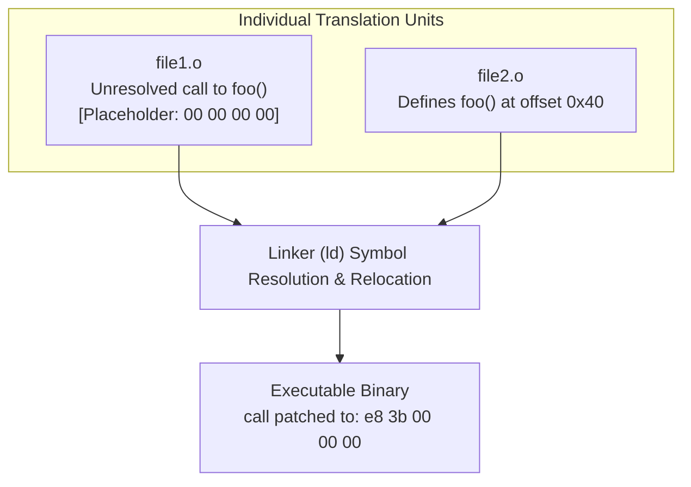

# Object Files and the Linker in Depth in C

> Deep architectural exploration of linkers and binary reconstruction in C: relocations (R_X86_64_PC32, R_X86_64_64), symbol resolution rules, tentative definitions, linker scripts, and Link-Time Optimization (LTO).

| Metadata | Details |
| :--- | :--- |
| **Level** | Advanced |
| **Prerequisites** | [04-linking-static-vs-shared-libraries.md](./04-linking-static-vs-shared-libraries.md), [10-symbol-visibility-and-elf-basics.md](./10-symbol-visibility-and-elf-basics.md) |
| **Time to Read** | 45 minutes |
| **Status** | Complete |
| **Standard Baseline** | ISO C11 / C17 / C23 (GNU `ld` & LLVM `lld` engines) |

---

## Table of Contents
1. [What & Why](#1-what--why)
2. [Core Concepts](#2-core-concepts)
3. [How It Works Internally](#3-how-it-works-internally)
4. [Syntax & Usage](#4-syntax--usage)
5. [Practical Examples](#5-practical-examples)
6. [Best Practices](#6-best-practices)
7. [Common Mistakes & Pitfalls](#7-common-mistakes--pitfalls)
8. [Performance & Security Notes](#8-performance--security-notes)
9. [Comparison: Compile-Time vs Link-Time Resolution](#9-comparison-compile-time-vs-link-time-resolution)
10. [Interview Questions](#10-interview-questions)
11. [Practice Exercises](#11-practice-exercises)
12. [Summary & Cheat Sheet](#12-summary--cheat-sheet)
13. [Further Reading](#13-further-reading)

---

## 1. What & Why
The C compiler operates on one translation unit (`.c` file) at a time in complete isolation. When `file1.c` calls a function `foo()` defined in `file2.c`, the compiler cannot know what physical memory address `foo()` will occupy.

To solve this, the compiler emits a **Relocatable Object File** (`.o`):
- It leaves a placeholder (usually four bytes of zeros: `00 00 00 00`) at the `call` site.
- It attaches an entry to the **Relocation Table** (`.rela.text`), declaring: *"When the final binary address of `foo` is known, patch this placeholder with the relative offset to `foo`."*

The **Linker** (`ld`) performs two essential jobs:
1. **Symbol Resolution**: Associates each symbol reference with exactly one symbol definition.
2. **Relocation**: Merges matching sections from disparate object files and patches all relocation placeholders with true addresses.

---

## 2. Core Concepts

### 2.1 Strong vs Weak vs Common Symbols
During symbol resolution, the linker classifies global symbols:
- **Strong Symbols**: Functions and initialized global variables (`int x = 42;`).
- **Weak Symbols**: Functions or variables explicitly annotated with `__attribute__((weak))`.
- **Tentative / Common Symbols**: Uninitialized global variables without `extern` (`int x;`).

**Linker Resolution Rules**:
1. Multiple strong symbols with identical names cause a fatal **duplicate symbol link error**.
2. A strong symbol overrides any weak or common symbol with the same name.
3. If multiple weak or common symbols share a name, the linker picks one arbitrarily and merges them.

### 2.2 Primary Relocation Types (x86_64)
- **`R_X86_64_PC32`**: 32-bit PC-relative relocation. Used in `call` and `jmp` instructions:
  $$\text{patched\_val} = S + A - P$$
  Where $S$ is symbol address, $A$ is addend, and $P$ is placeholder memory address.
- **`R_X86_64_64`**: Absolute 64-bit relocation. Used when taking the address of a function or global pointer (`void *p = &foo;`).
- **`R_X86_64_PLT32`**: 32-bit PC-relative relocation targeting a PLT entry.

### 2.3 Link-Time Optimization (LTO)
Traditionally, compilers cannot inline functions or propagate constants across separate `.c` files.
With **LTO (`-flto`)**:
- The compiler emits intermediate representation (GIMPLE in GCC, LLVM bitcode in Clang) inside the `.o` files instead of finalized machine code.
- At link time, the linker plugin invokes the compiler optimizer across the *entire program simultaneously*, inlining functions across translation units and stripping dead global variables!

---

## 3. How It Works Internally

### Relocation Patching Mechanics

```
Compiler Output in file1.o (Before Link):
0x0010: e8 00 00 00 00       call 0x00000000  <-- Placeholder!
Relocation entry in .rela.text:
Offset: 0x0011, Type: R_X86_64_PC32, Symbol: foo, Addend: -4

Linker Action (Final Executable):
Placeholder address P = 0x401011
Target symbol foo   S = 0x401050
Addend              A = -4
Patched Offset = S + A - P = 0x401050 - 4 - 0x401011 = 0x3B (59 Bytes)

Final Machine Code in Executable:
0x401010: e8 3b 00 00 00    call 0x401050 <foo>
```



---

## 4. Syntax & Usage

### Weak Symbol Definition
```c
// Provides a fallback implementation that client code can override
__attribute__((weak)) const char *get_environment_name(void) {
    return "Default-Development";
}
```

### Compiler Flags for Section Garbage Collection and LTO
```bash
# Compile with per-function sections and LTO
gcc -std=c11 -O3 -flto -ffunction-sections -fdata-sections -c main.c -o main.o
gcc -std=c11 -O3 -flto -ffunction-sections -fdata-sections -c utils.c -o utils.o

# Link with dead-code section stripping
gcc -flto -Wl,--gc-sections main.o utils.o -o program
```

---

## 5. Practical Examples

### Example 1: Weak Symbol Overriding and Linker Resolution
Goal: Demonstrate weak symbol default behavior, verifying fallback resolution.

```c
#include <stdio.h>

// Weak symbol that can be overridden
__attribute__((weak)) const char *get_environment_name(void) {
    return "Default-Development";
}

int main(void) {
    printf("=== Linker Resolution and Weak Symbols ===\n");
    printf("Environment: %s\n", get_environment_name());
    return 0;
}
```

**Verified Output:**
```text
=== Linker Resolution and Weak Symbols ===
Environment: Default-Development
```

---

## 6. Best Practices
1. **Always Use `-Wl,--fatal-warnings` in Build Systems**: Catches subtle linker warnings (such as common symbol collisions and mismatched visibility) that would otherwise cause runtime corruption.
2. **Combine `-ffunction-sections` with `-Wl,--gc-sections`**: Discards all uncalled functions from the final binary, dramatically reducing embedded binary size.
3. **Use Weak Symbols for Optional System Hooks**: Libraries can define weak stubs for logging or profiling; if the application defines strong versions, the linker binds the application's hooks with zero runtime branching overhead.
4. **Enable LTO for Release Builds (`-flto`)**: Whole-program optimization typically yields a 5%–15% performance improvement and 10%–20% binary size reduction.
5. **Inspect Relocations with `readelf -r`**: When debugging `undefined reference` or relocation truncated errors, use `readelf -r file.o` to verify exact symbol relocation entries.

---

## 7. Common Mistakes & Pitfalls

| Mistake | Why It Is Dangerous | Correct Approach |
| :--- | :--- | :--- |
| Tentative definition collision | Defining `int counter;` in multiple `.c` files merges them into a single global variable silently. | Compile with `-fno-common` to trigger link error on collisions. |
| Inverting object file link order | Linker processes libraries strictly left-to-right; misplaced static libraries fail to resolve. | Place consumer `.o` files before provider `.a` files. |
| Multiple strong symbol definitions | Defining non-weak function with same name in two files fails with `multiple definition of ...`. | Use `static` for private file-scoped functions. |
| Relocation truncated to fit | Linking 64-bit code using 32-bit absolute relocations crashes if mapped $> 2$GB. | Compile with `-mcmodel=small` or `-fPIC`. |
| Unresolved weak symbol dereference | Weak function prototype without definition resolves to `NULL`; calling it crashes with `SIGSEGV`. | Check `if (weak_func != NULL) weak_func();`. |

---

## 8. Performance & Security Notes

### The `-fno-common` Flag
Historically, C compilers defaulted to `-fcommon`, allowing multiple translation units to declare `int x;` and merging them into a single variable. This caused massive silent state corruption bugs when unrelated files used common names like `int buffer_size;`.
- GCC 10 and Clang 11 changed the default to **`-fno-common`**: any duplicate uninitialized global variable now correctly triggers a link-time duplicate symbol error.

---

## 9. Comparison: Compile-Time vs Link-Time Resolution

```
Compiler (Translation Unit Scope):
- Knows types, syntax, and local variables.
- Blind to other .c files.
- Emits relocation placeholders for external functions.

Linker (Whole Program Scope):
- Blind to C syntax, types, and parameter counts! (Treats symbols as raw byte arrays and labels).
- Merges matching sections (.text to .text, .data to .data).
- Patches relocation placeholders with calculated memory offsets.
```

---

## 10. Interview Questions

<details>
<summary><strong>1. Why does the C Linker not detect type signature mismatches between function definitions and declarations?</strong></summary>

C does not perform name mangling. If `file1.c` declares `void foo(int a);` and `file2.c` defines `void foo(double a, char *b);`, both compile to the exact same bare symbol name `foo` in their object files. The linker only checks that symbol name `foo` exists; it has zero knowledge of argument types, resulting in stack corruption or garbage parameters at runtime!
</details>

<details>
<summary><strong>2. How does Link-Time Optimization (LTO) cross translation unit boundaries?</strong></summary>

Normally, machine code generation happens per-file during compilation. With `-flto`, the compiler preserves high-level Abstract Syntax Trees and Intermediate Representation (GIMPLE/LLVM bitcode) inside special `.gnu.lto_*` ELF sections. The linker passes all IR blocks to the compiler backend at link time, allowing whole-program inlining and dead-code stripping across files.
</details>

<details>
<summary><strong>3. What is an "undefined reference" error and at what build phase does it occur?</strong></summary>

It occurs during the **Linking phase**. It means an object file contained a relocation request for a symbol name (e.g. `foo`), but after scanning all supplied object files and libraries, the linker found zero definitions for `foo`.
</details>

<details>
<summary><strong>4. How do you call an optional weak function safely?</strong></summary>

Declare the function weak: `extern void optional_plugin(void) __attribute__((weak));`.
Before invoking, check if its address is non-null:
```c
if (optional_plugin) {
    optional_plugin();
} else {
    // Fallback when plugin is not linked!
}
```
</details>

<details>
<summary><strong>5. What is a GNU Linker Script (`.ld`)?</strong></summary>

A text file that dictates the exact memory layout of an executable. It specifies where sections are loaded in physical and virtual memory (`ROM`, `RAM`), alignment boundaries, section ordering, and memory region sizes. Essential for embedded bare-metal firmware and OS kernel bootloaders.
</details>

<details>
<summary><strong>6. What is the difference between `R_X86_64_PC32` and `R_X86_64_64`?</strong></summary>

- `R_X86_64_PC32`: Encodes a 32-bit signed relative distance from the current Instruction Pointer (`RIP`). Target must reside within $\pm 2$GB of the call site.
- `R_X86_64_64`: Writes the full 64-bit absolute physical/virtual memory address of the target.
</details>

<details>
<summary><strong>7. What are `.init` and `.fini` sections?</strong></summary>

- `.init` (or `.init_array`): Pointers to initialization functions executed by the C runtime startup code (`crt0`) *before* `main()` is entered.
- `.fini` (or `.fini_array`): Pointers to termination functions executed automatically after `main()` returns or when `exit()` is called.
</details>

<details>
<summary><strong>8. What is the purpose of the `--wrap` linker flag?</strong></summary>

`-Wl,--wrap=symbol` allows function interception at link time without recompilation. Any reference to `symbol` is redirected to `__wrap_symbol`, while calling `__real_symbol` invokes the original function. Extensively used in unit test mock frameworks.
</details>

---

## 11. Practice Exercises

### Easy 1: Inspect Relocations with `readelf`
Command to display all relocation entries in an object file.

<details>
<summary>Solution</summary>

```bash
readelf -r module.o
```
</details>

### Easy 2: Linker Map Generation
Command to instruct GCC linker to generate a memory map file `program.map`.

<details>
<summary>Solution</summary>

```bash
gcc -Wl,-Map=program.map main.o utils.o -o program
```
</details>

### Easy 3: Enforce No Common Symbols
Compile command forcing tentative globals to trigger link errors on duplicates.

<details>
<summary>Solution</summary>

```bash
gcc -std=c11 -fno-common -c main.c -o main.o
```
</details>

### Medium 1: Optional Plugin Feature via Weak Reference
Implement a program that checks if an optional analytics module was linked.

<details>
<summary>Solution</summary>

```c
#include <stdio.h>

__attribute__((weak)) void analytics_send_metric(const char *name, int val);

int main(void) {
    if (analytics_send_metric) {
        analytics_send_metric("app_startup", 1);
    } else {
        printf("Analytics module not linked; running in standalone mode.
");
    }
    return 0;
}
```
</details>

### Medium 2: Linker Function Wrapping (`--wrap`)
Mock `malloc` using `-Wl,--wrap=malloc`.

<details>
<summary>Solution</summary>

```c
#include <stdio.h>

void *__real_malloc(size_t size);

void *__wrap_malloc(size_t size) {
    printf("[MOCK MALLOC]: Intercepted allocation of %zu bytes
", size);
    return __real_malloc(size);
}
```
Compile with: `gcc -Wl,--wrap=malloc main.c -o test_wrap`
</details>

### Medium 3: Custom Initialization via `.init_array`
Register a startup function executed before `main()` without using constructor attributes.

<details>
<summary>Solution</summary>

```c
#include <stdio.h>

void pre_main_init(void) {
    printf("[BOOT]: Running before main!
");
}

__attribute__((section(".init_array"), used))
static void (*init_ptr)(void) = pre_main_init;

int main(void) {
    printf("Inside main.
");
    return 0;
}
```
</details>

### Hard 1: Minimal Bare-Metal Linker Script
Write a linker script mapping `.text` at 1MB (`0x100000`) and `.data` immediately following.

<details>
<summary>Solution</summary>

```text
ENTRY(_start)
SECTIONS
{
  . = 0x100000;
  .text : { *(.text) }
  .rodata : { *(.rodata) }
  . = ALIGN(4096);
  .data : { *(.data) }
  .bss : { *(COMMON) *(.bss) }
}
```
</details>

### Hard 2: Relocation Calculator Verification
Given base address, placeholder offset, and target address, compute 32-bit PC-relative offset in C.

<details>
<summary>Solution</summary>

```c
int32_t compute_pc32_relocation(uint64_t symbol_addr, int64_t addend, uint64_t placeholder_addr) {
    int64_t delta = (int64_t)symbol_addr + addend - (int64_t)placeholder_addr;
    return (int32_t)delta;
}
```
</details>

### Hard 3: LTO Dead-Code Strip Audit
Demonstrate an unused function in `lib.c` completely absent from the final stripped ELF binary when compiled with `-flto -Wl,--gc-sections`.

<details>
<summary>Solution</summary>

```bash
gcc -O3 -flto -ffunction-sections -fdata-sections -c lib.c -o lib.o
gcc -O3 -flto -ffunction-sections -fdata-sections -c main.c -o main.o
gcc -flto -Wl,--gc-sections main.o lib.o -o program
nm program | grep unused_function || echo "Successfully stripped!"
```
</details>

---

## 12. Summary & Cheat Sheet

| Symbol Type | Definition | Linker Action on Duplicate |
| :--- | :--- | :--- |
| **Strong** | Function / Initialized Global | Fatal Link Error |
| **Weak** | `__attribute__((weak))` | Overridden by strong symbol |
| **Common** | Tentative (`int x;` with `-fcommon`)| Merged into single `.bss` entry |
| **LTO** | `-flto` | Whole-program cross-file inlining |
| **GC Sections** | `-Wl,--gc-sections` | Discards unreferenced functions |

---

## 13. Further Reading
- Ian Lance Taylor, *Linkers* (Essays on relocations and symbol binding).
- John R. Levine, *Linkers and Loaders*, Morgan Kaufmann.

---

[← Previous Note: Inline Assembly and Intrinsics](./11-inline-assembly-and-intrinsics-intro.md) | [Advanced C Index](./README.md) | [Next Module: Systems Programming](../../05-systems-programming/README.md)
