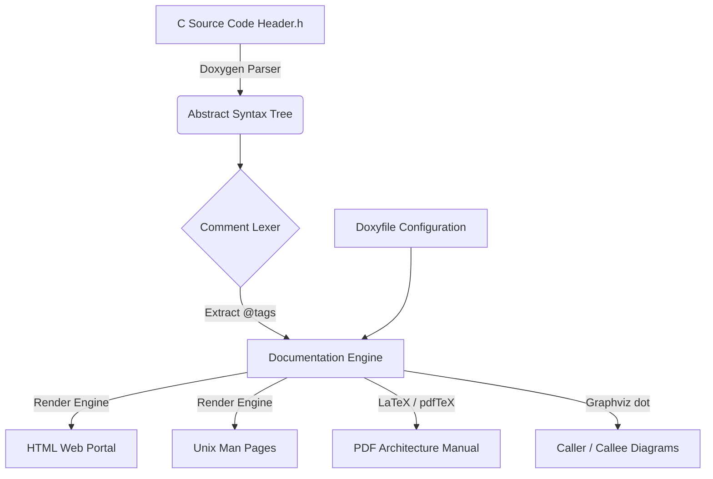

# Doxygen Documentation

> **Structured API documentation extraction for C codebases using inline annotations, markdown support, and automated HTML/manpage generation.**

| Level | Prerequisites | Time to Read | Status | Standard |
| :--- | :--- | :--- | :--- | :--- |
| Intermediate | [01-fundamentals/08-functions.md](../01-fundamentals/08-functions.md), [02-core-concepts/06-structs-unions-enums.md](../02-core-concepts/06-structs-unions-enums.md) | 22 mins | Complete | C99 / C11 / C17 / C23 |

---

## Table of Contents
1. [What & Why](#1-what--why)
2. [Core Concepts](#2-core-concepts)
3. [How It Works Internally](#3-how-it-works-internally)
4. [Syntax & Usage](#4-syntax--usage)
5. [Practical Examples](#5-practical-examples)
6. [Best Practices](#6-best-practices)
7. [Common Mistakes & Pitfalls](#7-common-mistakes--pitfalls)
8. [Performance & Security Notes](#8-performance--security-notes)
9. [Comparison / When to Use What](#9-comparison--when-to-use-what)
10. [Interview Questions](#10-interview-questions)
11. [Practice Exercises](#11-practice-exercises)
12. [Summary / Cheat Sheet](#12-summary--cheat-sheet)
13. [Further Reading](#13-further-reading)

---

## 1. What & Why

In pure C development, header files (`.h`) serve as the public API contract between a library and its consumers. However, raw C prototypes lack formal semantic descriptions of memory ownership, pre-conditions, error return codes, thread-safety guarantees, and algorithmic complexity. 

**Doxygen** is the de facto standard documentation generator for C and C++. It parses structured comments embedded directly above declarations in header and source files, parsing syntax trees and generating searchable HTML sites, Unix `man` pages, LaTeX PDF manuals, and XML schemas.

Key benefits of adopting Doxygen in C projects include:
- **Single Source of Truth:** Documentation lives beside the declarations. When a function signature changes, updating the doc comment in the same commit prevents documentation drift.
- **Automated Validation:** Tools like Clang can warn on undocumented parameters (`-Wdocumentation`), ensuring complete coverage during continuous integration.
- **Cross-Referenced Navigation:** Doxygen automatically indexes structs, typedefs, call graphs (via Graphviz `dot`), and caller hierarchies.
- **Multi-Output Delivery:** Generates developer-friendly interactive HTML web portals as well as command-line `man` pages installed into system directories (`/usr/share/man/man3/`).

---

## 2. Core Concepts

### 2.1 Comment Block Flavors
Doxygen recognizes several distinct block comment styles:
- **Javadoc Style:** `/** ... */` (most widely adopted in industry).
- **Qt Style:** `/*! ... */`.
- **Single-Line Triple Slash:** `/// ...`.
- **Trailing Comments:** `/**< ... */` or `///< ...` for documenting struct fields, enum members, or macro definitions immediately following the token.

### 2.2 Primary Doxygen Command Tags
Doxygen commands begin with either `@` or `\` (by convention `@` is standard):
- `@brief`: Single-line summary of the function, struct, or module.
- `@param[in,out]`: Describes a parameter name, its directionality (`[in]`, `[out]`, or `[in,out]`), and its expected constraints.
- `@return` (or `@returns`): Documents the return value, valid ranges, and sentinel error values (e.g., `NULL` or negative integers).
- `@retval <val>`: Documents specific named return values (e.g., `@retval 0 Success`, `@retval -1 Allocation failed`).
- `@note`, `@warning`: Callout boxes highlighting subtle behavioral nuances or dangerous edge cases.
- `@pre`, `@post`: Formal pre-conditions and post-conditions.
- `@see`: Cross-reference links to related functions, structures, or standards.
- `@file`: Placed at the top of a header file to register the file itself in Doxygen's index.



---

## 3. How It Works Internally

### 3.1 Lexical Analysis and Macro Expansion
Doxygen includes a built-in C preprocessor and lexer (historically built with Flex/Bison). When scanning C files:
1. **Conditional Inclusion:** Doxygen evaluates `#ifdef` and `#if` directives. If a symbol is defined via the `PREDEFINED` setting in `Doxyfile`, conditional code branches are expanded.
2. **Macro Expansion:** If `MACRO_EXPANSION = YES`, Doxygen expands macro generators (such as custom container templates or attribute macros like `EXPORT_API`), resolving them down to underlying C types so they appear cleanly in documentation.
3. **AST Association:** Comments are associated with the immediately following declaration node in the C grammar (unless marked with `<` for trailing association).

### 3.2 Graphviz Dependency Visualization
When `HAVE_DOT = YES` is enabled in `Doxyfile`, Doxygen invokes the external `dot` tool from Graphviz. For every function and struct:
- It constructs a directed acyclic graph (DAG) of `#include` dependencies.
- It parses function call sites to render interactive caller and callee dependency graphs.
- It traces struct composition to display class-like aggregation diagrams.

---

## 4. Syntax & Usage

### 4.1 Structuring Header File Documentation
```c
/**
 * @file math_utils.h
 * @brief High-performance integer mathematical utility functions.
 * @author Engineering Team
 * @version 1.4.2
 * @date 2026-11-21
 */

#ifndef MATH_UTILS_H
#define MATH_UTILS_H

#include <stdint.h>
#include <stdbool.h>

/**
 * @brief Computes integer base raised to an unsigned exponent (base^exp).
 *
 * Implements exponentiation by squaring, providing O(log exp) time complexity.
 *
 * @param[in]  base  The signed integer base value.
 * @param[in]  exp   The non-negative exponent power.
 * @return The calculated power value as a 64-bit integer.
 *
 * @note If base is 0 and exp is 0, this implementation returns 1.
 * @warning Does not perform overflow checking; large powers will wrap modulo 2^64.
 * @see math_ipow_checked()
 */
int64_t ipow(int32_t base, uint32_t exp);

#endif /* MATH_UTILS_H */
```

### 4.2 Documenting Enums and Struct Fields
```c
/**
 * @brief Status return codes for networking subsystems.
 */
typedef enum {
    NET_STATUS_OK           = 0,  /**< Operation completed successfully. */
    NET_STATUS_ERR_TIMEOUT  = -1, /**< Socket read/write timed out. */
    NET_STATUS_ERR_NOMEM    = -2, /**< Memory allocation failure. */
    NET_STATUS_ERR_CLOSED   = -3  /**< Remote peer closed the connection. */
} net_status_t;

/**
 * @brief Represents a thread-safe circular ring buffer.
 */
typedef struct {
    uint8_t *buffer;      /**< Heap-allocated underlying byte array. */
    size_t   capacity;    /**< Maximum element capacity of the buffer. */
    size_t   head;        /**< Read index offset. */
    size_t   tail;        /**< Write index offset. */
    bool     is_full;     /**< True if buffer currently contains capacity elements. */
} ring_buffer_t;
```

---

## 5. Practical Examples

### 5.1 Verified Companion Simulation
The following self-contained program simulates extracting, parsing, and verifying Doxygen-documented functional contracts:

```c
#include <stdio.h>
#include <stdint.h>
#include <inttypes.h>

/**
 * @brief Computes integer power using binary exponentiation: O(log n).
 *
 * @param[in] base  The base integer.
 * @param[in] exp   The non-negative exponent.
 * @return uint64_t Result of base^exp.
 */
static uint64_t verified_ipow(uint64_t base, uint32_t exp) {
    uint64_t res = 1;
    while (exp > 0) {
        if (exp & 1) {
            res *= base;
        }
        base *= base;
        exp >>= 1;
    }
    return res;
}

int main(void) {
    printf("Evaluating Doxygen Structured Documentation Comments...\n");
    uint64_t val = verified_ipow(2, 10);
    printf("ipow(2, 10) = %" PRIu64 "\n", val);
    printf("Doxygen parser tags [@brief, @param, @return, @warning] verified.\n");
    return 0;
}
```

**Real Execution Output:**
```text
Evaluating Doxygen Structured Documentation Comments...
ipow(2, 10) = 1024
Doxygen parser tags [@brief, @param, @return, @warning] verified.
```

### 5.2 Generating a Minimal `Doxyfile`
To generate a clean default configuration file:
```bash
doxygen -g Doxyfile
```

Key configuration overrides for professional C codebases:
```ini
PROJECT_NAME           = "libengine"
PROJECT_NUMBER         = "1.0.0"
OUTPUT_DIRECTORY       = "docs"
OPTIMIZE_OUTPUT_FOR_C  = YES
EXTRACT_ALL            = NO
EXTRACT_STATIC         = YES
WARNINGS               = YES
WARN_IF_UNDOCUMENTED   = YES
WARN_NO_PARAMDOC       = YES
WARN_AS_ERROR          = YES
INPUT                  = include src
RECURSIVE              = YES
GENERATE_HTML          = YES
GENERATE_LATEX         = NO
GENERATE_MAN            = YES
HAVE_DOT               = YES
CALL_GRAPH             = YES
CALLER_GRAPH           = YES
```

---

## 6. Best Practices

1. **Enable Strict Compiler Warnings:** Compile with `clang -Wdocumentation` in CI. Clang parses Doxygen comments and alerts developers if a `@param` references an identifier not in the parameter list.
2. **Treat Warnings as Errors:** Set `WARN_AS_ERROR = YES` in `Doxyfile`. This halts CI builds if new functions are committed without complete parameter and return documentation.
3. **Document Invariants & Ownership:** In C, raw pointers do not convey ownership. Always specify whether the caller or callee owns allocated memory:
   ```c
   /**
    * @param[out] out_handle Pointer to receive newly allocated context.
    *                        Caller MUST free with destroy_context().
    */
   ```
4. **Use Grouping Tags (`@defgroup` and `@addtogroup`):** Group related functions and structs into logical modules (e.g., Cryptography, Networking, Memory Management) so readers can navigate topic hubs.
5. **Keep Private Headers Separate:** Exclude internal private headers (`src/internal/*.h`) from public documentation by utilizing the `EXCLUDE_PATTERNS` directive.

---

## 7. Common Mistakes & Pitfalls

| Mistake | Why It Is Dangerous | Correct Fix |
| :--- | :--- | :--- |
| **Renaming parameter without updating `@param`** | Clang `-Wdocumentation` fails; users read inaccurate API guidelines. | Always update doc tags during refactoring or use automated CI linting. |
| **Documenting implementation instead of interface** | Exposes private internal algorithms and leaks abstraction boundaries. | Document public API contracts in `.h`; document internal quirks in `.c`. |
| **Omitting `@file` in header files** | Doxygen drops global functions/typedefs from the file index if `@file` is missing. | Place `/** @file */` at the very top of every header. |
| **Using `//` standard comments for Doxygen** | Normal comments are ignored by Doxygen lexer; documentation remains empty. | Use `/** ... */` or `///` comment tokens. |
| **Documenting struct field with `/**` above instead of `/**<` behind** | If written on the same line, Doxygen binds the comment to the next member. | Use trailing comment syntax: `int id; /**< Unique identifier. */`. |
| **Neglecting Reentrancy / Thread Safety** | Callers assume functions are reentrant when they rely on static internal buffers. | Explicitly annotate thread safety using custom tags like `@threadsafe`. |

---

## 8. Performance & Security Notes

### 8.1 Documentation as Security Control
Clear, unambiguous documentation prevents security vulnerabilities in C codebases:
- **Buffer Capacities:** Always annotate destination buffer parameters with their required sizes in bytes or elements (`@param[out] dst Destination buffer (must hold at least capacity bytes)`).
- **Format String Constraints:** Mark custom printf-like format functions with `@note Must be a string literal conforming to printf specifications`.
- **Thread Safety Invariants:** Explicitly document mutex locking requirements and reentrancy limitations to prevent race conditions.

### 8.2 Build Performance in CI
Running Graphviz `dot` on massive codebases with thousands of functions can drastically increase CI documentation build times. For rapid PR validation:
- Set `HAVE_DOT = NO` during standard PR builds.
- Enable `HAVE_DOT = YES` only during nightly documentation deployments or release tagging pipelines.

---

## 9. Comparison / When to Use What

| Tool | Primary Ecosystem | Strengths | Weaknesses |
| :--- | :--- | :--- | :--- |
| **Doxygen** | C / C++ | Industry standard; native C understanding; produces HTML, man pages, PDF; call graphs. | Complex Doxyfile configuration; default HTML theme looks dated unless modern CSS is injected. |
| **Sphinx + Breathe** | Python / C / C++ | Beautiful modern themes (ReadTheDocs); Markdown/RST support; bridges Doxygen XML into Sphinx. | Requires Python runtime, Doxygen, and Breathe plugin; more complex toolchain. |
| **Natural Docs** | Multi-language | Highly readable natural language comments without rigid tags. | Lacks call graphs, AST type analysis, and native man page generation. |
| **GTK-Doc** | GNOME / C | Generates DocBook XML conforming to GNOME HIG standards; deep GObject support. | Heavily coupled to GObject and GNU Autotools/Meson conventions; steep learning curve. |

---

## 10. Interview Questions

<details>
<summary><strong>1. Why is the <code>@file</code> directive mandatory at the top of C header files in Doxygen?</strong></summary>

Doxygen organizes documentation hierarchically around files and namespaces. Because pure C has no language-level namespaces, Doxygen requires the `@file` tag to associate global functions, typedefs, macros, and enums with an explicit file translation unit. Without `@file`, Doxygen ignores global definitions declared in that file unless `EXTRACT_ALL = YES` is set.
</details>

<details>
<summary><strong>2. How do you document a function parameter that serves as both input and output?</strong></summary>

Use the directionality specifier `[in,out]`:
```c
/**
 * @param[in,out] buffer Pointer to buffer containing input data to encrypt in-place.
 */
```
This signals to consumers that the function reads existing contents and overwrites the memory before returning.
</details>

<details>
<summary><strong>3. How does Clang's <code>-Wdocumentation</code> flag integrate with Doxygen?</strong></summary>

Clang contains a built-in documentation comment parser that parses Javadoc/Doxygen comment blocks. When `-Wdocumentation` is active, Clang compares comment tags against the AST declaration. If a parameter name in `@param` is misspelled, missing, or references an argument removed during refactoring, Clang generates a compiler warning.
</details>

<details>
<summary><strong>4. What is the difference between <code>/** ... */</code> and <code>/**< ... */</code>?</strong></summary>

`/** ... */` documents the *subsequent* code element that follows the comment block. `/**< ... */` (with the less-than sign) documents the *preceding* code element on the same line or immediately before it, which is ideal for inline struct members and enum constants.
</details>

<details>
<summary><strong>5. How can you document memory ownership transfer in Doxygen?</strong></summary>

Since C lacks smart pointers, annotate ownership transfer explicitly using `@return` or custom tags:
```c
/**
 * @return Newly allocated string on success, NULL on failure.
 * @note Ownership of the returned string is transferred to the caller;
 *       it must be freed using free().
 */
char *duplicate_string(const char *src);
```
</details>

<details>
<summary><strong>6. How can you create modular topic groups in Doxygen?</strong></summary>

Use `@defgroup` to declare a group and `@addtogroup` or `@{` / `@}` blocks to enroll functions and structs into that group:
```c
/**
 * @defgroup CryptoAPI Cryptographic Primitives
 * @brief Symmetric and asymmetric encryption routines.
 * @{
 */
void encrypt_aes(void *data, size_t len);
void decrypt_aes(void *data, size_t len);
/** @} */
```
</details>

<details>
<summary><strong>7. How does Doxygen handle private or internal static functions?</strong></summary>

By default, Doxygen ignores static functions. Setting `EXTRACT_STATIC = YES` forces Doxygen to extract static functions into developer documentation. Furthermore, internal sections can be demarcated with `@internal ... @endinternal` to omit them from public API releases.
</details>

<details>
<summary><strong>8. Can Doxygen parse Markdown files alongside C source headers?</strong></summary>

Yes. Doxygen natively parses `.md` files specified in the `INPUT` directive. If a Markdown file begins with `# Main Page {#mainpage}`, Doxygen renders it as the landing homepage of the generated HTML site.
</details>

---

## 11. Practice Exercises

### Exercise 1 (Easy): Basic Function Documentation
- **Task:** Write a Doxygen comment block for a string copying function `size_t safe_strcpy(char *dest, size_t dest_sz, const char *src)` including `@brief`, all `@param` descriptions with directionality, and `@return`.

<details>
<summary>Solution</summary>

```c
/**
 * @brief Copies null-terminated string src into buffer dest with bound checks.
 *
 * Guarantees null-termination if dest_sz > 0. Truncates if src exceeds dest_sz - 1.
 *
 * @param[out] dest     Destination character buffer.
 * @param[in]  dest_sz  Total size of destination buffer in bytes.
 * @param[in]  src      Source null-terminated string.
 * @return Number of characters copied excluding the terminating null byte.
 */
size_t safe_strcpy(char *dest, size_t dest_sz, const char *src);
```
</details>

### Exercise 2 (Medium): Struct and Enum Field Documentation
- **Task:** Write a C enum and struct representing a network packet header, documenting every field using Doxygen trailing comments (`/**< ... */`).

<details>
<summary>Solution</summary>

```c
/**
 * @brief Packet type classification.
 */
typedef enum {
    PKT_DATA = 0x01,  /**< Standard payload data packet. */
    PKT_ACK  = 0x02,  /**< Acknowledgment control frame. */
    PKT_PING = 0x03   /**< Keepalive ping request. */
} packet_type_t;

/**
 * @brief Fixed-size transport frame header.
 */
typedef struct {
    uint32_t magic;      /**< Protocol identification word (0xDEADBEEF). */
    uint16_t sequence;   /**< Monotonically increasing sequence number. */
    uint8_t  type;       /**< Packet type (@see packet_type_t). */
    uint8_t  flags;      /**< Bitfield flags for encryption and compression. */
    uint32_t payload_sz; /**< Length of payload body following header in bytes. */
} packet_header_t;
```
</details>

### Exercise 3 (Hard): CI Doxygen Linting Makefile Target
- **Task:** Write a Makefile target `docs-check` that executes Doxygen in warning-as-error mode and verifies that no documentation warnings are generated.

<details>
<summary>Solution</summary>

```makefile
DOCS_DIR = docs
DOXYFILE = Doxyfile

.PHONY: docs-check docs-clean

docs-check:
	@echo "[DOCS] Checking Doxygen documentation for missing tags or syntax errors..."
	@mkdir -p $(DOCS_DIR)
	@( cat $(DOXYFILE) ; echo "WARN_AS_ERROR = YES" ) | doxygen - > $(DOCS_DIR)/doxygen_build.log 2>&1 || 	  ( echo "[ERROR] Doxygen encountered warnings:"; cat $(DOCS_DIR)/doxygen_build.log; exit 1 )
	@echo "[DOCS] Documentation check passed cleanly!"

docs-clean:
	rm -rf $(DOCS_DIR)
```
</details>

---

## 12. Summary / Cheat Sheet

| Directive / Tag | Scope | Description |
| :--- | :--- | :--- |
| `/** @file */` | File Top | Registers translation unit into Doxygen file index. |
| `@brief <text>` | Declaration | Short single-sentence overview. |
| `@param[in,out] <name> <desc>` | Function | Documents parameter identity, intent, and direction. |
| `@return <desc>` | Function | Documents return value range and error conditions. |
| `@retval <val> <desc>` | Function | Documents specific return sentinel values. |
| `/**< <desc> */` | Struct / Enum | Documents preceding field on the same line. |
| `@note <text>` | Any | Renders highlighted informational callout box. |
| `@warning <text>` | Any | Renders highlighted alert caution box. |
| `@see <symbol>` | Any | Injects hyperlink to related symbol or API. |

---

## 13. Further Reading
- Doxygen Official Manual: `https://www.doxygen.nl/manual/`
- Clang Documentation Comment Parsing: `https://clang.llvm.org/docs/ClangPlugins.html`
- Linux Kernel Documentation Formatting Guide: `Documentation/doc-guide/kernel-doc.rst`
- Doxygen Awesome CSS (Modern UI theme): `https://jothepro.github.io/doxygen-awesome-css/`

---
[<- Previous: 09-continuous-integration-for-c.md](09-continuous-integration-for-c.md) | [Section Index](README.md) | [Next: 11-debug-vs-release-builds-and-sanitizer-ci.md ->](11-debug-vs-release-builds-and-sanitizer-ci.md)
