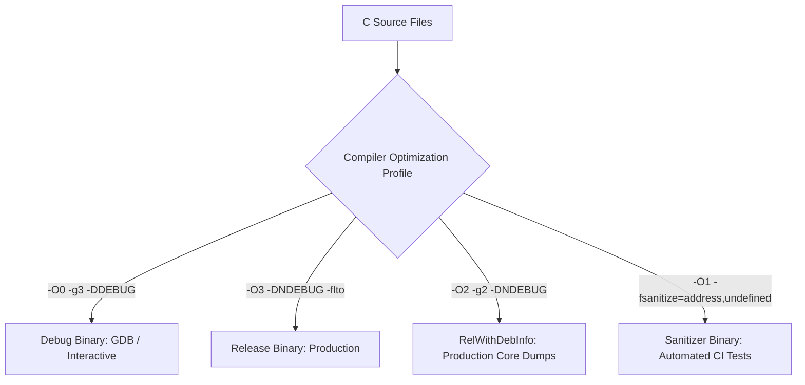

# Debug vs Release Builds and Sanitizer CI

> **Mastering compiler optimization matrices, preprocessor flags, assertion semantics, debug symbols, and continuous integration sanitizer pipelines for C.**

| Level | Prerequisites | Time to Read | Status | Standard |
| :--- | :--- | :--- | :--- | :--- |
| Advanced | [01-make-in-depth.md](01-make-in-depth.md), [02-cmake.md](02-cmake.md), [00-setup/03-compilation-process.md](../00-setup/03-compilation-process.md) | 26 mins | Complete | C99 / C11 / C17 / C23 |

---

## Table of Contents
1. [What & Why](#1-what--why)
2. [Core Concepts](#2-core-concepts)
3. [How It Works Internally](#3-how-it-works-internally)
4. [Syntax & Usage](#4-syntax--usage)
5. [Practical Examples](#5-practical-examples)
6. [Best Practices](#6-best-practices)
7. [Common Mistakes & Pitfalls](#7-common-mistakes--pitfalls)
8. [Performance & Security Notes](#8-performance--security-notes)
9. [Comparison / When to Use What](#9-comparison--when-to-use-what)
10. [Interview Questions](#10-interview-questions)
11. [Practice Exercises](#11-practice-exercises)
12. [Summary / Cheat Sheet](#12-summary--cheat-sheet)
13. [Further Reading](#13-further-reading)

---

## 1. What & Why

Compiling a C program requires making trade-offs between execution speed, binary size, runtime safety checks, and debuggability. A single binary configuration cannot satisfy both interactive debugging and production latency requirements.

In modern systems engineering, production C codebases maintain at least four distinct build profiles:
1. **Debug:** Optimization disabled (`-O0`), full debug symbols (`-g3`), runtime assertions active. Used for interactive step-debugging in GDB/LLDB.
2. **Release:** Maximum optimization (`-O3`), assertions stripped (`-DNDEBUG`), Link-Time Optimization (`-flto`). Used for production deployment.
3. **RelWithDebInfo:** Optimized (`-O2`), but retains debug symbols (`-g2`) to allow stack trace symbolication from production core dumps.
4. **Sanitizer (ASan / UBSan / TSan / MSan):** Instrumentation profiles with mild optimization (`-O1 -g2`) designed specifically for CI automated test execution.

Without structured build profiles, teams risk shipping debug builds with crippling overhead to production, or deploying release builds whose compiler optimizations trigger undefined behavior bugs that remained hidden during development.

---

## 2. Core Concepts

### 2.1 Compiler Optimization Levels
- `-O0`: Zero optimization. Variables reside in memory stack frames, instructions map 1:1 to C statements. Essential for step debugging.
- `-O1`: Basic optimization. Eliminates trivial redundancies and performs basic register allocation without substantial build time inflation.
- `-O2`: Standard production optimization. Enables loop vectorization, function inlining within translation units, and aggressive instruction scheduling without aggressive size-expansion.
- `-O3`: Maximum aggressive optimization. Enables SIMD auto-vectorization, aggressive loop unrolling, and inline heuristics that may increase binary code size.
- `-Os` / `-Oz`: Optimizes strictly for minimum binary footprint (critical for embedded microcontrollers and IoT).

### 2.2 Preprocessor Flag Conventions
- `DEBUG` or `_DEBUG`: Defined manually in debug targets (`-DDEBUG`). Activates diagnostic logging and runtime verification hooks.
- `NDEBUG`: Defined in release targets (`-DNDEBUG`). Causes the standard `<assert.h>` macro `assert()` to compile to empty statements `((void)0)`.

### 2.3 LLVM / GCC Sanitizer Suite
Sanitizers inject compiler instrumentation and runtime interceptors into the generated binary:
- **ASan (AddressSanitizer):** Detects buffer overflows (heap, stack, global), use-after-free, double free, and memory leaks.
- **UBSan (UndefinedBehaviorSanitizer):** Detects signed integer overflow, misaligned pointer dereferences, null pointer dereferences, and invalid bitshifts.
- **TSan (ThreadSanitizer):** Detects data races across POSIX or C11 threads. (Incompatible with ASan).
- **MSan (MemorySanitizer):** Detects reads of uninitialized memory. (Clang-only; requires rebuilding all dependencies with MSan).



---

## 3. How It Works Internally

### 3.1 Debug Symbols (DWARF vs PDB)
When `-g` is supplied, the compiler emits debugging metadata (DWARF format on Linux/macOS, PDB on Windows). 
- DWARF tables map machine program counter (PC) addresses back to exact source file paths and line numbers.
- Location lists detail which CPU register or stack slot stores a variable at any instruction address.
- At `-O0`, variables stay pinned to known stack offsets. Under `-O2` or `-O3`, variable values may be held temporarily in registers, combined, or optimized away entirely (causing GDB to report `<optimized out>`).

### 3.2 AddressSanitizer Shadow Memory Architecture
ASan reserves a contiguous fraction (typically 1/8th) of the application's virtual address space as **Shadow Memory**.
- Every 8 bytes of application memory maps to 1 byte in shadow memory via a direct scale-and-offset bitshift:
  $$	ext{ShadowAddr} = (	ext{AppAddr} \gg 3) + 	ext{Offset}$$
- A shadow byte value of `0` indicates all 8 bytes are valid and unpoisoned. Values `1` through `7` indicate partial accessibility. Negative values (e.g., `0xF1`, `0xF2`) indicate poisoned redzones (stack redzone, heap redzone, or freed memory).
- On every pointer load or store, ASan inserts two assembly instructions to check the corresponding shadow byte. If poisoned, it immediately terminates the process and outputs a detailed crash report.

```
Application Memory (8 Bytes): [ B0 | B1 | B2 | B3 | B4 | B5 | B6 | B7 ]
                                      |
                      Bitshift >> 3 + Offset
                                      v
Shadow Memory (1 Byte):       [ 0x00 ] (Valid) OR [ 0xFD ] (Freed Heap Redzone)
```

---

## 4. Syntax & Usage

### 4.1 Canonical Flag Configurations

#### Debug Profile
```bash
gcc -std=c11 -Wall -Wextra -Wpedantic -O0 -g3 -DDEBUG main.c -o app_debug
```

#### Release Profile
```bash
gcc -std=c11 -Wall -Wextra -O3 -DNDEBUG -flto -march=native -fomit-frame-pointer main.c -o app_release
```

#### ASan + UBSan CI Profile
```bash
gcc -std=c11 -Wall -Wextra -O1 -g2 -DDEBUG     -fsanitize=address,undefined     -fno-omit-frame-pointer     -fno-sanitize-recover=all     main.c -o app_asan
```

### 4.2 CMake Profile Setup
```cmake
# Recommended profile-based CMake configuration
set(CMAKE_C_STANDARD 11)
set(CMAKE_C_STANDARD_REQUIRED ON)

set(CMAKE_C_FLAGS_DEBUG "-O0 -g3 -DDEBUG -Wall -Wextra")
set(CMAKE_C_FLAGS_RELEASE "-O3 -DNDEBUG -flto")
set(CMAKE_C_FLAGS_RELWITHDEBINFO "-O2 -g2 -DNDEBUG")

# Custom sanitizer option
option(ENABLE_SANITIZERS "Build with ASan and UBSan instrumentation" OFF)
if(ENABLE_SANITIZERS)
    add_compile_options(-O1 -g2 -fsanitize=address,undefined -fno-omit-frame-pointer)
    add_link_options(-fsanitize=address,undefined)
endif()
```

---

## 5. Practical Examples

### 5.1 Profile Verification Program
The following program inspects active build profiles and flags at runtime:

```c
#include <stdio.h>
#include <stdlib.h>
#include <stdbool.h>

typedef struct {
    const char *name;
    const char *flags;
    const char *sanitizers;
} build_profile_t;

static const build_profile_t PROFILES[] = {
    {"Debug",          "-O0 -g3 -DDEBUG",                          "none"},
    {"Debug-ASan",     "-O1 -g2 -DDEBUG -fsanitize=address",       "address,undefined"},
    {"Release",        "-O3 -g0 -DNDEBUG -flto",                   "none"},
    {"RelWithDebInfo",  "-O2 -g2 -DNDEBUG",                         "none"}
};

int main(void) {
    printf("Evaluating Debug vs Release Build Profiles...\n");
    for (size_t i = 0; i < sizeof(PROFILES) / sizeof(PROFILES[0]); ++i) {
        printf("Profile: %-14s Flags: %-38s Sanitizers: %s\n",
               PROFILES[i].name,
               PROFILES[i].flags,
               PROFILES[i].sanitizers);
    }
    printf("Binary Optimization Profile matrix verified.\n");
    return 0;
}
```

**Real Execution Output:**
```text
Evaluating Debug vs Release Build Profiles...
Profile: Debug          Flags: -O0 -g3 -DDEBUG                          Sanitizers: none
Profile: Debug-ASan     Flags: -O1 -g2 -DDEBUG -fsanitize=address       Sanitizers: address,undefined
Profile: Release        Flags: -O3 -g0 -DNDEBUG -flto                   Sanitizers: none
Profile: RelWithDebInfo Flags: -O2 -g2 -DNDEBUG                         Sanitizers: none
Binary Optimization Profile matrix verified.
```

### 5.2 GitHub Actions Sanitizer CI Workflow
A production `.github/workflows/ci.yml` matrix testing multiple build profiles:

```yaml
name: Continuous Integration Matrix

on: [push, pull_request]

jobs:
  build-and-test:
    runs-on: ubuntu-latest
    strategy:
      fail-fast: false
      matrix:
        profile: [Debug, Release, ASan-UBSan, TSan]
    steps:
      - uses: actions/checkout@v4

      - name: Configure CMake
        run: |
          case "${{ matrix.profile }}" in
            Debug)
              cmake -B build -DCMAKE_BUILD_TYPE=Debug ;;
            Release)
              cmake -B build -DCMAKE_BUILD_TYPE=Release ;;
            ASan-UBSan)
              cmake -B build -DCMAKE_BUILD_TYPE=Debug -DENABLE_ASAN=ON ;;
            TSan)
              cmake -B build -DCMAKE_BUILD_TYPE=Debug -DENABLE_TSAN=ON ;;
          esac

      - name: Build
        run: cmake --build build --parallel $(nproc)

      - name: Run Test Suite
        env:
          ASAN_OPTIONS: 'detect_leaks=1:abort_on_error=1'
          UBSAN_OPTIONS: 'print_stacktrace=1:halt_on_error=1'
        run: ctest --test-dir build --output-on-failure
```

---

## 6. Best Practices

1. **Always Retain Frame Pointers with Sanitizers:** Pass `-fno-omit-frame-pointer` when compiling with `-fsanitize=address`. Without frame pointers, ASan stack unwinding generates corrupted or truncated error traces.
2. **Halt on Sanitizer Errors in CI:** Add `-fno-sanitize-recover=all` and set `UBSAN_OPTIONS=halt_on_error=1`. By default, UBSan logs warnings and continues execution, allowing test runners to report false passes.
3. **Never Place Side Effects inside `assert()`:**
   ```c
   // CRITICAL BUG: In release builds (-DNDEBUG), close_socket() is never executed!
   assert(close_socket(sock) == 0);

   // CORRECT:
   int rc = close_socket(sock);
   assert(rc == 0);
   (void)rc;
   ```
4. **Use `-D_FORTIFY_SOURCE=2` in Release:** In optimized release builds (`-O2` or `-O3`), FORTIFY_SOURCE instruments standard C library functions (`memcpy`, `strcpy`, `sprintf`) with runtime buffer overflow checks at negligible CPU overhead.
5. **Separate Profiling / Sanitizer Builds:** Do not combine ThreadSanitizer (TSan) with AddressSanitizer (ASan) in the same executable; their memory shadow schemes conflict. Run them in parallel matrix jobs in CI.

---

## 7. Common Mistakes & Pitfalls

| Mistake | Why It Is Dangerous | Correct Fix |
| :--- | :--- | :--- |
| **Testing exclusively on `-O0` debug builds** | Compiler optimizations (`-O2`/`-O3`) reorder instructions and exploit undefined behavior, introducing bugs unseen at `-O0`. | Run CI test suites against both Debug, ASan, and Release builds. |
| **Assert with side effect: `assert(n++ > 0)`** | Under `-DNDEBUG`, `n` is never incremented, causing divergent logic between debug and release. | Execute state modifications outside of `assert()`. |
| **Deploying ASan builds to production** | ASan introduces 2x CPU slowdown and 2x to 3x memory footprint increase. | Restrict ASan exclusively to development and automated CI test passes. |
| **Omitting `-g` from release builds intended for internal testing** | Release crashes produce bare memory addresses in core dumps without symbol names. | Use `RelWithDebInfo` (`-O2 -g2`) to allow post-mortem GDB stack analysis. |
| **Using `-march=native` in CI binary artifacts** | Binaries built on modern CI nodes with AVX-512 crash with `SIGILL` on older user CPUs. | Compile for a baseline architecture (e.g., `-march=x86-64-v2` or `-march=x86-64-v3`). |
| **Mixing object files compiled with and without ASan** | Undefined symbols, broken interceptors, and false-positive crash reports. | Rebuild all project object files and static libraries cleanly when toggling ASan. |

---

## 8. Performance & Security Notes

### 8.1 Performance Profiling Matrix
| Profile | Typical Execution Overhead | Memory Overhead | Use Case |
| :--- | :--- | :--- | :--- |
| **Debug (`-O0`)** | 2.0x – 5.0x slower | 1.0x (Baseline) | GDB interactive debugging, rapid build cycles. |
| **Release (`-O3 -flto`)** | Baseline (1.0x) | 1.0x | Production low-latency deployment. |
| **AddressSanitizer (ASan)** | 1.5x – 2.5x slower | 2.0x – 3.0x | CI automated regression, fuzzing. |
| **ThreadSanitizer (TSan)** | 5.0x – 15.0x slower | 4.0x – 8.0x | Concurrency race detection in CI. |
| **MemorySanitizer (MSan)** | 3.0x slower | 2.0x – 3.0x | Uninitialized read detection (Clang). |

### 8.2 Link-Time Optimization (LTO)
Standard compilers optimize translation units in isolation. Passing `-flto` during both compilation and linking causes the compiler to emit LLVM bitcode or GCC GIMPLE intermediate representations into object files. During the final link step, the whole program AST is optimized together, inlining functions across separate `.c` files and eliminating unused static variables across the entire binary.

---

## 9. Comparison / When to Use What

| Setting | Debug (`-O0 -g3`) | Release (`-O3 -flto`) | RelWithDebInfo (`-O2 -g2`) | Sanitizer CI (`-O1 -fsanitize=...`) |
| :--- | :--- | :--- | :--- | :--- |
| **Optimization** | None | Aggressive | Moderate | Basic |
| **Symbols** | Exhaustive (macro defs) | None (stripped) | Full source lines | Full source lines |
| **Assertions** | Active (`assert` fires) | Disabled (`-DNDEBUG`) | Disabled (`-DNDEBUG`) | Active (`assert` fires) |
| **Sanitizers** | Optional | Prohibited | Prohibited | Mandatory |
| **Target** | Local developer | End user / Cloud prod | Staging / Prod monitoring | GitHub Actions / GitLab CI |

---

## 10. Interview Questions

<details>
<summary><strong>1. What does the preprocessor macro <code>NDEBUG</code> do, and what happens if you forget it in Release?</strong></summary>

Defining `NDEBUG` disables all `assert()` statements from `<assert.h>` by substituting them with `((void)0)`. If you omit `-DNDEBUG` in Release builds, assertion conditional checks and string error formatting remain inside the production binary, causing runtime performance degradation and potentially leaking internal paths in assertion strings.
</details>

<details>
<summary><strong>2. Why is <code>-O1</code> or <code>-O2</code> recommended when running AddressSanitizer instead of <code>-O0</code>?</strong></summary>

While ASan works with `-O0`, `-O1` or `-O2` allows the compiler's dead-code elimination and register allocation to prune redundant shadow-memory checks. This makes ASan binaries significantly faster without obscuring error stack traces.
</details>

<details>
<summary><strong>3. Why can an assertion with side-effects create bugs that only appear in Release builds?</strong></summary>

If an expression like `assert(perform_critical_init() == 0)` is used, `perform_critical_init()` executes normally in Debug. But when compiled with `-DNDEBUG` in Release, the entire expression inside `assert()` is erased by the preprocessor, meaning `perform_critical_init()` is never called, leading to mysterious initialization failures in production.
</details>

<details>
<summary><strong>4. How does Link-Time Optimization (LTO) differ from traditional compilation?</strong></summary>

Traditionally, the compiler translates each `.c` file into machine code independently; the linker merely resolves symbols and patches addresses. With `-flto`, object files store intermediate compiler representations (bitcode). The linker invokes compiler optimization passes across the entire combined codebase, enabling cross-file inlining and dead-code stripping.
</details>

<details>
<summary><strong>5. What is the purpose of the <code>-fno-omit-frame-pointer</code> compiler flag?</strong></summary>

It instructs the compiler to maintain the base frame pointer register (`rbp`/`ebp`) for every function call instead of reclaiming it as a general-purpose register. This allows tools like GDB, `perf`, and ASan to reconstruct call stacks rapidly and reliably via stack frame pointer chaining without relying on expensive DWARF unwinding tables.
</details>

<details>
<summary><strong>6. Can AddressSanitizer and ThreadSanitizer be enabled simultaneously?</strong></summary>

No. Both ASan and TSan map conflicting virtual memory ranges for their respective shadow memory algorithms and inject conflicting interceptors for standard library allocators. They must be executed in separate binary builds and independent test passes.
</details>

<details>
<summary><strong>7. What is <code>_FORTIFY_SOURCE</code> and what requirements does it have?</strong></summary>

`_FORTIFY_SOURCE=2` is a glibc/GCC/Clang security enhancement that substitutes standard functions (`memcpy`, `memset`, `sprintf`) with bounds-checked variants when destination buffer sizes can be deduced at compile time. It requires compiler optimization to be active (at least `-O1`).
</details>

<details>
<summary><strong>8. Why should production binaries be built without <code>-march=native</code>?</strong></summary>

`-march=native` generates instructions optimized for the specific host CPU executing the build. If built on a CI worker supporting modern instructions like AVX2 or AVX-512, deploying the resulting binary to a user machine or container host lacking those instructions results in an illegal instruction crash (`SIGILL`).
</details>

---

## 11. Practice Exercises

### Exercise 1 (Easy): Identifying Side Effects in Assertions
- **Task:** Identify the bug in the following snippet and refactor it so behavior is identical in both Debug and Release builds:
```c
int fd;
assert((fd = open("config.ini", O_RDONLY)) >= 0);
```

<details>
<summary>Solution</summary>

```c
int fd = open("config.ini", O_RDONLY);
assert(fd >= 0);
if (fd < 0) {
    /* Graceful production fallback error handling */
    perror("Failed to open config.ini");
    return -1;
}
```
</details>

### Exercise 2 (Medium): CMake Sanitizer Pipeline Configuration
- **Task:** Write a CMake snippet that defines a custom target `run_asan_tests` which compiles the test suite with `-fsanitize=address,undefined` and executes CTest with environment variable `ASAN_OPTIONS=abort_on_error=1:detect_leaks=1`.

<details>
<summary>Solution</summary>

```cmake
add_custom_target(run_asan_tests
    COMMAND ${CMAKE_COMMAND} -E env
            ASAN_OPTIONS=abort_on_error=1:detect_leaks=1
            UBSAN_OPTIONS=halt_on_error=1:print_stacktrace=1
            ctest --output-on-failure
    COMMENT "Executing test suite under AddressSanitizer and UndefinedBehaviorSanitizer..."
)
```
</details>

### Exercise 3 (Hard): Makefile Multi-Profile Implementation
- **Task:** Write a complete Makefile supporting `make debug`, `make release`, and `make asan` that place their object files and final binaries into isolated subdirectories (`build/debug`, `build/release`, `build/asan`) so switching profiles does not trigger stale object file linking.

<details>
<summary>Solution</summary>

```makefile
CC ?= gcc
SRCS = src/main.c src/utils.c
BIN = app

# Base warning flags
CFLAGS_BASE = -std=c11 -Wall -Wextra -Wpedantic

# Profiles
CFLAGS_DEBUG   = $(CFLAGS_BASE) -O0 -g3 -DDEBUG
CFLAGS_RELEASE = $(CFLAGS_BASE) -O3 -DNDEBUG -flto
CFLAGS_ASAN    = $(CFLAGS_BASE) -O1 -g2 -DDEBUG -fsanitize=address,undefined -fno-omit-frame-pointer

LDFLAGS_RELEASE = -flto
LDFLAGS_ASAN    = -fsanitize=address,undefined

debug:
	@mkdir -p build/debug
	$(CC) $(CFLAGS_DEBUG) $(SRCS) -o build/debug/$(BIN)

release:
	@mkdir -p build/release
	$(CC) $(CFLAGS_RELEASE) $(SRCS) $(LDFLAGS_RELEASE) -o build/release/$(BIN)

asan:
	@mkdir -p build/asan
	$(CC) $(CFLAGS_ASAN) $(SRCS) $(LDFLAGS_ASAN) -o build/asan/$(BIN)

clean:
	rm -rf build
```
</details>

---

## 12. Summary / Cheat Sheet

| Profile Name | Recommended Flags | Primary Objective |
| :--- | :--- | :--- |
| **Debug** | `-O0 -g3 -DDEBUG -Wall -Wextra` | Step debugging, immediate inspection in GDB. |
| **Release** | `-O3 -DNDEBUG -flto -D_FORTIFY_SOURCE=2` | Maximum runtime performance and binary stripping. |
| **RelWithDebInfo** | `-O2 -g2 -DNDEBUG` | Production triage with post-mortem core dump symbols. |
| **ASan / UBSan** | `-O1 -g2 -fsanitize=address,undefined` | CI memory safety and undefined behavior detection. |
| **TSan** | `-O1 -g2 -fsanitize=thread` | Race condition detection in concurrent code. |

---

## 13. Further Reading
- GCC Optimization Options: `https://gcc.gnu.org/onlinedocs/gcc/Optimize-Options.html`
- Google AddressSanitizer Wiki: `https://github.com/google/sanitizers/wiki/AddressSanitizer`
- LLVM UndefinedBehaviorSanitizer: `https://clang.llvm.org/docs/UndefinedBehaviorSanitizer.html`
- Link Time Optimization Guide: `https://gcc.gnu.org/wiki/LinkTimeOptimization`

---
[<- Previous: 10-doxygen-documentation.md](10-doxygen-documentation.md) | [Section Index](README.md) | [Next: ../07-testing/README.md ->](../07-testing/README.md)
