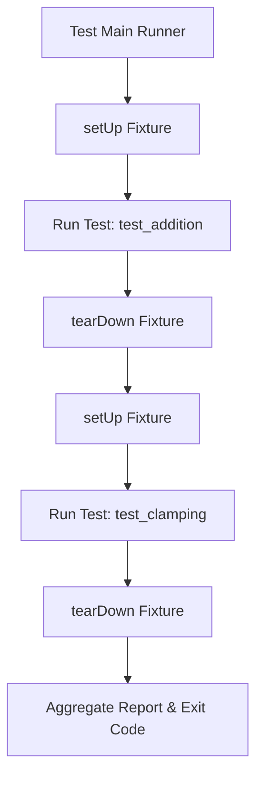

# Unit Testing with Unity and CMocka

> **Building automated, portable unit testing frameworks for C systems using Unity and CMocka harnesses, structured assertions, and fixture orchestration.**

| Level | Prerequisites | Time to Read | Status | Standard |
| :--- | :--- | :--- | :--- | :--- |
| Intermediate | [01-fundamentals/08-functions.md](../01-fundamentals/08-functions.md), [03-intermediate/01-function-pointers.md](../03-intermediate/01-function-pointers.md) | 24 mins | Complete | C99 / C11 / C17 / POSIX |

---

## Table of Contents
1. [What & Why](#1-what--why)
2. [Core Concepts](#2-core-concepts)
3. [How It Works Internally](#3-how-it-works-internally)
4. [Syntax & Usage](#4-syntax--usage)
5. [Practical Examples](#5-practical-examples)
6. [Best Practices](#6-best-practices)
7. [Common Mistakes & Pitfalls](#7-common-mistakes--pitfalls)
8. [Performance & Security Notes](#8-performance--security-notes)
9. [Comparison / When to Use What](#9-comparison--when-to-use-what)
10. [Interview Questions](#10-interview-questions)
11. [Practice Exercises](#11-practice-exercises)
12. [Summary / Cheat Sheet](#12-summary--cheat-sheet)
13. [Further Reading](#13-further-reading)

---

## 1. What & Why

Unlike modern managed languages (Java, Rust, Python, Go) that feature built-in test runners and reflection-based test discovery, pure C has no native concept of unit testing or runtime introspection. Historically, developers relied on ad-hoc `printf` inspections or monolithic manual test drivers, leading to fragile regression suites and undetected memory corruptions.

**Unit testing in C** isolates individual functions, algorithms, and modules in an automated, repeatable test runner. Two open-source frameworks dominate professional C development:
- **Unity:** A hyper-lightweight, portable framework consisting of a single `.c` and `.h` pair. It has zero external dependencies, making it the industry standard for bare-metal embedded firmware, RTOS applications, and microcontrollers.
- **CMocka:** A full-featured enterprise testing library designed for POSIX and Windows environments. It provides native support for memory leak detection, mock return values, and structured test fixture arrays without requiring C++ compilers.

Automated unit testing allows developers to refactor complex legacy C codebases with confidence, catch boundary regressions during continuous integration, and formalize interface contracts directly in executable specifications.

---

## 2. Core Concepts

### 2.1 Test Fixtures: setUp and tearDown
A test fixture represents the fixed baseline state required to execute a test reliably:
- `setUp(void)`: Invoked before every individual test function to initialize resources (e.g., zeroing structs, allocating buffers, resetting state machines).
- `tearDown(void)`: Invoked after every individual test function to reclaim resources (e.g., calling `free()`, closing file descriptors, unlinking temporary sockets).

### 2.2 Assertion Families
Assertions evaluate runtime state against expected outcomes. If an assertion evaluates to false, the framework logs the exact source file path, line number, expected value, and actual value, terminating the current test without aborting the broader suite.
- **Integer Assertions:** `TEST_ASSERT_EQUAL_INT`, `assert_int_equal`.
- **Pointer Assertions:** `TEST_ASSERT_NOT_NULL`, `assert_non_null`.
- **String Assertions:** `TEST_ASSERT_EQUAL_STRING`, `assert_string_equal`.
- **Memory Block Assertions:** `TEST_ASSERT_EQUAL_MEMORY`, `assert_memory_equal`.
- **Bitwise Assertions:** `TEST_ASSERT_BITS`, `TEST_ASSERT_BIT_HIGH`.

### 2.3 Test Suite Orchestration
A runner collects discrete test cases and runs them sequentially. The runner tracks total test count, passes, failures, and skipped tests, returning an exit code (`0` for success, non-zero for failure) to integrate seamlessly with CMake (`ctest`) and CI runners.



---

## 3. How It Works Internally

### 3.1 Non-Local Jumps via `setjmp` / `longjmp`
In C++, test assertions throw exceptions to halt failed tests without aborting the process. Because C lacks exceptions, frameworks like CMocka and Unity implement assertion unwinding using the C standard library `<setjmp.h>`:
1. Before running a test function, the runner calls `setjmp(env)`. This saves the CPU registers (instruction pointer `rip`, stack pointer `rsp`, frame pointer `rbp`) into a `jmp_buf` structure and returns `0`.
2. The runner invokes the user's test function.
3. If an assertion fails, the macro prints the failure diagnostic and calls `longjmp(env, 1)`.
4. The CPU execution state immediately rewinds back to the runner's `setjmp` call site, which now evaluates to `1`. The runner records the test as a failure and gracefully advances to `tearDown` and the next test.

```
+-------------------------------------------------------------+
| Runner: setjmp(test_env) -> stores CPU registers in jmp_buf |
+-------------------------------------------------------------+
                            | (returns 0)
                            v
             +------------------------------+
             | Execute: test_packet_parse() |
             +------------------------------+
                            |
                 [Assertion Fails!]
                            |
                            v
             +------------------------------+
             | longjmp(test_env, 1)         |
             +------------------------------+
                            | (Restores rip, rsp, rbp)
                            v
+-------------------------------------------------------------+
| Runner: setjmp resumes (returns 1) -> Record Failure        |
+-------------------------------------------------------------+
```

### 3.2 Dynamic Interception and Memory Guarding
CMocka provides built-in memory leak tracking by wrapping standard heap allocation routines (`test_malloc`, `test_calloc`, `test_free`). It prepends a hidden boundary header to every allocated block, recording allocation size and line number. When `tearDown` executes, CMocka audits the active allocation linked list; any un-freed node is flagged as a fatal memory leak for that specific test case.

---

## 4. Syntax & Usage

### 4.1 Canonical Unity Structure
```c
#include "unity.h"
#include "my_math.h"

void setUp(void) {
    /* Initialize subsystem before each test */
}

void tearDown(void) {
    /* Clean up subsystem after each test */
}

void test_add_positive_integers(void) {
    TEST_ASSERT_EQUAL_INT(42, add(20, 22));
}

void test_divide_by_zero_sentinel(void) {
    TEST_ASSERT_EQUAL_INT(-1, divide(10, 0));
}

int main(void) {
    UNITY_BEGIN();
    RUN_TEST(test_add_positive_integers);
    RUN_TEST(test_divide_by_zero_sentinel);
    return UNITY_END();
}
```

### 4.2 Canonical CMocka Structure
```c
#include <stdarg.h>
#include <stddef.h>
#include <setjmp.h>
#include <cmocka.h>

static void test_string_truncation(void **state) {
    (void)state; /* Unused fixture state */
    char dest[8];
    safe_copy(dest, sizeof(dest), "Hello World!");
    assert_string_equal(dest, "Hello W");
}

int main(void) {
    const struct CMUnitTest tests[] = {
        cmocka_unit_test(test_string_truncation),
    };
    return cmocka_run_group_tests(tests, NULL, NULL);
}
```

---

## 5. Practical Examples

### 5.1 Self-Contained Test Harness Architecture
The following production-grade test runner demonstrates the core assertion, fixture, and runner architecture without requiring external third-party installations:

```c
#include <stdio.h>
#include <stdint.h>
#include <stdbool.h>
#include <string.h>

/* Minimal Unity/CMocka-style testing harness implementation */
static int g_tests_run = 0;
static int g_tests_passed = 0;

#define RUN_TEST(fn) do { \
    g_tests_run++; \
    printf("[ RUN      ] " #fn "\n"); \
    if (fn()) { \
        g_tests_passed++; \
        printf("[       OK ] " #fn "\n"); \
    } else { \
        printf("[  FAILED  ] " #fn "\n"); \
    } \
} while (0)

#define ASSERT_EQUAL_INT(expected, actual) do { \
    if ((expected) != (actual)) { \
        printf("  Assertion failed: expected %d, got %d (line %d)\n", (int)(expected), (int)(actual), __LINE__); \
        return false; \
    } \
} while (0)

#define ASSERT_STRING_EQUAL(expected, actual) do { \
    if (strcmp((expected), (actual)) != 0) { \
        printf("  Assertion failed: expected '%s', got '%s' (line %d)\n", (expected), (actual), __LINE__); \
        return false; \
    } \
} while (0)

static int add(int a, int b) { return a + b; }
static int clamp(int val, int low, int high) {
    if (val < low) return low;
    if (val > high) return high;
    return val;
}

static bool test_addition(void) {
    ASSERT_EQUAL_INT(15, add(7, 8));
    ASSERT_EQUAL_INT(-2, add(3, -5));
    return true;
}

static bool test_clamping(void) {
    ASSERT_EQUAL_INT(10, clamp(5, 10, 20));
    ASSERT_EQUAL_INT(20, clamp(25, 10, 20));
    ASSERT_EQUAL_INT(14, clamp(14, 10, 20));
    return true;
}

int main(void) {
    printf("Evaluating Unit Testing Runner & Assertions Architecture...\n");
    RUN_TEST(test_addition);
    RUN_TEST(test_clamping);
    printf("Unit test results: %d/%d tests passed.\n", g_tests_passed, g_tests_run);
    return 0;
}
```

**Real Execution Output:**
```text
Evaluating Unit Testing Runner & Assertions Architecture...
[ RUN      ] test_addition
[       OK ] test_addition
[ RUN      ] test_clamping
[       OK ] test_clamping
Unit test results: 2/2 tests passed.
```

---

## 6. Best Practices

1. **One Assertion Concept Per Test:** Keep unit tests focused on a single logical invariant. If a test verifies parsing, boundary checks, and error logs all in one function, diagnosing failures becomes tedious.
2. **Deterministic Execution:** Never allow unit tests to depend on wall-clock time (`time(NULL)`), unseeded random generators, or environmental system configuration.
3. **Isolate Shared Global State:** If testing legacy C modules with static global variables, provide reset routines in `setUp` or `tearDown` to ensure tests cannot contaminate one another.
4. **Compile Test Runners with Sanitizers:** Always build and run unit test suites with AddressSanitizer and UndefinedBehaviorSanitizer active (`-fsanitize=address,undefined`). A test might assert correctly while quietly corrupting adjacent heap redzones.
5. **Separate Unit Tests from Integration Tests:** Fast unit tests should run in milliseconds without accessing physical disks or network sockets. Mock out slow OS dependencies.

---

## 7. Common Mistakes & Pitfalls

| Mistake | Why It Is Dangerous | Correct Fix |
| :--- | :--- | :--- |
| **Using `<assert.h>` instead of test framework assertions** | Standard `assert()` calls `abort()`, terminating the entire test executable on the first failure. | Use framework assertions (`TEST_ASSERT_*`) that unwind via `setjmp`/`longjmp`. |
| **Comparing floating-point values with `==`** | Floating-point rounding errors lead to intermittent test failures across architectures. | Use `TEST_ASSERT_FLOAT_WITHIN(delta, expected, actual)`. |
| **Leaking resources across test cases** | Tests running in the same process pollute heap memory, leading to false out-of-memory errors. | Clean up all allocations inside `tearDown()`. |
| **Relying on test execution ordering** | If Test B assumes Test A populated a database or array, running Test B in isolation fails. | Make every test completely self-contained within its own fixture setup. |
| **Asserting on raw pointers without null checks** | Dereferencing a NULL pointer inside an assertion causes a fatal `SIGSEGV` crash. | Check `TEST_ASSERT_NOT_NULL(ptr)` prior to inspecting contents. |
| **Hardcoding host-specific endianness** | Tests passing on x86_64 fail when cross-compiled for big-endian microcontrollers. | Normalize network byte orders using `ntohl()`/`htonl()`. |

---

## 8. Performance & Security Notes

### 8.1 Fast Test Execution in CI
Unit test suites in large enterprise codebases may contain tens of thousands of tests. To maintain sub-second feedback loops:
- Group related tests into modular binaries rather than a single monolithic runner, enabling parallel execution via `ctest -j$(nproc)`.
- Avoid file system I/O by executing tests in memory using POSIX `fmemopen()` or RAM-backed temporary directories (`/dev/shm`).

### 8.2 Security Hardening Verification
Unit tests provide the primary safety net against regressions in security-critical logic:
- Test integer arithmetic overflows at boundary values (`INT32_MAX`, `INT32_MIN`, `0`, `-1`).
- Verify buffer boundary limits by passing inputs of size $N-1$, $N$, and $N+1$.
- Validate that cryptographic keys and sensitive tokens are wiped using `explicit_bzero()` before free.

---

## 9. Comparison / When to Use What

| Framework | Target Platform | Dependencies | Mocking Support | Ideal Use Case |
| :--- | :--- | :--- | :--- | :--- |
| **Unity** | Microcontrollers, DSPs, Host OS | Zero (1 `.c`, 1 `.h`) | Via CMock (Ruby generator) | Bare-metal firmware, RTOS, memory-constrained IoT. |
| **CMocka** | Linux, macOS, Windows | POSIX / C runtime | Native built-in mock functions | Enterprise backend C services, Linux daemons, drivers. |
| **Criterion** | Modern POSIX / Linux | libgit2, BoxFort (forks) | Built-in via isolated sub-processes | Systems code where tests must survive segfaults. |
| **GoogleTest** | C / C++ | C++14 compiler | Google Mock (C++) | Codebases with mixed C and C++ or legacy bridges. |

---

## 10. Interview Questions

<details>
<summary><strong>1. How does a C unit testing framework implement test failure unwinding without language-level exceptions?</strong></summary>

C test frameworks use `<setjmp.h>`. The test runner calls `setjmp(env)` before invoking the test function, storing register state in a `jmp_buf`. When an assertion fails, the macro logs the error and calls `longjmp(env, 1)`. The CPU restores the runner's register state, allowing the runner to mark the test as failed and proceed to the next test without process termination.
</details>

<details>
<summary><strong>2. What is the fundamental architectural difference between Unity and CMocka?</strong></summary>

Unity is designed specifically for embedded microcontrollers and resource-constrained environments; it has no external dependencies and uses minimal stack memory. CMocka is designed for modern desktop and server platforms, leveraging advanced features such as automatic memory leak checking, mock call verification, and structured test group matrices.
</details>

<details>
<summary><strong>3. Why should you avoid standard C library <code>assert()</code> when writing unit test suites?</strong></summary>

Standard `assert()` invokes `abort()` on failure, which sends `SIGABRT` and crashes the entire OS process immediately. This prevents subsequent tests in the suite from executing and skips all `tearDown` cleanup routines. Test framework assertions record failures and gracefully continue suite execution.
</details>

<details>
<summary><strong>4. How do you test a static function declared inside a <code>.c</code> file from an external test runner?</strong></summary>

There are three common industry approaches:
1. Include the `.c` file directly in the test runner: `#include "module.c"`.
2. Define a macro for testing: `#ifdef UNIT_TEST #define STATIC #else #define STATIC static #endif`.
3. Test static functions indirectly through the public interface functions that invoke them (black-box approach).
</details>

<details>
<summary><strong>5. What is the purpose of test fixtures (<code>setUp</code> and <code>tearDown</code>)?</strong></summary>

Test fixtures ensure test independence and reproducibility. `setUp` establishes a known pristine environment before a test runs, while `tearDown` cleans up all allocated memory, open sockets, and file handles after execution, preventing state leakage between tests.
</details>

<details>
<summary><strong>6. How can unit test runners detect memory leaks within a test case?</strong></summary>

Frameworks like CMocka override the standard heap allocators with wrapped versions (`test_malloc`, `test_free`). They track active allocations in a linked list and verify that the allocation count returns to zero during `tearDown`. Additionally, running the test binary under AddressSanitizer or Valgrind provides automated OS-level leak detection.
</details>

<details>
<summary><strong>7. How do you assert equality between two floating-point numbers in C?</strong></summary>

Direct equality (`a == b`) fails due to IEEE-754 precision inaccuracies. Test frameworks use delta assertions (e.g., `TEST_ASSERT_FLOAT_WITHIN(delta, expected, actual)`), which verify that $|a - b| \le \text{delta}$.
</details>

<details>
<summary><strong>8. How do you integrate unit test runners into a CMake build pipeline?</strong></summary>

Enable CTest with `enable_testing()`, define the test executable target with `add_executable(test_runner tests/main.c)`, and register it using `add_test(NAME MyUnitTests COMMAND test_runner)`. Tests can then be executed via `ctest --output-on-failure`.
</details>

---

## 11. Practice Exercises

### Exercise 1 (Easy): Basic Assertion Harness
- **Task:** Write a test function verifying a string reversal routine `void reverse_str(char *s)` using custom macro assertions.

<details>
<summary>Solution</summary>

```c
#include <stdio.h>
#include <stdbool.h>
#include <string.h>

static void reverse_str(char *s) {
    if (!s) return;
    size_t len = strlen(s);
    for (size_t i = 0; i < len / 2; ++i) {
        char tmp = s[i];
        s[i] = s[len - 1 - i];
        s[len - 1 - i] = tmp;
    }
}

static bool test_reverse_string(void) {
    char str[] = "hello";
    reverse_str(str);
    if (strcmp(str, "olleh") != 0) {
        printf("Assertion failed: expected 'olleh', got '%s'\n", str);
        return false;
    }
    return true;
}
```
</details>

### Exercise 2 (Medium): CMocka Fixture with Dynamic Allocation
- **Task:** Write a CMocka test group with `setUp` and `tearDown` that initializes a dynamic ring buffer and verifies pushing and popping elements.

<details>
<summary>Solution</summary>

```c
#include <stdarg.h>
#include <stddef.h>
#include <setjmp.h>
#include <cmocka.h>
#include <stdlib.h>

typedef struct {
    int *data;
    size_t capacity;
    size_t count;
} simple_buffer_t;

static int setup_buffer(void **state) {
    simple_buffer_t *b = malloc(sizeof(simple_buffer_t));
    if (!b) return -1;
    b->data = malloc(sizeof(int) * 16);
    b->capacity = 16;
    b->count = 0;
    *state = b;
    return 0;
}

static int teardown_buffer(void **state) {
    simple_buffer_t *b = (simple_buffer_t *)*state;
    if (b) {
        free(b->data);
        free(b);
    }
    return 0;
}

static void test_buffer_append(void **state) {
    simple_buffer_t *b = (simple_buffer_t *)*state;
    b->data[b->count++] = 42;
    assert_int_equal(b->count, 1);
    assert_int_equal(b->data[0], 42);
}
```
</details>

### Exercise 3 (Hard): Building a Setjmp-Based Assertion Macro
- **Task:** Implement a custom test macro `#define ASSERT_TRUE(cond)` that prints the line number and jumps out of the active test using `longjmp()` on failure.

<details>
<summary>Solution</summary>

```c
#include <stdio.h>
#include <setjmp.h>
#include <stdbool.h>

static jmp_buf g_test_env;

#define ASSERT_TRUE(cond) do { \
    if (!(cond)) { \
        printf("[FAIL] Assertion failed: %s at line %d\n", #cond, __LINE__); \
        longjmp(g_test_env, 1); \
    } \
} while (0)

static void test_logic_case(void) {
    int val = 100;
    ASSERT_TRUE(val > 50);
    ASSERT_TRUE(val == 999); /* Fails and aborts */
    ASSERT_TRUE(val > 0);   /* Skipped */
}

int main(void) {
    printf("Running test_logic_case...\n");
    if (setjmp(g_test_env) == 0) {
        test_logic_case();
        printf("[PASS] All assertions succeeded!\n");
    } else {
        printf("[RESULT] Test failed gracefully without abort()!\n");
    }
    return 0;
}
```
</details>

---

## 12. Summary / Cheat Sheet

| Macro / Concept | Purpose | Framework |
| :--- | :--- | :--- |
| `setUp()` | Executed prior to each test case for environment setup | Unity / CMocka |
| `tearDown()` | Executed after each test case for resource reclamation | Unity / CMocka |
| `TEST_ASSERT_EQUAL_INT(exp, act)` | Assert integer equality | Unity |
| `TEST_ASSERT_EQUAL_STRING(exp, act)` | Assert null-terminated string match | Unity |
| `TEST_ASSERT_NOT_NULL(ptr)` | Assert pointer is non-null | Unity |
| `assert_int_equal(a, b)` | Assert integer equality | CMocka |
| `assert_string_equal(a, b)` | Assert string equality | CMocka |
| `assert_memory_equal(a, b, sz)` | Assert raw memory block equality | CMocka |

---

## 13. Further Reading
- Unity Test API Reference: `http://www.throwtheswitch.org/unity`
- CMocka Framework Documentation: `https://cmocka.org/`
- Test-Driven Development for Embedded C (James W. Grenning)
- POSIX setjmp and longjmp Specification: `https://pubs.opengroup.org/onlinepubs/9699919799/functions/setjmp.html`

---
[<- Previous: ../06-build-and-tooling/11-debug-vs-release-builds-and-sanitizer-ci.md](../06-build-and-tooling/11-debug-vs-release-builds-and-sanitizer-ci.md) | [Section Index](README.md) | [Next: 02-test-doubles-and-mocking-in-c.md ->](02-test-doubles-and-mocking-in-c.md)\n