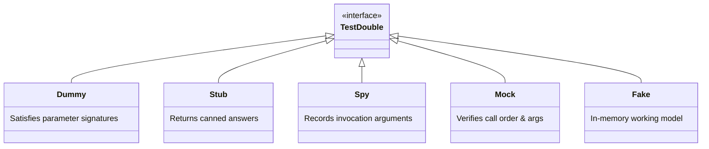

# Test Doubles and Mocking in C

> **Isolating hardware drivers, OS system calls, and external subsystems in C unit tests using stubs, fakes, spies, function pointer tables, and linker wrapping.**

| Level | Prerequisites | Time to Read | Status | Standard |
| :--- | :--- | :--- | :--- | :--- |
| Intermediate | [01-unit-testing-with-unity-or-cmocka.md](01-unit-testing-with-unity-or-cmocka.md), [03-intermediate/01-function-pointers.md](../03-intermediate/01-function-pointers.md), [04-advanced/12-object-files-and-the-linker-in-depth.md](../04-advanced/12-object-files-and-the-linker-in-depth.md) | 26 mins | Complete | C99 / C11 / C17 / POSIX |

---

## Table of Contents
1. [What & Why](#1-what--why)
2. [Core Concepts](#2-core-concepts)
3. [How It Works Internally](#3-how-it-works-internally)
4. [Syntax & Usage](#4-syntax--usage)
5. [Practical Examples](#5-practical-examples)
6. [Best Practices](#6-best-practices)
7. [Common Mistakes & Pitfalls](#7-common-mistakes--pitfalls)
8. [Performance & Security Notes](#8-performance--security-notes)
9. [Comparison / When to Use What](#9-comparison--when-to-use-what)
10. [Interview Questions](#10-interview-questions)
11. [Practice Exercises](#11-practice-exercises)
12. [Summary / Cheat Sheet](#12-summary--cheat-sheet)
13. [Further Reading](#13-further-reading)

---

## 1. What & Why

In systems programming, C code interacts directly with physical hardware, networking sockets, non-volatile flash memory, and kernel system calls. If a unit test attempts to exercise business logic that is tightly coupled to hardware registers or network endpoints, several critical problems arise:
- **Hardware Dependency:** Tests cannot execute on host development machines or continuous integration (CI) runners without specialized target hardware connected.
- **Non-Determinism:** Network timeouts, disk latency, and physical sensors introduce intermittent test failures.
- **Destructive Side Effects:** Executing flash erase or disk partitioning routines during routine unit tests destroys test environments.
- **Error Inaccessibility:** It is nearly impossible to force physical hardware into rare failure states (e.g., bus arbitration loss, flash bad-block faults) on demand.

**Test Doubles** solve this by substituting external dependencies with controlled software simulations. In C, because there is no runtime dynamic dispatch or dependency injection framework, developers employ architectural design patterns (function pointer tables) and toolchain features (GNU linker symbol wrapping) to inject test doubles cleanly.

---

## 2. Core Concepts

### 2.1 The Taxonomy of Test Doubles
The testing literature defines five distinct flavors of test doubles:
1. **Dummy:** Objects or pointers passed around to satisfy function parameters but never actually read or executed (e.g., passing a non-null context handle).
2. **Stub:** Provides canned, hardcoded responses to function calls made during the test, with no logic (e.g., always returning `0` or `SUCCESS`).
3. **Spy:** Records details of invocations (number of calls, arguments passed, timestamps) for later assertion in the test runner.
4. **Mock:** A double pre-programmed with expectations of which calls should occur, in what sequence, and with what parameters, failing immediately if expectations are violated.
5. **Fake:** A working implementation that takes shortcuts unsuitable for production (e.g., an in-memory hash table substituting an on-disk database).



### 2.2 Injection Strategies in Pure C
Three primary mechanisms exist for replacing real code with test doubles in C:
- **Compile-Time Injection:** Utilizing the preprocessor (`#ifdef TEST`) or header substitution to redirect symbols.
- **Link-Time Injection (Linker Wrapping):** Using the GNU linker flag `-Wl,--wrap=<symbol>` to intercept symbol references without modifying source code.
- **Runtime Injection (Vtable / Interface Tables):** Structs containing function pointers passed explicitly into system contexts.

---

## 3. How It Works Internally

### 3.1 GNU Linker Symbol Wrapping (`--wrap`)
The GNU linker (`ld`) provides the powerful `--wrap=<symbol>` flag. When `-Wl,--wrap=write` is passed during the link stage:
1. Any unresolved call to `write()` in all linked object files is rewritten to resolve to `__wrap_write()`.
2. Any call to `__real_write()` is rewritten to resolve to the original, underlying system `write()` function.

This allows test suites to intercept system calls like `read()`, `write()`, `malloc()`, or `socket()` transparently, inspect arguments, inject simulated failures, and optionally forward the call to the actual implementation.

```
+--------------------------------------------------------+
| Application Code: write(fd, buf, len)                  |
+--------------------------------------------------------+
                            |
                   (Linker --wrap=write)
                            v
+--------------------------------------------------------+
| Test Harness: __wrap_write(fd, buf, len)               |
| -> Log call, assert arguments, return simulated error |
+--------------------------------------------------------+
                            |
           (Optional: call __real_write(fd, buf, len))
                            v
+--------------------------------------------------------+
| Real C Library: libc write(fd, buf, len)               |
+--------------------------------------------------------+
```

### 3.2 Vtable Injection via Struct Composition
In interface-based C design, subsystems do not call global driver functions directly. Instead, they receive a pointer to an interface structure:
```c
struct uart_driver {
    bool (*send_byte)(uint8_t byte);
    bool (*read_byte)(uint8_t *out_byte);
};
```
In production, the system is initialized with a pointer to `g_hardware_uart_driver`. In unit tests, the test harness passes `&g_mock_uart_driver`. The CPU executes the mock function via an indirect call (`call *rax`), eliminating all compile-time dependencies on physical hardware registers.

---

## 4. Syntax & Usage

### 4.1 Linker Wrapping Implementation
In test code:
```c
#include <stdio.h>
#include <unistd.h>
#include <stdbool.h>

/* Prototype for the original system symbol */
extern ssize_t __real_write(int fd, const void *buf, size_t count);

static bool g_fail_write = false;
static size_t g_write_call_count = 0;

/* The wrapper function intercepting all write() calls */
ssize_t __wrap_write(int fd, const void *buf, size_t count) {
    g_write_call_count++;
    if (g_fail_write) {
        return -1; /* Simulate ENOSPC / EIO */
    }
    /* Forward to real write if desired */
    return __real_write(fd, buf, count);
}
```

Compilation command:
```bash
gcc -std=c11 -Wall -Wl,--wrap=write test_app.c app.c -o test_app
```

### 4.2 CMocka Mock API
CMocka provides standardized macros for defining mock return values and verifying parameter values:
```c
#include <cmocka.h>

/* Mock function */
int authenticate_user(const char *username, const char *password) {
    check_expected(username);
    check_expected(password);
    return (int)mock();
}

/* Inside unit test */
static void test_auth_success(void **state) {
    expect_string(authenticate_user, username, "admin");
    expect_string(authenticate_user, password, "secret123");
    will_return(authenticate_user, 1); /* Mock returns success */

    int rc = login_controller("admin", "secret123");
    assert_int_equal(rc, 0);
}
```

---

## 5. Practical Examples

### 5.1 Verified Companion Simulation: Vtable Driver Mock
The following self-contained C program demonstrates implementing and verifying an interface-based spy and mock driver:

```c
#include <stdio.h>
#include <stdint.h>
#include <stdbool.h>

/* Interface-based test double via function pointer table (vtable injection) */
typedef struct storage_driver {
    bool (*write_block)(uint32_t addr, const uint8_t *data, size_t len);
    bool (*read_block)(uint32_t addr, uint8_t *out_data, size_t len);
} storage_driver_t;

/* System Under Test */
typedef struct config_manager {
    const storage_driver_t *driver;
} config_manager_t;

static bool save_system_id(const config_manager_t *mgr, uint16_t sys_id) {
    uint8_t payload[2];
    payload[0] = (uint8_t)(sys_id & 0xFF);
    payload[1] = (uint8_t)((sys_id >> 8) & 0xFF);
    return mgr->driver->write_block(0x1000, payload, sizeof(payload));
}

/* Mock driver tracking invocations */
static uint32_t g_mock_last_addr = 0;
static size_t g_mock_write_count = 0;
static uint8_t g_mock_written_data[16];

static bool mock_write(uint32_t addr, const uint8_t *data, size_t len) {
    g_mock_last_addr = addr;
    g_mock_write_count++;
    for (size_t i = 0; i < len && i < sizeof(g_mock_written_data); ++i) {
        g_mock_written_data[i] = data[i];
    }
    return true;
}

static const storage_driver_t g_test_mock_driver = {
    .write_block = mock_write,
    .read_block = NULL
};

int main(void) {
    printf("Evaluating Test Doubles and Mocking via Injection...\n");
    config_manager_t cfg = { .driver = &g_test_mock_driver };
    
    bool ok = save_system_id(&cfg, 0x1234);
    printf("Save system ID outcome: %s\n", ok ? "SUCCESS" : "FAILURE");
    printf("Mock recorded writes: %zu, target addr: 0x%04X, bytes: 0x%02X 0x%02X\n",
           g_mock_write_count, g_mock_last_addr, g_mock_written_data[0], g_mock_written_data[1]);
    return 0;
}
```

**Real Execution Output:**
```text
Evaluating Test Doubles and Mocking via Injection...
Save system ID outcome: SUCCESS
Mock recorded writes: 1, target addr: 0x1000, bytes: 0x34 0x12
```

---

## 6. Best Practices

1. **Favor Interface Injection Over Linker Wrapping:** Vtable and function pointer injection makes dependency boundaries explicit in code architecture. Linker wrapping (`--wrap`) is a powerful fallback when mocking third-party libraries or POSIX system calls you cannot modify.
2. **Reset Mock State in `setUp()` / `tearDown()`:** Always clear recorded call counts, recorded pointers, and simulated failure flags between tests. Stale mock state from a previous test leads to order-dependent test failures.
3. **Avoid Over-Mocking:** Do not mock pure functions (e.g., string formatters, mathematical algorithms, data structures). Only mock boundary dependencies that cause side effects, latency, or non-determinism (I/O, network, time, random generators).
4. **Verify Call Parameters Rigorously:** A mock should verify not just that a function was called, but that the exact expected buffer addresses, sizes, and flags were passed.
5. **Keep Mocks Simple:** Never embed complex stateful business logic inside a mock. If your mock requires branching logic and internal state machines, use a **Fake** instead.

---

## 7. Common Mistakes & Pitfalls

| Mistake | Why It Is Dangerous | Correct Fix |
| :--- | :--- | :--- |
| **Mocking functions inside the same translation unit with `--wrap`** | GCC inlines calls within the same `.c` file or emits direct local jumps, bypassing the linker wrapper. | Compile caller and callee into separate `.o` files; disable inline with `-fno-inline`. |
| **Forgetting to mock failure paths** | Code works under happy-path mocking but panics in production when disk fills or sockets close. | Write tests specifically forcing mocks to return `NULL`, `-1`, or `ETIMEDOUT`. |
| **Global mock state corruption across tests** | Test A leaves `g_fail_network = true`, causing unrelated Test B to fail mysteriously. | Zero out all global mock variables inside the fixture's `setUp()` routine. |
| **Over-specifying call sequence** | Asserting exact call order for irrelevant background operations makes tests brittle to harmless refactoring. | Assert call orders only when strict protocol sequencing is required. |
| **Using `#ifdef TEST` throughout business code** | Clutters production logic with testing conditional flags and risks shipping divergent code. | Use interface structs and function pointer tables instead of compile-time macros. |
| **Missing `extern` declaration for `__real_symbol`** | Results in compiler warnings or unresolved linker symbols when calling the original function. | Properly declare `extern <type> __real_symbol(...)`. |

---

## 8. Performance & Security Notes

### 8.1 Performance Overhead of Indirection
Using function pointer tables (vtable injection) introduces an indirect call instruction (`call *%rax`). On modern CPUs with branch predictors, this overhead is negligible (1–2 CPU cycles). However, in tight inner loops processing millions of iterations, indirect calls prevent compiler auto-vectorization and inlining. In such hot paths, consider compile-time header substitution or LTO devirtualization.

### 8.2 Testing Security Fault Handlers
Mocks provide the only safe way to verify security error recovery in production C:
- Force simulated entropy depletion in `/dev/urandom` reads to verify that cryptographic token generators fail closed.
- Inject simulated memory allocation failures (`malloc() returns NULL`) to ensure all previously allocated buffers are wiped and freed without memory leakage.
- Simulate socket protocol desynchronization to test TLS handshake timeout defenses.

---

## 9. Comparison / When to Use What

| Technique | Mechanism | Coupling | Portability | Best Use Case |
| :--- | :--- | :--- | :--- | :--- |
| **Interface Vtable** | Function pointers in struct | High design impact (clean architecture) | 100% ISO C portable | Hardware drivers, storage engines, protocol stacks. |
| **Linker Wrapping (`--wrap`)** | GNU `ld` symbol redirection | Zero source code changes required | GNU/Clang toolchain only | Standard C library calls (`malloc`, `read`, `time`). |
| **Preprocessor `#define`** | Macro header aliasing | Medium (conditional builds) | 100% ISO C portable | Simple legacy codebases where architecture cannot change. |
| **Weak Symbols (`__attribute__((weak))`)** | Default implementation override | Low | GCC / Clang / ARM CC | Embedded BSPs with optional user callback hooks. |

---

## 10. Interview Questions

<details>
<summary><strong>1. How does the GNU linker's <code>--wrap</code> option work under the hood?</strong></summary>

When `-Wl,--wrap=func` is passed, the linker resolves any undefined reference to `func` to `__wrap_func`. Furthermore, any reference to `__real_func` is resolved to the original `func` symbol. This allows developers to wrap system functions without editing source files.
</details>

<details>
<summary><strong>2. Why might <code>--wrap</code> fail to intercept a function call between two functions in the same <code>.c</code> file?</strong></summary>

The compiler can inline static or local functions within the same translation unit, or generate direct relative branch instructions (`jmp`/`call` relative offsets) rather than emitting an unresolved ELF symbol in the relocation table. Because the linker never sees an external symbol lookup, `--wrap` is bypassed.
</details>

<details>
<summary><strong>3. What is the difference between a Mock and a Stub?</strong></summary>

A **Stub** provides canned answers to calls made during a test, with no verification of whether the call actually happened or what arguments were passed. A **Mock** is pre-configured with expectations (arguments, call counts, order) and verifies whether the system under test behaved as expected.
</details>

<details>
<summary><strong>4. How do you implement Dependency Injection in pure C without an object-oriented framework?</strong></summary>

Dependency injection in C is achieved by passing a pointer to an interface structure containing function pointers (a vtable) into an initialization function:
```c
system_t *sys_create(const hal_driver_t *hal);
```
Production code passes real hardware drivers; test suites pass mock driver tables.
</details>

<details>
<summary><strong>5. What is a "Spy" double, and when would you use one?</strong></summary>

A **Spy** is a test double that captures and records the parameters and invocation count of calls made to it. It is used when the test needs to verify post-conditions (e.g., verifying that `telemetry_send()` was called with packet ID `0x05` and payload length `64`).
</details>

<details>
<summary><strong>6. How can you simulate a memory allocation failure using linker wrapping?</strong></summary>

Wrap `malloc`:
```c
extern void *__real_malloc(size_t sz);
bool g_fail_alloc = false;

void *__wrap_malloc(size_t sz) {
    if (g_fail_alloc) return NULL;
    return __real_malloc(sz);
}
```
In the test, set `g_fail_alloc = true` and assert that the system handles `NULL` gracefully.
</details>

<details>
<summary><strong>7. What are the advantages of using "Fake" doubles over complex Mocks?</strong></summary>

A Fake implements actual working stateful behavior (e.g., an in-memory key-value store simulating Redis). Tests using Fakes are simpler to read and maintain because they avoid setting up dozens of fragile mock call expectations.
</details>

<details>
<summary><strong>8. How do GCC "weak symbols" enable mocking in embedded systems?</strong></summary>

Declaring a function with `__attribute__((weak))` allows a default implementation to exist in a library. If the application or test harness defines a non-weak function with the identical symbol name, the linker chooses the non-weak test implementation without throwing multiple definition errors.
</details>

---

## 11. Practice Exercises

### Exercise 1 (Easy): Basic Spy Double Implementation
- **Task:** Implement a spy double for a logging callback `typedef void (*log_cb_t)(int level, const char *msg);` that records the last logged message and level.

<details>
<summary>Solution</summary>

```c
#include <stdio.h>
#include <string.h>

typedef void (*log_cb_t)(int level, const char *msg);

static int g_spy_level = -1;
static char g_spy_msg[128] = {0};

static void spy_logger(int level, const char *msg) {
    g_spy_level = level;
    strncpy(g_spy_msg, msg, sizeof(g_spy_msg) - 1);
}

void trigger_alert(log_cb_t logger) {
    logger(2, "CRITICAL_PRESSURE");
}

int main(void) {
    trigger_alert(spy_logger);
    if (g_spy_level == 2 && strcmp(g_spy_msg, "CRITICAL_PRESSURE") == 0) {
        printf("Spy verified log output successfully!\n");
    }
    return 0;
}
```
</details>

### Exercise 2 (Medium): Vtable Mock for RTC Clock
- **Task:** Write an interface `rtc_driver_t` with a method `uint64_t (*get_epoch_ms)(void);`. Write a mock that increments time by 1000ms on each call to test a timeout detection algorithm.

<details>
<summary>Solution</summary>

```c
#include <stdio.h>
#include <stdint.h>
#include <stdbool.h>

typedef struct {
    uint64_t (*get_epoch_ms)(void);
} rtc_driver_t;

static uint64_t g_simulated_time = 10000;

static uint64_t mock_get_epoch_ms(void) {
    uint64_t current = g_simulated_time;
    g_simulated_time += 1000;
    return current;
}

static const rtc_driver_t g_mock_rtc = { .get_epoch_ms = mock_get_epoch_ms };

static bool is_timeout(const rtc_driver_t *rtc, uint64_t start_time, uint64_t timeout_ms) {
    return (rtc->get_epoch_ms() - start_time) >= timeout_ms;
}

int main(void) {
    uint64_t start = g_simulated_time;
    bool t1 = is_timeout(&g_mock_rtc, start, 5000); /* 1st call: elapsed 0 */
    bool t2 = is_timeout(&g_mock_rtc, start, 1500); /* 2nd call: elapsed 1000 */
    bool t3 = is_timeout(&g_mock_rtc, start, 1500); /* 3rd call: elapsed 2000 -> timeout */

    printf("Check 1: %s, Check 2: %s, Check 3: %s\n",
           t1 ? "TIMEOUT" : "ACTIVE",
           t2 ? "TIMEOUT" : "ACTIVE",
           t3 ? "TIMEOUT" : "ACTIVE");
    return 0;
}
```
</details>

### Exercise 3 (Hard): Linker Wrapping for File Open Interception
- **Task:** Write a complete linker wrapper `__wrap_fopen` that intercepts calls to open `/etc/secret.conf` and redirects them to an in-memory buffer or temporary file path `fixtures/mock_secret.conf`.

<details>
<summary>Solution</summary>

```c
#include <stdio.h>
#include <string.h>

extern FILE *__real_fopen(const char *filename, const char *mode);

FILE *__wrap_fopen(const char *filename, const char *mode) {
    if (strcmp(filename, "/etc/secret.conf") == 0) {
        printf("[WRAPPER] Redirecting /etc/secret.conf to local mock file!\n");
        return __real_fopen("fixtures/mock_secret.conf", mode);
    }
    return __real_fopen(filename, mode);
}
```
</details>

---

## 12. Summary / Cheat Sheet

| Double Type | Primary Intent | Mechanism in C |
| :--- | :--- | :--- |
| **Dummy** | Fills parameter lists | Pass NULL or static empty struct. |
| **Stub** | Supplies canned return values | Fixed function returning static constants. |
| **Spy** | Inspects outbound arguments | Function recording args into global variables. |
| **Mock** | Verifies invocation contracts | Framework asserts expectations (e.g. CMocka `expect_*`). |
| **Fake** | Provides lightweight in-memory logic | RAM-backed storage or ring buffers. |
| **Linker Wrapping**| Intercepts compiled ELF symbols | GCC flag `-Wl,--wrap=<symbol>`. |

---

## 13. Further Reading
- Martin Fowler on Test Doubles: `https://martinfowler.com/bliki/TestDouble.html`
- GNU Linker Manual (Command Line Options / `--wrap`): `https://sourceware.org/binutils/docs/ld/Options.html`
- CMocka Mock Objects Documentation: `https://api.cmocka.org/group__cmocka__mock.html`
- Working Effectively with Legacy Code (Michael Feathers)

---
[<- Previous: 01-unit-testing-with-unity-or-cmocka.md](01-unit-testing-with-unity-or-cmocka.md) | [Section Index](README.md) | [Next: 03-fuzzing-with-libfuzzer-afl.md ->](03-fuzzing-with-libfuzzer-afl.md)\n