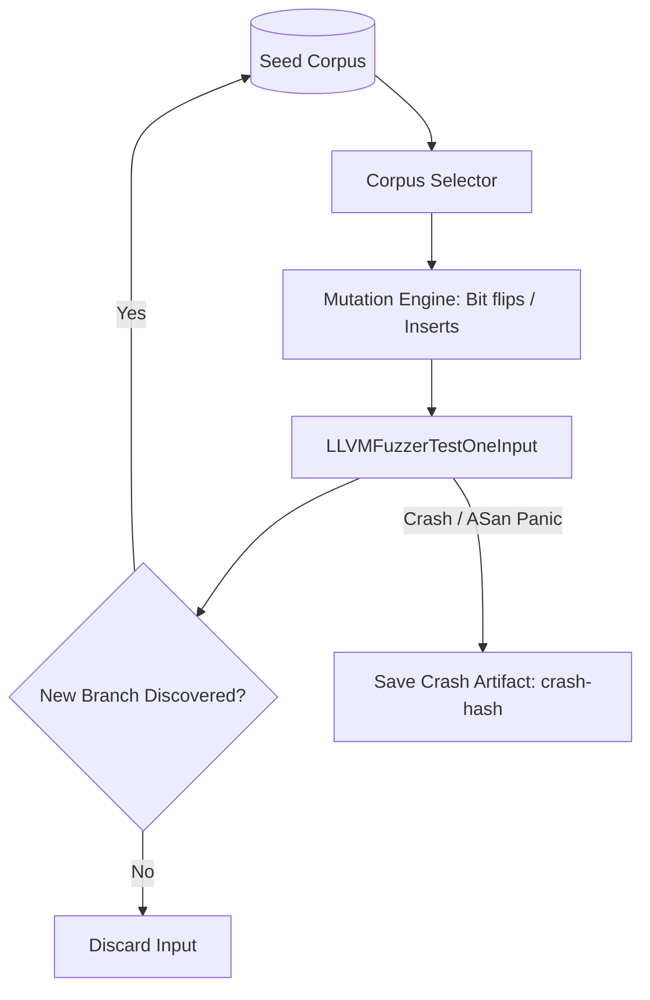

# Fuzzing with LibFuzzer and AFL++

> **Discovering zero-day vulnerabilities, buffer overflows, and parser crashes in C codebases using coverage-guided evolutionary fuzzing.**

| Level | Prerequisites | Time to Read | Status | Standard |
| :--- | :--- | :--- | :--- | :--- |
| Advanced | [06-testing-with-sanitizers-and-valgrind.md](06-testing-with-sanitizers-and-valgrind.md), [00-setup/03-compilation-process.md](../00-setup/03-compilation-process.md) | 28 mins | Complete | C99 / C11 / C17 / POSIX |

---

## Table of Contents
1. [What & Why](#1-what--why)
2. [Core Concepts](#2-core-concepts)
3. [How It Works Internally](#3-how-it-works-internally)
4. [Syntax & Usage](#4-syntax--usage)
5. [Practical Examples](#5-practical-examples)
6. [Best Practices](#6-best-practices)
7. [Common Mistakes & Pitfalls](#7-common-mistakes--pitfalls)
8. [Performance & Security Notes](#8-performance--security-notes)
9. [Comparison / When to Use What](#9-comparison--when-to-use-what)
10. [Interview Questions](#10-interview-questions)
11. [Practice Exercises](#11-practice-exercises)
12. [Summary / Cheat Sheet](#12-summary--cheat-sheet)
13. [Further Reading](#13-further-reading)

---

## 1. What & Why

Unit testing verifies that code behaves as expected for known inputs and deliberate edge cases conceived by the developer. However, human engineers rarely imagine the strange, malformed, or hostile inputs crafted by malicious adversaries or corrupt communications channels.

**Fuzz testing (fuzzing)** is an automated software testing technique that feeds millions of pseudo-random, mutated byte sequences into an application entry point to detect memory corruptions, infinite loops, and crashes.

Modern fuzzers are **coverage-guided**:
- Instead of generating random noise blindly, the fuzzer instruments compiler branch instructions to monitor which code paths are executed by each input.
- When an input mutation triggers a newly discovered code branch, that input is added to the **seed corpus** and prioritized for subsequent mutations.
- By marrying coverage-guided fuzzers (such as LLVM's **libFuzzer** and Google's **AFL++**) with AddressSanitizer (ASan), security engineers uncover buffer overflows, out-of-bounds reads, use-after-free conditions, and assertion crashes before shipping to production.

---

## 2. Core Concepts

### 2.1 The Fuzzing Loop
An evolutionary fuzzer operates in an infinite feedback loop:
1. **Corpus Selection:** Picks an existing valid input file from the seed corpus.
2. **Mutation Engine:** Applies bit flips, byte replacements, arithmetic shifts, block deletions, and dictionary token insertions.
3. **Execution:** Feeds the mutated input into the target function in-process.
4. **Coverage Evaluation:** Reads edge coverage bitmaps emitted by compiler instrumentation. If new control flow branches were reached, the mutated input is saved to the corpus.
5. **Crash Triage:** If a crash or ASan violation occurs, the fatal input is written to disk (e.g., `crash-0a1b2c...`) for developer reproduction.



### 2.2 libFuzzer vs AFL++
- **libFuzzer:** An in-process, library-based fuzzer built into Clang. It compiles the target function into a harness exposing `LLVMFuzzerTestOneInput()`. It achieves extreme performance (tens of thousands of executions per second) by running within a single process without invoking `fork()` or `exec()`.
- **AFL++ (American Fuzzy Lop Plus Plus):** A multi-process, fork-server-based fuzzer capable of testing complete command-line executables and file-reading programs. It supports advanced mutation strategies (custom mutators, MOpt, redqueen) and multi-core scaling.

---

## 3. How It Works Internally

### 3.1 Compiler Sanitizer Coverage (`-fsanitize-coverage`)
When compiling with Clang's `-fsanitize=fuzzer` or GCC's `-fsanitize-coverage=trace-pc-guard`:
1. The compiler inserts a small callback hook at the entry of every basic block:
   ```c
   __sanitizer_cov_trace_pc_guard(&guard_variable);
   ```
2. The runtime engine maintains an edge-transition bitmap (typically 64 KB). When control transitions from Block A to Block B, the fuzzer computes an edge hash:
   $$	ext{EdgeHash} = (	ext{PrevPC} \gg 1) \oplus 	ext{CurrPC}$$
3. The count at `bitmap[EdgeHash]` is incremented. If an input exercises a previously unvisited edge, the fuzzer recognizes that the mutation explored deeper code logic.

```
Basic Block A (Address: 0x401020)
       |
       v
Edge Transition: Hash = (0x401020 >> 1) ^ 0x401080
       v
Basic Block B (Address: 0x401080)
       |
       v
Increment Coverage Bitmap: bitmap[Hash]++
```

### 3.2 AFL++ Forkserver Architecture
Traditional CLI fuzzing incurs catastrophic OS overhead by calling `fork()` and `execve()` for every test iteration (translating to only ~50 executions/sec).
AFL++ eliminates this using a **forkserver**:
- The target binary initializes standard libraries and reaches the main entry point once.
- AFL++ halts the binary at a forkserver breakpoint.
- For each new test case, the parent binary performs a fast `fork()` without `execve()`, taking advantage of Copy-on-Write (CoW) virtual memory pages to run thousands of test cases per second.

---

## 4. Syntax & Usage

### 4.1 Writing a libFuzzer Harness
Every libFuzzer target requires implementing exactly one canonical C entry point:
```c
#include <stdint.h>
#include <stddef.h>

/**
 * @brief Mandatory libFuzzer entry point.
 * @param data Array of arbitrary, potentially hostile bytes generated by fuzzer.
 * @param size Number of bytes in the data buffer.
 * @return 0 (non-zero values reserved for future engine standards).
 */
int LLVMFuzzerTestOneInput(const uint8_t *data, size_t size) {
    if (size < 4) return 0; /* Ignore trivially small inputs */

    /* Pass input to system parser under test */
    parse_network_frame(data, size);

    return 0;
}
```

### 4.2 Compiling with Clang
Compile with AddressSanitizer and the fuzzing engine linked:
```bash
clang -std=c11 -Wall -Wextra -O1 -g       -fsanitize=fuzzer,address,undefined       fuzz_target.c parser.c -o fuzz_target
```

### 4.3 Executing the Fuzzer
Create a seed directory and launch the fuzzer:
```bash
mkdir corpus
echo "GET /index.html HTTP/1.1" > corpus/seed1.txt

# Run across 4 CPU cores
./fuzz_target corpus -jobs=4 -workers=4
```

---

## 5. Practical Examples

### 5.1 Self-Contained Simulated Fuzzer Target
The following program illustrates the inner workings of an input parsing target and verifies defensive bounds checking against malformed byte streams:

```c
#include <stdio.h>
#include <stdint.h>
#include <stdlib.h>
#include <stdbool.h>
#include <string.h>

/* Parser target to fuzz: parses key=value pairs */
static bool parse_key_value(const uint8_t *data, size_t size, char *out_key, char *out_val) {
    if (size == 0 || size > 64) return false;
    const char *eq = memchr(data, '=', size);
    if (!eq || eq == (const char *)data || eq == (const char *)data + size - 1) {
        return false;
    }
    size_t klen = (size_t)(eq - (const char *)data);
    size_t vlen = size - klen - 1;
    if (klen >= 32 || vlen >= 32) return false;

    memcpy(out_key, data, klen);
    out_key[klen] = '\0';
    memcpy(out_val, eq + 1, vlen);
    out_val[vlen] = '\0';
    return true;
}

/* Simulation of LLVMFuzzerTestOneInput */
static int fuzzer_test_one_input(const uint8_t *data, size_t size) {
    char key[32], val[32];
    parse_key_value(data, size, key, val);
    return 0;
}

int main(void) {
    printf("Evaluating Coverage-Guided Fuzzing Engine Target...\n");
    const uint8_t corpus1[] = "timeout=5000";
    const uint8_t corpus2[] = "port=";
    const uint8_t corpus3[] = "=none";
    const uint8_t corpus4[] = "host=localhost:8080";

    fuzzer_test_one_input(corpus1, sizeof(corpus1) - 1);
    fuzzer_test_one_input(corpus2, sizeof(corpus2) - 1);
    fuzzer_test_one_input(corpus3, sizeof(corpus3) - 1);
    fuzzer_test_one_input(corpus4, sizeof(corpus4) - 1);

    printf("Fuzzer test harness executed 4 seeds safely without memory violation.\n");
    return 0;
}
```

**Real Execution Output:**
```text
Evaluating Coverage-Guided Fuzzing Engine Target...
Fuzzer test harness executed 4 seeds safely without memory violation.
```

### 5.2 Creating a Fuzzing Dictionary
For structured protocols (JSON, XML, HTTP, SQL), random bit flips struggle to guess multi-byte magic keywords. Supplying a dictionary allows the fuzzer to insert valid tokens into mutated payloads:

`http.dict`:
```ini
# HTTP protocol tokens
kw_get="GET"
kw_post="POST"
kw_http11="HTTP/1.1"
kw_host="Host:"
kw_content_len="Content-Length:"
kw_crlf="\x0d\x0a"
```

Invoking with dictionary:
```bash
./fuzz_target corpus -dict=http.dict
```

---

## 6. Best Practices

1. **Always Fuzz with Sanitizers Enabled:** Fuzzing without AddressSanitizer and UndefinedBehaviorSanitizer is mostly wasted CPU time. A buffer over-read or use-after-free might read benign bytes without crashing unless ASan poisons adjacent redzones.
2. **Provide Meaningful Seed Corpora:** Seed the corpus directory with valid, minimal samples covering diverse features of your file format or protocol. The fuzzer mutates valid structures exponentially faster than building them from scratch.
3. **Minimize Harness Logic:** The `LLVMFuzzerTestOneInput` function should do one thing: forward bytes to the parser. Never write disk logs or allocate persistent structures inside the harness.
4. **Reset State Completely Between Iterations:** Because libFuzzer runs in-process for millions of iterations, any static variable or un-freed heap allocation will trigger false memory leak alerts or cross-iteration contamination.
5. **Minimize Execution Time Per Run:** Aim for >1,000 executions per second per CPU core. If a single run takes longer than 10 milliseconds, profile the target and eliminate slow logging or sleep timers.

---

## 7. Common Mistakes & Pitfalls

| Mistake | Why It Is Dangerous | Correct Fix |
| :--- | :--- | :--- |
| **Calling `exit()` or `abort()` on invalid input** | Halts the entire fuzzing campaign prematurely on simple validation failures. | Return `0` from the harness when inputs fail syntax validation. |
| **Writing disk files inside the harness** | Thrashing disk I/O throttles fuzzing execution speeds by 99%+. | Parse byte streams in-memory using buffers or `fmemopen()`. |
| **Fuzzing unconstrained integer sizes** | The fuzzer passes gigabyte payloads that trigger out-of-memory panics. | Add `if (size > MAX_LEN) return 0;` at the start of the harness. |
| **Ignoring UndefinedBehaviorSanitizer (UBSan)** | Signed integer overflows and misaligned reads escape detection. | Pass `-fsanitize=fuzzer,address,undefined`. |
| **Failing to minimize crash inputs** | Reproducing bugs with a 2 MB crash file full of irrelevant noise is difficult. | Run `./fuzz_target -minimize_crash=1 crash-file`. |
| **Persistent memory leakage across iterations** | In-process fuzzers quickly exhaust virtual RAM if targets leak memory. | Ensure every allocated context is freed before returning from the harness. |

---

## 8. Performance & Security Notes

### 8.1 Continuous Fuzzing with Google OSS-Fuzz
For open-source C projects, Google operates **OSS-Fuzz**, a free continuous fuzzing service running across distributed Google Cloud infrastructure. Integrating your C repository requires:
- A `Dockerfile` defining the build environment.
- A `build.sh` script compiling targets with `$CFLAGS` and linking `$LIB_FUZZING_ENGINE`.
- A `project.yaml` defining notifications. OSS-Fuzz continuously fuzzes git commits and files automated private vulnerability reports.

### 8.2 Reproducing and Debugging Crashes
When a fuzzer crashes, it outputs a crash artifact (e.g., `crash-0a1b2c3d`):
```bash
# Compile normal debug binary with ASan (no fuzzer engine)
clang -std=c11 -g -fsanitize=address,undefined target.c harness.c -o reproduce_crash

# Run crash artifact directly under GDB
gdb --args ./reproduce_crash crash-0a1b2c3d
```

---

## 9. Comparison / When to Use What

| Fuzzing Engine | Execution Model | Speed | Setup Complexity | Best Use Case |
| :--- | :--- | :--- | :--- | :--- |
| **libFuzzer** | In-process library calls | Extreme (10,000+ exec/s) | Low (single C file) | In-memory parsers, crypto routines, codecs, regex. |
| **AFL++** | Out-of-process forkserver | Fast (1,000 – 5,000 exec/s)| Medium | Full CLI programs, file-reading binaries, complex protocols. |
| **Honggfuzz** | Multi-threaded / hardware | Very Fast | Medium | Code relying on hardware performance counters (PT). |
| **Radamsa** | Black-box mutator | Moderate | Very Low | Command-line piping into un-instrumentable closed binaries. |

---

## 10. Interview Questions

<details>
<summary><strong>1. What does "coverage-guided fuzzing" mean, and how does it differ from traditional random fuzzing?</strong></summary>

Traditional fuzzing feeds completely random byte streams into a program without tracking what happens inside. Coverage-guided fuzzing instruments basic block branches. When an input reaches a new control flow path or edge transition, the fuzzer saves that input as an interesting seed in the corpus, iteratively mutating it to penetrate deeper into the software architecture.
</details>

<details>
<summary><strong>2. Why is AddressSanitizer (ASan) an indispensable partner to fuzz testing?</strong></summary>

Many memory corruptions in C (such as reading 1 byte beyond a heap buffer or accessing freed memory) do not cause an immediate OS page fault (`SIGSEGV`). Without ASan, the target may silently proceed, meaning the fuzzer never detects the security bug. ASan poisons memory redzones and crashes immediately upon violation.
</details>

<details>
<summary><strong>3. What is the contract of the <code>LLVMFuzzerTestOneInput</code> entry point?</strong></summary>

It accepts a `const uint8_t *data` pointer and a `size_t size`. It must parse the input without mutating global persistent state, handle all corrupt inputs gracefully without calling `exit()`, free all dynamically allocated resources, and return `0`.
</details>

<details>
<summary><strong>4. How does AFL++ achieve high execution throughput compared to standard <code>fork()</code> and <code>execve()</code>?</strong></summary>

AFL++ uses a **forkserver**. The target initializes once and stops right before `main()`. For each iteration, the parent processes a light `fork()` taking advantage of memory copy-on-write without re-linking dynamic libraries or re-executing `execve()`, increasing throughput from ~50 to thousands of executions per second.
</details>

<details>
<summary><strong>5. What is a "seed corpus" and why is it crucial for parser fuzzing?</strong></summary>

A seed corpus is a collection of small, valid input files covering different format features. If fuzzing a PNG parser, starting with valid 100-byte PNG files allows the fuzzer to explore deep chunk decoding logic immediately, rather than spending billions of CPU cycles guessing the initial 8-byte PNG file magic header.
</details>

<details>
<summary><strong>6. What is "corpus minimization" and why should you run it?</strong></summary>

As fuzzers run, the corpus can accumulate thousands of redundant input files that explore the same code paths. Corpus minimization (`-merge=1`) analyzes the corpus and discards redundant inputs, producing the smallest set of files that maintains identical code coverage, speeding up future mutation cycles.
</details>

<details>
<summary><strong>7. Why should you avoid calling <code>exit()</code> inside a fuzzer target?</strong></summary>

In an in-process fuzzer like libFuzzer, calling `exit()` terminates the entire fuzzer process rather than signaling invalid input, forcing the fuzzing orchestrator to restart and severely degrading throughput.
</details>

<details>
<summary><strong>8. What is the role of a fuzzing dictionary (<code>.dict</code>)?</strong></summary>

A dictionary contains keywords, magic constants, or delimiter strings relevant to the target protocol (e.g., `<html>`, `SELECT`, `Content-Length`). The fuzzer splices these tokens into mutated payloads to penetrate grammar barriers that bitwise mutations cannot easily breach.
</details>

---

## 11. Practice Exercises

### Exercise 1 (Easy): Basic libFuzzer Harness for Integer Parser
- **Task:** Write a libFuzzer harness that tests `bool parse_hex_color(const char *str, uint32_t *color)`. Ensure strings are properly null-terminated.

<details>
<summary>Solution</summary>

```c
#include <stdint.h>
#include <stddef.h>
#include <stdlib.h>
#include <string.h>
#include <stdbool.h>

extern bool parse_hex_color(const char *str, uint32_t *color);

int LLVMFuzzerTestOneInput(const uint8_t *data, size_t size) {
    if (size > 16) return 0; /* Color strings are short */

    char *buf = malloc(size + 1);
    if (!buf) return 0;

    memcpy(buf, data, size);
    buf[size] = '\0'; /* Guarantee null termination */

    uint32_t color = 0;
    parse_hex_color(buf, &color);

    free(buf);
    return 0;
}
```
</details>

### Exercise 2 (Medium): Crash Input Reproducer
- **Task:** Write a standalone C program that reads a crash artifact file from `argv[1]` and invokes the target function to reproduce an ASan crash under GDB.

<details>
<summary>Solution</summary>

```c
#include <stdio.h>
#include <stdlib.h>
#include <stdint.h>

extern int LLVMFuzzerTestOneInput(const uint8_t *data, size_t size);

int main(int argc, char **argv) {
    if (argc < 2) {
        fprintf(stderr, "Usage: %s <crash_file>\n", argv[0]);
        return 1;
    }

    FILE *f = fopen(argv[1], "rb");
    if (!f) {
        perror("fopen");
        return 1;
    }

    fseek(f, 0, SEEK_END);
    long sz = ftell(f);
    fseek(f, 0, SEEK_SET);

    uint8_t *buf = malloc(sz);
    if (fread(buf, 1, sz, f) != (size_t)sz) {
        perror("fread");
        fclose(f);
        free(buf);
        return 1;
    }
    fclose(f);

    printf("Executing target with %ld bytes from %s...\n", sz, argv[1]);
    LLVMFuzzerTestOneInput(buf, (size_t)sz);

    free(buf);
    printf("Completed without crash.\n");
    return 0;
}
```
</details>

### Exercise 3 (Hard): In-Memory JSON Key Extraction Fuzzer
- **Task:** Write a libFuzzer harness that passes fuzzer bytes to a hypothetical JSON parser and ensures that parsing errors never leak dynamically allocated parse trees.

<details>
<summary>Solution</summary>

```c
#include <stdint.h>
#include <stddef.h>
#include <stdlib.h>

typedef struct json_node json_node_t;
extern json_node_t *json_parse(const char *buf, size_t len);
extern void json_free(json_node_t *node);

int LLVMFuzzerTestOneInput(const uint8_t *data, size_t size) {
    if (size == 0 || size > 4096) return 0;

    /* Parse in-memory byte buffer */
    json_node_t *root = json_parse((const char *)data, size);
    if (root) {
        /* Parse succeeded; clean up parse tree */
        json_free(root);
    }

    return 0;
}
```
</details>

---

## 12. Summary / Cheat Sheet

| Command / Flag | Purpose | Tool |
| :--- | :--- | :--- |
| `-fsanitize=fuzzer` | Links libFuzzer engine and coverage instrumentation | Clang |
| `-fsanitize=address,undefined` | Instruments memory safety and undefined behavior checks | Clang / GCC |
| `LLVMFuzzerTestOneInput(data, sz)`| Canonical fuzzing entry point function | libFuzzer |
| `./fuzz_target corpus/` | Launches fuzzing campaign with seed directory | libFuzzer |
| `-dict=tokens.dict` | Injects protocol tokens for syntax-aware mutation | libFuzzer / AFL++ |
| `-merge=1 corpus_min/ corpus/` | Minimizes corpus to eliminate redundant seeds | libFuzzer |
| `afl-fuzz -i in -o out -- ./bin @@`| Launches multi-process fuzzing campaign | AFL++ |

---

## 13. Further Reading
- LLVM libFuzzer Official Documentation: `https://llvm.org/docs/LibFuzzer.html`
- AFL++ GitHub Repository and Documentation: `https://github.com/AFLplusplus/AFLplusplus`
- Google OSS-Fuzz Project: `https://github.com/google/oss-fuzz`
- The Fuzzing Book (Andreas Zeller et al.): `https://www.fuzzingbook.org/`

---
[<- Previous: 02-test-doubles-and-mocking-in-c.md](02-test-doubles-and-mocking-in-c.md) | [Section Index](README.md) | [Next: 04-test-driven-c.md ->](04-test-driven-c.md)\n