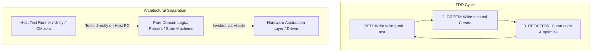

# Test-Driven Development (TDD) in C

> **Engineering defect-free C systems using the Red-Green-Refactor discipline, interface-first API design, and hardware-independent abstraction layers.**

| Level | Prerequisites | Time to Read | Status | Standard |
| :--- | :--- | :--- | :--- | :--- |
| Intermediate | [01-unit-testing-with-unity-or-cmocka.md](01-unit-testing-with-unity-or-cmocka.md), [02-test-doubles-and-mocking-in-c.md](02-test-doubles-and-mocking-in-c.md) | 24 mins | Complete | C99 / C11 / C17 / POSIX |

---

## Table of Contents
1. [What & Why](#1-what--why)
2. [Core Concepts](#2-core-concepts)
3. [How It Works Internally](#3-how-it-works-internally)
4. [Syntax & Usage](#4-syntax--usage)
5. [Practical Examples](#5-practical-examples)
6. [Best Practices](#6-best-practices)
7. [Common Mistakes & Pitfalls](#7-common-mistakes--pitfalls)
8. [Performance & Security Notes](#8-performance--security-notes)
9. [Comparison / When to Use What](#9-comparison--when-to-use-what)
10. [Interview Questions](#10-interview-questions)
11. [Practice Exercises](#11-practice-exercises)
12. [Summary / Cheat Sheet](#12-summary--cheat-sheet)
13. [Further Reading](#13-further-reading)

---

## 1. What & Why

In traditional C engineering workflows, testing is frequently relegated to the end of the development cycle. Developers write hundreds of lines of complex pointer arithmetic, memory management, and hardware manipulation before compiling or testing. This "code first, debug later" mindset leads to monolithic architectures, hidden memory corruptions, and agonizing debugging sessions with GDB.

**Test-Driven Development (TDD)** fundamentally reverses this sequence:
1. **Red:** Write an automated unit test that specifies a tiny increments of desired behavior. Compile and watch it fail (proving the test works and the feature does not yet exist).
2. **Green:** Write the absolute minimum C code necessary to make the test pass. Do not write premature features.
3. **Refactor:** Clean up the implementation—eliminate code duplication, optimize pointer usage, improve naming, and enforce const-correctness—while keeping all tests green.

In systems-level C, TDD forces developers to decouple pure algorithmic logic from physical hardware peripherals, OS kernel calls, and non-volatile memory, yielding modular, clean, and highly testable architectures.

---

## 2. Core Concepts

### 2.1 The Three Laws of TDD (Robert C. Martin applied to C)
1. You may not write any production C code unless it is to make a failing unit test pass.
2. You may not write more of a unit test than is sufficient to fail; failure to compile is considered a failure.
3. You may not write more production C code than is sufficient to pass the one currently failing unit test.

### 2.2 Model-View-Controller / Hardware Abstraction Layer (HAL)
To make embedded or systems C code testable under TDD, systems must be bifurcated into two layers:
- **Platform-Independent Domain Logic (The Model):** Pure C algorithms (state machines, packet parsers, business rules, calculation routines). This layer compiles cleanly on the host development machine (x86_64) and executes in microseconds without physical hardware.
- **Hardware Abstraction Layer (HAL):** Thin shim wrappers that read/write hardware registers or call OS system calls. In tests, the HAL is replaced by test doubles (stubs/mocks).



---

## 3. How It Works Internally

### 3.1 Driving Interface Design via Callee Needs
When writing tests first, you write code from the consumer's perspective. Consider designing an in-memory bounded stack:
1. You first write `test_new_stack_is_empty()`. This forces you to decide the API: Does `stack_create()` take a capacity? Does it return a pointer or a struct value?
2. You next write `test_push_one_item()`. This forces you to define `bool stack_push(stack_t *s, int val)`.
3. You next write `test_pop_empty_stack_returns_false()`. This forces you to handle underflows safely through return codes rather than undefined pointer dereferences.

By letting test cases demand APIs, functions naturally emerge with minimal coupling, clean error return signatures, and predictable parameter orders.

### 3.2 Regression Shielding
Under TDD, every bug encountered in production or QA is transformed into a failing test case *before* fixing the code. Over time, the unit test suite becomes an impermeable regression shield, guaranteeing that previously resolved defects can never silently reappear during subsequent refactorings.

---

## 4. Syntax & Usage

### 4.1 Step 1: The Failing Test (Red)
```c
/* test_ring_buffer.c */
#include "unity.h"
#include "ring_buffer.h"

void test_new_ring_buffer_is_empty(void) {
    ring_buf_t rb;
    ring_buf_init(&rb, 8);
    TEST_ASSERT_TRUE(ring_buf_is_empty(&rb));
    TEST_ASSERT_EQUAL_INT(0, ring_buf_count(&rb));
}
```

### 4.2 Step 2: Minimal Implementation (Green)
```c
/* ring_buffer.h */
#ifndef RING_BUFFER_H
#define RING_BUFFER_H

#include <stdbool.h>
#include <stddef.h>

typedef struct {
    size_t capacity;
    size_t count;
} ring_buf_t;

void ring_buf_init(ring_buf_t *rb, size_t capacity);
bool ring_buf_is_empty(const ring_buf_t *rb);
size_t ring_buf_count(const ring_buf_t *rb);

#endif
```

```c
/* ring_buffer.c */
#include "ring_buffer.h"

void ring_buf_init(ring_buf_t *rb, size_t capacity) {
    rb->capacity = capacity;
    rb->count = 0;
}

bool ring_buf_is_empty(const ring_buf_t *rb) {
    return rb->count == 0;
}

size_t ring_buf_count(const ring_buf_t *rb) {
    return rb->count;
}
```

---

## 5. Practical Examples

### 5.1 Verified Companion Simulation: TDD Bounded Stack Evolution
The following program implements a bounded stack developed strictly via TDD cycles, demonstrating LIFO guarantees and defensive boundary checks:

```c
#include <stdio.h>
#include <stdint.h>
#include <stdbool.h>

/* TDD Cycle Simulation: Developing a bounded stack data structure */
#define CAPACITY 4

typedef struct {
    int data[CAPACITY];
    size_t top;
} bounded_stack_t;

static void stack_init(bounded_stack_t *s) { s->top = 0; }
static bool stack_push(bounded_stack_t *s, int val) {
    if (s->top >= CAPACITY) return false;
    s->data[s->top++] = val;
    return true;
}
static bool stack_pop(bounded_stack_t *s, int *out_val) {
    if (s->top == 0) return false;
    *out_val = s->data[--s->top];
    return true;
}

int main(void) {
    printf("Evaluating Test-Driven Development (Red-Green-Refactor Cycle)...\n");
    bounded_stack_t s;
    stack_init(&s);
    stack_push(&s, 42);
    stack_push(&s, 99);

    int val1 = 0, val2 = 0;
    stack_pop(&s, &val1);
    stack_pop(&s, &val2);

    printf("Popped values: %d, %d (LIFO verified)\n", val1, val2);
    printf("Underflow check: %s\n", stack_pop(&s, &val1) ? "FAILED" : "SUCCESS (Handled)");
    return 0;
}
```

**Real Execution Output:**
```text
Evaluating Test-Driven Development (Red-Green-Refactor Cycle)...
Popped values: 99, 42 (LIFO verified)
Underflow check: SUCCESS (Handled)
```

---

## 6. Best Practices

1. **Take Baby Steps:** Add one tiny assertion or case at a time. If you write 50 lines of code to make a test pass, you took too big of a step. Break it down into simpler prerequisite cases.
2. **Never Skip the Refactor Step:** Getting a test to pass is only half the battle. Once tests are green, review the code: Are variable names self-explanatory? Can pointer arithmetic be simplified? Are magic constants replaced with enums?
3. **Keep Tests Blazing Fast:** TDD requires running tests every 30 to 60 seconds. A test suite that takes 10 seconds to execute disrupts developer flow. Mock slow dependencies and run tests in RAM.
4. **Resist Testing Implementation Details:** Test the public API behavior, not private internal helper variables. Tests tightly coupled to internal struct members break whenever algorithms are refactored.
5. **Continuous Verification under ASan:** Run your test suite with AddressSanitizer and UndefinedBehaviorSanitizer enabled on every local test run to catch memory bugs the instant they are written.

---

## 7. Common Mistakes & Pitfalls

| Mistake | Why It Is Dangerous | Correct Fix |
| :--- | :--- | :--- |
| **Writing code before writing the test** | Violates TDD rule 1; leads to untestable code and confirmation bias. | Delete the speculative code and write a failing test first. |
| **Writing tests that pass immediately** | If a test passes before you implement logic, the test is testing nothing or logic already exists. | Ensure the test fails for the expected reason before implementing. |
| **Testing private `static` functions directly** | Couples tests to private implementation details, preventing refactoring. | Test behaviors through public API interface entry points. |
| **Allowing tests to depend on physical target hardware** | Tests cannot run on host developer PCs or CI workers, killing test frequency. | Abstract hardware behind interface structs and test doubles. |
| **Letting tests become slow** | Developers stop running tests before every commit, allowing regressions to slip through. | Mock I/O, sockets, and timers to keep suite runtime under 1 second. |
| **Writing bloated tests covering multiple concepts** | When a test fails, it is unclear which invariant was broken. | Follow the "Arrange-Act-Assert" pattern with one behavior per test. |

---

## 8. Performance & Security Notes

### 8.1 Zero-Cost Abstraction in Production
A common concern in systems C is that abstracting hardware behind interface function pointers incurs performance penalties. 
- In non-critical code (configuration, initialization, command processing), indirect function call overhead (~1-2 nanoseconds) is completely negligible.
- In critical inner loops (DSP filtering, packet processing), compile-time inline header switching or Link-Time Optimization (LTO) devirtualization can inline calls while preserving testability.

### 8.2 Security Through Defensive Design
TDD naturally fosters defensive programming:
- Tests force developers to consider invalid inputs immediately: "What happens if a NULL pointer is passed?", "What happens if length is 0?", "What happens on integer wrap-around?".
- Handling edge cases up front eliminates security vulnerabilities (such as out-of-bounds reads and buffer overflows) before code ever enters code review.

---

## 9. Comparison / When to Use What

| Development Style | Test Timing | Design Feedback | Regression Safety | Speed of Delivery |
| :--- | :--- | :--- | :--- | :--- |
| **Test-Driven (TDD)** | Before code | Immediate interface design feedback | High (near 100% test coverage) | Slower start, much faster long-term delivery |
| **Test-After (TAT)** | After code | Low (code already baked) | Moderate (often misses subtle edge cases)| Fast initial prototype, slow debugging |
| **Manual / Ad-Hoc** | At system integration | None | Very Low (regressions common) | Rapid hacks, catastrophic production maintenance |

---

## 10. Interview Questions

<details>
<summary><strong>1. Explain the three phases of the Red-Green-Refactor cycle in C.</strong></summary>

- **Red:** Write an automated unit test expressing a new small behavior. Verify that it fails to compile or fails an assertion.
- **Green:** Implement the simplest, most direct C code that satisfies the test, without adding speculative features.
- **Refactor:** Clean up the implementation (remove duplication, apply design patterns, ensure const-correctness) while running the test suite to guarantee behavior remains unchanged.
</details>

<details>
<summary><strong>2. How does TDD improve the software architecture of an embedded C firmware project?</strong></summary>

TDD prevents code from being tightly coupled to physical hardware registers or RTOS APIs. Because developers must run tests on host development machines (x86_64) without physical hardware attached, they are forced to architect the code with clear Hardware Abstraction Layers (HAL) and interface tables, producing modular, portable software.
</details>

<details>
<summary><strong>3. What does "test behavior, not implementation" mean in C?</strong></summary>

It means assertions should inspect the observable output and return values of public interface functions given specific inputs, rather than peering into private internal struct fields or static helper variables. Testing implementation makes tests fragile to internal algorithmic refactorings.
</details>

<details>
<summary><strong>4. Why is seeing a test fail initially an essential rule of TDD?</strong></summary>

Seeing the test fail confirms that the test is actually executing, that its assertions are valid, and that the feature does not already exist. A test that passes without code changes may be a tautology, poorly written, or not being executed by the test runner.
</details>

<details>
<summary><strong>5. How do you handle testing error handling paths under TDD?</strong></summary>

You write a test that intentionally passes invalid parameters or configures a mock double to return an error code (e.g., simulating `read()` returning `-1` with `errno = EIO`). You then implement defensive checks to verify that the system cleans up resources and propagates the error cleanly.
</details>

<details>
<summary><strong>6. What is the role of the "Arrange-Act-Assert" (AAA) pattern?</strong></summary>

AAA structures each unit test into three distinct phases:
1. **Arrange:** Set up test inputs, initialize structs, configure mock expectations.
2. **Act:** Invoke the single function under test.
3. **Assert:** Verify return values and side effects using test assertions.
</details>

<details>
<summary><strong>7. When should you stop refactoring in the Refactor phase?</strong></summary>

Stop refactoring when code duplication has been eliminated, naming is completely clear and unambiguous, all invariants are preserved, and all tests remain green. Refactoring should never add new functional behavior.
</details>

<details>
<summary><strong>8. Can TDD prevent memory leaks in C?</strong></summary>

Yes. By writing tests that allocate and free structures while running under AddressSanitizer or Valgrind, any leaked buffer is immediately flagged during the local test execution step, allowing developers to add clean deallocation routines before committing.
</details>

---

## 11. Practice Exercises

### Exercise 1 (Easy): TDD for Absolute Value
- **Task:** Practice the TDD cycle by writing tests for `int safe_abs(int val)` covering positive numbers, negative numbers, and zero.

<details>
<summary>Solution</summary>

```c
#include <stdio.h>
#include <assert.h>

static int safe_abs(int val) {
    return (val < 0) ? -val : val;
}

int main(void) {
    /* Test cases written first */
    assert(safe_abs(10) == 10);
    assert(safe_abs(-25) == 25);
    assert(safe_abs(0) == 0);
    printf("TDD safe_abs passed cleanly!\n");
    return 0;
}
```
</details>

### Exercise 2 (Medium): TDD Ring Buffer Peek Operation
- **Task:** Add a `bool ring_buf_peek(const ring_buf_t *rb, int *out_val)` function to an existing ring buffer using the Red-Green-Refactor cycle.

<details>
<summary>Solution</summary>

```c
#include <stdio.h>
#include <stdbool.h>
#include <assert.h>

typedef struct {
    int data[8];
    size_t count;
    size_t head;
} ring_t;

/* Step 1: Write failing test */
/* Step 2: Implement minimal logic */
bool ring_peek(const ring_t *r, int *out_val) {
    if (!r || r->count == 0 || !out_val) return false;
    *out_val = r->data[r->head];
    return true;
}

int main(void) {
    ring_t r = { .count = 0, .head = 0 };
    int val = 0;
    /* Red: peek on empty fails */
    assert(!ring_peek(&r, &val));

    /* Populate and peek */
    r.data[0] = 77;
    r.count = 1;
    assert(ring_peek(&r, &val));
    assert(val == 77);
    /* Count must remain unchanged after peek */
    assert(r.count == 1);

    printf("Ring buffer peek TDD verified!\n");
    return 0;
}
```
</details>

### Exercise 3 (Hard): TDD Command Line Flag Parser
- **Task:** Build a command-line flag parser `bool parse_flag_int(int argc, char **argv, const char *flag, int *out_val)` via TDD, handling missing flags, malformed integers, and boundary conditions.

<details>
<summary>Solution</summary>

```c
#include <stdio.h>
#include <stdlib.h>
#include <string.h>
#include <stdbool.h>
#include <assert.h>

bool parse_flag_int(int argc, char **argv, const char *flag, int *out_val) {
    if (!argv || !flag || !out_val) return false;
    for (int i = 1; i < argc - 1; ++i) {
        if (strcmp(argv[i], flag) == 0) {
            char *endptr;
            long v = strtol(argv[i + 1], &endptr, 10);
            if (*endptr == '\0') {
                *out_val = (int)v;
                return true;
            }
        }
    }
    return false;
}

int main(void) {
    char *test1[] = { "app", "-p", "8080" };
    int port = 0;
    assert(parse_flag_int(3, test1, "-p", &port) && port == 8080);

    char *test2[] = { "app", "-p", "invalid" };
    assert(!parse_flag_int(3, test2, "-p", &port));

    char *test3[] = { "app", "-x" };
    assert(!parse_flag_int(2, test3, "-p", &port));

    printf("Flag parser TDD test suite passed!\n");
    return 0;
}
```
</details>

---

## 12. Summary / Cheat Sheet

| TDD Phase | Primary Activity | Rule |
| :--- | :--- | :--- |
| **1. Red** | Write a small failing test | Test must fail for the expected reason before writing logic. |
| **2. Green** | Write minimal C code | Do not write speculative code beyond what satisfies the test. |
| **3. Refactor**| Clean up and eliminate duplication | Keep all tests green throughout refactoring. |
| **Arrange** | Prepare inputs and fixtures | Set up independent pristine state. |
| **Act** | Execute single function under test | Invoke target API entry point. |
| **Assert** | Validate outputs and errors | Verify post-conditions without checking private state. |

---

## 13. Further Reading
- Test-Driven Development by Example (Kent Beck)
- Test-Driven Development for Embedded C (James W. Grenning)
- Clean Code: A Handbook of Agile Software Craftsmanship (Robert C. Martin)
- Unity Test Framework Guide: `http://www.throwtheswitch.org/unity`

---
[<- Previous: 03-fuzzing-with-libfuzzer-afl.md](03-fuzzing-with-libfuzzer-afl.md) | [Section Index](README.md) | [Next: 05-property-testing-ideas-in-c.md ->](05-property-testing-ideas-in-c.md)\n