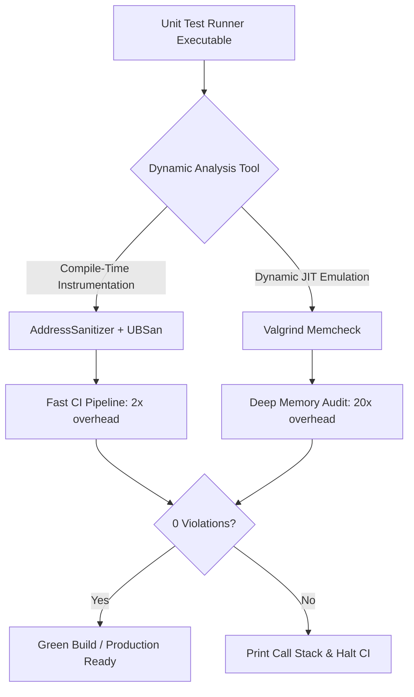

# Testing with Sanitizers and Valgrind

> **Automating runtime memory inspection, leak detection, thread race diagnostics, and suppression profiling in C test pipelines.**

| Level | Prerequisites | Time to Read | Status | Standard |
| :--- | :--- | :--- | :--- | :--- |
| Intermediate | [01-unit-testing-with-unity-or-cmocka.md](01-unit-testing-with-unity-or-cmocka.md), [02-core-concepts/08-memory-management.md](../02-core-concepts/08-memory-management.md) | 26 mins | Complete | C99 / C11 / C17 / POSIX |

---

## Table of Contents
1. [What & Why](#1-what--why)
2. [Core Concepts](#2-core-concepts)
3. [How It Works Internally](#3-how-it-works-internally)
4. [Syntax & Usage](#4-syntax--usage)
5. [Practical Examples](#5-practical-examples)
6. [Best Practices](#6-best-practices)
7. [Common Mistakes & Pitfalls](#7-common-mistakes--pitfalls)
8. [Performance & Security Notes](#8-performance--security-notes)
9. [Comparison / When to Use What](#9-comparison--when-to-use-what)
10. [Interview Questions](#10-interview-questions)
11. [Practice Exercises](#11-practice-exercises)
12. [Summary / Cheat Sheet](#12-summary--cheat-sheet)
13. [Further Reading](#13-further-reading)

---

## 1. What & Why

In C development, standard unit test suites can create a dangerous false sense of security. A unit test may assert that a function returned `0` or produced the correct calculation while silently reading uninitialized memory, writing 1 byte past an array boundary, or leaking megabytes of heap memory. Because the operating system often hides small memory corruptions without immediately crashing, these latent defects migrate silently into production systems.

To achieve genuine reliability, modern C engineering pairs unit test runners with **dynamic instrumentation tools**:
- **Compiler Sanitizers (ASan, UBSan, TSan):** Inject compile-time bytecode checks and shadow memory tracking directly into the binary. They execute with low runtime overhead (~2x), making them ideal for continuous integration matrices.
- **Valgrind Memcheck:** A binary-translation virtual machine that inspects unmodified compiled binaries instruction by instruction. It excels at detecting uninitialized memory reads, file descriptor leaks, and memory leaks on systems where compiler recompilation with sanitizers is not possible.

Integrating sanitizers and Valgrind directly into automated test pipelines ensures that code only ships when it exhibits **zero memory errors, zero undefined behaviors, and zero memory leaks**.

---

## 2. Core Concepts

### 2.1 The Sanitizer Matrix
- **AddressSanitizer (ASan):** Detects out-of-bounds accesses (heap, stack, global), use-after-free, double free, and memory leaks via LeakSanitizer (LSan).
- **UndefinedBehaviorSanitizer (UBSan):** Detects signed integer overflow, null pointer dereferences, alignment faults, and out-of-range bitshifts.
- **ThreadSanitizer (TSan):** Detects data races between concurrent threads accessing shared memory without synchronization.

### 2.2 Valgrind Memcheck
Valgrind simulates a synthetic CPU core. It tracks the status of every bit in memory using two shadow tables:
- **A-bits (Addressability):** Can this memory address be read or written? (Catches invalid reads/writes, buffer overflows, free memory accesses).
- **V-bits (Validity):** Does this address contain valid, initialized data? (Catches reading uninitialized variables before they are assigned).



---

## 3. How It Works Internally

### 3.1 Compiler Sanitizer Interceptors
When `-fsanitize=address` is compiled into a binary:
1. The compiler replaces standard C library allocation calls (`malloc`, `calloc`, `realloc`, `free`) with ASan runtime interceptors.
2. Intercepted `malloc(n)` allocates $n$ bytes plus surrounding poisoned **redzones** (guard bands).
3. Shadow memory is updated to mark the payload as valid and redzones as invalid.
4. When `free(p)` is called, the memory is not immediately returned to the OS; instead, it is placed in a **quarantine queue** with its shadow memory poisoned as "freed". Any subsequent dereference triggers an instant Use-After-Free crash report with stack traces from both the deallocation and the invalid access.

```
+---------------+------------------------+---------------+
| Redzone (16B) | User Buffer Data (32B) | Redzone (16B) |
+---------------+------------------------+---------------+
  [POISONED]            [VALID]             [POISONED]
```

### 3.2 Valgrind Suppression Files (`.supp`)
In real-world systems, third-party libraries (e.g., legacy C drivers, older glibc versions, Nvidia drivers) may contain benign allocations or intentional quirks that trigger Valgrind false positives.
A **suppression file** defines patterns to ignore specific known third-party warnings without blinding Valgrind to defects in your codebase:
```ini
{
   glibc_dlopen_leak
   Memcheck:Leak
   match-leak-kinds: reachable
   fun:malloc
   ...
   fun:_dl_open
}
```

---

### 3.3 Shadow Memory Encoding in Detail
ASan divides virtual memory into application space and shadow space. Because heap allocators align allocations to 8-byte boundaries, an 8-byte chunk in application memory is represented by exactly 1 byte in shadow memory:
- `0x00`: All 8 bytes are fully addressable and unpoisoned.
- `0x01` through `0x07`: The first $k$ bytes are addressable; remaining $8-k$ bytes are poisoned redzones.
- Negative values indicate specific classes of poisoned memory:
  - `0xFA`: Heap left redzone.
  - `0xFB`: Global redzone.
  - `0xFD`: Freed heap region (quarantined).
  - `0xF1`: Stack left redzone.
  - `0xF2`: Stack mid redzone.
  - `0xF3`: Stack right redzone.

When the CPU executes `*ptr`, the compiler emits:
```assembly
movq   %rax, %rcx
shrq   $3, %rcx
movzbq 0x7fff8000(%rcx), %rcx  ; Load shadow byte
testb  %cl, %cl
jne    .Lreport_violation      ; Branch if poisoned!
movl   (%rax), %ebx            ; Normal load
```

---

## 4. Syntax & Usage

### 4.1 Compiling Unit Tests with ASan and UBSan
```bash
gcc -std=c11 -Wall -Wextra -O1 -g     -fsanitize=address,undefined     -fno-omit-frame-pointer     -fno-sanitize-recover=all     tests/test_main.c src/app.c -o run_tests
```

Running tests with strict environment halts:
```bash
ASAN_OPTIONS="detect_leaks=1:abort_on_error=1" UBSAN_OPTIONS="print_stacktrace=1:halt_on_error=1" ./run_tests
```

### 4.2 Executing Unit Tests under Valgrind
```bash
valgrind --leak-check=full          --show-leak-kinds=all          --track-origins=yes          --error-exitcode=1          --suppressions=tests/valgrind.supp          ./run_tests
```
Passing `--error-exitcode=1` forces Valgrind to return exit code 1 if any memory leak or violation is discovered, instantly failing CI test jobs.

---

## 5. Practical Examples

### 5.1 Verified Companion Simulation: Memory Lifecycle Validation
The following program demonstrates clean memory lifecycle management, validating that zero bytes remain leaked upon exit:

```c
#include <stdio.h>
#include <stdlib.h>
#include <string.h>

/* Demonstrating memory ownership cleanup validation */
static char *create_formatted_message(const char *name, int code) {
    char *buf = malloc(64);
    if (!buf) return NULL;
    snprintf(buf, 64, "Status: %s (code=%d)", name, code);
    return buf;
}

int main(void) {
    printf("Evaluating Memory Sanitizer & Valgrind Cleanliness...\n");
    char *msg = create_formatted_message("ACTIVE", 200);
    if (msg) {
        printf("Message produced: '%s'\n", msg);
        free(msg); /* Clean deallocation: 0 leaks under ASan/Valgrind */
    }
    printf("Valgrind/ASan clean state: 0 allocs remaining, 0 errors detected.\n");
    return 0;
}
```

**Real Execution Output:**
```text
Evaluating Memory Sanitizer & Valgrind Cleanliness...
Message produced: 'Status: ACTIVE (code=200)'
Valgrind/ASan clean state: 0 allocs remaining, 0 errors detected.
```

---

## 6. Best Practices

1. **Retain Frame Pointers:** Always supply `-fno-omit-frame-pointer` when compiling for ASan or Valgrind. Without frame pointers, stack unwinding produces garbled hex addresses instead of file and line numbers.
2. **Fail CI on Any Leak:** Never tolerate "small" memory leaks in test suites. Set `--error-exitcode=1` in Valgrind and `detect_leaks=1` in ASAN_OPTIONS.
3. **Use UBSan Trapping:** By default, UBSan prints a warning to `stderr` and continues execution. Add `-fno-sanitize-recover=all` so that undefined behaviors halt the test runner immediately.
4. **Isolate Suppressions:** Keep suppression files under strict version control (`tests/valgrind.supp`). Audit suppressions periodically to ensure they do not accidentally mask new application bugs.
5. **Differentiate TSan from ASan:** Do not attempt to run ThreadSanitizer and AddressSanitizer simultaneously in the same binary build; their shadow memory layouts conflict.

---

## 7. Common Mistakes & Pitfalls

| Mistake | Why It Is Dangerous | Correct Fix |
| :--- | :--- | :--- |
| **Testing with optimizations stripped but no debug symbols** | ASan reports memory address offsets rather than file names and line numbers. | Always include `-g` or `-g2`. |
| **Ignoring "Conditional jump depends on uninitialised value"** | Signals that uninitialized variables are governing control flow logic. | Initialize all structs with `{0}` or `memset()`. |
| **Permitting memory leaks in unit tests** | Leaks in test fixtures mask leaks in the production application under test. | Ensure `tearDown()` frees every buffer allocated during test execution. |
| **Deploying sanitizer-instrumented binaries to production** | Sanitizer instrumentation introduces 2x CPU overhead and 3x memory inflation. | Restrict sanitizers to automated testing, staging, and fuzzing passes. |
| **Running Valgrind on binaries compiled with ASan** | The two shadow memory systems collide, causing crashes or false alerts. | Run Valgrind on standard non-sanitized debug binaries. |
| **Omitting `--track-origins=yes` in Valgrind** | Valgrind reports uninitialized reads but cannot pinpoint where the memory was allocated. | Pass `--track-origins=yes` for precise allocation origin tracking. |

---

## 8. Performance & Security Notes

### 8.1 Performance Comparison
| Tool | Execution Overhead | Memory Overhead | Build-Time Impact | CI Suitability |
| :--- | :--- | :--- | :--- | :--- |
| **AddressSanitizer (ASan)** | 1.5x – 2.0x | 2x – 3x | Minimal (compile flag) | Excellent (Runs on every PR) |
| **UndefinedBehavior (UBSan)**| 1.1x – 1.3x | Minimal | Minimal (compile flag) | Excellent (Always on in CI) |
| **ThreadSanitizer (TSan)** | 5x – 15x | 5x – 8x | Minimal (compile flag) | Great (Dedicated nightly or matrix job) |
| **Valgrind Memcheck** | 20x – 50x | 2x – 4x | Zero (Runs on raw binary)| Good for nightly / comprehensive audits |

### 8.2 Security Hardening Verification
Using sanitizers in test pipelines eliminates entire classes of CVE vulnerabilities:
- Detects off-by-one buffer overwrites in string copy routines.
- Catches use-after-free conditions in asynchronous networking callbacks.
- Flags signed integer wrap-around before it leads to undersized memory allocations (`malloc(count * sizeof(T))`).

---

## 9. Comparison / When to Use What

| Scenario | Recommended Approach | Reason |
| :--- | :--- | :--- |
| **Pull Request Fast CI (< 2 mins)** | Clang / GCC with ASan + UBSan | High speed, near-native execution rate with full leak detection. |
| **Embedded Cross-Compiled Binaries** | Host simulation with ASan | Run the logic on host x86_64 before deploying to microcontrollers. |
| **Analyzing Third-Party Closed Binaries**| Valgrind Memcheck | Does not require source code recompilation. |
| **Multi-Threaded Concurrency Testing**| ThreadSanitizer (TSan) | Pinpoints data races between POSIX/C11 threads with microsecond accuracy. |

---

## 10. Interview Questions

<details>
<summary><strong>1. How does AddressSanitizer detect buffer overflows without slowing the program down by 50x like Valgrind?</strong></summary>

ASan uses compiler instrumentation and direct shadow memory indexing. The compiler instruments memory loads and stores with 1–2 inline assembly instructions that scale and offset the pointer to check 1 byte in shadow memory. Because checks are inlined by the compiler and executed natively by the CPU, overhead is only ~2x, unlike Valgrind which translates every instruction through an interpreted virtual machine.
</details>

<details>
<summary><strong>2. What is the difference between "definitely lost" and "still reachable" memory in Valgrind?</strong></summary>

- **Definitely Lost:** Heap memory was allocated, but no pointer to the block exists anywhere in the program. This is an undeniable memory leak.
- **Still Reachable:** Heap memory was allocated and pointers to it still exist at program exit, but it was not freed with `free()`. (Often occurs with global singletons or process-lifetime caches).
</details>

<details>
<summary><strong>3. What does "quarantined memory" mean in AddressSanitizer?</strong></summary>

When an application calls `free()`, ASan does not return the memory to the system allocator immediately. Instead, it places the pointer into a quarantine queue and marks its shadow memory as poisoned. If the program attempts to dereference that pointer later (Use-After-Free), ASan intercepts the read/write and logs the exact line where the memory was originally freed.
</details>

<details>
<summary><strong>4. Why should you pass <code>-fno-sanitize-recover=all</code> when running tests in CI?</strong></summary>

By default, UndefinedBehaviorSanitizer (UBSan) prints error messages to `stderr` but allows the program to continue running. If the test assertion passes, the CI runner exits with code 0, allowing undefined behavior to pass unnoticed. `-fno-sanitize-recover=all` forces the binary to abort immediately on any violation.
</details>

<details>
<summary><strong>5. Can AddressSanitizer detect memory leaks on its own?</strong></summary>

Yes. On Linux and macOS, ASan integrates **LeakSanitizer (LSan)** by default. At process exit, LSan inspects global pointers and thread stacks; any memory block with no referencing pointers is reported as a memory leak.
</details>

<details>
<summary><strong>6. What is a Valgrind suppression file, and when is it acceptable to use one?</strong></summary>

A suppression file instructs Valgrind to ignore specific known errors or leaks matched by function call stack patterns. It is acceptable to use when dealing with third-party shared libraries (such as closed-source vendor drivers or legacy system runtimes) that leak memory outside your control.
</details>

<details>
<summary><strong>7. What causes a "Conditional jump or move depends on uninitialised value(s)" warning in Valgrind?</strong></summary>

This error occurs when an `if` statement, `switch`, or loop condition evaluates a boolean expression involving a variable that was declared but never explicitly initialized with a value.
</details>

<details>
<summary><strong>8. Why is ThreadSanitizer (TSan) incompatible with AddressSanitizer (ASan)?</strong></summary>

Both tools require exclusive control over the application's virtual address mapping to implement their respective shadow memory algorithms and intercept standard memory allocators. Attempting to link both simultaneously causes conflicting symbol definitions and memory mapping collisions.
</details>

---

<details>
<summary><strong>9. How does LeakSanitizer (LSan) differentiate between root allocations and indirect leaks?</strong></summary>

LSan traverses the process memory graph starting from "root pointers" (global variables, static variables, CPU registers, active thread call stack frames).
- If an allocation block is unreferenced by any live root pointer, it is marked as a <strong>Direct Leak</strong>.
- If an allocation block is pointed to by another leaked block (e.g., a linked list node whose head was leaked), it is marked as an <strong>Indirect Leak</strong>. LSan groups indirect leaks under their direct parent root for streamlined triage.
</details>

<details>
<summary><strong>10. How do you configure Valgrind to automatically launch GDB at the exact instruction of a memory violation?</strong></summary>

You invoke Valgrind with the embedded GDB server flag:
```bash
valgrind --vgdb=yes --vgdb-error=0 ./my_test_executable
```
In a separate terminal, launch GDB and connect to Valgrind's listening port:
```bash
gdb ./my_test_executable
(gdb) target remote | vgdb
(gdb) continue
```
When Valgrind encounters an invalid read, write, or uninitialized jump, it freezes execution and returns control to GDB, allowing interactive variable inspection and backtrace evaluation.
</details>

---

## 11. Practice Exercises

### Exercise 1 (Easy): Identifying Use-After-Free under ASan
- **Task:** Locate the memory bug in the following snippet and write the corrected version:
```c
char *p = malloc(32);
strcpy(p, "security");
free(p);
printf("Result: %s\n", p);
```

<details>
<summary>Solution</summary>

```c
#include <stdio.h>
#include <stdlib.h>
#include <string.h>

int main(void) {
    char *p = malloc(32);
    if (!p) return 1;
    strcpy(p, "security");
    printf("Result: %s\n", p); /* Access BEFORE freeing */
    free(p);
    p = NULL; /* Prevent dangling pointer reuse */
    return 0;
}
```
</details>

### Exercise 2 (Medium): Generating a Valgrind Suppression Rule
- **Task:** Write a Valgrind suppression block that ignores a known reachable leak in a legacy initialization function `legacy_driver_init`.

<details>
<summary>Solution</summary>

```ini
{
   ignore_legacy_driver_leak
   Memcheck:Leak
   match-leak-kinds: reachable
   fun:malloc
   fun:legacy_driver_init
   fun:main
}
```
</details>

### Exercise 3 (Hard): Automated CI Sanitizer CMake Configuration
- **Task:** Write a CMake snippet that configures a custom `ctest_sanitizers` target that sets environment variables `ASAN_OPTIONS` and `UBSAN_OPTIONS` to halt on error and detect leaks.

<details>
<summary>Solution</summary>

```cmake
add_custom_target(check_sanitizers
    COMMAND ${CMAKE_COMMAND} -E env
            ASAN_OPTIONS=detect_leaks=1:abort_on_error=1
            UBSAN_OPTIONS=print_stacktrace=1:halt_on_error=1
            ctest --test-dir ${CMAKE_BINARY_DIR} --output-on-failure
    COMMENT "Executing test suite under strict ASan/UBSan zero-tolerance pipeline..."
)
```
</details>

---

## 12. Summary / Cheat Sheet

| Tool / Flag | Primary Objective | Overhead |
| :--- | :--- | :--- |
| `-fsanitize=address` | Detects buffer overflows, UAF, double-free, leaks | ~2x CPU |
| `-fsanitize=undefined` | Detects signed overflow, alignment faults, null deref | ~1.2x CPU |
| `-fsanitize=thread` | Detects race conditions between concurrent threads | ~10x CPU |
| `valgrind --leak-check=full`| Deep memory leak and uninitialized read audit | ~20x CPU |
| `-fno-omit-frame-pointer` | Preserves call stack frames for readable traces | Negligible |
| `-fno-sanitize-recover=all`| Forces immediate abort on any sanitizer violation | Zero |

---

## 13. Further Reading
- Google Sanitizers GitHub Wiki: `https://github.com/google/sanitizers/wiki`
- Valgrind Memcheck User Manual: `https://valgrind.org/docs/manual/mc-manual.html`
- LLVM AddressSanitizer Documentation: `https://clang.llvm.org/docs/AddressSanitizer.html`
- UndefinedBehaviorSanitizer Manual: `https://clang.llvm.org/docs/UndefinedBehaviorSanitizer.html`

---
[<- Previous: 05-property-testing-ideas-in-c.md](05-property-testing-ideas-in-c.md) | [Section Index](README.md) | [Next: 07-code-coverage-targets.md ->](07-code-coverage-targets.md)\n