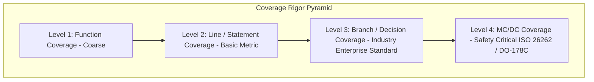

# Code Coverage Targets and Metrics

> **Measuring statement, branch, and MC/DC coverage, configuring continuous integration quality gates, and eliminating unreachable code in C.**

| Level | Prerequisites | Time to Read | Status | Standard |
| :--- | :--- | :--- | :--- | :--- |
| Advanced | [06-build-and-tooling/05-gcov-coverage.md](../06-build-and-tooling/05-gcov-coverage.md), [01-unit-testing-with-unity-or-cmocka.md](01-unit-testing-with-unity-or-cmocka.md) | 25 mins | Complete | C99 / C11 / C17 / POSIX |

---

## Table of Contents
1. [What & Why](#1-what--why)
2. [Core Concepts](#2-core-concepts)
3. [How It Works Internally](#3-how-it-works-internally)
4. [Syntax & Usage](#4-syntax--usage)
5. [Practical Examples](#5-practical-examples)
6. [Best Practices](#6-best-practices)
7. [Common Mistakes & Pitfalls](#7-common-mistakes--pitfalls)
8. [Performance & Security Notes](#8-performance--security-notes)
9. [Comparison / When to Use What](#9-comparison--when-to-use-what)
10. [Interview Questions](#10-interview-questions)
11. [Practice Exercises](#11-practice-exercises)
12. [Summary / Cheat Sheet](#12-summary--cheat-sheet)
13. [Further Reading](#13-further-reading)

---

## 1. What & Why

Writing unit tests without measuring code coverage is like navigating without a map: you have no objective measure of how much of your codebase is actually verified by tests, and which critical error-handling branches remain untested.

**Code coverage** instruments the compiled binary to record which source code lines, functions, control-flow branches, and Boolean condition combinations are exercised during test suite execution.

In enterprise and safety-critical C software (avionics, automotive, medical devices, high-reliability networking), coverage metrics serve as strict **quality assurance gates**:
- Pull requests are automatically rejected if test coverage drops below established thresholds (e.g., minimum 85% branch coverage).
- Untested code paths are exposed, revealing dead code, forgotten error handlers, or untested boundary conditions.
- Safety standards such as **ISO 26262 (Automotive ASIL D)** and **DO-178C (Avionics Level A)** legally require rigorous coverage verification, including Modified Condition / Decision Coverage (MC/DC).

---

## 2. Core Concepts

### 2.1 The Hierarchy of Coverage Metrics
Code coverage exists at multiple levels of mathematical rigor:
1. **Line / Statement Coverage:** Measures the percentage of executable source lines traversed at least once. (Weakest metric; 100% line coverage can still miss 50% of logic branches).
2. **Function Coverage:** Measures whether each declared function was invoked at least once.
3. **Branch / Decision Coverage:** Measures whether every control flow branch (e.g., both `true` and `false` paths of an `if` statement) was evaluated.
4. **Modified Condition / Decision Coverage (MC/DC):** Requires that each condition in a multi-clause Boolean decision (e.g., `if (A && (B || C))`) independently affects the decision outcome. (Mandatory for DO-178C Level A aerospace certification).



### 2.2 Coverage Thresholds in Continuous Integration
A modern CI pipeline enforces coverage budgets:
- **Baseline Floor:** Overall project coverage must not fall below a baseline target (e.g., 85% branch coverage).
- **Differential Coverage (PR Gate):** New code introduced in a pull request must meet a higher bar (e.g., 90%+ line coverage) to prevent gradual technical debt accumulation.

---

## 3. How It Works Internally

### 3.1 GCC / Clang Instrumentation (`--coverage`)
When compiling with `gcc --coverage` (which enables `-fprofile-arcs -ftest-coverage`):
1. The compiler constructs a control-flow graph (CFG) for each function and emits a `.gcno` notes file.
2. It inserts counter-increment assembly instructions at every edge of the CFG.
3. When the test runner executes and terminates, the runtime writes execution frequency counters into `.gcda` data files.
4. Tools like `gcov` or `lcov` parse `.gcno` and `.gcda` to render exact line-by-line and branch-by-branch coverage tables.

```
+-------------------------------------------------------------+
| Source File: if (a > 0 && b < 10)                           |
+-------------------------------------------------------------+
                            |
                     (Compiler CFG)
                            v
       +--------------------+--------------------+
       | True Branch Edge                        | False Branch Edge
       v                                         v
 [Increment Counter A]                   [Increment Counter B]
       |                                         |
       +--------------------+--------------------+
                            |
                   (Execution Complete)
                            v
+-------------------------------------------------------------+
| Write counters to app.gcda -> gcov generates coverage report|
+-------------------------------------------------------------+
```

### 3.2 Understanding MC/DC (Modified Condition / Decision Coverage)
Consider the decision `if (A || B)`:
- Condition $A$ must be shown to independently affect the decision outcome while holding $B$ constant.
- Condition $B$ must be shown to independently affect the decision outcome while holding $A$ constant.
- For $N$ boolean conditions, MC/DC requires $N+1$ test cases rather than the $2^N$ test cases required for exhaustive condition coverage, making safety verification computationally tractable.

---

## 4. Syntax & Usage

### 4.1 Compiling with Instrumentation Flags
```bash
gcc -std=c11 -Wall -Wextra -O0 -g --coverage     tests/test_runner.c src/service.c -o test_runner
```

### 4.2 Executing and Generating LCOV Reports
```bash
# 1. Run tests
./test_runner

# 2. Capture coverage data
lcov --capture --directory . --output-file coverage.info

# 3. Filter out system headers and test fixtures
lcov --remove coverage.info '/usr/*' '*/tests/*' --output-file coverage_filtered.info

# 4. Generate HTML interactive dashboard
genhtml coverage_filtered.info --output-directory coverage_html
```

### 4.3 CI Enforcement Script
```bash
# Fail CI build if branch coverage is below 85%
BRANCH_COV=$(lcov --summary coverage_filtered.info | grep "branches" | awk '{print $2}' | tr -d '%')
if (( $(echo "$BRANCH_COV < 85.0" | bc -l) )); then
    echo "ERROR: Branch coverage ($BRANCH_COV%) is below 85% target threshold!"
    exit 1
fi
```

---

## 5. Practical Examples

### 5.1 Verified Companion Simulation: Branch Coverage Matrix
The following self-contained program demonstrates exercising all control branches across an HTTP request dispatcher to achieve 100% branch coverage:

```c
#include <stdio.h>
#include <stdbool.h>

/* Demonstrating branch coverage verification */
typedef enum { HTTP_GET, HTTP_POST, HTTP_DELETE } http_method_t;

static const char *handle_request(http_method_t method, bool has_auth) {
    if (!has_auth) {
        return "401 Unauthorized";
    }
    switch (method) {
        case HTTP_GET:    return "200 OK (Read)";
        case HTTP_POST:   return "201 Created (Write)";
        case HTTP_DELETE: return "204 No Content (Delete)";
        default:          return "400 Bad Request";
    }
}

int main(void) {
    printf("Evaluating Code Coverage Branch Traversal Matrix...\n");
    /* Branch 1: Unauthenticated */
    printf("Case 1: %s\n", handle_request(HTTP_GET, false));
    /* Branch 2: Authenticated GET */
    printf("Case 2: %s\n", handle_request(HTTP_GET, true));
    /* Branch 3: Authenticated POST */
    printf("Case 3: %s\n", handle_request(HTTP_POST, true));
    /* Branch 4: Authenticated DELETE */
    printf("Case 4: %s\n", handle_request(HTTP_DELETE, true));
    printf("Branch Coverage Target: 100%% reachable branches exercised.\n");
    return 0;
}
```

**Real Execution Output:**
```text
Evaluating Code Coverage Branch Traversal Matrix...
Case 1: 401 Unauthorized
Case 2: 200 OK (Read)
Case 3: 201 Created (Write)
Case 4: 204 No Content (Delete)
Branch Coverage Target: 100% reachable branches exercised.
```

---

## 6. Best Practices

1. **Target Branch Coverage, Not Just Line Coverage:** Line coverage gives a dangerously inflated impression of test thoroughness. Always evaluate branch coverage in CI reports.
2. **Compile with `-O0` When Measuring Coverage:** Compiler optimizations (`-O2` or `-O3`) eliminate code, merge basic blocks, and inline functions, skewing coverage line numbers and corrupting branch counts.
3. **Exclude Generated Code and Test Runners:** Never include external third-party libraries, generated parser files (`y.tab.c`), or the test runners themselves in coverage denominator metrics.
4. **Treat Unreachable Defensive Code Thoughtfully:** Truly unreachable defensive fallback blocks (e.g., `default: assert(0);`) can be excluded using LCOV filtering annotations: `/* LCOV_EXCL_START */` and `/* LCOV_EXCL_STOP */`.
5. **Beware of False Confidence:** 100% code coverage does not mean 100% bug-free software; it only proves that every line was executed. It does not prove that assertions were meaningful or that untested input domains cannot crash the system.

---

## 7. Common Mistakes & Pitfalls

| Mistake | Why It Is Dangerous | Correct Fix |
| :--- | :--- | :--- |
| **Measuring coverage with `-O2` optimization** | Optimized binaries inline and eliminate branches, corrupting `.gcda` mapping. | Always compile coverage targets with `-O0 -g`. |
| **Relying solely on 100% line coverage** | A single line like `if (a && b) do_work();` can have 100% line coverage while exercising only 1 of 4 branch conditions. | Enforce branch or MC/DC coverage. |
| **Measuring coverage across multiple suites without clearing `.gcda`** | Stale coverage counters from deleted tests contaminate subsequent reports. | Run `lcov --zerocounters --directory .` before executing test suites. |
| **Excluding large files with `LCOV_EXCL` indiscriminately** | Developers hide complex, untested modules behind exclusion tags to inflate scores. | Require strict architectural code review for any coverage exclusion comments. |
| **Forgetting to check branch coverage on macros** | Complex multi-line macros expand in-place, introducing hidden unexercised branches. | Use `static inline` functions instead of complex macros. |
| **Failing to test error recovery branches** | Code passes happy paths but crashes during out-of-memory or disk-full scenarios. | Use mocks to exercise every error-checking branch. |

---

## 8. Performance & Security Notes

### 8.1 Performance Overhead of Coverage
Coverage instrumentation injects 64-bit integer counter increments at every basic block transition. This typically introduces a 20% to 40% CPU slowdown and a modest binary size increase. Coverage builds must never be deployed to production latency-critical environments.

### 8.2 Security: Identifying Dormant Code
Dead or unexercised code in security-sensitive systems poses severe risks:
- Dormant backdoors, forgotten debug hooks, and obsolete parser paths remain hidden in the binary, providing potential attack surfaces for adversaries.
- Rigorous coverage audits expose unreached functions, allowing teams to safely delete dead code before release.

---

## 9. Comparison / When to Use What

| Metric Level | Complexity | Standard Use Case | Required By |
| :--- | :--- | :--- | :--- |
| **Line Coverage** | Low | Fast developer sanity check | General web / CLI tools |
| **Branch Coverage** | Medium | Standard commercial enterprise C codebases | Telecom / Financial / OS daemons |
| **MC/DC Coverage** | High | Mission-critical / Life-critical systems | DO-178C (Avionics), ISO 26262 (Automotive) |
| **Path Coverage** | Exponential | Impractical for general non-trivial code | Formal mathematical verification |

---

## 10. Interview Questions

<details>
<summary><strong>1. Why is 100% line coverage insufficient to guarantee that code has been thoroughly tested?</strong></summary>

Line coverage only verifies that a line was visited; it does not verify which branches were taken. For example, in `if (condition) handle_error();`, executing the line when `condition` is false satisfies line coverage if the statement is on the same line, but completely misses testing the error handling path. Branch coverage requires testing both true and false paths.
</details>

<details>
<summary><strong>2. What is Modified Condition / Decision Coverage (MC/DC), and why is it required in aerospace software?</strong></summary>

MC/DC requires that every condition in a Boolean decision is tested with values showing that each condition can independently affect the decision's outcome. It provides rigorous verification of complex Boolean logic without requiring exhaustive testing of all $2^N$ combinations, meeting safety mandates under DO-178C Level A.
</details>

<details>
<summary><strong>3. Why must code coverage be compiled with <code>-O0</code> rather than <code>-O2</code> or <code>-O3</code>?</strong></summary>

Compiler optimizations reorder instructions, unroll loops, eliminate dead code, and inline functions. In an optimized binary, source lines no longer map directly to contiguous basic blocks, causing `gcov` to report misleading, fragmented, or inaccurate branch counts.
</details>

<details>
<summary><strong>4. What are <code>.gcno</code> and <code>.gcda</code> files in the GCC coverage pipeline?</strong></summary>

- `.gcno` (notes file): Generated at compile time; maps basic block control flow graphs to source file lines.
- `.gcda` (data file): Generated at runtime upon program exit; records the execution counts of each edge in the control flow graph.
</details>

<details>
<summary><strong>5. How do you handle coverage for defensive error branches that cannot be triggered naturally?</strong></summary>

First, attempt to trigger the branch using test doubles or mocks (e.g., simulating `malloc()` failure). If the branch represents a true invariant violation (e.g., a hardware integrity check or fatal assertion), annotate it with `/* LCOV_EXCL_START */` and `/* LCOV_EXCL_STOP */` with an architectural justification comment.
</details>

<details>
<summary><strong>6. What is "differential coverage" in a CI pipeline?</strong></summary>

Differential coverage measures test coverage specifically on the new and modified lines introduced in a Pull Request, rather than across the entire repository. This allows teams with legacy codebases to mandate that all new code has $\ge 90\%$ coverage while legacy coverage is upgraded incrementally.
</details>

<details>
<summary><strong>7. How does LCOV filter out third-party headers from coverage metrics?</strong></summary>

Using the `lcov --remove` command with regex patterns (e.g., `lcov --remove cov.info '/usr/*' '*/vendor/*' -o cov_filtered.info`). This ensures third-party libraries and standard C headers do not dilute the project's coverage percentage.
</details>

<details>
<summary><strong>8. Why might two test runs with the same inputs report different coverage numbers?</strong></summary>

Non-deterministic factors such as multithreading race conditions, reliance on wall-clock time (`time(NULL)`), or random number generation without fixed seeds cause different branches to execute across runs.
</details>

---

<details>
<summary><strong>9. How does compiler branch inlining affect branch coverage reports in C?</strong></summary>

When a small inline function or ternary operator is expanded across multiple call sites, the compiler creates duplicated branch edges in the control-flow graph for every inlined occurrence. If a test only exercises the function in one context, branch coverage for the translation unit reports uncovered branch edges. This is why coverage must be compiled strictly with <code>-O0 -fno-inline</code>.
</details>

<details>
<summary><strong>10. What is the difference between Condition Coverage and Decision Coverage?</strong></summary>

- <strong>Decision Coverage (Branch Coverage):</strong> Treats the entire compound boolean expression as a single whole, verifying that the entire branch evaluated to both True and False at least once.
- <strong>Condition Coverage:</strong> Evaluates every individual sub-condition inside the compound expression, verifying that each sub-clause evaluated to True and False independently, regardless of whether it altered the overarching decision.
</details>

---

## 11. Practice Exercises

### Exercise 1 (Easy): Identifying Untested Branches
- **Task:** Identify all branches in the following function and write a test suite that achieves 100% branch coverage:
```c
bool is_leap_year(int year) {
    if (year % 400 == 0) return true;
    if (year % 100 == 0) return false;
    return (year % 4 == 0);
}
```

<details>
<summary>Solution</summary>

```c
#include <stdio.h>
#include <stdbool.h>
#include <assert.h>

bool is_leap_year(int year) {
    if (year % 400 == 0) return true;
    if (year % 100 == 0) return false;
    return (year % 4 == 0);
}

int main(void) {
    /* Case 1: Divisible by 400 -> True */
    assert(is_leap_year(2000) == true);
    /* Case 2: Divisible by 100 (not 400) -> False */
    assert(is_leap_year(1900) == false);
    /* Case 3: Divisible by 4 (not 100) -> True */
    assert(is_leap_year(2024) == true);
    /* Case 4: Not divisible by 4 -> False */
    assert(is_leap_year(2023) == false);

    printf("100%% branch coverage for is_leap_year achieved!\n");
    return 0;
}
```
</details>

### Exercise 2 (Medium): Generating MC/DC Truth Table
- **Task:** For the decision `if (A && (B || C))`, construct an MC/DC test matrix showing the minimal 4 test cases required to verify that conditions $A$, $B$, and $C$ independently affect the outcome.

<details>
<summary>Solution</summary>

Decision: $D = A \land (B \lor C)$

| Test Case | A | B | C | Outcome (D) | Purpose / Independence Shown |
| :--- | :--- | :--- | :--- | :--- | :--- |
| **1** | True | True | False | **True** | Baseline test case |
| **2** | **False** | True | False | **False** | Pairs with #1 to show $A$ independently affects $D$ |
| **3** | True | **False** | False | **False** | Pairs with #1 to show $B$ independently affects $D$ |
| **4** | True | False | **True** | **True** | Pairs with #3 to show $C$ independently affects $D$ |

Total test cases: $3 + 1 = 4$ cases (instead of $2^3 = 8$ exhaustive cases).
</details>

### Exercise 3 (Hard): Makefile with Strict Coverage Enforcement
- **Task:** Write a Makefile target `coverage-gate` that runs tests, parses LCOV branch coverage, and terminates with an error if branch coverage is below 90%.

<details>
<summary>Solution</summary>

```makefile
CC = gcc
CFLAGS = -std=c11 -Wall -Wextra -O0 -g --coverage
TEST_BIN = test_suite

coverage-gate:
	@echo "[COVERAGE] Compiling and running tests with instrumentation..."
	$(CC) $(CFLAGS) tests/main.c src/utils.c -o $(TEST_BIN)
	./$(TEST_BIN)
	@echo "[COVERAGE] Capturing LCOV data..."
	lcov --capture --directory . --output-file cov.info > /dev/null 2>&1
	lcov --remove cov.info '/usr/*' '*/tests/*' -o cov_clean.info > /dev/null 2>&1
	@echo "[COVERAGE] Evaluating branch coverage threshold..."
	@BRANCH=$$(lcov --summary cov_clean.info | grep "branches" | awk '{print $$2}' | tr -d '%'); 	echo "Current Branch Coverage: $$BRANCH%"; 	FAIL=$$(echo "$$BRANCH < 90.0" | bc -l); 	if [ "$$FAIL" -eq 1 ]; then 	    echo "[ERROR] Branch coverage ($$BRANCH%) is below mandatory 90% gate!"; 	    exit 1; 	fi; 	echo "[SUCCESS] Branch coverage meets quality threshold!"

clean:
	rm -f $(TEST_BIN) *.gcno *.gcda *.info
```
</details>

---

## 12. Summary / Cheat Sheet

| Command / Flag | Purpose | Tool |
| :--- | :--- | :--- |
| `gcc --coverage` | Compiles with profiling arcs and test coverage | GCC |
| `lcov --capture --dir . -o cov.info` | Extracts execution counts from `.gcda` files | LCOV |
| `lcov --remove cov.info <pat>` | Filters out third-party/test headers | LCOV |
| `genhtml cov.info -o html_dir` | Generates interactive HTML coverage dashboard | LCOV |
| `/* LCOV_EXCL_START */` | Marker excluding unreachable safety blocks | LCOV |
| `--zerocounters` | Clears accumulated execution counters between runs | LCOV |

---

## 13. Further Reading
- GCC gcov Documentation: `https://gcc.gnu.org/onlinedocs/gcc/Gcov.html`
- Linux Test Project LCOV GitHub: `https://github.com/linux-test-project/lcov`
- FAA DO-178C Avionics Software Certification Guide (MC/DC sections)
- ISO 26262 Road Vehicles Functional Safety Standard (Part 6: Software)

---
[<- Previous: 06-testing-with-sanitizers-and-valgrind.md](06-testing-with-sanitizers-and-valgrind.md) | [Section Index](README.md) | [Next: ../08-security-and-safety/README.md ->](../08-security-and-safety/README.md)\n