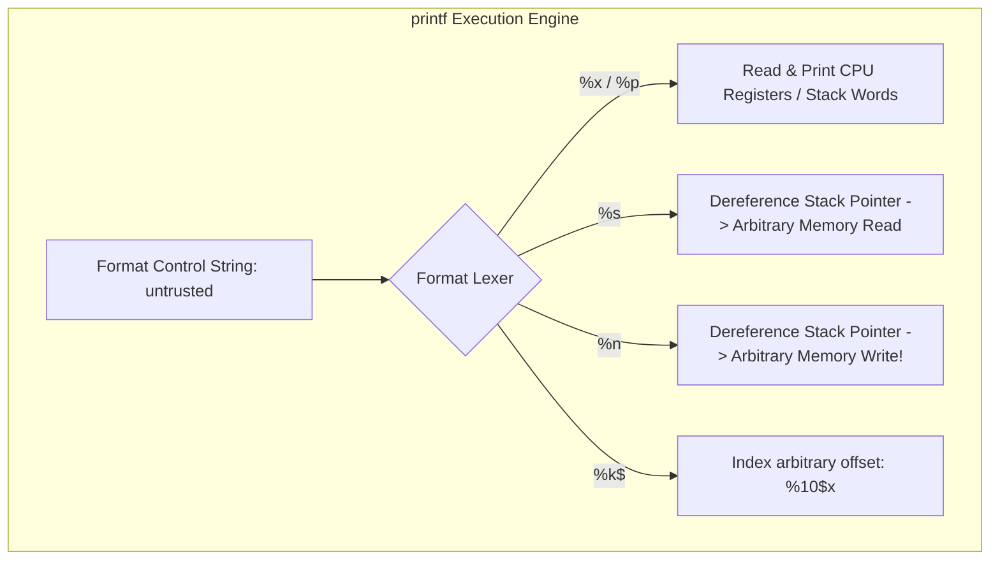

# Format String Vulnerabilities

> **Deconstructing format string exploitation mechanics, `%n` arbitrary memory writes, information disclosure via parameter indexing, and static analysis defenses.**

| Level | Prerequisites | Time to Read | Status | Standard |
| :--- | :--- | :--- | :--- | :--- |
| Advanced | [01-fundamentals/09-input-output.md](../01-fundamentals/09-input-output.md), [03-intermediate/06-variadic-functions.md](../03-intermediate/06-variadic-functions.md) | 26 mins | Complete | C99 / C11 / C17 / POSIX |

---

## Table of Contents
1. [What & Why](#1-what--why)
2. [Core Concepts](#2-core-concepts)
3. [How It Works Internally](#3-how-it-works-internally)
4. [Syntax & Usage](#4-syntax--usage)
5. [Practical Examples](#5-practical-examples)
6. [Best Practices](#6-best-practices)
7. [Common Mistakes & Pitfalls](#7-common-mistakes--pitfalls)
8. [Performance & Security Notes](#8-performance--security-notes)
9. [Comparison / When to Use What](#9-comparison--when-to-use-what)
10. [Interview Questions](#10-interview-questions)
11. [Practice Exercises](#11-practice-exercises)
12. [Summary / Cheat Sheet](#12-summary--cheat-sheet)
13. [Further Reading](#13-further-reading)

---

## 1. What & Why

The standard C library input/output subsystem relies on **variadic functions** (`printf`, `sprintf`, `fprintf`, `syslog`) that parse a formatting control string to determine the number and types of subsequent arguments to pop from the CPU registers or stack.

A **format string vulnerability** occurs when an untrusted user-supplied string is passed directly as the *format string argument* itself, rather than as a data parameter:
```c
/* VULNERABLE: Untrusted user input governs the format engine */
printf(user_input); 

/* SECURE: Format string is a fixed literal constant */
printf("%s", user_input);
```
If `user_input` contains format specifiers like `%x`, `%p`, `%s`, or `%n`, the `printf` engine blindly interprets the attacker's string as instructions to read from or write to arbitrary memory addresses across the process space.

Format string vulnerabilities allow attackers to:
- **Leak Sensitive Data (Information Disclosure):** Dump stack memory, cryptographic session keys, canary secrets, and function pointers to bypass ASLR.
- **Write to Arbitrary Memory (Remote Code Execution):** Overwrite Global Offset Table (GOT) entries, function pointers, or return addresses using the `%n` specifier.

---

## 2. Core Concepts

### 2.1 The Format Specifier Family
- `%d`, `%i`, `%u`: Pops 32-bit integer arguments.
- `%x`, `%X`: Pops and prints values in hexadecimal notation (primary tool for stack dumping).
- `%p`: Prints pointer addresses.
- `%s`: Interprets the argument as a memory pointer and prints null-terminated string contents (reading from arbitrary addresses).
- `%n`: **Writes** the number of bytes successfully output so far into an integer pointer supplied as an argument.
- Positional Parameter Syntax (`%k$x`): Directly accesses the $k$-th parameter without consuming preceding parameters.



---

## 3. How It Works Internally

### 3.1 Variadic Calling Conventions and Stack Walking
On x86_64 System V AMD64 ABI:
1. The first 6 integer or pointer arguments to a function are passed in registers: `%rdi`, `%rsi`, `%rdx`, `%rcx`, `%r8`, `%r9`.
2. Subsequent arguments are pushed onto the stack.
3. In `printf(fmt, arg1, arg2, ...)`:
   - `%rdi` holds the pointer to `fmt`.
   - If `fmt` contains more `%x` tokens than there are arguments provided in code, `printf` continues reading down the register list and then marches straight down the call stack frame!

```
Caller Frame / Registers:
%rdi = pointer to user_input: "%x.%x.%x.%x.%x.%x.%x"
%rsi = undefined (residual register value)
%rdx = undefined (residual register value)
%rcx = undefined (residual register value)
...
[ Stack Frame: Saved %rbp, Return Address, Local Secrets, Stack Canary ]
```
When `printf` evaluates the seventh `%x`, it begins reading 8-byte words directly off the caller's stack frame, leaking the stack canary and return addresses to the attacker.

### 3.2 Arbitrary Memory Write via `%n`
The `%n` specifier is unique in the C standard: instead of formatting output, it performs a memory write.
```c
int count;
printf("Hello%n", &count); /* Writes 5 into count */
```
If an attacker controls the format string and supplies `%n`:
1. The attacker crafts the input string to contain a target memory address (e.g., a function pointer in the GOT).
2. By padding the output width (e.g., `%1000u%n`), the attacker sets the byte counter to any desired value.
3. When `printf` evaluates `%n`, it treats the target address on the stack as `int *` and overwrites that memory address with the character count!

---

## 4. Syntax & Usage

### 4.1 Vulnerable vs Hardened Patterns

```c
/* =========================================================================
 * VULNERABLE PATTERNS
 * ========================================================================= */
void log_bad(const char *msg) {
    printf(msg);                  /* DANGEROUS */
    syslog(LOG_INFO, msg);        /* DANGEROUS */
    sprintf(dest, msg);           /* DANGEROUS */
}

/* =========================================================================
 * HARDENED DEFENSIVE PATTERNS
 * ========================================================================= */
void log_good(const char *msg) {
    printf("%s", msg);            /* SECURE: Static string literal */
    syslog(LOG_INFO, "%s", msg);  /* SECURE */
    snprintf(dest, sizeof(dest), "%s", msg); /* SECURE */
}
```

### 4.2 Compiler Warning Gates
Modern compilers provide dedicated static analysis checks to catch format vulnerabilities:
```bash
gcc -std=c11 -Wall -Wformat=2 -Wformat-security -Werror=format-security main.c
```
- `-Wformat`: Checks calls to `printf`, `scanf`, etc., to ensure format strings are string literals and arguments match types.
- `-Wformat-security`: Warns about uses of format functions that represent possible security vulnerabilities (such as format strings that are not string literals and take no arguments).
- `-Werror=format-security`: Promotes format security warnings into fatal compilation errors.

---

## 5. Practical Examples

### 5.1 Verified Companion Simulation: Format String Hardening
The following program demonstrates neutralizing attacker-supplied format tokens by enforcing static literal format templates:

```c
#include <stdio.h>
#include <stdbool.h>
#include <string.h>

/* Demonstrating safe logging that prevents format string injection */
static void safe_log(const char *level, const char *untrusted_user_msg) {
    /* SECURE: format specifier is a fixed literal; untrusted string is an argument */
    printf("[%s] %s\n", level, untrusted_user_msg);
}

int main(void) {
    printf("Evaluating Format String Hardening & Specifier Protection...\n");
    /* Attacker provides format specifiers inside raw input */
    const char *hostile_input = "User supplied: %x %x %x %n (Format string payload)";
    safe_log("INFO", hostile_input);
    printf("Format string specifiers neutralized safely as literal data.\n");
    return 0;
}
```

**Real Execution Output:**
```text
Evaluating Format String Hardening & Specifier Protection...
[INFO] User supplied: %x %x %x %n (Format string payload)
Format string specifiers neutralized safely as literal data.
```

---

## 6. Best Practices

1. **Format String Must Always Be a String Literal:** Never pass a variable, dynamic string, or user-supplied buffer as the first parameter of any `printf`-family function. Always use `printf("%s", var)`.
2. **Enforce `-Wformat-security` in CI:** Configure continuous integration builds with `-Wformat=2 -Werror=format-security`. This rejects any code containing `printf(dynamic_var)` before it can be merged.
3. **Audit Custom Logging Wrappers:** If creating custom logging functions, annotate them with GCC/Clang format attributes so the compiler validates argument types:
   ```c
   void my_log(int level, const char *fmt, ...) 
       __attribute__((format(printf, 2, 3)));
   ```
4. **Disable `%n` in Modern Environments:** In Windows MSVC, `%n` is disabled by default for security (`_set_printf_count_output`). In Android and modern glibc systems, `%n` in writable memory can be trapped.
5. **Sanitize Dynamic Strings:** If constructing error strings dynamically, use string copy routines (`snprintf(..., "%s", ...)`) rather than feeding raw fragments into formatting engines.

---

## 7. Common Mistakes & Pitfalls

| Mistake | Why It Is Dangerous | Correct Fix |
| :--- | :--- | :--- |
| **`printf(user_string)` for quick debugging** | If `user_string` contains `%`, crashes or leaks stack memory. | Use `puts(user_string)` or `printf("%s
", user_string)`. |
| **Passing dynamic strings to `syslog()`** | `syslog(LOG_INFO, msg)` is a variadic format function; `%n` allows root daemon takeover. | Always use `syslog(LOG_INFO, "%s", msg)`. |
| **Custom variadic logger missing `__attribute__`** | Compiler cannot verify format specifier consistency against arguments. | Add `__attribute__((format(printf, N, M)))`. |
| **Mismatched types: `%s` for integer** | `printf` attempts to dereference integer value as a pointer, causing `SIGSEGV`. | Verify format specifiers match argument types precisely. |
| **Using `%n` in production code** | Deprecated, hazardous construct that opens the door to arbitrary memory writes. | Compute string lengths using `strlen()` or return value of `snprintf()`. |
| **Assuming format string exploits only affect 32-bit** | On 64-bit systems, positional parameters (`%k$p`) easily leak 64-bit pointers and canaries. | Treat all format string bugs on 64-bit as high-severity. |

---

## 8. Performance & Security Notes

### 8.1 Performance Impact of Modern Format Checking
Static analysis and compiler format checks occur entirely at compile time, introducing **zero runtime overhead**. Enforcing `printf("%s", str)` executes identically in speed to `printf(str)` while eliminating an entire class of remote exploits.

### 8.2 Disabling `%n` in Modern Runtimes
Recognizing the danger of `%n`:
- Microsoft Visual C++ disables `%n` by default; calling it causes an invalid parameter handler invocation unless explicitly re-enabled via `_set_printf_count_output(1)`.
- In modern GNU/Linux with `_FORTIFY_SOURCE=2`, format strings residing in writable memory segments (such as the heap or stack) that contain `%n` trigger an immediate process abort (`*** %n in writable segment detected ***`).

---

## 9. Comparison / When to Use What

| Function Call | Format String Origin | Security Posture | Use Case |
| :--- | :--- | :--- | :--- |
| `puts(str)` | Any (Dynamic or Literal) | 100% Safe | Printing a simple unformatted string with newline. |
| `printf("%s", str)` | Static Literal + Dynamic Data | 100% Safe | Standard output formatting of untrusted strings. |
| `printf(str)` | Dynamic / Untrusted | **CRITICAL VULNERABILITY** | Anti-pattern; strictly forbidden. |
| `syslog(prio, "%s", msg)`| Static Literal + Dynamic Data | 100% Safe | Daemon and system service logging. |

---

## 10. Interview Questions

<details>
<summary><strong>1. Why is <code>printf(str);</code> a critical vulnerability when <code>str</code> contains untrusted user input?</strong></summary>

Because `printf` interprets characters in `str` as formatting control commands. If an attacker inputs `%x`, `printf` prints values from CPU registers and stack frames (leaking secrets). If the attacker inputs `%s`, `printf` attempts to dereference stack values as memory pointers (arbitrary read). If the attacker inputs `%n`, `printf` performs arbitrary writes to memory addresses specified on the stack.
</details>

<details>
<summary><strong>2. What is the unique purpose of the <code>%n</code> format specifier in C?</strong></summary>

`%n` does not format output for display. Instead, it expects an `int *` argument and writes the number of characters printed up to that point into the pointed-to integer. In format string attacks, adversaries pad the output string width (e.g. `%1000u`) and use `%n` to write arbitrary numerical values into target memory locations.
</details>

<details>
<summary><strong>3. How does positional parameter syntax (e.g. <code>%5$p</code>) assist an attacker in a format string exploit?</strong></summary>

Standard format specifiers advance sequentially through arguments. Positional syntax (`%k$spec`) allows direct random access to the $k$-th parameter without needing to chain $k-1$ preceding specifiers. An attacker can probe stack frame offsets directly to pinpoint canary values or return addresses.
</details>

<details>
<summary><strong>4. How do you instruct GCC or Clang to validate custom variadic functions for format string vulnerabilities?</strong></summary>

Use the `format` function attribute:
```c
void my_logger(const char *file, int line, const char *fmt, ...)
    __attribute__((format(printf, 3, 4)));
```
The arguments `3, 4` inform the compiler that parameter 3 is the format string template and parameter 4 is where variadic arguments begin.
</details>

<details>
<summary><strong>5. How can format string vulnerabilities be used to bypass Address Space Layout Randomization (ASLR)?</strong></summary>

ASLR randomizes memory segment base addresses, preventing attackers from using static target addresses in exploits. By supplying `%p` or `%lx` specifiers, the attacker leaks live pointers from the stack (such as return addresses pointing into `libc`). Subtracting known static offsets from the leaked pointer yields the randomized `libc` base address, completely neutralizing ASLR.
</details>

<details>
<summary><strong>6. What compiler flag promotes format security warnings into fatal build errors?</strong></summary>

`-Werror=format-security` (typically combined with `-Wformat=2`).
</details>

<details>
<summary><strong>7. Why is <code>snprintf(dest, sz, msg)</code> just as dangerous as <code>printf(msg)</code>?</strong></summary>

`snprintf` uses the identical formatting parser engine as `printf`. Passing `msg` as the format parameter allows the exact same information disclosure and memory corruption attacks to occur in memory buffers.
</details>

<details>
<summary><strong>8. How does <code>_FORTIFY_SOURCE</code> mitigate format string exploits involving <code>%n</code>?</strong></summary>

When `_FORTIFY_SOURCE` is active, glibc checks whether the format string resides in read-only memory (e.g., the `.rodata` segment). If a format string contains `%n` and resides in writable memory (the stack or heap), glibc terminates the process immediately with an error.
</details>

---

<details>
<summary><strong>9. How do attackers use width specifiers like <code>%1000u</code> to perform specific integer writes?</strong></summary>

The <code>%n</code> specifier writes the total count of characters output so far. Rather than transmitting thousands of literal space or byte characters over a network connection, an attacker uses field width specifiers such as <code>%10000u%n</code>. The formatting engine pads the output with spaces internally, rapidly incrementing the internal character counter to the attacker\'s desired numerical target with a tiny payload.
</details>

<details>
<summary><strong>10. Can format string vulnerabilities occur in functions other than <code>printf()</code> and <code>sprintf()</code>?</strong></summary>

Yes. Any standard C or POSIX variadic function that accepts a format specifier template string is vulnerable: <code>fprintf()</code>, <code>vprintf()</code>, <code>vsnprintf()</code>, <code>syslog()</code>, <code>err()</code>, and <code>warn()</code>. Additionally, any custom application wrapper that passes dynamic strings into <code>vsnprintf()</code> inherits the vulnerability.
</details>

---

<details>
<summary><strong>11. Why does passing <code>-Wformat-security</code> have no effect if <code>-Wformat</code> is not also enabled?</strong></summary>

In GCC and Clang, <code>-Wformat-security</code> is a sub-flag of the broader <code>-Wformat</code> diagnostic family. It specifically warns about potential security hazards in format calls, but its analysis engine requires the base format parser enabled by <code>-Wformat</code> (or <code>-Wall</code>). Enabling <code>-Wformat=2</code> automatically activates <code>-Wformat</code>, <code>-Wformat-security</code>, <code>-Wformat-nonliteral</code>, and <code>-Wformat-y2k</code>.
</details>

---

## 11. Practice Exercises

### Exercise 1 (Easy): Eliminating Format Vulnerabilities
- **Task:** Audit and fix the following flawed logging wrapper:
```c
void error_log(const char *error_msg) {
    fprintf(stderr, error_msg);
}
```

<details>
<summary>Solution</summary>

```c
#include <stdio.h>

void error_log(const char *error_msg) {
    /* SECURE: Use a fixed literal string with %s */
    fprintf(stderr, "%s
", error_msg);
}
```
</details>

### Exercise 2 (Medium): Adding GCC Format Attribute to Custom Logger
- **Task:** Declare and implement a function `void app_log(int severity, const char *fmt, ...)` and decorate it with `__attribute__((format(printf, 2, 3)))` to ensure compile-time format checking.

<details>
<summary>Solution</summary>

```c
#include <stdio.h>
#include <stdarg.h>

void app_log(int severity, const char *fmt, ...) 
    __attribute__((format(printf, 2, 3)));

void app_log(int severity, const char *fmt, ...) {
    printf("[SEV %d] ", severity);
    va_list args;
    va_start(args, fmt);
    vprintf(fmt, args);
    va_end(args);
    printf("
");
}
```
</details>

### Exercise 3 (Hard): Defending Against Format Specifiers in User Input
- **Task:** Write a string pre-processor `void neutralize_format_specifiers(char *str)` that replaces every `%` character with an underscore `_` in-place, neutralizing format tokens before feeding into legacy APIs.

<details>
<summary>Solution</summary>

```c
#include <stdio.h>
#include <string.h>

void neutralize_format_specifiers(char *str) {
    if (!str) return;
    for (size_t i = 0; str[i] != ''; ++i) {
        if (str[i] == '%') {
            str[i] = '_';
        }
    }
}

int main(void) {
    char untrusted[] = "Attack %x %x %n in progress";
    neutralize_format_specifiers(untrusted);
    printf("Sanitized output: %s
", untrusted);
    return 0;
}
```
</details>

---

## 12. Summary / Cheat Sheet

| Pattern | Status | Description |
| :--- | :--- | :--- |
| `printf(untrusted)` | **FATAL** | Format string vulnerability. Arbitrary memory read/write. |
| `printf("%s", untrusted)` | **SECURE** | Untrusted string is treated strictly as data. |
| `puts(untrusted)` | **SECURE** | Outputs string and newline without invoking format parser. |
| `__attribute__((format(printf, F, A)))`| **BEST PRACTICE** | Enforces compile-time format argument validation. |
| `-Werror=format-security` | **MANDATORY** | Compiler flag that halts CI on format vulnerabilities. |
| `%n` Specifier | **DANGEROUS** | Writes character count to pointer; banned in secure code. |

---

## 13. Further Reading
- Exploiting Format String Vulnerabilities (scut / TESO)
- CWE-134: Use of Externally-Controlled Format String: `https://cwe.mitre.org/data/definitions/134.html`
- CERT C Rule FIO30-C: Exclude user input from format strings
- GCC Function Attributes (format): `https://gcc.gnu.org/onlinedocs/gcc/Common-Function-Attributes.html`

---
[<- Previous: 01-buffer-overflows.md](01-buffer-overflows.md) | [Section Index](README.md) | [Next: 03-integer-overflow-and-wraparound.md ->](03-integer-overflow-and-wraparound.md)\n