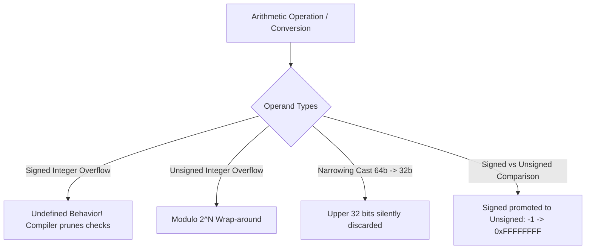

# Integer Overflows, Underflows, and Truncation

> **Mastering signed undefined behavior vs unsigned modulo arithmetic, integer promotion pitfalls, narrowing truncation, and checked arithmetic intrinsics in C.**

| Level | Prerequisites | Time to Read | Status | Standard |
| :--- | :--- | :--- | :--- | :--- |
| Advanced | [01-fundamentals/02-data-types.md](../01-fundamentals/02-data-types.md), [01-fundamentals/06-type-conversions.md](../01-fundamentals/06-type-conversions.md) | 26 mins | Complete | C99 / C11 / C17 / C23 |

---

## Table of Contents
1. [What & Why](#1-what--why)
2. [Core Concepts](#2-core-concepts)
3. [How It Works Internally](#3-how-it-works-internally)
4. [Syntax & Usage](#4-syntax--usage)
5. [Practical Examples](#5-practical-examples)
6. [Best Practices](#6-best-practices)
7. [Common Mistakes & Pitfalls](#7-common-mistakes--pitfalls)
8. [Performance & Security Notes](#8-performance--security-notes)
9. [Comparison / When to Use What](#9-comparison--when-to-use-what)
10. [Interview Questions](#10-interview-questions)
11. [Practice Exercises](#11-practice-exercises)
12. [Summary / Cheat Sheet](#12-summary--cheat-sheet)
13. [Further Reading](#13-further-reading)

---

## 1. What & Why

Fixed-width integer arithmetic on modern computers operates within bounded numerical ranges ($2^8$, $2^{16}$, $2^{32}$, or $2^{64}$ states). When an arithmetic operation produces a result that exceeds the maximum representable value or falls below the minimum representable value of the destination type, integer anomalies occur.

In C, integer bugs are especially perilous because of a fundamental asymmetry in the ISO C standard:
- **Unsigned Integer Overflow:** Well-defined by the standard to wrap modulo $2^N$.
- **Signed Integer Overflow:** Strictly **Undefined Behavior (UB)**. The compiler assumes signed overflow *never happens*, allowing optimizing compilers to optimize away bounds checks, invert loop conditions, or generate insecure machine code.
- **Narrowing Truncation:** Storing a larger integer type (e.g. `uint64_t` or `size_t`) into a smaller integer type (e.g. `uint16_t` or `int32_t`) silently discards the most significant bits.
- **Sign Extension Mismatches:** Comparing signed and unsigned integers triggers automatic implicit promotions that convert negative numbers into massive positive values.

In real-world exploits, integer overflow bugs commonly serve as the trigger for buffer overflows: an integer overflow wraps a memory allocation calculation (`malloc(count * sizeof(item))`) to a tiny number, which succeeds, only for a subsequent loop to write `count` items into the undersized buffer.

---

## 2. Core Concepts

### 2.1 The Four Classes of Integer Bugs
1. **Signed Overflow / Underflow:** Exceeding `INT_MAX` or dropping below `INT_MIN`. (Undefined Behavior).
2. **Unsigned Wrap-Around:** Exceeding `UINT_MAX` wraps to `0`; dropping below `0` wraps to `UINT_MAX`. (Well-defined modular arithmetic).
3. **Narrowing Truncation:** Casting from a wider type to a narrower type (e.g., `uint32_t` to `uint16_t`) discards the upper bits.
4. **Signed / Unsigned Conversion Pitfalls:** In comparisons like `int x = -1; unsigned int y = 1; if (x < y)`, `x` is promoted to `unsigned int`, evaluating to `4294967295`, making the condition false!



### 2.2 Integer Promotion Rules
In C, any integer type smaller than `int` (`char`, `signed char`, `unsigned char`, `short`, `unsigned short`) is automatically promoted to `int` (or `unsigned int`) before any arithmetic operation is evaluated.

---

## 3. How It Works Internally

### 3.1 Two's Complement Representation
Modern systems represent signed integers using two's complement notation:
- For a 32-bit signed integer:
  - `INT32_MAX` = `0x7FFFFFFF` ($+2,147,483,647$)
  - Adding `1` yields `0x80000000`, which in two's complement is `INT32_MIN` ($-2,147,483,648$).
- Because the standard declares signed overflow undefined behavior, an optimizing compiler compiling:
  ```c
  if (x + 1 > x) {
      // Always true according to mathematical logic!
  }
  ```
  will completely eliminate the `if` check at `-O2`, because the compiler assumes `x + 1` cannot overflow. If `x` was `INT32_MAX`, the check is bypassed entirely!

### 3.2 The Classic Memory Allocation Exploit
```c
/* VULNERABLE ALLOCATION LOGIC */
void *allocate_array(size_t count, size_t element_size) {
    /* 32-bit system: count = 0x40000001, element_size = 4 */
    /* Multiplication overflows 32-bit: 0x40000001 * 4 = 0x100000004 -> wraps to 4 bytes! */
    size_t total_bytes = count * element_size;
    
    char *buf = malloc(total_bytes); /* Allocates only 4 bytes! */
    if (!buf) return NULL;

    for (size_t i = 0; i < count; ++i) {
        /* Writes count * 4 bytes into a 4-byte buffer -> Massive Heap Overflow! */
        write_element(buf, i);
    }
    return buf;
}
```

---

## 4. Syntax & Usage

### 4.1 Manual Defensive Bounds Checking

#### Safe Unsigned Multiplication Check
```c
#include <stdint.h>
#include <stdbool.h>

bool safe_mul_u32(uint32_t a, uint32_t b, uint32_t *out) {
    if (a != 0 && b > UINT32_MAX / a) {
        return false; /* Overflow would occur */
    }
    *out = a * b;
    return true;
}
```

#### Safe Signed Addition Check
```c
#include <stdint.h>
#include <limits.h>
#include <stdbool.h>

bool safe_add_i32(int32_t a, int32_t b, int32_t *out) {
    if ((b > 0 && a > INT32_MAX - b) || (b < 0 && a < INT32_MIN - b)) {
        return false; /* Signed overflow would occur */
    }
    *out = a + b;
    return true;
}
```

### 4.2 GCC / Clang Builtin Overflow Intrinsics
Modern compilers provide compiler intrinsics that directly test the CPU hardware carry and overflow flags (`CF`/`OF`), providing zero-cost checked arithmetic:
```c
int a = ..., b = ..., result = 0;
if (__builtin_add_overflow(a, b, &result)) {
    /* Handle signed overflow error */
}

size_t sz = 0;
if (__builtin_mul_overflow(count, sizeof(struct item), &sz)) {
    /* Handle allocation overflow error */
}
```

### 4.3 C23 Checked Integer Arithmetic (`<stdckdint.h>`)
Standardized in C23, checked arithmetic is now part of the ISO C language without vendor extensions:
```c
#include <stdckdint.h>

int res;
if (ckd_add(&res, a, b)) {
    /* Standardized overflow handler */
}
if (ckd_mul(&res, count, size)) {
    /* Standardized overflow handler */
}
```

---

## 5. Practical Examples

### 5.1 Verified Companion Simulation: Checked Arithmetic Operations
The following program evaluates defensive integer arithmetic and bounds checking for both unsigned multiplication and signed addition:

```c
#include <stdio.h>
#include <stdint.h>
#include <stdbool.h>

static bool safe_multiply_u32(uint32_t a, uint32_t b, uint32_t *out_res) {
    if (a != 0 && b > UINT32_MAX / a) {
        return false; /* Overflow detected */
    }
    *out_res = a * b;
    return true;
}

static bool safe_add_i32(int32_t a, int32_t b, int32_t *out_res) {
    if ((b > 0 && a > INT32_MAX - b) || (b < 0 && a < INT32_MIN - b)) {
        return false; /* Signed overflow detected */
    }
    *out_res = a + b;
    return true;
}

int main(void) {
    printf("Evaluating Integer Overflow & Underflow Arithmetic Defenses...\n");
    uint32_t res_u = 0;
    bool ok_u = safe_multiply_u32(1000000, 5000, &res_u);
    printf("U32 Multiply (1000000 * 5000): %s (Result=%u)\n", ok_u ? "SUCCESS" : "OVERFLOW DETECTED", res_u);

    int32_t res_i = 0;
    bool ok_i = safe_add_i32(2147483640, 10, &res_i);
    printf("I32 Add (2147483640 + 10): %s (Result=%d)\n", ok_i ? "SUCCESS" : "OVERFLOW DETECTED", res_i);
    printf("Checked arithmetic invariants verified.\n");
    return 0;
}
```

**Real Execution Output:**
```text
Evaluating Integer Overflow & Underflow Arithmetic Defenses...
U32 Multiply (1000000 * 5000): OVERFLOW DETECTED (Result=0)
I32 Add (2147483640 + 10): OVERFLOW DETECTED (Result=0)
Checked arithmetic invariants verified.
```

---

## 6. Best Practices

1. **Use `__builtin_*_overflow` or C23 `<stdckdint.h>`:** Hardware overflow flags provide optimal performance and eliminate subtle bugs in manual pre-condition math.
2. **Never Check Overflow After It Occurs:** In signed arithmetic, checking `if (a + b < a)` is undefined behavior; the compiler is permitted to optimize away the entire check. Always check pre-conditions *before* computing the operation.
3. **Use `size_t` for Memory Sizes and Counts:** Never use signed `int` for memory offsets, array sizes, or buffer lengths.
4. **Compile with `-Wconversion` and `-Wsign-conversion`:** Enables compiler warnings whenever an expression silently changes signs or truncates bits during assignment.
5. **Enable `-fsanitize=signed-integer-overflow` in CI:** Forces UBSan to trap and abort on any signed integer overflow during test runs.

---

## 7. Common Mistakes & Pitfalls

| Mistake | Why It Is Dangerous | Correct Fix |
| :--- | :--- | :--- |
| **`if (a + b < a)` for signed addition** | Undefined behavior; optimizing compilers prune the check entirely under `-O2`. | Check pre-conditions: `if (a > INT_MAX - b)`. |
| **Comparing `int i = -1` with `size_t sz = 10`** | `-1` converts to `SIZE_MAX`, causing `i < sz` to evaluate to `false`. | Match operand types or assert `i >= 0` first. |
| **Unchecked multiplication in `malloc(n * sz)`** | Wraps modulo integer capacity, allocating undersized heap buffer. | Use `calloc(n, sz)` or check `__builtin_mul_overflow()`. |
| **Assigning `long` to `int` without range check** | On 64-bit platforms, truncates upper 32 bits without warning. | Validate `val >= INT_MIN && val <= INT_MAX`. |
| **`char c; while ((c = getchar()) != EOF)`** | If `char` is unsigned or too narrow, `EOF` (-1) can never be matched or truncates. | Store `getchar()` in an `int`. |
| **Bitshifting by $\ge$ bit width (e.g. `1 << 32`)** | Undefined behavior on 32-bit types. | Use `1ULL << shift` and check `shift < 64`. |

---

## 8. Performance & Security Notes

### 8.1 Modern CPU Overflow Flag Detection
Manual overflow checking requires divisions and multiple branch checks:
```c
if (a != 0 && b > UINT_MAX / a) // Requires slow division instruction!
```
Using `__builtin_mul_overflow()` allows the compiler to emit a single hardware multiply instruction (`mul` or `imul`) followed by a conditional jump on the CPU Overflow Flag (`jo` / `jc`). This converts an expensive division check into a single-cycle hardware flag test.

### 8.2 Compiler Flag: `-fwrapv`
If an existing legacy codebase relies heavily on two's complement signed wrap-around behavior, compiling with `-fwrapv` instructs GCC and Clang to treat signed integer overflow as well-defined two's complement wrapping (disabling the undefined behavior optimization). However, this should only be used as a migration crutch, not a substitute for sound code.

---

## 9. Comparison / When to Use What

| Technique | Efficiency | Portability | Safety Guarantee |
| :--- | :--- | :--- | :--- |
| **Manual Bounds Check (`a > MAX - b`)** | Moderate (Extra branches) | 100% C Standard | High |
| **GCC/Clang Intrinsics (`__builtin_*_overflow`)** | Maximum (Direct CPU flags) | GCC / Clang / ICC | High |
| **C23 Standard (`<stdckdint.h>`)** | Maximum | Modern C23 Compilers | High |
| **Compiler Sanitizer (`-fsanitize=undefined`)** | Runtime abort (~10% overhead)| GCC / Clang | High (Debug/Testing only) |
| **Compiler Flag `-fwrapv`** | Normal execution | GCC / Clang | Eliminates UB, but masks bugs |

---

## 10. Interview Questions

<details>
<summary><strong>1. Why is signed integer overflow undefined behavior in C, while unsigned integer overflow is well-defined?</strong></summary>

Historically, C was designed to run across diverse CPU hardware architectures, including ones complement, sign-magnitude, and two's complement processors. Defining signed overflow as undefined behavior allowed compilers to generate direct assembly arithmetic instructions without injecting software emulation for uniform overflow semantics. In contrast, unsigned arithmetic is explicitly specified as modular arithmetic ($\pmod{2^N}$) to model hardware register wrapping.
</details>

<details>
<summary><strong>2. How does an optimizing compiler exploit signed overflow undefined behavior?</strong></summary>

Because signed overflow is UB, the compiler assumes it will never occur in a valid program. If it encounters `if (x + 1 > x)`, it mathematically simplifies the expression to `true` and eliminates the `if` check entirely. If `x` overflows, the check fails to execute, allowing security vulnerabilities to proceed undetected.
</details>

<details>
<summary><strong>3. What happens when you compare a signed <code>int</code> with an unsigned <code>unsigned int</code>?</strong></summary>

Under the C "Usual Arithmetic Conversions", if both operands have the same rank (e.g. 32-bit `int` and 32-bit `unsigned int`), the signed integer is implicitly converted to `unsigned int`. A negative signed number (like `-1`) becomes a massive unsigned number (`0xFFFFFFFF` or $4,294,967,295$), causing `-1 < 1U` to evaluate to `false`.
</details>

<details>
<summary><strong>4. Why is <code>calloc()</code> generally safer than <code>malloc(count * size)</code>?</strong></summary>

`calloc(count, size)` performs internal integer multiplication overflow checking. If `count * size` would overflow `size_t`, `calloc()` immediately returns `NULL` without allocating an undersized buffer. `malloc(count * size)` calculates the product first, passing the wrapped, truncated value directly to `malloc()`.
</details>

<details>
<summary><strong>5. Explain the purpose of GCC's <code>__builtin_mul_overflow</code> intrinsic.</strong></summary>

It performs multiplication and checks if the result overflows the destination type in a single hardware operation by inspecting the CPU's overflow flag (`OF`), returning `true` on overflow and `false` on success. It works polymorphically across any integer type.
</details>

<details>
<summary><strong>6. What is "integer truncation" and when does it occur?</strong></summary>

Integer truncation occurs when an integer of wider bit width is cast or assigned to a narrower integer type (e.g., assigning a 64-bit `uint64_t` to a 32-bit `uint32_t`). The most significant bits are discarded, which alters the numerical value if the source exceeded the destination range.
</details>

<details>
<summary><strong>7. Why must the return value of <code>getchar()</code> be stored in an <code>int</code> rather than a <code>char</code>?</strong></summary>

`getchar()` returns all valid byte values (`0` to `255`) as well as the sentinel macro `EOF` (typically `-1`). If stored in a `char`, and `char` is unsigned, `-1` wraps to `255`, and the `EOF` comparison never succeeds (infinite loop). If `char` is signed, a valid data byte `0xFF` matches `EOF`, truncating the stream prematurely.
</details>

<details>
<summary><strong>8. What is C23 <code><stdckdint.h></code>?</strong></summary>

A new standard C header introduced in C23 that provides macro functions (`ckd_add`, `ckd_sub`, `ckd_mul`) for portable checked integer arithmetic with overflow detection, standardizing what compilers previously offered via proprietary intrinsics.
</details>

---

## 11. Practice Exercises

### Exercise 1 (Easy): Safe Array Index Validator
- **Task:** Write a function `bool is_valid_index(int signed_idx, size_t array_len)` that checks bounds safely without signed/unsigned conversion bugs.

<details>
<summary>Solution</summary>

```c
#include <stdbool.h>
#include <stddef.h>

bool is_valid_index(int signed_idx, size_t array_len) {
    if (signed_idx < 0) {
        return false; /* Reject negative index before unsigned conversion */
    }
    return (size_t)signed_idx < array_len;
}
```
</details>

### Exercise 2 (Medium): Safe Memory Allocation Wrapper
- **Task:** Implement `void *safe_malloc_array(size_t count, size_t elem_size)` that checks for multiplication overflow using `__builtin_mul_overflow` before calling `malloc`.

<details>
<summary>Solution</summary>

```c
#include <stdio.h>
#include <stdlib.h>
#include <stdbool.h>

void *safe_malloc_array(size_t count, size_t elem_size) {
    size_t total_bytes = 0;
#if defined(__GNUC__) || defined(__clang__)
    if (__builtin_mul_overflow(count, elem_size, &total_bytes)) {
        return NULL; /* Overflow detected */
    }
#else
    if (elem_size != 0 && count > SIZE_MAX / elem_size) {
        return NULL;
    }
    total_bytes = count * elem_size;
#endif
    return malloc(total_bytes);
}
```
</details>

### Exercise 3 (Hard): Checked Integer Parsing from String
- **Task:** Write a string-to-int32 parser `bool parse_i32_checked(const char *str, int32_t *out_val)` that detects integer overflow and underflow during base-10 accumulation.

<details>
<summary>Solution</summary>

```c
#include <stdio.h>
#include <stdint.h>
#include <stdbool.h>
#include <limits.h>

bool parse_i32_checked(const char *str, int32_t *out_val) {
    if (!str || !*str || !out_val) return false;
    int sign = 1;
    if (*str == '-') {
        sign = -1;
        str++;
    } else if (*str == '+') {
        str++;
    }

    int32_t acc = 0;
    while (*str) {
        if (*str < '0' || *str > '9') return false;
        int digit = *str - '0';

        if (sign == 1) {
            if (acc > (INT32_MAX - digit) / 10) return false; /* Overflow */
            acc = acc * 10 + digit;
        } else {
            if (acc < (INT32_MIN + digit) / 10) return false; /* Underflow */
            acc = acc * 10 - digit;
        }
        str++;
    }
    *out_val = acc;
    return true;
}
```
</details>

---

## 12. Summary / Cheat Sheet

| Integer Type | Overflow Behavior | Optimization Risk | Recommended Safety Check |
| :--- | :--- | :--- | :--- |
| **Unsigned (`uint32_t`)** | Modular wrap-around ($\pmod{2^N}$) | None (Well-defined) | Pre-condition math: `b > MAX / a` |
| **Signed (`int32_t`)** | **Undefined Behavior (UB)** | High (Checks pruned) | Pre-condition check: `a > MAX - b` |
| **GCC / Clang** | Hardware flag inspection | Minimal | `__builtin_add_overflow(a, b, &res)` |
| **C23 Standard** | Portable checked arithmetic | Minimal | `ckd_add(&res, a, b)` |
| **Narrowing Cast** | Upper bits discarded | Silent truncation | Range validation before casting |

---

## 13. Further Reading
- CERT C Rule INT30-C: Ensure that unsigned integer operations do not wrap
- CERT C Rule INT32-C: Ensure that operations on signed integers do not result in overflow
- CWE-190: Integer Overflow or Wraparound: `https://cwe.mitre.org/data/definitions/190.html`
- ISO/IEC 9899:2023 (C23) `<stdckdint.h>` Specification

---
[<- Previous: 02-format-string-vulnerabilities.md](02-format-string-vulnerabilities.md) | [Section Index](README.md) | [Next: 04-use-after-free-and-double-free.md ->](04-use-after-free-and-double-free.md)\n