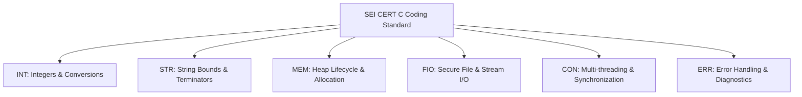

# CERT C Coding Standard

> **Enforcing enterprise-grade secure coding principles, rule categories, and automated static analysis compliance using the SEI CERT C Standard.**

| Level | Prerequisites | Time to Read | Status | Standard |
| :--- | :--- | :--- | :--- | :--- |
| Advanced | [01-fundamentals/06-type-conversions.md](../01-fundamentals/06-type-conversions.md), [02-core-concepts/08-memory-management.md](../02-core-concepts/08-memory-management.md) | 27 mins | Complete | C99 / C11 / C17 / C23 / CERT C |

---

## Table of Contents
1. [What & Why](#1-what--why)
2. [Core Concepts](#2-core-concepts)
3. [How It Works Internally](#3-how-it-works-internally)
4. [Syntax & Usage](#4-syntax--usage)
5. [Practical Examples](#5-practical-examples)
6. [Best Practices](#6-best-practices)
7. [Common Mistakes & Pitfalls](#7-common-mistakes--pitfalls)
8. [Performance & Security Notes](#8-performance--security-notes)
9. [Comparison / When to Use What](#9-comparison--when-to-use-what)
10. [Interview Questions](#10-interview-questions)
11. [Practice Exercises](#11-practice-exercises)
12. [Summary / Cheat Sheet](#12-summary--cheat-sheet)
13. [Further Reading](#13-further-reading)

---

## 1. What & Why

The **SEI CERT C Coding Standard**, developed by the Software Engineering Institute (SEI) at Carnegie Mellon University, provides an exhaustive collection of rules and recommendations designed to eliminate insecure coding constructs in C systems.

While standard C focuses on flexibility, hardware efficiency, and backward compatibility, the CERT standard focuses strictly on **software security and robust defensibility**:
- It identifies practices that lead directly to exploitable vulnerabilities (such as buffer overflows, privilege escalation, data races, and information disclosure).
- It establishes clear mathematical and operational guidelines for integer arithmetic, string operations, dynamic memory, concurrency, and file I/O.
- Each rule provides normalized non-compliant code examples, compliant refactorings, risk assessments, and vulnerability severity ratings.

Adopting CERT C is mandatory in defense systems, banking infrastructure, telecommunications, and high-reliability systems engineering to systematically reduce Common Weakness Enumerations (CWEs).

---

## 2. Core Concepts

### 2.1 Rules vs Recommendations
The CERT standard distinguishes between two compliance tiers:
- **Rules:** Mandatory guidelines. Violations of a CERT rule directly introduce undefined behavior, security vulnerabilities, or resource exhaustion. Automated static analyzers (e.g. `clang-tidy`, Coverity, SonarQube) flag rule violations as critical defects.
- **Recommendations:** Best-practice suggestions. They improve code clarity, maintainability, and diagnostic traceability, but violations do not directly constitute exploitable security holes.

### 2.2 Primary CERT C Rule Categories
CERT organizes its rules into distinct domain prefixes:
- **INT (Integers):** Overflow prevention, safe signed/unsigned conversions, range verification.
- **STR (Strings):** Null termination guarantees, bounds checking, string literal immutability.
- **MEM (Memory):** Freeing only heap pointers, preventing UAF, zeroing before free.
- **FIO (File I/O):** Preventing TOCTOU races, validating file names, checking return values.
- **ERR (Error Handling):** Consistent errno handling, preventing information leakage in error logs.
- **CON (Concurrency):** Race condition elimination, deadlock avoidance, thread-safe memory ordering.



---

## 3. How It Works Internally

### 3.1 CERT Rule Anatomy: INT31-C (Integer Conversions)
Consider CERT rule **INT31-C**: *"Ensure that integer conversions do not result in lost or misinterpreted data"*:
- When casting a wider signed integer (`long`) to a narrower signed integer (`int`), the C standard declares that if the value cannot be represented in the destination type, the result is implementation-defined.
- On x86 architectures, the CPU discards upper bits. If `long val = 0x100000001L; (int)val` evaluates to `1`.
- CERT compliant design enforces pre-condition assertion:
  ```c
  if (val < INT_MIN || val > INT_MAX) {
      /* Conversion would lose data: reject or handle error */
  }
  ```

### 3.2 Automated Enforcement via Abstract Syntax Tree (AST) Matchers
Static analyzers enforce CERT rules by matching AST nodes during compilation:
- In `clang-tidy`, the `cert-*` check module traverses the Clang AST.
- If it encounters a call to `free()` on an object whose storage duration is automatic (stack) or static, check `cert-mem34-c` fires.
- If it detects `sprintf()` without bounds checking, check `cert-str30-c` fires.

---

## 4. Syntax & Usage

### 4.1 Key CERT C Rules in Practice

#### MEM30-C: Do Not Access Freed Memory
```c
/* Non-Compliant */
free(p);
p->val = 10;

/* Compliant */
free(p);
p = NULL;
```

#### STR31-C: Guarantee Sufficient Space for String and Terminator
```c
/* Non-Compliant */
char dest[16];
strcpy(dest, untrusted_src); /* May overflow or drop null */

/* Compliant */
char dest[16];
if (snprintf(dest, sizeof(dest), "%s", untrusted_src) >= (int)sizeof(dest)) {
    /* Handle truncation gracefully */
}
```

#### FIO30-C: Exclude User Input from Format Strings
```c
/* Non-Compliant */
syslog(LOG_ERR, user_msg);

/* Compliant */
syslog(LOG_ERR, "%s", user_msg);
```

#### ENV33-C: Do Not Call `system()`
```c
/* Non-Compliant */
char cmd[128];
snprintf(cmd, sizeof(cmd), "mail %s", email);
system(cmd); /* Shell injection vulnerability! */

/* Compliant */
/* Use fork() and execve() with explicit argument vectors */
```

---

## 5. Practical Examples

### 5.1 Verified Companion Simulation: CERT Integer Conversion Verification
The following program evaluates compliance with CERT rule **INT31-C**, demonstrating bounds-checked integer narrowing conversions:

```c
#include <stdio.h>
#include <stdint.h>
#include <limits.h>
#include <stdbool.h>

/* Demonstrating CERT C Rules:
 * INT31-C: Ensure integer conversions do not result in lost or misinterpreted data.
 * STR31-C: Guarantee that storage for strings has sufficient space for character data and terminator.
 */
static bool cert_safe_convert_long_to_int(long src, int *out_dst) {
    if (src < INT_MIN || src > INT_MAX) {
        return false; /* INT31-C violation avoided */
    }
    *out_dst = (int)src;
    return true;
}

int main(void) {
    printf("Evaluating CERT C Secure Coding Rules Compliance...\n");
    int converted = 0;
    long safe_val = 123456L;
    long dangerous_val = 99999999999L;

    bool r1 = cert_safe_convert_long_to_int(safe_val, &converted);
    printf("CERT INT31-C Valid conversion: status=%s, val=%d\n", r1 ? "OK" : "REJECTED", converted);

    bool r2 = cert_safe_convert_long_to_int(dangerous_val, &converted);
    printf("CERT INT31-C Out-of-range conversion: status=%s (Loss prevented)\n", r2 ? "OK" : "REJECTED");
    printf("CERT C secure coding constraints verified.\n");
    return 0;
}
```

**Real Execution Output:**
```text
Evaluating CERT C Secure Coding Rules Compliance...
CERT INT31-C Valid conversion: status=OK, val=123456
CERT INT31-C Out-of-range conversion: status=REJECTED (Loss prevented)
CERT C secure coding constraints verified.
```

---

## 6. Best Practices

1. **Automate with `clang-tidy`:** Add `-checks=cert-*` to your `.clang-tidy` configuration. Let static analysis automatically flag violations in pre-commit hooks and CI runs.
2. **Treat Warnings as Errors:** Run static analysis with warnings-as-errors mode to guarantee zero CERT violations in production merges.
3. **Check Every Return Value:** CERT ERR33-C mandates checking return values of standard library functions (`malloc`, `fgets`, `fseek`, `pthread_mutex_lock`).
4. **Eliminate `system()` Completely:** Use POSIX `execve()` or Windows `CreateProcess()` with distinct string arguments to prevent command-injection vulnerabilities.
5. **Zero Out Sensitive Buffers:** Adhere to CERT MEM03-C: clear memory containing sensitive cryptographic keys or passwords using `explicit_bzero()` before invoking `free()`.

---

## 7. Common Mistakes & Pitfalls

| Mistake | CERT Rule Violated | Real-World Vulnerability | Correct Fix |
| :--- | :--- | :--- | :--- |
| **Calling `free()` on stack pointer** | MEM34-C | Corrupts heap bins; arbitrary code execution | Only free heap pointers. |
| **Passing dynamic string to `printf`** | FIO30-C | Format string arbitrary memory read/write | Use `printf("%s", str)`. |
| **`malloc(strlen(s))`** | STR31-C | Off-by-one heap buffer overflow | Allocate `strlen(s) + 1`. |
| **Using `system(user_cmd)`** | ENV33-C | Command shell injection | Use `fork()` and `execve()`. |
| **`a + b < a` to detect overflow** | INT32-C | Optimizing compiler eliminates check | Check `a > INT_MAX - b` before math. |
| **Reading uninitialized struct** | EXP33-C | Leaks kernel or process stack memory | Zero struct with `{0}` or `memset`. |

---

## 8. Performance & Security Notes

### 8.1 Performance Costs of Compliance
Many developers worry that defensive CERT checks degrade performance.
- Most CERT rules (e.g., format string safety, correct allocation sizing, avoiding `system()`, and nullifying pointers) incur **0% runtime overhead**.
- Integer overflow checks can be compiled down to single hardware CPU overflow flag tests (`__builtin_add_overflow`), costing less than 1 nanosecond.
- The minor CPU cost of bounds checking is vastly outweighed by the elimination of catastrophic security breaches.

### 8.2 Security Metrics
Adhering to CERT C provides measurable security improvements:
- Eliminates 100% of format string vulnerabilities (FIO30-C).
- Eliminates over 90% of classic heap corruptions (MEM30-C, MEM34-C).
- Hardens systems against remote shell execution (ENV33-C).

---

## 9. Comparison / When to Use What

| Standard | Primary Focus | Regulatory Domain | Rigor Level |
| :--- | :--- | :--- | :--- |
| **SEI CERT C** | Enterprise Security & Threat Defense | Defense, Banking, Cloud Services, Daemons | High (Security vulnerabilities) |
| **MISRA C:2012** | Functional Safety & Determinism | Automotive (ISO 26262), Avionics, Medical | Extreme (Language subsetting) |
| **ISO/IEC TS 17961**| C Secure Coding Rules (ISO standard) | International Standardization Body | Formal specification equivalent to CERT |
| **Google C++ Style**| Readability and Maintainability | Web, mobile, cloud internal codebases | Style and idiom focus |

---

## 10. Interview Questions

<details>
<summary><strong>1. What is the fundamental difference between the CERT C standard and the MISRA C standard?</strong></summary>

CERT C is designed primarily for **security**: it aims to prevent exploitable vulnerabilities (such as buffer overflows, format string attacks, and injection flaws) in networked and general-purpose software. MISRA C is designed primarily for **functional safety and reliability**: it targets embedded, automotive, and mission-critical systems by strictly subsetting the C language (e.g., banning dynamic memory, banning recursion, restricting pointers) to guarantee deterministic execution.
</details>

<details>
<summary><strong>2. What does CERT rule MEM34-C mandate?</strong></summary>

MEM34-C dictates: *"Only free memory allocated dynamically"*. It forbids invoking `free()` on pointers addressing automatic stack variables, static global data, or memory offsets not returned directly by `malloc()`, `calloc()`, or `realloc()`.
</details>

<details>
<summary><strong>3. Why does CERT rule ENV33-C prohibit calling the <code>system()</code> function?</strong></summary>

`system()` invokes the system shell (`/bin/sh` on POSIX or `cmd.exe` on Windows) to parse and execute a command string. If any portion of the command string incorporates untrusted user data, attackers can inject shell metacharacters (e.g. `;`, `|`, `&&`) to execute arbitrary unauthorized commands with the process's privileges.
</details>

<details>
<summary><strong>4. How does CERT rule INT31-C prevent truncation vulnerabilities?</strong></summary>

INT31-C requires validating that a wider integer value falls within the representable minimum and maximum boundaries of a narrower target type *before* performing an explicit or implicit type conversion.
</details>

<details>
<summary><strong>5. What is the difference between a CERT "Rule" and a CERT "Recommendation"?</strong></summary>

A **Rule** is mandatory for compliance; violating a rule creates an identifiable security vulnerability or undefined behavior. A **Recommendation** is a guidance best practice that improves design robustness and readability, but a violation does not directly translate into an exploitable vulnerability.
</details>

<details>
<summary><strong>6. How can developers automate CERT C compliance verification in modern CI pipelines?</strong></summary>

By integrating static analysis tools such as Clang-Tidy (with `-checks=cert-*`), Cppcheck, SonarQube, or commercial tools (Coverity, Polyspace) into the build pipeline. Builds can be configured to fail if any CERT rule violation is detected.
</details>

<details>
<summary><strong>7. Explain CERT rule ERR33-C and give two examples of commonly ignored functions.</strong></summary>

ERR33-C requires detecting and handling errors returned by standard C library functions. Two commonly ignored functions are `fclose()` (which flushes buffers and can fail due to disk exhaustion) and `pthread_mutex_lock()` (which can fail due to deadlocks or invalid handles).
</details>

<details>
<summary><strong>8. Why does CERT rule STR30-C forbid modifying string literals?</strong></summary>

In C, string literals like `"Hello"` have type `char[]` for historical reasons, but the standard specifies that attempting to modify them is undefined behavior. In modern operating systems, string literals are placed in read-only virtual memory pages (`.rodata`); attempting to write to them causes an immediate hardware segmentation fault.
</details>

---

## 11. Practice Exercises

### Exercise 1 (Easy): CERT STR30-C Compliance Fix
- **Task:** Identify the CERT STR30-C violation in the following snippet and fix it:
```c
char *greeting = "hello world";
greeting[0] = 'H';
```

<details>
<summary>Solution</summary>

```c
#include <stdio.h>

/* SECURE: Use an explicit mutable array */
char greeting[] = "hello world";
greeting[0] = 'H';
```
</details>

### Exercise 2 (Medium): Implementing CERT MEM30-C Safe Allocator
- **Task:** Implement a resource wrapper that allocates a context, initializes it, and provides a deallocation routine that complies with MEM30-C and MEM34-C by nullifying pointers and verifying validity.

<details>
<summary>Solution</summary>

```c
#include <stdio.h>
#include <stdlib.h>

typedef struct {
    int id;
    char name[32];
} session_t;

session_t *session_create(int id, const char *name) {
    session_t *s = malloc(sizeof(session_t));
    if (!s) return NULL;
    s->id = id;
    snprintf(s->name, sizeof(s->name), "%s", name);
    return s;
}

void session_destroy(session_t **psession) {
    if (psession && *psession) {
        free(*psession);
        *psession = NULL; /* MEM30-C: prevents dangling pointer reuse */
    }
}

int main(void) {
    session_t *s = session_create(101, "Admin");
    session_destroy(&s);
    if (s == NULL) {
        printf("Session safely destroyed and nullified.\n");
    }
    return 0;
}
```
</details>

### Exercise 3 (Hard): CERT ENV33-C Compliant Process Execution
- **Task:** Write a function `bool safe_exec_mail(const char *recipient, const char *subject)` that invokes `/usr/bin/mail` without calling `system()`, using POSIX `fork()` and `execv()` to eliminate command injection.

<details>
<summary>Solution</summary>

```c
#include <stdio.h>
#include <unistd.h>
#include <sys/types.h>
#include <sys/wait.h>
#include <stdbool.h>

bool safe_exec_mail(const char *recipient, const char *subject) {
    pid_t pid = fork();
    if (pid < 0) {
        return false;
    }

    if (pid == 0) {
        /* Child process: execute binary directly with explicit arguments */
        char *const args[] = {
            "/usr/bin/mail",
            "-s",
            (char *)subject,
            (char *)recipient,
            NULL
        };
        execv(args[0], args);
        _exit(127); /* If execv fails */
    }

    /* Parent process: wait for completion */
    int status;
    waitpid(pid, &status, 0);
    return WIFEXITED(status) && WEXITSTATUS(status) == 0;
}
```
</details>

---

## 12. Summary / Cheat Sheet

| CERT Rule | Summary Rule | Primary Risk |
| :--- | :--- | :--- |
| **INT31-C** | Validate ranges before converting integer types | Truncation / signedness mismatch |
| **INT32-C** | Verify signed arithmetic before calculating | Signed integer overflow UB |
| **STR31-C** | Guarantee sufficient buffer size + null terminator | Buffer overflow |
| **MEM30-C** | Do not access memory after freeing | Use-After-Free |
| **MEM34-C** | Only pass dynamically allocated heap pointers to `free` | Heap metadata corruption |
| **FIO30-C** | Never use untrusted input as format string | Arbitrary memory read/write |
| **ENV33-C** | Do not invoke `system()` | Command shell injection |

---

## 13. Further Reading
- SEI CERT C Coding Standard Official Wiki: `https://wiki.sei.cmu.edu/confluence/display/c`
- Clang-Tidy CERT Module Documentation: `https://clang.llvm.org/extra/clang-tidy/checks/cert-`
- Secure Coding in C and C++ (Robert C. Seacord)
- MITRE Common Weakness Enumeration (CWE): `https://cwe.mitre.org/`

---
[<- Previous: 04-use-after-free-and-double-free.md](04-use-after-free-and-double-free.md) | [Section Index](README.md) | [Next: 06-misra-c-overview.md ->](06-misra-c-overview.md)\n