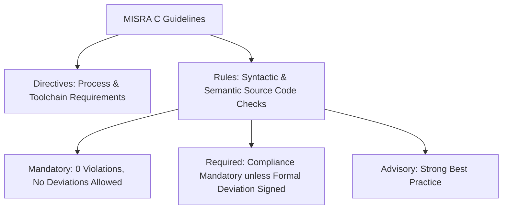

# MISRA C Overview

> **Navigating safety-critical C software guidelines, rule classifications, compliance matrices, and formal deviation workflows in automotive and embedded systems.**

| Level | Prerequisites | Time to Read | Status | Standard |
| :--- | :--- | :--- | :--- | :--- |
| Advanced | [01-fundamentals/02-data-types.md](../01-fundamentals/02-data-types.md), [02-core-concepts/03-pointers.md](../02-core-concepts/03-pointers.md) | 28 mins | Complete | C99 / C11 / MISRA C:2012 |

---

## Table of Contents
1. [What & Why](#1-what--why)
2. [Core Concepts](#2-core-concepts)
3. [How It Works Internally](#3-how-it-works-internally)
4. [Syntax & Usage](#4-syntax--usage)
5. [Practical Examples](#5-practical-examples)
6. [Best Practices](#6-best-practices)
7. [Common Mistakes & Pitfalls](#7-common-mistakes--pitfalls)
8. [Performance & Security Notes](#8-performance--security-notes)
9. [Comparison / When to Use What](#9-comparison--when-to-use-what)
10. [Interview Questions](#10-interview-questions)
11. [Practice Exercises](#11-practice-exercises)
12. [Summary / Cheat Sheet](#12-summary--cheat-sheet)
13. [Further Reading](#13-further-reading)

---

## 1. What & Why

In consumer software, a program crash or memory leak causes an annoying restart or an error dialog. In safety-critical embedded systems—such as automotive anti-lock braking systems (ABS), drive-by-wire steering, medical infusion pumps, and aerospace avionics—a software crash or non-deterministic timing delay can cause loss of human life.

**MISRA C** (Motor Industry Software Reliability Association) is the preeminent software development standard for safety-critical C systems. Originally created in 1998 for the automotive sector, it is now globally mandated across defense, medical devices (IEC 62304), railway transit (EN 50128), and industrial automation (IEC 61508).

Rather than expanding C, MISRA C **strictly subsets** the language:
- It removes ambiguous, dangerous, or compiler-dependent features (such as dynamic memory allocation, unbounded recursion, implicit type conversions, and complex macros).
- It mandates static analyzability: code must be written such that static checkers can formally prove the absence of runtime undefined behaviors.
- Compliance is legally required to achieve **ISO 26262 ASIL D** automotive safety certification.

---

## 2. Core Concepts

### 2.1 Rule Classifications
MISRA C:2012 categorizes its guidelines into two forms:
- **Directives:** Broad architectural guidelines where compliance cannot be checked entirely by looking at source code alone (e.g., design documentation, toolchain validation).
- **Rules:** Explicit, unambiguous code-level requirements enforceable by automated static analysis tools.

Rules are further divided into three strictness tiers:
1. **Mandatory:** Absolute requirements. Violations are NEVER permitted; no exceptions or deviations can be granted under any circumstances.
2. **Required:** Strict requirements. Code must comply unless a formal, documented **Deviation Permit** is approved by the safety engineering board.
3. **Advisory:** Best-practice recommendations that should be followed where reasonably practical.



### 2.2 Core Tenets of MISRA C
- **No Dynamic Heap Memory Allocation:** Banning `malloc()`, `calloc()`, `realloc()`, and `free()` (Rule 21.3) to prevent heap fragmentation, out-of-memory panics, and dangling pointers.
- **No Direct or Indirect Recursion:** Banning recursive function calls (Rule 17.2) to allow static calculation of the program's maximum stack depth.
- **Explicit Fixed-Width Integer Types:** Mandating `<stdint.h>` types (`uint32_t`, `int16_t`) rather than raw `int` or `long` (Directive 4.6).
- **Strict Essential Type System:** Banning implicit conversions across distinct essential types (e.g. assigning a signed integer expression directly to an unsigned variable).

---

## 3. How It Works Internally

### 3.1 Static Stack Depth Analysis (Rule 17.2)
In safety-critical microcontrollers, stack memory is fixed (often only a few kilobytes of RAM). A stack overflow overwrites memory and crashes the microcontroller.
- By banning recursion (`Rule 17.2`), the function call tree becomes a Directed Acyclic Graph (DAG).
- Static analysis tools compute the exact worst-case stack depth by summing the maximum frame sizes along the deepest call path:
  $$	ext{MaxStack} = \max_{p \in 	ext{Paths}} \sum_{f \in p} 	ext{FrameSize}(f)$$
- The engineering team can mathematically prove that the stack will never exceed available hardware RAM.

```
       [ main() - 64B ]
             |
             v
       [ process_sensor() - 128B ]
             |
             v
       [ filter_kalman() - 256B ]
             |
   Total Worst-Case Stack: 64 + 128 + 256 = 448 Bytes (Safe in 1KB RAM)
```

### 3.2 The Essential Type System (Rule 10.1 - 10.8)
Standard C's "Usual Arithmetic Conversions" silently promote types and change signedness behind the scenes. MISRA overlays an **Essential Type Model**:
- Every operand has an essential type: *Boolean, Character, Signed, Unsigned, Floating, or Enum*.
- Operations between mixed essential categories (e.g. adding an `unsigned int` to a `signed int`) are illegal under Rule 10.4 without an explicit cast.

---

## 4. Syntax & Usage

### 4.1 Non-Compliant vs Compliant MISRA Code

#### Banning Dynamic Memory (Rule 21.3)
```c
/* NON-COMPLIANT: Dynamic heap allocation */
uint8_t *buffer = (uint8_t *)malloc(1024U);

/* COMPLIANT: Static allocation with fixed, deterministic boundaries */
static uint8_t buffer[1024];
```

#### Banning Recursion (Rule 17.2)
```c
/* NON-COMPLIANT: Recursive factorial exhausts stack */
uint32_t factorial(uint32_t n) {
    if (n <= 1U) return 1U;
    return n * factorial(n - 1U);
}

/* COMPLIANT: Bounded iterative loop */
uint32_t factorial(uint32_t n) {
    uint32_t acc = 1U;
    for (uint32_t i = 2U; i <= n; ++i) {
        acc *= i;
    }
    return acc;
}
```

#### Single Point of Exit (Rule 15.5)
```c
/* NON-COMPLIANT: Multiple return statements */
bool check_threshold(int32_t val) {
    if (val < 0) return false;
    if (val > 100) return false;
    return true;
}

/* COMPLIANT: Single return at end of function */
bool check_threshold(int32_t val) {
    bool is_valid = false;
    if ((val >= 0) && (val <= 100)) {
        is_valid = true;
    }
    return is_valid;
}
```

---

## 5. Practical Examples

### 5.1 Verified Companion Simulation: MISRA Iterative Determinism
The following self-contained program implements an iterative algorithm adhering strictly to MISRA C principles (fixed integer types, explicit unsigned literals, single exit point, and no recursion):

```c
#include <stdio.h>
#include <stdint.h>
#include <stdbool.h>

/* Demonstrating MISRA C principles:
 * Rule 17.2: Functions shall not call themselves either directly or indirectly (No recursion).
 * Rule 8.4: A compatible declaration shall be visible when an object or function with external linkage is defined.
 * Rule 10.4: Both operands of an operator shall have the same essential type category.
 */

/* Iterative factorial complying with MISRA Rule 17.2 */
static bool misra_factorial_u32(uint32_t n, uint64_t *out_res) {
    if (!out_res || n > 20U) { /* 20! is max for uint64_t */
        return false;
    }
    uint64_t acc = 1ULL;
    for (uint32_t i = 2U; i <= n; ++i) {
        acc *= (uint64_t)i;
    }
    *out_res = acc;
    return true;
}

int main(void) {
    printf("Evaluating MISRA C Safety & Defensive Rules Architecture...\n");
    uint64_t fact5 = 0ULL;
    bool ok = misra_factorial_u32(5U, &fact5);
    printf("MISRA-compliant iterative factorial(5U) = %llu (status=%s)\n",
           (unsigned long long)fact5, ok ? "SUCCESS" : "FAILURE");
    printf("Rule 17.2 non-recursive loop execution verified.\n");
    return 0;
}
```

**Real Execution Output:**
```text
Evaluating MISRA C Safety & Defensive Rules Architecture...
MISRA-compliant iterative factorial(5U) = 120 (status=SUCCESS)
Rule 17.2 non-recursive loop execution verified.
```

---

## 6. Best Practices

1. **Use Explicit Integer Literals:** Always append appropriate suffixes to numerical literals: `U` for unsigned integers (`100U`), `ULL` for 64-bit unsigned integers (`10ULL`), `F` for single-precision floats (`3.14F`).
2. **Parenthesize Compound Expressions:** Never rely on default operator precedence (Rule 12.1). Always use explicit parentheses: `if ((a > 0) && (b < 10))`.
3. **Mandate Static Memory Allocation:** Allocate all ring buffers, queues, and state machines statically at compile time. Eliminate `malloc()` from safety-critical repositories.
4. **Automate MISRA Auditing in CI:** Run PC-lint, Axivion, Polyspace, or Cppcheck with the MISRA addon on every pull request.
5. **Document Formal Deviations Rigorously:** If a Required rule must be violated (e.g., writing a low-level hardware register driver), draft a formal Deviation Record containing: Rule Number, Technical Justification, Risk Assessment, and Verification Evidence.

---

## 7. Common Mistakes & Pitfalls

| Mistake | MISRA C Rule | Why It Is Dangerous | Correct Fix |
| :--- | :--- | :--- | :--- |
| **Using `int` or `long` directly** | Dir 4.6 | Target hardware sizes vary across 16/32/64 bits. | Use `int32_t`, `uint16_t` from `<stdint.h>`. |
| **Using `malloc()` in initialization** | Rule 21.3 | Heap fragmentation can cause unexpected out-of-memory panics. | Allocate static buffers at compile time. |
| **Implicit signed/unsigned conversion**| Rule 10.4 | Triggers silent sign-extension and incorrect comparisons. | Use explicit type casts: `(uint32_t)val`. |
| **Recursive function call** | Rule 17.2 | Unbounded stack growth risks silent stack collision. | Refactor into an iterative loop with fixed bounds. |
| **Missing `default:` in `switch`** | Rule 16.4 | Unhandled enum or state code leaves system undefined. | Always provide a `default:` handling error state. |
| **Relying on operator precedence** | Rule 12.1 | Developers misinterpret precedence, leading to logic bugs. | Use explicit parentheses: `(x << 2U) + 1U`. |

---

## 8. Performance & Security Notes

### 8.1 Zero-Overhead Safety
A common misconception is that MISRA C reduces software execution speed. In reality, MISRA C code often executes **faster and more predictably** than standard C:
- Static memory allocations eliminate dynamic allocator searching and fragmentation overhead.
- Avoiding recursion eliminates function call frame setup and teardown instructions.
- Explicit typing allows compiler optimization passes to emit direct machine register instructions without sign-extension instructions.

### 8.2 ISO 26262 Automotive Safety Compliance
In automotive engineering, **ISO 26262** defines Automotive Safety Integrity Levels (ASIL A through ASIL D). To achieve ASIL D certification:
- MISRA C compliance is an explicit, recognized prerequisite.
- The software engineering organization must demonstrate 100% compliance with Mandatory rules and maintain signed, verified deviation documentation for any deviated Required rules.

---

## 9. Comparison / When to Use What

| Dimension | MISRA C:2012 | SEI CERT C | Standard ISO C11 |
| :--- | :--- | :--- | :--- |
| **Primary Goal** | Functional Safety & Determinism | Threat Security & Exploit Prevention | General-purpose computing |
| **Dynamic Heap** | **BANNED** (Rule 21.3) | Permitted (MEM rules enforce safety) | Fully permitted |
| **Recursion** | **BANNED** (Rule 17.2) | Permitted (if stack bounds safe) | Fully permitted |
| **Target Sector** | Automotive, Medical, Avionics, Trains | Enterprise, Cloud, Networking, OS | General Desktop / Server |
| **Static Analyzability**| Extreme (Enforced by design) | High | Variable |

---

## 10. Interview Questions

<details>
<summary><strong>1. Why does MISRA C ban dynamic memory allocation (<code>malloc</code>, <code>free</code>)?</strong></summary>

Dynamic memory allocation introduces non-deterministic execution times, heap fragmentation, and runtime out-of-memory failures. In safety-critical embedded systems (like automotive brakes), memory allocation failure or memory fragmentation cannot be tolerated. Allocating all memory statically at compile time guarantees deterministic availability.
</details>

<details>
<summary><strong>2. What is the difference between a MISRA "Mandatory" rule and a "Required" rule?</strong></summary>

- **Mandatory:** Absolute rules that must never be violated. No deviations can be granted under any circumstances.
- **Required:** Rules that must be followed unless a formal, documented deviation is submitted, justified, safety-reviewed, and approved by the engineering board.
</details>

<details>
<summary><strong>3. Why does MISRA C ban recursion (Rule 17.2)?</strong></summary>

Recursive functions make it impossible or computationally intractable to determine maximum call stack usage statically. Banning recursion allows static analysis tools to construct a call graph DAG and mathematically prove that worst-case stack depth will never exceed the physical RAM of the microcontroller.
</details>

<details>
<summary><strong>4. What is the MISRA C "Essential Type Model"?</strong></summary>

It is a strict type system layered over C's weak type system. It assigns an essential type category (Boolean, Character, Signed, Unsigned, Floating, Enum) to every expression and bans implicit conversions between different categories, preventing subtle integer promotion and sign-mismatch bugs.
</details>

<details>
<summary><strong>5. Explain the MISRA rule regarding single points of exit (Rule 15.5).</strong></summary>

Rule 15.5 recommends that a function should have a single `return` statement at the very end of the function body. This ensures that all exit paths execute common cleanup routines and simplifies control flow analysis.
</details>

<details>
<summary><strong>6. Why does MISRA C mandate explicit fixed-width integer types from <code><stdint.h></code>?</strong></summary>

Standard C types like `int`, `short`, and `long` have compiler- and architecture-dependent widths (e.g. `int` is 16 bits on older microcontrollers and 32 bits on modern CPUs). Mandating `<stdint.h>` types (`uint32_t`, `int16_t`) guarantees identical word lengths across all target architectures.
</details>

<details>
<summary><strong>7. What is a MISRA "Deviation Permit"?</strong></summary>

A formal engineering document required whenever a "Required" rule cannot be followed. It must detail the rule number, the exact source code location, the technical justification why deviation is necessary, the safety risks involved, and evidence of testing proving the code is safe.
</details>

<details>
<summary><strong>8. Why does MISRA C require every <code>switch</code> statement to have a <code>default</code> label?</strong></summary>

Rule 16.4 requires a `default` clause to guarantee that unexpected, corrupted, or unhandled values are caught safely rather than silently skipping the entire `switch` construct.
</details>

---

## 11. Practice Exercises

### Exercise 1 (Easy): Refactoring Raw Types to MISRA Compliant Types
- **Task:** Refactor the following prototype to comply with MISRA Directive 4.6 (explicit fixed-width types):
```c
int compute_checksum(unsigned char *data, int len);
```

<details>
<summary>Solution</summary>

```c
#include <stdint.h>
#include <stddef.h>

/* COMPLIANT: Explicit width and const-correctness */
int32_t compute_checksum(const uint8_t *data, size_t len);
```
</details>

### Exercise 2 (Medium): Enforcing Single Exit Point
- **Task:** Refactor the following multi-exit validation function to conform to MISRA Rule 15.5 (single point of exit):
```c
bool is_valid_packet(uint8_t magic, uint16_t len) {
    if (magic != 0xAAU) return false;
    if (len < 4U) return false;
    if (len > 128U) return false;
    return true;
}
```

<details>
<summary>Solution</summary>

```c
#include <stdint.h>
#include <stdbool.h>

bool is_valid_packet(uint8_t magic, uint16_t len) {
    bool valid = false;
    if ((magic == 0xAAU) && (len >= 4U) && (len <= 128U)) {
        valid = true;
    }
    return valid;
}
```
</details>

### Exercise 3 (Hard): MISRA-Compliant Static Circular Ring Buffer
- **Task:** Write a ring buffer implementation that adheres strictly to MISRA C:2012: zero dynamic memory allocation, fixed integer types, explicit unsigned literals, and bounded loops.

<details>
<summary>Solution</summary>

```c
#include <stdint.h>
#include <stdbool.h>

#define RING_CAPACITY 8U

typedef struct {
    uint8_t data[RING_CAPACITY];
    uint32_t head;
    uint32_t tail;
    uint32_t count;
} misra_ring_t;

static void ring_init(misra_ring_t *rb) {
    if (rb != NULL) {
        rb->head = 0U;
        rb->tail = 0U;
        rb->count = 0U;
        for (uint32_t i = 0U; i < RING_CAPACITY; ++i) {
            rb->data[i] = 0U;
        }
    }
}

static bool ring_push(misra_ring_t *rb, uint8_t val) {
    bool success = false;
    if ((rb != NULL) && (rb->count < RING_CAPACITY)) {
        rb->data[rb->tail] = val;
        rb->tail = (rb->tail + 1U) % RING_CAPACITY;
        rb->count++;
        success = true;
    }
    return success;
}

int main(void) {
    misra_ring_t rb;
    ring_init(&rb);
    bool ok1 = ring_push(&rb, 0x55U);
    printf("MISRA Ring push status: %s\n", ok1 ? "SUCCESS" : "FAILURE");
    return 0;
}
```
</details>

---

## 12. Summary / Cheat Sheet

| Guideline | Category | Requirement |
| :--- | :--- | :--- |
| **Rule 21.3** | Mandatory | Do not use dynamic heap memory allocation (`malloc`, `free`) |
| **Rule 17.2** | Mandatory | Functions shall not call themselves (No recursion) |
| **Dir 4.6** | Advisory | Use explicit fixed-width integer types (`<stdint.h>`) |
| **Rule 10.4** | Required | Operands of an operator must have matching essential types |
| **Rule 12.1** | Advisory | Explicitly parenthesize complex expressions |
| **Rule 15.5** | Advisory | A function shall have a single point of exit at the end |
| **Rule 16.4** | Required | Every `switch` statement shall have a `default` label |

---

## 13. Further Reading
- MISRA C:2012 Guidelines for the use of the C language in critical systems
- ISO 26262-6: Road Vehicles — Functional Safety (Product development at the software level)
- IEC 62304: Medical Device Software — Software Life Cycle Processes
- Cppcheck MISRA Verification Addon: `https://cppcheck.sourceforge.io/misra.php`

---
[<- Previous: 05-secure-coding-cert-c.md](05-secure-coding-cert-c.md) | [Section Index](README.md) | [Next: 07-compiler-hardening-flags.md ->](07-compiler-hardening-flags.md)\n