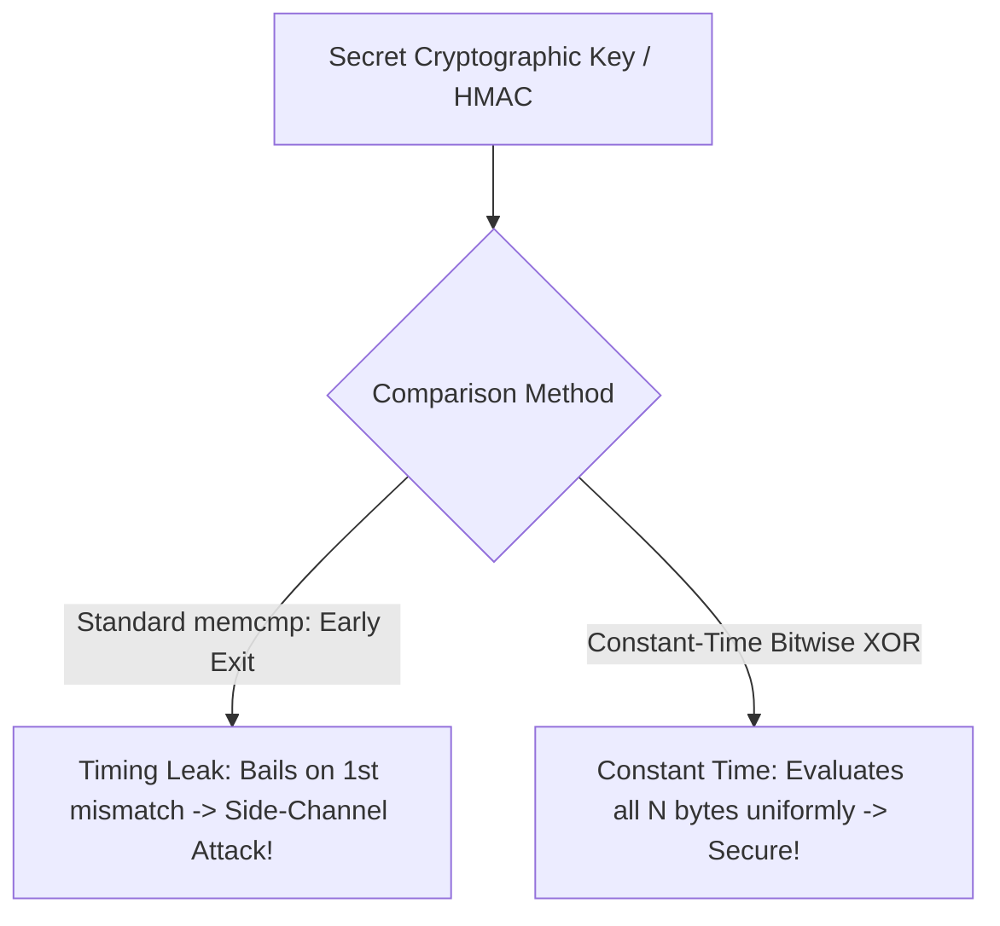

# Secure Randomness and Cryptography Pitfalls in C

> **Navigating side-channel timing attacks, secure memory erasure, CSPRNG entropy sources, and cryptographic implementation pitfalls in C.**

| Level | Prerequisites | Time to Read | Status | Standard |
| :--- | :--- | :--- | :--- | :--- |
| Advanced | [01-fundamentals/04-variables-constants.md](../01-fundamentals/04-variables-constants.md), [03-intermediate/09-time-and-random.md](../03-intermediate/09-time-and-random.md) | 27 mins | Complete | C99 / C11 / C17 / POSIX |

---

## Table of Contents
1. [What & Why](#1-what--why)
2. [Core Concepts](#2-core-concepts)
3. [How It Works Internally](#3-how-it-works-internally)
4. [Syntax & Usage](#4-syntax--usage)
5. [Practical Examples](#5-practical-examples)
6. [Best Practices](#6-best-practices)
7. [Common Mistakes & Pitfalls](#7-common-mistakes--pitfalls)
8. [Performance & Security Notes](#8-performance--security-notes)
9. [Comparison / When to Use What](#9-comparison--when-to-use-what)
10. [Interview Questions](#10-interview-questions)
11. [Practice Exercises](#11-practice-exercises)
12. [Summary / Cheat Sheet](#12-summary--cheat-sheet)
13. [Further Reading](#13-further-reading)

---

## 1. What & Why

Writing cryptographic software in C is one of the most perilous endeavors in computer science. Even when using mathematically proven cryptographic algorithms (such as AES-GCM, ChaCha20-Poly1305, or Ed25519), subtle low-level C implementation details frequently introduce catastrophic vulnerabilities that completely bypass mathematical security:
- **Side-Channel Timing Attacks:** Standard comparison functions like `memcmp()` abort early upon discovering the first mismatched byte. An attacker measuring execution time down to nanoseconds can deduce secret encryption keys and HMAC signatures byte by byte.
- **Dead-Store Elimination:** Compilers actively optimize away standard `memset()` calls used to wipe private keys from stack or heap memory before deallocation, leaving plaintext secrets exposed in RAM.
- **Flawed Random Number Generation:** Using standard C `rand()` or `random()` generates predictable, low-entropy sequences, allowing attackers to forge session tokens, private keys, and nonces.

Understanding low-level cryptographic engineering ensures that C systems remain secure against both remote network adversaries and local side-channel analysis.

---

## 2. Core Concepts

### 2.1 PRNG vs CSPRNG
- **Pseudo-Random Number Generator (PRNG):** Algorithms like Linear Congruential Generators (standard `rand()`) or Mersenne Twister. They are designed for statistical uniform distribution in simulations, *not* security. Observing a small sequence of outputs allows an attacker to reverse-engineer the internal state and predict all future outputs.
- **Cryptographically Secure PRNG (CSPRNG):** Sources entropy from hardware events (keyboard timing, interrupt jitter, thermal noise). They satisfy the **Next-Bit Test**: given the first $k$ bits, no polynomial-time algorithm can predict the $(k+1)$-th bit with probability significantly greater than 50%. (e.g., `/dev/urandom`, POSIX `getentropy()`, Linux `getrandom()`, Windows `BCryptGenRandom()`).

### 2.2 Constant-Time Execution
In cryptography, the execution time of an operation must be completely independent of the *values* of secret data:
- No conditional branches (`if`/`else`) based on secret data.
- No array lookups (memory table indexing) where the index is secret, because CPU L1/L2 cache hits and misses leak timing information (e.g. cache-timing attacks on AES S-boxes).
- Memory comparisons between secrets must traverse every single byte without early exit.



---

## 3. How It Works Internally

### 3.1 Constant-Time Comparison Mechanics
Standard `memcmp` bails out on the first difference:
```c
int memcmp(const void *s1, const void *s2, size_t n) {
    const unsigned char *p1 = s1, *p2 = s2;
    while (n--) {
        if (*p1 != *p2) return *p1 - *p2; /* LEAKS TIMING! */
        p1++; p2++;
    }
    return 0;
}
```
If byte 0 mismatches, it takes 5 CPU cycles; if byte 15 mismatches, it takes 50 CPU cycles.
A **constant-time comparison** accumulates differences using bitwise OR across all bytes:
```c
int constant_time_memcmp(const void *a, const void *b, size_t len) {
    const volatile unsigned char *pa = a;
    const volatile unsigned char *pb = b;
    unsigned char result = 0;
    for (size_t i = 0; i < len; ++i) {
        result |= (pa[i] ^ pb[i]);
    }
    return (int)result;
}
```
Regardless of where differences occur, the loop always executes exactly `len` iterations, emitting identical instruction counts and eliminating timing side-channels.

### 3.2 Dead-Store Elimination and Memory Wiping
Compilers perform Dead-Store Elimination (DSE) optimization. If memory will never be read again before being freed or returning from a function:
```c
void authenticate(void) {
    char key[32];
    load_secret_key(key);
    verify_auth(key);
    memset(key, 0, sizeof(key)); /* DEAD STORE! Optimized away at -O2 */
}
```
Because `key` is never read after `memset()`, the compiler discards the entire `memset()` call. The plaintext key remains resident in stack memory indefinitely.
To force memory zeroing:
- Use POSIX / glibc `explicit_bzero()`.
- Use C23 `memset_explicit()`.
- Use Windows `SecureZeroMemory()`.
- Or access via volatile pointers with compiler memory barriers: `__asm__ __volatile__("" : : "r"(ptr) : "memory");`.

---

## 4. Syntax & Usage

### 4.1 Secure Randomness Acquisition

#### Modern POSIX / Linux (`getentropy` or `getrandom`)
```c
#define _GNU_SOURCE
#include <unistd.h>
#include <sys/random.h>
#include <stdbool.h>

bool get_secure_random(void *buf, size_t len) {
    /* getentropy() fetches up to 256 bytes directly from kernel CSPRNG */
    if (len <= 256) {
        return getentropy(buf, len) == 0;
    }
    /* For larger buffers, use getrandom() */
    ssize_t ret = getrandom(buf, len, 0);
    return (ret == (ssize_t)len);
}
```

#### Windows CSPRNG (`BCryptGenRandom`)
```c
#include <windows.h>
#include <bcrypt.h>

bool get_secure_random_win(void *buf, ULONG len) {
    NTSTATUS status = BCryptGenRandom(NULL, buf, len, BCRYPT_USE_SYSTEM_PREFERRED_RNG);
    return BCRYPT_SUCCESS(status);
}
```

### 4.2 Secure Memory Erasure Patterns
```c
#include <string.h>

void wipe_sensitive_data(void *ptr, size_t len) {
#if defined(__STDC_LIB_EXT1__) || defined(memset_explicit)
    memset_explicit(ptr, 0, len); /* C23 Standard */
#elif defined(_WIN32)
    SecureZeroMemory(ptr, len);   /* Windows API */
#elif defined(__GLIBC__) || defined(__FreeBSD__) || defined(__OpenBSD__)
    explicit_bzero(ptr, len);     /* POSIX / BSD / Glibc */
#else
    /* Fallback volatile wipe with memory barrier */
    volatile unsigned char *p = (volatile unsigned char *)ptr;
    while (len--) {
        *p++ = 0;
    }
    __asm__ __volatile__("" : : "r"(ptr) : "memory");
#endif
}
```

---

## 5. Practical Examples

### 5.1 Verified Companion Simulation: Constant-Time Comparison
The following program evaluates constant-time memory comparison against identical and differing HMAC tokens, and demonstrates secure volatile memory erasure:

```c
#include <stdio.h>
#include <stdint.h>
#include <stdbool.h>
#include <string.h>

/* Constant-time memory comparison to defeat side-channel timing attacks */
static int constant_time_memcmp(const void *a, const void *b, size_t len) {
    const volatile uint8_t *va = (const volatile uint8_t *)a;
    const volatile uint8_t *vb = (const volatile uint8_t *)b;
    uint8_t diff = 0;
    for (size_t i = 0; i < len; ++i) {
        diff |= (va[i] ^ vb[i]);
    }
    return (int)diff;
}

/* Simulated explicit_bzero to wipe memory without compiler dead-store elimination */
static void secure_memzero(void *ptr, size_t len) {
    volatile uint8_t *p = (volatile uint8_t *)ptr;
    while (len--) {
        *p++ = 0;
    }
}

int main(void) {
    printf("Evaluating Cryptographic Pitfalls & Constant-Time Defenses...\n");
    uint8_t mac1[8] = { 0xAA, 0xBB, 0xCC, 0xDD, 0x11, 0x22, 0x33, 0x44 };
    uint8_t mac2[8] = { 0xAA, 0xBB, 0xCC, 0xDD, 0x11, 0x22, 0x33, 0x44 };
    uint8_t mac3[8] = { 0xAA, 0xBB, 0xCC, 0xDD, 0x99, 0x22, 0x33, 0x44 };

    int r_equal = constant_time_memcmp(mac1, mac2, sizeof(mac1));
    int r_diff  = constant_time_memcmp(mac1, mac3, sizeof(mac1));

    printf("Constant-time comparison (Identical): %s\n", (r_equal == 0) ? "MATCH" : "MISMATCH");
    printf("Constant-time comparison (Different): %s\n", (r_diff == 0) ? "MATCH" : "MISMATCH");

    secure_memzero(mac1, sizeof(mac1));
    printf("Secret wiping verified: first byte is now 0x%02X\n", mac1[0]);
    return 0;
}
```

**Real Execution Output:**
```text
Evaluating Cryptographic Pitfalls & Constant-Time Defenses...
Constant-time comparison (Identical): MATCH
Constant-time comparison (Different): MISMATCH
Secret wiping verified: first byte is now 0x00
```

---

## 6. Best Practices

1. **Never Implement Custom Cryptography:** Always use vetted, peer-reviewed libraries (libsodium, OpenSSL, BoringSSL, mbedTLS).
2. **Never Use `rand()` or `srand(time(NULL))` for Security:** `rand()` is completely predictable; seeds based on time are trivially brute-forced within seconds. Always use kernel CSPRNGs (`getentropy`, `getrandom`, `/dev/urandom`).
3. **Always Use Constant-Time Functions for MACs and Signatures:** Use `CRYPTO_memcmp()` (OpenSSL) or `sodium_memcmp()` (libsodium) to compare cryptographic tags.
4. **Never Re-use Nonces (Numbers Used Once):** In modern stream ciphers like AES-GCM or ChaCha20-Poly1305, encrypting two different messages with the identical key and nonce completely destroys ciphertext confidentiality and authenticity.
5. **Wipe Plaintext Keys Immediately After Use:** Always call `explicit_bzero()` or `memset_explicit()` on sensitive data buffers prior to releasing memory.

---

## 7. Common Mistakes & Pitfalls

| Mistake | Why It Is Dangerous | Correct Fix |
| :--- | :--- | :--- |
| **`memcmp(user_token, secret_token, 32)`** | Early exit leaks timing; attacker recovers token byte by byte. | Use `constant_time_memcmp()`. |
| **`memset(secret_key, 0, sz)` before free** | Compiler dead-store elimination erases the call; secret stays in RAM. | Use `explicit_bzero()` or `memset_explicit()`. |
| **`srand(time(NULL)); token = rand();`** | Attacker tests the few thousand timestamps around token creation, recovering seed. | Fetch entropy from `getentropy()` or `/dev/urandom`. |
| **Using Electronic Codebook (ECB) mode** | Identical plaintext blocks produce identical ciphertext blocks; leaks image/data structure. | Use authenticated modes: AES-GCM or ChaCha20-Poly1305. |
| **Hardcoding cryptographic keys in source code** | Keys are stored in plaintext in the `.rodata` ELF segment; extracted with `strings`. | Load keys from secure hardware keystores or environment variables. |
| **Failing to verify HMAC signatures before decryption** | Enables padding oracle attacks (e.g. Vaudenay attack on CBC mode). | Use Encrypt-then-MAC or AEAD ciphers. |

---

## 8. Performance & Security Notes

### 8.1 Side-Channel Attacks in Cloud Environments
In shared virtualization environments (AWS, Azure, Google Cloud):
- Co-located virtual machines share physical CPU hardware caches (L1/L2/L3).
- Attackers run cache-probing routines (Prime+Probe, Flush+Reload) to monitor which memory lines the cryptographic process accesses.
- If an algorithm accesses lookup tables based on secret key bits (as in naive implementations of AES or RSA), the attacker can reconstruct the entire private key without software exploits.

### 8.2 Safe Dynamic Memory Allocation for Secrets
Standard `malloc()` places secrets in virtual memory pages that can be swapped to physical disk swap space (`/swapfile`), persisting in plaintext across power reboots:
- Use POSIX `mlock()` to lock secret memory buffers into physical RAM and prevent swapping to disk.
- In Linux, mark pages with `madvise(..., MADV_DONTDUMP)` to ensure keys are not included in core dumps if the process crashes.

---

## 9. Comparison / When to Use What

| Primitive | Deterministic / Fast | Cryptographically Secure | Use Case |
| :--- | :--- | :--- | :--- |
| **`rand()` / `random()`** | Fast PRNG | **NO (Predictable)** | Monte Carlo simulations, games |
| **`getentropy()`** | Moderate (Syscall) | **YES (Kernel CSPRNG)** | Encryption keys, IVs, session tokens |
| **`memcmp()`** | Highly optimized | **NO (Timing leaks)** | General data sorting / searching |
| **`constant_time_memcmp()`**| Slightly slower | **YES (Timing safe)** | HMAC, password hash, signature checks |
| **`memset()`** | Fast | **NO (Subject to DSE)** | General buffer zero-initialization |
| **`explicit_bzero()`** | Fast | **YES (Guaranteed wipe)**| Clearing private keys and passwords |

---

## 10. Interview Questions

<details>
<summary><strong>1. Why is <code>memcmp()</code> dangerous when validating cryptographic signatures or HMACs?</strong></summary>

`memcmp()` aborts and returns as soon as it encounters the first mismatched byte. An attacker measuring the elapsed time over a network (or on localhost) can measure that a guess whose first byte is correct takes slightly longer to reject than a guess whose first byte is wrong. By iterating through all 256 possibilities for each byte sequentially, the attacker cracks the secret HMAC byte by byte in linear time ($256 	imes N$) rather than exponential time ($256^N$).
</details>

<details>
<summary><strong>2. What is "Dead-Store Elimination" and how does it compromise cryptographic key erasure?</strong></summary>

Dead-Store Elimination (DSE) is a compiler optimization that removes memory write operations whose stored values are never subsequently read before the variable's lifetime ends. If a developer calls `memset(key, 0, 32)` immediately before freeing `key` or returning from a function, the compiler sees that `key` is never read again and erases the `memset()` instruction entirely, leaving the plaintext key exposed in physical RAM.
</details>

<details>
<summary><strong>3. How does <code>explicit_bzero()</code> or <code>memset_explicit()</code> prevent dead-store elimination?</strong></summary>

`explicit_bzero()` (POSIX) and `memset_explicit()` (C23) are formally specified by standards to prevent compilers from optimizing away the memory write operation, guaranteeing that the memory buffer is physically wiped with zeroes regardless of dataflow optimizations.
</details>

<details>
<summary><strong>4. Why is seeding <code>srand(time(NULL))</code> insecure for cryptographic token generation?</strong></summary>

`time(NULL)` returns the current Unix epoch in seconds. A remote attacker knowing approximately when a token was generated (e.g. within a 1-hour window) only has to test $3,600$ possible seed values. Testing $3,600$ seeds with `rand()` takes less than 1 millisecond on modern hardware, completely compromising the pseudo-random stream.
</details>

<details>
<summary><strong>5. What is the difference between Linux <code>/dev/random</code> and <code>/dev/urandom</code>?</strong></summary>

Historically, `/dev/random` blocked execution whenever the kernel estimated entropy had depleted, while `/dev/urandom` never blocked (re-seeding a CSPRNG). In modern Linux kernels (5.6+), both interfaces are powered by the same ChaCha20 CSPRNG; neither blocks after initial boot seeding. Modern C programs should use the `getentropy()` or `getrandom()` system calls directly rather than opening device nodes.
</details>

<details>
<summary><strong>6. What is a "Nonce" and what catastrophic vulnerability occurs if a nonce is reused in AES-GCM?</strong></summary>

A Nonce ("Number used Once") is an arbitrary number used in cryptographic communication to ensure identical plaintexts encrypt to different ciphertexts. In AES-GCM or ChaCha20-Poly1305, reusing a nonce with the same key allows attackers to XOR the ciphertexts to recover plaintext differences, and mathematically calculate the authentication hash subkey ($H$), completely destroying both confidentiality and forgery protection.
</details>

<details>
<summary><strong>7. How does the <code>mlock()</code> system call contribute to cryptographic security?</strong></summary>

`mlock(ptr, len)` locks the specified memory pages into physical RAM, preventing the operating system kernel from swapping those memory pages out to physical disk swap files or hibernation images. This prevents plaintext cryptographic keys from persisting on non-volatile disks.
</details>

<details>
<summary><strong>8. What is the purpose of the volatile keyword when implementing custom secure wipe functions?</strong></summary>

Declaring a pointer as `volatile unsigned char *` informs the compiler that the memory addressed by the pointer can be accessed or modified by hardware or external agents outside the compiler's knowledge. This inhibits the compiler's optimizer from assuming the store operation is dead, preventing Dead-Store Elimination.
</details>

---

## 11. Practice Exercises

### Exercise 1 (Easy): Refactoring Insecure Randomness
- **Task:** Refactor the following flawed API key generator to use POSIX `getentropy()`:
```c
void generate_api_key(char *out_key) {
    srand(time(NULL));
    for (int i = 0; i < 16; ++i) {
        out_key[i] = "0123456789ABCDEF"[rand() % 16];
    }
    out_key[16] = '';
}
```

<details>
<summary>Solution</summary>

```c
#include <unistd.h>
#include <stdint.h>
#include <stdbool.h>

bool generate_api_key_secure(char *out_key) {
    uint8_t raw_bytes[16];
    if (getentropy(raw_bytes, sizeof(raw_bytes)) != 0) {
        return false; /* Kernel entropy failure */
    }
    const char hex_chars[] = "0123456789ABCDEF";
    for (int i = 0; i < 16; ++i) {
        out_key[i] = hex_chars[raw_bytes[i] & 0x0F];
    }
    out_key[16] = '';
    return true;
}
```
</details>

### Exercise 2 (Medium): Implementing Constant-Time String Equality
- **Task:** Write a constant-time string comparison function `bool ct_streq(const char *s1, const char *s2, size_t max_len)` that compares two null-terminated strings without leaking timing information about where characters diverge.

<details>
<summary>Solution</summary>

```c
#include <stdbool.h>
#include <stddef.h>

bool ct_streq(const char *s1, const char *s2, size_t max_len) {
    if (!s1 || !s2) return false;
    unsigned char diff = 0;
    bool s1_done = false;
    bool s2_done = false;

    for (size_t i = 0; i < max_len; ++i) {
        unsigned char c1 = (unsigned char)s1[i];
        unsigned char c2 = (unsigned char)s2[i];

        if (c1 == '') s1_done = true;
        if (c2 == '') s2_done = true;

        if (s1_done || s2_done) {
            /* If one string ended before the other, record difference */
            diff |= (s1_done ^ s2_done);
        } else {
            diff |= (c1 ^ c2);
        }

        if (s1_done && s2_done) {
            break;
        }
    }
    return (diff == 0);
}
```
</details>

### Exercise 3 (Hard): Secure Secret Lifecycle Container
- **Task:** Implement a secure key container `secret_box_t` with `box_alloc(size_t len)`, `box_lock(box)` (uses `mlock`), and `box_destroy(box)` (wipes with `explicit_bzero` and unlocks).

<details>
<summary>Solution</summary>

```c
#include <stdio.h>
#include <stdlib.h>
#include <string.h>
#include <sys/mman.h>

typedef struct {
    uint8_t *data;
    size_t len;
} secret_box_t;

secret_box_t *box_alloc(size_t len) {
    secret_box_t *b = malloc(sizeof(secret_box_t));
    if (!b) return NULL;
    b->data = malloc(len);
    if (!b->data) {
        free(b);
        return NULL;
    }
    b->len = len;
    /* Lock memory into RAM to prevent swap leakage */
    mlock(b->data, len);
    return b;
}

void box_destroy(secret_box_t **pbox) {
    if (pbox && *pbox) {
        secret_box_t *b = *pbox;
        if (b->data) {
            /* Secure wipe */
            volatile uint8_t *p = (volatile uint8_t *)b->data;
            for (size_t i = 0; i < b->len; ++i) p[i] = 0;
            munlock(b->data, b->len);
            free(b->data);
        }
        free(b);
        *pbox = NULL;
    }
}
```
</details>

---

## 12. Summary / Cheat Sheet

| Domain | Insecure Approach | Cryptographically Hardened Approach |
| :--- | :--- | :--- |
| **Entropy Source** | `rand()`, `random()`, `time(NULL)` | `getentropy()`, `getrandom()`, `BCryptGenRandom()` |
| **Memory Comparison**| `memcmp()` (Early exit) | `constant_time_memcmp()` (Bitwise OR accumulation) |
| **Secret Deletion** | `memset()` (Dead-store eliminated) | `explicit_bzero()`, `memset_explicit()`, `SecureZeroMemory()` |
| **Memory Swapping** | Standard heap allocations | `mlock()` to lock buffers in physical RAM |
| **Cipher Modes** | AES-ECB, unauthenticated CBC | Authenticated Encryption (AES-GCM, ChaCha20-Poly1305) |

---

## 13. Further Reading
- Cryptographic Right Answers (Latacora Guides): `https://latacora.micro.blog/2018/04/03/cryptographic-right-answers.html`
- BearSSL: Why Constant-Time Crypto Matters (Thomas Pornin)
- CERT C Rule MSC30-C: Do not use the rand() function for generating pseudorandom numbers
- POSIX getentropy() Specification: `https://man7.org/linux/man-pages/man3/getentropy.3.html`

---
[<- Previous: 09-safe-string-handling-patterns.md](09-safe-string-handling-patterns.md) | [Section Index](README.md) | [Next: 11-exploit-mitigations-explained.md ->](11-exploit-mitigations-explained.md)\n