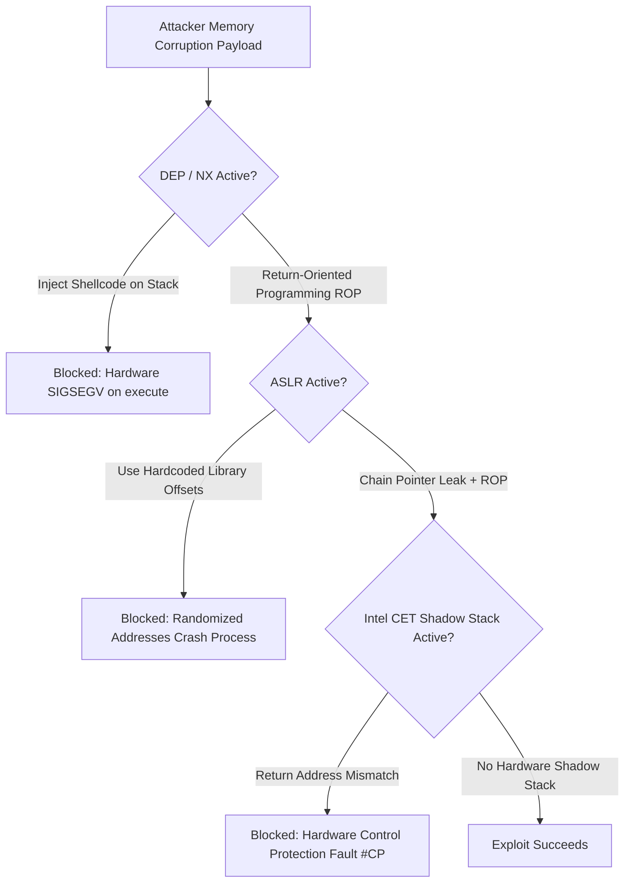

# Modern Exploit Mitigations Explained

> **Deconstructing modern operating system and hardware binary defenses: ASLR, DEP/NX, Control Flow Integrity (CFI), and Intel CET shadow stacks.**

| Level | Prerequisites | Time to Read | Status | Standard |
| :--- | :--- | :--- | :--- | :--- |
| Advanced | [01-buffer-overflows.md](01-buffer-overflows.md), [07-hardening-flags.md](07-hardening-flags.md) | 27 mins | Complete | C99 / C11 / C17 / POSIX |

---

## Table of Contents
1. [What & Why](#1-what--why)
2. [Core Concepts](#2-core-concepts)
3. [How It Works Internally](#3-how-it-works-internally)
4. [Syntax & Usage](#4-syntax--usage)
5. [Practical Examples](#5-practical-examples)
6. [Best Practices](#6-best-practices)
7. [Common Mistakes & Pitfalls](#7-common-mistakes--pitfalls)
8. [Performance & Security Notes](#8-performance--security-notes)
9. [Comparison / When to Use What](#9-comparison--when-to-use-what)
10. [Interview Questions](#10-interview-questions)
11. [Practice Exercises](#11-practice-exercises)
12. [Summary / Cheat Sheet](#12-summary--cheat-sheet)
13. [Further Reading](#13-further-reading)

---

## 1. What & Why

In the early decades of computer security (1980s–1990s), exploiting a C buffer overflow was straightforward: an attacker injected machine code (shellcode) directly into a stack buffer and overwrote the saved return address to point to that buffer. Memory addresses were static, memory was simultaneously writable and executable, and the CPU executed whatever address `%eip` pointed to.

Over the last 25 years, operating system architects, compiler engineers, and CPU designers introduced **Exploit Mitigations**:
- Hardware and kernel features designed to make entire classes of exploits mathematically or architecturally impossible, even when low-level source-code vulnerabilities exist.
- Moving the goalposts from simple execution to complex bypass chains (such as chaining information leaks to bypass ASLR, followed by Return-Oriented Programming (ROP) to bypass DEP/NX).
- The latest generation of hardware mitigations—such as **Control Flow Integrity (CFI)** and **Intel CET (Shadow Stacks)**—now renders traditional ROP chains obsolete.

Systems programmers must understand these runtime defenses to configure their software correctly and comprehend modern attack surfaces.

---

## 2. Core Concepts

### 2.1 The Defensive Trinity and Beyond
1. **DEP / NX (Data Execution Prevention / No-Execute Bit):** CPU memory page table bit that enforces $W \oplus X$ (Write XOR Execute). Memory can be writable or executable, but never both. The stack and heap are non-executable.
2. **ASLR (Address Space Layout Randomization):** The operating system loader randomizes the base virtual memory addresses of the stack, heap, shared libraries (`libc`), and main binary on every execution.
3. **CFI (Control Flow Integrity):** Validates that indirect jumps and calls (`call *%rax`) only target compiler-approved, legitimate function entry points.
4. **CET (Control-flow Enforcement Technology):** Hardware CPU features (Intel CET / ARM Guarded Control Stack) that maintain a dedicated **Shadow Stack** in protected hardware memory, preventing return address overwriting.



---

## 3. How It Works Internally

### 3.1 DEP / NX: The Hardware Page Table Bit
In x86_64 CPU page table entries, **Bit 63** is the **NX (No-Execute) Bit** (or XD / Execute-Disable):
- When the kernel allocates virtual memory pages for the thread stack or heap, it sets Bit 63 to `1`.
- If the CPU instruction pointer (`%rip`) ever attempts to fetch an instruction from a memory page where Bit 63 is set, the CPU's Memory Management Unit (MMU) raises a hardware page-fault exception (`#PF`), which the kernel translates into an immediate `SIGSEGV` crash.
- Attackers can no longer execute custom shellcode placed in memory buffers.

### 3.2 The ROP Counter-Attack
To bypass DEP/NX, attackers developed **Return-Oriented Programming (ROP)**:
- Instead of injecting new instructions, attackers reuse existing snippets of executable machine code already present in the binary's read-only `.text` segment or shared libraries (`libc.so`).
- These snippets end in a `ret` instruction and are called **gadgets**:
  ```assembly
  pop %rdi; ret    ; Gadget 1: Load parameter into %rdi
  pop %rsi; ret    ; Gadget 2: Load parameter into %rsi
  call *%rax       ; Gadget 3: Invoke function
  ```
- By writing a sequence of gadget addresses onto the stack, the attacker chains them together: each `ret` instruction pops the next gadget address into `%rip`.

### 3.3 Intel CET Shadow Stack: Killing ROP at the Silicon Level
Intel CET introduces two complementary hardware mechanisms:
1. **Shadow Stack (SHSTK):** The CPU maintains a secondary, internal stack dedicated *strictly* to return addresses.
   - When `call` executes, the CPU pushes the return address to both the normal data stack *and* the hardware shadow stack.
   - When `ret` executes, the CPU pops the return address from both stacks and compares them.
   - If an attacker used a buffer overflow to overwrite the return address on the data stack, it will not match the shadow stack copy. The CPU raises a **Control Protection Exception (`#CP`)**, killing the process instantly.
   - The shadow stack memory pages are protected by page-table attributes; application software cannot write to them via standard `mov` instructions.
2. **Indirect Branch Tracking (IBT):** Requires indirect calls (`call *%rax`) to land *only* on instructions prefixed with a special `ENDBR64` (End Branch 64) marker, defeating Jump-Oriented Programming (JOP).

---

### 3.4 Hardware-Assisted ARM Memory Tagging Extension (MTE)
In ARMv8.5-A, hardware introduces **Memory Tagging Extension (MTE)**:
- Physical memory is divided into 16-byte granules.
- Every 16-byte granule is assigned a 4-bit hardware key stored in dedicated metadata RAM.
- Every pointer is tagged with a matching 4-bit key in its upper unused byte (`Top-Byte-Ignore` TBI).
- When a memory access occurs (`ldr` / `str`), the hardware compares the pointer's tag with the memory granule's tag.
- If the tags mismatch (e.g. accessing 1 byte past an array boundary, or accessing freed memory whose tag was cleared), the hardware generates an immediate tag-check fault (`SIGSEGV`). MTE provides silicon-level protection against buffer overflows and use-after-free bugs with virtually zero CPU performance overhead.

---

## 4. Syntax & Usage

### 4.1 Enabling Hardware Mitigations in Compilers

#### Enabling Intel CET on GCC / Clang
```bash
gcc -std=c11 -Wall -Wextra -O2     -fcf-protection=full     -fPIE -pie     -Wl,-z,relro,-z,now     main.c -o app_cet
```
- `-fcf-protection=full`: Instructs the compiler to emit `ENDBR64` instructions at all legitimate indirect branch targets and generate shadow-stack compatible code.

#### Enabling Clang Control Flow Integrity (CFI)
Clang includes software-based Control Flow Integrity checks (requires Link-Time Optimization `-flto`):
```bash
clang -std=c11 -Wall -O2       -flto -fsanitize=cfi       -fvisibility=hidden       main.c -o app_cfi
```

---

## 5. Practical Examples

### 5.1 Verified Companion Simulation: Exploit Mitigation Matrix
The following program audits modern operating system and hardware exploit mitigations and records their defensive characteristics:

```c
#include <stdio.h>
#include <stdint.h>
#include <stdbool.h>

typedef struct {
    const char *name;
    const char *mechanism;
    const char *bypassed_by;
} mitigation_t;

static const mitigation_t MITIGATIONS[] = {
    {"ASLR", "Randomizes base addresses of stack, heap, and shared libraries", "Information disclosure / pointer leaks"},
    {"DEP / NX", "Marks data pages non-executable via CPU page table bit", "Return-Oriented Programming (ROP)"},
    {"CFI", "Validates indirect call targets against compiler-generated graph", "Function re-use within valid signature sets"},
    {"Intel CET", "Hardware shadow stack prevents return address overwrites", "Data-only attacks"}
};

int main(void) {
    printf("Evaluating Modern Operating System & Hardware Exploit Mitigations...\n");
    for (size_t i = 0; i < sizeof(MITIGATIONS)/sizeof(MITIGATIONS[0]); ++i) {
        printf("Mitigation: %-10s Mechanism: %-52s Bypassed By: %s\n",
               MITIGATIONS[i].name, MITIGATIONS[i].mechanism, MITIGATIONS[i].bypassed_by);
    }
    printf("Modern defense-in-depth architecture matrix verified.\n");
    return 0;
}
```

**Real Execution Output:**
```text
Evaluating Modern Operating System & Hardware Exploit Mitigations...
Mitigation: ASLR       Mechanism: Randomizes base addresses of stack, heap, and shared libraries Bypassed By: Information disclosure / pointer leaks
Mitigation: DEP / NX   Mechanism: Marks data pages non-executable via CPU page table bit Bypassed By: Return-Oriented Programming (ROP)
Mitigation: CFI        Mechanism: Validates indirect call targets against compiler-generated graph Bypassed By: Function re-use within valid signature sets
Mitigation: Intel CET  Mechanism: Hardware shadow stack prevents return address overwrites Bypassed By: Data-only attacks
Modern defense-in-depth architecture matrix verified.
```

---

## 6. Best Practices

1. **Build Everything as PIE:** Never compile standard executables with fixed base addresses. Always enable `-fPIE -pie` to allow the kernel to randomize the entire binary via ASLR.
2. **Compile with `-fcf-protection=full`:** Enable Intel CET / ARM BTI support. On CPUs lacking CET hardware, `ENDBR64` executes as a safe NOP; on modern CPUs, it enforces hardware control flow verification.
3. **Enforce $W \oplus X$:** Never allocate memory with both `PROT_WRITE` and `PROT_EXEC` in `mmap()` calls. If developing a JIT compiler, allocate memory as writable, write the code, then call `mprotect()` to make it read-only and executable.
4. **Eliminate Information Leaks:** ASLR's only weakness is memory disclosure (format strings, uninitialized reads). Treating information leaks as critical security bugs prevents attackers from de-randomizing memory layouts.
5. **Keep Compilers and Kernels Updated:** Modern mitigations (like CET and Safe-Linking) require coordination between the compiler, C standard library, and kernel.

---

## 7. Common Mistakes & Pitfalls

| Mistake | Why It Is Dangerous | Correct Fix |
| :--- | :--- | :--- |
| **Using `mprotect(..., PROT_READ | PROT_WRITE | PROT_EXEC)`** | Completely disables DEP/NX on that memory region. | Use $W \oplus X$: write, then make read+exec. |
| **Assuming ASLR alone stops exploits** | ASLR without PIE leaves the main executable code at static addresses; ROP uses binary gadgets. | Always pair ASLR with `-fPIE -pie`. |
| **Brute-forcing 32-bit ASLR** | On 32-bit systems, ASLR entropy is only 16 bits; attackers brute-force addresses in minutes. | Deploy 64-bit binaries where ASLR has 28–32 bits of entropy. |
| **Ignoring information leaks (pointer leaks)** | A single leaked function pointer allows an attacker to compute the base address of `libc`. | Prevent uninitialized reads and format string bugs. |
| **Disabling mitigations for performance** | Disabling stack protectors or ASLR saves negligible CPU while exposing the system to total compromise. | Retain all standard hardening mitigations. |
| **Assuming CET stops data-only attacks** | CET protects return addresses and call targets, but does not prevent altering boolean flags like `is_admin`. | Validate data integrity and state logic. |

---

## 8. Performance & Security Notes

### 8.1 Hardware Acceleration Overhead
Modern mitigations are implemented directly in silicon:
- **DEP/NX:** Evaluated by the CPU MMU during address translation with **0% runtime overhead**.
- **Intel CET Shadow Stack:** The secondary return stack push and pop occurs in parallel within CPU execution pipelines, introducing less than **1% CPU overhead**.
- **ASLR:** Evaluated once during process loading by the kernel ELF loader; introduces **0% runtime overhead** during program execution.

### 8.2 Data-Only Attacks (The Next Frontier)
Because modern mitigations make control-flow hijacking (ROP, shellcode) nearly impossible:
- Attackers now focus on **Data-Only Attacks**: corrupting sensitive application variables (such as user credentials, file descriptors, permission booleans, or cryptographic keys) without altering CPU instruction pointers.
- Defending against data-only attacks requires strict source-code bounds checking and static analysis.

---

## 9. Comparison / When to Use What

| Mitigation | Layer | Primary Attack Neutralized | Hardware Required |
| :--- | :--- | :--- | :--- |
| **DEP / NX** | CPU MMU / OS Kernel | Shellcode execution in stack/heap | Any x86_64 / ARMv8 CPU |
| **ASLR** | OS Kernel ELF Loader | Hardcoded address ROP attacks | OS Support (Linux, Win, macOS) |
| **Stack Canaries** | Compiler / glibc | Linear stack buffer overwrites | Software only (GCC/Clang) |
| **Clang CFI** | Compiler / LTO | Virtual table and indirect call hijacking | Clang LTO |
| **Intel CET** | CPU Microarchitecture | ROP gadgets and shadow stack corruption | Intel 11th Gen+ / AMD Zen 3+ |

---

## 10. Interview Questions

<details>
<summary><strong>1. Explain how the $W \oplus X$ (Write XOR Execute) principle works in modern operating systems.</strong></summary>

$W \oplus X$ dictates that no virtual memory page should be simultaneously writable and executable. If a page can be written to by an application (such as the stack or heap), the operating system sets the CPU page table's NX (No-Execute) bit, preventing the CPU from executing code from that page. If a page contains executable machine code (such as the `.text` segment), it is mapped read-only.
</details>

<details>
<summary><strong>2. How did Return-Oriented Programming (ROP) evolve to bypass DEP/NX?</strong></summary>

Because DEP/NX prevents attackers from executing custom shellcode on the stack, attackers realized they could execute existing snippets of valid machine code ending in `ret` instructions already residing in executable memory (such as `libc`). By forging a stack containing a sequence of gadget addresses, the CPU returns from gadget to gadget, chaining operations together to execute arbitrary logic without executing data pages.
</details>

<details>
<summary><strong>3. How does Address Space Layout Randomization (ASLR) defend against ROP attacks?</strong></summary>

ROP attacks require knowing the exact memory addresses of gadgets in memory. ASLR randomizes the base memory addresses of the stack, heap, shared libraries, and executable code on every process execution. Because the attacker cannot predict where `libc` or gadgets reside in virtual memory, hardcoded ROP chains crash the process with a segmentation fault.
</details>

<details>
<summary><strong>4. How can an attacker bypass ASLR?</strong></summary>

By exploiting an **Information Disclosure Vulnerability** (such as a format string leak or uninitialized memory read). If the attacker can leak a single function pointer pointing into `libc` or the binary, they can subtract the known static symbol offset from the leaked address to calculate the base address of the library, completely neutralizing ASLR for that process instance.
</details>

<details>
<summary><strong>5. What is an Intel CET Shadow Stack and how does it prevent ROP?</strong></summary>

A Shadow Stack is a secondary call stack maintained by the CPU in protected hardware memory. When `call` is executed, the return address is pushed to both the data stack and the shadow stack. When `ret` executes, the CPU verifies that the return address on the data stack matches the shadow stack copy. If a buffer overflow overwrote the return address on the data stack, the addresses mismatch, and the CPU raises an immediate hardware Control Protection Exception (`#CP`), terminating the exploit.
</details>

<details>
<summary><strong>6. What is the role of the <code>ENDBR64</code> instruction in Intel CET Indirect Branch Tracking (IBT)?</strong></summary>

IBT ensures that indirect calls (`call *%rax`) or indirect jumps can only target legitimate compiler-approved function entry points. The compiler places an `ENDBR64` instruction at every valid indirect target. When an indirect call executes, the CPU transitions into a tracking state; if the instruction immediately following the call is not `ENDBR64`, the CPU raises an immediate control protection fault, defeating Jump-Oriented Programming (JOP).
</details>

<details>
<summary><strong>7. Why is 64-bit ASLR vastly superior to 32-bit ASLR?</strong></summary>

On 32-bit architectures, virtual address space is limited to 4GB, leaving only 16 bits of usable entropy for ASLR. An attacker can brute-force the randomized base address in a few thousand attempts. On 64-bit architectures, address space is 256TB or more, providing 28 to 32 bits of entropy ($2^{32} pprox 4.3 	ext{ billion}$ possibilities), making brute-force attacks computationally impossible.
</details>

<details>
<summary><strong>8. What is a "Data-Only Attack"?</strong></summary>

A data-only attack is a memory corruption attack that does not hijack CPU control flow (leaving return addresses and function pointers intact). Instead, it alters critical data variables (e.g. flipping a `bool is_authenticated` flag from false to true, or changing a user ID). Data-only attacks bypass DEP, ASLR, CFI, and CET because control flow instructions remain entirely legitimate.
</details>

---

<details>
<summary><strong>9. How does ARM Pointer Authentication (PAC) defend against return-oriented programming?</strong></summary>

ARMv8.3-A introduced Pointer Authentication Codes (PAC). The CPU uses cryptographic primitives (QARMA cipher) with secret internal hardware keys to sign pointers before saving them to the stack (injecting a cryptographic authentication code into the unused upper bits of the 64-bit pointer). Before dereferencing or returning, the CPU verifies the PAC signature with <code>autiasp</code>; if an attacker corrupted the pointer, verification fails and triggers a CPU fault.
</details>

<details>
<summary><strong>10. What is the difference between Forward-Edge and Backward-Edge Control Flow Integrity?</strong></summary>

- <strong>Forward-Edge CFI:</strong> Protects indirect calls and jumps (e.g. <code>call *%rax</code>, function pointers, and C++ vtable dispatches) by ensuring targets land on compiler-approved function entry points (enforced by Clang CFI or Intel IBT).
- <strong>Backward-Edge CFI:</strong> Protects return instructions (<code>ret</code>) by ensuring execution returns strictly to the caller that invoked the function (enforced by hardware Shadow Stacks or ARM PAC).
</details>

---

## 11. Practice Exercises

### Exercise 1 (Easy): Auditing Binary Exploit Mitigations
- **Task:** Explain what each line of output from `checksec --file=my_app` indicates regarding exploit mitigations:
```text
RELRO:    Full RELRO
STACK:    Canary found
NX:       NX enabled
PIE:      PIE enabled
```

<details>
<summary>Solution</summary>

- **Full RELRO:** All ELF dynamic symbols resolved at startup; Global Offset Table (GOT) is marked read-only, preventing GOT hijacking.
- **Canary found:** Stack canaries (`-fstack-protector-strong`) active; function frames contain randomized guard words to detect stack smashing.
- **NX enabled:** Non-Executable stack and heap (DEP/NX active via MMU bit); prevents shellcode execution on data pages.
- **PIE enabled:** Position Independent Executable; main executable is relocatable, allowing the kernel to fully randomize binary code locations via ASLR.
</details>

### Exercise 2 (Medium): Implementing $W \oplus X$ Safe JIT Memory Allocation
- **Task:** Write a function `void *allocate_jit_code(const uint8_t *code, size_t len)` that allocates memory using `mmap()`, writes the code while writable, and then uses `mprotect()` to make it executable and read-only, enforcing $W \oplus X$.

<details>
<summary>Solution</summary>

```c
#include <stdio.h>
#include <string.h>
#include <sys/mman.h>
#include <unistd.h>

void *allocate_jit_code(const uint8_t *code, size_t len) {
    if (!code || len == 0) return NULL;

    /* Step 1: Allocate memory as READ + WRITE (not executable) */
    void *mem = mmap(NULL, len, PROT_READ | PROT_WRITE, MAP_ANONYMOUS | MAP_PRIVATE, -1, 0);
    if (mem == MAP_FAILED) {
        return NULL;
    }

    /* Step 2: Copy machine code instructions */
    memcpy(mem, code, len);

    /* Step 3: Transition to READ + EXECUTE (remove WRITE) */
    if (mprotect(mem, len, PROT_READ | PROT_EXEC) != 0) {
        munmap(mem, len);
        return NULL;
    }

    return mem;
}
```
</details>

### Exercise 3 (Hard): Emulating Return Address Integrity Verification
- **Task:** Write a C verification harness simulating a software shadow stack: record return addresses in an array upon entry and verify that the return address was not corrupted before returning.

<details>
<summary>Solution</summary>

```c
#include <stdio.h>
#include <stdlib.h>
#include <stdint.h>

#define MAX_DEPTH 8

static void *g_shadow_stack[MAX_DEPTH];
static size_t g_shadow_top = 0;

void shadow_push(void *ret_addr) {
    if (g_shadow_top < MAX_DEPTH) {
        g_shadow_stack[g_shadow_top++] = ret_addr;
    }
}

void shadow_verify_and_pop(void *expected_ret_addr) {
    if (g_shadow_top == 0) abort();
    void *actual_ret = g_shadow_stack[--g_shadow_top];
    if (actual_ret != expected_ret_addr) {
        fprintf(stderr, "*** HARDWARE #CP EMULATION: Return address hijacked! ***\n");
        abort();
    }
    printf("Shadow stack matched return address %p successfully.\n", expected_ret_addr);
}

void example_function(void) {
    void *ret_addr = __builtin_return_address(0);
    shadow_push(ret_addr);

    /* Operations... */

    shadow_verify_and_pop(__builtin_return_address(0));
}

int main(void) {
    example_function();
    return 0;
}
```
</details>

---

## 12. Summary / Cheat Sheet

| Mitigation | Primary Layer | Defense Mechanism | Bypassed By |
| :--- | :--- | :--- | :--- |
| **DEP / NX** | Hardware MMU | $W \oplus X$: Stack and heap cannot execute | Return-Oriented Programming (ROP) |
| **ASLR** | OS Kernel | Randomizes stack, heap, and library bases | Information disclosure / pointer leaks |
| **PIE** | Compiler / Linker | Enables ASLR for main binary `.text` segment | Pointer leaks |
| **Stack Canaries**| Compiler | Terminates process if guard word modified | Non-linear writes / pointer arithmetic |
| **Full RELRO** | Dynamic Linker | Makes Global Offset Table strictly read-only | Non-GOT write targets |
| **Intel CET** | CPU Silicon | Shadow stack prevents return address modification| Data-only attacks |

---

## 13. Further Reading
- Intel Control-Flow Enforcement Technology (CET) Specification: `https://www.intel.com/content/www/us/en/developer/articles/technical/technical-look-control-flow-enforcement-technology.html`
- Clang Control Flow Integrity (CFI) Documentation: `https://clang.llvm.org/docs/ControlFlowIntegrity.html`
- PaX Address Space Layout Randomization (ASLR) Design: `https://pax.grsecurity.net/docs/aslr.txt`
- The Geometry of Innocent Flesh on the Bone: Return-into-libc without Function Calls (Hovav Shacham)

---
[<- Previous: 10-secure-random-and-crypto-pitfalls.md](10-secure-random-and-crypto-pitfalls.md) | [Section Index](README.md) | [Next: ../09-performance/README.md ->](../09-performance/README.md)\n