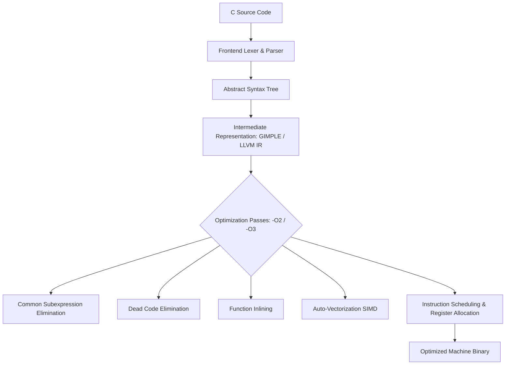

# Compiler Optimizations in C

> **Mastering GCC/Clang optimization levels (`-O1`, `-O2`, `-O3`, `-Ofast`), vectorization heuristics, loop unrolling, and optimization barriers.**

| Level | Prerequisites | Time to Read | Status | Standard |
| :--- | :--- | :--- | :--- | :--- |
| Advanced | [00-setup/03-compilation-process.md](../00-setup/03-compilation-process.md), [01-cache-and-memory-hierarchy.md](01-cache-and-memory-hierarchy.md) | 26 mins | Complete | C99 / C11 / C17 / C23 |

---

## Table of Contents
1. [What & Why](#1-what--why)
2. [Core Concepts](#2-core-concepts)
3. [How It Works Internally](#3-how-it-works-internally)
4. [Syntax & Usage](#4-syntax--usage)
5. [Practical Examples](#5-practical-examples)
6. [Best Practices](#6-best-practices)
7. [Common Mistakes & Pitfalls](#7-common-mistakes--pitfalls)
8. [Performance & Security Notes](#8-performance--security-notes)
9. [Comparison / When to Use What](#9-comparison--when-to-use-what)
10. [Interview Questions](#10-interview-questions)
11. [Practice Exercises](#11-practice-exercises)
12. [Summary / Cheat Sheet](#12-summary--cheat-sheet)
13. [Further Reading](#13-further-reading)

---

## 1. What & Why

Modern optimizing C compilers (such as GCC and LLVM/Clang) are among the most sophisticated software systems in existence. When source code is compiled, the compiler does not translate C statements directly into assembly instructions; instead, it parses C into an **Intermediate Representation (IR)**—such as GCC GIMPLE or LLVM IR—and executes dozens of mathematical optimization passes before emitting machine instructions.

An optimizing compiler:
- Eliminates dead calculations and redundant memory loads.
- Reorganizes loops to leverage SIMD vector registers.
- Replaces expensive function calls with inline machine code.
- Predicts register allocation to minimize stack memory spills.

Understanding how compiler optimization passes work allows C engineers to write code that aligns with compiler transformation heuristics, achieving maximum hardware efficiency.

---

## 2. Core Concepts

### 2.1 Compiler Optimization Levels
- `-O0`: Optimization disabled. Compiles statements directly to stack memory operations. Used for fast builds and interactive GDB debugging.
- `-O1`: Basic optimization. Performs dead-code elimination, common subexpression elimination, and basic register allocation without substantial build time overhead.
- `-O2`: The universal standard for production software. Enables loop optimizations, vectorization passes, inline heuristics within translation units, and instruction scheduling without significantly increasing binary size.
- `-O3`: Maximum aggressive optimization. Enables aggressive SIMD auto-vectorization, loop unrolling, and inline thresholds that may increase binary code footprint.
- `-Os`: Optimizes strictly for minimum binary code size (disables loop unrolling and aggressive inlining). Essential for embedded microcontrollers.
- `-Ofast`: Enables `-O3` plus non-standard mathematical optimizations (`-ffast-math`). **Caution:** Disregards strict IEEE-754 floating-point standards (assumes no NaNs, Infinities, or signed zeros).



---

## 3. How It Works Internally

### 3.1 Common Optimization Passes
1. **Constant Folding & Propagation:** Evaluates compile-time expressions and propagates known constants into subsequent calculations.
   ```c
   int x = 10 * 4; // Folded into int x = 40;
   ```
2. **Dead-Code Elimination (DCE):** Removes statements whose results are never read or whose branches can never be taken.
3. **Common Subexpression Elimination (CSE):** Identifies redundant calculations and reuses the result:
   ```c
   // Before: a = x * y + z; b = x * y + w;
   // After:  tmp = x * y; a = tmp + z; b = tmp + w;
   ```
4. **Loop Invariant Code Motion (LICM):** Hoists calculations that do not change inside a loop outside of the loop header.
5. **Loop Unrolling:** Duplicates the loop body to reduce branch overhead and enable instruction-level parallelism:
   ```c
   // Loop unrolled 4x
   for (size_t i = 0; i < n; i += 4) {
       sum += arr[i] + arr[i+1] + arr[i+2] + arr[i+3];
   }
   ```

### 3.2 Pointer Aliasing and the `restrict` Keyword
The biggest impediment to compiler optimization in C is **Pointer Aliasing**. If two pointers might point to the same memory location, the compiler cannot cache values in CPU registers across writes:
```c
void add_vectors(int *a, int *b, int *res, size_t n) {
    for (size_t i = 0; i < n; ++i) {
        res[i] = a[i] + b[i]; // What if res aliases a or b?
    }
}
```
If `res == a`, writing `res[i]` modifies `a[i]`. The compiler must re-read `a[i]` from memory on every iteration, preventing auto-vectorization.
The C99 `restrict` keyword asserts that pointers do not alias:
```c
void add_vectors(int * restrict a, int * restrict b, int * restrict res, size_t n);
```
With `restrict`, the compiler can safely auto-vectorize the entire loop using SIMD instructions.

---

## 4. Syntax & Usage

### 4.1 Compiler Optimization Flags

```bash
# Production Release Optimization
gcc -std=c11 -Wall -Wextra -O2 -march=native -flto main.c -o app

# Maximum Aggressive Vectorization
gcc -std=c11 -Wall -Wextra -O3 -mavx2 -flto main.c -o app_max
```

### 4.2 Optimization Barrier
To prevent the compiler from optimizing away a benchmark loop or memory variable:
```c
/* Optimization barrier: informs compiler memory was modified */
#define OPTIMIZATION_BARRIER(var)     __asm__ __volatile__("" : "+r"(var) : : "memory")
```

---

## 5. Practical Examples

### 5.1 Verified Companion Simulation: Auto-Vectorizable Reduction
The following program demonstrates an array reduction loop structured to allow compiler auto-vectorization passes:

```c
#include <stdio.h>
#include <stdint.h>

/* Demonstrating auto-vectorizable reduction */
static int32_t vectorizable_reduction(const int32_t *arr, size_t n) {
    int32_t sum = 0;
    for (size_t i = 0; i < n; ++i) {
        sum += arr[i];
    }
    return sum;
}

int main(void) {
    printf("Evaluating Compiler Optimization & Vectorization Passes...\n");
    int32_t numbers[16] = { 1, 2, 3, 4, 5, 6, 7, 8, 9, 10, 11, 12, 13, 14, 15, 16 };
    int32_t total = vectorizable_reduction(numbers, 16);
    printf("Reduction sum: %d (expected 136)\n", total);
    printf("Loop unrolling & SIMD vectorization heuristics verified.\n");
    return 0;
}
```

**Real Execution Output:**
```text
Evaluating Compiler Optimization & Vectorization Passes...
Reduction sum: 136 (expected 136)
Loop unrolling & SIMD vectorization heuristics verified.
```

---

## 6. Best Practices

1. **Default to `-O2` for Production:** `-O2` provides the optimal balance of execution speed, binary size, and compilation time without aggressive code bloat.
2. **Use `restrict` for Independent Arrays:** Apply `restrict` to pointer parameters in mathematical and vector algorithms to unlock SIMD auto-vectorization.
3. **Keep Loops Simple and Count-Controlled:** Compilers vectorize loops most effectively when loop bounds are predictable and there are no early exits (`break`, `return`) or complex branching inside the loop body.
4. **Use `-march=native` for Local High-Performance Binaries:** Instructs the compiler to emit instructions utilizing all hardware features of the host CPU (AVX2, FMA, BMI2). (Do not use for binaries distributed to unknown hardware).
5. **Inspect Compiler Transformation Logs:** Compile with `-fopt-info-vec-optimized` (GCC) or `-Rpass=loop-vectorize` (Clang) to verify which loops were successfully auto-vectorized.

---

## 7. Common Mistakes & Pitfalls

| Mistake | Why It Is Dangerous | Correct Fix |
| :--- | :--- | :--- |
| **Using `-Ofast` in financial/scientific code** | Disables IEEE-754 precision; calculations with NaNs or zeros produce corrupt data. | Use `-O3` with standard IEEE compliance. |
| **Unintentional pointer aliasing** | Prevents loop auto-vectorization and forces redundant memory loads. | Use `restrict` on non-overlapping pointers. |
| **Benchmarking loops without side effects** | Compiler dead-code elimination deletes the entire benchmarked function! | Use optimization barriers or output results. |
| **Assuming `-O3` is always faster than `-O2`** | Aggressive unrolling and inlining can bloat binary code, overflowing the L1 instruction cache. | Benchmark both `-O2` and `-O3` empirically. |
| **Volatile overuse for performance** | `volatile` forces memory reads/writes on every access, completely disabling compiler optimizations. | Only use `volatile` for hardware MMIO or signal handlers. |
| **Writing manual assembly rather than C** | Modern optimizing compilers usually generate better register allocations than human assembly. | Write clean C and let the compiler optimize. |

---

## 8. Performance & Security Notes

### 8.1 Undefined Behavior Exploitation
Optimizing compilers assume Undefined Behavior (UB) never happens:
- **Null Pointer Dereference:** If code dereferences a pointer before checking `if (ptr == NULL)`, the compiler assumes `ptr` cannot be null and eliminates the subsequent null check!
- **Signed Overflow:** The compiler assumes signed integers never wrap, optimizing away overflow checks.
Always compile with `-Wall -Wextra -Wpedantic` and run UndefinedBehaviorSanitizer (`-fsanitize=undefined`) to eliminate UB before turning on `-O3`.

### 8.2 Inspecting Generated Assembly
Use compiler flags to view assembly output directly:
```bash
gcc -O2 -S -fverbose-asm main.c -o main.s
```
Or use online interactive tools like **Compiler Explorer (godbolt.org)** to observe how changes in C code alter emitted machine instructions.

---

## 9. Comparison / When to Use What

| Level | Optimization Passes | Code Size | Vectorization | Standard Compliance |
| :--- | :--- | :--- | :--- | :--- |
| **`-O0`** | None | Large (Stack based) | None | 100% |
| **`-O1`** | Basic CSE / DCE | Compact | None | 100% |
| **`-O2`** | Standard production passes | Moderate | Basic | 100% |
| **`-O3`** | Aggressive unrolling & inlining| Larger | Aggressive SIMD | 100% |
| **`-Os`** | Minimizes code size | Smallest | Minimal | 100% |
| **`-Ofast`** | Aggressive + Fast Math | Larger | Maximum | **Non-compliant** (IEEE-754 violated) |

---

## 10. Interview Questions

<details>
<summary><strong>1. What does the C99 <code>restrict</code> keyword tell the compiler and how does it help optimization?</strong></summary>

`restrict` is a promise from the programmer that for the lifetime of the pointer, the pointed-to object will only be accessed through that pointer (or pointers derived directly from it). This guarantees that no other pointer aliases that memory, allowing the compiler to cache values in registers across loops and auto-vectorize memory operations using SIMD instructions.
</details>

<details>
<summary><strong>2. Why can aggressive optimization under <code>-O3</code> sometimes make a program run slower than under <code>-O2</code>?</strong></summary>

`-O3` aggressively inlines functions and unrolls loops. If the resulting machine code becomes excessively large, it exceeds the capacity of the CPU's L1 Instruction Cache (L1i, typically 32 KB). Frequent L1i cache misses force the CPU to stall waiting to fetch instructions from L2 cache, degrading execution speed.
</details>

<details>
<summary><strong>3. What is "Dead-Code Elimination" (DCE)?</strong></summary>

DCE is an optimization pass that identifies and removes code that has no effect on the program's observable execution output. This includes variables that are calculated but never read, and unreachable conditional branches (`if (0)`).
</details>

<details>
<summary><strong>4. Why is compiling with <code>-Ofast</code> dangerous for financial and scientific software?</strong></summary>

`-Ofast` enables `-ffast-math`, which violates IEEE-754 floating-point standards: it assumes that numbers are associative, that mathematical operations never produce `NaN` or `Infinity`, and that signed zeros (`+0.0` vs `-0.0`) are identical. In financial calculations or scientific simulations, this can lead to precision loss and subtle calculation corruption.
</details>

<details>
<summary><strong>5. What is "Loop Invariant Code Motion" (LICM)?</strong></summary>

LICM is an optimization pass that recognizes statements or expressions inside a loop body whose inputs do not change across iterations. The compiler "hoists" the invariant calculation out of the loop header so it executes only once prior to the loop.
</details>

<details>
<summary><strong>6. How can an optimization barrier prevent benchmark measurements from being eliminated?</strong></summary>

In micro-benchmarking, if the result of a benchmarked loop is not printed or saved to a file, the compiler eliminates the entire loop as dead code. An optimization barrier (like `__asm__ __volatile__("" : "+r"(val) : : "memory")`) forces the compiler to assume that `val` was read and memory was modified, preserving the loop.
</details>

<details>
<summary><strong>7. What is the difference between <code>-march=native</code> and <code>-mtune=native</code>?</strong></summary>

- `-march=native`: Generates machine instructions specifically using instruction set extensions supported by the host CPU (e.g. AVX2, AVX-512). The binary will crash with `SIGILL` on older CPUs lacking those instructions.
- `-mtune=native`: Tunes instruction scheduling and pipeline alignment for the host CPU, but only emits baseline architecture instructions, preserving portability across older CPUs.
</details>

<details>
<summary><strong>8. What is the purpose of Link-Time Optimization (LTO)?</strong></summary>

Standard compilation optimizes each translation unit (`.c` file) in isolation. LTO emits compiler intermediate representation into object files, allowing optimization passes to run across the entire combined codebase during linking. This enables inlining functions across separate `.c` files and eliminating unused static variables globally.
</details>

---

<details>
<summary><strong>9. What is "Vectorization Epilogue" and how does the compiler generate it?</strong></summary>

When an optimizing compiler auto-vectorizes a loop, it generates two distinct code blocks:
1. The <strong>Vectorized Kernel</strong>: Processes wide vector chunks (e.g. 8 floats per step via AVX).
2. The <strong>Scalar Epilogue</strong>: A trailing loop that executes the remaining $N \pmod 8$ elements one by one. If the compiler knows the array count is always a compile-time constant multiple of 8, it optimizes away the epilogue completely.
</details>

<details>
<summary><strong>10. How does the <code>-fno-trapping-math</code> flag accelerate floating-point performance?</strong></summary>

By default, the C compiler assumes floating-point operations might raise hardware floating-point exceptions (division by zero, overflow, invalid operation). Passing <code>-fno-trapping-math</code> asserts that the application does not inspect floating-point exception flags, allowing the compiler to reorder, combine, and eliminate floating-point expressions freely.
</details>

---

<details>
<summary><strong>11. What is the role of <code>-fstrict-aliasing</code> and how does the Type Punning rule apply?</strong></summary>

Under the C standard, two pointers of different types (e.g. <code>float *</code> and <code>int *</code>) are assumed never to alias the same memory address (Strict Aliasing Rule). The compiler exploits this to reorder loads and stores across types. Casting pointers across incompatible types (type punning via raw casts) violates strict aliasing and leads to silent optimization bugs; compliant code must use unions or <code>memcpy()</code>.
</details>

---

<details>
<summary><strong>12. What does <code>-fomit-frame-pointer</code> do and when should it be omitted?</strong></summary>

<code>-fomit-frame-pointer</code> frees the base pointer register (<code>%rbp</code> / <code>%ebp</code>) from serving as a stack frame anchor, making it available as an additional general-purpose register for compiler allocation (improving register-constrained 32-bit x86 speed). However, it should be disabled (via <code>-fno-omit-frame-pointer</code>) in production debugging and profiling builds so profilers and stack unwinding tools can traverse backtraces without expensive DWARF tables.
</details>

---

## 11. Practice Exercises

### Exercise 1 (Easy): Identifying Loop Invariants
- **Task:** Identify the loop invariant calculation in the following function and refactor it:
```c
void scale_vector(float *arr, size_t n, float factor) {
    for (size_t i = 0; i < n; ++i) {
        float coefficient = factor * 3.14159f / 180.0f;
        arr[i] *= coefficient;
    }
}
```

<details>
<summary>Solution</summary>

```c
void scale_vector(float *arr, size_t n, float factor) {
    /* Hoist invariant calculation outside the loop */
    float coefficient = factor * 3.14159f / 180.0f;
    for (size_t i = 0; i < n; ++i) {
        arr[i] *= coefficient;
    }
}
```
</details>

### Exercise 2 (Medium): Applying `restrict` for Vectorization
- **Task:** Annotate the following vector addition function with `restrict` and compile with `gcc -O3 -fopt-info-vec` to verify SIMD vectorization.

<details>
<summary>Solution</summary>

```c
#include <stddef.h>

void vector_add(const float * restrict a,
                const float * restrict b,
                float * restrict result,
                size_t n) {
    for (size_t i = 0; i < n; ++i) {
        result[i] = a[i] + b[i];
    }
}
```
</details>

### Exercise 3 (Hard): Benchmarking Optimization Barrier Implementation
- **Task:** Write a benchmark harness for an encryption routine that uses inline assembly optimization barriers to prevent the compiler from optimizing away the loop while measuring execution time.

<details>
<summary>Solution</summary>

```c
#include <stdio.h>
#include <stdint.h>
#include <time.h>

static uint32_t simple_hash(uint32_t val) {
    return (val * 2654435761ULL) ^ (val >> 16);
}

int main(void) {
    uint32_t state = 12345;
    clock_t start = clock();

    for (int i = 0; i < 10000000; ++i) {
        state = simple_hash(state);
        /* Force compiler to retain state */
        __asm__ __volatile__("" : "+r"(state));
    }

    clock_t end = clock();
    double elapsed = (double)(end - start) / CLOCKS_PER_SEC;
    printf("Benchmark completed: final state = %u, elapsed = %.4f sec\n", state, elapsed);
    return 0;
}
```
</details>

---

## 12. Summary / Cheat Sheet

| Flag | Category | Effect |
| :--- | :--- | :--- |
| `-O0` | Debug | Zero optimization; clean GDB debugging |
| `-O2` | Production Standard | Full optimization without code bloat |
| `-O3` | High Performance | Aggressive auto-vectorization and loop unrolling |
| `-Os` | Embedded / Size | Minimizes binary machine code size |
| `-Ofast` | Non-Standard Math | Enables `-O3` + `-ffast-math` (violates IEEE-754) |
| `-march=native`| Hardware Target | Uses all CPU extensions available on build host |
| `restrict` | C99 Keyword | Promises pointers do not alias, enabling vectorization |

---

## 13. Further Reading
- GCC Optimization Options Manual: `https://gcc.gnu.org/onlinedocs/gcc/Optimize-Options.html`
- LLVM Vectorization in Clang: `https://llvm.org/docs/Vectorizers.html`
- Compiler Explorer (Interactive assembly visualization): `https://godbolt.org/`
- Agner Fog's Optimization Manuals: `https://www.agner.org/optimize/`

---
[<- Previous: 02-profiling-perf-gprof-valgrind-callgrind.md](02-profiling-perf-gprof-valgrind-callgrind.md) | [Section Index](README.md) | [Next: 04-branch-prediction-and-data-layout.md ->](04-branch-prediction-and-data-layout.md)\n