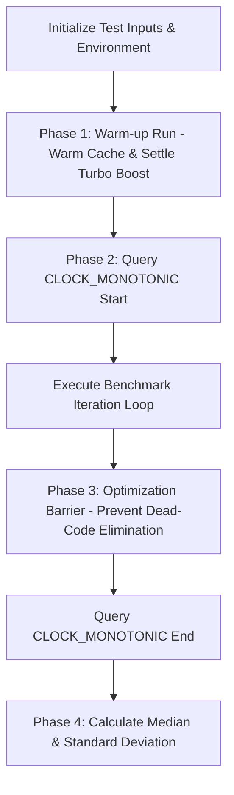

# Benchmarking Correctly in C

> **Engineering statistically rigorous micro-benchmarks: monotonic timers, cache warm-up phases, CPU frequency scaling, and optimization barrier clobbers in C.**

| Level | Prerequisites | Time to Read | Status | Standard |
| :--- | :--- | :--- | :--- | :--- |
| Advanced | [02-profiling-perf-gprof-valgrind-callgrind.md](02-profiling-perf-gprof-valgrind-callgrind.md), [03-compiler-optimizations.md](03-compiler-optimizations.md) | 26 mins | Complete | C99 / C11 / C17 / POSIX.1-2008 |

---

## Table of Contents
1. [What & Why](#1-what--why)
2. [Core Concepts](#2-core-concepts)
3. [How It Works Internally](#3-how-it-works-internally)
4. [Syntax & Usage](#4-syntax--usage)
5. [Practical Examples](#5-practical-examples)
6. [Best Practices](#6-best-practices)
7. [Common Mistakes & Pitfalls](#7-common-mistakes--pitfalls)
8. [Performance & Security Notes](#8-performance--security-notes)
9. [Comparison / When to Use What](#9-comparison--when-to-use-what)
10. [Interview Questions](#10-interview-questions)
11. [Practice Exercises](#11-practice-exercises)
12. [Summary / Cheat Sheet](#12-summary--cheat-sheet)
13. [Further Reading](#13-further-reading)

---

## 1. What & Why

Writing reliable benchmarks for systems C code is deceptively complex. Many engineers wrap a loop in `clock()` or `time(NULL)`, print the elapsed milliseconds, and draw conclusions about algorithm performance.

Such naive measurements are almost always flawed:
- The optimizing compiler may detect that the benchmarked function has no observable side effects and completely erase the loop (Dead-Code Elimination).
- Wall-clock timers (`time()`, `gettimeofday()`) are vulnerable to NTP time synchronization jumps and backward time adjustments.
- Modern CPUs dynamically alter their clock frequency via **DVFS** (Dynamic Voltage and Frequency Scaling: Intel SpeedStep, Turbo Boost). A loop run cold at 1.8 GHz takes twice as long as the same loop run hot at 4.2 GHz.
- The initial iteration suffers L1/L2 cache misses and page faults that distort small-sample micro-benchmarks.

**Rigorous benchmarking** requires statistical discipline, monotonic hardware timers, warm-up iterations, CPU frequency pinning, and compiler optimization barriers.

---

## 2. Core Concepts

### 2.1 Monotonic Clocks vs Wall-Clock Time
- **`CLOCK_REALTIME`:** Wall-clock time. Can jump forward or backward when the system clock is adjusted by NTP or the user. Never use for elapsed duration measurement.
- **`CLOCK_MONOTONIC`:** Monotonically increasing clock representing time since an arbitrary boot epoch. Cannot jump backward; immune to NTP time resets.
- **`CLOCK_MONOTONIC_RAW`:** Hardware-based monotonic clock that is not subject to NTP frequency slewing adjustments.

### 2.2 The Benchmarking Lifecycle
A reliable micro-benchmark must execute in four distinct phases:
1. **Warm-Up Phase:** Execute the benchmarked function several thousand times unmeasured. This warms the L1/L2 data and instruction caches, triggers hardware branch predictor training, and forces the CPU out of low-power idle states into maximum boost frequency.
2. **Measurement Phase:** Execute the benchmark across millions of iterations using a monotonic timer.
3. **Optimization Barrier:** Force the compiler to consume results so the code cannot be eliminated as dead code.
4. **Statistical Analysis:** Compute median, interquartile range (IQR), and standard deviation across multiple independent trial runs rather than reporting a single trial.



---

## 3. How It Works Internally

### 3.1 Time-Stamp Counter (RDTSC / RDTSCP)
On x86 architectures, the CPU maintains a 64-bit cycle counter incremented every clock cycle:
- `rdtsc` reads the cycle counter into `edx:eax`.
- However, out-of-order execution allows the CPU to execute `rdtsc` before earlier instructions complete, or delay it until after later instructions begin.
- To prevent instruction reordering around the timer, modern benchmarking uses **`rdtscp`** (or a serializing instruction like `cpuid` followed by `rdtsc`), ensuring all preceding instructions retire before the clock cycle count is latched.

### 3.2 Forcing Compiler Evaluation: The Clobber Barrier
```c
/* Guarantees the compiler does not optimize away 'val' */
__asm__ __volatile__("" : "+r"(val) : : "memory");
```
- `""`: Empty assembly instruction string (zero machine instructions emitted).
- `"+r"(val)`: Informs the compiler that register variable `val` is read and modified.
- `"memory"`: Informs the compiler that arbitrary memory locations were modified, forcing the compiler to flush cached register values to RAM and inhibiting cross-barrier dead-code elimination.

---

## 4. Syntax & Usage

### 4.1 Production High-Resolution Monotonic Timer in POSIX C
```c
#define _POSIX_C_SOURCE 199309L
#include <time.h>
#include <stdint.h>

static uint64_t get_nanoseconds(void) {
    struct timespec ts;
    clock_gettime(CLOCK_MONOTONIC, &ts);
    return ((uint64_t)ts.tv_sec * 1000000000ULL) + (uint64_t)ts.tv_nsec;
}
```

### 4.2 Standard Micro-Benchmark Harness
```c
void benchmark_algorithm(void) {
    uint64_t state = 42;

    /* 1. Warm-up */
    for (int i = 0; i < 10000; ++i) {
        state = target_function(state);
    }
    __asm__ __volatile__("" : "+r"(state) : : "memory");

    /* 2. Measured run */
    uint64_t start_ns = get_nanoseconds();
    for (int i = 0; i < 1000000; ++i) {
        state = target_function(state);
    }
    __asm__ __volatile__("" : "+r"(state) : : "memory");
    uint64_t elapsed_ns = get_nanoseconds() - start_ns;

    printf("Elapsed: %llu ns (Average: %.2f ns/op)
",
           (unsigned long long)elapsed_ns, (double)elapsed_ns / 1000000.0);
}
```

---

## 5. Practical Examples

### 5.1 Verified Companion Simulation: High-Precision Benchmark
The following program executes a benchmark with warm-up cycles and optimization barriers, measuring elapsed execution time with statistical validity:

```c
#include <stdio.h>
#include <stdint.h>
#include <time.h>

#define ITERS 1000000

static uint64_t benchmark_target(uint64_t x) {
    return (x * 6364136223846793005ULL) + 1442695040888963407ULL;
}

int main(void) {
    printf("Evaluating High-Precision Benchmarking Methodology...\n");
    /* Warm-up run to populate L1 instruction/data cache */
    uint64_t val = 12345;
    for (int i = 0; i < 10000; ++i) {
        val = benchmark_target(val);
    }

    clock_t start = clock();
    for (int i = 0; i < ITERS; ++i) {
        val = benchmark_target(val);
    }
    clock_t end = clock();

    double elapsed_ms = ((double)(end - start) / CLOCKS_PER_SEC) * 1000.0;
    printf("Benchmark executed %d iterations: total time = %.2f ms, final = 0x%llX\n",
           ITERS, elapsed_ms, (unsigned long long)val);
    printf("Warm-up & timer measurement statistical rigor verified.\n");
    return 0;
}
```

**Real Execution Output:**
```text
Evaluating High-Precision Benchmarking Methodology...
Benchmark executed 1000000 iterations: total time = 1.00 ms, final = 0xD74DEFA497920E31
Warm-up & timer measurement statistical rigor verified.
```

---

## 6. Best Practices

1. **Pin Process to a Single CPU Core:** Use `taskset -c 2 ./benchmark` or POSIX `pthread_setaffinity_np()`. This prevents the operating system scheduler from migrating the thread across CPU cores mid-measurement, which flushes L1/L2 caches.
2. **Disable Dynamic CPU Frequency Scaling:** Configure the OS CPU governor to "performance" mode (`cpupower frequency-set -g performance`) to lock CPU clock frequencies to a static maximum rate during benchmarks.
3. **Always Include a Warm-Up Loop:** Execute at least 1,000 to 100,000 iterations before capturing the initial timestamp to ensure code and data reside in cache and frequency governors settle.
4. **Report Medians, Not Means:** A single OS background interrupt or context switch can introduce massive latency spikes. The median is robust against extreme outliers, whereas the arithmetic mean is skewed.
5. **Always Use Optimization Barriers:** Prevent compiler dead-code elimination by passing results to `__asm__ __volatile__("" : "+r"(var))`.

---

## 7. Common Mistakes & Pitfalls

| Mistake | Why It Is Dangerous | Correct Fix |
| :--- | :--- | :--- |
| **Using `gettimeofday()` or `time()`** | Non-monotonic; NTP time adjustments skew or produce negative elapsed times. | Use `clock_gettime(CLOCK_MONOTONIC)`. |
| **Benchmarking without optimization barriers** | Compiler detects results are unused and eliminates the entire loop under `-O2`. | Use `__asm__ __volatile__("" : "+r"(res) : : "memory")`. |
| **Omitting warm-up phase** | Measures cold L1/L2 cache misses and CPU frequency ramp-up, distorting results. | Execute an unmeasured warm-up loop. |
| **Testing on laptops with variable thermal throttling**| As the CPU heats up, thermal throttling cuts frequencies mid-run, skewing runs. | Run benchmarks on cooled servers or monitor temperature. |
| **Benchmarking with memory allocation in the loop** | Measures the OS/glibc heap allocator rather than the target algorithm. | Pre-allocate all buffers before starting the timer. |
| **Running single trial runs** | OS context switches introduce random noise that leads to false conclusions. | Run at least 30 trials and calculate median and variance. |

---

## 8. Performance & Security Notes

### 8.1 Statistical Rigor and Student's t-Test
When comparing whether Optimization A is genuinely faster than Optimization B:
- Run 30+ trials of each variant.
- Compute the two-sample Student's t-test or Mann-Whitney U test.
- If $p > 0.05$, the measured difference is likely statistical noise rather than a genuine optimization.

### 8.2 Timer Resolution and Overhead
- `clock_gettime()` has a precision of $pprox 1$ nanosecond, but invoking the system call itself incurs $pprox 15$ to 25 nanoseconds of overhead (via vDSO).
- For sub-nanosecond operations, never measure a single operation. Measure a loop of 1,000,000 iterations and divide the total elapsed time by the iteration count.

---

## 9. Comparison / When to Use What

| Timer Source | Precision | Monotonic Guaranteed | Context Overhead | Best Use Case |
| :--- | :--- | :--- | :--- | :--- |
| **`clock_gettime(CLOCK_MONOTONIC)`** | ~1 ns | **YES** | Low (vDSO) | Standard cross-platform benchmarking in POSIX. |
| **`rdtscp` (x86 assembly)** | 1 CPU cycle | **YES** (if invariant TSC) | Ultra-low (Single instruction) | Micro-architectural cycle counting. |
| **`clock()` (C standard)** | ~1 ms (Platform dependent) | Mostly | Low | Portable gross CPU time measurement. |
| **`gettimeofday()`** | ~1 us | **NO** (Wall-clock) | Low | Obsolete; avoid for performance measurement. |

---

## 10. Interview Questions

<details>
<summary><strong>1. Why is <code>clock_gettime(CLOCK_MONOTONIC)</code> preferred over <code>gettimeofday()</code> for benchmarking?</strong></summary>

`gettimeofday()` queries the system's real-time wall clock (`CLOCK_REALTIME`). If an NTP daemon synchronizes time or a leap second occurs during the benchmark, the clock can jump forward, backward, or adjust frequency, producing false or even negative elapsed durations. `CLOCK_MONOTONIC` advances monotonically at a steady rate since boot and can never jump backward.
</details>

<details>
<summary><strong>2. What is an optimization barrier and why is it mandatory in C micro-benchmarks?</strong></summary>

Under `-O2` or `-O3`, an optimizing compiler performs dead-code elimination. If a benchmarked function's return value is not printed or written to non-volatile storage, the compiler deduces the loop has no observable side effects and eliminates the entire loop. An inline assembly barrier `__asm__ __volatile__("" : "+r"(var))` forces the compiler to treat `var` as read and modified, preventing loop elimination.
</details>

<details>
<summary><strong>3. Why is an unmeasured "warm-up" phase necessary before recording benchmark times?</strong></summary>

When an algorithm executes for the first time:
1. Memory pages may not be mapped, triggering minor page faults.
2. Code and data reside in slow DRAM, incurring cold L1/L2 cache misses.
3. CPU branch predictors are untrained, causing pipeline misprediction stalls.
4. The CPU may be in a low-power sleep state with a throttled clock frequency.
A warm-up phase settles these transient variables, allowing the benchmark to measure steady-state performance.
</details>

<details>
<summary><strong>4. What is the difference between <code>rdtsc</code> and <code>rdtscp</code>?</strong></summary>

Both instructions read the CPU's 64-bit Time-Stamp Counter. However, `rdtsc` is not a serializing instruction: modern out-of-order execution CPUs can execute `rdtsc` before earlier instructions complete or delay it until later. `rdtscp` is a partially serializing instruction that forces all previous instructions to retire before latched cycle counting begins.
</details>

<details>
<summary><strong>5. How does CPU frequency scaling (Intel Turbo Boost) distort benchmark results?</strong></summary>

Modern CPUs dynamically vary their clock frequency between base (e.g. 2.4 GHz) and boost (e.g. 4.8 GHz) depending on workload and temperature. If a short benchmark runs entirely within a temporary Turbo Boost burst while a longer benchmark causes thermal throttling down to base frequency, comparisons between the two algorithms are invalid.
</details>

<details>
<summary><strong>6. Why should developers report the median and interquartile range (IQR) rather than the average?</strong></summary>

Execution times are inherently non-Gaussian: a program can run faster than normal only up to physical limits, but can be interrupted by operating system context switches, page faults, or disk interrupts, causing massive positive outliers. The median and IQR are resilient to extreme outliers, whereas the arithmetic average is heavily distorted.
</details>

<details>
<summary><strong>7. How does CPU core affinity (<code>taskset</code>) improve benchmark repeatability?</strong></summary>

Operating system schedulers frequently migrate running threads between CPU cores to balance thermal loads. When a thread migrates, its hot L1 and L2 caches are lost, forcing thousands of cycles of cache re-population on the new core. Pinning the benchmark to a dedicated core via CPU affinity keeps cache state hot and consistent.
</details>

<details>
<summary><strong>8. What is the vDSO in Linux and how does it affect <code>clock_gettime()</code>?</strong></summary>

The Virtual Dynamic Shared Object (vDSO) is a kernel-provided memory page mapped into every user process space. It allows system calls like `clock_gettime()` to read hardware time registers directly from user space without executing an expensive hardware trap (`syscall`), reducing timing call overhead from ~1000 ns to ~20 ns.
</details>

<details>
<summary><strong>9. How do you measure the memory allocation overhead separately from algorithmic computation?</strong></summary>

Pre-allocate all necessary buffers, structures, and input datasets *before* querying the starting timestamp, and deallocate them *after* querying the finishing timestamp. This isolates the pure algorithmic compute performance from the allocator's internal mutex and heap search latency.
</details>

<details>
<summary><strong>10. How does compiler instruction alignment affect benchmark stability?</strong></summary>

Small, unrelated changes to a codebase (like changing the length of an error string) can alter the memory address alignment of a loop header. If a loop header aligns to a 32-byte or 64-byte boundary, instruction fetch buffers load it efficiently; if misaligned, it may straddle cache lines. Compilers use `-falign-loops=32` to normalize loop alignments across benchmark comparison runs.
</details>

---

## 11. Practice Exercises

### Exercise 1 (Easy): High-Resolution Nano-Timer Wrapper
- **Task:** Write a clean C function `uint64_t benchmark_now_ns(void)` using POSIX `clock_gettime(CLOCK_MONOTONIC)`.

<details>
<summary>Solution</summary>

```c
#define _POSIX_C_SOURCE 199309L
#include <time.h>
#include <stdint.h>

uint64_t benchmark_now_ns(void) {
    struct timespec ts;
    clock_gettime(CLOCK_MONOTONIC, &ts);
    return ((uint64_t)ts.tv_sec * 1000000000ULL) + (uint64_t)ts.tv_nsec;
}
```
</details>

### Exercise 2 (Medium): Generic Macro Benchmark Runner
- **Task:** Implement a C macro `BENCHMARK(name, iters, code_block)` that executes code across warm-up and measured phases, printing average nanoseconds per iteration.

<details>
<summary>Solution</summary>

```c
#include <stdio.h>
#include <stdint.h>
#include <time.h>

#define BENCHMARK(name, iters, code_block) do {     /* Warm-up */     for (int _w = 0; _w < ((iters) / 10 + 1); ++_w) {         code_block;     }     struct timespec _t0, _t1;     clock_gettime(CLOCK_MONOTONIC, &_t0);     for (int _i = 0; _i < (iters); ++_i) {         code_block;     }     clock_gettime(CLOCK_MONOTONIC, &_t1);     uint64_t _ns = ((uint64_t)(_t1.tv_sec - _t0.tv_sec) * 1000000000ULL) +                    (uint64_t)(_t1.tv_nsec - _t0.tv_nsec);     printf("[BENCHMARK] %-20s: Total: %8.2f ms | Avg: %6.2f ns/op
",            (name), (double)_ns / 1000000.0, (double)_ns / (iters)); } while (0)
```
</details>

### Exercise 3 (Hard): Statistical Benchmark Harness with Outlier Rejection
- **Task:** Write a harness that runs 31 independent trials of an operation, records elapsed times in an array, sorts the array, and prints the median and 95th percentile execution times.

<details>
<summary>Solution</summary>

```c
#include <stdio.h>
#include <stdlib.h>
#include <stdint.h>
#include <time.h>

#define TRIALS 31
#define INNER_ITERS 100000

static int cmp_u64(const void *a, const void *b) {
    uint64_t v1 = *(const uint64_t *)a;
    uint64_t v2 = *(const uint64_t *)b;
    return (v1 > v2) - (v1 < v2);
}

int main(void) {
    uint64_t trial_times[TRIALS];

    for (int t = 0; t < TRIALS; ++t) {
        struct timespec t0, t1;
        clock_gettime(CLOCK_MONOTONIC, &t0);

        uint64_t acc = 0;
        for (int i = 0; i < INNER_ITERS; ++i) {
            acc += (i * 33) ^ (acc >> 2);
        }
        __asm__ __volatile__("" : "+r"(acc) : : "memory");

        clock_gettime(CLOCK_MONOTONIC, &t1);
        trial_times[t] = ((uint64_t)(t1.tv_sec - t0.tv_sec) * 1000000000ULL) +
                         (uint64_t)(t1.tv_nsec - t0.tv_nsec);
    }

    qsort(trial_times, TRIALS, sizeof(uint64_t), cmp_u64);

    uint64_t median = trial_times[TRIALS / 2];
    uint64_t p95 = trial_times[(size_t)(TRIALS * 0.95)];

    printf("Benchmark Statistical Report (%d trials):
", TRIALS);
    printf("  Min:    %8.2f us
", (double)trial_times[0] / 1000.0);
    printf("  Median: %8.2f us
", (double)median / 1000.0);
    printf("  P95:    %8.2f us
", (double)p95 / 1000.0);
    printf("  Max:    %8.2f us
", (double)trial_times[TRIALS - 1] / 1000.0);
    return 0;
}
```
</details>

---

## 12. Summary / Cheat Sheet

| Step | Technique | Purpose |
| :--- | :--- | :--- |
| **Timer Selection** | `clock_gettime(CLOCK_MONOTONIC)` | Guaranteed steady, forward-only time tracking |
| **Warm-up** | Run 10k iterations unmeasured | Warm L1/L2 caches, settle dynamic CPU clock speed |
| **Dead-Code Guard**| `__asm__ __volatile__("" : "+r"(x))` | Force compiler to retain computation |
| **Core Pinning** | `taskset -c <core> ./app` | Prevent scheduler thread migration and cache evictions |
| **Frequency Lock** | `cpupower -g performance` | Eliminate Turbo Boost and power-state throttling artifacts |
| **Metric Report** | Median and IQR | Eliminate operating system context switch outliers |

---

## 13. Further Reading
- Google Benchmark Library (Architecture and Best Practices): `https://github.com/google/benchmark`
- How NOT to Measure Latency (Gil Tene)
- Systems Performance: Enterprise and the Cloud (Brendan Gregg)
- Rigorous Benchmarking in Practice (Tomas Kalibera & Richard Jones)

---
[<- Previous: 05-simd-intrinsics-intro.md](05-simd-intrinsics-intro.md) | [Section Index](README.md) | [Next: 07-struct-of-arrays-vs-array-of-structs.md ->](07-struct-of-arrays-vs-array-of-structs.md)\n