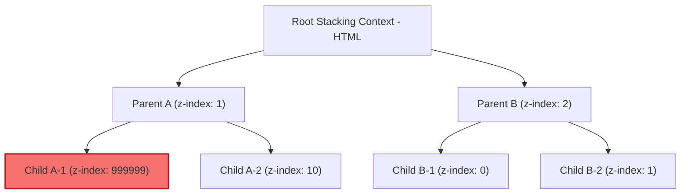

# Stacking Contexts and z-index

| Metadata | Details |
| :--- | :--- |
| **Level** | Core / Advanced |
| **Prerequisites** | `02-box-model-and-layout-basics/08-positioning-static-relative-absolute-fixed.md` |
| **Estimated Reading Time** | 25 minutes |
| **Status** | Complete |
| **Baseline Status** | Widely Available (`z-index` CSS2.1, `isolation: isolate` Baseline 2020) |
| **Browsers Tested** | Chrome 120+, Firefox 121+, Safari 17.2+ |
| **Tested With** | Automated CSS Validation Runner (`css_runner.js`) |

---

## Table of Contents
- [1 What & Why](#1-what--why)
- [2 Core Concepts](#2-core-concepts)
- [3 How It Works Internally](#3-how-it-works-internally)
- [4 Syntax & Usage](#4-syntax--usage)
- [5 Practical Examples](#5-practical-examples)
- [6 Best Practices](#6-best-practices)
- [7 Common Mistakes & Pitfalls](#7-common-mistakes--pitfalls)
- [8 Performance, Accessibility & Browser Support](#8-performance-accessibility--browser-support)
- [9 Comparison / When to Use What](#9-comparison--when-to-use-what)
- [10 Interview Questions](#10-interview-questions)
- [11 Practice Exercises](#11-practice-exercises)
- [12 Summary / Cheat Sheet](#12-summary--cheat-sheet)
- [13 Further Reading](#13-further-reading)

---

## 1 What & Why

On a physical computer display, CSS layouts exist across two dimensions: the horizontal X-axis and the vertical Y-axis. However, when elements overlap—through relative shifts, negative margins, or absolute positioning—the browser engine must project a third dimension: the **Z-axis** (depth facing outward toward the user).

Every developer has encountered the infamous `z-index: 999999` conundrum: an element with an astronomical `z-index` mysteriously renders behind an element with `z-index: 2`.

This happens because `z-index` values are **never globally compared across the entire document**. Instead, rendering depth is strictly governed by **Stacking Contexts**. A stacking context is an isolated three-dimensional rendering layer. Children inside a stacking context can never step outside their parent layer's stacking order.

---

## 2 Core Concepts

### What Triggers a Stacking Context?

An element forms a new stacking context if it satisfies any one of the following conditions:

1. **Root Element**: The document root (`<html>`).
2. **Positioned with non-auto z-index**: `position: relative`, `absolute`, or `fixed`, combined with an explicit `z-index` other than `auto`.
3. **Flex or Grid item with non-auto z-index**: A direct child of `display: flex` or `display: grid` with `z-index` other than `auto` (even if `position: static`!).
4. **Opacity less than 1**: Any element with `opacity < 1`.
5. **CSS Transforms**: Any element with `transform` other than `none` (e.g. `transform: scale(1)` or `translate3d(...)`).
6. **CSS Filters & Blends**: `filter` other than `none`, `backdrop-filter` other than `none`, or `mix-blend-mode` other than `normal`.
7. **CSS Containment**: `contain: paint`, `contain: layout`, or `contain: strict`.
8. **Explicit Isolation**: An element with `isolation: isolate` (the modern, clean way to create a stacking context without side effects).
9. **`will-change` property**: Specifying `will-change` with any property that would trigger a context (e.g., `will-change: transform`).

### The Atomic Layer Analogy

Think of a stacking context like a book or folder. All pages inside Folder B can be sorted in relation to each other (Page 1, Page 2, Page 999). But if Folder A is placed physically on top of Folder B on your desk, Folder A and every single page inside it will always sit above Folder B!

Even if Folder B contains `z-index: 999999`, if its parent container is sorted below another container (`z-index: 1` vs `z-index: 2`), Folder B can never escape.

---

## 3 How It Works Internally

Within a single stacking context, the browser paints elements in a strict, deterministic sequence from back to front along the Z-axis (Specification: CSS 2.1 Appendix E):

```
+------------------------------------------------------------------------+
| 7. Positioned descendants with z-index > 0 (Highest z-index on top)     |
| 6. Positioned descendants with z-index: auto or z-index: 0             |
| 5. In-flow inline-level descendants (text, spans, inline-blocks)       |
| 4. Non-positioned floats (and their contents)                          |
| 3. In-flow non-positioned block-level descendants                      |
| 2. Positioned descendants with z-index < 0                             |
| 1. Background and borders of the element establishing the context      |
+------------------------------------------------------------------------+
  BACK (Furthest from user) ==================> FRONT (Nearest to user)
```



> **Key Takeaway**: Even though `Child A-1` has `z-index: 999999`, it is completely trapped within `Parent A`. Because `Parent B` has `z-index: 2` (greater than `Parent A`'s `1`), `Child B-1` and `Child B-2` paint **on top** of `Child A-1`!

---

## 4 Syntax & Usage

```css
.card {
  /* Classic stacking context trigger */
  position: relative;
  z-index: 1;

  /* Modern, zero-side-effect stacking context trigger */
  isolation: isolate;
}

.child-badge {
  position: absolute;
  top: -8px;
  right: -8px;
  z-index: 10;
}
```

> [!NOTE]
> **Baseline Status: Widely Available**
> `z-index` has been supported since CSS2.1. The `isolation: isolate` property is Baseline Widely Available (supported across all modern browsers since 2020: Chrome 61+, Firefox 36+, Safari 13+).

---

## 5 Practical Examples

### Example 1: Isolating Component Stacking Context with `isolation: isolate`

Using `isolation: isolate` is the best practice for UI component libraries because it creates a local stacking context without requiring fake positioning or transforms:

```css
/* Card creates an isolated 3D realm */
.product-card {
  isolation: isolate; /* Clean, intentional stacking boundary */
  background-color: #ffffff;
  border-radius: 8px;
  border: 1px solid #e2e8f0;
  overflow: hidden;
}

/* Background decorative gradient inside card */
.product-card-bg {
  position: absolute;
  inset: 0;
  background: linear-gradient(135deg, #eff6ff 0%, #dbeafe 100%);
  z-index: -1; /* Sits behind text, but CANNOT leak behind the card's outer parent! */
}

.product-card-content {
  padding: 16px;
  color: #1e293b;
}
```

### Example 2: Modern Dropdown Menu Escaping Parent Overlap

```css
/* Top Navbar */
.site-navbar {
  position: relative;
  z-index: 50; /* Sits comfortably above hero banner */
  background: #ffffff;
  display: flex;
  align-items: center;
}

.dropdown-container {
  position: relative;
}

.dropdown-menu {
  position: absolute;
  top: 100%;
  left: 0;
  min-width: 220px;
  background-color: #ffffff;
  border-radius: 6px;
  box-shadow: 0 10px 15px -3px rgba(0, 0, 0, 0.1);
  z-index: 10; /* Local to .site-navbar */
}

/* Hero Banner situated below nav in DOM */
.hero-banner {
  position: relative;
  z-index: 1; /* Below navbar's 50 */
}
```

### Example 3: Edge Case — Opacity and Transform Trapping Fixed Children

```css
/* Card container with a subtle hover zoom */
.media-card {
  /* BUG WARNING: opacity < 1 or transform creates a stacking context */
  transform: translateZ(0);
  opacity: 0.99;
}

/* Tooltip inside the card intended to float above all other page modals */
.media-card-tooltip {
  position: fixed;
  top: 50px;
  left: 50px;
  z-index: 999999;
  /* Result: Trapped inside .media-card! Any sibling element on the page
     with z-index higher than .media-card will paint ABOVE this tooltip! */
}
```

### Example 4: Failure Case — The `z-index` Arms Race

```css
/* FAILURE PATTERN */
.modal-overlay  { z-index: 99999999; }
.cookie-banner  { z-index: 999999999; }
.support-widget { z-index: 9999999999; } /* Chaos: arbitrary numbers solve nothing */

/* FIXED PATTERN: Scalable Design Token Layering */
:root {
  --z-base: 0;
  --z-elevated: 10;
  --z-dropdown: 100;
  --z-sticky: 200;
  --z-header: 300;
  --z-modal-backdrop: 400;
  --z-modal-dialog: 500;
  --z-toast: 600;
  --z-tooltip: 700;
}

.modal-backdrop {
  position: fixed;
  inset: 0;
  z-index: var(--z-modal-backdrop);
}

.modal-dialog {
  position: fixed;
  z-index: var(--z-modal-dialog);
}
```

### Example 5: Stacking Context inside CSS Grid / Flexbox Items

Direct flex or grid items can accept `z-index` even without `position: relative`:

```css
.card-grid {
  display: grid;
  grid-template-columns: repeat(3, 1fr);
  gap: 16px;
}

.grid-card {
  background-color: #ffffff;
  padding: 24px;
  border: 1px solid #cbd5e1;
  transition: transform 0.2s ease, box-shadow 0.2s ease;
}

/* Elevate card on hover so shadow and scale overlap adjacent cards */
.grid-card:hover {
  transform: translateY(-4px) scale(1.02);
  /* z-index works directly on grid items without position: relative! */
  z-index: 2;
  box-shadow: 0 20px 25px -5px rgba(0, 0, 0, 0.15);
}
```

---

## 6 Best Practices

1. **Use `isolation: isolate` on independent components**: This creates an isolated local stacking boundary, ensuring internal `z-index` values cannot interact with or break the parent layout.
2. **Standardize z-index through semantic CSS variables**: Maintain a single central scale (`--z-dropdown`, `--z-modal`, `--z-tooltip`) rather than ad-hoc numbers.
3. **Avoid arbitrary huge numbers (`z-index: 99999`)**: If an element with `z-index: 10` is not rendering on top, a larger number will not fix an ancestor stacking context issue.
4. **Be aware of subtle triggers**: Remember that `opacity: 0.99`, `filter: blur(...)`, and `transform: scale(1)` silently establish new stacking contexts.
5. **Keep modal dialogs near the document `<body>` root**: Portaling modals or tooltips to the root prevents accidental stacking context entrapment from deeply nested components.
6. **Use negative `z-index` strictly inside isolated contexts**: Declaring `z-index: -1` inside a non-isolated element will cause it to sink behind the parent's background or the root `<body>`.

---

## 7 Common Mistakes & Pitfalls

| Mistake | Why It Breaks | Solution |
| :--- | :--- | :--- |
| `z-index` on `position: static` block | Standard block elements in normal flow ignore `z-index` | Add `position: relative` or make it a flex/grid item |
| Huge `z-index: 99999` still hidden | Element is trapped in an ancestor with a lower stacking context | Move element up the DOM tree or raise ancestor's z-index |
| `z-index: -1` disappears completely | Sinks behind the root viewport / body canvas background | Add `isolation: isolate` to the immediate parent |
| Transform on parent traps fixed modal | `transform` forces all children to calculate coordinates relative to parent | Mount modals directly on `document.body` |
| Sibling cards overlapping incorrectly | Hovering card does not lift above next sibling | Apply `position: relative; z-index: 2;` on `:hover` |
| Forgetting flex/grid z-index capabilities | Unnecessarily adding `position: relative` to every flex item | Use `z-index` directly on the flex or grid item |

---

## 8 Performance, Accessibility & Browser Support

### Compositor Layer Promotion

- When an element establishes a stacking context and involves 3D transforms (`translate3d`), opacity transitions, or `will-change`, browser engines often promote that subtree into its own hardware-accelerated **Compositor Layer** (GPU texture).
- **Layer Explosion Warning**: Creating thousands of stacking contexts simultaneously (e.g. adding `transform: translateZ(0)` or `will-change: transform` to every item in a 5,000-row list) exhausts VRAM and degrades scrolling performance. Use layer promotion conservatively.

### Screen Readers & Tab Order

- Changing the visual stacking order along the Z-axis with `z-index` has **no effect on accessibility or keyboard DOM focus order**.
- A modal visually sitting on top via `z-index: 500` will still let keyboard focus drop into underlying obscured elements unless focus trapping (or native `<dialog>`) is implemented.

---

## 9 Comparison / When to Use What

| Technique | When to Use | Side Effects / Gotchas |
| :--- | :--- | :--- |
| `position: relative; z-index: N` | Positioning offset required, classic stacking | Requires positioning declaration |
| `isolation: isolate` | Encapsulating components, preventing z-index leaks | None; clean, modern standard |
| Flex/Grid Item `z-index: N` | Lifting cards, tabs, or badges inside flex/grid | Only applies to direct children of flex/grid |
| `z-index: -1` | Placing background artwork behind parent text | Requires parent `isolation: isolate` |

---

## 10 Interview Questions

<details>
<summary><strong>1. Why does <code>z-index: 999999</code> not guarantee an element will appear on top of other elements?</strong></summary>

Because `z-index` values are only compared within the same **Stacking Context**. If an element belongs to an ancestor stacking context that is stacked lower than another stacking context (e.g., Parent A with `z-index: 1` vs. Parent B with `z-index: 2`), everything inside Parent A—regardless of how high its internal `z-index` is—will always render behind Parent B.
</details>

<details>
<summary><strong>2. How does <code>isolation: isolate</code> solve stacking context issues?</strong></summary>

`isolation: isolate` explicitly creates a new stacking context on an element without requiring positioning (`position: relative`), transforms, opacity changes, or layout side effects. It creates a clean boundary for internal z-indexes, preventing negative z-indexes from bleeding behind the component.
</details>

<details>
<summary><strong>3. Can a <code>position: static</code> element utilize <code>z-index</code>?</strong></summary>

Yes, but only if it is a direct child of a Flexbox container (`display: flex`) or CSS Grid container (`display: grid`). In standard block or inline formatting contexts, `position: static` elements ignore `z-index`.
</details>

<details>
<summary><strong>4. List at least five CSS properties that create a new stacking context.</strong></summary>

1. `position: relative / absolute` with `z-index` other than `auto`.
2. `opacity` with a value less than 1.
3. `transform` with a value other than `none`.
4. `filter` or `backdrop-filter` with a value other than `none`.
5. `isolation: isolate`.
*(Also: `contain: paint / layout`, `mix-blend-mode: multiply`, `will-change`).*
</details>

<details>
<summary><strong>5. In what order does the browser paint elements within a single stacking context?</strong></summary>

From back to front:
1. Context owner's background and borders.
2. Descendants with negative `z-index`.
3. In-flow, non-positioned block descendants.
4. Non-positioned floats.
5. In-flow, inline descendants (text and inline boxes).
6. Positioned descendants with `z-index: auto` or `0`.
7. Positioned descendants with positive `z-index` (sorted ascending).
</details>

<details>
<summary><strong>6. What happens when you apply <code>z-index: -1</code> to a child element inside an unisolated container?</strong></summary>

The child will be painted behind its parent's background, and potentially behind the page `<body>` background, making it completely invisible to the user. Adding `isolation: isolate` to the parent resolves this by bounding the negative z-index to the parent box.
</details>

<details>
<summary><strong>7. How do CSS transforms interact with <code>position: fixed</code> elements?</strong></summary>

Any ancestor with a non-none `transform` creates a containing block and stacking context for all descendants, turning `position: fixed` children into elements positioned relative to that ancestor rather than the viewport.
</details>

<details>
<summary><strong>8. How should a design system architect manage z-index across a large enterprise application?</strong></summary>

By establishing an immutable, centrally defined scale of semantic CSS custom properties (`--z-base`, `--z-dropdown`, `--z-sticky`, `--z-modal`, `--z-toast`) and enforcing that all reusable components use `isolation: isolate` to avoid polluting the global coordinate space.
</details>

---

## 11 Practice Exercises

### Exercise 1 (Easy): Hover Lift on Cards
- **Task**: Prevent adjacent card borders or shadows from clipping a card when hovered.

<details>
<summary>View Solution</summary>

```css
.card {
  position: relative;
  z-index: 1;
  border: 1px solid #e2e8f0;
  transition: transform 0.2s ease, box-shadow 0.2s ease;
}

.card:hover {
  z-index: 10; /* Raises above sibling cards */
  box-shadow: 0 10px 15px -3px rgba(0, 0, 0, 0.1);
  transform: translateY(-2px);
}
```
</details>

### Exercise 2 (Easy): Safe Decorative Background with `isolation: isolate`
- **Task**: Create an element with a negative z-index decorative shape behind text without losing it behind the page background.

<details>
<summary>View Solution</summary>

```css
.hero-card {
  isolation: isolate; /* Crucial boundary */
  position: relative;
  padding: 40px;
  background-color: #ffffff;
}

.hero-card .blob {
  position: absolute;
  top: -20px;
  right: -20px;
  width: 100px;
  height: 100px;
  background-color: #fde047;
  border-radius: 50%;
  z-index: -1; /* Behind text, but safely in front of card container */
}
```
</details>

### Exercise 3 (Medium): Sticky Header over Normal Content but under Modal
- **Task**: Configure appropriate z-index levels so a sticky navbar sits above scrolling paragraphs but below a modal dialog.

<details>
<summary>View Solution</summary>

```css
:root {
  --z-sticky-nav: 100;
  --z-modal-overlay: 1000;
}

.sticky-navbar {
  position: sticky;
  top: 0;
  z-index: var(--z-sticky-nav);
  background-color: #ffffff;
}

.modal-overlay {
  position: fixed;
  inset: 0;
  z-index: var(--z-modal-overlay);
  background-color: rgba(0, 0, 0, 0.5);
}
```
</details>

### Exercise 4 (Medium): Flex Item Stacking Without Relative Positioning
- **Task**: Reorder the visual paint layering of overlapping flex items using pure flex `z-index`.

<details>
<summary>View Solution</summary>

```css
.avatar-group {
  display: flex;
}

.avatar {
  width: 40px;
  height: 40px;
  border-radius: 50%;
  margin-left: -12px;
  border: 2px solid #ffffff;
  /* position: static by default! */
}

.avatar:hover {
  z-index: 2; /* Flex item supports z-index natively */
}
```
</details>

### Exercise 5 (Hard): Isolating Third-Party Widget Z-Index Leakage
- **Task**: Ensure a third-party chat widget cannot display its dropdowns behind your custom dashboard cards.

<details>
<summary>View Solution</summary>

```css
.dashboard-container {
  isolation: isolate;
  position: relative;
  z-index: 10;
}

.chat-widget-container {
  isolation: isolate;
  position: fixed;
  bottom: 24px;
  right: 24px;
  z-index: 100;
}
```
</details>

### Exercise 6 (Hard): Cascading Dropdown Menus in Multi-level Navigation
- **Task**: Style a multi-tier navigation menu where level 2 dropdowns stack properly over sibling level 1 items.

<details>
<summary>View Solution</summary>

```css
.nav-menu {
  display: flex;
  list-style: none;
  position: relative;
  z-index: 10;
}

.nav-item {
  position: relative;
}

.nav-item:hover {
  z-index: 20; /* Ensures current open branch sits above neighboring items */
}

.dropdown-level-1 {
  position: absolute;
  top: 100%;
  left: 0;
  z-index: 30;
  background: #ffffff;
}

.dropdown-level-2 {
  position: absolute;
  top: 0;
  left: 100%;
  z-index: 40;
  background: #ffffff;
}
```
</details>

---

## 12 Summary / Cheat Sheet

```css
/* Stacking Context Checklist */
1. Is position relative/absolute/fixed with z-index !== auto?
2. Is it a Flex/Grid child with z-index !== auto?
3. Does it have opacity < 1?
4. Does it have transform, filter, or backdrop-filter?
5. Does it have isolation: isolate?

/* Modern Isolation Shorthand */
.isolated-component {
  isolation: isolate; /* Clean, no side effects */
}
```

---

## 13 Further Reading

- [MDN Web Docs: The stacking context](https://developer.mozilla.org/en-US/docs/Web/CSS/CSS_positioned_layout/Understanding_z-index/Stacking_context)
- [W3C CSS 2.1 Specification: Appendix E - Elaborate description of Stacking Contexts](https://www.w3.org/TR/CSS21/zindex.html)
- [web.dev: Understanding Z-Index and Stacking Contexts](https://web.dev/)
- [Josh W. Comeau: What The Heck, z-index??](https://www.joshwcomeau.com/css/stacking-contexts/)

---

[Previous: 09-sticky-positioning.md](file:///e:/Learning/engineering-notes/01-languages/css/02-box-model-and-layout-basics/09-sticky-positioning.md) | [Section Index](file:///e:/Learning/engineering-notes/01-languages/css/02-box-model-and-layout-basics/README.md) | [Next: 11-overflow-and-clipping.md](file:///e:/Learning/engineering-notes/01-languages/css/02-box-model-and-layout-basics/11-overflow-and-clipping.md)
