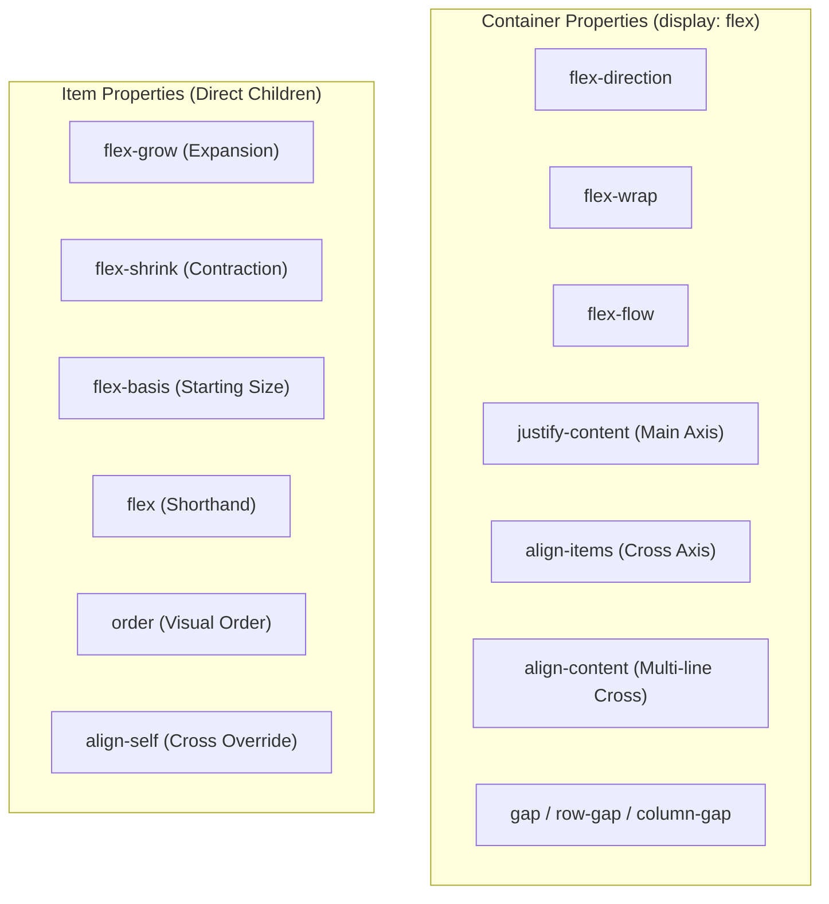

# Flexbox Mental Model

| Metadata | Details |
| :--- | :--- |
| **Level** | Core / Fundamental |
| **Prerequisites** | `02-box-model-and-layout-basics/05-display-property.md`, `02-box-model-and-layout-basics/06-inline-vs-block-formatting-contexts.md` |
| **Estimated Reading Time** | 22 minutes |
| **Status** | Complete |
| **Baseline Status** | Widely Available across all modern browsers (Baseline 2015) |
| **Browsers Tested** | Chrome 120+, Firefox 121+, Safari 17.2+ |
| **Tested With** | Automated CSS Validation Runner (`css_runner.js`) |

---

## Table of Contents
- [1 What & Why](#1-what--why)
- [2 Core Concepts](#2-core-concepts)
- [3 How It Works Internally](#3-how-it-works-internally)
- [4 Syntax & Usage](#4-syntax--usage)
- [5 Practical Examples](#5-practical-examples)
- [6 Best Practices](#6-best-practices)
- [7 Common Mistakes & Pitfalls](#7-common-mistakes--pitfalls)
- [8 Performance, Accessibility & Browser Support](#8-performance-accessibility--browser-support)
- [9 Comparison / When to Use What](#9-comparison--when-to-use-what)
- [10 Interview Questions](#10-interview-questions)
- [11 Practice Exercises](#11-practice-exercises)
- [12 Summary / Cheat Sheet](#12-summary--cheat-sheet)
- [13 Further Reading](#13-further-reading)

---

## 1 What & Why

Before the CSS Flexible Box Layout specification, organizing elements on a web page was constrained by document flow rules originally designed for academic prose:
- Block elements stacked rigidly down the page.
- Inline elements flowed left-to-right, wrapping across lines without height or top/bottom margin control.
- Equal-height columns, vertical centering, and toolbars with flexible search bars required brittle hacks like CSS floats with clearfix, table display emulation (`display: table-cell`), or negative margins.

**Flexbox** changed everything by introducing a **one-dimensional layout model**. It grants a container the intelligence to expand, shrink, align, and distribute its children dynamically to best utilize the available space, regardless of screen resolution or dynamic text lengths.

---

## 2 Core Concepts

### The 1-Dimensional Architecture

Flexbox deals with layout along **one dimension at a time**: either as a row or as a column. (If you need simultaneous two-dimensional control over both rows and columns, CSS Grid is the designated tool).

### The Dual-Axis Model

At the heart of Flexbox are two perpendicular axes:

1. **The Main Axis**:
   - The primary axis along which flex items are laid out sequentially.
   - Defined by `flex-direction`.
   - If `flex-direction: row` (the default), the main axis runs horizontally from inline-start to inline-end (left to right in LTR).
   - If `flex-direction: column`, the main axis runs vertically from top to bottom.
   - Alignment along the main axis is controlled by `justify-content`.

2. **The Cross Axis**:
   - The perpendicular axis running 90 degrees to the main axis.
   - If the main axis is horizontal (`row`), the cross axis is vertical.
   - If the main axis is vertical (`column`), the cross axis is horizontal.
   - Alignment along the cross axis is controlled by `align-items`, `align-self`, and `align-content`.

### The Flex Formatting Context (FFC)

Declaring `display: flex` or `display: inline-flex` transforms an element into a **Flex Container** and its immediate children into **Flex Items**.

This establishes a **Flex Formatting Context (FFC)**, which fundamentally alters CSS behavior:
- **Margins do not collapse**: Vertical margins between adjacent flex items never collapse into each other.
- **`float` and `clear` have no effect**: Any `float: left` or `clear: both` on flex items is completely ignored.
- **`vertical-align` has no effect**: Cross-axis alignment is handled strictly by `align-items`.
- **Text nodes become anonymous flex items**: Contained raw text is wrapped in an anonymous inline flex item.
- **Percentages are resolved against the flex container**: Dimensions and paddings calculate against the flex container's main or cross dimensions.

---

## 3 How It Works Internally

When the browser encounters `display: flex`, it constructs a Flex Formatting Context according to the following axis geometry:

```
+-------------------------------------------------------------------------+
| Flex Container (display: flex; flex-direction: row)                     |
|                                                                         |
|                          MAIN AXIS (Inline direction)                   |
|  main-start ===============================================> main-end   |
|                                                                         |
|  c  +-------------------+  +-------------------+  +------------------+  |
|  r  | Flex Item 1       |  | Flex Item 2       |  | Flex Item 3      |  |
|  o  |                   |  |                   |  |                  |  |
|  s  | (cross-size       |  | (cross-size       |  | (cross-size      |  |
|  s  |  stretches to     |  |  stretches to     |  |  stretches to    |  |
|  |  |  match tallest)   |  |  match tallest)   |  |  match tallest)  |  |
|  a  +-------------------+  +-------------------+  +------------------+  |
|  x                                                                      |
|  i                                                                      |
|  s  cross-end                                                           |
+-------------------------------------------------------------------------+
```

### Container vs Item Separation of Concerns

Flexbox properties are strictly segregated into two functional domains:



---

## 4 Syntax & Usage

```css
/* Establish a Block-level Flex Container */
.flex-container {
  display: flex;
}

/* Establish an Inline-level Flex Container */
.inline-flex-container {
  display: inline-flex;
}

/* Direct Child Defaults (Automatic) */
.flex-item {
  /* Default computed styles: */
  flex-grow: 0;         /* Do not grow beyond intrinsic width */
  flex-shrink: 1;       /* Shrink if container is too small */
  flex-basis: auto;     /* Initial size based on content or width */
  align-self: auto;     /* Inherits container align-items (default stretch) */
}
```

> [!NOTE]
> **Baseline Status: Widely Available**
> The Flexbox specification is Baseline Widely Available across all desktop and mobile browsers since 2015. Flex `gap` is Baseline Widely Available since 2021 (Safari 14.1+, Chrome 84+, Firefox 63+).

---

## 5 Practical Examples

### Example 1: Basic Horizontal Toolbar with Auto-Stretching Items

```css
.toolbar {
  display: flex;
  background-color: #0f172a;
  padding: 12px 16px;
  border-radius: 8px;
  gap: 12px;
}

.toolbar-brand {
  color: #ffffff;
  font-weight: 700;
  display: flex;
  align-items: center;
}

.toolbar-search {
  flex-grow: 1; /* Absorbs all remaining horizontal space */
  padding: 8px 12px;
  border-radius: 4px;
  border: 1px solid #334155;
  background-color: #1e293b;
  color: #ffffff;
}

.toolbar-action-btn {
  background-color: #2563eb;
  color: #ffffff;
  border: none;
  border-radius: 4px;
  padding: 8px 16px;
  cursor: pointer;
  font-weight: 600;
}
```

### Example 2: Equal Height Cards in a Row

```css
.card-row {
  display: flex;
  gap: 20px;
}

.card {
  flex: 1; /* Each card takes equal 33.3% width */
  display: flex;
  flex-direction: column; /* Items stack vertically inside card */
  background: #ffffff;
  border: 1px solid #e2e8f0;
  border-radius: 8px;
  padding: 24px;
}

.card-content {
  flex-grow: 1; /* Pushes button cleanly to bottom of equal-height card */
}

.card-button {
  margin-top: 16px;
  align-self: flex-start;
}
```

### Example 3: Edge Case — Text Node Anonymous Flex Items

```html
<div class="user-badge">
  
  Jane Doe
</div>
```

```css
.user-badge {
  display: flex;
  align-items: center;
  gap: 8px;
}
/* The text "Jane Doe" is automatically converted into an anonymous flex item!
   It respects align-items: center and spacing gap exactly like a real element. */
```

### Example 4: Failure Case — Applying Container Properties to Items

```css
/* FAILURE PATTERN */
.parent {
  display: flex;
}

.child {
  /* BUG: justify-content only works on containers, NOT flex items! */
  justify-content: center; /* Completely ignored unless .child is ALSO display: flex */
}

/* FIXED PATTERN */
.parent-fixed {
  display: flex;
  justify-content: center; /* Container aligns all children */
}

.child-fixed {
  /* To align an INDIVIDUAL item across the cross axis, use align-self */
  align-self: center;
}
```

### Example 5: Clean Inline Badge with Icon

```css
.status-pill {
  display: inline-flex;
  align-items: center;
  gap: 6px;
  padding: 4px 10px;
  border-radius: 9999px;
  background-color: #ecfdf5;
  color: #065f46;
  font-size: 0.75rem;
  font-weight: 600;
}

.status-dot {
  width: 8px;
  height: 8px;
  border-radius: 50%;
  background-color: #10b981;
}
```

---

## 6 Best Practices

1. **Understand which axis is active**: Always remember whether you are in `flex-direction: row` or `column`; `justify-content` always aligns along the main axis.
2. **Use `gap` instead of child margin hacks**: `gap` automatically avoids first/last child margin suppression bugs.
3. **Use the `flex` shorthand**: Write `flex: 1` or `flex: 0 0 200px` rather than declaring `flex-grow`, `flex-shrink`, and `flex-basis` separately.
4. **Use `display: flex; flex-direction: column` for card layouts**: Pushing a call-to-action button to the bottom using `margin-top: auto` on an inner element is bulletproof.
5. **Beware of the `min-width: auto` default**: Flex items default to `min-width: auto`, preventing them from shrinking smaller than their contents. Add `min-width: 0` to enable clean text truncation.
6. **Keep container and item properties separate**: Never declare `justify-content` or `align-items` on an element unless it has `display: flex` or `display: grid`.

---

## 7 Common Mistakes & Pitfalls

| Mistake | Root Cause | Solution |
| :--- | :--- | :--- |
| Declaring `justify-items` in Flexbox | The CSS Flexbox specification does not support `justify-items` | Use `justify-content` or `margin: auto` |
| Text truncation (`text-overflow: ellipsis`) fails | Flex item defaults to `min-width: auto`, forcing container expansion | Add `min-width: 0` to the flex item |
| Expecting vertical margins to collapse | Flex Formatting Context explicitly disables margin collapsing | Use `gap` for uniform item spacing |
| Declaring `align-items` on a child item | `align-items` is a container-only property | Use `align-self` on the child item |
| Floats not working inside flexbox | Flexbox automatically disables floats on child items | Embrace flex alignment instead of legacy floats |
| `vertical-align: middle` ignored | `vertical-align` only applies to inline boxes and table cells | Use container `align-items: center` |

---

## 8 Performance, Accessibility & Browser Support

### Layout Performance

- Flexbox layout algorithms are highly optimized in modern rendering engines.
- Unlike deep nested legacy float grids with clearing tags, Flexbox computes item dimensions in a single layout pass.
- Avoid nesting 10+ levels of deep flex containers within large virtualization lists (e.g. 10,000 table rows), which can cause style recalculation overhead.

### Accessibility Considerations (WCAG 1.3.2 Meaningful Sequence)

- **The Visual Reordering Hazard**: Using `order: 2` or `flex-direction: row-reverse` visually moves an element on the screen, but **does NOT change the underlying DOM order**.
- Keyboard users navigating with `Tab` will travel in DOM order, causing the focus ring to jump erratically across the screen.
- Screen readers read content in DOM order. Never use Flexbox visual reordering to fix an incorrect DOM structure.

---

## 9 Comparison / When to Use What

| Layout Mechanism | Primary Dimension | Best Suited For | Margins Collapse? |
| :--- | :--- | :--- | :--- |
| **Normal Flow (Block)** | Vertical (Document) | Editorial prose, text hierarchy, articles | Yes |
| **Flexbox (`display: flex`)** | 1-Dimensional (Row OR Column) | Navbars, toolbars, buttons, media objects, cards | **No** |
| **CSS Grid (`display: grid`)** | 2-Dimensional (Rows AND Columns) | Page layout, dashboards, image galleries, complex cards | **No** |

---

## 10 Interview Questions

<details>
<summary><strong>1. What does the mental model of a "one-dimensional layout" mean in the context of Flexbox?</strong></summary>

Flexbox handles layout along a single axis at any given time—either the horizontal inline direction (`flex-direction: row`) or the vertical block direction (`flex-direction: column`). Even when items wrap into multiple lines via `flex-wrap: wrap`, each line operates as an independent flex container with its own cross-axis alignment, rather than a coordinated two-dimensional grid of cells.
</details>

<details>
<summary><strong>2. What is the difference between the Main Axis and the Cross Axis?</strong></summary>

The Main Axis is the primary path along which flex items are laid out sequentially (defined by `flex-direction`), controlled by `justify-content`. The Cross Axis runs perpendicular ($90^\circ$) to the main axis, controlled by `align-items` and `align-self`. When `flex-direction` switches from `row` to `column`, the physical orientations of the main and cross axes swap.
</details>

<details>
<summary><strong>3. How does establishing a Flex Formatting Context (FFC) affect margin collapsing?</strong></summary>

Under standard Block Formatting Contexts, vertical margins between adjacent siblings collapse into a single margin. In a Flex Formatting Context, margin collapsing is completely disabled: adjacent flex items retain their full individual margins without collapsing.
</details>

<details>
<summary><strong>4. Why does <code>vertical-align: middle</code> have no effect on a flex item?</strong></summary>

The `vertical-align` property only applies to inline-level boxes and table cells. In a flex container, child items are flex items whose cross-axis alignment is strictly governed by `align-items` on the container or `align-self` on the item.
</details>

<details>
<summary><strong>5. What is an anonymous flex item?</strong></summary>

When a flex container contains direct text strings without an enclosing HTML tag (e.g. `<div>Text <span>Icon</span></div>`), the browser automatically wraps that raw text into an anonymous flex item. It participates in flex sizing and alignment just like a real DOM element, though it cannot be styled with individual CSS selectors.
</details>

<details>
<summary><strong>6. What are the default values of <code>flex-grow</code>, <code>flex-shrink</code>, and <code>flex-basis</code>?</strong></summary>

The specification default on flex items is `flex-grow: 0`, `flex-shrink: 1`, and `flex-basis: auto` (shorthand `flex: 0 1 auto`). This means items will not grow to fill excess space, will shrink if space is constrained, and derive their initial size from their content or explicit `width`/`height`.
</details>

<details>
<summary><strong>7. Why should you avoid using <code>flex-direction: row-reverse</code> for accessible tab navigation?</strong></summary>

`row-reverse` visually flips the order of items on the screen, but preserves the original DOM source order. When a keyboard user presses `Tab`, the focus moves in DOM order, resulting in focus traveling in the opposite direction of the visual layout, violating WCAG 1.3.2 (Meaningful Sequence).
</details>

<details>
<summary><strong>8. What is the difference between <code>display: flex</code> and <code>display: inline-flex</code>?</strong></summary>

`display: flex` generates a block-level flex container that expands to fill the full width of its parent block formatting context. `display: inline-flex` generates an inline-level flex container that only sizes itself to fit its contents along the inline axis, flowing inline alongside text and other inline boxes.
</details>

---

## 11 Practice Exercises

### Exercise 1 (Easy): Basic Media Object
- **Task**: Align an avatar image and a block of text side-by-side with 16px gap, vertically centered.

<details>
<summary>View Solution</summary>

```css
.media-object {
  display: flex;
  align-items: center;
  gap: 16px;
}

.media-avatar {
  width: 48px;
  height: 48px;
  border-radius: 50%;
  object-fit: cover;
}

.media-body {
  flex: 1;
}
```
</details>

### Exercise 2 (Easy): Inline Flex Button with Icon and Badge
- **Task**: Style a compact inline button containing an icon, text label, and notification badge aligned in a row.

<details>
<summary>View Solution</summary>

```css
.btn-badge {
  display: inline-flex;
  align-items: center;
  gap: 8px;
  padding: 8px 16px;
  border-radius: 6px;
  background-color: #3b82f6;
  color: #ffffff;
  border: none;
  cursor: pointer;
}

.badge-count {
  background-color: #1d4ed8;
  padding: 2px 6px;
  border-radius: 9999px;
  font-size: 0.75rem;
}
```
</details>

### Exercise 3 (Medium): Sticky Footer Layout
- **Task**: Construct a full-page layout where the footer stays pinned to the bottom of the viewport even when content is short.

<details>
<summary>View Solution</summary>

```css
.page-container {
  display: flex;
  flex-direction: column;
  min-height: 100vh;
}

.page-header {
  height: 60px;
}

.page-main {
  flex-grow: 1; /* Consumes all spare vertical space, pushing footer down */
}

.page-footer {
  padding: 24px;
  background-color: #0f172a;
  color: #ffffff;
}
```
</details>

### Exercise 4 (Medium): Card Action Button Pinned to Bottom
- **Task**: Ensure the "Buy Now" button in a row of dynamic-height product cards is always aligned to the bottom.

<details>
<summary>View Solution</summary>

```css
.card {
  display: flex;
  flex-direction: column;
  border: 1px solid #e2e8f0;
  padding: 20px;
  border-radius: 8px;
}

.card-description {
  flex-grow: 1; /* Absorbs vertical slack */
  margin-bottom: 16px;
}

.card-cta-btn {
  margin-top: auto; /* Alternatively pushes button to bottom */
}
```
</details>

### Exercise 5 (Hard): Split Header with Auto Margins
- **Task**: In a single flex navbar, keep the brand logo on the left, search in the middle, and profile/settings grouped on the right.

<details>
<summary>View Solution</summary>

```css
.navbar {
  display: flex;
  align-items: center;
  padding: 12px 24px;
  background: #ffffff;
  border-bottom: 1px solid #e2e8f0;
}

.nav-brand {
  font-weight: 700;
  margin-right: 24px;
}

.nav-search {
  flex: 0 1 300px;
}

.nav-user-actions {
  margin-left: auto; /* Consumes all available space, pushing actions to the right */
  display: flex;
  gap: 12px;
}
```
</details>

### Exercise 6 (Hard): Multi-Line Equal-Width Form Rows
- **Task**: Create a flex form container where fields stretch to 50% width on desktop and 100% on mobile using pure flex basis.

<details>
<summary>View Solution</summary>

```css
.form-row {
  display: flex;
  flex-wrap: wrap;
  gap: 16px;
}

.form-field {
  flex: 1 1 calc(50% - 8px);
  min-width: 260px; /* Wraps to 100% width when space is below 260px */
}
```
</details>

---

## 12 Summary / Cheat Sheet

```css
/* Container Mental Model */
display: flex;               /* Block-level flex formatting context */
display: inline-flex;        /* Inline-level flex formatting context */

/* The Two Axes */
flex-direction: row;         /* Main axis: horizontal, Cross axis: vertical */
flex-direction: column;      /* Main axis: vertical, Cross axis: horizontal */

/* Axis Alignment */
justify-content: ...;        /* Controls MAIN axis distribution */
align-items: ...;            /* Controls CROSS axis item alignment */
align-self: ...;             /* Overrides CROSS axis for single item */

/* Margins */
margin: auto;                /* In flexbox, absorbs available space on that axis! */
```

---

## 13 Further Reading

- [MDN Web Docs: Basic concepts of flexbox](https://developer.mozilla.org/en-US/docs/Web/CSS/CSS_flexible_box_layout/Basic_concepts_of_flexbox)
- [W3C CSS Flexible Box Layout Module Level 1](https://www.w3.org/TR/css-flexbox-1/)
- [web.dev: Learn CSS - Flexbox](https://web.dev/learn/css/flexbox/)
- [CSS-Tricks: A Complete Guide to Flexbox](https://css-tricks.com/snippets/css/a-guide-to-flexbox/)

---

[Previous Module: 02-box-model-and-layout-basics/13-box-alignment-basics.md](file:///e:/Learning/engineering-notes/01-languages/css/02-box-model-and-layout-basics/13-box-alignment-basics.md) | [Section Index](file:///e:/Learning/engineering-notes/01-languages/css/03-flexbox/README.md) | [Next: 02-flex-container-properties.md](file:///e:/Learning/engineering-notes/01-languages/css/03-flexbox/02-flex-container-properties.md)
