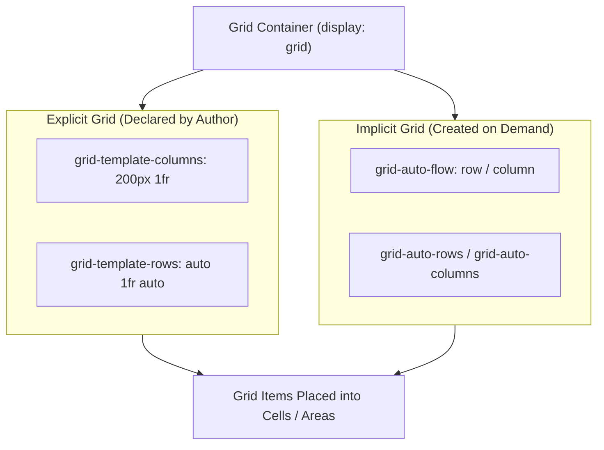

# CSS Grid Mental Model

| Metadata | Details |
| :--- | :--- |
| **Level** | Core / Fundamental |
| **Prerequisites** | `02-box-model-and-layout-basics/01-the-box-model.md`, `03-flexbox/01-flexbox-mental-model.md` |
| **Estimated Reading Time** | 22 minutes |
| **Status** | Complete |
| **Baseline Status** | Widely Available across all modern browsers (Baseline 2017) |
| **Browsers Tested** | Chrome 120+, Firefox 121+, Safari 17.2+ |
| **Tested With** | Automated CSS Validation Runner (`css_runner.js`) |

---

## Table of Contents
- [1 What & Why](#1-what--why)
- [2 Core Concepts](#2-core-concepts)
- [3 How It Works Internally](#3-how-it-works-internally)
- [4 Syntax & Usage](#4-syntax--usage)
- [5 Practical Examples](#5-practical-examples)
- [6 Best Practices](#6-best-practices)
- [7 Common Mistakes & Pitfalls](#7-common-mistakes--pitfalls)
- [8 Performance, Accessibility & Browser Support](#8-performance-accessibility--browser-support)
- [9 Comparison / When to Use What](#9-comparison--when-to-use-what)
- [10 Interview Questions](#10-interview-questions)
- [11 Practice Exercises](#11-practice-exercises)
- [12 Summary / Cheat Sheet](#12-summary--cheat-sheet)
- [13 Further Reading](#13-further-reading)

---

## 1 What & Why

For the first two decades of the web, layout was constrained by techniques that were never designed for full two-dimensional page architecture. Developers wrestled with tables (`<table>`), cleared floats (`float: left` with `.clearfix`), and inline-block whitespace anomalies. Even Flexbox, while revolutionary, is fundamentally a **one-dimensional** model: items on line 2 wrap independently and cannot coordinate their widths or vertical edges with items on line 1.

**CSS Grid Layout** is the first native CSS layout system designed specifically to coordinate elements across **both horizontal columns and vertical rows simultaneously**.

With CSS Grid:
- You declare a two-dimensional matrix of tracks on the parent container.
- Child items are slotted into precise intersecting coordinate cells.
- Layout is orchestrated from the **outside in** (container-directed), rather than from the inside out (content-pushed).
- Complex magazine-style layouts, dashboards, and responsive card decks become trivial and robust.

---

## 2 Core Concepts

### The 6 Foundational Terms of CSS Grid

```
Line 1       Line 2       Line 3       Line 4
  │            │            │            │
──┼────────────┼────────────┼────────────┼── Line 1
  │            │            │            │
  │  [Cell]    │            │            │  ▲
  │            │            │            │  │ Track (Row 1)
──┼────────────┼────────────┼────────────┼── Line 2
  │            │            │            │  ▼
  │            │ ┌─────────────────────┐ │
  │            │ │  [Grid Area]        │ │
  │            │ │  (Spans 2 Cells)    │ │
──┼────────────┼─┴─────────────────────┴─┼── Line 3
  │            │                         │
  ◄────────────►
   Track (Col 1)
```

1. **Grid Container**: The parent element upon which `display: grid` or `display: inline-grid` is declared. Establishes a **Grid Formatting Context (GFC)**.
2. **Grid Item**: Direct children of the Grid Container. (Grandchildren do not participate in the grid unless CSS Subgrid or `display: contents` is applied).
3. **Grid Lines**: The dividing horizontal and vertical vectors that form the skeleton of the grid. Lines are indexed starting at `1` (positive numbers from start to end) and `-1` (negative numbers from end to start).
4. **Grid Track**: The generic term for the space between two adjacent grid lines—either a **column track** (vertical slice) or a **row track** (horizontal slice).
5. **Grid Cell**: The single atomic unit of a grid, formed by the intersection of one row track and one column track (the grid equivalent of a table cell).
6. **Grid Area**: Any rectangular space bounded by four grid lines. A grid area can comprise a single cell or span multiple rows and columns.

### Grid Formatting Context (GFC)

When `display: grid` is declared:
- **Margins never collapse** between grid items.
- `float`, `clear`, and `vertical-align` declarations on grid items are **completely ignored**.
- Text nodes directly inside the container become anonymous grid items.
- Children support `z-index` even when `position: static`.

---

## 3 How It Works Internally



### The Two-Pass Layout Process

1. **Track Sizing Pass**: The browser measures the container's available width and height, computes explicit track definitions (resolving percentages, `px`, `minmax()`, and fractional `fr` units), and generates the coordinate grid.
2. **Item Placement Pass**: The engine resolves explicit placements (`grid-column: 1 / 3`), creates named areas, and then runs the auto-placement algorithm to position unplaced items into available vacant cells.

---

## 4 Syntax & Usage

```css
/* Container Setup */
.grid-container {
  display: grid;

  /* Define 3 column tracks and 2 row tracks */
  grid-template-columns: 200px 1fr 1fr;
  grid-template-rows: auto 1fr;

  /* Gutter spacing between tracks */
  gap: 1.5rem; /* row-gap and column-gap */
}

/* Item Placement */
.grid-item-featured {
  /* Span across columns 1 to 3 */
  grid-column: 1 / 3;
  /* Span across row 1 */
  grid-row: 1;
}
```

> [!NOTE]
> **Baseline Status: Widely Available**
> CSS Grid Layout is Baseline Widely Available across all major modern desktop and mobile browsers since March 2017 (Chrome 57+, Firefox 52+, Safari 10.1+, Edge 16+).

---

## 5 Practical Examples

### Example 1: Basic 3-Column Product Grid

```css
.product-grid {
  display: grid;
  grid-template-columns: repeat(3, 1fr); /* 3 equal columns */
  gap: 20px;
}

.product-card {
  background-color: #ffffff;
  border: 1px solid #e2e8f0;
  border-radius: 8px;
  padding: 16px;
}
```

### Example 2: Classic Asymmetric Dashboard Grid

```css
.dashboard-layout {
  display: grid;
  grid-template-columns: 240px 1fr; /* Fixed sidebar, fluid main */
  grid-template-rows: 64px 1fr;     /* Fixed header, fluid body */
  min-height: 100vh;
}

.dash-header {
  grid-column: 1 / -1; /* Spans across entire top row from first to last line */
  background-color: #0f172a;
  color: #ffffff;
  display: flex;
  align-items: center;
  padding: 0 24px;
}

.dash-sidebar {
  background-color: #f8fafc;
  border-right: 1px solid #e2e8f0;
  padding: 20px;
}

.dash-main {
  padding: 24px;
  background-color: #ffffff;
}
```

### Example 3: Edge Case — Overlapping Grid Items (Collage Pattern)

Unlike Flexbox, CSS Grid natively permits items to occupy the **exact same cells**, creating intentional overlays without absolute positioning hacks:

```css
.hero-banner {
  display: grid;
  grid-template-columns: 1fr;
  grid-template-rows: 1fr;
  height: 400px;
}

/* Background image occupying cell 1/1 */
.hero-image {
  grid-column: 1;
  grid-row: 1;
  width: 100%;
  height: 100%;
  object-fit: cover;
}

/* Text card layered ON TOP of the image in the exact same cell */
.hero-text-card {
  grid-column: 1;
  grid-row: 1;
  z-index: 2; /* Sits above image */
  align-self: center;
  justify-self: center;
  background: rgba(15, 23, 42, 0.85);
  color: #ffffff;
  padding: 24px 32px;
  border-radius: 8px;
  text-align: center;
}
```

### Example 4: Failure Case — Anonymous Text Item Disruption

```html
<!-- FAILURE PATTERN: Raw text between tags -->
<div class="card-grid">
  <div class="card">Card 1</div>
  Unexpected loose text string
  <div class="card">Card 2</div>
</div>
```

```css
.card-grid {
  display: grid;
  grid-template-columns: repeat(2, 1fr);
}
/* BUG: The browser wraps "Unexpected loose text string" in an anonymous grid item!
   It claims the second cell, shoving Card 2 down to the next row! */
```

### Example 5: Clean Inline Grid for Badges

```css
.metric-pill-group {
  display: inline-grid;
  grid-template-columns: auto auto;
  gap: 8px;
  background-color: #f1f5f9;
  padding: 6px 12px;
  border-radius: 9999px;
  align-items: center;
}
```

---

## 6 Best Practices

1. **Design from the layout down, not content up**: Declare explicit tracks on the container rather than setting widths on individual child items.
2. **Use `gap` instead of child margins**: `gap` creates clean, uniform gutters without needing `:nth-child()` margin resets.
3. **Use negative line numbers (`-1`) to span full width**: `grid-column: 1 / -1;` cleanly spans an element across all declared columns without counting line numbers.
4. **Leverage overlapping cells for banners and cards**: Avoid fragile `position: absolute` hacks when an image and overlay text can share a grid cell.
5. **Keep DOM order semantic**: Place elements in logical reading sequence in HTML, then use Grid to position them visually.
6. **Use `minmax(0, 1fr)` instead of raw `1fr` when text truncation is required**: Protects against the grid content blowout bug.

---

## 7 Common Mistakes & Pitfalls

| Mistake | Why It Breaks | Fix |
| :--- | :--- | :--- |
| Writing `width: 33.33%` on grid items | Contradicts the Grid paradigm; overrides track sizing | Let `grid-template-columns: repeat(3, 1fr)` control item sizing |
| Assuming lines and tracks are the same number | An $N$-track grid has $N+1$ grid lines | For 3 columns, lines are 1, 2, 3, 4 |
| Expecting Grandchildren to align to Grid | Only direct children participate in a Grid Formatting Context | Use CSS Subgrid (`subgrid`) or `display: contents` |
| Accidental anonymous grid item | Whitespace or raw text between elements becomes an item | Clean up HTML markup; wrap loose text in tags |
| Using `justify-items` expecting whole container to center | `justify-items` aligns items inside cells; `justify-content` centers grid | Use `justify-content: center` to center tracks |
| Forgetting that `1fr` defaults to `min-content` | Long code blocks expand `1fr` tracks unexpectedly | Use `minmax(0, 1fr)` |

---

## 8 Performance, Accessibility & Browser Support

### Layout Performance

- CSS Grid computation is executed in native engine C++ using optimized track-sizing algorithms.
- Unlike JavaScript masonry scripts that poll window dimensions and trigger multiple layout reflows, CSS Grid calculates coordinates in a single layout pass.
- Complex grids with hundreds of items recalculate efficiently; however, avoid creating unbounded grids with thousands of implicit dynamic tracks.

### Accessibility Standards (WCAG 1.3.2)

- **The Visual Disconnect Hazard**: CSS Grid makes it trivially easy to place an element anywhere on the screen (e.g. placing the 10th DOM child into cell row 1, column 1).
- Screen readers and keyboard tab navigation traverse strictly according to **DOM source order**.
- If visual position differs drastically from DOM order, sighted keyboard users will experience disorienting focus jumps across the screen. Always ensure your HTML source reads logically from top to bottom.

---

## 9 Comparison / When to Use What

| Requirement | CSS Grid (`display: grid`) | Flexbox (`display: flex`) |
| :--- | :--- | :--- |
| **Dimensionality** | **2-Dimensional** (Rows AND Columns) | 1-Dimensional (Row OR Column) |
| **Layout Control** | Container-directed (Layout-First) | Item-directed (Content-First) |
| **Orphan Item Wrapping** | Stays locked in its vertical column track | Stretches across the row |
| **Overlapping Layers** | Native (Same cell row/column coordinates) | Requires `position: absolute` |
| **Ideal Use Cases** | Page shells, dashboards, photo grids, card matrices | Navbars, toolbars, buttons, tags, form inputs |

---

## 10 Interview Questions

<details>
<summary><strong>1. What is the fundamental architectural difference between CSS Grid and Flexbox?</strong></summary>

Flexbox is a one-dimensional layout model that calculates space distribution along a single axis at a time (content-first). Items on wrapped lines operate independently and cannot coordinate widths with items on other lines. In contrast, CSS Grid is a two-dimensional layout model (layout-first) that defines a rigid matrix of intersecting rows and columns simultaneously, aligning items in both dimensions.
</details>

<details>
<summary><strong>2. What is the difference between a Grid Track, a Grid Line, and a Grid Cell?</strong></summary>

- **Grid Line**: The dividing vector (horizontal or vertical) separating tracks, indexed starting at 1.
- **Grid Track**: The space between two consecutive grid lines (either a row or a column).
- **Grid Cell**: The single atomic intersecting area between one row track and one column track.
</details>

<details>
<summary><strong>3. How many grid lines exist in a grid with 4 columns and 3 rows?</strong></summary>

There are always $N + 1$ lines for $N$ tracks. A grid with 4 columns has **5 vertical lines**. A grid with 3 rows has **4 horizontal lines**.
</details>

<details>
<summary><strong>4. What does <code>grid-column: 1 / -1</code> mean?</strong></summary>

It instructs an item to span from vertical line `1` (the very start of the explicit grid) to line `-1` (the very end of the explicit grid), effectively spanning the full width of all declared columns.
</details>

<details>
<summary><strong>5. What happens when raw text is placed directly inside a <code>display: grid</code> container?</strong></summary>

The browser wraps the raw text node in an anonymous grid item. It takes up a full grid cell and participates in track placement and alignment just like a real HTML element, which can accidentally displace neighboring elements.
</details>

<details>
<summary><strong>6. Can two grid items occupy the exact same cell? If so, what happens?</strong></summary>

Yes. CSS Grid allows multiple items to share identical row and column coordinates. The items overlap in three-dimensional space, and their visual stacking order is determined by standard stacking rules (DOM order or explicit `z-index`).
</details>

<details>
<summary><strong>7. What is an anonymous grid item, and can it be targeted with CSS selectors?</strong></summary>

An anonymous grid item is created when text nodes exist directly inside a grid container. It cannot be targeted by CSS selectors because it has no corresponding DOM element node, but it inherits styling from the container.
</details>

<details>
<summary><strong>8. Why should you avoid using CSS Grid visual placement to fix disordered HTML markup?</strong></summary>

Because screen readers and keyboard `Tab` navigation strictly follow the underlying HTML DOM tree, completely ignoring CSS Grid placement. If DOM order is disordered, keyboard focus and auditory reading will jump erratically, violating accessibility standard WCAG 1.3.2.
</details>

---

## 11 Practice Exercises

### Exercise 1 (Easy): Basic 2x2 Image Grid
- **Task**: Create a 2-column, 2-row square grid with 16px gap between all cells.

<details>
<summary>View Solution</summary>

```css
.photo-grid {
  display: grid;
  grid-template-columns: 1fr 1fr;
  grid-template-rows: 200px 200px;
  gap: 16px;
}

.photo-grid img {
  width: 100%;
  height: 100%;
  object-fit: cover;
}
```
</details>

### Exercise 2 (Easy): Spanning Banner
- **Task**: In a 3-column grid, make the first item span all 3 columns across the top.

<details>
<summary>View Solution</summary>

```css
.grid-container {
  display: grid;
  grid-template-columns: repeat(3, 1fr);
  gap: 16px;
}

.hero-cell {
  grid-column: 1 / -1; /* Spans across all columns */
}
```
</details>

### Exercise 3 (Medium): Overlapping Hero Card
- **Task**: Layer a semi-transparent text box directly over an image using pure CSS Grid without `position: absolute`.

<details>
<summary>View Solution</summary>

```css
.hero-component {
  display: grid;
  grid-template-columns: 1fr;
  grid-template-rows: 350px;
}

.hero-bg {
  grid-column: 1;
  grid-row: 1;
  width: 100%;
  height: 100%;
  object-fit: cover;
}

.hero-overlay {
  grid-column: 1;
  grid-row: 1;
  z-index: 10;
  align-self: end;
  padding: 24px;
  background: linear-gradient(to top, rgba(0,0,0,0.8), transparent);
  color: #ffffff;
}
```
</details>

### Exercise 4 (Medium): Fixed Sidebar with Equal Multi-Column Content
- **Task**: Build a layout with a fixed 280px sidebar on the left and 3 equal-width columns on the right.

<details>
<summary>View Solution</summary>

```css
.app-layout {
  display: grid;
  grid-template-columns: 280px repeat(3, 1fr);
  gap: 24px;
  min-height: 100vh;
}

.sidebar {
  background-color: #0f172a;
}
```
</details>

### Exercise 5 (Hard): Asymmetric 12-Column Magazine Header
- **Task**: Build a 12-column grid where article A spans columns 1 to 8 and article B spans columns 9 to 12.

<details>
<summary>View Solution</summary>

```css
.magazine-grid {
  display: grid;
  grid-template-columns: repeat(12, 1fr);
  gap: 20px;
}

.main-feature {
  grid-column: 1 / 9; /* Spans 8 columns */
}

.side-feature {
  grid-column: 9 / 13; /* Spans 4 columns */
}
```
</details>

### Exercise 6 (Hard): Inline Metric Counters
- **Task**: Create a compact inline-grid status badge with 2 columns and 2 rows for statistics.

<details>
<summary>View Solution</summary>

```css
.stat-pill {
  display: inline-grid;
  grid-template-columns: auto auto;
  grid-template-rows: auto auto;
  gap: 4px 12px;
  padding: 8px 16px;
  background-color: #f8fafc;
  border: 1px solid #cbd5e1;
  border-radius: 8px;
}

.stat-label {
  font-size: 0.75rem;
  color: #64748b;
}

.stat-value {
  font-size: 1.25rem;
  font-weight: 700;
  color: #0f172a;
}
```
</details>

---

## 12 Summary / Cheat Sheet

```css
/* Container Basics */
display: grid;                       /* Block-level grid */
display: inline-grid;                /* Inline-level grid */

/* Defining Tracks */
grid-template-columns: 200px 1fr 1fr; /* 3 columns */
grid-template-rows: auto 1fr;        /* 2 rows */
gap: 16px;                           /* Gutters between cells */

/* Item Placement */
grid-column: 1 / 3;                  /* Starts line 1, ends line 3 (spans 2) */
grid-column: 1 / -1;                 /* Spans all columns from start to end */
grid-row: 2;                         /* Sits in row track 2 */
```

---

## 13 Further Reading

- [MDN Web Docs: Basic concepts of grid layout](https://developer.mozilla.org/en-US/docs/Web/CSS/CSS_grid_layout/Basic_concepts_of_grid_layout)
- [W3C CSS Grid Layout Module Level 1](https://www.w3.org/TR/css-grid-1/)
- [web.dev: Learn CSS - Grid](https://web.dev/learn/css/grid/)
- [CSS-Tricks: A Complete Guide to CSS Grid](https://css-tricks.com/snippets/css/complete-guide-grid/)

---

[Previous Module: 03-flexbox/08-flexbox-pitfalls.md](file:///e:/Learning/engineering-notes/01-languages/css/03-flexbox/08-flexbox-pitfalls.md) | [Section Index](file:///e:/Learning/engineering-notes/01-languages/css/04-grid/README.md) | [Next: 02-defining-tracks-and-fr-units.md](file:///e:/Learning/engineering-notes/01-languages/css/04-grid/02-defining-tracks-and-fr-units.md)
