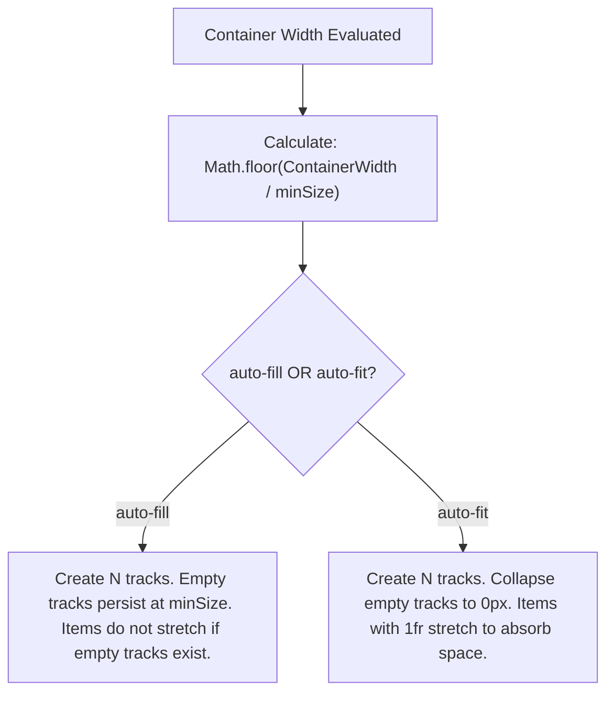

# minmax(), auto-fit, and auto-fill

| Metadata | Details |
| :--- | :--- |
| **Level** | Core / Advanced |
| **Prerequisites** | `04-grid/01-grid-mental-model.md`, `04-grid/02-defining-tracks-and-fr-units.md` |
| **Estimated Reading Time** | 25 minutes |
| **Status** | Complete |
| **Baseline Status** | Widely Available across all modern browsers (Baseline 2017) |
| **Browsers Tested** | Chrome 120+, Firefox 121+, Safari 17.2+ |
| **Tested With** | Automated CSS Validation Runner (`css_runner.js`) |

---

## Table of Contents
- [1 What & Why](#1-what--why)
- [2 Core Concepts](#2-core-concepts)
- [3 How It Works Internally](#3-how-it-works-internally)
- [4 Syntax & Usage](#4-syntax--usage)
- [5 Practical Examples](#5-practical-examples)
- [6 Best Practices](#6-best-practices)
- [7 Common Mistakes & Pitfalls](#7-common-mistakes--pitfalls)
- [8 Performance, Accessibility & Browser Support](#8-performance-accessibility--browser-support)
- [9 Comparison / When to Use What](#9-comparison--when-to-use-what)
- [10 Interview Questions](#10-interview-questions)
- [11 Practice Exercises](#11-practice-exercises)
- [12 Summary / Cheat Sheet](#12-summary--cheat-sheet)
- [13 Further Reading](#13-further-reading)

---

## 1 What & Why

Historically, making a card grid responsive required tedious media queries:
```css
/* The Old Way: Media Query Spaghetti */
.card-grid { grid-template-columns: 1fr; }
@media (min-width: 600px)  { .card-grid { grid-template-columns: repeat(2, 1fr); } }
@media (min-width: 900px)  { .card-grid { grid-template-columns: repeat(3, 1fr); } }
@media (min-width: 1200px) { .card-grid { grid-template-columns: repeat(4, 1fr); } }
```

This brute-force approach has fatal flaws:
- Breakpoints target the global viewport width, not the container's width (breaking when placed inside sidebars).
- Maintaining 5+ media queries across multiple card variants is brittle and verbose.

CSS Grid solved this permanently with the **Holy Grail of Responsive Layout**:
```css
grid-template-columns: repeat(auto-fit, minmax(280px, 1fr));
```
This single line of CSS creates an inherently responsive, fluid layout that automatically scales from 1 to 2, 3, 4, or 10 columns based purely on available container space—**without a single `@media` query!**

---

## 2 Core Concepts

### 1. The `minmax()` Function

Defines a size range between a minimum bound and a maximum bound:
$$\text{Syntax: } \text{minmax}(\text{min}, \text{max})$$
- If the container space is constrained, the track shrinks down to $\text{min}$.
- If spare space is available, the track expands up to $\text{max}$.
- **Important Constraint**: The first argument ($\text{min}$) **cannot** be a flexible `fr` unit (e.g. `minmax(1fr, 300px)` is invalid). The second argument ($\text{max}$) can be an `fr` unit, length, percentage, or keyword (`auto`, `max-content`).

### 2. `auto-fill` vs. `auto-fit`

Both keywords tell the browser to automatically compute how many tracks of size $S$ can fit inside the container. The crucial difference occurs when **there are fewer items than available tracks**:

- **`auto-fill` (Preserves Empty Tracks)**:
  - Fills the row with as many tracks as mathematically possible.
  - If you have 2 items in an 8-track row, the remaining 6 tracks **remain as empty physical slots**. The 2 items stay their minimum size!
- **`auto-fit` (Collapses Empty Tracks to $0\text{px}$)**:
  - Calculates the tracks, but **collapses any empty tracks to $0\text{px}$**.
  - If you have 2 items with `1fr` maximum, the items **expand to fill the entire container** (each taking 50% width)!

---

## 3 How It Works Internally

```
Container Width = 1000px, Track Size: minmax(200px, 1fr)
The container can physically hold 5 tracks of 200px (1000px / 200px = 5).
Scenario: You only have 2 cards in the HTML.

1. auto-fill:
+-------------------+-------------------+-------------------+-------------------+-------------------+
| Card 1 (200px)    | Card 2 (200px)    | [Empty Track]     | [Empty Track]     | [Empty Track]     |
+-------------------+-------------------+-------------------+-------------------+-------------------+
Result: 5 explicit tracks exist. The 2 cards stay locked at 200px.

2. auto-fit:
+---------------------------------------+---------------------------------------+
| Card 1 (500px - expands via 1fr)      | Card 2 (500px - expands via 1fr)      |
+---------------------------------------+---------------------------------------+
Result: The 3 empty tracks collapse to 0px! The 2 items expand to fill the full 1000px width.
```



---

## 4 Syntax & Usage

```css
.container {
  display: grid;

  /* The Universal Fluid Grid Pattern */
  grid-template-columns: repeat(auto-fit, minmax(280px, 1fr));
  gap: 1.5rem;

  /* Resilient Rows with minmax */
  grid-auto-rows: minmax(180px, auto);

  /* Preserve Empty Slots Pattern */
  grid-template-columns: repeat(auto-fill, minmax(200px, 1fr));
}
```

---

## 5 Practical Examples

### Example 1: The Production Fluid Card Grid (`auto-fit`)

```css
.card-grid {
  display: grid;
  /* Automatically wraps from 1 to 4 columns based on container width */
  grid-template-columns: repeat(auto-fit, minmax(min(100%, 280px), 1fr));
  gap: 20px;
}

.card {
  background-color: #ffffff;
  border: 1px solid #e2e8f0;
  border-radius: 8px;
  padding: 24px;
  box-shadow: 0 4px 6px -1px rgba(0, 0, 0, 0.1);
}
```

> **Why `min(100%, 280px)`?**
> On small mobile screens below 280px width (e.g. 240px wide devices), declaring pure `minmax(280px, 1fr)` would cause horizontal overflow. Wrapping the minimum in `min(100%, 280px)` guarantees that on screens smaller than 280px, the track smoothly drops to 100% width!

### Example 2: Fixed Slot Catalog Grid (`auto-fill`)

In an image picker or icon browser, you want icons to stay a consistent size and not stretch to enormous dimensions when only 1 icon is present:

```css
.icon-picker-grid {
  display: grid;
  /* Preserves 80px slots so single icons don't stretch */
  grid-template-columns: repeat(auto-fill, minmax(80px, 1fr));
  gap: 12px;
}

.icon-item {
  height: 80px;
  display: grid;
  place-items: center;
  background-color: #f1f5f9;
  border-radius: 6px;
}
```

### Example 3: Edge Case — `minmax()` in Grid Rows with Dynamic Text

```css
.testimonial-grid {
  display: grid;
  grid-template-columns: repeat(auto-fit, minmax(300px, 1fr));
  /* Minimum row height is 220px, but expands if review text is long */
  grid-auto-rows: minmax(220px, auto);
  gap: 24px;
}
```

### Example 4: Failure Case — `1fr` as Minimum Bound

```css
/* FAILURE PATTERN */
.invalid-grid {
  display: grid;
  /* PARSER ERROR: The minimum in minmax() CANNOT be an fr unit! */
  grid-template-columns: repeat(auto-fit, minmax(1fr, 300px)); /* Discarded by browser! */
}

/* FIXED PATTERN */
.valid-grid {
  display: grid;
  grid-template-columns: repeat(auto-fit, minmax(200px, 1fr)); /* min is length, max is fr */
}
```

### Example 5: Fluid Dashboard Metrics Bar

```css
.metrics-deck {
  display: grid;
  grid-template-columns: repeat(auto-fit, minmax(220px, 1fr));
  gap: 16px;
  margin-bottom: 24px;
}

.metric-card {
  background-color: #ffffff;
  border: 1px solid #cbd5e1;
  border-radius: 8px;
  padding: 20px;
}

.metric-value {
  font-size: 2rem;
  font-weight: 800;
  color: #0f172a;
}
```

---

## 6 Best Practices

1. **Use `auto-fit` for content cards and blogs**: Ensures cards stretch to fill the row attractively when few items exist.
2. **Use `auto-fill` for icon sets, photo thumbnails, and product tiles**: Prevents lone items from swelling to unnatural widths.
3. **Always use `min(100%, [target-px])` as the minimum bound**: E.g. `minmax(min(100%, 300px), 1fr)`. Prevents horizontal scrollbars on viewports narrower than $300\text{px}$.
4. **Never use an `fr` unit as the first argument in `minmax()`**: `minmax(1fr, ...)` is invalid CSS.
5. **Pair `minmax(0, 1fr)` with text truncation**: Overrides `min-content` locks on child items.
6. **Use `minmax(Npx, auto)` for rows**: Provides a solid visual baseline height while remaining resilient against content overflow.

---

## 7 Common Mistakes & Pitfalls

| Mistake | Root Cause | Solution |
| :--- | :--- | :--- |
| Single card stretches to 100% width | Used `auto-fit` with `1fr`; collapsed empty tracks allow it to expand | Use `auto-fill` or set `max-width` on cards |
| Mobile overflow with `minmax(320px, 1fr)` | Mobile device is 300px wide; 320px minimum exceeds viewport | Use `minmax(min(100%, 320px), 1fr)` |
| `minmax(1fr, 250px)` ignored | CSS specification forbids `fr` units as minimum bound | Swap arguments or use lengths |
| Confusing `auto-fill` and `auto-fit` | `auto-fill` keeps empty tracks; `auto-fit` collapses them | Remember: *fit* stretches items to *fit* the box |
| Card blowout from code blocks | `1fr` defaults to `auto` minimum | Use `minmax(0, 1fr)` |
| Row text clipped at fixed height | Hardcoding `grid-auto-rows: 200px` without `minmax` | Use `grid-auto-rows: minmax(200px, auto)` |

---

## 8 Performance, Accessibility & Browser Support

### Track Computation Performance

- When `auto-fit` or `auto-fill` is used, the browser calculates the number of tracks by dividing the container's inline size by the minimum bound:
$$N = \left\lfloor \frac{\text{Container Inline Size} + \text{Gap}}{\text{Min Track Size} + \text{Gap}} \right\rfloor$$
- This mathematical calculation executes in constant time $\mathcal{O}(1)$ on the compositor layout pass.
- It is exponentially faster than JavaScript `window.onresize` listeners adjusting DOM elements.

### Accessibility

- Fluid grids preserve responsive zoom (WCAG 1.4.4 & 1.4.10 Reflow). As users zoom in to $200\%$ or $400\%$, columns reduce automatically from 4 to 2 to 1 without horizontal scrollbars, keeping content fully accessible to low-vision users.

---

## 9 Comparison / When to Use What

| Feature | `repeat(auto-fit, minmax(250px, 1fr))` | `repeat(auto-fill, minmax(250px, 1fr))` | Traditional `@media` Breakpoints |
| :--- | :--- | :--- | :--- |
| **Few Items Behavior** | Items stretch to fill container | Empty tracks persist; items stay 250px | Rigid column counts |
| **Media Queries Needed?** | **Zero** | **Zero** | 4-6 `@media` blocks |
| **Container-Aware?** | **Yes** (Responds to parent size) | **Yes** (Responds to parent size) | No (Responds to viewport only) |
| **Best Used For** | Cards, articles, dashboards | Photo pickers, tool palettes | Custom non-uniform breakpoints |

---

## 10 Interview Questions

<details>
<summary><strong>1. Explain the difference between <code>auto-fit</code> and <code>auto-fill</code> in CSS Grid.</strong></summary>

Both calculate how many tracks of a given size can fit in the container. The difference arises when there are fewer items than calculated tracks. Under `auto-fill`, empty tracks remain in the layout as physical slots. Under `auto-fit`, any empty tracks are collapsed to $0\text{px}$, allowing the remaining items (if styled with a flexible unit like `1fr`) to expand and fill the entire container width.
</details>

<details>
<summary><strong>2. Why is <code>minmax(1fr, 300px)</code> invalid CSS?</strong></summary>

The CSS Grid specification strictly mandates that the first argument of `minmax()` (the minimum bound) must be a fixed length, percentage, or intrinsic keyword (`min-content`, `max-content`, `auto`). It **cannot** be a flexible `fr` unit, because `fr` represents a share of remaining free space, which cannot be computed until after minimum bounds are established.
</details>

<details>
<summary><strong>3. What problem does <code>min(100%, 300px)</code> solve inside <code>minmax()</code>?</strong></summary>

If you write `minmax(300px, 1fr)`, any viewport narrower than $300\text{px}$ (e.g. older smartphones or nested widgets) will be forced into horizontal scrolling because the minimum track width is locked at $300\text{px}$. Wrapping it in `min(100%, 300px)` ensures that if the container is narrower than $300\text{px}$, the track scales down to $100\%$ width, preventing horizontal overflow.
</details>

<details>
<summary><strong>4. How does <code>repeat(auto-fit, minmax(250px, 1fr))</code> behave inside a container that resizes from 1200px to 300px?</strong></summary>

- At $1200\text{px}$: Accommodates 4 tracks ($\approx 300\text{px}$ each).
- At $800\text{px}$: Automatically drops to 3 tracks ($\approx 266\text{px}$ each).
- At $550\text{px}$: Automatically drops to 2 tracks ($275\text{px}$ each).
- At $300\text{px}$: Automatically drops to a single full-width column ($300\text{px}$).
All transitions occur continuously without a single media query.
</details>

<details>
<summary><strong>5. Can <code>minmax()</code> be used for grid rows?</strong></summary>

Yes. A common pattern is `grid-auto-rows: minmax(200px, auto);`, which ensures that dynamically generated rows have a minimum height of $200\text{px}$, but can expand naturally if interior content or translations require more space.
</details>

<details>
<summary><strong>6. What happens if container width is smaller than the minimum track size in <code>auto-fit</code>?</strong></summary>

The browser instantiates a single track whose width equals the minimum bound, causing the container to overflow along the inline axis (unless `min(100%, ...)` was used).
</details>

<details>
<summary><strong>7. When would you deliberately choose <code>auto-fill</code> over <code>auto-fit</code>?</strong></summary>

When designing user interfaces where elements must maintain a uniform, predictable size regardless of item count—such as an icon selector, color swatch palette, or product tile browser where a single item stretching to 100% width would look deformed or disproportionate.
</details>

<details>
<summary><strong>8. How does <code>gap</code> affect the mathematical track count calculation in <code>auto-fit</code>?</strong></summary>

The browser factors in the `gap` when determining how many tracks fit. The formula is:
$$\text{Tracks} = \left\lfloor \frac{\text{Width} + \text{Gap}}{\text{MinTrack} + \text{Gap}} \right\rfloor$$
This prevents gutters from pushing the final track onto a new row.
</details>

---

## 11 Practice Exercises

### Exercise 1 (Easy): Fluid 3-to-1 Responsive Product Deck
- **Task**: Create a card deck that fits as many 250px cards as possible, expanding to fill rows cleanly with `auto-fit`.

<details>
<summary>View Solution</summary>

```css
.card-deck {
  display: grid;
  grid-template-columns: repeat(auto-fit, minmax(min(100%, 250px), 1fr));
  gap: 16px;
}
```
</details>

### Exercise 2 (Easy): Fixed-Size Icon Library Grid
- **Task**: Build an icon palette where tracks stay locked at 64px width and do not stretch if only 2 icons exist.

<details>
<summary>View Solution</summary>

```css
.icon-palette {
  display: grid;
  grid-template-columns: repeat(auto-fill, minmax(64px, 1fr));
  gap: 8px;
}
```
</details>

### Exercise 3 (Medium): Dynamic Row Expansion with minmax
- **Task**: Author a dynamic card layout where rows start at 240px minimum, but expand cleanly if description text overflows.

<details>
<summary>View Solution</summary>

```css
.catalog-grid {
  display: grid;
  grid-template-columns: repeat(auto-fit, minmax(min(100%, 280px), 1fr));
  grid-auto-rows: minmax(240px, auto);
  gap: 20px;
}
```
</details>

### Exercise 4 (Medium): Defending Mobile Viewports from Overflow
- **Task**: Fix a fluid grid with a 350px target width so it never triggers a horizontal scrollbar on a 320px phone.

<details>
<summary>View Solution</summary>

```css
.safe-responsive-grid {
  display: grid;
  /* min(100%, 350px) guarantees track shrinks to 100% on small devices */
  grid-template-columns: repeat(auto-fit, minmax(min(100%, 350px), 1fr));
  gap: 16px;
}
```
</details>

### Exercise 5 (Hard): Asymmetric Hybrid Grid with Auto-Fit
- **Task**: Create a dashboard layout with a fixed 240px sidebar and a fluid widget area using `auto-fit`.

<details>
<summary>View Solution</summary>

```css
.dashboard-shell {
  display: grid;
  grid-template-columns: 240px 1fr;
  min-height: 100vh;
}

.widget-area {
  display: grid;
  grid-template-columns: repeat(auto-fit, minmax(min(100%, 220px), 1fr));
  gap: 16px;
  padding: 24px;
  align-content: start;
}
```
</details>

### Exercise 6 (Hard): Clean Truncation Inside Auto-Fit Card
- **Task**: Build an `auto-fit` grid where card titles truncate cleanly with an ellipsis without expanding the track width.

<details>
<summary>View Solution</summary>

```css
.article-deck {
  display: grid;
  grid-template-columns: repeat(auto-fit, minmax(min(100%, 260px), 1fr));
  gap: 16px;
}

.article-card {
  min-width: 0; /* Prevents card blowout */
  padding: 16px;
  background: #ffffff;
  border: 1px solid #e2e8f0;
}

.article-title {
  white-space: nowrap;
  overflow: hidden;
  text-overflow: ellipsis;
}
```
</details>

---

## 12 Summary / Cheat Sheet

```css
/* The Holy Grail Fluid Responsive Formula */
grid-template-columns: repeat(auto-fit, minmax(min(100%, 280px), 1fr));

/* auto-fit vs auto-fill */
auto-fit:  Collapses empty tracks to 0px. Items stretch to fill row.
auto-fill: Preserves empty tracks. Items do NOT stretch if empty slots exist.

/* minmax Rules */
minmax(200px, 1fr);   /* Valid: length min, fr max */
minmax(1fr, 300px);   /* INVALID: fr cannot be min */
minmax(200px, auto);  /* Valid: length min, content auto max */
```

---

## 13 Further Reading

- [MDN Web Docs: Auto-fill and auto-fit in CSS Grid](https://developer.mozilla.org/en-US/docs/Web/CSS/CSS_grid_layout/Auto-placement_in_grid_layout#the_difference_between_auto-fill_and_auto-fit)
- [W3C CSS Grid Layout Module Level 1: The minmax() function](https://www.w3.org/TR/css-grid-1/#valdef-grid-template-columns-minmax)
- [CSS-Tricks: Auto-Sizing Columns in CSS Grid: auto-fill vs auto-fit](https://css-tricks.com/auto-sizing-columns-css-grid-auto-fill-vs-auto-fit/)
- [web.dev: Learn CSS - Responsive Grid](https://web.dev/learn/css/grid/)

---

[Previous: 05-auto-placement-and-implicit-grid.md](file:///e:/Learning/engineering-notes/01-languages/css/04-grid/05-auto-placement-and-implicit-grid.md) | [Section Index](file:///e:/Learning/engineering-notes/01-languages/css/04-grid/README.md) | [Next: 07-alignment-in-grid.md](file:///e:/Learning/engineering-notes/01-languages/css/04-grid/07-alignment-in-grid.md)
