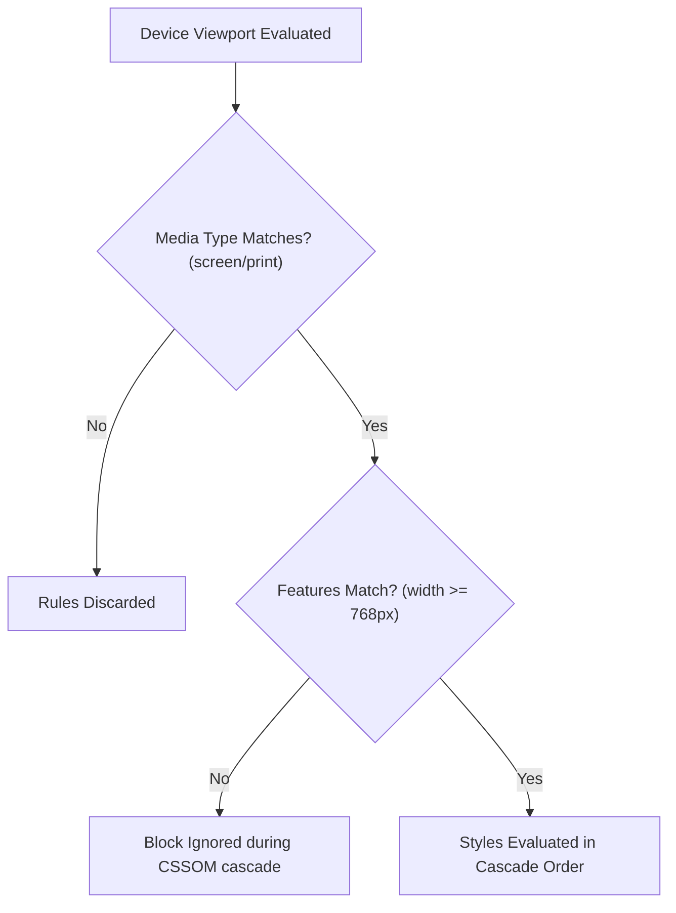

# Modern Media Queries

| Metadata | Details |
| :--- | :--- |
| **Level** | Core / Fundamental |
| **Prerequisites** | `05-responsive-design/01-responsive-principles-and-mobile-first.md`, `05-responsive-design/02-viewport-meta-and-units.md` |
| **Estimated Reading Time** | 24 minutes |
| **Status** | Complete |
| **Baseline Status** | Widely Available (Media Query Range Syntax Baseline 2023) |
| **Browsers Tested** | Chrome 120+, Firefox 121+, Safari 17.2+ |
| **Tested With** | Automated CSS Validation Runner (`css_runner.js`) |

---

## Table of Contents
- [1 What & Why](#1-what--why)
- [2 Core Concepts](#2-core-concepts)
- [3 How It Works Internally](#3-how-it-works-internally)
- [4 Syntax & Usage](#4-syntax--usage)
- [5 Practical Examples](#5-practical-examples)
- [6 Best Practices](#6-best-practices)
- [7 Common Mistakes & Pitfalls](#7-common-mistakes--pitfalls)
- [8 Performance, Accessibility & Browser Support](#8-performance-accessibility--browser-support)
- [9 Comparison / When to Use What](#9-comparison--when-to-use-what)
- [10 Interview Questions](#10-interview-questions)
- [11 Practice Exercises](#11-practice-exercises)
- [12 Summary / Cheat Sheet](#12-summary--cheat-sheet)
- [13 Further Reading](#13-further-reading)

---

## 1 What & Why

Media Queries are the foundation upon which responsive web design was born. Introduced in CSS3, they allow stylesheets to apply rules conditionally based on the capabilities and characteristics of the rendering device (such as screen width, orientation, or pixel density).

For years, authors were forced to write awkward, verbose syntax:
```css
/* Legacy CSS3 Syntax */
@media (min-width: 600px) and (max-width: 899.98px) { ... }
```
This syntax was confusing (is `min-width` inclusive or exclusive?) and prone to sub-pixel collision bugs.

**Media Queries Level 4** (Baseline 2023) revolutionized this syntax by introducing intuitive mathematical comparison operators:
```css
/* Modern Media Queries Level 4 Syntax (Baseline 2023) */
@media (600px <= width < 900px) { ... }
```
Understanding modern media query syntax, boolean logic (`and`, `not`, comma-separated `or`), and non-width features (`orientation`, `aspect-ratio`, `print`) is essential for building robust multi-device stylesheets.

---

## 2 Core Concepts

### 1. Media Types

Dictates the broad category of device being targeted:
- **`all` (Default)**: Matches all devices.
- **`screen`**: Monitors, tablets, smartphones, and televisions with color digital displays.
- **`print`**: Printers and print preview modes (critical for print stylesheets).
- *(Deprecated: `speech`, `tv`, `braille` were deprecated in Level 4).*

### 2. Media Query Level 4 Range Syntax

Replaces legacy `min-width` and `max-width` with standard mathematical comparison operators:

| Legacy CSS3 Syntax | Modern Level 4 Syntax | Meaning |
| :--- | :--- | :--- |
| `@media (min-width: 768px)` | `@media (width >= 768px)` | Viewport width is 768px or wider |
| `@media (max-width: 767.98px)` | `@media (width < 768px)` | Viewport width is strictly under 768px |
| `@media (min-width: 600px) and (max-width: 900px)` | `@media (600px <= width <= 900px)` | Viewport width is between 600px and 900px |

### 3. Boolean Logic in Media Queries

- **AND (`and`)**: All conditions must be true:
  `@media (width >= 768px) and (orientation: landscape)`
- **OR (Comma `,`)**: Either condition evaluates to true:
  `@media (width < 600px), (orientation: portrait)`
- **NOT (`not`)**: Inverts the entire media query:
  `@media not print` (Applies to all devices *except* printers).

### 4. Non-Width Media Features

- **`orientation`**: `portrait` (height $\ge$ width) vs `landscape` (width $>$ height).
- **`aspect-ratio`**: Matches screen aspect ratio: `@media (aspect-ratio >= 16/9)`.
- **`display-mode`**: Useful for Progressive Web Apps (PWAs): `fullscreen`, `standalone`, `minimal-ui`, `browser`.

---

## 3 How It Works Internally



### Cascade & Evaluation Mechanics

1. **Non-Blocking Resource Loading**: Linking a stylesheet with a media query (`<link rel="stylesheet" href="print.css" media="print">`) does **not** block page rendering! The browser downloads it in the background with lowest priority, and only applies it when printing.
2. **Dynamic Live Evaluation**: As the user resizes their browser window or tilts their mobile phone, the rendering engine continually evaluates media queries, triggering layout recalculations only when boundary thresholds are crossed.

---

## 4 Syntax & Usage

```css
/* 1. Mobile-First Modern Range Syntax */
@media (width >= 768px) {
  .site-nav {
    display: flex;
  }
}

/* 2. Bounded Inclusive Range */
@media (768px <= width <= 1024px) {
  .tablet-banner {
    display: block;
  }
}

/* 3. Combining Logical Operators */
@media screen and (width >= 1024px) and (orientation: landscape) {
  .hero-canvas {
    height: 100vh;
  }
}

/* 4. Print Stylesheet */
@media print {
  .no-print, nav, footer {
    display: none !important;
  }
  body {
    color: #000000;
    background: #ffffff;
    font-size: 12pt;
  }
}
```

> [!NOTE]
> **Baseline Status: Widely Available (Baseline 2023)**
> Modern Media Query Range Syntax (`width >= 768px`) is Baseline Widely Available across all modern browsers: Chrome 104+ (Aug 2022), Safari 16.4+ (March 2023), Firefox 63+ (Oct 2018), Edge 104+.

---

## 5 Practical Examples

### Example 1: Modern Multi-Breakpoint Layout System

```css
/* Base: Mobile (< 640px) */
.content-grid {
  display: flex;
  flex-direction: column;
  gap: 16px;
  padding: 16px;
}

/* Small / Tablet (640px to 1023px) */
@media (640px <= width < 1024px) {
  .content-grid {
    display: grid;
    grid-template-columns: repeat(2, 1fr);
  }
}

/* Desktop (>= 1024px) */
@media (width >= 1024px) {
  .content-grid {
    display: grid;
    grid-template-columns: repeat(4, 1fr);
    gap: 24px;
    padding: 32px;
  }
}
```

### Example 2: Mobile Landscape Orientation Adjustment

On smartphones held horizontally, vertical height is extremely constrained ($360\text{px} - 400\text{px}$). Adjust sticky headers so they do not consume half the screen:

```css
@media (height < 500px) and (orientation: landscape) {
  .site-header {
    height: 40px; /* Reduce from 64px */
    padding: 4px 16px;
  }
  
  .hero-title {
    font-size: 1.5rem; /* Scale down title */
  }
}
```

### Example 3: Edge Case — Print Stylesheet with URL Expansion

When users print an article, hyperlinks on screen become useless on physical paper. Expand the link's `href` attribute onto paper:

```css
@media print {
  /* Show destination URLs next to links on paper */
  a[href^="http"]::after {
    content: " (" attr(href) ")";
    font-size: 0.85em;
    color: #4b5563;
  }
  
  /* Suppress site-internal anchor links */
  a[href^="#"]::after {
    content: "";
  }
}
```

### Example 4: Failure Case — Confusing Comma OR with AND

```css
/* FAILURE PATTERN */
@media (width >= 768px), (orientation: landscape) {
  /* BUG: Developer thought comma meant AND!
     This rule fires on a mobile phone in landscape OR a desktop in portrait! */
}

/* FIXED PATTERN */
@media (width >= 768px) and (orientation: landscape) {
  /* Fires ONLY when BOTH width is >= 768px AND orientation is landscape */
}
```

### Example 5: Progressive Web App (PWA) Standalone Mode

```css
/* Style differently when launched as an installed app from home screen */
@media (display-mode: standalone) {
  .install-app-banner {
    display: none; /* Hide 'Install App' promo since already installed */
  }
  
  .app-header {
    padding-top: calc(8px + env(safe-area-inset-top, 0px));
  }
}
```

---

## 6 Best Practices

1. **Adopt Range Syntax as your default**: Write `@media (width >= 768px)` instead of legacy `min-width: 768px`.
2. **Keep breakpoints additive and mobile-first**: Use `width >= ...` queries exclusively for primary layout transitions.
3. **Use commas for OR conditions**: `@media (hover: none), (pointer: coarse)` targets all touchscreen devices.
4. **Always include a basic print stylesheet**: Hide navigation, floating action buttons, and set background to white.
5. **Base breakpoints on component needs**: Avoid tying breakpoints to specific brand names (e.g. "iPad Pro query").
6. **Group media queries alongside the components they modify**: With modern CSS build tools, keep media queries nested inside component blocks rather than isolated in giant separate files.

---

## 7 Common Mistakes & Pitfalls

| Mistake | Why It Breaks | Solution |
| :--- | :--- | :--- |
| Breakpoint collisions at `768px` | `min-width: 768px` and `max-width: 768px` overlap at 768.0px | Use range operators: `width < 768px` and `width >= 768px` |
| Using `screen and (width >= 768px)` when `all` was fine | Unnecessarily restricting styles from print | Use `@media (width >= 768px)` without `screen` |
| Confusing comma (`,`) with `and` | Comma represents logical OR; any matching clause activates the block | Use `and` if all conditions must be met |
| Hiding print elements with opacity | Element still occupies physical paper space and creates blank pages | Use `display: none !important;` |
| Overly specific media queries | Writing 10+ breakpoints makes maintenance a nightmare | Consolidate around 3-4 standard semantic tiers |
| Misunderstanding `orientation: landscape` on desktop | Desktop monitors are almost always landscape | Pair orientation queries with width or height checks |

---

## 8 Performance, Accessibility & Browser Support

### Rendering Engine Performance

- Media query evaluation is performed on the browser's style resolution pass.
- Modern engines store active media queries in an optimized lookup tree. When the window resizes, the engine evaluates only the registered breakpoint thresholds rather than re-evaluating every style declaration on every pixel tick.
- Avoid writing hundreds of unique, mismatched breakpoints across components; standardize on a unified system (e.g. `sm: 640px`, `md: 768px`, `lg: 1024px`, `xl: 1280px`).

### Accessibility Standards

- **Print Accessibility**: Users who print web pages (e.g. airline boarding passes, medical instructions, recipes) rely on print media queries to remove decorative dark mode backgrounds that waste ink and render text unreadable.
- **Orientation Independence (WCAG 1.3.4)**: Content must not restrict its view and operation to a single display orientation (portrait or landscape) unless an orientation lock is essential (such as a piano app). Media queries must accommodate both orientations gracefully.

---

## 9 Comparison / When to Use What

| Media Query | Type | Trigger Condition | Best Use Case |
| :--- | :--- | :--- | :--- |
| `width >= 768px` | Range (L4) | Viewport width $\ge 768\text{px}$ | Tablet / Desktop layout expansion |
| `width < 640px` | Range (L4) | Viewport width $< 640\text{px}$ | Mobile-specific exception styling |
| `640px <= width < 1024px` | Range (L4) | Bounded range | Tablet-specific intermediate styling |
| `print` | Type | Printing / Print Preview | Removing nav, expanding link URLs |
| `orientation: landscape` | Feature | Width $>$ Height | Constrained mobile height adjustments |

---

## 10 Interview Questions

<details>
<summary><strong>1. What are the key improvements introduced in Media Queries Level 4 Range Syntax?</strong></summary>

Media Queries Level 4 introduced mathematical comparison operators (`>=`, `<=`, `<`, `>`) and bounded ranges. This replaces ambiguous legacy `min-width` and `max-width` syntax, improves code readability, and permanently eliminates the sub-pixel collision bug where `max-width: 768px` and `min-width: 768px` fired simultaneously at exactly 768.0px.
</details>

<details>
<summary><strong>2. How does the comma (<code>,</code>) operator behave in a media query declaration?</strong></summary>

In media query syntax, a comma acts as a logical **OR** operator. If any one of the comma-separated media queries evaluates to true, the enclosed CSS block is applied:
`@media (width < 600px), (orientation: portrait) { ... }`
</details>

<details>
<summary><strong>3. How does the browser handle external stylesheet links with media queries (e.g. <code>&lt;link media="print"&gt;</code>)?</strong></summary>

The browser downloads the print stylesheet in the background with lowest network priority without blocking the Critical Rendering Path (it does not block DOM or CSSOM construction for initial screen rendering). It remains inactive until the user triggers a print action.
</details>

<details>
<summary><strong>4. How do you invert a media query using the <code>not</code> operator?</strong></summary>

The `not` operator inverts the entire media query. It must be paired with an explicit media type:
`@media not print { ... }` (applies to screen, tv, speech, etc., but not print). In Level 4, `not` can also invert individual feature expressions: `@media not (width >= 768px)`.
</details>

<details>
<summary><strong>5. What is the difference between <code>orientation: portrait</code> and mobile viewport width?</strong></summary>

`orientation: portrait` simply evaluates whether the viewport height is greater than or equal to the viewport width. It does not mean the device is a mobile phone; an iPad held vertically or a rotating desktop monitor in portrait mode will both evaluate to `portrait`. Always pair orientation checks with width/height boundaries.
</details>

<details>
<summary><strong>6. What is the baseline support status for modern Media Query Range Syntax?</strong></summary>

Media Query Range Syntax (`width >= 768px`) is part of **Web Platform Baseline 2023** (Widely Available), supported in Chrome 104+ (2022), Safari 16.4+ (2023), Firefox 63+ (2018), and Edge 104+.
</details>

<details>
<summary><strong>7. How does <code>display-mode: standalone</code> work in media queries?</strong></summary>

It matches when a Progressive Web App (PWA) has been installed and opened as a standalone application outside the standard browser interface (without URL address bar or browser tabs).
</details>

<details>
<summary><strong>8. Why should you avoid using <code>device-width</code> in media queries?</strong></summary>

`device-width` targets the physical resolution of the hardware screen rather than the browser window's actual viewport. If a user resizes their desktop browser or runs a split-screen window on an iPad, `device-width` reports the full screen width rather than the active app window width. `device-width` was deprecated in Media Queries Level 4.
</details>

---

## 11 Practice Exercises

### Exercise 1 (Easy): Modern Range Media Query
- **Task**: Write a media query that hides a desktop sidebar when the screen width is strictly under 768px.

<details>
<summary>View Solution</summary>

```css
@media (width < 768px) {
  .sidebar {
    display: none;
  }
}
```
</details>

### Exercise 2 (Easy): Clean Print Reset
- **Task**: Style a print media query that hides all `.no-print` buttons and sets the body background to white.

<details>
<summary>View Solution</summary>

```css
@media print {
  .no-print {
    display: none !important;
  }
  
  body {
    background-color: #ffffff;
    color: #000000;
  }
}
```
</details>

### Exercise 3 (Medium): Inclusive Tablet Bounded Range
- **Task**: Apply a 2-column grid layout exclusively on viewports between 640px and 1024px using Level 4 range syntax.

<details>
<summary>View Solution</summary>

```css
@media (640px <= width < 1024px) {
  .deck {
    display: grid;
    grid-template-columns: repeat(2, 1fr);
    gap: 16px;
  }
}
```
</details>

### Exercise 4 (Medium): Mobile Landscape Header Shrink
- **Task**: Detect devices in landscape mode whose vertical height is under 450px and reduce header height to 40px.

<details>
<summary>View Solution</summary>

```css
@media (orientation: landscape) and (height < 450px) {
  .site-header {
    height: 40px;
    padding: 4px 16px;
  }
}
```
</details>

### Exercise 5 (Hard): Multi-Condition PWA Standalone Header
- **Task**: Add 20px padding to the topbar when launched as a standalone PWA on mobile devices.

<details>
<summary>View Solution</summary>

```css
@media (display-mode: standalone) and (width < 768px) {
  .app-topbar {
    padding-top: calc(20px + env(safe-area-inset-top, 0px));
  }
}
```
</details>

### Exercise 6 (Hard): Refactoring Legacy CSS3 to Modern Range Syntax
- **Task**: Refactor `@media (min-width: 600px) and (max-width: 899px)` into modern syntax.

<details>
<summary>View Solution</summary>

```css
/* Modern Clean Equivalent */
@media (600px <= width < 900px) {
  .card-container {
    padding: 20px;
  }
}
```
</details>

---

## 12 Summary / Cheat Sheet

```css
/* Modern Level 4 Range Syntax (Baseline 2023) */
@media (width >= 768px)             /* min-width: 768px */
@media (width < 768px)              /* max-width: 767.98px */
@media (640px <= width <= 1024px)   /* Bounded range */

/* Logical Operators */
and  /* All must be true */
,    /* OR: either matches */
not  /* Invert query */

/* Other Features */
@media print { ... }
@media (orientation: landscape) { ... }
@media (display-mode: standalone) { ... }
```

---

## 13 Further Reading

- [MDN Web Docs: Using media queries](https://developer.mozilla.org/en-US/docs/Web/CSS/CSS_media_queries/Using_media_queries)
- [W3C Media Queries Level 4 Specification: Syntax](https://www.w3.org/TR/mediaqueries-4/#syntax)
- [web.dev: Media query range syntax](https://web.dev/blog/media-query-range-syntax)
- [CSS-Tricks: The New Media Query Range Syntax](https://css-tricks.com/the-new-css-media-query-range-syntax/)

---

[Previous: 02-viewport-meta-and-units.md](file:///e:/Learning/engineering-notes/01-languages/css/05-responsive-design/02-viewport-meta-and-units.md) | [Section Index](file:///e:/Learning/engineering-notes/01-languages/css/05-responsive-design/README.md) | [Next: 04-container-queries-and-container-units.md](file:///e:/Learning/engineering-notes/01-languages/css/05-responsive-design/04-container-queries-and-container-units.md)
