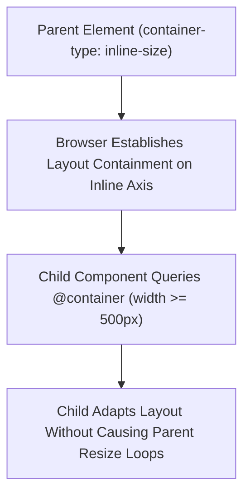

# Container Queries and Container Query Units

| Metadata | Details |
| :--- | :--- |
| **Level** | Advanced / Modern Standard |
| **Prerequisites** | `05-responsive-design/01-responsive-principles-and-mobile-first.md`, `05-responsive-design/03-media-queries.md` |
| **Estimated Reading Time** | 26 minutes |
| **Status** | Complete |
| **Baseline Status** | Widely Available across all modern browsers (Baseline 2023) |
| **Browsers Tested** | Chrome 105+, Firefox 110+, Safari 16.0+, Edge 105+ |
| **Tested With** | Automated CSS Validation Runner (`css_runner.js`) |

---

## Table of Contents
- [1 What & Why](#1-what--why)
- [2 Core Concepts](#2-core-concepts)
- [3 How It Works Internally](#3-how-it-works-internally)
- [4 Syntax & Usage](#4-syntax--usage)
- [5 Practical Examples](#5-practical-examples)
- [6 Best Practices](#6-best-practices)
- [7 Common Mistakes & Pitfalls](#7-common-mistakes--pitfalls)
- [8 Performance, Accessibility & Browser Support](#8-performance-accessibility--browser-support)
- [9 Comparison / When to Use What](#9-comparison--when-to-use-what)
- [10 Interview Questions](#10-interview-questions)
- [11 Practice Exercises](#11-practice-exercises)
- [12 Summary / Cheat Sheet](#12-summary--cheat-sheet)
- [13 Further Reading](#13-further-reading)

---

## 1 What & Why

For more than a decade, CSS had a glaring architectural limitation: **Media Queries only respond to the global browser viewport**.

In modern component-driven frontend architectures (React, Vue, Web Components), a reusable component (like a product card or video player) can be rendered in multiple distinct contexts on the exact same page:
- In a full-width hero container ($1200\text{px}$ wide).
- In a 3-column dashboard grid ($400\text{px}$ wide).
- In a narrow sidebar drawer ($250\text{px}$ wide).

Under traditional media queries, if the user is on a desktop monitor ($1920\text{px}$), the card in the narrow sidebar mistakenly receives desktop styling, blowing out the sidebar and looking distorted! Developers were forced to author dozens of contextual CSS class overrides (`.sidebar .card { ... }`).

**CSS Container Queries** (Baseline 2023) solve this fundamentally. They allow a component to query the width of its **immediate parent container** rather than the viewport. A component now styles itself dynamically based entirely on the space it has available, achieving true, universal component modularity!

---

## 2 Core Concepts

### 1. The Container Context (`container-type`)

Before a child can query its ancestor, the ancestor must explicitly establish a **containment context**:

- **`container-type: inline-size` (Most Common)**: Establishes a container query context based on the container's **inline dimension** (width in horizontal writing modes).
- **`container-type: size`**: Establishes a context based on both inline and block dimensions (width AND height). *Warning: Requires the container to have an explicit height, otherwise it collapses to 0px!*
- **`container-type: normal` (Default)**: Not a container for size queries.

### 2. The `@container` At-Rule

Evaluates styling conditions against the nearest ancestor container:

```css
@container (min-width: 400px) {
  .card {
    display: flex; /* Switches to horizontal layout when container is >= 400px */
  }
}
```

Modern Media Query Level 4 range syntax is also fully supported:
```css
@container (width >= 400px) { ... }
```

### 3. Named Containers (`container-name`)

If an element is nested inside multiple containers (e.g. an article inside a sidebar inside a page shell), you can name containers and query them specifically:

```css
.sidebar {
  container-name: sidebar;
  container-type: inline-size;
}

@container sidebar (width < 300px) {
  .widget-btn { font-size: 0.8rem; }
}
```

### 4. Container Query Units (CQ Units)

Just as `vw` and `vh` calculate percentages of the viewport, **CQ Units** calculate percentages of the **parent container's size**:

| Unit | Definition |
| :--- | :--- |
| **`cqw`** | $1\%$ of the container's width. |
| **`cqh`** | $1\%$ of the container's height. |
| **`cqi`** | $1\%$ of the container's **inline size** (width in LTR/RTL). |
| **`cqb`** | $1\%$ of the container's **block size** (height in horizontal). |
| **`cqmin`** | The smaller value between `cqi` and `cqb`. |
| **`cqmax`** | The larger value between `cqi` and `cqb`. |

---

## 3 How It Works Internally

### Why Layout Containment is Required (Preventing Infinite Loops)

```
The Infinite Loop Dilemma (Why standard CSS couldn't do this for 10 years):
1. Card queries parent width: "If parent > 500px, expand card to 600px".
2. Card expands to 600px, which forces parent container to expand to 600px.
3. Parent expansion changes the query condition!
4. The browser would enter an infinite recalculation loop and crash.

The Engine Solution (contain: layout inline-size):
Declaring container-type: inline-size enforces strict layout containment.
The parent's inline-size CANNOT depend on the size of its children.
Children can query the parent's width, but cannot push the parent wider!
```



---

## 4 Syntax & Usage

```css
/* Container Setup */
.card-wrapper {
  /* Shorthand: container: <name> / <type>; */
  container: card-container / inline-size;
}

/* Explicit Longhands */
.sidebar {
  container-name: sidebar-context;
  container-type: inline-size;
}

/* Querying Nearest Container */
@container (width >= 480px) {
  .card {
    display: flex;
    flex-direction: row;
    gap: 16px;
  }
}

/* Querying Named Container Specifically */
@container sidebar-context (width < 320px) {
  .nav-item {
    padding: 4px;
  }
}

/* Fluid Sizing with CQ Units */
.card-title {
  /* Scales directly with the card container width, not the screen! */
  font-size: clamp(1rem, 5cqi, 2rem);
}
```

> [!NOTE]
> **Baseline Status: Widely Available (Baseline 2023)**
> CSS Container Queries and CQ Units are supported across all modern browsers: Chrome 105+ (Aug 2022), Safari 16.0+ (Sept 2022), Firefox 110+ (Feb 2023), Edge 105+.

---

## 5 Practical Examples

### Example 1: The Universally Adaptive Card Component

This single component renders as a vertical card when placed in a sidebar ($280\text{px}$), and automatically transforms into a rich horizontal media card when dropped into a wide main column ($600\text{px}$), on the exact same screen!

```css
/* The Container (Wrapper) */
.card-slot {
  container-type: inline-size;
}

/* The Card (Default: Compact Vertical Stack) */
.product-card {
  display: flex;
  flex-direction: column;
  gap: 12px;
  background-color: #ffffff;
  border: 1px solid #e2e8f0;
  border-radius: 8px;
  padding: 16px;
}

.product-image {
  width: 100%;
  aspect-ratio: 16 / 9;
  object-fit: cover;
  border-radius: 6px;
}

/* Container Query: Transform to Horizontal Layout when slot >= 500px */
@container (width >= 500px) {
  .product-card {
    flex-direction: row;
    align-items: center;
    padding: 24px;
  }

  .product-image {
    width: 180px;
    aspect-ratio: 1 / 1;
    flex-shrink: 0;
  }

  .product-body {
    flex: 1;
  }
}
```

### Example 2: Container-Relative Fluid Typography (`cqi`)

```css
.hero-widget {
  container-type: inline-size;
  padding: 32px;
  background-color: #0f172a;
  color: #ffffff;
}

.hero-heading {
  /* 6cqi = 6% of the hero-widget container's width! */
  font-size: clamp(1.5rem, 6cqi, 3.5rem);
  line-height: 1.1;
  font-weight: 800;
}
```

### Example 3: Edge Case — Querying Named Containers in Nested Grids

```css
/* Page Shell */
.app-sidebar {
  container: sidebar-root / inline-size;
  width: 280px;
}

.app-main {
  container: main-root / inline-size;
  flex: 1;
}

/* Target specifically when inside sidebar, regardless of intervening containers */
@container sidebar-root (width <= 300px) {
  .user-profile-badge .status-text {
    display: none; /* Hide detailed text inside narrow sidebar */
  }
}
```

### Example 4: Failure Case — Applying `@container` Directly on the Container

```css
/* FAILURE PATTERN */
.card-wrapper {
  container-type: inline-size;
  /* BUG: A container CANNOT query its own dimensions!
     @container queries can only style CHILDREN of the container. */
}

@container (width >= 400px) {
  .card-wrapper {
    /* Completely ignored! The container cannot style itself via container queries */
    background-color: red;
  }
}

/* FIXED PATTERN */
@container (width >= 400px) {
  .card-wrapper > .card-child {
    background-color: #ffffff; /* Correct: styles descendant elements */
  }
}
```

### Example 5: Responsive User Profile Card

```css
.profile-wrapper {
  container-type: inline-size;
}

.profile-card {
  display: grid;
  grid-template-columns: 1fr;
  gap: 16px;
  padding: 16px;
  background: #ffffff;
  border-radius: 8px;
}

@container (width >= 420px) {
  .profile-card {
    grid-template-columns: 80px 1fr;
    align-items: center;
  }
}
```

---

## 6 Best Practices

1. **Use `container-type: inline-size` by default**: Almost all responsive layouts query width (inline size). Avoid `container-type: size` unless you have explicit height constraints.
2. **Always style children, not the container**: A container query can only style descendant elements inside the container.
3. **Use Container Query Units (`cqi`) for modular typography**: `clamp(1rem, 4cqi, 2.5rem)` makes typography fluid relative to the component box.
4. **Use named containers when components are deeply nested**: Eliminates ambiguity when multiple container contexts exist in the DOM tree.
5. **Combine with CSS Grid RAM layouts**: Pair `repeat(auto-fit, minmax(280px, 1fr))` on the grid with `@container` on the cards for next-generation responsiveness.
6. **Provide a mobile-first component baseline**: Design the single-column, narrow container layout by default, then enhance with `@container (width >= ...)`.

---

## 7 Common Mistakes & Pitfalls

| Mistake | Root Cause | Solution |
| :--- | :--- | :--- |
| Container queries not firing | Forgot to declare `container-type: inline-size` on an ancestor | Add `container-type: inline-size` to parent |
| Element trying to query itself | The CSS specification forbids self-querying to prevent layout loops | Query from a parent wrapper and style child |
| Container collapses to $0\text{px}$ height | Declared `container-type: size` without setting explicit height | Use `container-type: inline-size` instead |
| Using `vw` inside modular components | `vw` responds to the whole screen, breaking cards in sidebars | Replace `vw` with `cqi` (container inline size) |
| Typo in container shorthand | Syntax is `container: <name> / <type>;` (slash is mandatory) | Write `container: my-name / inline-size;` |
| Overlapping named query collisions | Unnamed `@container` queries bind to the *nearest* container ancestor | Use named containers (`@container my-name (...)`) |

---

## 8 Performance, Accessibility & Browser Support

### Layout Performance

- Container queries are designed specifically for high performance.
- Because `container-type: inline-size` introduces strict **CSS Containment** (`contain: layout inline-size`), the browser engine knows that changes inside the container cannot alter the width of elements outside the container!
- This isolates layout recalculations to that specific DOM subtree, preventing full-page document reflows.

### Accessibility

- Components built with Container Queries scale gracefully when a user increases text size or changes display zoom, adapting their visual layout based on actual available space without breaking out of layout columns.

---

## 9 Comparison / When to Use What

| Feature | Media Queries (`@media`) | Container Queries (`@container`) |
| :--- | :--- | :--- |
| **Query Target** | Global Browser Viewport | Nearest Parent Container |
| **Best Used For** | Macro page shells, dark mode, print, orientation | Reusable UI components (cards, widgets, navbars) |
| **Fluid Units** | `vw`, `vh`, `svh`, `dvh` | `cqw`, `cqh`, `cqi`, `cqb` |
| **Modularity** | Low (Tied to screen size) | **High (100% portable component)** |

---

## 10 Interview Questions

<details>
<summary><strong>1. What is the fundamental difference between Media Queries and Container Queries?</strong></summary>

Media Queries evaluate conditions against the global browser viewport or device characteristics (e.g. screen width, orientation). Container Queries evaluate conditions against the dimensions of an ancestor container element in the DOM tree, allowing components to adapt based on their immediate physical slot width regardless of total screen size.
</details>

<details>
<summary><strong>2. Why can an element not query its own dimensions with <code>@container</code>?</strong></summary>

Allowing an element to query its own size would create catastrophic infinite layout loops: changing an element's styles based on its own width could alter its width, invalidating the query and triggering an endless cycle of style recalculations. Therefore, the specification mandates that `@container` queries can only style descendant elements of a container.
</details>

<details>
<summary><strong>3. What is the difference between <code>container-type: inline-size</code> and <code>container-type: size</code>?</strong></summary>

- `inline-size`: Establishes containment along the inline axis only (width in horizontal writing modes). The container's block axis (height) can still grow dynamically based on its content.
- `size`: Establishes containment along both axes (width and height). Because height is contained, the container cannot compute height based on child content, requiring an explicit height declaration; otherwise, it collapses to $0\text{px}$.
</details>

<details>
<summary><strong>4. What does the <code>cqi</code> unit represent?</strong></summary>

`cqi` represents $1\%$ of the container's **inline size** (width in horizontal writing modes like English or Arabic, and height in vertical writing modes like traditional Japanese).
</details>

<details>
<summary><strong>5. How do Named Containers work, and why are they useful?</strong></summary>

By declaring `container-name: sidebar-context;` on an ancestor, you can target that specific container explicitly using `@container sidebar-context (width < 300px)`. This is useful when a component is nested inside multiple containers and needs to respond to a higher-level parent container rather than its immediate wrapper.
</details>

<details>
<summary><strong>6. What is the browser support status for CSS Container Queries?</strong></summary>

CSS Container Queries are part of **Web Platform Baseline 2023** (Widely Available). They are supported in all major engines: Chrome 105+ (Aug 2022), Safari 16.0+ (Sept 2022), Firefox 110+ (Feb 2023), and Edge 105+.
</details>

<details>
<summary><strong>7. How does CSS Containment improve browser rendering performance in container queries?</strong></summary>

By declaring `container-type: inline-size`, the browser creates an isolated layout boundary. When elements inside the container change shape, the browser does not need to recalculate or reflow the geometry of elements outside the container, significantly reducing layout calculation overhead.
</details>

<details>
<summary><strong>8. Can container queries query computed styles in addition to dimensions?</strong></summary>

Yes. CSS Container Style Queries (`@container style(--theme: dark)`) allow components to query CSS custom properties on their parent containers (Baseline Newly Available / emerging support across engines).
</details>

---

## 11 Practice Exercises

### Exercise 1 (Easy): Basic Card Container Context
- **Task**: Establish an inline-size container on `.card-wrapper` and switch `.card` from column to row layout at 450px.

<details>
<summary>View Solution</summary>

```css
.card-wrapper {
  container-type: inline-size;
}

.card {
  display: flex;
  flex-direction: column;
}

@container (width >= 450px) {
  .card {
    flex-direction: row;
  }
}
```
</details>

### Exercise 2 (Easy): Fluid Title with `cqi` Units
- **Task**: Make a card headline scale proportionally with the card container using `cqi` units and `clamp()`.

<details>
<summary>View Solution</summary>

```css
.card-header-title {
  font-size: clamp(1.125rem, 4cqi, 2rem);
  font-weight: 700;
}
```
</details>

### Exercise 3 (Medium): Named Container Sidebar Query
- **Task**: Create a named container `dashboard-sidebar` and hide description text on badges when the sidebar is under 250px.

<details>
<summary>View Solution</summary>

```css
.sidebar {
  container-name: dashboard-sidebar;
  container-type: inline-size;
}

@container dashboard-sidebar (width < 250px) {
  .badge-description {
    display: none;
  }
}
```
</details>

### Exercise 4 (Medium): Shorthand Container Declaration
- **Task**: Use the `container` shorthand property to declare a container named `feed-slot` with `inline-size` containment.

<details>
<summary>View Solution</summary>

```css
.feed-slot {
  /* Syntax: <name> / <type> */
  container: feed-slot / inline-size;
}
```
</details>

### Exercise 5 (Hard): Multi-Tier Adaptive Component
- **Task**: Build an article component that displays in 3 states: compact vertical (< 360px), horizontal media (360px - 600px), and full feature grid (>= 600px).

<details>
<summary>View Solution</summary>

```css
.article-slot {
  container-type: inline-size;
}

/* State 1: Compact vertical (< 360px) */
.article-widget {
  display: flex;
  flex-direction: column;
  gap: 12px;
}

/* State 2: Horizontal media (360px to 599px) */
@container (360px <= width < 600px) {
  .article-widget {
    flex-direction: row;
    align-items: center;
  }
  
  .article-thumb {
    width: 120px;
    height: 120px;
    flex-shrink: 0;
  }
}

/* State 3: Full feature grid (>= 600px) */
@container (width >= 600px) {
  .article-widget {
    display: grid;
    grid-template-columns: 240px 1fr;
    gap: 24px;
    padding: 24px;
  }
}
```
</details>

### Exercise 6 (Hard): Grid + Container Queries Ultimate Synergy
- **Task**: Place multiple container slots into a CSS Grid RAM layout (`auto-fit`) so each card adapts internally as the grid columns change.

<details>
<summary>View Solution</summary>

```css
.catalog-grid {
  display: grid;
  grid-template-columns: repeat(auto-fit, minmax(min(100%, 280px), 1fr));
  gap: 20px;
}

.catalog-slot {
  container-type: inline-size;
}

@container (width >= 400px) {
  .catalog-item-card {
    display: grid;
    grid-template-columns: 140px 1fr;
  }
}
```
</details>

---

## 12 Summary / Cheat Sheet

```css
/* Container Context */
container-type: inline-size;             /* Establish width containment */
container-name: my-slot;                 /* Optional name */
container: my-slot / inline-size;        /* Shorthand */

/* Container Query */
@container (width >= 480px) { ... }      /* Nearest container */
@container my-slot (width < 300px) { ... } /* Specific named container */

/* Container Query Units */
1cqi  /* 1% of container inline-size (width) */
1cqb  /* 1% of container block-size (height) */
1cqw  /* 1% of container physical width */
1cqh  /* 1% of container physical height */
```

---

## 13 Further Reading

- [MDN Web Docs: CSS Container Queries](https://developer.mozilla.org/en-US/docs/Web/CSS/CSS_containment/Container_queries)
- [W3C CSS Containment Module Level 3](https://www.w3.org/TR/css-contain-3/)
- [web.dev: A Primer on CSS Container Queries](https://web.dev/blog/cq-stable)
- [Smashing Magazine: An In-Depth Guide To CSS Container Queries](https://www.smashingmagazine.com/2021/05/complete-guide-css-container-queries/)

---

[Previous: 03-media-queries.md](file:///e:/Learning/engineering-notes/01-languages/css/05-responsive-design/03-media-queries.md) | [Section Index](file:///e:/Learning/engineering-notes/01-languages/css/05-responsive-design/README.md) | [Next: 05-fluid-typography-and-spacing-clamp.md](file:///e:/Learning/engineering-notes/01-languages/css/05-responsive-design/05-fluid-typography-and-spacing-clamp.md)
