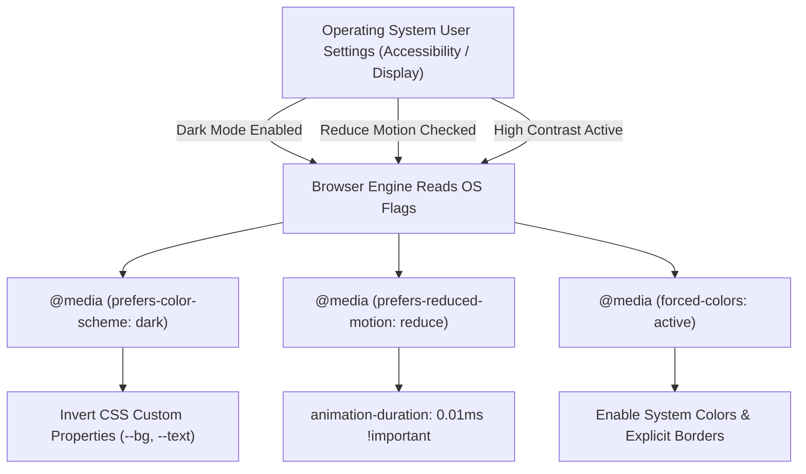

# User Preference Media Features

| Metadata | Details |
| :--- | :--- |
| **Level** | Core / Accessibility & UX |
| **Prerequisites** | `05-responsive-design/01-responsive-principles-and-mobile-first.md`, `05-responsive-design/03-media-queries.md` |
| **Estimated Reading Time** | 26 minutes |
| **Status** | Complete |
| **Baseline Status** | Widely Available (`prefers-color-scheme`, `prefers-reduced-motion` Baseline 2020; `forced-colors` Baseline 2022) |
| **Browsers Tested** | Chrome 120+, Firefox 121+, Safari 17.2+ |
| **Tested With** | Automated CSS Validation Runner (`css_runner.js`) |

---

## Table of Contents
- [1 What & Why](#1-what--why)
- [2 Core Concepts](#2-core-concepts)
- [3 How It Works Internally](#3-how-it-works-internally)
- [4 Syntax & Usage](#4-syntax--usage)
- [5 Practical Examples](#5-practical-examples)
- [6 Best Practices](#6-best-practices)
- [7 Common Mistakes & Pitfalls](#7-common-mistakes--pitfalls)
- [8 Performance, Accessibility & Browser Support](#8-performance-accessibility--browser-support)
- [9 Comparison / When to Use What](#9-comparison--when-to-use-what)
- [10 Interview Questions](#10-interview-questions)
- [11 Practice Exercises](#11-practice-exercises)
- [12 Summary / Cheat Sheet](#12-summary--cheat-sheet)
- [13 Further Reading](#13-further-reading)

---

## 1 What & Why

Historically, responsive design was almost exclusively concerned with physical screen geometry: width and height.

However, modern operating systems (macOS, Windows, iOS, Android, Linux) empower users with personal accessibility and physiological settings:
- Users with **vestibular disorders** can experience severe nausea, dizziness, or migraines from parallax scrolling and aggressive bouncy transitions.
- Users with **visual impairments** or **photophobia** require dark interfaces (`prefers-color-scheme: dark`) or extreme contrast (`forced-colors: active` / Windows High Contrast Mode).
- Users on **metered cellular plans** or slow satellite networks signal that they wish to save cellular bandwidth (`prefers-reduced-data: reduce`).

**User Preference Media Features** expose these OS-level signals directly to CSS, allowing your web applications to adapt with empathy to the user's physical needs and environmental conditions.

---

## 2 Core Concepts

### 1. `prefers-color-scheme` (Dark / Light Mode)

Detects if the user has requested light or dark themes at the operating system level:
- **`light`**: User prefers a light background with dark typography.
- **`dark`**: User prefers a dark background with light typography.
- Standard pattern: Define CSS Custom Properties on `:root`, and invert them inside `@media (prefers-color-scheme: dark)`.

### 2. `prefers-reduced-motion` (Motion Accessibility)

Detects if the user has enabled "Reduce Motion" in their system accessibility settings:
- **`no-preference`**: User has not requested reduced motion.
- **`reduce`**: **Mandatory Accessibility Requirement**. You must eliminate, minimize, or replace disorienting animations (such as zooming, parallax, sliding drawers, and 3D rotations) with simple, non-jarring cross-fades or static states.

### 3. `forced-colors` (Windows High Contrast Mode)

Detects when the operating system enforces a restricted, high-contrast system color palette:
- **`none`**: Normal author colors apply.
- **`active`**: Active High Contrast Mode. The browser overrides author `color`, `background-color`, `border-color`, and **strips all `box-shadow` and background images!**
- You must use system color keywords (`Canvas`, `CanvasText`, `Highlight`, `ButtonText`) and explicit borders so buttons and outlines remain visible.

### 4. `prefers-contrast`

Detects if the user has requested higher or lower contrast in their accessibility settings:
- **`no-preference`**, **`more`** (increase border contrast, darken text), **`less`** (soften harsh contrasts), **`custom`**.

### 5. `prefers-reduced-data`

Detects if the user has turned on "Data Saver" mode on their mobile device:
- **`reduce`**: Suppress heavy background videos, high-resolution hero images, web font preloading, and non-essential visual fluff.

---

## 3 How It Works Internally



### Windows High Contrast Mode (`forced-colors`) Quirks

When `forced-colors: active`:
1. The browser enforces a strict palette of system colors: `Canvas` (background), `CanvasText` (body text), `LinkText` (links), `Highlight` (selected items), `ButtonFace` (buttons).
2. The browser **completely deletes all `box-shadow` declarations**!
3. If you designed a card with no borders and relied solely on `box-shadow: 0 4px 6px rgba(0,0,0,0.1);`, in High Contrast Mode your card **completely vanishes into the background canvas!**
4. The solution: Always add a transparent border (`border: 1px solid transparent;`). In forced-colors mode, the browser turns that transparent border into a visible, high-contrast system border!

---

## 4 Syntax & Usage

```css
/* 1. Dark Mode System */
:root {
  --bg-primary: #ffffff;
  --text-primary: #0f172a;
}

@media (prefers-color-scheme: dark) {
  :root {
    --bg-primary: #0f172a;
    --text-primary: #f8fafc;
  }
}

/* 2. Reduced Motion Universal Guard */
@media (prefers-reduced-motion: reduce) {
  *,
  *::before,
  *::after {
    animation-duration: 0.01ms !important;
    animation-iteration-count: 1 !important;
    transition-duration: 0.01ms !important;
    scroll-behavior: auto !important;
  }
}

/* 3. Forced Colors (High Contrast) Defense */
.card {
  /* Transparent border converts to visible high-contrast border in WHCM */
  border: 1px solid transparent;
}
```

---

## 5 Practical Examples

### Example 1: Production Dark/Light Theme with Native `light-dark()` Function

Modern CSS provides the `light-dark()` color function (Baseline 2024), which pairs seamlessly with `color-scheme`:

```css
:root {
  /* Tells browser engine this page supports both modes natively */
  color-scheme: light dark;

  /* light-dark(lightColor, darkColor) */
  --bg-surface: light-dark(#ffffff, #0f172a);
  --text-main: light-dark(#1e293b, #f8fafc);
  --card-border: light-dark(#e2e8f0, #334155);
}

body {
  background-color: var(--bg-surface);
  color: var(--text-main);
}

.card {
  background-color: var(--bg-surface);
  border: 1px solid var(--card-border);
  padding: 24px;
  border-radius: 8px;
}
```

### Example 2: Accessible Animation with Reduced Motion Replacement

Instead of jarringly disabling transitions entirely, replace disorienting spatial movement (sliding/zooming) with gentle, non-vestibular opacity fades:

```css
.modal-dialog {
  opacity: 0;
  transform: translateY(40px) scale(0.95);
  transition: opacity 0.3s ease, transform 0.3s ease;
}

.modal-dialog.open {
  opacity: 1;
  transform: translateY(0) scale(1);
}

/* Vestibular Motion Replacement */
@media (prefers-reduced-motion: reduce) {
  .modal-dialog {
    /* Remove spatial translation, keep gentle opacity fade */
    transform: none;
    transition: opacity 0.15s ease;
  }
}
```

### Example 3: Defending UI in Windows High Contrast Mode (`forced-colors`)

```css
.pill-button {
  background-color: #2563eb;
  color: #ffffff;
  padding: 8px 16px;
  border-radius: 9999px;
  /* CRITICAL: A transparent border ensures a border appears in forced-colors mode! */
  border: 2px solid transparent;
  cursor: pointer;
}

.pill-button:focus-visible {
  outline: 3px solid #60a5fa;
  outline-offset: 2px;
}

@media (forced-colors: active) {
  .pill-button {
    /* WHCM automatically maps background and text to ButtonFace / ButtonText,
       and turns transparent border into a crisp system-highlighted line! */
    forced-color-adjust: auto;
  }
}
```

### Example 4: Data-Saver Optimization with `prefers-reduced-data`

```css
.hero-header {
  background-color: #0f172a;
  background-image: url("hero-high-res-4k.webp");
  background-size: cover;
  min-height: 400px;
}

/* User is on metered mobile cellular data */
@media (prefers-reduced-data: reduce) {
  .hero-header {
    /* Strip heavy 2MB background image; use lightweight solid gradient */
    background-image: linear-gradient(135deg, #0f172a, #1e293b);
  }
}
```

### Example 5: High-Contrast Mode Preference (`prefers-contrast: more`)

```css
.alert-box {
  background-color: #fef2f2;
  border: 1px solid #fecaca;
  color: #991b1b;
  padding: 16px;
  border-radius: 6px;
}

@media (prefers-contrast: more) {
  .alert-box {
    /* Enhance border thickness and text darkness for low-vision users */
    border: 2px solid #7f1d1d;
    color: #450a0a;
    background-color: #ffffff;
    font-weight: 700;
  }
}
```

---

## 6 Best Practices

1. **Always declare `color-scheme: light dark;` on `:root`**: Informs the browser engine to adjust native form controls (checkboxes, inputs, datepickers) and default scrollbars automatically.
2. **Implement the universal `prefers-reduced-motion` safety reset**: Ensure no user experiences motion sickness from non-essential UI animations.
3. **Always use transparent borders on cards and buttons**: `border: 1px solid transparent;` guarantees visibility in Windows High Contrast Mode (`forced-colors: active`).
4. **Replace spatial animations with gentle opacity fades**: When reduced motion is requested, cross-fades provide visual state confirmation without triggering vestibular nausea.
5. **Never disable `forced-color-adjust` globally**: Only apply `forced-color-adjust: none` on specific color swatches where original color accuracy is functionally required (like a color palette picker).
6. **Support `prefers-reduced-data` for heavy media**: Avoid preloading videos or massive background images on metered connections.

---

## 7 Common Mistakes & Pitfalls

| Mistake | Why It Breaks | Fix |
| :--- | :--- | :--- |
| Cards invisible in Windows High Contrast Mode | Relied solely on `box-shadow`; WHCM deletes all box-shadows | Add `border: 1px solid transparent;` |
| Setting `transition: none` breaks JavaScript listeners | Scripts waiting for `transitionend` events will hang permanently | Set `transition-duration: 0.01ms` instead of `none` |
| Forgetting `color-scheme: light dark` | Dark mode pages display blinding white native scrollbars | Add `color-scheme: light dark;` to `:root` |
| Disabling all animations indiscriminately | Complete removal can disorient users; gentle fades confirm state changes | Replace translations with subtle opacity fades |
| Hardcoding `#000000` text in dark mode overrides | Contrast becomes illegible if dark mode styles partially fail | Use semantic CSS custom properties centrally |
| Using `forced-color-adjust: none` on buttons | Forces author colors, blinding users who need high-contrast system colors | Respect default `forced-color-adjust: auto` |

---

## 8 Performance, Accessibility & Browser Support

### Accessibility Compliance (WCAG 2.1 & 2.2)

- **WCAG 2.3.3 Animation from Interactions (Level AAA)**: Motion animation triggered by interaction can be disabled unless the animation is essential to functionality.
- **WCAG 1.4.11 Non-text Contrast (Level AA)**: Visual boundaries of user interface components (such as buttons and form inputs) must have a contrast ratio of at least $3:1$ against adjacent backgrounds.
- Supporting `forced-colors: active` and `prefers-contrast: more` is the gold standard for achieving enterprise accessibility compliance.

---

## 9 Comparison / When to Use What

| Media Feature | User Intent | Primary Action in CSS |
| :--- | :--- | :--- |
| `prefers-color-scheme: dark` | Comfort / Eye fatigue / Dark environment | Invert color palette variables |
| `prefers-reduced-motion: reduce` | Prevent nausea, vertigo, migraines | Suppress spatial translation & parallax |
| `forced-colors: active` | Severe low vision / High contrast needs | Use transparent borders & system colors |
| `prefers-contrast: more` | Low vision / Outdoor glare | Thicken borders, darken text, eliminate tints |
| `prefers-reduced-data: reduce` | Save cellular mobile data quota | Strip background videos & heavy textures |

---

## 10 Interview Questions

<details>
<summary><strong>1. Why is <code>prefers-reduced-motion</code> critical for users with vestibular disorders?</strong></summary>

Vestibular disorders affect the inner ear and brain, disrupting the body's sense of balance and spatial orientation. Screen movements involving rapid scaling, parallax scrolling, sliding drawers, or 3D rotations create a mismatch between sensory inputs, triggering physical nausea, intense vertigo, migraines, and disorientation. Respecting `prefers-reduced-motion: reduce` protects users from physical harm.
</details>

<details>
<summary><strong>2. What happens to author CSS when <code>forced-colors: active</code> (Windows High Contrast Mode) is turned on?</strong></summary>

The browser engine overrides author-defined `color`, `background-color`, `border-color`, `outline-color`, and `text-decoration-color` with user-selected system colors (such as `Canvas` and `CanvasText`). Furthermore, the engine **completely strips all `box-shadow` and `text-shadow` declarations** and ignores non-essential background images.
</details>

<details>
<summary><strong>3. How does adding <code>border: 1px solid transparent</code> defend cards in Windows High Contrast Mode?</strong></summary>

Cards designed with subtle shadows (`box-shadow`) lose their shadows completely in WHCM. If the card has no border, its background matches the page canvas (`Canvas`), making the card blend invisibly into the page. By adding a transparent border in standard CSS, the browser engine replaces that transparent border with a crisp, visible system border in WHCM, preserving card boundaries.
</details>

<details>
<summary><strong>4. Why should you set <code>animation-duration: 0.01ms</code> rather than <code>animation: none</code> when reducing motion?</strong></summary>

Many JavaScript frameworks and interactive components listen for the `transitionend` or `animationend` DOM events to update application state (e.g. unmounting a modal dialog or removing an element). Setting `animation: none` prevents the event from firing, which can freeze the user interface. Setting duration to `0.01ms` executes the transition imperceptibly fast while guaranteeing the completion event fires reliably.
</details>

<details>
<summary><strong>5. What does the <code>color-scheme: light dark</code> declaration on <code>:root</code> do?</strong></summary>

It informs the browser engine that the document is designed to support both light and dark themes. In response, the browser automatically switches default browser elements (such as native scrollbars, checkboxes, radio buttons, select dropdowns, and form input controls) to match the operating system's active color scheme.
</details>

<details>
<summary><strong>6. What is the <code>forced-color-adjust</code> property?</strong></summary>

`forced-color-adjust` allows authors to opt specific elements out of Windows High Contrast Mode color overriding by setting `forced-color-adjust: none`. It should be used extremely sparingly, exclusively for elements where color carries functional semantic meaning (such as a color swatch picker in an online store).
</details>

<details>
<summary><strong>7. How does the modern CSS <code>light-dark()</code> color function work?</strong></summary>

`light-dark(lightColor, darkColor)` is a native CSS function (Baseline 2024) that returns the first argument in light mode and the second argument in dark mode, based on the computed value of `color-scheme`. It eliminates the need for manual `@media (prefers-color-scheme: dark)` overrides for individual color tokens.
</details>

<details>
<summary><strong>8. What is the difference between <code>prefers-color-scheme</code> and <code>forced-colors</code>?</strong></summary>

- `prefers-color-scheme` expresses an aesthetic preference for light or dark palettes, while author styles remain fully in control of color values.
- `forced-colors` is an active accessibility override where the operating system takes control away from author styles, strictly enforcing high-contrast system color keywords and stripping shadows.
</details>

---

## 11 Practice Exercises

### Exercise 1 (Easy): Universal Reduced Motion Reset
- **Task**: Author the standard, accessible reduced motion reset block that safe-guards all elements without breaking JavaScript events.

<details>
<summary>View Solution</summary>

```css
@media (prefers-reduced-motion: reduce) {
  *,
  *::before,
  *::after {
    animation-duration: 0.01ms !important;
    animation-iteration-count: 1 !important;
    transition-duration: 0.01ms !important;
    scroll-behavior: auto !important;
  }
}
```
</details>

### Exercise 2 (Easy): Dark Mode Background & Text Inversion
- **Task**: Define CSS custom properties for page background and text that invert automatically in dark mode.

<details>
<summary>View Solution</summary>

```css
:root {
  --bg-color: #ffffff;
  --text-color: #0f172a;
}

@media (prefers-color-scheme: dark) {
  :root {
    --bg-color: #0f172a;
    --text-color: #f8fafc;
  }
}

body {
  background-color: var(--bg-color);
  color: var(--text-color);
}
```
</details>

### Exercise 3 (Medium): WHCM Transparent Border Defense
- **Task**: Style a white card with a subtle box-shadow that safely renders an outline in Windows High Contrast Mode.

<details>
<summary>View Solution</summary>

```css
.card {
  background-color: #ffffff;
  padding: 24px;
  border-radius: 8px;
  box-shadow: 0 4px 6px -1px rgba(0, 0, 0, 0.1);
  /* Transparent border converts to visible high-contrast border in WHCM */
  border: 1px solid transparent;
}
```
</details>

### Exercise 4 (Medium): High-Contrast Preference Enhancement
- **Task**: Darken text and increase button border thickness when `prefers-contrast: more` is active.

<details>
<summary>View Solution</summary>

```css
.btn {
  background-color: #2563eb;
  color: #ffffff;
  padding: 8px 16px;
  border: 1px solid #2563eb;
  font-weight: 500;
}

@media (prefers-contrast: more) {
  .btn {
    border: 3px solid #000000;
    font-weight: 700;
  }
}
```
</details>

### Exercise 5 (Hard): Data-Saver Video Hero Fallback
- **Task**: Show an autoplaying background video on desktop, but replace it with a lightweight gradient when data saver is requested.

<details>
<summary>View Solution</summary>

```css
.hero-video {
  width: 100%;
  height: 100%;
  object-fit: cover;
  display: block;
}

.hero-data-fallback {
  display: none;
}

@media (prefers-reduced-data: reduce) {
  .hero-video {
    display: none; /* Strip heavy streaming video */
  }
  
  .hero-data-fallback {
    display: block;
    width: 100%;
    height: 100%;
    background: linear-gradient(135deg, #0f172a, #1e3a8a);
  }
}
```
</details>

### Exercise 6 (Hard): Modern Theme System with `light-dark()`
- **Task**: Implement a 100% pure CSS dark mode token system using the modern `light-dark()` function and `color-scheme`.

<details>
<summary>View Solution</summary>

```css
:root {
  color-scheme: light dark;
  --surface: light-dark(#ffffff, #090d16);
  --text:    light-dark(#0f172a, #f1f5f9);
  --border:  light-dark(#cbd5e1, #334155);
}

body {
  background-color: var(--surface);
  color: var(--text);
}

.panel {
  background-color: var(--surface);
  border: 1px solid var(--border);
  padding: 20px;
}
```
</details>

---

## 12 Summary / Cheat Sheet

```css
/* Accessibility & User Preferences */

/* Dark Mode */
@media (prefers-color-scheme: dark) { ... }
:root { color-scheme: light dark; } /* Informs browser engine */

/* Reduced Motion (Vestibular Safety) */
@media (prefers-reduced-motion: reduce) {
  * { animation-duration: 0.01ms !important; transition-duration: 0.01ms !important; }
}

/* Windows High Contrast Mode */
@media (forced-colors: active) { ... }
.card { border: 1px solid transparent; } /* WHCM defense */

/* Data Saver */
@media (prefers-reduced-data: reduce) { ... }

/* Contrast Preference */
@media (prefers-contrast: more) { ... }
```

---

## 13 Further Reading

- [MDN Web Docs: prefers-reduced-motion](https://developer.mozilla.org/en-US/docs/Web/CSS/@media/prefers-reduced-motion)
- [MDN Web Docs: forced-colors](https://developer.mozilla.org/en-US/docs/Web/CSS/@media/forced-colors)
- [web.dev: prefers-color-scheme: Hello darkness, my old friend](https://web.dev/prefers-color-scheme/)
- [Microsoft Edge: Styling for Windows High Contrast with new standards](https://blogs.windows.com/msedgedev/2020/09/17/styling-for-windows-high-contrast-with-new-standards-for-forced-colors/)

---

[Previous: 06-responsive-images-with-css.md](file:///e:/Learning/engineering-notes/01-languages/css/05-responsive-design/06-responsive-images-with-css.md) | [Section Index](file:///e:/Learning/engineering-notes/01-languages/css/05-responsive-design/README.md) | [Next: 08-interaction-media-features.md](file:///e:/Learning/engineering-notes/01-languages/css/05-responsive-design/08-interaction-media-features.md)
