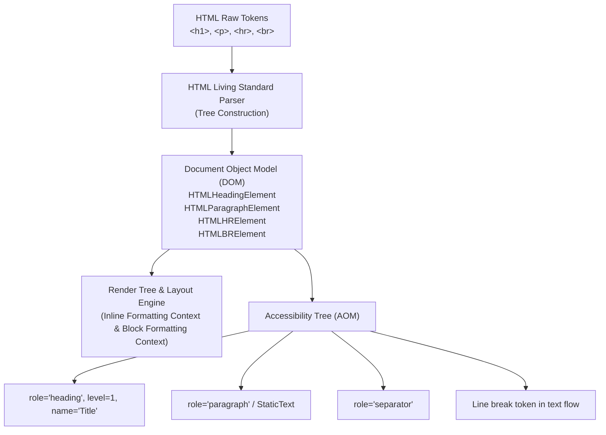

# Text Content, Paragraphs, Headings, and Typography

| Metadata | Details |
| :--- | :--- |
| **Level** | Core / Fundamental |
| **Prerequisites** | `01-document-structure.md`, `02-syntax-rules-and-error-recovery.md` |
| **Estimated Reading Time** | 25 minutes |
| **Status** | Production-Ready |
| **Baseline Status** | Widely Available across all modern browsers |
| **Browsers Tested** | Chrome 120+, Firefox 120+, Safari 17+, Edge 120+ |
| **Tested With** | W3C Nu HTML Checker, Axe-core v4.8, NVDA 2023.3, VoiceOver iOS 17 |

---

## Table of Contents
- [1 What & Why](#1-what--why)
- [2 Core Concepts](#2-core-concepts)
- [3 How It Works Internally](#3-how-it-works-internally)
- [4 Syntax & Usage](#4-syntax--usage)
- [5 Practical Examples](#5-practical-examples)
- [6 Best Practices](#6-best-practices)
- [7 Common Mistakes & Pitfalls](#7-common-mistakes--pitfalls)
- [8 Performance, Accessibility, SEO & Security Notes](#8-performance-accessibility-seo--security-notes)
- [9 Comparison / When to Use What](#9-comparison--when-to-use-what)
- [10 Interview Questions](#10-interview-questions)
- [11 Practice Exercises](#11-practice-exercises)
- [12 Summary / Cheat Sheet](#12-summary--cheat-sheet)
- [13 Further Reading](#13-further-reading)

---

## 1 What & Why

Text is the foundational medium of the World Wide Web. Early hypermedia protocols failed to achieve mass adoption precisely because they treated documents as fixed binary blocks or rigid typographic sheets. HTML succeeded by decoupling structural semantics from typographic rendering: text content in HTML represents hierarchical thoughts, rhetorical paragraphs, thematic transitions, and semantic line breaks rather than physical coordinates on paper.

When an author marks up content using headings (`<h1>` through `<h6>`), paragraphs (`<p>`), thematic dividers (`<hr>`), semantic line breaks (`<br>`), and word-break opportunities (`<wbr>`), they are not instructing the browser engine on pixel font size or line height. Instead, they construct an **Abstract Syntax Tree (AST)** and an **Accessibility Tree (AOM)** that assistive technologies (screen readers, braille displays), web crawlers (search engine indexers), and user stylesheets rely upon to parse narrative meaning.

Without structured text semantics:
- Screen reader users cannot skim pages or jump directly to relevant sections (over 70% of screen reader users navigate via heading shortcuts `H` and `1`-`6`).
- Search engine crawlers fail to deduce topic authority, document hierarchy, and relevance vectors.
- Responsive reflow breaks across varied viewport geometries, foldable screens, and personalized accessibility font sizes.

---

## 2 Core Concepts

### Headings (`<h1>` to `<h6>`)
Headings establish the structural backbone and outline of a document. They represent six descending ranks of semantic importance:
- `<h1>`: The primary subject of the document or page. Best practice dictates exactly one logical `<h1>` per page.
- `<h2>`: Major sections dividing the primary subject.
- `<h3>`: Subsections nested within an `<h2>`.
- `<h4>`–`<h6>`: Deeper structural tiers within their preceding parent ranks.

Headings convey implicit ARIA roles (`role="heading"` with `aria-level="1"` through `"6"`). They must **never** be selected for aesthetic font-sizing; CSS handles visual typography, while HTML headings model informational relationships.

### Paragraphs (`<p>`)
The `<p>` element represents a paragraph—a self-contained block of text expressing a single thought, idea, or rhetorical unit. In the WHATWG specification, `<p>` is a grouping element that can contain phrasing content (inline text, images, spans, links). A `<p>` element automatically closes when immediately followed by another block-level element (such as another `<p>`, `<div>`, `<ul>`, `<table>`, or heading).

### Thematic Break (`<hr>`)
Historically termed a "horizontal rule" rendering a 3D-shaded line, HTML5 redefined `<hr>` as a **thematic break** between paragraph-level elements. It signifies a scene change in a story, a shift of topic within a section, or a rhetorical transition. In the accessibility tree, it maps to `role="separator"`.

### Line Break (`<br>`)
The `<br>` element represents a strict, meaningful division of lines within an existing line of phrasing content. It is **not** a spacer or layout tool. Its valid use cases are strictly semantic:
- Poetic stanzas where line termination is part of the artistic composition.
- Physical street addresses where line sequences follow postal formatting standards.
- Dialogue scripts.

### Word Break Opportunity (`<wbr>`)
The `<wbr>` element indicates a point within a long string of uninterrupted characters (such as an ultra-long domain name, hash string, or technical identifier) where the browser's line-breaking engine may optionally break the line if necessary to prevent viewport overflow, without inserting an explicit hyphen.

---

## 3 How It Works Internally

### Parser Tokenization and Implicit Paragraph Termination
The HTML parser operates on an insertion-mode state machine. When parsing phrasing content within the `"in body"` state, encountering an opening `<p>` tag creates an `HTMLParagraphElement` and pushes it onto the stack of open elements.

However, `<p>` has an optional closing tag in HTML syntax. The specification defines precise closing rules: if the parser is in `"in body"` mode and encounters a start tag for any of the following elements, it implicitly pops `<p>` from the stack before opening the new element:
`address`, `article`, `aside`, `blockquote`, `details`, `div`, `dl`, `fieldset`, `figcaption`, `figure`, `footer`, `form`, `h1`-`h6`, `header`, `hr`, `main`, `nav`, `ol`, `p`, `pre`, `section`, `table`, `ul`.

```
HTML Stream: <p>First paragraph<div>Inside div</div>

Parser Action:
1. Encounter <p>      --> Create HTMLParagraphElement, push to stack.
2. Character tokens   --> Append "First paragraph" as TextNode child of <p>.
3. Encounter <div>    --> Parser rule: <div> is a block-level boundary.
                          Auto-pop <p> from stack (synthesize </p>).
                          Create HTMLDivElement, push to stack.
4. Final DOM:
   HTMLParagraphElement
     └─ Text: "First paragraph"
   HTMLDivElement
     └─ Text: "Inside div"
```

### DOM and Accessibility Object Model (AOM) Mapping



When the browser engine maps the DOM to the accessibility tree:
1. `<h1>`–`<h6>` are assigned the accessibility role `heading` and an explicit integer property `level` (1–6).
2. Screen readers load this into an index table, allowing keys like `H` (next heading) or `2` (next level-2 heading) to traverse the document without parsing intermediate DOM text nodes.
3. `<hr>` receives `role="separator"`. Assistive technologies announce "divider" or "separator", signalling a contextual transition.
4. `<br>` translates to a carriage return / line feed in the accessible text representation, pausing speech synthesizers momentarily.

---

## 4 Syntax & Usage

```html
<!-- Document Title (Single Top-Level Heading) -->
<h1>Understanding Distributed Systems</h1>

<!-- Introductory Paragraph with inline phrasing -->
<p>
  A distributed system consists of autonomous computing nodes that communicate
  over a shared network to coordinate actions and maintain state consistency.
</p>

<!-- Thematic topic transition -->
<hr>

<!-- Major Section -->
<h2>Core Architectural Challenges</h2>
<p>
  Engineering resilient clusters requires balancing network partitions,
  latency, and concurrency boundaries.
</p>

<!-- Subsection with Line Break in a Postal Context -->
<h3>Node Infrastructure Physical Location</h3>
<p>
  Primary Datacenter:<br>
  Building 4, Suite 200<br>
  1040 Innovation Way<br>
  San Jose, CA 95134
</p>

<!-- Subsection with Long Identifier using <wbr> -->
<h3>Cluster Endpoint URL</h3>
<p>
  Connect via: https://eu-central-1.prod.internal.cloud-telemetry<wbr>.infrastructure.enterprise-systems<wbr>.internal:8443/stream
</p>
```

> [!NOTE]
> **Baseline Status: Widely Available**
> The elements `<h1>`–`<h6>`, `<p>`, `<hr>`, `<br>`, and `<wbr>` are baseline features supported in all graphical, text-based, and assistive user agents across desktop and mobile devices since the inception of modern browser engines.

---

## 5 Practical Examples

### Example 1: Basic Document Typography Hierarchy
```html
<!DOCTYPE html>
<html lang="en">
<head>
  <meta charset="UTF-8">
  <title>Article Hierarchy Demo</title>
</head>
<body>
  <article>
    <header>
      <h1>Architecting Resilient Microservices</h1>
      <p>Published on <time datetime="2026-03-15">March 15, 2026</time> by Engineering Core.</p>
    </header>

    <section>
      <h2>Failure Domains and Blast Radii</h2>
      <p>
        Isolating fault domains ensures that catastrophic failures in auxiliary
        components do not cascade across transaction boundaries.
      </p>
      
      <h3>Circuit Breaker Patterns</h3>
      <p>
        By intercepting external RPC requests, circuit breakers transition to an
        open state when error thresholds exceed tolerance criteria.
      </p>
    </section>
  </article>
</body>
</html>
```

### Example 2: Real-World Postal Address and Poetry Block
```html
<!-- Case A: Semantic Postal Address -->
<address>
  <strong>Global Logistics Corp</strong><br>
  Attention: Receiving Dock B<br>
  742 Evergreen Terrace<br>
  Springfield, OR 97477<br>
  United States
</address>

<!-- Case B: Structured Poetry with Stanzas and Thematic Break -->
<article class="poem">
  <h1>The Road Not Taken</h1>
  <p class="stanza">
    Two roads diverged in a yellow wood,<br>
    And sorry I could not travel both<br>
    And be one traveler, long I stood<br>
    And looked down one as far as I could<br>
    To where it bent in the undergrowth;
  </p>
  <hr>
  <p class="stanza">
    Then took the other, as just as fair,<br>
    And having perhaps the better claim,<br>
    Because it was grassy and wanted wear;<br>
    Though as for that the passing there<br>
    Had worn them really about the same,
  </p>
</article>
```

### Example 3: Edge Case — Implicit `<p>` Closure and Void Elements
```html
<!-- What the developer writes: -->
<p>First paragraph content
<h2>Section Header</h2>
<p>Second paragraph with an unclosed <hr> tag inside?
<hr>
<p>Third paragraph.</p>

<!-- What the WHATWG parser constructs in the DOM tree: -->
<!--
HTMLParagraphElement
  └─ "First paragraph content\n"
HTMLHeadingElement (H2)
  └─ "Section Header"
HTMLParagraphElement
  └─ "Second paragraph with an unclosed "
HTMLHRElement
HTMLParagraphElement
  └─ " tag inside?\n" (Note: <hr> implicitly closes the current <p> and opens an HR element)
HTMLHRElement
HTMLParagraphElement
  └─ "Third paragraph."
-->
```

### Example 4: Failure Case — Heading Skipping and Presentation-Only Markup
```html
<!-- ANTI-PATTERN: DO NOT COPY -->
<!-- Problem 1: Skipping heading levels (h1 -> h4 -> h2) destroys screen reader navigation -->
<!-- Problem 2: Using <br><br> to simulate paragraph margins -->
<!-- Problem 3: Using <b> or <span> styled big instead of true heading -->

<h1>Product Catalog</h1>
<br><br> <!-- BAD: Layout spacing with line breaks -->

<span style="font-size: 28px; font-weight: bold;">Spring Deals</span> <!-- BAD: Fake heading -->
<p>Explore our discounted items below.</p>

<h4>Subcategory: Footwear</h4> <!-- BAD: Skipped from h1 directly to h4 -->
<p>Running shoes and trail boots.</p>

<!-- Screen Reader Auditing Result:
VoiceOver Rotor:
- Heading 1: "Product Catalog"
- Heading 4: "Subcategory: Footwear" (Alert: Skipped heading level from 1 to 4)
"Spring Deals" is completely absent from the heading outline!
-->
```

### Example 5: Production-Grade Accessible Article Layout
```html
<!DOCTYPE html>
<html lang="en">
<head>
  <meta charset="UTF-8">
  <meta name="viewport" content="width=device-width, initial-scale=1.0">
  <title>Understanding Cache Invalidation Strategies</title>
  <style>
    /* CSS controls typography and rhythm, NOT the HTML tags */
    body { font-family: system-ui, -apple-system, sans-serif; line-height: 1.6; max-width: 800px; margin: 0 auto; padding: 2rem; color: #1a1a1a; }
    h1 { font-size: 2.25rem; line-height: 1.2; margin-bottom: 0.5rem; }
    h2 { font-size: 1.5rem; margin-top: 2rem; border-bottom: 1px solid #e5e5e5; padding-bottom: 0.25rem; }
    h3 { font-size: 1.2rem; margin-top: 1.5rem; color: #333; }
    p { margin: 1rem 0; }
    hr { border: 0; height: 1px; background: #ccc; margin: 2.5rem 0; }
    .hash-display { font-family: monospace; background: #f4f4f4; padding: 0.2rem 0.4rem; border-radius: 3px; word-break: break-all; }
  </style>
</head>
<body>
  <main>
    <article>
      <header>
        <h1>Cache Invalidation Strategies in High-Throughput Web Applications</h1>
        <p>Published <time datetime="2026-02-18">February 18, 2026</time> &bull; 8 min read</p>
      </header>

      <p>
        There are only two hard things in Computer Science: cache invalidation and naming things.
        In modern web architectures, delivering stale state can result in transaction inconsistency
        and degraded user trust.
      </p>

      <section aria-labelledby="ttl-heading">
        <h2 id="ttl-heading">Time-To-Live (TTL) Eviction</h2>
        <p>
          Passive expiration assigns an absolute expiration timestamp to cached keys.
          Once the clock passes this threshold, cache read operations treat the key as a miss.
        </p>

        <h3 id="ttl-tradeoffs">Trade-offs and Stampede Risk</h3>
        <p>
          When heavily requested keys expire simultaneously, hundreds of concurrent processes
          may query the underlying persistence tier simultaneously. This is known as a
          <em>cache stampede</em>.
        </p>
      </section>

      <hr>

      <section aria-labelledby="write-through-heading">
        <h2 id="write-through-heading">Write-Through and Purge APIs</h2>
        <p>
          Active purging issues explicit invalidation commands over a pub/sub channel whenever
          mutation operations succeed.
        </p>
        <p>
          Verification deployment signature:<br>
          <span class="hash-display">sha256:e3b0c44298fc1c149afbf4c8996fb92427ae41e4649b934ca495991b7852b855<wbr>a89c74826189ef94</span>
        </p>
      </section>
    </article>
  </main>
</body>
</html>
```

---

## 6 Best Practices

1. **Maintain a Strict Heading Outline**: Always progress in sequential descending order (`<h1>` $\to$ `<h2>` $\to$ `<h3>`). Never skip levels downward (e.g., `<h1>` directly to `<h3>`) merely to achieve a smaller default font size.
2. **Single Primary `<h1>` Per Route**: Reserve `<h1>` for the overarching topic of the document. Sub-views, articles, or sidebars should start at `<h2>`.
3. **Use CSS for Spacing, Never `<br>`**: Never use repeated `<br><br>` tags to push content down or simulate paragraph margins. Margins belong to CSS box models (`margin-block-end`).
4. **Use `<p>` for Rhetorical Units**: Do not wrap raw inline text directly inside `<div>` or `<body>`. Every narrative sentence block belongs inside a `<p>`.
5. **Use `<hr>` for Semantic Transitions**: Treat `<hr>` as a dramatic scene break or topical pivot, not as a decorative border line. If you only want a line, style the container with `border-bottom` in CSS.
6. **Deploy `<wbr>` for Long Monolithic Strings**: Prevent mobile layout breakage from unbreakable URLs, file hashes, and GUIDs by inserting `<wbr>` at natural delimiter boundaries.

---

## 7 Common Mistakes & Pitfalls

| Mistake | Bad Code | Good Code | Technical Explanation |
| :--- | :--- | :--- | :--- |
| **Visual Heading Selection** | `<h4>Short Note</h4>` (following `<h1>`) | `<p class="callout-heading">Short Note</p>` or `<h2>Short Note</h2>` | Skipping heading ranks destroys the screen reader outline tree (violates WCAG 1.3.1 Info and Relationships). |
| **Fake Headings via CSS** | `<div class="title" style="font-size:24px; font-weight:bold;">News</div>` | `<h2>News</h2>` | `<div>` has no semantic heading role in the AOM; screen readers cannot navigate to it via heading shortcuts. |
| **Spacers via `<br>`** | `<p>Text</p><br><br><p>More Text</p>` | `p { margin-block-end: 2rem; }` | Consecutive `<br>` tags create empty accessible lines that screen readers announce as "blank", cluttering audio navigation. |
| **Block Elements inside `<p>`** | `<p>Welcome <div>nested</div></p>` | `<div><p>Welcome</p><div>nested</div></div>` | `<p>` cannot contain block-level elements. The browser parser automatically closes the `<p>` before `<div>`, corrupting the intended DOM tree. |
| **Postal Address without `<address>`** | `<p>Acme Inc<br>123 Main St</p>` | `<address>Acme Inc<br>123 Main St</address>` | `<address>` explicitly identifies contact information for the document or article author. |
| **Overuse of `<hr>` for Visual Lines** | `<div class="card">Item 1</div><hr><div class="card">Item 2</div>` | `.card + .card { border-top: 1px solid #ccc; }` | `<hr>` exposes `role="separator"` to accessibility clients. Using it between every list item creates overwhelming audio chatter. |

---

## 8 Performance, Accessibility, SEO & Security Notes

### Accessibility (WCAG 2.2 AA)
- **Criterion 1.3.1 (Info and Relationships - Level A)**: Structural meaning conveyed visually (bold text, big fonts) must be programmatically determinable via correct HTML elements (`<h1>`–`<h6>`, `<p>`).
- **Criterion 2.4.6 (Headings and Labels - Level AA)**: Headings and labels must describe topic or purpose clearly.
- **Criterion 2.4.10 (Section Headings - Level AAA)**: Section headings are used to organize the content.
- Screen readers provide a dedicated "Headings List" modal (e.g., NVDA: `Insert + F7`, VoiceOver: `Ctrl + Option + U` $\to$ Headings). Skipping levels creates confusion about document nesting.

### Search Engine Optimization (SEO)
- Search engines parse `<h1>` as a critical relevancy signal for page subject identification.
- `<h2>` through `<h6>` tags structure content into sub-topics, which search engines frequently use to generate **Featured Snippets** and indexed section jump links directly on search results pages.
- Replacing semantic headings with `<span class="h2">` deprives search bots of hierarchical context.

### Performance & Parser Cost
- Parsing native text elements (`<p>`, `<h1>`, `<br>`) incurs negligible microsecond overhead in the browser tokenizer.
- In contrast, deeply nested `<div>` soup increases DOM tree depth, ballooning memory footprint and recalculate-style times during reflow cycles.

### Security Notes
- Plain text content within `<p>` and headings automatically treats raw characters as text nodes when generated via `document.createElement()` and `textContent`.
- **Warning**: Never inject untrusted user input into headings or paragraphs using `element.innerHTML = userInput`. Always use `textContent` to avoid Cross-Site Scripting (XSS).

---

## 9 Comparison / When to Use What

| Element | Primary Purpose | ARIA Implicit Role | Permitted Content | When NOT to Use |
| :--- | :--- | :--- | :--- | :--- |
| `<h1>`–`<h6>` | Section titles defining outline | `heading` (`aria-level="1-6"`) | Phrasing content only | Subtitles, taglines, or decorative callout text. |
| `<p>` | Narrative paragraph of prose | `paragraph` | Phrasing content only | Containers for lists, tables, cards, or other blocks. |
| `<hr>` | Thematic transition between topics | `separator` | Void (no content) | Purely decorative visual dividers between list/card items. |
| `<br>` | Semantic line break (poetry/address) | Line break in text stream | Void (no content) | Creating vertical space between containers or paragraphs. |
| `<wbr>` | Optional word-break opportunity | None | Void (no content) | Regular sentences with normal spaces. |
| `<div>` | Generic non-semantic grouping | None (generic) | Flow content (any elements) | Whenever an existing semantic element (`<p>`, `<section>`) applies. |

---

## 10 Interview Questions

<details>
<summary><strong>1. Why is having more than one &lt;h1&gt; per page considered an anti-pattern despite HTML5 sectioning element algorithms?</strong></summary>

**Answer:**
The early HTML5 specification proposed the "HTML5 Document Outline Algorithm", which theorized that nesting `<h1>` inside distinct `<section>`, `<article>`, `<aside>`, and `<nav>` elements would automatically recalculate its semantic heading level relative to its section depth. 

However, **no major browser engine or assistive technology ever implemented this algorithm**. Screen readers like NVDA, JAWS, and VoiceOver continue to announce every `<h1>` as level 1, regardless of enclosing `<section>` containers. Consequently, having multiple `<h1>` elements flattens the accessibility tree into multiple top-level root items, disorienting screen reader users who expect a single document title. Both WHATWG and the W3C Accessibility Guidelines Working Group now officially recommend maintaining a strict single `<h1>` per page with sequential descending ranks (`<h2>`–`<h6>`).
</details>

<details>
<summary><strong>2. What occurs in the DOM when a block-level element like &lt;div&gt; is placed inside a &lt;p&gt; tag in raw HTML?</strong></summary>

**Answer:**
In HTML syntax, the `<p>` element has an optional closing tag and cannot legally contain block-level elements. According to the WHATWG parsing specification for the `"in body"` insertion mode, when the parser encounters a start tag for a block element (such as `<div>`, `<ul>`, `<table>`, or `<h2>`), it executes an implicit paragraph closure:
1. It pops the open `<p>` element from the stack of open elements (synthesizing a `</p>`).
2. It pushes the new block element (`<div>`) as a sibling to the closed `<p>`.
3. If an explicit closing `</p>` tag appears later in the markup, the parser treats it as an orphan and discards it or parses it into an empty paragraph.
As a result, your DOM tree structure will not match your indented source code nesting.
</details>

<details>
<summary><strong>3. How does the &lt;wbr&gt; element differ from the soft hyphen entity (&amp;shy;)?</strong></summary>

**Answer:**
Both elements indicate potential line-breaking opportunities inside long strings, but they render differently when broken:
- `&shy;` (Soft Hyphen): Invisible when the word fits on a single line. When the line wraps at the soft hyphen location, the browser **renders a hyphen character (`-`)** at the end of the line.
- `<wbr>` (Word Break Opportunity): Completely invisible both when unbroken and when broken. If the browser breaks the text at a `<wbr>`, **no hyphen character is inserted**.
Use `<wbr>` for URLs, cryptographic hashes, and file paths where an inserted hyphen would alter the factual character sequence and corrupt copy-paste operations.
</details>

<details>
<summary><strong>4. How should subtitles and subheadings be marked up semantically without corrupting the document outline?</strong></summary>

**Answer:**
Subtitles and taglines should **not** be marked up with immediate sibling headings (e.g., `<h1>Main Title</h1><h2>The Subtitle</h2>`), because this creates a phantom level-2 section in the document outline that has no child content.

The correct semantic pattern is to group the heading and its subtitle within an `<hgroup>` element (standardized in HTML Living Standard):
```html
<hgroup>
  <h1>Mastering Hypertext</h1>
  <p>The definitive guide to modern semantic markup</p>
</hgroup>
```
Inside `<hgroup>`, any `<p>` tag represents a subheading or subtitle and is excluded from creating phantom sections in the accessibility tree, while remaining cleanly associated with the `<h1>`.
</details>

<details>
<summary><strong>5. What is the semantic difference between &lt;hr&gt; and a CSS border?</strong></summary>

**Answer:**
- `<hr>` carries intrinsic structural meaning: it represents a **thematic break** between paragraphs or sections of content. In the accessibility tree, it is exposed with `role="separator"`, signalling to assistive software that a contextual or narrative pivot has occurred.
- A CSS border (such as `border-bottom: 1px solid gray`) carries **zero semantic meaning**. It is a purely visual decoration that does not alert assistive technologies or partition content logic. Use `<hr>` for editorial transitions; use CSS borders for visual component separation (like list dividers).
</details>

<details>
<summary><strong>6. Can an &lt;h1&gt; element contain an image? If so, what are the accessibility requirements?</strong></summary>

**Answer:**
Yes, headings can contain phrasing content, including images (``). 
The critical requirement is that the image **must provide an explicit, meaningful `alt` attribute** that acts as the text label for the heading in the accessibility tree:
```html
<h1>
  
</h1>
```
If the image has an empty `alt=""`, the heading becomes an "empty heading" in the accessibility tree, causing screen readers to announce "Heading Level 1, blank", which is a severe WCAG failure.
</details>

<details>
<summary><strong>7. How does whitespace collapsing behave inside &lt;p&gt; elements versus &lt;pre&gt; elements?</strong></summary>

**Answer:**
In standard HTML elements like `<p>`, the CSS `white-space` property defaults to `normal`. The browser engine collapses multiple contiguous whitespace characters (spaces, tabs, newlines) into a single space character. Leading and trailing whitespace within block boundaries is completely discarded.

In `<pre>` (preformatted text), `white-space` defaults to `pre`. The browser engine preserves every individual space, tab, and newline sequence exactly as written in the source document, rendering it typically in a monospace typeface without collapsing.
</details>

<details>
<summary><strong>8. What is the screen reader behavior when encountering multiple consecutive &lt;br&gt; tags?</strong></summary>

**Answer:**
Screen readers such as NVDA and JAWS navigate down pages line by line. When encountering consecutive `<br><br><br>` tags, the speech synthesizer announces each break as "Blank", forcing users to press their navigation keys repeatedly through dead space. This creates cognitive friction and breaks reading flow. Layout spacing must always be achieved using CSS margin or padding properties (`margin-block`).
</details>

---

## 11 Practice Exercises

### Exercise 1 (Easy): Fix the Document Heading Hierarchy
**Task**: Inspect the following markup snippet. Correct the heading levels so they conform to a logical, accessible document outline without skipping ranks.

```html
<!-- Broken Source -->
<div class="page">
  <h3>Welcome to CloudOps</h3>
  <p>Overview of the platform.</p>
  <h6>Cluster Topology</h6>
  <p>Details about nodes.</p>
  <h6>Storage Volumes</h6>
  <p>Details about persistent disks.</p>
</div>
```

<details>
<summary><strong>Solution</strong></summary>

```html
<!-- Corrected Semantic Markup -->
<main>
  <h1>Welcome to CloudOps</h1>
  <p>Overview of the platform.</p>
  
  <h2>Cluster Topology</h2>
  <p>Details about nodes.</p>
  
  <h2>Storage Volumes</h2>
  <p>Details about persistent disks.</p>
</main>
```
*Explanation*: The document begins with a single `<h1>`. The subsequent major sections become `<h2>` elements, establishing a clean, unbroken 2-level hierarchy.
</details>

### Exercise 2 (Easy): Format a Physical Mailing Address
**Task**: Author a semantic, accessible contact address for a corporate office using `<address>`, `<strong>`, and `<br>`.

<details>
<summary><strong>Solution</strong></summary>

```html
<address>
  <strong>Anthropic PBC</strong><br>
  500 Howard Street, Suite 400<br>
  San Francisco, CA 94105<br>
  United States<br>
  Email: <a href="mailto:contact@anthropic.com">contact@anthropic.com</a>
</address>
```
*Explanation*: The `<address>` element signifies authorship/contact info. `<br>` is appropriately used here to mirror postal address line termination conventions.
</details>

### Exercise 3 (Medium): Long Hash Formatting with Responsive Fallbacks
**Task**: Create a table cell or paragraph that displays a 64-character SHA-256 hash. Ensure that on narrow mobile viewports (320px width), the hash does not cause horizontal scrollbar blowout, while remaining unbroken on wide screens.

<details>
<summary><strong>Solution</strong></summary>

```html
<p>
  Artifact Checksum:<br>
  <code>
    a1b2c3d4<wbr>e5f6a7b8<wbr>c9d0e1f2<wbr>a3b4c5d6<wbr>
    e7f8a9b0<wbr>c1d2e3f4<wbr>a5b6c7d8<wbr>e9f0a1b2
  </code>
</p>
```
*Explanation*: Placing `<wbr>` every 8 characters provides the browser layout engine with safe wrap boundaries on constrained viewports without injecting unwanted hyphens or altering copy-paste clipboard buffers.
</details>

### Exercise 4 (Medium): Subheading Association with `<hgroup>`
**Task**: Mark up a blog post header containing a main title, a kicker (category label above title), and a subtitle (tagline below title) using modern HTML semantic conventions.

<details>
<summary><strong>Solution</strong></summary>

```html
<header>
  <hgroup>
    <p class="kicker">DevOps &bull; Architecture</p>
    <h1>Immutable Infrastructure Patterns</h1>
    <p>Eliminating configuration drift through declarative machine images</p>
  </hgroup>
</header>
```
*Explanation*: Under the HTML Living Standard, `<hgroup>` can contain one heading (`<h1>`–`<h6>`) alongside one or more `<p>` elements representing subtitles or kickers. Assistive technologies associate these paragraphs with the heading without generating extraneous outline nodes.
</details>

### Exercise 5 (Hard): Parser Recovery Reconstruction
**Task**: Predict the exact DOM tree created by the browser engine for the following invalid HTML snippet:
```html
<p>Alpha <div>Beta <p>Gamma</div> Delta</p>
```

<details>
<summary><strong>Solution</strong></summary>

```
DOM Tree Construction:
1. <p> opens: contains text "Alpha "
2. <div> encountered: block tag auto-closes open <p>.
3. <div> opens: contains text "Beta "
4. <p> opens inside <div>: contains text "Gamma"
5. </div> encountered: closes open <p> first, then closes <div>.
6. " Delta" encountered: parsed as text node child of <body>.
7. </p> encountered: no open <p> exists; ignored by parser error recovery.

Final Resulting DOM:
- HTMLParagraphElement: "Alpha "
- HTMLDivElement
    - Text: "Beta "
    - HTMLParagraphElement: "Gamma"
- TextNode: " Delta"
```
</details>

### Exercise 6 (Hard): Refactor Presentation Markup to Accessible Typography
**Task**: Refactor the following unstructured, visual-only HTML into a fully accessible semantic article with proper landmarks, headings, paragraphs, and thematic breaks.

```html
<!-- Dirty Source -->
<div style="font-size:32px; font-weight:bold;">Release Notes v4.2</div>
<br><br>
<div style="font-weight:bold;">New Capabilities</div>
We have deployed distributed tracing across all microservices.
<br><br>
--------------------------------------------------
<br><br>
<div style="font-weight:bold;">Breaking Changes</div>
The legacy v1 telemetry endpoint has been decommissioned.
```

<details>
<summary><strong>Solution</strong></summary>

```html
<!DOCTYPE html>
<html lang="en">
<head>
  <meta charset="UTF-8">
  <title>Release Notes v4.2</title>
</head>
<body>
  <main>
    <article>
      <header>
        <h1>Release Notes v4.2</h1>
      </header>

      <section aria-labelledby="new-capabilities-title">
        <h2 id="new-capabilities-title">New Capabilities</h2>
        <p>We have deployed distributed tracing across all microservices.</p>
      </section>

      <hr>

      <section aria-labelledby="breaking-changes-title">
        <h2 id="breaking-changes-title">Breaking Changes</h2>
        <p>The legacy v1 telemetry endpoint has been decommissioned.</p>
      </section>
    </article>
  </main>
</body>
</html>
```
</details>

---

## 12 Summary / Cheat Sheet

```
┌────────────────────────────────────────────────────────────────────────┐
│                        HTML TYPOGRAPHY CHEAT SHEET                     │
├───────────────┬────────────────────────────┬───────────────────────────┤
│ Element       │ Meaning                    │ Key Rule                  │
├───────────────┼────────────────────────────┼───────────────────────────┤
│ <h1>          │ Page Subject / Document    │ Single instance per route │
│ <h2>–<h6>     │ Section & Sub-headings     │ Never skip levels down    │
│ <p>           │ Narrative Prose Paragraph  │ Auto-closed by block tags │
│ <hr>          │ Thematic Scene Break       │ role="separator"          │
│ <br>          │ Semantic Line Break        │ Only addresses & poetry   │
│ <wbr>         │ Word Break Opportunity     │ Invisible; no hyphenation │
│ <hgroup>      │ Heading + Subtitle Wrapper │ Excludes subtitle from AOM│
│ <address>     │ Author Contact Information │ For document or article   │
└───────────────┴────────────────────────────┴───────────────────────────┘
```

---

## 13 Further Reading

- [WHATWG HTML Living Standard: Section 4.4 Grouping Content](https://html.spec.whatwg.org/multipage/grouping-content.html)
- [WHATWG HTML Living Standard: Section 4.3 Sections & Headings](https://html.spec.whatwg.org/multipage/sections.html)
- [MDN Web Docs: &lt;h1&gt;–&lt;h6&gt; Heading Elements](https://developer.mozilla.org/en-US/docs/Web/HTML/Element/Heading_Elements)
- [MDN Web Docs: &lt;wbr&gt; Word Break Opportunity](https://developer.mozilla.org/en-US/docs/Web/HTML/Element/wbr)
- [W3C Web Accessibility Initiative (WAI): Headings Tutorial](https://www.w3.org/WAI/tutorials/page-structure/headings/)
- [W3C WCAG 2.2 Technique H42: Using h1-h6 to identify headings](https://www.w3.org/WAI/WCAG22/Techniques/html/H42)

---

| [Previous: 02 Syntax Rules & Error Recovery](02-syntax-rules-and-error-recovery.md) | [Section Index](README.md) | [Next: 04 Lists & Grouping](04-lists-and-grouping.md) |
