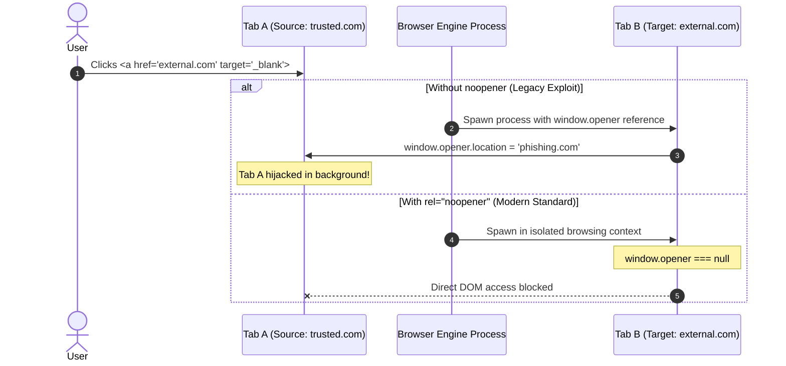

# Links, Hypermedia, and URL Resolution

| Metadata | Details |
| :--- | :--- |
| **Level** | Core / Fundamental |
| **Prerequisites** | `01-document-structure.md`, `03-text-content-and-typography.md` |
| **Estimated Reading Time** | 25 minutes |
| **Status** | Production-Ready |
| **Baseline Status** | Widely Available across all modern browsers |
| **Browsers Tested** | Chrome 120+, Firefox 120+, Safari 17+, Edge 120+ |
| **Tested With** | W3C Nu HTML Checker, Axe-core v4.8, NVDA 2023.3, VoiceOver iOS 17 |

---

## Table of Contents
- [1 What & Why](#1-what--why)
- [2 Core Concepts](#2-core-concepts)
- [3 How It Works Internally](#3-how-it-works-internally)
- [4 Syntax & Usage](#4-syntax--usage)
- [5 Practical Examples](#5-practical-examples)
- [6 Best Practices](#6-best-practices)
- [7 Common Mistakes & Pitfalls](#7-common-mistakes--pitfalls)
- [8 Performance, Accessibility, SEO & Security Notes](#8-performance-accessibility-seo--security-notes)
- [9 Comparison / When to Use What](#9-comparison--when-to-use-what)
- [10 Interview Questions](#10-interview-questions)
- [11 Practice Exercises](#11-practice-exercises)
- [12 Summary / Cheat Sheet](#12-summary--cheat-sheet)
- [13 Further Reading](#13-further-reading)

---

## 1 What & Why

The defining breakthrough of the World Wide Web is **hypertext**—the ability to link any document, fragment, or external resource across the global Internet via uniform addressing. The HTML anchor element (`<a>`) transforms static text into dynamic navigational pathways.

Links do not merely jump between pages; they establish trust relationships, govern browser security sandboxes, dictate search engine indexation graphs, and power client-side accessibility routing. However, hyperlinks are also frequent vectors for security vulnerabilities (e.g., **reverse tabnabbing** via `window.opener`) and accessibility failures (e.g., non-descriptive "click here" links that disorient screen reader users).

Understanding the anchor element requires mastering:
- Absolute vs. relative URL resolution algorithms.
- Custom URI schemes (`mailto:`, `tel:`, `sms:`).
- Browsing contexts (`target` attributes) and window isolation.
- Relationship types (`rel="noopener"`, `rel="noreferrer"`, `rel="nofollow"`).
- Programmatic binary asset downloads via the `download` attribute.

---

## 2 Core Concepts

### The Anchor Element (`<a>`)
The `<a>` element creates a hyperlink to web pages, files, email addresses, phone numbers, or fragment locations within the current page. If an `<a>` has an `href` attribute, it represents a hyperlink. If an `<a>` omits the `href` attribute, it represents a **placeholder link** (representing where a link had existed or where one would be added by a script).

### URL Resolution: Absolute vs. Relative
A URL specified in `href` can take several forms:
1. **Absolute URL**: Contains the explicit scheme and host (e.g., `https://api.example.com/v1/health`). Resolves independently of the current document's location.
2. **Protocol-Relative URL**: Begins with `//` (e.g., `//cdn.example.com/lib.js`). Inherits the active document's protocol (`http` or `https`). *Largely deprecated in favor of explicit `https://`.*
3. **Root-Relative URL**: Begins with a single slash `/` (e.g., `/docs/getting-started`). Resolves against the current origin host (e.g., `https://example.com/docs/getting-started`).
4. **Document-Relative URL**: Does not start with `/` (e.g., `../images/logo.svg` or `subpage.html`). Resolves relative to the directory path of the current document URL.
5. **Fragment Identifier**: Begins with `#` (e.g., `#architecture`). Resolves to an element with a matching `id` attribute on the current page, executing an instant in-page scroll without triggering a network fetch.

### The `target` Attribute and Browsing Contexts
The `target` attribute specifies where to display the linked resource:
- `_self` (Default): Loads the response into the current browsing context.
- `_blank`: Spawns a new, unnamed top-level browsing context (tab or window).
- `_parent`: Loads into the parent browsing context (useful inside `<iframe>`).
- `_top`: Clears all nested `<iframe>` contexts and loads into the outermost window.
- `<custom-name>`: Targets a specific named window or iframe.

### Reverse Tabnabbing and `rel="noopener noreferrer"`
Historically, opening a new tab via `target="_blank"` granted the newly opened window access to the origin page's JavaScript execution context via `window.opener`. Malicious destination sites could execute:
```javascript
window.opener.location = "https://phishing-fake-login.com";
```
This swapped the original, trusted tab to a phishing clone while the user was distracted. Modern browsers implicitly apply `rel="noopener"` to all `target="_blank"` anchors, but explicit defensive coding requires declaring `rel="noopener noreferrer"` for universal defense.

### URI Schemes (`mailto:`, `tel:`)
- `mailto:`: Invokes the user's default email client, supporting query parameters (`subject`, `body`, `cc`, `bcc`).
- `tel:`: Invokes telephony dialing applications on mobile devices and VoIP clients. Numbers should be formatted in international E.164 standard (e.g., `tel:+14155552671`).
- `javascript:`: An archaic anti-pattern used to execute inline code on click. **Strictly banned** in modern architectures due to Content Security Policy (CSP) violations and accessibility breakage.

---

## 3 How It Works Internally

### URL Resolution State Machine
When the browser encounters an `<a href="...">` attribute, the WHATWG URL Parser resolves the string against the document's **base URL** (governed by the document's URL or modified by a `<base href="...">` tag):

```
Current Document URL: https://example.com/products/hardware/index.html

href Target                 Parsing Resolution Algorithm                             Final Computed URL
-------------------------------------------------------------------------------------------------------------------------
"support"                   Relative to current directory (/products/hardware/)       https://example.com/products/hardware/support
"../software"               Traverse up one directory level to /products/             https://example.com/products/software
"/api/v2"                   Origin-root relative: resolves against origin root        https://example.com/api/v2
"#specs"                    Fragment reference: preserves current path                https://example.com/products/hardware/index.html#specs
"//cdn.corp.net/img.png"    Protocol-relative: copies document scheme (https)         https://cdn.corp.net/img.png
```

### Browsing Context Isolation Flow



When `rel="noopener"` is present (or applied by default in modern browsers):
1. The browser engine sets the `Opener` browsing context pointer of the newly spawned tab to `null`.
2. The new tab is typically placed into an isolated rendering process (Process Isolation), preventing long-running scripts in the new tab from starving CPU cycles on the original tab.
3. If `noreferrer` is also added, the browser strips the `Referer` HTTP request header, ensuring no sensitive path or query parameters are leaked to the destination origin.

---

## 4 Syntax & Usage

```html
<!-- 1. Absolute Hyperlink with Security Isolation -->
<a href="https://github.com/torvalds/linux" 
   target="_blank" 
   rel="noopener noreferrer">
  Explore Linux Kernel Source (opens in new tab)
</a>

<!-- 2. Accessible In-Page Skip Link -->
<a href="#main-content" class="skip-link">
  Skip to main content
</a>

<!-- 3. Telephony and Email Protocol Schemes -->
<p>
  Contact Technical Escalations:
  <a href="tel:+18005550199">+1 (800) 555-0199</a> or
  <a href="mailto:ops@enterprise.net?subject=Cluster%20Incident&amp;body=Priority%20Level:">
    ops@enterprise.net
  </a>
</p>

<!-- 4. Explicit Binary Download Trigger -->
<a href="/assets/reports/q4-telemetry.pdf" 
   download="Enterprise-Telemetry-Q4-2026.pdf">
  Download Performance Audit (PDF, 4.2 MB)
</a>
```

> [!NOTE]
> **Baseline Status: Widely Available**
> The `<a>` element, `target="_blank"`, `rel="noopener"`, `rel="noreferrer"`, and `download` attributes are baseline web platform standards supported across all modern rendering engines. All modern browsers automatically apply `rel="noopener"` behavior to `target="_blank"` by default.

---

## 5 Practical Examples

### Example 1: Accessible Skip Navigation Link Pattern
```html
<!DOCTYPE html>
<html lang="en">
<head>
  <meta charset="UTF-8">
  <title>Skip Link Pattern</title>
  <style>
    /* Visually hide the skip link until focused by a keyboard user */
    .skip-link {
      position: absolute;
      top: -999px;
      left: 1rem;
      background: #000;
      color: #fff;
      padding: 0.75rem 1.5rem;
      z-index: 1000;
      text-decoration: none;
      font-weight: bold;
      border-radius: 4px;
    }
    .skip-link:focus {
      top: 1rem;
      outline: 3px solid #facc15;
    }
  </style>
</head>
<body>
  <!-- 1. The Skip Link is the first focusable element -->
  <a href="#main-content" class="skip-link">Skip to main content</a>

  <header>
    <nav aria-label="Main Navigation">
      <ul>
        <li><a href="/services">Services</a></li>
        <li><a href="/solutions">Solutions</a></li>
        <li><a href="/pricing">Pricing</a></li>
      </ul>
    </nav>
  </header>

  <!-- 2. Target element with matching id -->
  <!-- tabindex="-1" ensures programmatic focus lands cleanly across older browsers -->
  <main id="main-content" tabindex="-1">
    <h1>System Architecture Overview</h1>
    <p>Core platform documentation begins here.</p>
  </main>
</body>
</html>
```

### Example 2: Granular Relationship Attributes (`rel`) for SEO and Trust
```html
<article>
  <h2>Community Contributions &amp; Sponsored Reviews</h2>
  
  <p>
    Read the official documentation on our
    <!-- Standard trusted outbound link -->
    <a href="https://developer.mozilla.org" target="_blank" rel="noopener">MDN Reference</a>.
  </p>

  <p>
    User discussion post on third-party forum:
    <!-- UGC: User Generated Content (informs search engines not to pass endorsement) -->
    <a href="https://forum.example.org/thread/924" rel="ugc nofollow">Forum Thread #924</a>.
  </p>

  <p>
    Infrastructure sponsored by:
    <!-- Sponsored: Paid link attribution required by search engine guidelines -->
    <a href="https://cloud-provider.com" target="_blank" rel="sponsored noopener">Apex Cloud Services</a>.
  </p>
</article>
```

### Example 3: Edge Case — Anchor Wrapping Entire Cards Accessible Pattern
```html
<!-- Pattern: Accessible interactive card without breaking screen reader announcement -->
<div class="product-card">
  <h3>
    <a href="/products/quantum-core" class="card-link">
      Quantum Compute Core v2
    </a>
  </h3>
  <p>Next-generation sub-nanosecond processing accelerator.</p>
  <span class="price" aria-label="Price: 4,999 dollars">$4,999</span>
</div>

<style>
  /* CSS Pseudo-element stretches the anchor click area over the entire card */
  .product-card {
    position: relative;
    border: 1px solid #e2e8f0;
    padding: 1.5rem;
  }
  .card-link::after {
    content: "";
    position: absolute;
    inset: 0; /* Stretches <a> to fill .product-card */
  }
</style>
```

### Example 4: Failure Case — Inaccessible Buttons and Void Links
```html
<!-- ANTI-PATTERN: DO NOT COPY -->

<!-- Error 1: Using <a> as a JavaScript action trigger without href -->
<a onclick="deleteDatabase()">Delete Record</a>

<!-- Error 2: "href='#'" or "javascript:void(0)" breaks accessibility and history -->
<a href="#" onclick="openModal(); return false;">Open Settings</a>
<a href="javascript:void(0)" onclick="executeMigration()">Run Migration</a>

<!-- Error 3: Non-descriptive link text -->
<p>To view our data privacy policies, <a href="/privacy">click here</a>.</p>

<!-- Error 4: Missing target="_blank" notification for assistive tech -->
<a href="https://external.com" target="_blank">External Doc</a>

<!-- Audit Violations:
1. Axe-core: Elements must have valid href to expose link role.
2. WCAG 2.4.4: Purpose of Link in Context failure ("click here").
3. Security: javascript: URLs trigger Content Security Policy errors.
-->
```

### Example 5: Production-Grade Navigation Header with Descriptive Indicators
```html
<!DOCTYPE html>
<html lang="en">
<head>
  <meta charset="UTF-8">
  <meta name="viewport" content="width=device-width, initial-scale=1.0">
  <title>Production Navigation &amp; Link Hygiene</title>
  <style>
    .external-link::after {
      content: " ↗";
      font-size: 0.85em;
    }
    .visually-hidden {
      position: absolute;
      width: 1px;
      height: 1px;
      padding: 0;
      margin: -1px;
      overflow: hidden;
      clip: rect(0, 0, 0, 0);
      white-space: nowrap;
      border: 0;
    }
  </style>
</head>
<body>
  <header>
    <nav aria-label="Global Directory">
      <ul>
        <li><a href="/" aria-current="page">Dashboard</a></li>
        <li><a href="/clusters">Cluster Management</a></li>
        <li>
          <a href="https://status.enterprise-cloud.net" 
             target="_blank" 
             rel="noopener noreferrer" 
             class="external-link">
            Infrastructure Status
            <span class="visually-hidden">(opens in a new tab)</span>
          </a>
        </li>
        <li>
          <a href="/assets/logs/incident-2026-03.csv" 
             download="incident-2026-03.csv">
            Export Incident Logs
            <span class="visually-hidden">(downloads CSV file)</span>
          </a>
        </li>
      </ul>
    </nav>
  </header>
</body>
</html>
```

---

## 6 Best Practices

1. **Use `<button>` for Actions, `<a>` for Navigation**: If clicking triggers a state change, opens a modal, or performs a mutation, use `<button type="button">`. If it navigates to a URL or resource, use `<a>`.
2. **Always Provide Self-Descriptive Link Text**: Link text must make sense out of context. Screen reader users frequently navigate via the "Links List" modal. Never use "click here", "read more", or "link". Use "Read the 2026 Architecture Roadmap".
3. **Notify Users of New Tabs**: When using `target="_blank"`, visually indicate this to sighted users (e.g., an external link icon) and provide screen reader context via hidden text or `aria-label`.
4. **Always Specify `rel="noopener noreferrer"`**: When pointing to third-party domains with `target="_blank"`, declare `rel="noopener noreferrer"` to sever `window.opener` references and prevent referrer leakage.
5. **Use International E.164 Format for `tel:`**: Always format telephony links with the country code prefix (`tel:+14155550123`) to ensure mobile carriers resolve calls correctly regardless of local dialing conventions.
6. **Deploy a Skip-to-Content Link**: Every enterprise page containing a complex header/nav must provide a `#main-content` skip link as its first focusable element (WCAG 2.4.1).

---

## 7 Common Mistakes & Pitfalls

| Mistake | Bad Code | Good Code | Technical Explanation |
| :--- | :--- | :--- | :--- |
| **Link as Button Action** | `<a href="#" onclick="save()">Save</a>` | `<button type="button" onclick="save()">Save</button>` | Anchors require an `href` navigating to a resource. Misusing `<a>` breaks keyboard `Spacebar` activation and history navigation. |
| **Reverse Tabnabbing** | `<a href="https://ext.com" target="_blank">Site</a>` | `<a href="https://ext.com" target="_blank" rel="noopener noreferrer">Site</a>` | Opening untrusted sites allows them to rewrite `window.opener.location` to phishing pages in older browsers. |
| **Vague Anchor Text** | `For docs, <a href="/docs">click here</a>.` | `Review the <a href="/docs">CloudOps Documentation</a>.` | Fails WCAG 2.4.4. Screen reader link rotors present lists of meaningless "click here" entries. |
| **Inline `javascript:` URI** | `<a href="javascript:doSomething()">Link</a>` | `<button type="button" class="btn-link">Action</button>` | Blocked by strict Content Security Policies (`script-src 'self'`); completely breaks right-click "Open in New Tab". |
| **Missing Protocol in Scheme** | `<a href="www.google.com">Google</a>` | `<a href="https://www.google.com">Google</a>` | Without a scheme, the browser resolves `www.google.com` as a relative path (`https://yoursite.com/www.google.com`), generating a 404. |
| **Cross-Origin Download Attribute** | `<a href="https://cdn.other.com/f.zip" download>` | Host file on same-origin or serve with `Content-Disposition: attachment` | The `download` attribute is strictly ignored by browsers for cross-origin URLs due to security restrictions. |

---

## 8 Performance, Accessibility, SEO & Security Notes

### Accessibility (WCAG 2.2 AA)
- **Criterion 2.4.1 (Bypass Blocks - Level A)**: A mechanism must be available to bypass blocks of content repeated across multiple pages (implemented via skip links).
- **Criterion 2.4.4 (Link Purpose in Context - Level A)**: The purpose of each link can be determined from the link text alone or from the link text combined with programmatic context.
- **Criterion 2.4.7 (Focus Visible - Level AA)**: When navigating via keyboard (`Tab`), every `<a>` element must present a high-contrast focus indicator. Never set `outline: none;` without providing an alternative focus ring.

### Search Engine Optimization (SEO)
- Search engine spiders crawl the web strictly by following `<a href="...">` links. Links created via JavaScript event handlers (`div.addEventListener('click')`) are generally invisible to standard indexing pipelines.
- Attribute signals:
  - `rel="nofollow"`: Instructs bots not to pass PageRank equity.
  - `rel="sponsored"`: Required for commercial endorsements to avoid Google search manual penalties.
  - `rel="ugc"`: Marks user-generated content (comments, forums).

### Security Notes
- **Referrer Leakage**: Navigating from a sensitive internal dashboard (`https://intranet.corp/user/shiva/secrets`) to an external link leaks the entire URL via the `Referer` header unless `rel="noreferrer"` or a document-level `<meta name="referrer" content="origin">` is configured.
- **Phishing Redirection**: Never build open redirect endpoints (e.g., `https://yoursite.com/redirect?url=http://evil.com`). Validate destination URLs server-side.

---

## 9 Comparison / When to Use What

| Scenario / Goal | Correct HTML Element | Key Attributes Required | Why |
| :--- | :--- | :--- | :--- |
| Navigate to another page | `<a>` | `href="https://..."` | Native browser routing, bookmarking, and link tree indexing. |
| In-page section jump | `<a>` | `href="#section-id"` | Instant viewport scroll without network overhead; updates history stack. |
| Trigger UI state / modal | `<button>` | `type="button"` | Keyboard activates via both `Enter` and `Space`; doesn't pollute history. |
| Submit a web form | `<button>` | `type="submit"` | Dispatches form submit event and runs native constraint validation. |
| Trigger file download | `<a>` | `href="..." download="..."` | Hints browser to trigger direct file save dialog rather than rendering. |
| Dial phone number | `<a>` | `href="tel:+1..."` | Directly invokes operating system telephony or dialer handler. |

---

## 10 Interview Questions

<details>
<summary><strong>1. Explain the "reverse tabnabbing" security vulnerability and how modern browsers protect against it.</strong></summary>

**Answer:**
Reverse tabnabbing occurs when a hyperlink opens a new tab via `target="_blank"` without isolating browsing contexts. In legacy browser implementations, the newly opened window retained a reference to the originating window through JavaScript's `window.opener` object. A malicious site could execute:
```javascript
if (window.opener) {
  window.opener.location = "https://evil-phishing-login.com";
}
```
While the user was reading the new tab, their original trusted tab silently navigated to a fake login page. When the user returned to the original tab, they assumed their session had expired and entered their credentials.

Modern browsers (Chrome 88+, Firefox 79+, Safari 12.1+) remediated this by making `rel="noopener"` the **default behavior** for any hyperlink declaring `target="_blank"`. When `noopener` is active, `window.opener` evaluates to `null` in the child tab.
</details>

<details>
<summary><strong>2. Why is using `javascript:void(0)` in an `href` attribute considered an anti-pattern?</strong></summary>

**Answer:**
Using `<a href="javascript:void(0)">` violates core architectural, security, and accessibility standards:
1. **Accessibility**: Screen readers identify the element as a hyperlink, leading users to expect navigation. However, pressing `Spacebar` (the standard key for button activation) does not trigger links (links only activate on `Enter`).
2. **Security**: Modern security architectures employ strict **Content Security Policies (CSP)** such as `script-src 'self'`, which completely block inline `javascript:` URI execution, breaking the component.
3. **User Experience**: Breaks standard browser hypermedia affordances like right-clicking to "Open link in new tab", "Copy link address", or middle-clicking. If an action does not navigate to a URL, a `<button type="button">` must be used instead.
</details>

<details>
<summary><strong>3. How does the `download` attribute behave when pointing to a cross-origin resource?</strong></summary>

**Answer:**
For security reasons (preventing malicious sites from surreptitiously initiating downloads of sensitive user resources across origins), modern browsers enforce the **Same-Origin Policy** on the `download` attribute.

If the URL in `href` points to a different origin (domain, protocol, or port) than the hosting page:
- The browser **ignores the `download` attribute completely**.
- The browser executes standard navigation instead, attempting to display the resource inside the browsing context.
To force a download from a cross-origin asset (e.g., hosted on an S3/CDN bucket), the asset server must explicitly send the HTTP response header:
`Content-Disposition: attachment; filename="report.pdf"`
</details>

<details>
<summary><strong>4. What is the semantic difference between `rel="noreferrer"` and `rel="noopener"`?</strong></summary>

**Answer:**
- **`rel="noopener"`**: Prevents the newly opened tab from accessing the `window.opener` object of the originating page, securing against tab hijacking and enabling separate process threads.
- **`rel="noreferrer"`**: Performs everything `noopener` does, and additionally instructs the browser **not to send the `Referer` HTTP request header** when fetching the target URL. The destination server receives an empty `Referer` header and cannot determine which page the user arrived from.
</details>

<details>
<summary><strong>5. What is the difference between `rel="nofollow"`, `rel="ugc"`, and `rel="sponsored"`?</strong></summary>

**Answer:**
Google and search engine consortiums introduced these values to classify outbound link relationships:
- `rel="nofollow"`: A generic directive telling search crawlers not to associate the linking site with the target page or transfer search ranking authority (PageRank).
- `rel="ugc"` (User Generated Content): Specifically designates links created by external visitors, such as forum posts, blog comments, or chat logs.
- `rel="sponsored"`: Explicitly identifies links created as part of paid advertising, promotional sponsorships, or affiliate arrangements. Using `sponsored` ensures compliance with Google webmaster quality guidelines to prevent ranking penalties.
</details>

<details>
<summary><strong>6. How does the browser resolve an anchor with `href="#top"`?</strong></summary>

**Answer:**
According to the HTML Living Standard, when an anchor targets `href="#top"`, if no DOM element possesses the attribute `id="top"`, the browser layout engine defaults to scrolling the viewport to the very beginning of the document (equivalent to `window.scrollTo(0, 0)`). This is a legacy exception baked into the specification. For any other fragment (e.g., `#section-1`), if no element with matching `id` exists, the browser does nothing.
</details>

<details>
<summary><strong>7. How should an author handle focus management when implementing a skip-navigation link?</strong></summary>

**Answer:**
When a user activates a skip link targeting `<main id="main-content">`, the browser scrolls the page. However, in older WebKit and Chromium engines, keyboard focus could remain stuck on the skip link itself, causing the next `Tab` press to jump to the second item in the header rather than inside `<main>`.

To ensure consistent programmatic focus transfer across all browsers, the target container must have `tabindex="-1"`:
```html
<main id="main-content" tabindex="-1">
```
`tabindex="-1"` allows the container to receive focus programmatically via the fragment jump without inserting it into the natural keyboard tab sequence for users navigating linearly.
</details>

<details>
<summary><strong>8. Why should you avoid using protocol-relative URLs (`//example.com/asset.js`) in modern HTML?</strong></summary>

**Answer:**
Protocol-relative URLs were popularized in the early 2010s when sites were transitioning between HTTP and HTTPS to prevent "mixed content" warnings. In modern web standards:
1. HTTPS is ubiquitous and universally mandatory.
2. If an HTML file is viewed locally via the `file:///` protocol during testing or offline documentation browsing, protocol-relative links resolve to `file://example.com/asset.js`, causing network load failures.
3. Explicit `https://` declarations ensure security and predictable resolution regardless of local testing environments.
</details>

---

## 11 Practice Exercises

### Exercise 1 (Easy): Create an Accessible External Link
**Task**: Write an anchor pointing to `https://www.w3.org` that opens in a new tab. Ensure that sighted users and screen reader users are both informed that a new window will open, and ensure modern browser isolation.

<details>
<summary><strong>Solution</strong></summary>

```html
<a href="https://www.w3.org" 
   target="_blank" 
   rel="noopener noreferrer">
  World Wide Web Consortium (W3C)
  <span class="sr-only">(opens in a new tab)</span>
  <span aria-hidden="true">↗</span>
</a>
```
*Explanation*: `target="_blank"` opens the window; `rel="noopener noreferrer"` enforces isolation; visually-hidden text informs screen readers; `aria-hidden="true"` prevents screen readers from redundantly announcing the unicode arrow symbol.
</details>

### Exercise 2 (Easy): Author a Fully Populated `mailto:` Link
**Task**: Build a `mailto:` link addressing `support@enterprise.com` with a pre-filled subject line "Incident Report: Service Disruption" and CC address `lead@enterprise.com`.

<details>
<summary><strong>Solution</strong></summary>

```html
<a href="mailto:support@enterprise.com?cc=lead@enterprise.com&amp;subject=Incident%20Report:%20Service%20Disruption">
  Escalate to Support &amp; Lead Architect
</a>
```
*Explanation*: Notice that the ampersand separating query parameters in HTML attributes must be encoded as `&amp;` to maintain valid XML/HTML entity syntax, and spaces in the subject are URL-encoded as `%20`.
</details>

### Exercise 3 (Medium): Accessible "Read More" Refactoring
**Task**: Refactor the following list of news teasers so that each link is accessible to screen reader users navigating in a "Links Rotor" without changing the visible design.

```html
<!-- Dirty Source -->
<article>
  <h3>Kafka Cluster Migration Completed</h3>
  <p>Our infrastructure successfully completed zero-downtime cutover.</p>
  <a href="/news/kafka">Read more</a>
</article>
<article>
  <h3>Security Patch CVE-2026-1104</h3>
  <p>Urgent patch deployed across edge proxy ingress nodes.</p>
  <a href="/news/cve">Read more</a>
</article>
```

<details>
<summary><strong>Solution</strong></summary>

```html
<article>
  <h3>Kafka Cluster Migration Completed</h3>
  <p>Our infrastructure successfully completed zero-downtime cutover.</p>
  <a href="/news/kafka">
    Read more<span class="visually-hidden"> about Kafka Cluster Migration</span>
  </a>
</article>

<article>
  <h3>Security Patch CVE-2026-1104</h3>
  <p>Urgent patch deployed across edge proxy ingress nodes.</p>
  <a href="/news/cve">
    Read more<span class="visually-hidden"> about Security Patch CVE-2026-1104</span>
  </a>
</article>
```
*Explanation*: Wrapping the clarifying phrase in a `.visually-hidden` class keeps the visible UI uncluttered while providing the screen reader with full context during link list extraction.
</details>

### Exercise 4 (Medium): Build an In-Page Table of Contents
**Task**: Write an in-page navigation block linking to three distinct sections (`#auth`, `#caching`, `#deployment`) on the same page. Include the target section headers.

<details>
<summary><strong>Solution</strong></summary>

```html
<nav aria-label="Table of Contents">
  <h2>Contents</h2>
  <ul>
    <li><a href="#auth">1. Authentication Flow</a></li>
    <li><a href="#caching">2. Distributed Caching</a></li>
    <li><a href="#deployment">3. Canary Deployment</a></li>
  </ul>
</nav>

<section id="auth" tabindex="-1">
  <h2>1. Authentication Flow</h2>
  <p>Authentication operates via short-lived JWT tokens.</p>
</section>

<section id="caching" tabindex="-1">
  <h2>2. Distributed Caching</h2>
  <p>Redis clusters handle session state.</p>
</section>

<section id="deployment" tabindex="-1">
  <h2>3. Canary Deployment</h2>
  <p>Traffic is shifted progressively over 60 minutes.</p>
</section>
```
</details>

### Exercise 5 (Hard): Predict URL Resolution Results
**Task**: Given a document located at `https://cdn.example.org/docs/v2/guides/setup.html` containing a `<base href="/assets/">` tag in the `<head>`, resolve where the following anchors will point:
1. `<a href="config.json">`
2. `<a href="/root.png">`
3. `<a href="#top">`
4. `<a href="../styles.css">`

<details>
<summary><strong>Solution</strong></summary>

```
Base URL established by <base href="/assets/">: https://cdn.example.org/assets/

1. href="config.json"
   -> Resolves relative to base URL: https://cdn.example.org/assets/config.json

2. href="/root.png"
   -> Root-relative: ignores directory of base URL, resolves against origin:
      https://cdn.example.org/root.png

3. href="#top"
   -> Fragment resolution: under the WHATWG URL specification, fragment references
      resolve against the DOCUMENT'S URL, NOT the <base> URL!
      https://cdn.example.org/docs/v2/guides/setup.html#top

4. href="../styles.css"
   -> Moves up from /assets/ directory to root origin:
      https://cdn.example.org/styles.css
```
</details>

### Exercise 6 (Hard): Refactor Action Links into Accessible Controls
**Task**: Review this UI panel snippet containing links acting as functional triggers. Convert them to accessible, standards-compliant controls while retaining semantic styling hooks.

```html
<!-- Dirty Source -->
<div class="toolbar">
  <a href="#" onclick="copyToken()">Copy Token</a>
  <a href="javascript:void(0)" onclick="restartServer()">Restart Node</a>
  <a href="/export/csv">Export CSV</a>
</div>
```

<details>
<summary><strong>Solution</strong></summary>

```html
<div class="toolbar" role="toolbar" aria-label="Node Actions">
  <button type="button" class="btn-link" onclick="copyToken()">
    Copy Token
  </button>
  <button type="button" class="btn-link" onclick="restartServer()">
    Restart Node
  </button>
  <a href="/export/csv" class="btn-link" download="cluster-metrics.csv">
    Export CSV
  </a>
</div>
```
*Explanation*: The two actions modifying state or performing client-side operations are converted to `<button type="button">`. The CSV download is retained as a semantic `<a>` with a `download` attribute.
</details>

---

## 12 Summary / Cheat Sheet

```
┌────────────────────────────────────────────────────────────────────────┐
│                        HYPERLINK SYNTAX CHEAT SHEET                    │
├───────────────────┬────────────────────────────────────────────────────┤
│ Pattern           │ Syntax / Example                                   │
├───────────────────┼────────────────────────────────────────────────────┤
│ External URL      │ <a href="https://ext.com" target="_blank"          │
│                   │    rel="noopener noreferrer">...</a>               │
│ Fragment Link     │ <a href="#target-id">Jump to section</a>            │
│ Telephony Link    │ <a href="tel:+14155550199">+1 (415) 555-0199</a>   │
│ Email Link        │ <a href="mailto:ops@corp.net?subject=Alert">...</a>│
│ Binary Download   │ <a href="/file.pdf" download="renamed.pdf">...</a> │
│ Skip Navigation   │ <a href="#main" class="skip-link">Skip to main</a> │
│ Search Trust      │ rel="nofollow" / rel="ugc" / rel="sponsored"       │
└───────────────────┴────────────────────────────────────────────────────┘
```

---

## 13 Further Reading

- [WHATWG HTML Living Standard: Section 4.5.1 The &lt;a&gt; Element](https://html.spec.whatwg.org/multipage/text-level-semantics.html#the-a-element)
- [MDN Web Docs: The Anchor Element](https://developer.mozilla.org/en-US/docs/Web/HTML/Element/a)
- [W3C Web Accessibility Initiative (WAI): Links and Hypertext Tutorial](https://www.w3.org/WAI/tutorials/page-structure/content/#links)
- [OWASP Foundation: Reverse Tabnabbing Defense Cheat Sheet](https://cheatsheetseries.owasp.org/cheatsheets/HTML5_Security_Cheat_Sheet.html#tabnabbing)
- [Google Search Central: Qualify Outbound Links for SEO](https://developers.google.com/search/docs/crawling-indexing/qualify-outbound-links)

---

| [Previous: 04 Lists & Grouping](04-lists-and-grouping.md) | [Section Index](README.md) | [Next: 06 Images & Alt Text](06-images-and-alt-text.md) |
