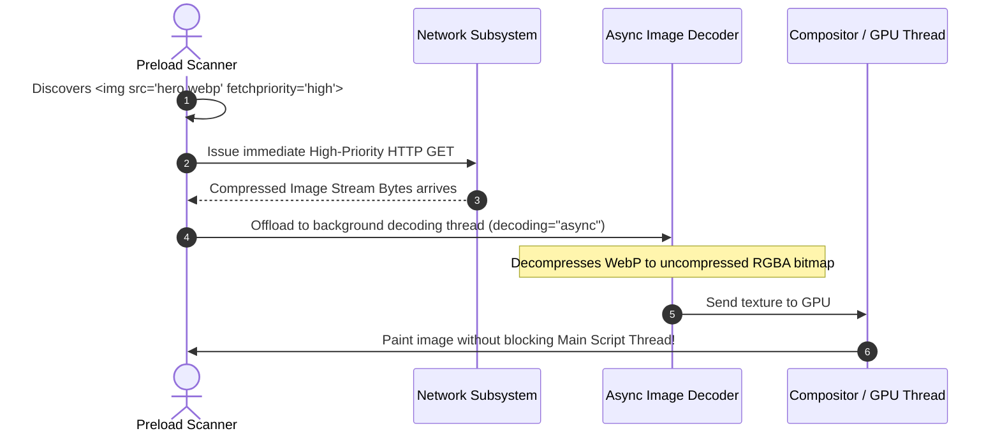

# Images, Intrinsic Sizing, and Alt Text Accessibility

| Metadata | Details |
| :--- | :--- |
| **Level** | Core / Fundamental |
| **Prerequisites** | `01-document-structure.md`, `03-text-content-and-typography.md` |
| **Estimated Reading Time** | 25 minutes |
| **Status** | Production-Ready |
| **Baseline Status** | Widely Available (`fetchpriority` Newly Available Oct 2024) |
| **Browsers Tested** | Chrome 120+, Firefox 120+, Safari 17+, Edge 120+ |
| **Tested With** | W3C Nu HTML Checker, Axe-core v4.8, NVDA 2023.3, Lighthouse 11 |

---

## Table of Contents
- [1 What & Why](#1-what--why)
- [2 Core Concepts](#2-core-concepts)
- [3 How It Works Internally](#3-how-it-works-internally)
- [4 Syntax & Usage](#4-syntax--usage)
- [5 Practical Examples](#5-practical-examples)
- [6 Best Practices](#6-best-practices)
- [7 Common Mistakes & Pitfalls](#7-common-mistakes--pitfalls)
- [8 Performance, Accessibility, SEO & Security Notes](#8-performance-accessibility-seo--security-notes)
- [9 Comparison / When to Use What](#9-comparison--when-to-use-what)
- [10 Interview Questions](#10-interview-questions)
- [11 Practice Exercises](#11-practice-exercises)
- [12 Summary / Cheat Sheet](#12-summary--cheat-sheet)
- [13 Further Reading](#13-further-reading)

---

## 1 What & Why

Visual imagery accounts for over 60% of the byte weight of average web pages. The `` element embeds graphical assets into an HTML document. While visually straightforward, the implementation of `` in enterprise production systems intersects with critical browser subsystems:
- **Layout and Rendering Performance**: Images loaded without dimensional metadata cause **Cumulative Layout Shift (CLS)**, jolting page content and degrading Google Core Web Vitals.
- **Resource Scheduling & Network Pipeline**: Modern attributes like `loading="lazy"`, `decoding="async"`, and `fetchpriority="high"` direct the browser's preload scanner and decoding engines on how to prioritize scarce network bandwidth and CPU cycles.
- **Universal Accessibility (AOM)**: Assistive technology users cannot perceive raw bitmap pixels. The `alt` attribute provides the textual equivalent that screen readers announce. Omitting an `alt` attribute forces screen readers to fall back to announcing raw, unreadable file paths (e.g., *"slash assets slash uploads slash photo-92847-v2 dot jpg"*), representing a catastrophic accessibility breakdown.

Understanding the `` element requires mastering the W3C Alt Text Decision Tree, intrinsic aspect ratio mechanics, and native performance hints.

---

## 2 Core Concepts

### The `` Element
The `` element is an empty (void) element. It accepts several core attributes:
- `src`: The address (URL) of the image resource.
- `alt`: The text alternative representing the image's information or function.
- `width` and `height`: The **intrinsic dimensions** of the image in CSS pixels (specified as unitless integers).
- `loading`: Instructs the browser whether to defer loading (`lazy`) or fetch immediately (`eager`).
- `decoding`: Hints whether decoding can occur asynchronously off the main UI thread (`async`), synchronously (`sync`), or at browser discretion (`auto`).
- `fetchpriority`: Hints relative network prioritization (`high`, `low`, `auto`).

### The Alt Text Decision Tree
Every `` element **must** include an `alt` attribute. However, the *value* of the `alt` attribute depends entirely on the image's role:
1. **Informative Image**: Conveys new information not present in the surrounding text. The `alt` text must succinctly convey the message of the image (e.g., `alt="Chart showing Q3 revenue growth of 24%"`).
2. **Decorative Image**: Purely visual styling, borders, or aesthetic background imagery. The `alt` attribute must be present but **empty** (`alt=""`). This informs screen readers to ignore the image entirely and exclude it from the accessibility tree.
3. **Functional Image**: An image inside an interactive element (`<a>` or `<button>`) serving as an icon or control. The `alt` text must describe the *action* of the control (e.g., `alt="Search"` or `alt="Close modal"`), not visual appearance (e.g., NOT `alt="Magnifying glass"`).
4. **Complex Image**: Graphs, detailed system diagrams, or schematics. The `alt` provides a brief identifier (e.g., `alt="Microservices cluster network diagram"`), while full details are provided in an adjacent `<figcaption>` or referenced via an accessible table.

### Intrinsic Dimensions and Cumulative Layout Shift (CLS)
Historically, developers omitted `width` and `height` attributes in HTML, preferring to control sizing purely via CSS (e.g., `img { width: 100%; height: auto; }`). 

In modern browser engines, providing unitless HTML attributes (`width="800" height="450"`) allows the engine to compute the **intrinsic aspect ratio** (`aspect-ratio: 800 / 450`) *before* the image binary file finishes downloading over the network. The browser reserves the exact vertical height in the document layout, completely eliminating layout jumps when the image finally arrives.

---

## 3 How It Works Internally

### Aspect Ratio Calculation and Layout Reservation
When the HTML parser tokenizes an `` tag with dimensional attributes:

```
HTML: 

Parsing & Style Computation:
1. Engine parses width=1200, height=600.
2. User-Agent stylesheet applies default rule:
   img[width][height] {
     aspect-ratio: attr(width) / attr(height);
   }
3. The layout engine computes: aspect-ratio = 1200 / 600 = 2.0 (2:1).
4. Layout pass: Viewport width is 600px.
   CSS width: 100% -> Computed width = 600px.
   Computed height = 600px / 2.0 = 300px.
5. Engine allocates a 600px x 300px placeholder box in the Block Formatting Context.
6. CLS = 0.0. The page text below does NOT shift down when the network response finishes.
```

### Preload Scanner and Network Priority Pipeline



1. **Preload Scanner Discovery**: The browser's lightweight background parser scans ahead through the HTML token stream. When it detects `fetchpriority="high"`, it elevates the resource in the HTTP/2 or HTTP/3 multiplexing stream above other assets.
2. **Asynchronous Decoding**: With `decoding="async"`, the browser decodes compressed byte arrays (JPEG, PNG, WebP, AVIF) on worker threads. Main-thread JavaScript execution and user scrolling remain completely smooth (60/120 FPS).

---

## 4 Syntax & Usage

```html
<!-- 1. Informative Image with Preload Priority and Zero-CLS Dimensions -->


<!-- 2. Purely Decorative Image (Explicit Empty Alt) -->


<!-- 3. Functional Image Inside an Action Button -->
<button type="button" aria-label="Export metrics to CSV">
  
  <span>Export</span>
</button>

<!-- 4. Native Lazy-Loaded Image with Responsive CSS -->

```

> [!NOTE]
> **Baseline Status: Widely Available**
> The `` element, `width`, `height`, `loading="lazy"`, and `decoding="async"` are supported across all modern web browsers.
> **`fetchpriority` Baseline Status**: **Newly Available** across all major engines (Chrome 101+, Safari 17.2+, Firefox 132+ since late 2024).

---

## 5 Practical Examples

### Example 1: Critical LCP Hero Image Implementation
```html
<!DOCTYPE html>
<html lang="en">
<head>
  <meta charset="UTF-8">
  <meta name="viewport" content="width=device-width, initial-scale=1.0">
  <title>LCP Optimized Hero</title>
  <style>
    /* Responsive image rule preserving intrinsic aspect ratio */
    .hero-img {
      width: 100%;
      height: auto;
      display: block;
    }
  </style>
</head>
<body>
  <header>
    <h1>Next-Generation Serverless Platforms</h1>
    <!-- Critical LCP Image: Eager loading, high priority, zero CLS dimensions -->
    
  </header>
</body>
</html>
```

### Example 2: Complex Infographic with `<figure>` and Accessible Description
```html
<figure aria-labelledby="architecture-caption">
  
  <figcaption id="architecture-caption">
    <strong>Figure 4: Event-Driven Processing Pipeline.</strong>
    Telemetry events are ingested via gRPC into the Ingress Gateway, published to the
    <code>telemetry.raw</code> Kafka topic, and consumed by the Deduplication,
    Anomaly Detection, and Long-Term Cold Storage worker pools.
  </figcaption>
</figure>
```

### Example 3: Edge Case — Interactive Functional Image Links
```html
<!-- Case A: Image is the SOLE content of the link -->
<!-- The alt text MUST provide the link's destination/purpose -->
<a href="https://github.com/org/repo" target="_blank" rel="noopener noreferrer">
  
</a>

<!-- Case B: Link contains BOTH an image and descriptive text -->
<!-- The image MUST have an empty alt="" to prevent duplicate announcements -->
<a href="/settings/security">
  
  <span>Security &amp; MFA Settings</span>
</a>
```

### Example 4: Failure Case — The Worst Image Implementation Anti-Patterns
```html
<!-- ANTI-PATTERN: DO NOT COPY -->

<!-- Error 1: Missing alt attribute entirely -->
<!-- Screen readers will read the entire URL string out loud! -->


<!-- Error 2: Redundant phrases in alt text -->


<!-- Error 3: Missing dimensions causing massive Cumulative Layout Shift -->


<!-- Error 4: lazy loading the primary Above-The-Fold / LCP hero image -->
 <!-- BAD: Delays LCP by 200-800ms! -->

<!-- Accessibility & Performance Audit Results:
1. Axe-core violation: [image-alt] Image elements must have an alt attribute.
2. Lighthouse Performance Alert: Largest Contentful Paint image was lazily loaded.
3. Lighthouse CLS: 0.384 (Failed threshold > 0.1).
-->
```

### Example 5: Production E-Commerce Product Card Pattern
```html
<!DOCTYPE html>
<html lang="en">
<head>
  <meta charset="UTF-8">
  <title>Product Card Component</title>
  <style>
    .card { max-width: 360px; border: 1px solid #e5e7eb; border-radius: 8px; overflow: hidden; }
    .card-img { width: 100%; height: auto; display: block; background: #f3f4f6; }
    .card-body { padding: 1.25rem; }
  </style>
</head>
<body>
  <article class="card">
    
    <div class="card-body">
      <h2>NVIDIA H100 PCIe Accelerator</h2>
      <p>80GB HBM3 memory bandwidth delivering 3.35 TB/s throughput for LLM inference workloads.</p>
      <button type="button">Request Quote</button>
    </div>
  </article>
</body>
</html>
```

---

## 6 Best Practices

1. **Always Include the `alt` Attribute**: Every single `` tag must have `alt`. If the image is decorative, use `alt=""`. Never omit the attribute.
2. **Declare Explicit Unitless `width` and `height`**: Always specify the intrinsic pixel dimensions in HTML attributes. Pair this with CSS `height: auto; max-width: 100%;` to maintain responsiveness while preserving aspect ratio.
3. **Never Lazy-Load Above-The-Fold Images**: Never place `loading="lazy"` on hero images or headers visible in the initial viewport. Lazy-loading above-the-fold assets significantly degrades Largest Contentful Paint (LCP).
4. **Mark LCP Images with `fetchpriority="high"`**: Give the browser preload scanner an immediate directive to fetch your primary visual asset ahead of non-critical stylesheets or deferred scripts.
5. **Avoid Redundant Words in `alt`**: Never write *"Image of..."*, *"Photo of..."*, or *"Graphic showing..."*. Screen readers already prefix image announcements with the word "Graphic" or "Image".
6. **Use `decoding="async"` Globally**: Offload image decompression work from the browser's main thread to background threads to prevent scroll stuttering and UI frame drops.

---

## 7 Common Mistakes & Pitfalls

| Mistake | Bad Code | Good Code | Technical Explanation |
| :--- | :--- | :--- | :--- |
| **Omitting `alt` Attribute** | `` | `` | Screen readers announce the full file URL string, disorienting visually impaired users (violates WCAG 1.1.1). |
| **Missing Dimensions (CLS)** | `` | `` | Browser cannot compute aspect ratio prior to download, causing layout reflow and high CLS score. |
| **Lazy Loading Hero Image** | `` | `` | `loading="lazy"` halts the download until layout computation completes, severely penalizing LCP. |
| **Redundant Alt Text** | `alt="Photo of Jane Doe"` | `alt="Jane Doe, VP of Engineering"` | Assistive tech announces "Graphic, Photo of Jane Doe", repeating redundant words. |
| **Duplicate Label in Links** | `<a href="/"> Home</a>` | `<a href="/"> Home</a>` | Screen reader announces "Home, Link, Home, Image", speaking the word "Home" twice. |
| **Using Alt as Tooltip** | `` | Use `title` for tooltip or visible `<figcaption>` | `alt` is an accessibility fallback, not an interactive mouse tooltip. |

---

## 8 Performance, Accessibility, SEO & Security Notes

### Accessibility (WCAG 2.2 AA)
- **Criterion 1.1.1 (Non-text Content - Level A)**: All non-text content that is presented to the user has a text alternative that serves the equivalent purpose.
- Screen reader behavior:
  - `alt="Search"` $\to$ NVDA announces: *"Graphic, Search"*.
  - `alt=""` $\to$ NVDA completely skips the image as if it does not exist in the DOM.
  - No `alt` present $\to$ NVDA announces: *"Graphic, https://domain.com/assets/img2026.png"*.

### Search Engine Optimization (SEO)
- Search engines cannot "watch" raster image pixels to deduce context; they rely heavily on the `alt` attribute, the surrounding `<figcaption>`, and the image filename.
- Descriptive `alt` text powers Google Image Search indexing, driving qualified organic traffic to technical documentation and e-commerce listings.

### Performance & Core Web Vitals
- **Cumulative Layout Shift (CLS)**: Target $< 0.1$. Supplying `width` and `height` attributes enables the browser to allocate exact dimensional boxes via the CSS aspect-ratio mapping algorithm, guaranteeing a CLS score of 0.0 for media assets.
- **Largest Contentful Paint (LCP)**: Target $< 2.5\text{s}$. Using `fetchpriority="high"` on the main hero banner triggers immediate multiplexed streaming over HTTP/2, trimming hundreds of milliseconds off paint timings.

### Security Notes
- **SVG Injection Risks**: Embedded SVGs via `` are isolated in a sandboxed image context where scripts cannot execute. However, inlining raw `<svg>` into HTML allows embedded `<script>` tags to execute XSS payloads. When displaying user-uploaded vector graphics, always serve them through `` tags or sanitize the SVG DOM.

---

## 9 Comparison / When to Use What

| Technique / Approach | Screen Reader Exposure | Core Web Vitals Impact | Best Used For |
| :--- | :--- | :--- | :--- |
| `` with descriptive `alt` | Announced as Graphic + Text | High impact if missing width/height | Informative editorial content, charts, photos. |
| `` with `alt=""` | Completely ignored (hidden) | Low overhead | Purely decorative background accents, flourishes. |
| CSS `background-image` | Completely ignored (hidden) | No CLS if container sized | Pure styling, repeating background patterns. |
| `<figure>` + `<figcaption>` | Grouped with caption label | Clean structural grouping | Complex diagrams, code listings, exhibits. |
| Inline `<svg>` | Exposes internal text nodes | Zero network request | Dynamic interactive icons, theme-aware graphics. |

---

## 10 Interview Questions

<details>
<summary><strong>1. Why is specifying unitless `width` and `height` attributes on &lt;img&gt; elements critical for preventing Cumulative Layout Shift (CLS)?</strong></summary>

**Answer:**
Historically, responsive web design encouraged omitting HTML image dimensions to prevent fixed-pixel images from overflowing fluid CSS containers. However, this forced the browser layout engine to treat image dimensions as `0x0` pixels until the image file header was downloaded over the network. When the binary file finally arrived and its dimensions were decoded, the engine triggered an asynchronous reflow, pushing all content below the image downward.

Modern browsers resolve this via an internal User-Agent stylesheet rule:
```css
img[width][height] {
  aspect-ratio: attr(width) / attr(height);
}
```
When `width="1600" height="900"` is provided in HTML, the browser computes the intrinsic aspect ratio (16:9) immediately during the initial HTML parsing pass. Combined with CSS rules like `width: 100%; height: auto;`, the browser calculates the precise vertical height required and reserves that space before any image bytes are received, resulting in a CLS of 0.
</details>

<details>
<summary><strong>2. What is the difference in accessibility tree representation between an &lt;img&gt; with `alt=""` and an &lt;img&gt; that lacks the `alt` attribute entirely?</strong></summary>

**Answer:**
- **With `alt=""` (Empty Alt)**: The author explicitly signals that the image is purely decorative. The browser engine assigns the element `role="presentation"` or `role="none"` in the Accessibility Object Model (AOM), completely removing the image from the screen reader's virtual cursor tree. Sighted users see the image, while screen readers skip it silently.
- **Without `alt` (Omitted Attribute)**: The browser engine cannot determine authorial intent. To ensure blind users do not miss potentially critical information, assistive software falls back to announcing the image's source URL or file name (e.g., *"Graphic, slash static slash assets slash banner-v2-final dot png"*). This is extremely jarring, creates audio noise, and fails WCAG 1.1.1.
</details>

<details>
<summary><strong>3. Why should `loading="lazy"` never be applied to the primary Largest Contentful Paint (LCP) element?</strong></summary>

**Answer:**
The `loading="lazy"` attribute instructs the browser to defer fetching the image until the layout engine calculates that the element is within a certain distance threshold of the current viewport scroll boundary.

For an above-the-fold hero image that constitutes the LCP element:
1. The browser's **Preload Scanner** discovers the `` tag in the raw HTML stream.
2. Because `loading="lazy"` is present, the preload scanner skips immediate fetching.
3. The browser must wait for the entire HTML to be parsed, the CSSOM to be constructed, the render tree to be built, and the initial layout pass to complete before it confirms that the image is inside the viewport.
4. Only then does the network request begin.
This introduces an unnecessary waterfall delay of 200–800ms, severely degrading the LCP metric. LCP images should always use `loading="eager"` (or omit `loading`) and include `fetchpriority="high"`.
</details>

<details>
<summary><strong>4. How does `decoding="async"` work, and what problem does it solve on low-powered mobile devices?</strong></summary>

**Answer:**
Image files (JPEG, PNG, WebP, AVIF) are compressed data formats. Before an image can be painted to the screen, the compressed binary stream must be decompressed into an uncompressed RGBA pixel bitmap in memory.

By default (`decoding="sync"` or `auto`), image decoding often occurs on the browser's **main execution thread**. If a user is scrolling through a page with multiple large images, the main thread can get blocked by heavy decoding operations, dropping frame rates and causing UI stutter (jank).

Setting `decoding="async"` gives the browser permission to decode the image asynchronously on a background worker thread. Once the bitmap is ready, it is handed directly to the GPU compositor thread, keeping the main thread responsive for user interactions.
</details>

<details>
<summary><strong>5. How should an &lt;img&gt; inside an &lt;a&gt; element be marked up when the link also contains descriptive text?</strong></summary>

**Answer:**
When a link contains both an icon image and text:
```html
<a href="/profile">
  
  <span>User Profile</span>
</a>
```
The image **must have an empty `alt=""`**. 
If the image had `alt="User Icon"`, the screen reader would announce: *"Link, Graphic: User Icon, User Profile"*, speaking the same concept twice. Giving the image `alt=""` hides the decorative icon from the screen reader, allowing it to announce only the clean text label *"Link, User Profile"*.
</details>

<details>
<summary><strong>6. When should you use `alt` text versus a &lt;figcaption&gt;?</strong></summary>

**Answer:**
- **`alt` text**: An accessibility fallback that is only rendered when the image fails to load or when read by assistive software. It is invisible to sighted users in normal browsing.
- **`<figcaption>`**: A visible editorial caption displayed to all users (both sighted and assistive tech users) that provides additional context, data interpretation, source attribution, or analysis.
For complex diagrams, the best pattern combines both: a concise `alt` describing the visual summary, and a detailed `<figcaption>` providing the full analytical explanation.
</details>

<details>
<summary><strong>7. What is the difference between `fetchpriority="high"` and `<link rel="preload">`?</strong></summary>

**Answer:**
- `<link rel="preload" as="image" href="...">` is placed in the `<head>` to force the browser to initiate a network fetch immediately, even before the parser has discovered the corresponding `` tag in the `<body>`.
- `fetchpriority="high"` is an attribute applied directly to the `` element in the `<body>` (or on a `<link>` preload tag) that instructs the browser's priority queuing algorithm to assign this request the highest priority slot in the network multiplexing queue relative to other assets.
</details>

<details>
<summary><strong>8. Why should you avoid embedding sensitive user text directly inside raster image bitmaps?</strong></summary>

**Answer:**
Embedding text directly into bitmap pixels (e.g., creating an infographic where all text is baked into a PNG) creates significant drawbacks:
1. **Accessibility**: Text inside images cannot be resized by user font-size preferences, cannot be translated by automated browser translation tools, and cannot be read by screen readers unless painstakingly transcribed into `alt` text.
2. **Responsiveness**: Raster text pixelates or becomes illegible on high-DPI (Retina) screens or mobile displays.
3. **Copy/Paste**: Users cannot highlight, select, or copy text for use in documentation or tickets.
Text should always be marked up using real HTML typography (`<h1>`–`<h6>`, `<p>`) layered over background graphics with CSS.
</details>

---

## 11 Practice Exercises

### Exercise 1 (Easy): Identify Decorative vs Informative Images
**Task**: Mark up two images: (1) an abstract geometric background squiggle next to a headline, and (2) a company organizational hierarchy chart. Provide the correct `alt` attributes.

<details>
<summary><strong>Solution</strong></summary>

```html
<!-- 1. Purely Decorative Image -->


<!-- 2. Informative Image -->

```
</details>

### Exercise 2 (Easy): Calculate Aspect Ratio for Zero CLS
**Task**: You have an image with native dimensions 2560x1440 pixels. Write the complete HTML `` tag ensuring that on mobile viewports it scales responsively while completely preventing Cumulative Layout Shift.

<details>
<summary><strong>Solution</strong></summary>

```html

```
*Explanation*: The unitless `width="2560"` and `height="1440"` establish the 16:9 ratio in the browser engine, while CSS `width: 100%; height: auto;` handles dynamic fluid downscaling.
</details>

### Exercise 3 (Medium): Accessible Icon Button with Image
**Task**: Build an accessible icon-only button that allows users to close a floating drawer. Use an inline `` for the "X" icon.

<details>
<summary><strong>Solution</strong></summary>

```html
<button type="button" class="drawer-close-btn" aria-label="Close navigation drawer">
  
</button>
```
*Explanation*: The accessible name is placed on the interactive container (`<button aria-label="...">`), while the image inside is hidden from the accessibility tree via `alt=""` and `aria-hidden="true"`.
</details>

### Exercise 4 (Medium): High-Performance Hero Banner
**Task**: Construct the HTML markup for an above-the-fold hero image for a tech blog. Apply all modern performance optimizations for Largest Contentful Paint.

<details>
<summary><strong>Solution</strong></summary>

```html
<header class="post-hero">
  <h1>Distributed Tracing at Petabyte Scale</h1>
  
</header>
```
*Explanation*: Notice the omission of `loading="lazy"`, the inclusion of `fetchpriority="high"`, explicit dimensions for zero CLS, and `decoding="async"` for non-blocking UI rendering.
</details>

### Exercise 5 (Hard): Refactor Image Accessibility and Performance Anti-Patterns
**Task**: Review this poorly authored production markup and rewrite it to meet WCAG 2.2 AA and Core Web Vitals standards.

```html
<!-- Dirty Source -->
<div class="user-profile">
  <a href="/profile/shiva">
    
    <span>Shiva Ram</span>
  </a>
  
  
</div>
```

<details>
<summary><strong>Solution</strong></summary>

```html
<div class="user-profile">
  <!-- Fix 1: Decorative avatar next to visible name -> alt="" -->
  <a href="/profile/shiva">
    
    <span>Shiva Ram</span>
  </a>

  <!-- Fix 2: Missing alt and dimensions added -->
  <aside aria-label="Promotional Announcement">
    
  </aside>

  <!-- Fix 3: Hero image removes lazy loading, adds fetchpriority and dimensions -->
  <div class="hero-container">
    
  </div>
</div>
```
</details>

### Exercise 6 (Hard): Accessible Data Chart with Fallback Table
**Task**: Build a complete accessible component for a complex line chart showing server memory usage over 4 hours. Provide both the chart image and an accessible tabular fallback for assistive technologies.

<details>
<summary><strong>Solution</strong></summary>

```html
<figure class="chart-container" aria-labelledby="chart-title">
  <figcaption id="chart-title">
    <h3>Memory Allocation Over Past 4 Hours</h3>
  </figcaption>

  <!-- Chart Image with summary alt -->
  

  <!-- Accessible Table presenting the raw data points -->
  <details>
    <summary>View detailed data table for Memory Allocation</summary>
    <table>
      <thead>
        <tr>
          <th scope="col">Timestamp</th>
          <th scope="col">RAM Utilized (%)</th>
          <th scope="col">Total Allocated (GB)</th>
        </tr>
      </thead>
      <tbody>
        <tr><td>12:00</td><td>42%</td><td>26.8 GB</td></tr>
        <tr><td>13:00</td><td>55%</td><td>35.2 GB</td></tr>
        <tr><td>14:00</td><td>78%</td><td>49.9 GB</td></tr>
        <tr><td>15:00</td><td>89%</td><td>56.9 GB</td></tr>
        <tr><td>16:00</td><td>65%</td><td>41.6 GB</td></tr>
      </tbody>
    </table>
  </details>
</figure>
```
</details>

---

## 12 Summary / Cheat Sheet

```
┌────────────────────────────────────────────────────────────────────────┐
│                        IMAGE ACCESSIBILITY & PERFORMANCE               │
├───────────────────┬────────────────────────────────────────────────────┤
│ Pattern           │ Implementation Rule                                │
├───────────────────┼────────────────────────────────────────────────────┤
│ Informative       │ alt="Concise description of message/data"          │
│ Decorative        │ alt="" (Empty string - completely hides from AOM)  │
│ Functional        │ alt="Action of the button/link" (NOT the visual)   │
│ Zero-CLS Sizing   │ width="X" height="Y" (unitless HTML attributes)    │
│ Above-the-fold    │ fetchpriority="high" (NO loading="lazy")           │
│ Below-the-fold    │ loading="lazy" decoding="async"                    │
│ Asynchronous Paint│ decoding="async" (Offloads main thread decoding)   │
└───────────────────┴────────────────────────────────────────────────────┘
```

---

## 13 Further Reading

- [W3C WAI: Alt Text Decision Tree](https://www.w3.org/WAI/tutorials/images/decision-tree/)
- [WHATWG HTML Living Standard: Section 4.8.4 The &lt;img&gt; Element](https://html.spec.whatwg.org/multipage/embedded-content.html#the-img-element)
- [web.dev: Setting Height and Width on Images is Important Again](https://web.dev/articles/optimize-cls#images-without-dimensions)
- [web.dev: Optimizing Largest Contentful Paint with fetchpriority](https://web.dev/articles/fetch-priority)
- [MDN Web Docs: &lt;img&gt; Element](https://developer.mozilla.org/en-US/docs/Web/HTML/Element/img)

---

| [Previous: 05 Links & URLs](05-links-and-urls.md) | [Section Index](README.md) | [Next: 07 Character Encoding & Entities](07-character-encoding-and-entities.md) |
